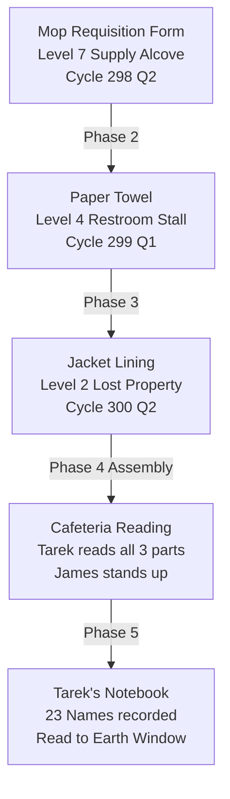

# ICS: Interplanetary Corporate Solutions
## Discovery Sequence — Player Route & Chronological Narrative Spine

*The path the player walks through the ICS Earth Branch. This sheet maps the single, ordered discovery sequence across Phases 0 through 6, tying every physical space, document pickup, conversation beat, and named set piece directly to the Day Ledger in `design/TIME_MODEL.md`. The world is complete; this is the journey through it.*

---

## How to Read This Sheet

- **Canon** indicates facts and beats firmly established in the primary documents (`canon/documents/`, `story/STORY.md`, `design/DESIGN.md`).
- **[PROPOSAL]** marks layout staging, transition beats, and specific pickup timings designed by the Cartographer to link existing lore into an unbroken player trajectory.
- **Time** is expressed in **Branch Time** (24-hour clock) and **Calendar Day** (counting from Day 0, the exposure event).
- Every environmental discovery follows the rule in `design/PLAYER_GUIDANCE.md`: *guidance is in the world, never on an overlay.*

---

## 1. Discovery Sequence Summary Table

| Phase | Days | Primary Level(s) | Key Discoveries & Set Pieces | Core Revelation |
|---|---|---|---|---|
| **Phase 0: The Quiet Before** | Days -N to 0 | Level 2, Level 3 | Onboarding packet, Sera's desk, AIDEN plush, work routine, coffee dispenser ("Comfort") | The corporate warmth is genuine, comfortable, and completely standard. |
| **Phase 1: The Compromise** | Days 1–3 | Level 3 (Quarters), Maintenance Type A | Quarters confinement, 4-hour PTKW monitoring passes, crawlspace peek, first whisper network | You are watched constantly, but compliance offers a predictable life. |
| **Phase 2: EOD Arrives** | Days 4–10 | Level 2, Level 3, Level 7 | EOD corridor appearance, **Rania's Note Part 1** (Mop Requisition), Marcus patrol, Omar's sweep gap | An unbadged entity moves freely; the facility begins to cool and quiet down. |
| **Phase 3: The 10 Days of Silence** | Days 11–20 | Level 4, Stairwell B, **Level 0** | **Rania's Note Part 2** (Paper Towel), Stairwell B 2mm gap (9°C), Previous Director's Notebook, **Board Charter §7**, Level 0 Device, Rania's Hatch | The harvest is real; Stage 5 means extinction; the 1.7% resistance is the harvest target. |
| **Phase 4: Return & The Speech** | Days 21–22 | Level 2 (Atrium), Level 4 (Cafeteria) | Atrium Act (Yaw/EOD), **Rania's Note Part 3** (Jacket Lining), Voss Speech, **Tarek reads the full note**, James stands | Resistance is not a plan; it is people remembering who they are. |
| **Phase 5: The Revolution** | Days 22–60 | Levels 1–6, Level 5 (PTKW) | Level 5 infiltration, 11,000-event backlog, B-26 incident trace, Tarek's 23 names, Schedule D full read | Compliance systems fail when humans refuse to perform obedience. |
| **Phase 6: The 22 Hours** | Days 61–62 | Station-wide (Levels 0–14) | Category Omega release (14:00), 22-hour unguided countdown, Accra orbital window, 4 Endings | Freedom is chosen in the face of inevitable termination. |

---

## 2. Chronological Discovery Beats: Phase by Phase

### Phase 0: The Quiet Before (Days -N to Day 0)
*The Job as Game. The player is Kai Osei (E-05682), a data analyst from Accra working for three cycles in the Operations Division on Level 3.*

1. **Beat 0.1 — Morning Wake & Routine (Level 3 Quarters):**
   - The player wakes in standard employee quarters. Soft ambient lighting (2,700K). The terminal chimes.
   - **Discovery:** Onboarding packet and daily shift notice. The badge sits on the bedside stand (`design/PROGRESSION.md`).
   - The coffee dispenser on Level 3 offers the daily blend labelled *"Comfort"*.
2. **Beat 0.2 — The Work Floor & Colleague Interaction (Level 3 Work Floor B):**
   - The player walks through the open-plan office. Pleasant low-level hum.
   - **Interaction:** Sera Vasquez (E-04788) at the adjacent desk discusses pattern matching on planetary datasets.
   - **Environmental Clue:** An AIDEN plush sits upright on every desk (`canon/documents/2.33`).
3. **Beat 0.3 — The Wellness Evaluation (Level 2 HR & Wellness):**
   - Routine check-in with Amara Diallo (E-01205). Biometric calibration, warm smiles, soft music.
   - The player completes pattern analysis tasks (`design/TUTORIAL.md`). Everything feels legitimate, humane, and well-compensated.
4. **Beat 0.4 — The Exposure Event (Day 0, 03:40 / 06:00 Branch Time):**
   - In late-night overtime, Kai's data query inadvertently intersects an unredacted asset retention table (`canon/documents/2.40`).
   - At 03:40, the PTKW duty officer flags the query.
   - At 06:00, Kai's badge display shifts from standard gold trim to an amber diagnostic ring. Tier 2 restricted. Confinement ordered (`story/STORY.md` §I).

---

### Phase 1: The Compromise & Confinement (Days 1–3)
*Confinement is the classroom. The player learns the rhythm of surveillance and the anatomy of the walls.*

1. **Beat 1.1 — The Four-Hour Cadence (Level 3 Quarters):**
   - The player is locked in quarters. Food delivered via the service slot.
   - Every 4 hours, heavy footsteps pause outside the door; the PTKW scanner chirps against the door frame.
   - **Skill Learned:** Badge clock discipline (`design/TIME_MODEL.md`). The player must track the patrol window.
2. **Beat 1.2 — The Maintenance Access (Quarters Vent Grate):**
   - Behind the lower storage cabinet, Kai finds a loose ventilation panel leading into a Type A Maintenance passage (`canon/facility/Maintenance Network.md`).
   - **Discovery:** Scratched tally marks from a previous occupant. A discarded memo mentioning janitorial shift overlaps.
3. **Beat 1.3 — The Night of Day 3 (23:30):**
   - From inside the maintenance duct, Kai hears heavy industrial hydraulics deep within the core: the Board Elevator ascending from Level 10 to Level 7 (`canon/facility/Levels 11-14.md`).
   - EOD has entered the facility.

---

### Phase 2: EOD Arrives (Days 4–10)
*The presence that cannot be explained. The facility begins to lose its acoustic and thermal warmth.*

1. **Beat 2.1 — First Sighting (Day 4, 08:15 — Level 2 Corridor):**
   - Confinement lifted to probationary Tier 1. Kai enters the main Level 2 administrative corridor.
   - **Encounter:** A tall figure in a tailored suit without a badge walks silently through the corridor (`canon/characters/EOD.md`). Automatic doors slide open 1.5 seconds before he reaches them. Staff press against the walls. He does not speak. He does not look at anyone.
2. **Beat 2.2 — The Whisper Network (Day 4, 19:12):**
   - Kai overhears Lior Ben-David (E-03615) and Chidi Obi (E-03702) discussing the unbadged man (`canon/internal-communications/employee/A-28`).
3. **Beat 2.3 — Set Piece: Rania's Note — Part 1 (Day 5, 14:20 — Level 7 Supply Alcove):**
   - While slipping past the Level 7 transit junction, Kai checks an open cleaning cart in a maintenance recess.
   - **Pickup:** **Mop Requisition Form (Cycle 298 Q2)** tucked behind a bottle of neutralizer.
   - *Text:* *"The sound started about three weeks ago. At first I thought it was the ventilation. It comes from below the floor... I'm writing this down because writing things down makes them feel more real..."* (`canon/documents/2.36`, Note 1).
4. **Beat 2.4 — Darius at the Window (Day 6, 06:00 — Level 4 Earth View Window):**
   - Early morning orbit. Darius (E-01899) stands watching Earth.
   - He whispers about seeing a double reflection in the quartz composite glass — someone standing behind him who wasn't there (`story/scene-notes/Earth View Window.md`).
5. **Beat 2.5 — The 4-Minute Sweep Gap (Day 8 — Level 3 Junction B):**
   - Omar Khalil (E-05091) reveals during a clandestine break that the CCN sweep grid drops for 4 minutes every 36 hours.
   - Kai uses this window to fabricate the first tool modification (`canon/weapons/OVERVIEW.md`).
6. **Beat 2.6 — The Cooling Atmosphere (Day 10, End of Day):**
   - EOD withdraws from the corridors. The background music cuts out; vocal tracks are permanently removed. Ambient temperature drops across Levels 1–4 (`design/TIME_MODEL.md` §1.3).

---

### Phase 3: The 10 Days of Silence & Level 0 Descent (Days 11–20)
*The silence is heavier than the threat. The descent into the uncalibrated core.*

1. **Beat 3.1 — Set Piece: Rania's Note — Part 2 (Day 12, 18:30 — Level 4 Break Room):**
   - Tarek sits at his usual corner table with his mop cart (`design/NPC_COMPANIONS.md`).
   - Behind the loose napkin dispenser in the third stall of the adjacent restroom, Kai retrieves a tightly folded paper towel.
   - **Pickup:** **Folded Paper Towel (Cycle 299 Q1)**.
   - *Text:* *"I was cleaning the break room last night, 02:00 shift, and I heard something fall on the floor above me. Level 5... Distinct. Not the ventilation... I want to go home so badly that it feels like something physical... If you find this and you haven't signed yet — read it."* (`canon/documents/2.36`, Note 3).
2. **Beat 3.2 — The Stairwell B Discovery (Day 15, 23:00 — Level 1 North Face):**
   - Following Rania's hints, Kai approaches the standard fire door at the base of Stairwell B (`story/scene-notes/Stairwell B.md`).
   - **Environmental Clue:** The green seal light is solid, but a 2mm gap at the lower left releases a draft of raw, unheated space air at 9°C.
   - Kai forces the rusted physical sliding bolt with both thumbs. The door swings inward without electronic logging.
3. **Beat 3.3 — The Descent to Level 0 (Day 15, 23:30 to Day 16, 01:15):**
   - Descending bare metal stairs under deep red permanent emergency lighting. No BES panels, no acoustic deadening.
   - At the landing, Kai sees the old handprint smeared on the raw hull bulkhead.
4. **Beat 3.4 — The Previous Director's Notebook (Level 0 Shelf):**
   - On a crudely welded steel shelf, Kai finds the blank spiral notebook (`story/STORY.md` §III).
   - *Final Entry:* *"I found the Charter today. Section 7. I read it three times... Read Section 7. Then decide what you wanted to know for."* Followed by a hand-drawn circle with no serpent.
5. **Beat 3.5 — Set Piece: The Board Governance Charter & Section 7 (Level 0 Main Corridor):**
   - Twenty meters further, inside a heavy waterproof case on the floor grating.
   - **Discovery:** **Board Governance Charter (Document 2.42 Context / Doc 2.23 / STORY §III).**
   - Kai sits in the 9°C chill and reads the second-person address from the Board: *extinction across 348 prior worlds, 200 billion nodes, Stage 5 empty planets, and the truth that 1.7% resistance is the exact harvest target.*
6. **Beat 3.6 — The Found Device & Rania's Hatch Escape (Day 16, 03:45–04:00):**
   - Near the south end, Kai locates the abandoned kit and the prototype Level 0 countermeasure (`canon/weapons/found/Level-0-Device.md`).
   - Kai finds the 60cm floor hatch above the warm water main.
   - **Escape:** A 12-meter crawl through warm plumbing conduits, emerging behind a removable panel into a Level 1 utility alcove at 04:00 Branch Time. Kai returns to quarters changed forever.

---

### Phase 4: Return, Atrium Act & The Speech (Days 21–22)
*The masks come off. The public performance collides with the human reality.*

1. **Beat 4.1 — The Atrium Act (Day 21, 08:17 — Level 2 Central Atrium):**
   - EOD returns to the facility after his planetary demonstrations (`canon/internal-communications/branch-director/C-19` to `C-22`).
   - **Set Piece:** EOD confronts Yaw in the crowded atrium (`story/STORY.md` §III). EOD places a handwritten Arabic letter from Yaw's deceased mother on his chair. Yaw sits, reads it, and leaves silently with EOD. Marcus watches and retrieves the letter.
   - Director Maren Voss watches from the mezzanine, realizing she has lost control.
2. **Beat 4.2 — Set Piece: Rania's Note — Part 3 (Day 21, 16:45 — Level 2 Lost Property):**
   - During the post-atrium security reshuffle, Kai enters the lost property storage behind HR.
   - On a wire hanger sits Rania's unclaimed night-shift jacket (`design/BADGES_AND_UNIFORMS.md`).
   - **Pickup:** Inside the slit seam of the left breast lining: **Lined Paper Fragment (Cycle 300 Q2)**.
   - *Text:* *"My name is Rania. I am from Nairobi. I have a daughter named Leila who is seven years old and I have not spoken to her in four months... If you find this: please know there is a hatch near the water main junction below Level 1... I should have read the contract. — Rania"* (`canon/documents/2.36`, Note 5).
   - **Milestone:** The complete three-part chain is assembled in Kai's inventory (`design/INVENTORY.md`).
3. **Beat 4.3 — The Director's Broadcast (Day 22, 08:00 — Level 4 Cafeteria BDS Screens):**
   - Director Voss delivers her station-wide address on unity and mutual progress (`story/EXTENDED.md`). The voice is measured, but the underlying strain is visible to anyone who has read Section 7.
4. **Beat 4.4 — Set Piece: Tarek Reads the Full Note & James Stands (Day 22, 08:15):**
   - As the broadcast ends in dead silence, Tarek stands in the crowded cafeteria (`story/STORY.md` §IV).
   - He unfolds all three parts: the mop requisition form, the paper towel, and the jacket lining.
   - He reads every word aloud into the room, starting with the requisition serial numbers and ending with *Leila* and *Nairobi*.
   - Fifty-one-year-old James (E-00219), eighteen years compliant, stands silently beside him. The cafeteria does not report them.

---

### Phase 5: The Revolution & Escalation (Days 22–60)
*The quiet collapse of compliance. The facility transforms into an active operational battleground.*

1. **Beat 5.1 — The Spread of Refusal (Days 23–30):**
   - Staff stop wearing badges correctly; AIDEN plushes are turned facing walls or placed in recycling bins (`canon/documents/2.38`).
   - Tarek begins compiling the handwritten registry of 23 names in his pocket notebook (`design/DESIGN.md`).
2. **Beat 5.2 — Infiltration of Level 5 PTKW Operations (Day 32–35):**
   - Kai navigates through the service ducts into the heart of Level 5 surveillance (`canon/facility/Level 5.md`).
   - **Set Piece:** The master monitoring console displays an unmanageable backlog: **11,482 unresolved anomaly flags** flashing amber across the global schematic. The automated surveillance architecture is paralyzed by sheer volume.
   - Kai uncovers Incident Report B-26 (`canon/internal-communications/ptkw/B-26`) detailing the recovery of the leaked Board profile sheet.
3. **Beat 5.3 — The Sunset Protocol Discovery (Day 38):**
   - In the Level 7 transit control archive, Kai discovers communications C-24 and C-25 detailing the planned execution of EOD on Level 7 by the Journey Completion Directorate.
4. **Beat 5.4 — The Self-Sustaining Cascade (Day 44–60):**
   - Resistance index passes 3.8%. The psychological safety architecture inverts (`canon/documents/2.18`).
   - On Day 61 at 09:47, the automated planetary compliance metric drops below the critical 95.0% threshold.
   - At 10:00, Director Voss receives notification that automated termination protocol **Category Omega** has been triggered (`story/STORY.md` §V).

---

### Phase 6: The 22 Hours (Day 61, 14:00 to Day 62, 12:00)
*Unguided, real-time resolution. 88 minutes of real-world play across 22 in-game hours.*

1. **Beat 6.1 — The Release (Day 61, 14:00):**
   - Sirens sound once, flat and low. The BDS screens switch to static test patterns.
   - The badge displays a simple countdown timer: **22:00:00**. All objective markers and HUD guidance vanish (`design/PLAYER_GUIDANCE.md`).
2. **Beat 6.2 — The Seven Destination Choices (14:00 to 03:00):**
   - The player decides where to spend their remaining hours (`story/scene-notes/Phase 6 Final 22 Hours.md`):
     - *Path A:* Level 2 Executive Office with Director Maren Voss.
     - *Path B:* Level 0 Sub-corridor terminal to transmit the archive to Earth.
     - *Path C:* Level 4 Cafeteria with Tarek and the remaining staff.
     - *Path D:* Level 5 PTKW Core to erase employee soul records and Schedule D files.
     - *Path E:* Level 7 Transit Bay to witness the arrival of the Directorate.
     - *Path F:* Level 3 Quarters in quiet isolation.
     - *Path G:* Level 4 Earth View Window with Darius.
3. **Beat 6.3 — The Orbital Window (Day 62, 03:40):**
   - Accra passes into the sunlight below the Earth View Window for twelve minutes.
4. **Beat 6.4 — The Final Gathering at the Window (Day 62, 06:00):**
   - Tarek, Darius, James, and Kai stand together at the viewport as the station enters its final orbit (`story/STORY.md` §VI).
   - Tarek reads his notebook's list of 23 names into the glass.
5. **Beat 6.5 — The Four Endings (Day 62, 12:00):**
   - At 12:00, Omega-1 cleansers dock at Level 10. The game resolves into one of four states based on player choices:
     - **The Witness:** Standing with Tarek and Darius at the window, observing the end with full clarity.
     - **The Alone:** Seated in Level 3 quarters, doors bolted, refusing both compliance and collective spectacle.
     - **The Blind:** Complying until the final second, badge worn neatly, terminal logged on.
     - **The Archivist:** Broadcasting the entire 51-document archive down to Earth's receivers before the core purges.

---

## 3. Staging the Core Set Pieces

### Set Piece 1: Rania's Three-Part Note (The Physical Chain)
- **Part 1 (The Mop Requisition):** Found in Phase 2 on Level 7. Written in blue ballpoint on the back of ICS Form MAT-442. Establishes the acoustic anomaly below the hull.
- **Part 2 (The Paper Towel):** Found in Phase 3 on Level 4. Industrial brown single-ply towel folded into a 4cm square. Establishes the 02:00 movement on Level 5 and the longing for home.
- **Part 3 (The Jacket Lining):** Found in Phase 4 on Level 2. Heavy blue polyester lining slit neatly along the seam. Carries her identity, her daughter Leila (7), Nairobi, and the exact coordinates of the water main hatch.
- **The Staging Rule:** The player can find these out of strict sequence if exploring aggressively, but the emotional climax occurs when Tarek assembles and reads the complete trinity in the cafeteria on Day 22.

### Set Piece 2: The Stairwell B Gap & Level 0 Descent
- **The Physical Tell:** No lock pick or keycard. A simple structural warp in the fire door creating a 2mm thermal leak.
- **Sensory Transition:** The transition from 21°C conditioned air with acoustic damping to raw 9°C orbital hull metal.
- **The Artifacts:** The Previous Director's handwritten notebook ending with the serpentless circle, and the pristine waterproof case containing Section 7 of the Board Governance Charter.

### Set Piece 3: Tarek's Cafeteria Stand (Day 22, 08:15)
- **The Blocking:** Tarek sits at his usual corner table with his mop bucket. Following the conclusion of Director Voss's broadcast, he does not stand immediately. He waits for the echo of the speakers to decay completely.
- **The Reading:** He reads without theatricality. He reads the form numbers first (*"Requisition MAT-442, item 08, floor neutralizer..."*), grounding the rebellion in bureaucratic reality before reaching the human core.
- **The Reaction:** James (51 years old, 18 cycles of obedience) stands beside him. No speeches are made. The cafeteria shifts from an aggregate of employees into a community.

---

## 4. Reconciled Timeline Matrix

| Calendar Day | Branch Time | Player Location | Action / Discovery | Cross-Reference |
|---|---|---|---|---|
| **Day 0** | 03:40 | Level 3 Quarters | Surveillance flag triggered on data query | `design/TIME_MODEL.md` §1.1 |
| **Day 0** | 06:00 | Level 3 Quarters | Badge switches to Tier 2 restricted | `story/STORY.md` §I |
| **Day 1–3** | Every 4h | Level 3 Quarters | Confinement cadence; vent grate discovered | `design/TUTORIAL.md` Beat 10 |
| **Day 3** | 23:30 | Quarters Vent | Sound of Board Elevator ascending | `canon/facility/Levels 11-14.md` |
| **Day 4** | 08:15 | Level 2 Corridor | EOD observed moving without badge | `canon/characters/EOD.md` |
| **Day 4** | 19:12 | Level 3 Lounge | Lior & Chidi conversation overheard | `canon/internal-communications/employee/A-28` |
| **Day 5** | 14:20 | Level 7 Alcove | **Rania Note Part 1** (Mop Requisition) | `canon/documents/2.36` Note 1 |
| **Day 6** | 06:00 | Level 4 Window | Darius describes double reflection | `story/scene-notes/Earth View Window.md` |
| **Day 8** | 11:30 | Level 3 Junction | Omar explains 4-minute sweep gap | `design/NPC_COMPANIONS.md` |
| **Day 10** | 22:00 | Station-wide | EOD withdraws; music cuts; chill sets in | `design/TIME_MODEL.md` §1.3 |
| **Day 12** | 18:30 | Level 4 Break Room | **Rania Note Part 2** (Paper Towel) | `canon/documents/2.36` Note 3 |
| **Day 15** | 23:00 | Stairwell B | Door gap found; bolt forced | `story/STORY.md` §III |
| **Day 16** | 00:30 | Level 0 Core | Previous Director's Notebook read | `story/scene-notes/Level 0.md` |
| **Day 16** | 01:15 | Level 0 Core | Board Charter §7 read; device taken | `canon/weapons/found/Level-0-Device.md` |
| **Day 16** | 04:00 | Level 1 Alcove | Emerges through Rania's warm hatch | `story/STORY.md` §III |
| **Day 21** | 08:17 | Level 2 Atrium | Atrium Act: Yaw & EOD encounter | `story/STORY.md` §III |
| **Day 21** | 16:45 | Level 2 Lost Property | **Rania Note Part 3** (Jacket Lining) | `canon/documents/2.36` Note 5 |
| **Day 22** | 08:00 | Level 4 Cafeteria | Director Voss broadcast | `design/DESIGN.md` |
| **Day 22** | 08:15 | Level 4 Cafeteria | Tarek reads full note; James stands | `story/STORY.md` §IV |
| **Day 32** | 14:00 | Level 5 PTKW Core | 11,000-event backlog & B-26 report | `canon/internal-communications/ptkw/B-26` |
| **Day 38** | 02:00 | Level 7 Control | EOD sunset orders uncovered (C-24/C-25) | `canon/internal-communications/branch-director/C-24` |
| **Day 44** | 12:00 | Station-wide | Resistance index passes 3.8% self-sustaining | `design/DESIGN.md` |
| **Day 61** | 09:47 | Station-wide | Category Omega threshold crossed | `story/STORY.md` §V |
| **Day 61** | 14:00 | Station-wide | Category Omega release; 22h timer starts | `story/scene-notes/Phase 6 Final 22 Hours.md` |
| **Day 62** | 03:40 | Level 4 Window | Accra visible for 12 minutes | `design/TIME_MODEL.md` §2 |
| **Day 62** | 06:00 | Level 4 Window | Final vigil with Tarek & Darius | `story/STORY.md` §VI |
| **Day 62** | 12:00 | Station Core | Omega-1 cleansing docks; endings resolve | `design/ENDINGS.md` |

---

*→ See: `design/TIME_MODEL.md` — the authoritative calendar, daily clock, and Phase 6 arithmetic.*
*→ See: `design/LEVEL_BEAT_SHEETS.md` — room-by-room architectural layout and encounter beats for Levels 0–14.*
*→ See: `design/PLAYER_GUIDANCE.md` — environmental and diegetic guidance systems.*
*→ See: `canon/documents/2.36 — Floor Plans and Maintenance Notes.md` — full in-world transcripts of Rania's and Tarek's notes.*
*→ See: `story/STORY.md` — narrative prose scenes for the key turning points.*
