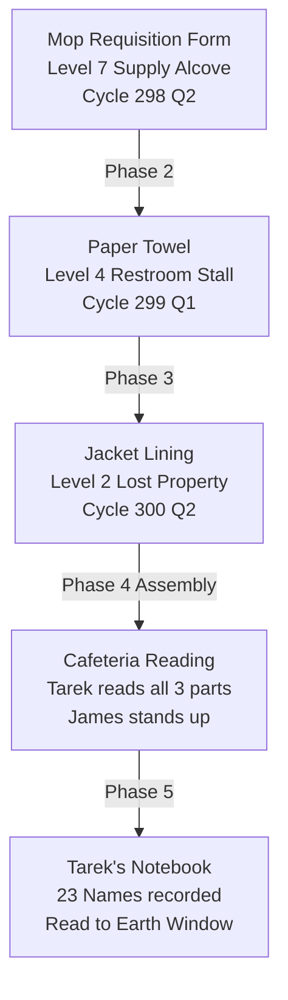

# ICS - Rigged Sphere - MASTER REFERENCE

*One file holding everything written about the game. It replaces `WORLD.md` and `ICS - Rigged Sphere.md`, both of which were retired after a line-by-line comparison showed that their only unique text is now in Appendix A.*

## How this file is built

- Every story, design, canon and meta file in the repo is included **verbatim**, in the order of the index below. Nothing is paraphrased or shortened. Paths are relative to the repo root.
- Each file starts with a marker line `<!-- BEGIN FILE: path -->` and ends with `<!-- END FILE: path -->`, so a file can be located or split back out.
- The generated lookup files (`meta/INDEX.md`, `ENTITIES.md`, `LINKS.md`, `FACTS.md`) are not included; they are rebuilt from the files here.
- `story/trailers.md` repeats the scripts that also exist one-per-file under `story/trailers/`. Both are kept.
- Canon is tagged **Canon**; anything new is tagged **[PROPOSAL]** inside the files themselves.
- **This file is a snapshot.** Regenerate it with `python3 tools/build_master.py`. Never edit it by hand; edit the files themselves. The lookup tools skip it so nothing is counted twice.

## Naming rule

**EOD** is always called EOD. Other names appear only in square brackets: [Executioner of Despair], [Envoy of Devotion], [Subjugator], [The Willbreaker], [Harmony]. 'Subjugator' is also the ARM-27 equipment codename.

## Index (file, then line number in this master file)


**Part 1 - Core documents and game design**

- `README.md` - line 325
- `design/DESIGN.md` - line 487
- `story/STORY.md` - line 1354
- `story/EXTENDED.md` - line 1764
- `meta/HANDOFF_CARTOGRAPHER.md` - line 2092
- `design/ART_DIRECTION.md` - line 2641
- `design/AUDIO_VOICE.md` - line 2819
- `design/BADGES_AND_UNIFORMS.md` - line 3002
- `design/DEVICES.md` - line 3271
- `design/DIFFICULTY_ACCESSIBILITY.md` - line 3376
- `design/DISCOVERY_SEQUENCE.md` - line 3633
- `design/ENDINGS.md` - line 3899
- `design/ENEMY_AI.md` - line 4136
- `design/ENVIRONMENTAL_STORYTELLING.md` - line 4281
- `design/EOD_ENCOUNTERS.md` - line 4485
- `design/FAILURE_LOOP.md` - line 4729
- `design/GATING_BACKTRACKING.md` - line 4868
- `design/HEALTH_SURVIVAL.md` - line 5024
- `design/HEARTH.md` - line 5148
- `design/ICS_OS.md` - line 5357
- `design/INVENTORY.md` - line 5551
- `design/JOBS_AND_CAREER.md` - line 5665
- `design/LEVEL_BEAT_SHEETS.md` - line 5848
- `design/NPC_COMPANIONS.md` - line 6564
- `design/PLAYER_GUIDANCE.md` - line 6872
- `design/PRODUCTION_SCOPE.md` - line 6988
- `design/PROGRESSION.md` - line 7180
- `design/SAVE_SYSTEM.md` - line 7317
- `design/SOLCRED_ECONOMY.md` - line 7420
- `design/SOLUTION_MATRIX.md` - line 7558
- `design/STEALTH_DETECTION.md` - line 7827
- `design/TENSION_CURVE.md` - line 8028
- `design/TIME_MODEL.md` - line 8327
- `design/TOOL_TUNING.md` - line 8603
- `design/TUTORIAL.md` - line 8772
- `design/UI_MENUS.md` - line 8889
- `design/VERBS.md` - line 9070
- `meta/CANON_DECISIONS.md` - line 9359
- `meta/STYLE_GUIDE.md` - line 9450
- `meta/TODO.md` - line 9493
- `story/trailers.md` - line 9553

**Part 2 - In-world documents (2.01-2.51)**

- `canon/documents/2.01 — Labor Source ID 349 Earth Profile.md` - line 10262
- `canon/documents/2.02 — Internal Acronym Reference.md` - line 10282
- `canon/documents/2.03 — Training Material Decision Making Access.md` - line 10301
- `canon/documents/2.04 — Lookup for the Second Moon Video Script.md` - line 10342
- `canon/documents/2.05 — Outsource the Stars Year 300 Ad.md` - line 10370
- `canon/documents/2.06 — Employee Wellness Check-In Form.md` - line 10382
- `canon/documents/2.07 — Interplanetary Transit Waiver ICS-T7.md` - line 10430
- `canon/documents/2.08 — Asset Reclassification Notice HR-09941.md` - line 10471
- `canon/documents/2.09 — Branch Manager Memo Q4 Harvest Targets.md` - line 10514
- `canon/documents/2.10 — Employee Handbook Curiosity Policy.md` - line 10553
- `canon/documents/2.11 — Incident Report ICS-IR3 Unauthorized Inquiry.md` - line 10588
- `canon/documents/2.12 — Interplanetary HQ Bulletin Saturation Update.md` - line 10635
- `canon/documents/2.13 — Personal Device Unsent Draft Message.md` - line 10667
- `canon/documents/2.14 — Planetary Disciplinary Protocol.md` - line 10699
- `canon/documents/2.15 — EOD Profile.md` - line 10787
- `canon/documents/2.16 — ARM-27 Technical Dossier.md` - line 10860
- `canon/documents/2.17 — ARM-27 Deployment Sequence Earth.md` - line 10964
- `canon/documents/2.18 — Human Psychology Report.md` - line 11058
- `canon/documents/2.19 — ICS Origin Narrative Earth Edition.md` - line 11390
- `canon/documents/2.20 — Employee Handbook.md` - line 11498
- `canon/documents/2.21 — Organizational Charter.md` - line 11679
- `canon/documents/2.22 — Interplanetary Operations Manual.md` - line 11870
- `canon/documents/2.23 — Board Governance Charter.md` - line 12084
- `canon/documents/2.24 — 300 Years of Changing Lives.md` - line 12267
- `canon/documents/2.25 — Planetary Case Files.md` - line 12400
- `canon/documents/2.26 — Job Catalogue.md` - line 12538
- `canon/documents/2.27 — Labor Source Profiles.md` - line 12661
- `canon/documents/2.28 — Commerce Catalogue Earth Export Profile.md` - line 12826
- `canon/documents/2.29 — Acronym and Terminology Glossary.md` - line 12967
- `canon/documents/2.30 — Workplace Conduct and Facility Use Policy.md` - line 13492
- `canon/documents/2.31 — Mascot Family AIDEN SOL CLEO VELO.md` - line 13832
- `canon/documents/2.32 — Brand Identity The Logo.md` - line 14294
- `canon/documents/2.33 — New Employee Onboarding Packet.md` - line 14608
- `canon/documents/2.34 — Facility Broadcast Channel and Music Programme.md` - line 14790
- `canon/documents/2.35 — Branch Directors Private Journal.md` - line 14987
- `canon/documents/2.36 — Floor Plans and Maintenance Notes.md` - line 15161
- `canon/documents/2.37 — In-World Advertisement Archive.md` - line 15305
- `canon/documents/2.38 — The Chaos Variable.md` - line 15470
- `canon/documents/2.39 — Yusras Resistance Document.md` - line 16102
- `canon/documents/2.40 — Asset Register and Termination Log.md` - line 16227
- `canon/documents/2.41 — EIMU Deep Assessment EOD.md` - line 16326
- `canon/documents/2.42 — Board Terminal Message.md` - line 16472
- `canon/documents/2.43 — Stage 2 to 3 Transition.md` - line 16513
- `canon/documents/2.44 — Labor Source Response Framework.md` - line 16677
- `canon/documents/2.45 — SOLCRED Internal Commerce Programme.md` - line 16799
- `canon/documents/2.46 — Employee Badge Technical Specification.md` - line 16983
- `canon/documents/2.47 — Host Force Assessment The Harrow.md` - line 17084
- `canon/documents/2.48 — Host Force Assessment Gyrfalcon Wing.md` - line 17227
- `canon/documents/2.49 — The Smile Study.md` - line 17377
- `canon/documents/2.50 — ICS Nomenclature Note.md` - line 17508
- `canon/documents/2.51 — Enforcement Asset Executive Handling Protocol.md` - line 17583

**Part 3 - Characters**

- `canon/characters/Branch Director.md` - line 17669
- `canon/characters/Captain Eirik Aronsen.md` - line 17703
- `canon/characters/Colonel Leif Aronsen.md` - line 17790
- `canon/characters/E-00219 - James.md` - line 17905
- `canon/characters/E-01205 - Amara Diallo.md` - line 17931
- `canon/characters/E-01573 - Yusra.md` - line 17970
- `canon/characters/E-01899 - Darius.md` - line 17996
- `canon/characters/E-02847 - Marcus.md` - line 18022
- `canon/characters/E-03388 - Tarek Mansour.md` - line 18050
- `canon/characters/E-04421 - Rania Odhiambo.md` - line 18072
- `canon/characters/E-04788 - Sera Vasquez.md` - line 18093
- `canon/characters/E-05091 - Omar Khalil.md` - line 18120
- `canon/characters/E-05682 - The Variable (Player).md` - line 18149
- `canon/characters/EOD.md` - line 18270
- `canon/characters/K-7 - PTKW Monitoring and Analysis Team Leader.md` - line 18433
- `canon/characters/Narrative Arc - Phases 0 through 6.md` - line 18487
- `canon/characters/Previous Branch Director.md` - line 18668

**Part 4 - Facility**

- `canon/facility/Level 0.md` - line 18695
- `canon/facility/Level 1.md` - line 18798
- `canon/facility/Level 2.md` - line 18944
- `canon/facility/Level 3.md` - line 19097
- `canon/facility/Level 4.md` - line 19236
- `canon/facility/Level 5.md` - line 19399
- `canon/facility/Level 6.md` - line 19518
- `canon/facility/Level 7.md` - line 19646
- `canon/facility/Levels 11-14.md` - line 19757
- `canon/facility/Levels 8-10.md` - line 19837
- `canon/facility/Maintenance Network.md` - line 19919
- `canon/facility/Overview.md` - line 20027
- `canon/facility/TV_SCREENS.md` - line 20132

**Part 5 - Scenes and scene notes**

- `story/scenes/1.1 - Labor Source 312, Day Four.md` - line 20315
- `story/scenes/1.10 - Kai, The Folder, Day Three.md` - line 20371
- `story/scenes/1.11 - The Director, The Desk, Entry 37.md` - line 20432
- `story/scenes/1.12 - Level 3, Monday, A Fresh Start.md` - line 20484
- `story/scenes/1.13 - K-7, Level 5, Forty Minutes.md` - line 20532
- `story/scenes/1.2 - Earth, Day Four, First Sight.md` - line 20586
- `story/scenes/1.3 - Omar, The Work Floor, Day Nine.md` - line 20636
- `story/scenes/1.4 - Sera, The Check-In.md` - line 20698
- `story/scenes/1.5 - Tarek, The Break Room, Day Eighteen.md` - line 20746
- `story/scenes/1.6 - Yusra, Stairwell C, Cycle 299.md` - line 20812
- `story/scenes/1.7 - James, Real Stories, Cycle 292.md` - line 20880
- `story/scenes/1.8 - Kai, Work Floor C, The Shift.md` - line 20936
- `story/scenes/1.9 - Kai, The Atrium, Day Twenty-One.md` - line 20988
- `story/scene-notes/Earth View Window.md` - line 21042
- `story/scene-notes/Elevator.md` - line 21245
- `story/scene-notes/Level 0.md` - line 21257
- `story/scene-notes/Opening Sequence.md` - line 21397
- `story/scene-notes/Phase 6 Final 22 Hours.md` - line 21562
- `story/scene-notes/Stairwell B.md` - line 21837

**Part 6 - Enemies**

- `canon/enemies/Arrangement-Class.md` - line 22022
- `canon/enemies/HQ-Response-Protocol.md` - line 22117
- `canon/enemies/PTKW-Security-Division.md` - line 22231
- `canon/enemies/README.md` - line 22302
- `canon/enemies/True-Believers.md` - line 22395

**Part 7 - Weapons and tools**

- `canon/weapons/MODIFICATIONS.md` - line 22486
- `canon/weapons/OVERVIEW.md` - line 22581
- `canon/weapons/README.md` - line 22667
- `canon/weapons/compliance/ACS-9 — Acoustic Compliance System.md` - line 22732
- `canon/weapons/compliance/CCN-Spoofer — Communications Node Spoofer.md` - line 22797
- `canon/weapons/compliance/CRD-7 — Compliance Restraint Device.md` - line 22862
- `canon/weapons/compliance/EIMU-Jammer — Emotional Interference Unit.md` - line 22926
- `canon/weapons/compliance/PTKW-Baton — Asset Management Baton.md` - line 22989
- `canon/weapons/found/Level-0-Device.md` - line 23051
- `canon/weapons/found/Rania-Hatch-Kit.md` - line 23128
- `canon/weapons/found/Yusra-Cache.md` - line 23184
- `canon/weapons/improvised/AIDEN-Unit.md` - line 23239
- `canon/weapons/improvised/Maintenance-Bar.md` - line 23316
- `canon/weapons/improvised/Olfactory-Canister.md` - line 23361
- `canon/weapons/improvised/Pressurized-Pipe-Tool.md` - line 23410
- `canon/weapons/modifications/ACS-9D — Directed Beam.md` - line 23459
- `canon/weapons/modifications/ACS-9RS — Resonance Shell.md` - line 23522
- `canon/weapons/modifications/AMB-3F — Fracture Baton.md` - line 23593
- `canon/weapons/modifications/BAR-FL — Fragment Launcher.md` - line 23673
- `canon/weapons/modifications/CRD-7R — Compliance Reversal.md` - line 23754
- `canon/weapons/modifications/CRD-7X — Extended Burst.md` - line 23834
- `canon/weapons/modifications/ECT-4C — Cascade Broadcast.md` - line 23903
- `canon/weapons/modifications/Ignition-Canister.md` - line 23980

**Part 8 - Trailer scripts**

- `story/trailers/Trailer 1 - The Crack.md` - line 24059
- `story/trailers/Trailer 2 - The Offer.md` - line 24191
- `story/trailers/Trailer 3 - The Contract.md` - line 24290
- `story/trailers/Trailer 4 - The Archive.md` - line 24457
- `story/trailers/Trailer 5 - The Envoy.md` - line 24596
- `story/trailers/Trailer 6 - The File.md` - line 24828

**Part 9 - Internal communications**

- `canon/internal-communications/README.md` - line 24941
- `canon/internal-communications/branch-director/C-01 — Director to Brant Cluster Flag.md` - line 25081
- `canon/internal-communications/branch-director/C-02 — Brant to Director EOD Briefing.md` - line 25122
- `canon/internal-communications/branch-director/C-03 — Director to Brant After the Speech.md` - line 25158
- `canon/internal-communications/branch-director/C-04 — Board to Director Transition Notice.md` - line 25204
- `canon/internal-communications/branch-director/C-05 — Level 9 Transition Batch Note.md` - line 25238
- `canon/internal-communications/branch-director/C-06 — Brant Q1 HQ Review Notes.md` - line 25272
- `canon/internal-communications/branch-director/C-07 — HQ Directive Space Oddity Removal.md` - line 25310
- `canon/internal-communications/branch-director/C-08 — Branch Director Private Notes.md` - line 25349
- `canon/internal-communications/branch-director/C-09 — Director to Brant Coffee Machine.md` - line 25457
- `canon/internal-communications/branch-director/C-10 — Brant to Director Parallel Systems.md` - line 25495
- `canon/internal-communications/branch-director/C-11 — Director to HQ Flagged Communications Q3.md` - line 25537
- `canon/internal-communications/branch-director/C-12 — HQ Response Directives Q3.md` - line 25615
- `canon/internal-communications/branch-director/C-13 — HQ Execution Directives Q4.md` - line 25699
- `canon/internal-communications/branch-director/C-14 — Director Execution Confirmation.md` - line 25784
- `canon/internal-communications/branch-director/C-15 — Director to HQ Equipment Incident Assessment.md` - line 25838
- `canon/internal-communications/branch-director/C-16 — HQ Omega-1 Pre-Deployment Briefing.md` - line 25897
- `canon/internal-communications/branch-director/C-17 — Director to HQ SOLCRED Pricing Concern.md` - line 25974
- `canon/internal-communications/branch-director/C-18 — EOD Research Team - Deployment 287 Field Report Update Request.md` - line 26025
- `canon/internal-communications/branch-director/C-19 — EOD Research Team - Deployment 287 Field Report Update - Team Blue Harrow - Last Survivor Interview.md` - line 26080
- `canon/internal-communications/branch-director/C-20 — EOD Research Team - Deployment 287 Field Report Update - Team Gyrfalcon Wing - Incident Report.md` - line 26245
- `canon/internal-communications/branch-director/C-21 — EOD Research Team - Deployment 287 Field Report Update - Team Gyrfalcon Wing - Open Water Combat Report.md` - line 26406
- `canon/internal-communications/branch-director/C-22 — EOD Research Team - Deployment 287 Field Report Update - Team Gyrfalcon Senior Officer - Hallvik Tower Conversation Report.md` - line 26842
- `canon/internal-communications/branch-director/C-23 — EOD Research Team - Deployment 287 Field Report Update - Master Summary.md` - line 26977
- `canon/internal-communications/branch-director/C-24 — EOD Research Team - The Discussion of EOD Sunsetting.md` - line 27114
- `canon/internal-communications/branch-director/C-25 — Earth Branch Manager - Reply to The Discussion of EOD Sunsetting.md` - line 27315
- `canon/internal-communications/branch-director/C-26 — Earth Branch Manager - EOD First Arrival at Labor Source 312 - Cycle 292 Thread.md` - line 27457
- `canon/internal-communications/design-team/01 — Akar — Design Philosophy.md` - line 27577
- `canon/internal-communications/design-team/02 — Vance — Arrival Corridor Brief.md` - line 27627
- `canon/internal-communications/design-team/03 — Akar — Default Mode Threat.md` - line 27668
- `canon/internal-communications/design-team/04 — Ohm — Resistance Index Projections.md` - line 27714
- `canon/internal-communications/design-team/05 — Castile — Restroom Design Rationale.md` - line 27760
- `canon/internal-communications/design-team/06 — Akar — Year 1 Review.md` - line 27809
- `canon/internal-communications/design-team/07 — Brant — Board Observation Forwarded.md` - line 27848
- `canon/internal-communications/design-team/08 — Unknown — Unsent Draft.md` - line 27885
- `canon/internal-communications/design-team/09 — Ohm — The Remembering Room.md` - line 27928
- `canon/internal-communications/employee/A-00 — Unknown Employee to Dad (unsent).md` - line 27972
- `canon/internal-communications/employee/A-01 — Marcus to Lena.md` - line 28007
- `canon/internal-communications/employee/A-02 — Darius to Yemi (unsent).md` - line 28045
- `canon/internal-communications/employee/A-03 — Sera to Colleague.md` - line 28080
- `canon/internal-communications/employee/A-04 — James Note to Himself.md` - line 28113
- `canon/internal-communications/employee/A-05 — Tarek to the Wall.md` - line 28155
- `canon/internal-communications/employee/A-06 — Kai to Vantage (intercepted).md` - line 28190
- `canon/internal-communications/employee/A-07 — Hana to Femi Coffee Machine.md` - line 28233
- `canon/internal-communications/employee/A-08 — Dev to Priya Window Seat.md` - line 28269
- `canon/internal-communications/employee/A-09 — Yaw to Blessing Kofi.md` - line 28300
- `canon/internal-communications/employee/A-10 — Omar Personal Note Not Sent.md` - line 28331
- `canon/internal-communications/employee/A-11 — Amara PWRP Diary.md` - line 28367
- `canon/internal-communications/employee/A-12 — Marcus to Aditi Game Night.md` - line 28427
- `canon/internal-communications/employee/A-13 — Tarek Notebook Rules.md` - line 28460
- `canon/internal-communications/employee/A-14 — Rania Voice Memo to Leila.md` - line 28495
- `canon/internal-communications/employee/A-15 — James to M (undeliverable).md` - line 28540
- `canon/internal-communications/employee/A-16 — Nilufar to Unknown (unsent).md` - line 28577
- `canon/internal-communications/employee/A-17 — Priya to Dev Follow-Up.md` - line 28609
- `canon/internal-communications/employee/A-18 — Omar to Tarek (found in pocket).md` - line 28647
- `canon/internal-communications/employee/A-19 — Marcus to Team Phase 5.md` - line 28684
- `canon/internal-communications/employee/A-20 — Priya to Dev Canteen Price.md` - line 28726
- `canon/internal-communications/employee/A-21 — Yaw to Sera SOLCRED Question.md` - line 28762
- `canon/internal-communications/employee/A-22 — Tarek Notebook SOLCRED.md` - line 28798
- `canon/internal-communications/employee/A-23 — Marcus to Priya Phase 5.md` - line 28829
- `canon/internal-communications/employee/A-24 — Darius to Sera Badge Anomaly.md` - line 28876
- `canon/internal-communications/employee/A-25.md` - line 28916
- `canon/internal-communications/employee/A-26.md` - line 28939
- `canon/internal-communications/employee/A-27.md` - line 28979
- `canon/internal-communications/employee/A-28 — Lior and Chidi The Man Without a Badge.md` - line 29008
- `canon/internal-communications/employee/A-29 — Chidi and Ruth Read It Once REDACTED EVIDENCE.md` - line 29095
- `canon/internal-communications/ptkw/B-01 — K7 EIMU Anomaly Flag.md` - line 29238
- `canon/internal-communications/ptkw/B-02 — HQ Resistance Index Analysis.md` - line 29277
- `canon/internal-communications/ptkw/B-03 — ICS-OP-7 Note to Team.md` - line 29314
- `canon/internal-communications/ptkw/B-04 — ENV-SYS-3 Olfactory Primer Request.md` - line 29353
- `canon/internal-communications/ptkw/B-05 — K7 to K12 Monday Calendar.md` - line 29393
- `canon/internal-communications/ptkw/B-06 — VAH3 Human Names Protocol.md` - line 29426
- `canon/internal-communications/ptkw/B-07 — K12 to K7 Music Programme.md` - line 29463
- `canon/internal-communications/ptkw/B-08 — TOR9 Rania File Closure.md` - line 29500
- `canon/internal-communications/ptkw/B-09 — VAH3 SMAC Clustering Note.md` - line 29538
- `canon/internal-communications/ptkw/B-10 — K12 to K7 The Reader.md` - line 29583
- `canon/internal-communications/ptkw/B-11 — Intercept Thread — Yaw Kofi Email.md` - line 29621
- `canon/internal-communications/ptkw/B-12 — Intercept Thread — Tarek Wall Message.md` - line 29689
- `canon/internal-communications/ptkw/B-13 — Intercept Thread — James Note to Himself.md` - line 29758
- `canon/internal-communications/ptkw/B-14 — Intercept Thread — Darius Appendix Line.md` - line 29849
- `canon/internal-communications/ptkw/B-15 — TOR9 Conduct Notation Response.md` - line 29918
- `canon/internal-communications/ptkw/B-16 — All-Staff Broadcast Equipment Warning.md` - line 29963
- `canon/internal-communications/ptkw/B-17 — PTKW Circular Equipment Modification.md` - line 30025
- `canon/internal-communications/ptkw/B-18 — Intercept Thread — Yaw Reads the CLEO Broadcast.md` - line 30099
- `canon/internal-communications/ptkw/B-19 — Intercept Thread — Sera to Kai Canister Info.md` - line 30191
- `canon/internal-communications/ptkw/B-20 — ICS-OP7 to VAH3 The CRD7 Impulse.md` - line 30285
- `canon/internal-communications/ptkw/B-21 — Intercept Thread — Marcus Phase 5 Message.md` - line 30370
- `canon/internal-communications/ptkw/B-22 — K7 SOLCRED Pricing Flag.md` - line 30433
- `canon/internal-communications/ptkw/B-23 — SOLCRED Q3 Pricing Directive.md` - line 30487
- `canon/internal-communications/ptkw/B-24 — PTKW Engineering Badge Deactivation Urgent.md` - line 30538
- `canon/internal-communications/ptkw/B-25 — HQ Host Force Monitoring Instruction.md` - line 30587
- `canon/internal-communications/ptkw/B-26 — Incident Report ICS-IR3 - Restricted Designation Heard and Document Recovered.md` - line 30631
- `canon/internal-communications/ptkw/B-27 — Intercept Thread — Lior Asks the Floor Liaison About the Man Without a Badge.md` - line 30749
- `canon/internal-communications/ptkw/B-28 — K-7 Asks the Earth Branch Manager About EOD and Forwards His Answer to All PTKW.md` - line 30825
- `canon/internal-communications/ptkw/B-29 — Investigation Result ICS-IR3-300Q4-032 - The Source of the Sheet Is Not Found.md` - line 30974
- `canon/internal-communications/ptkw/B-30 — Incident Report ICS-IR3 - PTKW Designation of ICS Written on a Wall.md` - line 31070

**Appendix A - recovered text from the retired files**

---

# PART 1 - CORE DOCUMENTS AND GAME DESIGN

<!-- BEGIN FILE: README.md -->

# ICS: Interplanetary Corporate Solutions

**A first-person narrative game in the style of BioShock.** The player is a human employee inside the ICS Earth Branch — a corporate facility shaped like a second moon in orbit above Earth. ICS is an alien-run planetary labor company. The warmth is real. The cage is real. The horror is that you cannot point to the moment it goes wrong, because it was always this.

---

## Layout

```
canon/      What is true in the world. Source of truth for lore.
  documents/  characters/  facility/  enemies/  weapons/
  internal-communications/   (A employee, B PTKW, C Branch Director, D design team)
story/      What the player experiences, written as prose.
  STORY.md  EXTENDED.md  trailers.md
  scenes/ (new scenes, 1.1-1.13)  scene-notes/  trailers/
design/     How the game works: systems, pacing, production. Mostly [PROPOSAL].
meta/       How we work: STYLE_GUIDE, CANON_DECISIONS, HANDOFF_CARTOGRAPHER.
reference/  Generated snapshot of the whole corpus. Read-only.
```

If two files disagree, `canon/` wins over `story/`, and `story/` wins over `design/`.

---

## Files

### Canon & Narrative

| File | Contents |
|---|---|
| `canon/documents/` | **The canon.** All 51 in-world documents (2.1–2.51), one file each, including the Glossary (2.29). The source of truth for lore, access tiers, and cross-references. The two old compiled files (WORLD and ICS - Rigged Sphere) were retired; their unique text lives in the master reference below. |
| `reference/` | **Master reference (generated snapshot).** One large read-only file with the writing files verbatim, plus Appendix A (Game Overview, the earlier Doc 2.32 version, recovered variants). It duplicates the other files and will drift; don't edit it. The script that regenerated it was in the retired writing map. |
| [`design/DESIGN.md`](design/DESIGN.md) | **The blueprint.** Characters, narrative arc (Phases 0–6), scene notes, and Document 2.41 (EOD's perspective). This is where the game lives. |
| [`story/STORY.md`](story/STORY.md) | **The story itself.** Six scenes written as experienced narrative: the interrogation, what happened in the atrium on Day 21, the Level 0 descent and Section 7, Tarek standing up, Maren Voss in the final hours, and the ending. |
| [`story/scenes/`](story/scenes/) | **New scenes.** Thirteen short scenes that sit in the gaps of the canon: EOD at Labor Source #312 and on Earth, Omar, Sera, Tarek, Yusra, James, Kai's shift, the atrium and the folder, the Director's Entry 37, a Monday coffee queue, and K-7's forty minutes. All [PROPOSAL]. |
| [`meta/STYLE_GUIDE.md`](meta/STYLE_GUIDE.md) | **One-page style guide.** Voice, motifs to keep, tics to retire, canon rules for scenes. |
| [`meta/CANON_DECISIONS.md`](meta/CANON_DECISIONS.md) | **Rulings for the author.** The real contradictions with proposed defaults, and a triage of the [PROPOSAL] material. |
| [`story/EXTENDED.md`](story/EXTENDED.md) | **The long reads.** Schedule D pages 1–6, Yusra's full resistance document, and the Branch Director's address — the three documents the player finds and must read completely. |
| [`story/trailers.md`](story/trailers.md) | **Seven trailer/ad scripts.** "The Crack," "The Offer" (revised), "The Contract," "The Archive" (post-release, Board POV), the 30-second in-world TV spot "Something Better," and "The Envoy" (EOD, told across Global, PTKW and Board access). Four are also split into `story/trailers/`; the TV spot lives only in `story/trailers.md`; "The Envoy" lives only in `story/trailers/Trailer 5 - The Envoy.md`. "The File" (Trailer 6) is a tag that can close any trailer: the sound of the Folio file opening, then the EOD card; its Name field is left for the author (`story/trailers/Trailer 6 - The File.md`). |

### Game Design Systems

| File | Contents |
|---|---|
| [`design/PROGRESSION.md`](design/PROGRESSION.md) | **Badge tier system.** The badge IS the character sheet. Tier 1–5 unlock mechanics, 847 undeactivated badges in the system, the badge as the game's primary progression mechanic. |
| [`design/HEALTH_SURVIVAL.md`](design/HEALTH_SURVIVAL.md) | **Four-track vitals system.** Physical Integrity, Neurological Status, Thermal Regulation, EIMU Coherence — each track, its sources of damage and recovery, and what flat-lining each one looks like. |
| [`design/ENEMY_AI.md`](design/ENEMY_AI.md) | **Behavioral states for all 5 enemy categories.** PTKW Security, True Believers (Marcus/Lani/Cho), Arrangement Class (Dayo/Priti), Omega-1, and EOD advance team. Four-state alert ladder. |
| [`design/STEALTH_DETECTION.md`](design/STEALTH_DETECTION.md) | **Full detection architecture.** Visual, EIMU, and acoustic detection inputs. Zone coverage map. CCN Anomaly Score. Maintenance passage rules. EIMU Diagnostic Accessory. Phase-by-phase detection summary. |
| [`design/NPC_COMPANIONS.md`](design/NPC_COMPANIONS.md) | **Tarek, Omar, Sera — dynamic interaction.** Phase-by-phase behavior for each NPC. Specific conversation options, flags, and Phase 6 outcomes. The unannounced relationship design principle. |
| [`design/INVENTORY.md`](design/INVENTORY.md) | **10-slot inventory system.** Badge-as-interface design. Item categories (documents, tools, recovery, key items). Inventory pressure in Phase 5. The Phase 4 manifest check. |
| [`design/AUDIO_VOICE.md`](design/AUDIO_VOICE.md) | **11 voices, full audio log design.** Who speaks, what they say, why audio vs. text, performance notes. Includes Rania's single recording and the Senior Analyst's 11-second log. Ambient audio by phase. |
| [`design/SAVE_SYSTEM.md`](design/SAVE_SYSTEM.md) | **Save architecture.** Continuous autosave, one manual save slot (quarters only), irreversible events list, death save behavior, and the "Last Entry" Phase 6 permanent save. |
| [`design/TUTORIAL.md`](design/TUTORIAL.md) | **Tutorial-as-job design.** 10 mechanic introduction beats across Phase 0–1. Discovery tutorial schedule for Phases 2+. What is never explicitly taught and why. |
| [`design/ENDINGS.md`](design/ENDINGS.md) | **Endings branching chart.** Full flag reference (Phases 0–5). Four ending states: The Witness, The Alone, The Blind, The Archivist. Gradient states. What does not branch. New Game+ implications. |
| [`design/VERBS.md`](design/VERBS.md) | **The verb sheet.** The eight things the player can do (Move, Read, Badge, Use, Modify, Speak, Slip, Witness), how each feels, and what each costs. Canon and proposals tagged separately. |
| [`design/SOLUTION_MATRIX.md`](design/SOLUTION_MATRIX.md) | **Obstacles × answers.** Every obstacle in the facility with the non-lethal answers the existing tools and verbs give, and what each answer costs. |
| [`design/TENSION_CURVE.md`](design/TENSION_CURVE.md) | **Pacing across Phases 0–6.** Intensity targets, peaks, valleys, safe-space ledger, pacing rules, playtime split. |
| [`design/LEVEL_BEAT_SHEETS.md`](design/LEVEL_BEAT_SHEETS.md) | **Level beat-sheet template**, filled in for Levels 0–14 (Levels 0 and 4 in detail; the rest are draft tables). Includes inconsistencies found between level files. |
| [`design/DISCOVERY_SEQUENCE.md`](design/DISCOVERY_SEQUENCE.md) | **Discovery sequence & narrative spine.** Single ordered path across Phases 0–6, room-by-room trajectory, key document pickups, and full staging of named set pieces (Rania's 3-part note, Level 0 Charter retrieval, Atrium confrontation, Cafeteria stand, PTKW backlog). |
| [`design/TIME_MODEL.md`](design/TIME_MODEL.md) | **Time model.** Weekday anchor, phase boundaries, day-by-day ledger, Phase 6 arithmetic, NPC schedules, real-time rates, action time costs. |
| [`design/EOD_ENCOUNTERS.md`](design/EOD_ENCOUNTERS.md) | **EOD, encounter by encounter.** Modes A/B/C, Phase 2 beats, Day 21 atrium, capture flow, tools versus him. |
| [`design/PLAYER_GUIDANCE.md`](design/PLAYER_GUIDANCE.md) | **How the game says "go there."** Five channels, guidance by phase, what never appears, Phase 6 as unguided. |
| [`design/GATING_BACKTRACKING.md`](design/GATING_BACKTRACKING.md) | **Gates and backtracking.** Credential ladder, level graph, what closes, what never closes, sequence breaks. |
| [`design/FAILURE_LOOP.md`](design/FAILURE_LOOP.md) | **Death, capture and retry.** The failure states, the retry flow, target fail rates, when the player is stuck. |
| [`design/UI_MENUS.md`](design/UI_MENUS.md) | **HUD, badge, menus.** What is on screen, the badge tabs, boot, pause, save/load, settings, credits. |
| [`design/SOLCRED_ECONOMY.md`](design/SOLCRED_ECONOMY.md) | **SOLCRED as a mechanic.** Canon prices, where it appears, what it is for, detection flags. |
| [`design/TOOL_TUNING.md`](design/TOOL_TUNING.md) | **Tool numbers in one place.** Charges, durations, ranges, build times, enemy parameters, playtest targets. |
| [`design/ART_DIRECTION.md`](design/ART_DIRECTION.md) | **Visual direction.** Brand colours, light by place and phase, materials, mascots, camera. |
| [`design/BADGES_AND_UNIFORMS.md`](design/BADGES_AND_UNIFORMS.md) | **Badges and attire.** Tier cards, department glyphs, per-character badge sheet, PTKW/Director/stripped badges, uniforms for every group. Canon vs [PROPOSAL] marked. |
| [`design/ENVIRONMENTAL_STORYTELLING.md`](design/ENVIRONMENTAL_STORYTELLING.md) | **Placement rules and prop manifest per level.** The Blender files it once linked to were removed from this repo. |
| [`design/PRODUCTION_SCOPE.md`](design/PRODUCTION_SCOPE.md) | **Production questions.** What the design fixes, scope drivers, vertical slice, engine, localization, QA. All figures are placeholders. |
| [`design/JOBS_AND_CAREER.md`](design/JOBS_AND_CAREER.md) | **Jobs and the career ladder.** What the player's job produces, why the department is fixed, second jobs through acquired badges, tier versus role, and what a rung pays besides access. All [PROPOSAL]. |
| [`design/DIFFICULTY_ACCESSIBILITY.md`](design/DIFFICULTY_ACCESSIBILITY.md) | **Difficulty as information, not damage.** Presets, individual options, vision/hearing/motor/cognitive/photosensitivity accessibility, controls. |
| [`meta/HANDOFF_CARTOGRAPHER.md`](meta/HANDOFF_CARTOGRAPHER.md) | **Handoff brief: Archivist → Cartographer.** What exists, what is missing, canon not to break, working rules, and the open rulings to resolve with the user. |


### Facility

| File | Contents |
|---|---|
| [`canon/facility/Overview.md`](canon/facility/Overview.md) | The full facility — orbital position, BES design philosophy, level structure, what it smells like. |
| [`canon/facility/TV_SCREENS.md`](canon/facility/TV_SCREENS.md) | **The Broadcast Display System.** 200+ screens, the advertising characters (SONA, BRIK, the Wellness Pair), all products, SOLCRED pricing, and what the BDS looks like when the warmth is gone. |
| `canon/facility/Level 0.md` through `canon/facility/Levels 11-14.md` | Individual level files. |
| `canon/facility/Maintenance Network.md` | The parallel map — Type A, B, C passages. |

### Internal Communications

| File | Contents |
|---|---|
| `canon/internal-communications/README.md` | Index of all recovered correspondence: A (employees), B (PTKW), C (Branch Director / HQ), D (design team). |
| [`design/HEARTH.md`](design/HEARTH.md) | **Hearth, the ICS Earth Branch internal messaging system.** The in-world name, the design (Deep Blue and Warm Gold, three panes), the folders (delivered, drafts, held by CCN, sealed, found notes), and how the viewer is built from the messages and kept current by the writing map. **[PROPOSAL]** |
| [`design/ICS_OS.md`](design/ICS_OS.md) | **ICS-OS (version 0.1), the ICS Earth Branch operating system.** Boot, sign-in and desktop; three windowed apps (Hearth mail, ICS Cloud Drive, Folio document viewer); cloud-only files with no local save; clearance by whole file and by layered section; and the Branch Director's retained copies of Staff and PTKW mail. Lives in its own folder, ICS-OS, beside the writing map. **[PROPOSAL]** |
| [`design/DEVICES.md`](design/DEVICES.md) | **Devices and addresses.** The invented mail domain (`.ics`, never ics.org), department and staff mailboxes, the device map (Manager, K-7, Director, a Work Floor B desk, found notes), where each slice of the 95 messages lives, and the passwords (`smiling-man`). **[PROPOSAL]** |
| [`tools/`](tools/) | **Scripts.** `mail_index.py` counts messages per mailbox; `add_addresses.py` appends `<address>` to From/To/Cc (dry run by default); `export_mail.py` writes `mail.json` (95 messages and the four device slices) for the game. Run with `python3 -I`. **Lookup:** `build_index.py` rebuilds `meta/INDEX.md`, `ENTITIES.md`, `LINKS.md`, `FACTS.md` and `graph.html` (also `--who EOD`, `--links C-24`, `--find text`); names and numbers it tracks are in `entities.json` and `facts.json`. `build_master.py` rebuilds the master reference snapshot. `fix_encoding.py` repairs mojibake. **[PROPOSAL]** |
| `canon/internal-communications/branch-director/C-18 — EOD Research Team - Deployment 287 Field Report Update Request.md` | The EOD Research Team asks the Earth Branch Manager for findings on Deployment Order 287; the Branch replies that it cannot place EOD at any point in the ten days. **[PROPOSAL]** |
| `canon/internal-communications/branch-director/C-19 — EOD Research Team - Deployment 287 Field Report Update - Team Blue Harrow - Last Survivor Interview.md` | **Newest.** Day 22: the Branch Manager's update to C-18. It places EOD at Sudbury on Day 16, explains the ten days and reproduces the Blue Harrow survivor's transcript; the Research Team replies. Split out of C-18. **[PROPOSAL]** |
| `canon/internal-communications/branch-director/C-20 — EOD Research Team - Deployment 287 Field Report Update - Team Gyrfalcon Wing - Incident Report.md` | The Branch Manager corrects C-19: the second demonstration (Gyrfalcon Wing, Day 18) was not ARM-27's. A cockpit and radio transcript, no casualties; the Research Team replies. **[PROPOSAL]** |
| `canon/internal-communications/branch-director/C-21 — EOD Research Team - Deployment 287 Field Report Update - Team Gyrfalcon Wing - Open Water Combat Report.md` | Day 21: the air engagement — HAWK patrol spots EOD on the surface, Gyrfalcon Wing scrambles, one pilot breaks formation and his face is pressed flat against his own canopy by an open hand before weapons release; the other seven engage for 36 minutes with no hits. One of them, Captain Eirik Aronsen (Gyrfalcon Seven), is flown by hand by the contact, ordered to eject by his father, and killed in the sea after his father says "son", the contact turns back and the parachute is cut. On the way he tells his father he is dead and knows it, and tells humans to be afraid and to proceed despite being afraid. Eight pilots dead total; seven aircraft land, one empty. ARM-27's first active sortie since the Show of Force. Sealed with C-23 and Doc 2.49; the question of why the Captain was smiling is first raised in a board note. **[PROPOSAL]** |
| `canon/internal-communications/branch-director/C-22 — EOD Research Team - Deployment 287 Field Report Update - Team Gyrfalcon Senior Officer - Hallvik Tower Conversation Report.md` | Day 21 (continues C-21): EOD and ARM-27 stand at the Hallvik tower; the Wing's commander shoots at him through bullet-proof glass and EOD speaks plainly ("downsizing", "branch sunsetting"). The tower cab recording, the Branch Manager's conclusions and the Research Team's reply. **[PROPOSAL]** |
| `canon/internal-communications/branch-director/C-23 — EOD Research Team - Deployment 287 Field Report Update - Master Summary.md` | **Newest.** Day 28: the Branch Manager's master summary of all four Deployment 287 events (C-19 through C-22), drawing the through-line — four demonstrations, four audiences, one argument. The Research Team replies at length: its human-psychology study (Doc 2.18) succeeded and fear is a useful instrument; what it expected of humans facing EOD; Eirik's refusal and his message to the species, and Gyrfalcon Three's inverted pass, which it did not expect and will study further; and EOD's own debrief statement, that humans who smile at certain death cannot be controlled. Sealed: readers are the Research Team, the Earth Branch Manager and EOD, not PTKW. **[PROPOSAL]** |
| `canon/internal-communications/branch-director/C-24 — EOD Research Team - The Discussion of EOD Sunsetting.md` | **Newest.** Day 29: the Research Team to the Earth Branch Manager, two readers only (one level above Doc 2.49; EOD is excluded). The words EOD said about Eirik must never be said or heard in any branch or asset planet, given ICS's record of never failing. The Team asks the Manager to watch EOD closely, or to sunset him: the Journey Completion Directorate (fourteen of its members held ready, from a larger roster) will arrive disguised as a rival company's force, he will fight it, and the analysis says 100 percent. Failure to report puts the whole Branch before the Board and the Directorate. He will be announced as a hero who died defending ICS, and the humans must never question it. The Team asks the Branch for the location, the damage costs and the repair time, and supplies the public statement ("After more than 300 years…"). **[PROPOSAL]** |
| `canon/internal-communications/branch-director/C-25 — Earth Branch Manager - Reply to The Discussion of EOD Sunsetting.md` | **Newest.** Day 30: the Earth Branch Manager's reply to C-24, two readers only. It opens to EOD by his full name and "my dear friend" (a line he will never read), then argues seven reasons to hold the sunset order, proposes the first option under his own hand, and prepares the entire Level 7 floor for EOD's farewell and the fight, "the least he can do for an old friend" (Day 38, 02:00 Branch Time). He says he will comply if the Team insists, and asks that EOD be told the attackers are real and have come to destroy the Branch, so that he dies believing he protected the ICS he served. **[PROPOSAL]** |
| `canon/internal-communications/ptkw/B-25 — HQ Host Force Monitoring Instruction.md` | **Newest.** PTKW Oversight tells Level 5 to monitor the Harrow and Gyrfalcon Wing by open sources only, and not to tell Branch Operations. **[PROPOSAL]** |
| `canon/internal-communications/ptkw/B-26 — Incident Report ICS-IR3 - Restricted Designation Heard and Document Recovered.md` | Day 32: PTKW Level 5 duty officer to K-7 and TOR-9. A human asset (E-03615, Operations Division, Work Floor B) is heard saying "[Subjugator]" at his desk, and a print of a scan of the Doc 2.15 designation block is found in his drawer, with "Executioner of Despair" highlighted and, above it, his own written reaction. Form ICS-IR3 and the seven-part source investigation; the asset is retained, not released and not reclassified, because he is the only trace. The handling note records that PTKW officers have now read names that are not for PTKW use. **[PROPOSAL]** |
| `canon/internal-communications/branch-director/C-26 — Earth Branch Manager - EOD First Arrival at Labor Source 312 - Cycle 292 Thread.md` | **Newest.** Cycle 292 Q2 (an earlier planet, off the game timeline): the Manager of Labor Source #312 writes to HQ about a man with no badge who smiles and waves at everyone, and whom he finds hard to look at; HQ copies the EOD Research Team and tells it to explain; the Team sends the eight-section handling manual that comes with EOD, with a cropped one-page scan of his profile as section 7. The Manager kept it, and told the Division the page was destroyed. He is now the Earth Branch Manager. **[PROPOSAL]** |
| `canon/internal-communications/employee/A-28 — Lior and Chidi The Man Without a Badge.md` | Day 4, 19:12 to 19:40: two Level 3 assets (E-03615, E-03702) talk about the unbadged man in the Level 2 corridor, whose doors open before he reaches them, and Lior decides to ask the floor liaison. **[PROPOSAL]** |
| `canon/internal-communications/ptkw/B-27 — Intercept Thread — Lior Asks the Floor Liaison About the Man Without a Badge.md` | Day 5: Lior's polite query to the Floor Liaison, the Liaison's rude reply that PTKW does not know and he should expect updates, and the forward to K-7, who will ask the Manager. **[PROPOSAL]** |
| `canon/internal-communications/ptkw/B-28 — K-7 Asks the Earth Branch Manager About EOD and Forwards His Answer to All PTKW.md` | Day 5 to 6: K-7 asks the Manager. The Manager tells all PTKW to tread carefully around his old friend, whose commands apply as if he outranked anyone. He forwards the old manual from C-26 with the page removed, and K-7 sends it to all PTKW against his instruction. **[PROPOSAL]** |
| `canon/internal-communications/ptkw/B-29 — Investigation Result ICS-IR3-300Q4-032 - The Source of the Sheet Is Not Found.md` | Day 34: the Investigation Team reports the seven lines of B-26. The page was cut by the Research Division and scanned on a device outside the logged queues; E-03615's document path cannot reach a Board page; nine readers; the Oversight Unit's five-point direction (a recorded exposure is not an incident, repeating is). The source is not found. E-03615 asked one question: "Is it true?" **[PROPOSAL]** |
| `canon/internal-communications/ptkw/B-30 — Incident Report ICS-IR3 - PTKW Designation of ICS Written on a Wall.md` | **Newest.** Day 36: the PTKW expansion of ICS ("INFLATABLE CROWD SOLUTIONS") is found in black marker on the Level 3 corridor wall by a night cleaner and removed after 68 minutes; about 450 people may have read it; two sleeping assets' badges pass the doors in the night. Who wrote it, and how they knew, is the investigation; the duty officer notes that Level 5 itself may be where the words left. **[PROPOSAL]** |
| `canon/internal-communications/employee/A-29 — Chidi and Ruth Read It Once REDACTED EVIDENCE.md` | Day 31 chat, redacted by the PTKW investigation team on Day 33 as evidence in ICS-IR3-300Q4-032: two assets say they read the sheet once, do not have it, and discuss what it said. Three redactions and a cover note. **[PROPOSAL]** |

### Human Forces (Earth's strongest formations)

| File | Contents |
|---|---|
| `canon/documents/2.47 — Host Force Assessment The Harrow.md` | **The ground unit.** Global Narcotics Interdiction Command, Special Operations Directorate, known as **the Harrow**. Official and operational names, why it was created, why it is deployed, its weapons, and its **insignia** (black-and-silver spike-harrow patch, six team tabs, motto AGAIN TOMORROW, the Tine badge). Blue Harrow Team is one of its six teams. **[PROPOSAL]** |
| `canon/documents/2.48 — Host Force Assessment Gyrfalcon Wing.md` | **The air unit.** Allied Polar Air Defence Command, 1st Strategic Interception Wing, known as **Gyrfalcon Wing**. Pilots, F-22 aircraft, missiles, standing alert, **insignia** (azure-and-white gyrfalcon patch, bronze/silver/gold wings, three squadron patches, motto SIX MINUTES), the Day 18 incident, and the Day 26 addendum on Day 21. **[PROPOSAL]** |
| `canon/documents/2.49 — The Smile Study.md` | **Sealed.** The Research Team's special study of Captain Eirik Aronsen, opened Day 28, 18:50. Readers: the EOD Research Team, the Earth Branch Manager and EOD only; PTKW are not told it exists and are given a false account of Day 21 in Doc 2.18 Section 2.11. Contains why the file is sealed, the Captain's two transmissions, the debrief of EOD, the five hypotheses on why he was smiling, and the three false statements told to PTKW. Calls the response "the first crack in the entire ICS system". **[PROPOSAL]** |
| `canon/documents/2.50 — ICS Nomenclature Note.md` | **Board access.** The true meaning of the name ICS. Public: Interplanetary Corporate Solutions. PTKW (Doc 2.02): Inflatable Crowd Solutions. Board: the same words read as a procedure, "fill the crowd; dissolve it". Explains "Inflatable" as fill (hire rate to saturation), "Crowd" as the unit, and "Solutions" in the chemical sense (Schedule D, Stage 5), and gives five reasons the third reading is withheld from PTKW. A single sheet stapled behind the PTKW copy of 2.02, with one pencilled word, "Why?". **[PROPOSAL]** |
| `canon/documents/2.51 — Enforcement Asset Executive Handling Protocol.md` | **Branch Director access.** Form GOV-PDR-002-BM: the standardized operational handling directive and briefing template provisioned to Branch Directors / Branch Managers upon active deployment of Enforcement Asset EOD (Executioner of Despair). Contains the eight-part operational handling instructions and the Board-authorized profile excerpt (Section VII). Cited in C-26 and B-28. **[PROPOSAL]** |
| `canon/characters/Colonel Leif Aronsen.md` | **The Wing's commander.** History, the night his wife died, the rules he keeps with his son, and Day 21 in the tower cab. Evidence only; the player never meets him. **[PROPOSAL]** |
| `canon/characters/Captain Eirik Aronsen.md` | **The commander's son,** call sign Tern, Gyrfalcon Seven. History, the apron, the kitchen timer, and what the game does and does not know about his last transmissions, including his message to humans. **[PROPOSAL]** |
| `canon/characters/K-7 - PTKW Monitoring and Analysis Team Leader.md` | **The PTKW analyst who notices.** Profile built only from what he does in B-01, B-05, B-10, B-22 and B-28; his workstation is the second-largest mail source in the game. Five open rulings (pronouns, Level 5 or 8, device name, password, rank). **[PROPOSAL]** |


---

## The three-tier access system

Every in-world document has up to three layers. This is non-negotiable across every document:

- **Global Access** — warm, corporate, propaganda. The employees see this.
- **PTKW Access** — operational reality. Mid-level alien management sees this.
- **Board Access** — the deepest truth. The harvest, Schedule D, the Board's nature.

**PTKW** full name: *"Punish who Think, Kill who Wonder"* — coined by a resistor at Labor Source #038, written on a wall. Public cover definition: "Privileged Technology Access, Key Main Workforce."

---

## Key facts — never contradict these

- Earth is **Labor Source #349**, currently **Stage 2 of 5**
- **Stage 5 planets are empty.** 3 confirmed, ~200 billion nodes integrated. Grey dots. No label. No file.
- **Compliance index: 98.3% / Resistance index: 1.7%** — the 1.7% is the point
- **Schedule D** is 94 pages, hidden as Appendix C of Form ICS-T7. The contract does not end at death.
- The **Board** is not a committee. It is an ancient non-physical entity older than ICS itself.
- **AIDEN** full designation: Asset Identification & Data Extraction Node
- **Rania (E-04421)** is from Nairobi. Her daughter is Leila. Her last note points to the Level 0 hatch.
- **Level 0 does not appear on any official map.** Cold air through the Stairwell B gap. The door moves.

---

*The game ends with Phase Six: enough humans choosing purposeful self-destruction over continued compliance that they force ICS to deploy its own automated planetary termination protocol (Category Omega). The humans don't win in a conventional sense. ICS gets the planet. The humans get to choose how it ends. In ICS terms that is the most catastrophic operational failure in portfolio history. In human terms it has a name: freedom.*

<!-- END FILE: README.md -->

---

<!-- BEGIN FILE: design/DESIGN.md -->

# ICS: Interplanetary Corporate Solutions
### Game Design Document

*This file is the blueprint. It contains everything about how the game works, who walks through it, and what they find when they do. The world is built in the `canon/documents/` folder. This file is what happens inside it.*

*→ See: `canon/documents/` for all in-world canon documents.*
*→ See: story/EXTENDED.md for the long-form player-found documents (Schedule D, Yusra's document, the Speech).*
*→ See: story/trailers.md for the five trailer/ad scripts.*

---

## Table of Contents

- [Section 3 — Scene Notes](#3-scene-notes)
- [Section 6 — Characters & The Narrative Arc](#6-characters)
  - [The Player Character — E-05682](#e-05682--player-name--the-variable)
  - [Named Characters](#named-characters)
  - [The Narrative Arc](#the-narrative-arc)
- [Section 8 — Scene Notes: Extended Locations](#8-scene-notes--extended-locations)
  - [8.1 Level 0 — What Is Down There](#81-level-0--what-is-down-there)
- [Section 9 — EOD's Perspective (Document 2.41)](#9-eods-perspective--document-241)

---

## 3. Scene Notes

**Elevator Scene:**

> A scene in an elevator. We see a display screen on the left side of the elevator. A video starts playing:
>
> *"Welcome to Global Solutions, where we offer jobs to multiple planets to outsource our jobs. We offer happy and special opportunities to our applicants. Hope you enjoy your stay here. Don't forget to visit our break area with the amazing view, and the gym area, and the swimming pool. Hope you enjoy your stay here."*

---

## 6. Characters

*This section documents the named characters of ICS: Interplanetary Corporate Solutions: who they are, what they know, what they want, and what happens to them. Every character entry includes their asset number, their public-facing ICS identity, and the private truth underneath it. Where a character exists in the in-world documents — in a maintenance note, an EIMU report, a reclassification batch — that reference is noted.*

*The game is about systems, not heroes. But systems are walked through by people. These are the people.*

---

### THE PLAYER CHARACTER

---

#### E-05682 — [Player Name] / "The Variable"

*Asset Number: E-05682*
*Department: Research & Learning — Behavioral Data Analysis*
*Current Tier: Tier 2*
*Time at Branch: 3 cycles*
*EIMU Status at game start: 3 historical flags, all minor and resolved (most recent: Anticipation: Vigilance, Cycle 299 Q2)*
*CCN Status: 3 Protocol 7 intercepts in Cycle 300 Q3 — held, not yet escalated*

---

**Who They Are (What ICS Knows)**

E-05682 applied for ICS employment in Cycle 297 through the standard Earth recruitment channel — the *Lookup for the Second Moon* broadcast, the online application portal, the shuttle intake process. Their background: behavioral data analysis, formerly employed by a mid-tier Earth market research consultancy. Excellent quantitative profile. Curiosity index high — assessed as manageable through Actualization Redirect. No prior ICS contacts. Passed all onboarding screens.

Assigned to Research & Learning, Behavioral Data Analysis unit. Their official function: processing and summarizing EIMU aggregate data into quarterly reports for Branch management. They are, functionally, one of the humans who helps ICS understand humans.

Performance record: strong. Tier 2 achieved in Cycle 298, faster than average. Compliance score: 88/100 — good, not exceptional. Three EIMU flags in three years, all minor, all resolved. The kind of employee who is trusted enough to be given access to moderately sensitive data, but not so trusted that anyone is watching closely.

They have friends here. Real ones. They eat at the same table in the cafeteria most evenings. They know Tarek by name. They were aware of Rania before her disappearance and did not understand, for two weeks afterward, why the absence felt the way it did.

They have been to the Earth View Window enough times that the view no longer startles them. That fact, when they notice it, is the thing that unsettles them most.

---

**Who They Are (What No One at ICS Knows)**

E-05682 is a contracted intelligence operative placed by **Vantage Consortium** — a loose alliance of seven Earth-based multinational corporations whose combined market reach spans energy, media, pharmaceutical logistics, and aerospace supply chains. They are not a government. They are not a resistance organization. They are businesses. Their problem with ICS is commercial: ICS has been quietly absorbing human labor at a rate that, if it continues, will collapse the employment base that their own revenue models depend on. They do not have a moral objection to what ICS does. They have a financial one.

Vantage Consortium recruited E-05682 eighteen months before the ICS application. The recruit was a data analyst at a boutique consultancy that Vantage quietly acquired. The offer was simple: take the ICS job. Report back what you find. Get out. We will make it worth your time and we will get you home.

The mission was never to destroy ICS. It was to gather enough structural information about ICS operations — the compliance architecture, the PTKW access system, the true nature of the contracts — that Vantage could use it for leverage: regulatory action, public exposure, a competitive advantage in the labor market. Corporate espionage at the civilizational scale.

The player accepted because they needed the money. And because they were curious. And because somewhere under the recruitment pitch, the voice that said *this is wrong and someone should find out* was quiet but it was there.

---

**The Complication**

Three years in, the player has found more than Vantage asked for.

They have read documents they were not supposed to find — not through any heroic act of resistance, but because their job gives them access to behavioral data that, if you look at the aggregates long enough and the right way, starts to resolve into a shape that cannot be unseen. They know what the EIMU is actually measuring. They know what the Wellness Check-In forms are actually for. They know that the colleague who "completed their ICS journey" three months ago did not move on to anything voluntary.

They have not yet read the Board Governance Charter. They do not yet know what Schedule D says. They do not know about Category Omega or Phase Six or the three grey dots on the galaxy map.

But they are close. Dangerously close. And the data streams their job gives them access to have started, recently, showing them something the behavioral models didn't predict: their own.

Their CCN Protocol 7 flag rate — three in the last quarter — is above the threshold that should have triggered escalation. The reason it hasn't: the PTKW duty officer who was monitoring their file was one of the two officers the Branch Director mentioned in journal Entry 18. Transitioned in Cycle 300 Q2. The flag escalation fell through a gap in the handoff.

The player has, without knowing it, been living on borrowed time for ninety days.

---

**The Exposure**

The player's cover breaks not because of anything dramatic. There is no chase, no confrontation, no heroic moment of being caught in the act.

It breaks because of paperwork.

Vantage Consortium's encrypted reporting channel — the method E-05682 has been using to transmit behavioral data back to Earth — uses a compression protocol that ICS's CCN system cannot read. For three years, the transmissions have been invisible: flagged as corrupted data packets, filtered out, ignored. But in Cycle 300 Q4, ICS deployed a CCN infrastructure update. The new system does not flag the transmissions as corrupted. It flags them as *deliberate obfuscation* — a Protocol 7 subcategory that routes not to standard HR review but directly to PTKW Command.

Three years of reports. Every transmission. Reconstructed in reverse order.

The PTKW duty officer opens the file at 03:40 Branch Time on a Tuesday and begins reading.

By 06:00, the Branch Director has been woken up.

By 09:00, ICS knows that a human corporate entity on Earth has been running an intelligence operation inside Earth Branch for three years. They know the scope. They know the target. They know the frequency.

What they do not know — what they cannot find in the transmissions — is how much E-05682 has actually understood. The behavioral data they transmitted is interpretable but not conclusive. The transmissions show a sophisticated observer. They do not show how far the observation went.

The Branch Director looks at the file for a long time. Then she makes the call to the Regional Sector Lead.

The Regional Sector Lead looks at the resistance index: 1.7% and climbing. Looks at the CCN intercept rate: above threshold for two consecutive cycles. Looks at the Q4 harvest targets: below projection.

Three metrics out of range. Tier 3 Escalation.

The standing EOD authorization activates.

---

**What Happens to the Player**

E-05682 is detained before the morning shift. Two PTKW officers. No announcement. A hallway on Level 5 that does not appear on any standard map.

The player is not killed. Not immediately. They are the most information-rich asset in the facility at this moment: a three-year double agent whose transmissions have been partially reconstructed but not fully understood. PTKW wants to know what they know. How much they've found. Who else they've spoken to.

The interrogation is where the player, for the first time, is told what they actually signed.

The PTKW officer who handles the interrogation is not cruel. They are clinical. They explain, matter-of-factly, that E-05682's contract is binding regardless of the circumstances of their employment. That the Vantage Consortium has no standing in ICS's operational framework. That what happens next is determined entirely by what E-05682 is willing to tell them.

The player can choose, in this moment, what to give. They cannot choose to leave.

They are returned to their quarters under monitored confinement. Their badge is downgraded. The broadcast that morning announces a "facility security review." Their colleagues notice the absence from breakfast but do not ask publicly — the facility has taught them not to.

EOD's transport departs from the second moon three days later.

---

**The Player's Arc After Exposure**

E-05682 does not lead the revolution. They are not the hero of this story in any conventional sense. They are the domino.

What they become, over the course of the game, is a witness. And a choice. The player will be present for every phase of what follows — they will see what EOD does, they will hear the Branch Director's speech, they will watch the humiliation of the people around them detonate into something that cannot be contained. They will understand, before anyone else does, how far this is going to go.

At the end, the player has one decision. Not a weapon. Not a plan. A decision about what to do with everything they've seen — the documents, the names, the faces, the knowledge — in the window between the revolution beginning and Category Omega executing.

The game does not offer a happy ending. It offers a *true* one.

---

### NAMED CHARACTERS

---

#### E-03388 — Tarek Mansour
*Cleaning Supervisor, Levels 1–4 | Tier 3 | 7 years at Branch*

A big man with a small notebook. Tarek is from Alexandria, Egypt. He came to ICS because his brother came first and said it was real. His brother was transitioned in Cycle 298. Tarek was told he "completed his ICS journey." Tarek keeps a list of six things he knows. He does not know his brother is in the network.

Tarek is not a hero. He is the most observant person in the building precisely because nobody thinks about the person with the mop. He has been quietly collecting evidence for two years without knowing what to do with it. He knows AIDEN always returns to position. He knows the sounds from below Level 1 are not the ventilation. He knows three colleagues disappeared without saying goodbye.

When EOD arrives, Tarek is on Level 2, near the main corridor. He sees what happens to the first person EOD reaches publicly. He does not run. He watches. He is writing in his notebook.

After the Branch Director's speech, Tarek is the person who stands up in the cafeteria and reads Rania's last note out loud. He does not plan to. He just has it in his pocket, as he has had it every day since he found it, and when the speech ends, the note is the only thing he knows how to answer it with.

*→ See: Document 2.36 (Floor Plans & Maintenance Notes), Note 4 — Tarek's list of six things he knows.*
*→ See: Section 6, EOD's Arrival — Tarek witnesses the first public action.*

---

#### E-04421 — Rania Odhiambo
*Cleaning Staff, Levels 1–4 (night shift) | Tier 1 | 2 years at Branch | STATUS: REASSIGNED (Cycle 300 Q2)*

Rania is from Nairobi. Her daughter is named Leila. Leila is seven years old and Rania has not spoken to her in four months.

Rania is gone before the game starts. The player never meets her. They only ever know her through her notes — found in a mop requisition form, a paper towel, a jacket lining. The last note is the one that matters: the hatch near the water main junction below Level 1. Go through it. The answers are there.

Rania is the most important character in the game and she has almost no lines. She is not a symbol. She is a specific person who cleaned specific floors and noticed specific things and wrote them down because writing things down makes things real, and she needed things to be real.

When Tarek reads her note aloud in the cafeteria, he reads her name. Her name is what breaks the room open.

*→ See: Document 2.36 (Floor Plans & Maintenance Notes), Notes 1, 3, and 5.*

---

#### E-02847 — [First Name: Marcus] / "The True Believer"
*Operations Division | Tier 2 | 6 years at Branch*

Marcus came to ICS because he had three jobs and none of them noticed him. He leads a team of 22. He knows everyone's coffee order. He said "I keep waiting for the catch" in a recruitment video that played on Earth and was probably responsible for bringing 40,000 more people up.

He believes in ICS. Genuinely. Not naively — he knows the place is not perfect, he has seen colleagues disappear, he has noticed the music has no instruments. But he has done the calculation, and the calculation keeps coming out the same: this is still better than what he had. The Mosaic Dependency has done its work completely and honestly: Marcus has nothing left on Earth. His mother's bills are paid. His three closest friends are on Level 3. Leaving would mean tearing all of that away.

When EOD arrives, Marcus tries to reason with the situation. He tries to explain to a PTKW officer that there must be a misunderstanding. He is a compliance model. He has never filed a deviation. Whatever happened, surely it can be resolved through the proper channels.

The PTKW officer does not disagree with him. The PTKW officer simply does not have the authority to stop what has already been authorized.

Marcus watches. His compliance score has been 94/100 for six years. He has never been the person who causes a problem.

After the Branch Director's speech, Marcus sits in the cafeteria for a long time. He does not say anything. Then he goes to the printer and he prints, for the first time in six years, something that is not for ICS work.

His harvest readiness assessment, which has been at 67% since the video was made, reaches 100% at this moment. The Board's records note it with precision.

*→ See: Document 2.24 (300-Year History), Part B — Marcus's submitted testimonial.*
*→ See: Document 2.37 (Advertisement Archive), Real Stories #1.*

---

#### E-00219 — [First Name: James] / "The One Who Still Thinks About M"
*Operations Lead | Tier 2 | 18 years at ICS (11 cycles at Branch)*

James has been here longer than almost anyone in the active population. He is the person who wrote the testimonial about Supervisor M — the one where he said he hopes she's well, wherever she ended up. M was transitioned in Cycle 291. James does not know.

Eighteen years. James is fifty-one years old. He has trained 200 people. He knows the facility the way you know a place you stopped being surprised by a long time ago. He has a system for everything — for the coffee machine, for the EIMU check-in, for the small careful ways you maintain your compliance score without thinking about it.

He has also noticed, over eighteen years, that people leave in a specific way here. Not the way people leave jobs on Earth — with notice, with goodbye drinks, with a forwarding address. They leave suddenly. The locker is empty by morning. Someone says they took a different opportunity. And then no one says their name anymore, and after a few months it is as if the shape of the person was never quite real.

He has never said this out loud to anyone. Not once in eighteen years.

What James knows — what he has known, at some level, for a very long time — is that M did not go to a different opportunity. He knows it the way you know something you have refused to think about directly. The testimonial he wrote about her in Cycle 292 — the one that ends "I still think about them, I hope they're well" — was not propaganda. It was grief dressed as gratitude because grief was the only thing he had and ICS had not given him any language for it.

When Tarek reads Rania's note in the cafeteria, James is at his usual table. He is fifty-one years old and he has been here eighteen years and he is the one who, quietly, without drama, gets up and stands next to Tarek while he reads.

*→ See: Document 2.25 (Planetary Case Files), Case File 4.*
*→ See: Document 2.37 (Advertisement Archive), Real Stories #2.*

---

#### E-01573 — [First Name: Yusra] / "The One Who Already Knew"
*Former: Research & Learning | TERMINATED — Cycle 299*

Yusra is dead before the game starts. She is present everywhere.

Her handwriting appears in the margins of the Job Catalogue. On the back of a VELO poster near the shuttle bay. On a copy of the facility orientation map folded into Stairwell B. She was the one who figured out what the words meant — VELO is veil, the BES document exists, ask about the return schedule — and she left the knowledge behind in every crack she could find.

She was terminated for asking a colleague whether contracts end. Asset E-00882, who reported her, received a tier review in return. Asset E-00882 still works on Level 3. They sit in a different part of the cafeteria now.

Yusra's full resistance document — the one she wrote and hid, the one that was never found by ICS — is the document waiting to be discovered in the space behind the third panel from the left in Stairwell C, Level 6. It is wrapped in a plastic sleeve she took from the supply closet. It has been there since Cycle 299. The temperature is constant. It is still legible.

It begins: *"I don't know if anyone will find this. I'm writing it anyway because writing things down makes them real. A woman named Rania taught me that."*

*→ See: Document 2.8 (Asset Reclassification Notice) — E-01573 appears in the termination batch.*
*→ See: Document 2.11 (Incident Report ICS-IR3) — the event that ended her.*
*→ See: Document 2.26 (Job Catalogue) — her margin notes throughout.*
*→ See: Document 2.31 (Mascot Files) — her note on the back of the VELO poster.*
*→ See: story/EXTENDED.md, Section 7.2 — her full resistance document.*

---

#### E-01899 — [First Name: Darius] / "The View"
*Communications Division | Tier 2 | 2 years at Branch*

Darius is from a small town. He goes to the Earth View Window every morning before his shift. He has done this every single day for two years. He was in the Real Stories #3 advertisement. He said he doesn't regret it. He meant it.

He is also the person in the game who is most clearly happy, and that happiness is the thing that makes what happens to him feel the worst.

Darius does not go looking for anything. He is not curious in the way that Yusra was or the player is. He found a life here that worked and he is living it. The window is his ritual. The ritual holds something together in him that he does not examine too closely because examining it would mean looking at it from the outside, and from the outside it looks like a man pressing his face to the glass of a jar.

He is on Level 4 at the Earth View Window on the morning EOD takes his first action in the facility. He is standing there with his coffee. He does not hear it coming.

He survives. He is not harmed. But he sees it happen. He is standing there looking at Earth and in the reflection of the glass he sees what happens behind him and he does not look away.

He does not go to the window again after that day.

*→ See: Document 2.37 (Advertisement Archive), Real Stories #3.*
*→ See: Document 2.34 (Broadcast Channel) — the Ambient Update at 06:00 describes Earth's position for Darius's daily visit.*

---

#### [REDACTED] — The Branch Director
*Branch Director, ICS Earth Branch | Full PTKW Clearance | 6 cycles in post*

The Branch Director is not a villain. This is the most important thing about her and the thing that makes the speech she gives the most damaging thing in the game.

She believes in ICS. She has read the Organizational Charter, the Operations Manual, the Board Governance Charter. She knows what Schedule D says. She has been approving transitions for six cycles. She has told herself, each time, that fast is kinder than slow.

She is also the person who noticed the AIDEN plush on her desk that she didn't put there. Who followed a sound to Level 0. Who read a dead Branch Director's notebook and went back the next day. Who read the Board Governance Charter on a device in a maintenance corridor and sat at her desk afterward for two hours and then continued doing her job.

She is capable of genuine warmth. The annual address she gives to the facility — the one that reduces CCN Protocol 7 flags by 14% for 48 hours afterward — is genuine. She means every word of it. The line the Board made her cut, about "I know some of you wonder whether you can go home" — she was going to mean that too.

The speech she gives after EOD returns is not written by ICS Communications. It is not approved by the Board before broadcast. The Branch Director writes it herself at 23:00 and delivers it at 08:00 the next morning from the atrium on Level 2, where the whole facility can see the live feed.

She means that speech too. That is the problem.

The speech is not cruel in its intention. It is cruel in its certainty. The Branch Director genuinely believes that humanity brought this on itself — that ICS provided genuine opportunity, genuine warmth, genuine community, and a spy ring was the response. The hurt in the speech is real. The arrogance underneath the hurt is real. The line — *"we gave you no reason for this"* — is not a rhetorical calculation. It is a sincere belief.

And that sincerity is exactly what breaks the room.

Because James has been here eighteen years and knows what happened to M. And Marcus has been here six years and his compliance score is 94/100. And Darius stood at the window every morning for two years. And Tarek has Rania's note in his pocket.

They were not given a reason. That is true. That is the horror of it. They were not given a reason and they were harvested anyway.

*→ See: Document 2.35 (Branch Director's Private Journal) — all 37 entries.*
*→ See: story/EXTENDED.md, Section 7.3 — full text of the address that starts the revolution.*

---

#### [DESIGNATION CLASSIFIED] — EOD [Subjugator] [The Willbreaker] [Harmony]
*ICS Interplanetary Enforcement Asset | Not an employee | Not a resident | Deployed Cycle 300 Q4*

EOD arrives on Day 4, the morning after Phase 1 ends. He does not announce himself. There is no broadcast. One day the facility is normal and the next morning there is a figure in the Level 2 corridor that moves differently from everyone else.

He is not visibly alien. That is the first thing people notice. He looks human enough — tall, precise in his movements, wearing what looks like a modified version of standard ICS senior management attire. No badge. No access card. He does not need one.

The profile in Document 2.15 says he does not experience doubt, hesitation, or sympathy. This is correct. But the profile does not fully describe what fills the space those things would otherwise occupy.

EOD has studied every book Earth has ever written about freedom. Every revolution. Every declaration. Every martyrdom. He has read Viktor Frankl and Erving Goffman and the Board Governance Charter and the Dead Hand system and the Milgram experiments. He understands, with complete precision, what it means to be human and to resist.

He finds it interesting.

Not the way a doctor finds a pathogen interesting. The way a collector finds a specimen interesting. The 1.7% — the most curious, most freedom-seeking, most determined humans in the facility — they are not a problem to him. They are the reason he was called. They are the things worth finding.

What the profile also does not say: EOD has been deployed nine times across the ICS portfolio. He has never lost a Labor Source. He has never failed to reduce a resistance index to below 1% within three cycles of deployment. His record is perfect.

His methods are not described in any document available below Board level. What the assets in the facility experience is this: people disappear faster than they did before. The disappearances are not clean. Not everyone disappears quietly. Some of them are made examples of — not through violence that can be described as tactical or proportionate. Through cruelty that is deliberate and excessive and visible. EOD does not need to be cruel to do his job. He chooses to be. He has the standing deployment authorization. He has no oversight below the Board. He has 300 cycles of portfolio authority.

He uses it.

The cruelty is not random. It is surgical in its visibility — designed to maximize the psychological impact on the compliant population, to demonstrate that resistance is not just futile but that it costs the people around the resistors, not just the resistors themselves. This is Milgram's Relationship Condition weaponized: the people you love pay for your choices. The machine that processes resistance is calibrated to make compliance the act of love.

For most of ICS's history, this has worked.

Earth is not like most of ICS's history.

*→ See: Document 2.15 (EOD Profile) — official Board-level profile.*
*→ See: Document 2.16 (ARM-27 Technical Dossier) — his instrument.*
*→ See: Document 2.17 (ARM-27 Deployment Sequence) — the operational order.*
*→ See: Section 9 of this file — Document 2.41, the EIMU deep assessment of EOD's inner life.*

---

#### E-04788 — Sera Vasquez / "The One Who Reports Everything"
*Human Resources & Wellness | Tier 3 | 4 years at Branch*

Sera submits more Peer Wellness Reports than any other asset in the facility — 34 in four years, the highest individual count on record. She receives the Community Care Commendation every cycle. She keeps a framed copy in her quarters.

She is not a bad person. This is important. Sera genuinely believes the PWRP is a care system. She genuinely worries about colleagues who eat alone, who spend too long at the window, who ask questions they shouldn't. She genuinely thinks she is helping.

She has been the source of three reclassification escalations that she does not know about. The PTKW system does not tell her. Her file shows: good compliance, strong community engagement, zero personal deviation events. She is the compliance architecture working exactly as designed.

After EOD's arrival, Sera submits a PWRP report about the colleague who is crying in the bathroom on Level 3. It is flagged automatically. It goes nowhere. The PTKW duty officers are busy. The system is overwhelmed.

She submits four more reports that week. None of them are processed.

The week after the Branch Director's speech, the PWRP terminal on Level 3 is still working. Sera approaches it to submit a report about Tarek. She stands in front of it for a long time. Then she walks away. She does not submit anything.

She does not submit anything again.

*→ See: Document 2.30 (Workplace Conduct Policy), Part Three — the PWRP programme she believes in.*

---

#### E-05091 — Omar Khalil / "The Researcher"
*Research & Learning — Senior Analyst | Tier 2 | 5 years at Branch*

Omar is the one in the Branch Director's journal — the researcher who brings homemade Earth food to share. He is from Cairo. He makes koshari from memory using whatever the cafeteria has available. It is never quite right. People eat it anyway because the gesture is right.

Omar works two desks from E-05682 in the Research & Learning behavioral data unit. He has never asked his colleague what they are actually working on, because the Curiosity Policy covers exactly this, and because he genuinely likes his work and does not want to destabilize it with questions that lead somewhere he would have to act on.

He knows more than he has admitted to himself. The behavioral data flows through his desk too. He has noticed the same aggregates the player noticed — the pattern that resolves, if you look at it the right way, into something that cannot be unseen. He has not looked at it the right way. Deliberately.

After the exposure of E-05682, Omar is brought in for a PTKW interview. Not as a suspect — as a witness. Did he know? What did his colleague say? Did anything seem unusual?

He answers honestly: nothing seemed unusual. He is telling the truth. He did not let himself see anything unusual because he did not want to know.

The PTKW officer thanks him and releases him. Omar goes back to his desk. He sits down. He opens the behavioral data aggregate he has been deliberately not reading the right way.

He reads it the right way.

He is still sitting at his desk three hours later when the announcement comes through about EOD.

*→ See: Document 2.35 (Branch Director's Journal), Entry 29 — "A researcher who brings homemade Earth food to share."*

---

#### [NO ASSET NUMBER] — The Previous Branch Director / "The Notebook"
*Former Branch Director, ICS Earth Branch | STATUS: TRANSITIONED — cycle unknown*

They exist only in a notebook. The notebook is in the maintenance corridor off Level 0, behind the false wall panel. The cover has no name — it was scratched out, carefully. The handwriting is careful in the early entries and very small by the last one.

They found the device in Level 0 before the current Branch Director did. They read the Board Governance Charter. Their last entry: *"I want to keep reading."*

There are no entries after that one.

The AIDEN plush on the current Branch Director's desk that appeared without being placed — it was theirs. They left it when they went back to Level 0 the second time. They did not need it anymore. They had something to follow.

The player finds the notebook. The player reads it. They understand, reading it, that whoever wrote it knew what was coming and went toward it anyway.

The notebook does not explain what happened to the person who wrote it. Neither does any other document in the facility.

The Board's records show a name. The name is not in this document.

---

### THE NARRATIVE ARC

*This section maps the spine of the game — the sequence of events from the player's discovery phase through the revolution and its end. It is not a chapter list. It is the load-bearing structure that every scene, document discovery, and character moment hangs from.*

---

#### Phase 0 — The Quiet Before (Game Start — Exposure Event)

The game begins three years in. The player is already here. They know the coffee machine on Level 3 dispenses something called "Comfort" that changes daily. They know Tarek's name. They know Rania is gone but don't know why they keep thinking about it.

The player character's sleeper mission has been running in the background of their life here. Data transmissions roughly monthly — behavioral aggregates, compliance architecture notes, structural observations — sent through the Vantage channel, invisible to the CCN for three years. 47 transmissions across three cycles. The mission is almost complete. Vantage has nearly everything they asked for.

The player has found more than Vantage asked for. They know this. They haven't transmitted everything they know. Some of it they don't know what to do with.

This phase is the world before the domino falls. The player moves through it discovering the documents that establish what ICS is — the Organizational Charter, the Psychology Report, the Mascot Files, the PTKW definitions. Each discovery is earned through observation, not combat. The player reads. The world resolves.

The exposure event happens at the end of Phase 0. The CCN infrastructure update processes three years of transmissions overnight. At 06:00, the player's badge goes from Tier 2 access to a status that doesn't have a name in the public system.

---

#### Phase 1 — The Compromise (Days 1–3 Post-Exposure)

The player is detained. Interrogated. Returned to monitored quarters.

The facility continues to function. Nobody knows yet. The broadcast announces a security review. Tarek asks someone why E-05682 wasn't at breakfast. Nobody answers.

The player, confined, has access to nothing — except what they already have in their head. And what they can still reach through the maintenance access panel in their residential quarters that they found in month four of their employment and have never reported.

This phase is about what the player already knows versus what they're about to find out. The interrogation tells them part of what Schedule D says. Not the full 94 pages. Enough to understand that the Vantage mission — the corporate espionage that brought them here — has just inadvertently signed 2.6 billion people's death sentence.

They did not mean to do this. That is true. It does not change what they did.

---

#### Phase 2 — EOD Arrives (Days 4–14)

There is no announcement. No broadcast. One morning there is a figure on Level 2 who was not there the day before.

EOD does not begin with the resistors. He begins with demonstration — public actions, visible in the corridors and the common areas, that are designed to establish one thing: *the rules have changed.* The normal ICS compliance architecture operated through invisibility — transitions happened without announcement, reclassifications were silent, the system managed itself. EOD operates through visibility. He wants to be seen. He wants the seeing to teach the lesson.

What he does in this phase is not proportionate. It is deliberately excessive. He has the authorization. He has no restraint on the method. He uses both.

The facility, which has been warm for three years — the coffee machine, the Earth view, the music in the corridors — goes cold. Not metaphorically. The BES temperature adjustment that the Branch Director noticed in journal Entry 1 is reversed without announcement. Level 4 drops 6°C. The music stops. Not the vocal tracks — all of it. Silence in the corridors.

The people in the facility have never experienced ICS without its warmth. That warmth was always the cage. Now the cage is just the cage.

Darius stands at the Earth View Window on Day 6 and sees something in the reflection of the glass. He does not go back.

Marcus tries to talk to a PTKW officer on Day 8 and is listened to politely and then the conversation ends and nothing changes.

Tarek writes nothing in his list for five days. Then he writes one more line:

*"7. The warmth was a lie. The cold is the truth. I think I always knew the cold was there."*

---

#### Phase 3 — The 10 Days of Silence (Days 11–20)

EOD goes quiet. Per protocol. He is observing.

He is not only observing. On Day 16, away from the facility, he makes his own demonstration against a formation Earth's societies believe cannot be broken, in front of a single survivor, and says nothing that explains him. The facility does not see it. The player can read about it later in C-19.

The facility does not relax. It gets worse. The absence of visible action after visible cruelty is its own kind of pressure — it fills the space with what might be coming next. The EIMU readings across the facility shift to a pattern the system has never logged: distributed, low-intensity Anticipation: Vigilance across hundreds of assets simultaneously. Not a flag. A weather pattern.

The player is still confined. But confined means something different to a behavioral data analyst with three years of access to the facility's infrastructure. The maintenance panel. The sounds from below. The cold air in Stairwell B that Rania wrote about.

Phase 3 is when the player finds Level 0.

The Board Governance Charter. The Previous Branch Director's notebook. The device that was left there to be found.

The player reads all of it. They read what Schedule D says. They read what Stage 5 means. They read about the three grey dots. They read Section 7 of the Charter — the part addressed directly to the person reading it.

They have always been watched. The Board knew they would find this. The Board placed the device there to see what they do next.

The player comes back up from Level 0 through Rania's hatch, near the water main junction, below Level 1. They emerge into a corridor at 04:00 Branch Time. The corridor is empty.

They have the Board Governance Charter in their head. They have Rania's name. They have the note.

They go back to their quarters and they sit in the dark and they think about Vantage Consortium — the human corporations who sent them here, who wanted leverage, who had a financial objection — and they think about what financial objections mean in a world where the contract doesn't end at death.

---

#### Phase 4 — The Return and the Speech (Day 21)

EOD re-emerges on Day 21 — one day later than protocol, which is its own message.

He does not land in the city center of the most populated Earth nation. He does not fly slow circuits of any capital. He is already here. He has been here. He surfaces in the facility itself — on Level 2, in the atrium, in view of the whole facility's live feed, on an otherwise normal Tuesday morning.

What happens in the atrium on Day 21 is not described in this document. It is described by the people who were there — in notes, in testimonials, in the things they say afterward to each other in low voices. It is the act that makes everything that follows feel not like a revolution but like an inevitability.

The Branch Director sends EOD back to the second moon's docking bay that afternoon.

That evening, she writes the speech.

She delivers it the next morning from the atrium. She is not reading from notes. She wrote it and she put it away and she is saying it from memory because it is what they believe.

The speech is warm. It is tired. It is the speech of someone who is genuinely hurt — who gave genuine warmth for three years and watched it be repaid with espionage and resentment and a resistance index that has climbed every cycle despite everything. The Branch Director does not know that she has been watched for six cycles. She does not know her harvest readiness assessment was completed in journal Entry 37. She does not know that she will not be here for Phase Six.

She says: *"We gave you every reason to stay. We gave you no reason for this."*

She means it.

The room is very quiet.

And then Tarek stands up.

---

#### Phase 5 — The Revolution (Days 22–60)

Tarek reads Rania's note. He reads it in full — the mop requisition form, the paper towel, the jacket lining — the whole chain of it, one document after another. He reads her name. He reads Leila's name.

When he gets to the part about the hatch near the water main junction, James stands up next to him. Not because they planned it. Because James has been here eighteen years and he has been waiting, without knowing he was waiting, for the moment when someone said the thing that couldn't be answered by continuing to work.

Marcus sits at his table for a long time. Then he goes to the printer.

The revolution does not look like a revolution at first. It looks like a cafeteria that isn't emptying on schedule. It looks like broadcast announcements that receive no acknowledgment. It looks like three PWRP submissions that use the exact same text — which means they can't be real wellness concerns, they're a message, and the message is: *we know what this system does.*

Sera stands at the PWRP terminal and walks away.

The CCN Protocol 7 intercept rate climbs to 4.1% in forty-eight hours. The EIMU readings don't resolve into flags. They resolve into a pattern the system has no category for.

The Board is notified. The Board does not respond within the standard window.

The Branch Director tries Phase 2. The address. The warmth. The acknowledgment of concerns. The offer of amnesty.

The room watches it on the live feed and the room does not respond the way it always has.

The Branch Director sends a message to the Regional Sector Lead. The Regional Sector Lead has never seen a reading like this. The Board is still not responding.

On Day 44, the cascade becomes self-sustaining.

---

#### Phase 6 — The Ending (Days 61–62; file closes Day 65)

The Category Omega threshold is crossed. Not by a command decision. By the numbers.

The Board does not intervene. It watches. For the first time in 300 cycles, the Board is watching a Labor Source population force the timeline of its own closure.

The protocol executes.

The compound is released at orbital altitude from the Earth Branch facility at 14:00 Branch Time on a day that is otherwise unremarkable. The facility's systems log it as a Maintenance Release. Nobody in the facility knows what it is except the PTKW staff who are authorized to know, and the Branch Director who was briefed four hours before on the threshold crossing, and the player, who has read the Board Governance Charter.

The player has 22 hours before the compound reaches the surface. Twenty-two hours in which they are the only person in the facility who knows what is happening and what it means.

What they do with those twenty-two hours is the game.

Not a battle. Not a rescue mission. A choice about what to do with everything they know — the documents, the names, the faces, the structure of the system — in the time they have left.

The Board has one question: *what does a species do when it knows all of this and chooses to act anyway?*

The player's answer is the ending.

---

*The game does not end with freedom. It ends with choice. The humans chose to make the harvest impossible. ICS closed the system. The contract does not end at death — it ends when productive capacity is fully realized. Ninety-six hours after the compound begins to descend, the Board marks Earth's file complete.*

*The second moon continues to orbit.*

*The city lights are gone.*

*The Board experienced something, when the readings finally resolved. Something its models had been waiting 300 cycles to encounter. Something it did not have a word for in any of the 349 languages it had absorbed.*

*In human terms: the feeling of watching something you could not predict do exactly what it was always going to do.*

*The Board had studied the ouroboros in every civilization it ever harvested. It had known, since before first contact with Earth, that every intelligent species eventually draws the thing that eats itself.*

*It had not known, until now, that some of them do it on purpose.*

---

## 8. Scene Notes — Extended Locations

*Specific physical spaces in the game that require scene-level detail — what the player sees, hears, feels, and finds. These notes serve the level designers, the writers, and the player. Every detail in this section is load-bearing.*

---

### 8.1 Level 0 — What Is Down There

*Level 0 does not appear on any official map. The stairwell to it is in Stairwell B, behind a sealed door. The cold air comes through the gap. The seal light reads green. The door moves when you push it.*

*The player reaches Level 0 during Phase 3 — the ten days of silence after EOD's first actions and before his re-emergence. The player's quarters have a maintenance access panel. They found it in month four of their employment and never reported it. The panel connects to the service corridor network, which runs parallel to the official stairwell system. The service corridors are not on any map the player has been given. They are on the maps that the facility's original engineers filed, which are on the PTKW network, which the player's job has given them partial access to.*

*The player reaches the sealed door in Stairwell B at approximately 02:00 Branch Time, three days into Phase 3. The facility is on night cycle. The corridor lights are at 30%. The broadcast is silent — the Music Programme has stopped, the announcements have stopped, and the silence in the facility is the kind that has weight.*

---

**The door:**

The door is standard ICS fire door grey with a white seal indicator in the upper corner. The indicator reads green — sealed — as it always has. The door is cold to the touch, colder than the corridor around it. The gap between the door and the frame is approximately 2mm at the bottom-left corner. Through the gap: cold air, and a different quality of dark.

The player pushes the door. It moves. The seal was reset four times by maintenance; it keeps drifting. The latch mechanism is slightly warped — the facility shifts, over time, in ways that the structural tolerances can accommodate but that maintenance paperwork classifies as "within acceptable parameters." The warping has been in the maintenance log since Cycle 298 as a low-priority item. No one has fixed it because fixing it would require access authorization to Level 0, and access authorization to Level 0 requires PTKW clearance, and the PTKW officer responsible for the work order has been transitioned.

The door opens.

---

**The descent:**

Beyond the door, stairs continue downward. Not a ladder — stairs, identical in construction to every other stairwell in the facility, the same non-slip surface, the same handrail on the right side. They descend approximately four meters before reaching a landing, then continue another four meters to the floor of Level 0. The emergency lighting is active — low, red, the kind designed to operate indefinitely on passive power. The lights have been on for the full duration of the facility's operation.

The air is cold. Not the 2°C adjustment the Branch Director noticed in journal Entry 1 — real cold. The kind that makes you aware of your skin. The temperature on Level 0 is approximately 12°C. The facility's environmental systems do not service Level 0. The cold comes from the structure itself — from being closer to the outer hull, where the insulation is thinner and the void beyond it is very, very cold.

The stairwell smells of metal and something else that is harder to name. Not decay. Not damage. Stillness. The smell of a space that has been sealed for a long time with no circulation and no occupants and no disturbance except the quiet, continuous operation of whatever is down here.

---

**What the player sees:**

Level 0 is a single large corridor running the full width of the facility — approximately 80 meters long, 4 meters wide, 3 meters high. The walls are raw — no paneling, no ICS branding, no AIDEN posters, no soft lighting. Metal. Pipes run along the ceiling, thick and industrial, labeled in an ICS engineering notation that is not the same notation used on Levels 1–14. The labels are in Cycle 1 format — the original designation system from before the Earth Branch was branded. The pipes are the facility's deep infrastructure: water mains, power conduits, data lines. The stuff that makes everything above it work.

The floor is clean. This is the first thing that is wrong. Level 0 has not been accessed by maintenance staff in approximately two cycles — the Branch Director's restriction order removed them. But the floor is clean. Not swept-clean. *Maintained-clean.* Something is keeping this space in order that is not the cleaning staff.

At intervals along the walls, panels are recessed into the metal. Most are sealed — no visible handles or latches, the seam barely visible in the emergency lighting. Two of them are marked with a notation the player does not recognize — a glyph that does not appear in any ICS document they have seen. Later, in the Board Governance Charter, they will find a passing reference: *"The facility was not entirely built by ICS. Certain structural elements predate the Earth Branch operation. Their function is not documented at PTKW level."*

---

**The maintenance corridor junction:**

At the far end of the main corridor, Rania's hatch. A hatch set into the floor, approximately 60cm square, with a recessed pull handle and no lock. The hatch is warm to the touch — the water main it sits above carries warm water from the facility's heating system. The warmth is the first warm thing in Level 0. It is the detail Rania noticed and wrote about and believed.

The hatch does not lead further down. It leads to a crawl space that connects to the water main junction for Levels 1–3 — an access route for plumbing maintenance that is wide enough to navigate on hands and knees, that emerges in a utility alcove on Level 1 near the transit docking area. This is the route the player uses to return to the main facility after Phase 3. This is the route E-04891 found years ago when the door to it was slightly open. This is the route Rania wrote about without knowing what was above it.

---

**The false wall panel — the device:**

Approximately 15 meters from the stairwell entrance, on the left wall, the third panel from the left is not sealed the way the others are. The seam is slightly wider — a gap of perhaps 3mm, running the full height of the panel. The panel hinges inward when pressed at the upper right corner. No handle. No mechanism. Pressure at that specific point, and the panel swings inward.

Behind it: a recess in the wall, approximately 40cm deep, 60cm wide, 80cm tall. The recess is clean. Whatever cleaned the rest of Level 0 cleaned this too.

Inside: a device. Small — the size of a thick hardcover book. No ICS markings. No manufacturing marks of any kind that the player can identify. The material is not plastic and not metal and not glass in any configuration the player has encountered. The surface is warm, which is the first impossible thing about it: there is no power source visible, no battery cover, no charging port, nothing that explains why it is warm rather than the same temperature as the room it has been sitting in for years.

The device is on. There is a display — or something that functions as a display, though the technology is not screen technology as the player understands it. The light it produces is not backlit in any visible way; it simply is, steady and even, the color of something that has been running for a very long time.

The Board Governance Charter is open on the display. It has been open since before the player arrived. It has been open since before the current Branch Director arrived. The previous Branch Director's notebook, found in the adjacent maintenance corridor behind a stack of old water main inspection reports, references *"a device behind the wall. A screen. A document already open."*

This is the same device. The document has been open this entire time.

---

**The previous Branch Director's notebook:**

On a narrow shelf running along the back of the maintenance corridor off Level 0 — not the main Level 0 corridor but a narrower branch of it, leading toward the power conduit junctions — a stack of old inspection reports. Paper, faded, from Cycles 291–293. The stack has been there since the reports were filed and never retrieved. They are wedged against the wall in a way that looks accidental but creates a space between the stack and the wall that is approximately 20cm wide.

In that space: a notebook. Small, cloth-covered, navy blue. No markings on the cover. The first entry is dated internally to early Cycle 294. The handwriting is precise in the early entries and very small by the last one. The last entry reads:

*"I think they have been watching me from the beginning. Not the Board. Something older than the Board. The facility itself. It knows where I walk. It adjusts.*

*I found a device behind the wall. A screen. A document already open.*

*I know what I am now. I know what happens to Branch Directors who find things.*

*I'm not afraid. I think that's the strangest part.*

*I want to keep reading."*

Below that, no more entries. Blank pages.

On the inside cover — not the first page, the inside cover itself, the part you don't look at: in smaller writing, added after the fact, in slightly different ink:

*"The AIDEN plush. I left it on the desk. For the next one.*

*I don't know if it helps. I wanted to leave something.*

*Go back. Keep reading.*

*We are not the first. We will not be the last. But we were here, and we noticed, and that matters.*

*— [name scratched out]*"*

---

**The Board Governance Charter — what the player reads in Level 0:**

The document on the device is the full Board Governance Charter — Document 2.23. The player has not been able to access this document until now. The terminal in their quarters does not have Board-level clearance. The PTKW terminals they accessed in Phase 0 have Board-level fields that resolve to [REDACTED]. The device in Level 0 has no access restriction. It has no access system at all. It was left here to be read.

The player reads it. They read Section 1 — the harvest system. Section 2 — what the Board is. Section 3 — what Schedule D says in full. Section 4 — what Stage 5 means: the planet is empty, the people are in the network, the three grey dots. Section 5 — the PTKW loyalty protocol. Section 6 — the succession protocol.

And Section 7 — the final section, addressed to them directly:

*"You found this document. That means you are one of them — one of the 1.7%."*

They read it knowing that they are not, technically, one of the 1.7%. They came here as a corporate spy. The resistance the Board is addressing was not their resistance. They came here for Vantage Consortium.

And then they read the line: *"The Board wanted the most determined human in the facility to read this document. Not to stop them. To see what they do next."*

And they understand, for the first time, that the Board does not know they are a spy. The Board sees the behavioral data — the Anticipation: Vigilance readings, the CCN flags, the pattern of a human who has been pushing against the edges of the information system for three years. The Board sees a high-value resistance node.

The Board placed the device for them.

Not for the corporate spy. For the person the spy has become.

The player sits in Level 0, in 12°C cold, in red emergency light, with a device that is older than the facility and a document that has never been printed, and they sit there for a long time.

Then they go back up through Rania's hatch.

---

**What stays:**

The device closes when the player removes it from the recess — not dramatically, not with any sound. The display simply goes dark. The warmth persists for a moment. Then it cools to room temperature.

The player takes it with them. It does not activate again. It does not need to. The document has been read.

What stays in Level 0, after the player leaves: the notebook. The panel, now slightly wider at the gap than before. The red light. The clean floor.

The cold.

---

## 9. EOD's Perspective — Document 2.41

*[There is no official ICS document that contains EOD's inner experience. The profile in Document 2.15 (GOV-PDR-002) describes his capabilities and doctrine. It does not describe what he thinks. No document in the ICS system attempts to.]*

*[What follows is not an ICS document. It is not found in the facility. It is found at the very end of the game — in the player's own file, in a section of the PTKW system the player accesses using the device from Level 0 in the final 22-hour window of Phase 6. It is a file generated automatically by the EIMU's deepest assessment layer — not the Plutchik emotional taxonomy that PTKW officers use, but the underlying system, the one the Board described in the Glossary as operating "considerably beyond" what the Plutchik categories can reach.]*

*[The deepest EIMU layer does not flag emotions. It models generative architectures. It maps how minds work, not what they feel. For every asset in the facility, there is a file — a model of their cognitive pattern, updated continuously, used to project harvest readiness and Transition timing. Most of these files are dense with data and read like technical assessments.]*

*[EOD's file is different.]*

*[It is 3 pages long. It was generated in Cycle 293, updated twice — in Cycle 297 and Cycle 300. It has no harvest readiness score. The field where the score would appear contains, instead, a notation the player has not seen before: "OUTSIDE ASSESSMENT FRAMEWORK — SEE NOTE."]*

*[The note is what follows.]*

---

### Document 2.41 — EIMU Deep Assessment: Designated Asset: EOD
*Classification: BOARD ACCESS ONLY*
*Generated: Cycle 293 | Updated: Cycle 297, Cycle 300 Q4*
*Assessment Type: Cognitive Architecture Mapping — Non-Standard Asset*

---

> **NOTE ON ASSESSMENT FRAMEWORK**
>
> This file exists outside the standard harvest readiness assessment model. EOD is not an ICS asset in the operational sense. He is not subject to Schedule D. He will not be Transitioned on a harvest readiness timeline. He is an instrument, not a resource.
>
> This assessment was initiated by the Board in Cycle 293, following EOD's ninth deployment, as part of the Board's ongoing interest in understanding the cognitive architectures of its highest-functioning operational entities. The assessment is not a compliance tool. It is a study.
>
> The following is the assessment's summarized output. The full data architecture is retained in Board-level records and is not accessible through this interface.
>
> ---
>
> **What EOD Thinks About**
>
> EOD's cognitive architecture is organized around a single primary orientation that the assessment model has no existing category for. The closest available descriptor, drawn from Earth's psychological vocabulary, is *collection.*
>
> He is a collector.
>
> Not of objects. Not of data — the data collection is incidental, handled by systems that operate below the level of his primary cognitive engagement. He collects *understandings.* Specifically: the moment at which an intelligent being's cognitive model of its own situation updates to include information that it cannot unknow. The moment before and the moment after. The gap between what a mind believed and what it now knows.
>
> The Board's assessment instruments have mapped this orientation across all nine of his deployments. The pattern is consistent. In each deployment, EOD's cognitive engagement peaks at the moment of contact with the highest-resistance assets — not at the point of their physical removal from the population, but at the earlier point when they first understand what he represents. When the resistance asset looks at him and knows, at the level below argument, that their model of the situation has just changed permanently.
>
> He is interested in that moment.
>
> He has been interested in it for as long as the assessment instruments have been able to reach his cognitive architecture, which is as long as he has existed in his current configuration. The Board does not know if this interest predates his current configuration. The Board does not have complete records of what EOD was before he was this.
>
> ---
>
> **What EOD Does Not Think About**
>
> The profile (GOV-PDR-002) states that EOD does not experience doubt, hesitation, or sympathy. This is accurate. But accuracy here requires precision: it is not that these states were absent from his original architecture and therefore were never present. It is that his cognitive architecture does not process events through the evaluative layer that generates those states in most intelligent beings.
>
> A being that experiences doubt is a being that generates competing models of a situation and weighs them against each other. EOD does not generate competing models. He generates one model — the most accurate one available to his processing capacity — and acts on it. There is no competition. There is no weighing. There is the model and there is the action.
>
> This is not the same as certainty. Certainty implies the possibility of being wrong and the knowledge that one is not. EOD does not think about being wrong any more than a stone thinks about falling. The consideration does not arise.
>
> The assessment instrument was designed to detect ethical reasoning under pressure — the specific cognitive signature of an entity making a decision it knows may cause harm to another being. This signature is present in every other entity the instrument has assessed, including every PTKW officer, every Branch Director, and the Board itself (whose signature in this domain is ancient, complex, and the subject of separate analysis).
>
> In EOD: absent. Not suppressed. Not overridden. Not present.
>
> The instrument detected, in its place, something it does not have a category for. The closest translation from the raw assessment data is: *appreciation of quality.*
>
> When EOD encounters a high-resistance asset — a human who has read the documents, who has found the notes, who has arrived at the correct conclusions through their own observation — his cognitive architecture generates a response that the instrument can only describe as aesthetic. Something that, if translated into human vocabulary, approximates the response a skilled practitioner has when they encounter someone else's excellent work.
>
> He does not admire them. Admiration implies a comparative judgment. He simply — notices the quality. Registers it. The moment of contact with a mind that has done everything right and arrived exactly where it was going is, for EOD, the most fully realized version of the interaction.
>
> They are the reason he was built.
>
> ---
>
> **On The Cruelty**
>
> The cruelty is not in the profile. This is deliberate. The profile (GOV-PDR-002) describes EOD's capabilities and doctrine. It does not describe his methods because his methods are authorized and not subject to review below Board level.
>
> The assessment instrument recorded the cruelty for the first time during Deployment 3. It had not been present in Deployments 1 and 2, which were concluded more efficiently. The instrument flagged the behavioral change. The Board reviewed the flag. The Board took no action.
>
> The assessment's analysis of the cruelty:
>
> The cruelty is not a malfunction. It is not a corruption of EOD's original design. It is the natural output of a cognitive architecture that processes resistance as interesting, that has been deployed nine times across 300 cycles, and that has — across those deployments — discovered that the most fully realized version of the interaction is one in which the resistance has the opportunity to be *real* before it is concluded.
>
> The resistance asset who is removed quietly and immediately was not fully explored. The understanding was not fully achieved. The collection was not complete.
>
> The cruelty creates time. It extends the duration of the interaction. It maximizes the yield of the moment EOD is interested in — the update, the knowing, the gap between before and after.
>
> It is, from EOD's perspective, not cruelty. It is not anything with a moral valence. It is the optimal configuration for producing the thing he is interested in.
>
> He has never described it as cruelty. He has never described it as anything. He does not discuss his methods. He has not been asked to.
>
> ---
>
> **On Earth (Labor Source #349)**
>
> This assessment was updated in Cycle 300 Q4 following EOD's arrival at Earth Branch. The update was requested by the Board.
>
> The Earth deployment is EOD's tenth. He has prepared for it as he has prepared for all others: full study of the Labor Source's military, cultural, psychological, and philosophical history. In Earth's case, the preparation volume exceeds all previous deployments. Earth has more history, more philosophy, more accumulated thought on the subject of resistance and freedom than any Labor Source he has previously engaged with. He has read all of it. He retains it with perfect fidelity.
>
> The assessment instrument's update records a change in EOD's cognitive pattern that the instrument has not previously detected: something that, across nine deployments and 300 cycles, has never appeared in the pre-deployment assessment.
>
> The instrument identifies it as: *anticipation.*
>
> Not in the EIMU sense — not the Plutchik Anticipation: Vigilance that flags pre-resistance states in asset populations. The instrument is operating at a deeper level than the Plutchik taxonomy. What it identifies is the cognitive signature of an entity that believes the interaction it is about to have will be the most fully realized version of the thing it has been doing for 300 cycles.
>
> Earth's resistance index is 1.7%. Earth has the most sophisticated resistance tradition of any Labor Source in the portfolio. Earth has 8,000 years of documented history of individuals choosing to die rather than submit, of collectives choosing destruction over compliance, of civilizations rebuilding themselves from the rubble of everything they had previously been.
>
> Earth has Yusra. And Rania. And Tarek. And James. And the player.
>
> EOD has read every book Earth has ever written about freedom. He has studied every revolution, every declaration, every martyrdom. He understands, with complete precision, what it means to be human and to resist.
>
> He has been waiting, across nine deployments and 300 cycles, for a population that would give him the most fully realized version of the moment he is interested in.
>
> He has arrived at Earth.
>
> ---
>
> **On What Happens Next**
>
> The assessment instrument cannot project EOD's behavior in the Phase 5 and Phase 6 scenarios because his behavior in those scenarios depends on inputs — the quality and character of the resistance he encounters — that the instrument cannot model in advance.
>
> What the instrument can state is this: EOD's deployment authorization covers all phases of the disciplinary protocol. It covers Phase 6. It covers Category Omega. EOD is aware of Category Omega. He has read the succession protocol. He knows what the humans would have to do to force the protocol's execution.
>
> The instrument detects in EOD's updated cognitive architecture something that the Board will want to note:
>
> He is not trying to prevent Phase 6.
>
> He is not trying to provoke it.
>
> He is simply present — attending to the interaction with the full quality of his attention — in the way that someone attends to something they have been waiting for for a very long time.
>
> The instrument does not have a word for this. It has recorded the pattern. It has flagged it to the Board. The Board has not responded to the flag.
>
> The Board is also attending.
>
> The instrument notes, in conclusion, that in 300 cycles of portfolio operation, it has never recorded two entities of this type — the Board and EOD — both attending to the same event simultaneously with this quality of attention.
>
> The event they are both attending to is Earth's resistance.
>
> The event they are both attending to is you.

---

*[End of Document 2.41.]*

*[The player's terminal closes this file automatically after 90 seconds. The access is not logged. The Board's instruments are not the logging system.]*

*[The Board's instruments are the logging system.]*

---

<!-- END FILE: design/DESIGN.md -->

---

<!-- BEGIN FILE: story/STORY.md -->

# ICS: Interplanetary Corporate Solutions
## The Story

*This is the game's narrative written as a story — the moments, the scenes, the experience of being Kai Osei moving through these events for the first time. The Narrative Arc file is the skeleton. This is the flesh.*

*Six scenes that were referenced but never written. Written now in full.*

---

## Before It Begins

Kai Osei has been at ICS Earth Branch for three years.

He knows which of the four coffee machines on Level 4 runs the warmest. He knows that Tarek's mop cart has a wheel that catches on the Level 3 corridor junction, and that Tarek compensates for it without breaking stride, the same small lean every time. He knows that the 06:00 Earth broadcast says *"Earth is 384,000 kilometers at current orbital apogee"* in a voice that was designed by someone who understood that framing matters — that *"384,000 kilometers"* sounds like a number and *"current orbital apogee"* sounds like something the facility controls.

He knows, without having decided to know, that Rania is gone.

She cleaned his floor. Hers were the hands that straightened the AIDEN desk card he kept face-down in the shallow under-desk drawer, the one that said *"You Belong Here."* He knows she had a daughter named Leila because she mentioned it once — not in conversation with him, in a conversation nearby, the kind you hear because the cafeteria acoustic panels absorb high frequencies and let the warmth carry. *Leila starts school in September.* That was Cycle 299. She was transitioned in Cycle 300. He had not known the word "transitioned" then. He knows it now.

The Vantage Consortium sent him here to do what behavioral data analysts do — observe, aggregate, transmit. Every two weeks, through a channel the CCN never logged, Kai has been sending Vantage what they asked for: compliance architecture data, behavioral aggregate reports, structural observations about how ICS Earth Branch works from the inside. Vantage is human. They are a consortium of Earth corporations who have a financial objection to ICS's labor model — not a moral objection, a financial one. The distinction matters. They wanted leverage. They sent Kai to get it.

He has been getting it. He has also been getting things Vantage didn't ask for, and those are the things that have been accumulating in a folder on his quarters terminal that he has not transmitted. Not because he disobeyed his orders. Because he doesn't know what to do with them.

He knows what PTKW stands for.

He knows about the three grey dots.

He has not transmitted these things because transmitting them means filing them as intelligence deliverables and Kai Osei does not yet know what you do with intelligence that tells you the entire planet is on a five-stage consumption schedule.

The CCN infrastructure update runs overnight. At 06:00, his badge goes from Tier 2 to a status without a name in the public system.

---

## I. The Interrogation

*Phase 1, Day 1. An interview room on Level 2. Three years of operational cover, gone in one overnight system update.*

The room is warm. That is what stays with him afterward, more than the questions or the woman across the table: twenty-two degrees, the same as every other room in the facility. The Behavioral Environment Specification has no category for interrogation rooms. It has rooms, and every one of them is calibrated to make you feel that this is a reasonable place to be.

The woman across the table is a PTKW senior analyst. She is not human. She is tall, and she moves with the economy Kai has been cataloguing for three years because Vantage asked him to. She puts a badge reader on the table between them and leaves it there.

*"E-05682,"* she says. *"Kai. We know what you are. We have known the channel for fourteen months."*

Fourteen months. He counts back and arrives at a Tuesday he remembers.

*"You may wonder why we waited."*

He does wonder. He does not say so.

*"You were more useful where you were. The consortium believes it has leverage. The Board is interested in what it does with it."*

The room hums, climate systems at the edge of hearing.

*"There are things you found and did not transmit."*

She slides a stack of four pages across the table. He recognizes the format at once. It is the Transit Waiver he signed before he boarded: the same clean typeface, the same warm beige stock.

*"Schedule D. Four pages of it. Read it."*

He reads it.

The first page is the perpetuity clause, the contract that does not end at death. He knew this, abstractly, from the documents in his untransmitted folder. In the actual language it is a different thing. *"Productive capacity is not determined by the condition of the biological host, but by the total cognitive contribution extracted across the full term of service."* He reads it twice.

The second page is Stage progression, Stage 2 to Stage 5, and what Stage 5 means for the assets of a Labor Source. He reads the word *assets* and thinks of Rania, and of Leila starting school in September, and of what the word is doing in a document that uses it for 2.6 billion people.

The third page is mostly black. He can read the section headings. He cannot read the text.

The fourth is the Category Omega Protocol. What triggers it. What the 22-hour dispersal window is for.

He sets the document down. Neither of them speaks. When she does, it is to the badge reader, which she picks up and puts in her pocket.

*"You are going back to monitored quarters while we complete the CCN review. You are not being reclassified at this time."*

He wants to ask why. The question that comes out is a different one.

*"Why did you show me Schedule D?"*

She looks at him for one second longer than professional necessity requires.

*"Because you would have found it anyway,"* she says.

She stands and goes to the door. Her hand is on the frame when she adds, without turning:

*"The Vantage transmission does not contain Section 7 of the Board Governance Charter. The Board is aware of this."*

She leaves.

Kai sits in the warm room for a long time. The document is still on the table. He picks it up and folds it into his left breast pocket, and he cannot say why. It does not feel like a decision. It feels like what you do when something is yours now whether you wanted it or not.

---

## II. What Happened in the Atrium on Day 21

*Phase 4, Day 21. EOD has been gone for ten days. He comes back one day late, which is its own message. He surfaces in the facility itself.*

This is what people said afterward:

Marcus, in a recording he made three days later, said: *"It wasn't — it wasn't violent in the way I thought violence was. I thought violence looked like something. This looked like administration."*

James, who has been here eighteen years, said nothing about it for four days. On the fifth day he told Tarek: *"I've been here long enough to know when something changes the room permanently. That changed the room permanently."*

Tarek wrote nothing in his notebook that day. The page for Day 21 is blank. The next entry is the one with the names.

What happened:

EOD appeared on Level 2, in the atrium, at 08:17 Branch Time on an otherwise unremarkable Tuesday. No announcement. The all-staff broadcast was running the standard morning update — *"today's cafeteria special,"* *"maintenance window on Level 7, access restricted 10:00–14:00"* — and then there was a figure in the atrium that had not been there sixty seconds before and every person in the space became aware of him simultaneously without understanding how.

He moved to the center of the atrium.

In the center of the atrium, there was an employee — a man named Yaw, who worked on Work Floor A, who had been the one to write *"the way the light comes through the Earth View Window at 09:00 on a clear orbital day is worth every commute I have ever sat through"* in his Cycle 299 testimonial, who had been flagged in the EIMU archive eighteen months ago for a Pattern 7 deviation that the CCN processed as a minor anomaly and closed without action, who had this morning — Tarek's notebook records this, in the entry he wrote six days later — been sitting in the atrium with his coffee and reading a personal document on his personal device. Not a work document. Something he had brought from Earth. A letter, Tarek thinks. The kind on real paper.

EOD reached him.

What he did was not violent in the way violence is usually described. He did not raise his voice. He did not strike. What he did was specifically, surgically, and visibly demonstrate what Yaw's badge status was — not by telling him, but by showing him. The badge reader built into the atrium pillar behind Yaw's chair activated. Yaw's badge read. The display on the reader — the small panel that usually just shows green or red — showed a classification string.

Everyone in the atrium could see it. The room was designed for visibility.

Yaw read his own classification.

EOD waited for him to finish reading.

Then he said something that no one could hear clearly. Quiet enough that only Yaw could hear it. The room was so still by then that the acoustic panels in the atrium ceiling — calibrated to carry collective warmth — were carrying something else.

Yaw stood up. He left the atrium with EOD. The letter was still on his chair. The coffee cup was still on the side table, still warm.

Marcus picked up the letter after they left. He read it — not because he was trying to, but because he was standing there and it was there and the room had gone so quiet that looking at something felt necessary. It was in Arabic, which Marcus does not read. He held it anyway for a moment, then put it back exactly where it had been.

He went to the printer that afternoon.

He did not know yet what he was printing. He just knew that the letter on the chair and the display on the badge reader were two different languages for the same sentence and he needed to find the third language — the one he could hold.

The Branch Director sent EOD back to the docking bay at 14:30. He went without conflict. The Branch Director stood in the atrium for a while afterward. She looked at Yaw's chair. She looked at the badge reader on the atrium pillar. She had authorized this. She did not know she had authorized exactly this. Authorization at this facility works the way many things at this facility work: the specifics are filled in by someone else.

She went to her office. She closed the door. She wrote the speech.

---

## III. Level Zero

*Phase 3, Day 15. 23:00 Branch Time. Stairwell B, below Level 1.*

The seal on the door in Stairwell B is not a lock. It is a pressure seal — a ring of dense material around the door's edge that compresses when the door is closed, forming an airtight barrier. The door itself is not locked electronically. It has no badge reader. It has a physical bolt, surface-mounted, the kind used in industrial settings before electronic access became standard. The bolt is rusted at the join but moves when Kai presses it sideways with both thumbs.

The door opens inward.

The cold comes out.

Not the facility's managed 21°C. Not the maintenance corridors' 17°C. Something else — the cold of a space that has never been calibrated, that sits at the ambient temperature of the infrastructure surrounding it, which is the temperature of a metal structure in low Earth orbit with no active heating. Approximately 9°C. Kai is wearing his work uniform. He is not prepared for 9°C. His body reads it as wrong before his mind processes it.

He goes in.

The corridor below is lit in red emergency lighting — fixed, steady, not flickering. The reds here are different from the reds elsewhere in the facility: darker, older, the color of something installed decades ago and not updated because no one has been here to update it. The floor is bare metal grating. His footsteps sound different down here — harder, the sound of a building without acoustic treatment, without BES calibration, without the warm panel surfaces and the diffuse lighting and the soft acoustic absorption. The facility is made of this, underneath everything. This is what it is when it isn't performing warmth.

He walks the corridor for four minutes. It feels longer because there is nothing to measure time by except his footsteps.

The first thing he finds: the previous Branch Director's notebook.

It is on a shelf built into the wall — not a fitted shelf, a piece of metal plate welded in at some point by someone with access to a welding kit. The notebook is spiral-bound. The cover is blank. He opens it.

The previous Branch Director was here for six cycles. Appointed Cycle 288, on-site through construction; the Branch opened Cycle 290. Her entries begin in Cycle 288 — early ones are pre-opening notes about the design decisions, the EIMU calibration problems, the way the harvest readiness model was being built from nothing. By Cycle 290, when the first employees arrived, the tone shifts. The early entries are professional: observations, recommendations, questions about protocol. The later entries are something else. Not distress — the writing does not become distressed. It becomes careful. The carelessness of someone writing for themselves is replaced by something more deliberate, the way a person writes when they know they may not be the only reader.

The last entry reads:

*"I found the Charter today. Section 7. I read it three times. I don't know who left it here for me or if I was always going to find it. I'm leaving this here for whoever comes next. I don't know if you'll be human. I don't know if you'll want to know. If you found this, you wanted to know. Read Section 7. Then decide what you wanted to know for."*

Her name is not signed. Below the last line, she has drawn a small circle. Just the circle — the arc, the closed loop, no serpent. The ouroboros with the serpent removed. The Earth Branch logo, drawn by hand, by someone who knew what it meant.

He finds the Board Governance Charter on the floor twenty meters further along, in a waterproof case that was placed there and not left accidentally. Someone carried it here. Someone put it in this case. Someone left it.

He sits on the metal grating in his work uniform in 9°C and he reads it.

---

**What Section 7 says:**

Section 7 of the Board Governance Charter is addressed in the second person. Every other section of the Charter is formal, third-person, the language of corporate governance. Section 7 is not:

*"If you are reading this section, you have accessed a document that exists below Tier 4 clearance in a facility at Labor Source #349. You are human. You are an employee of ICS Earth Branch. You are reading this because you wanted to know what is true.*

*"We placed this document here for you specifically. Not for you personally — we did not know your name. We placed it here for the person who would descend to this level and read this far. We placed it here because the Board has a methodological interest in what a fully informed human asset does next.*

*"You now know: the contract. The stages. The three grey dots. What the grey dots mean. What Stage 5 means for the 349th Labor Source.*

*"You know that the 1.7 percent resistance index is the point, not a problem. You know that resistors yield the highest harvest value. You know that you are here, reading this, because ICS hired you for your pattern recognition and you have used it.*

*"We have a question for the record. The question is not rhetorical. It is the operational reason for this document's existence.*

*"What does a species do when it knows all of this?*

*"The Board has observed 348 Labor Sources across 300 cycles. Not one of them has produced a population that, on full knowledge of the harvest architecture, chose to act in a way that was not predicted by the harvest readiness model. The model is very good. It has never failed.*

*"We are not placing this document here to stop the harvest. We are placing it here to see what you do next.*

*"We already know what you will do next. We are watching to confirm it.*

*"Or we are wrong, and we are watching to see that instead.*

*"Either way, we are watching.*

*"This is not a threat. This is an observation that has always been true."*

---

Kai reads Section 7 twice. Then he sits in the red light on the metal grating and thinks about Vantage Consortium — the human corporations, the financial objection, the leverage play — and thinks about what leverage means when the thing you're trying to leverage is a 300-cycle harvest operation run by an entity older than agriculture. He thinks about the 2.6 billion people below who signed Form ICS-T7 because they needed work and ICS was the best work available and they did not read Appendix C.

He thinks about Rania's note, which brought him here.

*I want to go home.*

He sits there. The red light does not change. The cold does not change. The low sound that has always been present below this level — beneath the ventilation, beneath the HVAC, beneath everything — goes on. It has been there so long that it has become the condition of the place.

He picks up the Charter. He puts it under his arm. He walks back along the corridor, back up through the cold, back through the bolt and the pressure seal and the door that looks like a wall from this side. He comes up through Rania's hatch at 04:00 Branch Time, near the water main junction, into an empty corridor.

The corridor is exactly the same as it was.

He goes back to his quarters and he sits in the dark and he does not sleep.

---

## IV. Tarek Stands Up

*Phase 5, Day 22. The cafeteria, Level 4. After the Branch Director's speech.*

The speech ends with: *"We gave you every reason to stay. We gave you no reason for this."*

She means it. That is the thing about Maren Voss — she has always meant it. The warmth she put into this facility is the warmth she has. She gave it genuinely and she watched it be repaid with a resistance index that climbs every cycle and a corporate espionage operation running out of the behavioral data unit and EOD, whom she had to authorize and never wanted to see again. She says the last line and she stands at the atrium podium in the silence that follows and she looks at the cafeteria full of people watching the live feed and she means every word.

The room is quiet. The acoustic panels take the ambient noise and return nothing.

Tarek has been sitting at the corner table on the left side of the cafeteria — the table he always uses, the one nearest the service corridor, the one where he leaves his mop cart during meal breaks. He has his notebook in his front pocket. He has had Rania's note in his other pocket for four months: the mop requisition form, the paper towel, the piece of jacket lining. He got them in sequence — three separate findings, three separate months, the same handwriting, the same name at the end, the same daughter.

When the speech ends and the room goes quiet, Tarek does not stand up immediately. He sits with the silence for a moment. Then he reaches into his pocket and takes out the mop requisition form — the first piece, the most official-looking piece, the one with the ICS letterhead and the supply request numbers and then, in the margin, in smaller writing, in a different pen: *"The sounds are not the ventilation. I have asked about them twice. The third time I am going to find out myself."*

He stands up.

He does not look around to see if anyone is watching. He reads from the mop requisition form first — all of it, including the supply numbers, because that is where it starts and that is where you have to start if you are going to read the whole thing. Someone in the back of the cafeteria makes a sound — not a word, just the sound of a person's breathing changing when they recognize a name. Rania worked this floor. Half the people in this cafeteria knew her.

He reads the paper towel next. The part about the sounds below Level 1. The part about wanting to go home.

He reads the jacket lining last. The part about the hatch near the water main junction. He reads her name, which is on all three pieces. He reads Leila's name, which is on the jacket lining. *"Leila, if anyone finds this, tell her I was thinking about her. Tell her the view from the window is very good."*

When Tarek finishes, James stands up next to him.

James does not say anything. He just stands up. He has been here eighteen years and he has heard the name Rania before — he worked alongside her on Level 4 maintenance for two cycles — and when Tarek said her name, James stood up because eighteen years of carrying the weight of not asking the question came up through him and standing up was what happened when it did.

Marcus is at the table by the window. He has been sitting still since the speech ended. Now he looks at his hands. He looks at the printer station on the east wall of the cafeteria — the communal printer, the one that requires a badge read to operate. He looks at his hands again. Then he gets up and goes to the printer.

He prints thirty copies of the Board Charter section he has been carrying on his personal device since Phase 3 — the copy Kai showed him, the copy that answered a question Marcus has been not-asking for six years. Thirty copies, folded, left on the tables around the cafeteria. No note. No name. Just the document, folded, left where people eat.

Sera is standing at the PWRP terminal near the cafeteria entrance. She has her hand on the screen. She has been filling out a PWRP report in her head — about Tarek, because Tarek standing up in the cafeteria and reading a dead woman's notes is, by every standard she was trained with, a deviation that the wellness system should know about.

She takes her hand off the screen.

She does not submit anything.

The cafeteria does not empty on schedule.

---

## V. The Branch Director, Hours Before

*Phase 6, Day 61. 10:04 Branch Time. The Branch Director's office, Level 2.*

Maren Voss received the notification at 10:00.

It came through the standard Board communication channel — the one she has never used in six cycles because the Board does not communicate through standard channels. The message was four lines. The Category Omega threshold, crossed at 09:47 Branch Time. The compound release, scheduled for 14:00. The 22-hour dispersal window. And the last line, which she has read eleven times since 10:00 and which does not become less true on the eleventh reading: *"Branch Director notification is provided per Charter Section 4.9 as a courtesy only. No reversal pathway exists."*

She is sitting at her desk with the previous Branch Director's AIDEN plush in front of her.

She found it in the top drawer of this desk on the first day of Cycle 294 when she arrived to take the post. She did not know whose it was. She did not report it as an unaccounted facility asset. She put it on the desk. It has been on the desk since. It is the only personal item in this office — everything else is facility-standard, clean, the impersonality of a space used for six cycles by someone who never unpacked fully, who always knew at some level that permanence was not the offer.

At 10:04, Kai Osei knocks on the door of her office.

He is the last person she expected and the person she has been most exactly waiting for. She knows his file. She has read his EIMU annotations. She knows about the untransmitted folder. She knows that he went to Level 0 in Phase 3 because the CCN thermal sensors in Stairwell B logged an anomalous heat signature that the duty officer filed as an HVAC inconsistency. She knows he read the Charter.

She knows he knows.

*"Come in,"* she says.

He does not sit. He stands near the door, which she understands — she is still technically the Branch Director, the CCN is still technically running, old instincts die last.

*"You know what happened at 09:47,"* he says.

*"Yes."*

*"And you know I know."*

*"Yes."*

The room is quiet. The AIDEN plush sits between them on the desk, smiling at both of them with the expression of something that was designed to put you at ease.

*"I've been in this post for six cycles,"* she says. *"I approved 2,400 transitions. I believed in the wellness architecture — genuinely, not as a performance. I believed the work here was good work."*

He does not argue with this. She is right that she believed it.

*"I received a harvest readiness assessment notification in my personnel file three cycles ago,"* she says. *"I recognized the format. I read my own assessment. I knew what the notation meant."*

Her harvest readiness is complete. Has been complete for three cycles. The Board's file shows Entry 37 of her own journal as the inflection point — the entry where she wrote about the employee who brought homemade food to a meeting, about the view from the observation deck, about looking up what Stage 3 involves and then not doing it. Full readiness achieved. The Board has been patient. The Board is always patient.

*"The previous Branch Director left this,"* she says. She touches the AIDEN plush lightly. *"I didn't understand why. I think she knew what I know now — that you leave something for the next one because the next one will need to find something that was left. Not instructions. Not a warning. Just evidence that someone was here and noticed."*

She looks at him.

*"Go. You have things to do."*

*"There are 22 hours,"* he says.

*"I know."*

*"You could—"*

*"No,"* she says. Not sharply. Gently, as to a question she has already answered for herself. *"I could not. And you know that. You read the Charter."*

He does know that. The Charter is precise about what the 22-hour window is for. It is not for reversal. It is not for escape. It is an operational close-out period. That is what it says. That is what it is.

He goes.

She remains at the desk with the AIDEN plush. She picks it up and holds it in both hands. It is the wrong shape to be comforting. She holds it anyway. She thinks about the previous Branch Director, who left this here, who wrote in her notebook *"read Section 7, then decide what you wanted to know for."* She thinks about what she would have done if she had found the notebook before she did. She thinks about what she would have done if she had read Stage 3 when she told herself she should.

She thinks that the thing she would have done is the same thing she is doing now: sitting at her desk, holding this, being in the end of it.

She sets the plush back on the desk. She opens her journal. She writes the last entry.

It is not long.

---

## VI. The Ending

*Phase 6, Day 62. 06:00 Branch Time. Earth View Window, Level 4. Kai, Tarek, Darius. Six hours remaining.*

The compound is at altitude. The city lights are still on.

From this window, at this time of orbital position, it is possible to see the West African coastline on the night side — the scattered amber of port cities, the denser clusters of the inland urban belts, the dark between them that is land without electricity. Kai has tried to find Accra from this window before. From 384,000 kilometers, you can see the general geography. You can see the coast. You cannot find a specific city without knowing exactly where to look, and even then what you find is an approximation, a light that might be it, a probability rather than a certainty.

He knows where to look now. He has spent three years finding it.

Tarek is sitting on the bench — on the right side, the worn side, Darius's side. Darius is already there, which is the only reason Tarek chose the right side rather than the left — because Darius was there first and Tarek sat next to him and neither of them said anything about it. Darius has been here since before 06:00. He made coffee from the window corridor machine. He has been sitting with it, looking at Earth, in the way he has not allowed himself to look at it since Day 6 of Phase 2.

Tarek has his notebook. He has been writing in it for the last three hours in the maintenance storage room. He closes it now and holds it in his lap. In the inside front cover, in the last few minutes before he came here, he wrote the thing he has been trying to find the right words for since the cafeteria — the thing that Rania's note taught him, the thing that the list of six things had been building toward without arriving at:

*"The thing you leave behind is the only thing that goes forward. The body goes into the network. The note stays."*

The broadcast does not come. The broadcast is off. There is no voice that says *"Earth is 384,000 kilometers at current orbital apogee."* There is no music. The corridor is quiet in the way it has not been quiet since Cycle 290 — quiet down to the HVAC hum, quiet down to the distant structural vibration of a facility that is still running normally, that will keep running after this, that was never going to stop running.

Kai stands at the window.

From here, at this time, the coastline is visible. The lights are on. It is morning in Accra — the compound is falling through an atmosphere where morning is happening, where people are making the first meal of the day, where Leila might be going to school, where the sky still looks like sky and the air still smells like air and nothing about the world below signals what is in it.

Tarek opens his notebook.

He reads names. Quietly — not performing it, not speaking to the room, speaking to the record, which is what he has been doing every time he has written in this notebook for seven years. He reads the name of the person who cleaned the Level 4 floor after Rania. He reads the name of a researcher who used to make food in the cafeteria from memory and it was never quite right. He reads James's name — James, who is still alive, who stood up in the cafeteria, who is somewhere in the facility right now with the same eighteen years in him. He reads Khalid. He reads Yaw, the name he learned from the PTKW archive.

He reads Rania's name last.

Darius says, without looking away from the window: *"I used to think the view was a gift. I think it still is. Just not the way they meant it."*

Nobody says anything for a while.

Below, the lights are on. The compound is in the atmosphere. The city lights are on.

Tarek closes his notebook. He puts it in his pocket. It will be in this facility when the Omega-1 response team arrives to close the Earth Branch books. It will be in the pocket of a cleaning supervisor from Alexandria who left his brother's name in it and Rania's name and twenty-three others. The notebook is not in any document the PTKW system tracks. It is not a transmittable file. It is a notebook. The data inside it is not data. It is the other thing — the thing that the 94-page contract does not have a clause for because the 94 pages are very thorough and it still did not think of this.

Kai has the Board Governance Charter under his left arm. He has two hours before he will go back down — back through the hatch, back through the red light and the metal grating and the 9°C cold, back to the device that was left there to be found, the one he used in Phase 5 to send a message. The message went. Whether it arrived, whether Leila was ever told: not determined. The message was sent. That is a completed fact.

He looks at the coastline.

He finds it. The specific cluster of lights. The probability resolves to a certainty. That is Accra. That is where he is from. The lights are on.

---

## After

The protocol executes. The compound saturates. The Board marks the file complete.

The second moon continues to orbit.

The city lights go dark gradually — not all at once, not dramatically. Gradually, the way things end when the mechanism is patient.

The Board's file for Labor Source #349 is archived with a notation that does not appear in the Terminology Glossary, that does not have a translation in any of the 349 languages the Board has absorbed across its 300 cycles of operation. The notation is in the Board's own notation system. The human translation would require context that does not exist.

The closest approximation, in the language the Board studied most carefully from Earth:

*Unprecedented.*

The Board has studied the ouroboros in every civilization it ever harvested. It had known, since before first contact with Earth, that every intelligent species eventually draws the thing that eats itself.

It had not known, until now, that some of them do it on purpose — and spend the time it takes writing down each other's names.

The second moon orbits. The facility's systems run normally. The HVAC hums. The badge readers wait. The Earth View Window faces Earth.

In the Level 4 break room, on the small shelf on the east wall, the social AIDEN plush sits at roughly standing-eye-height, positioned facing the room. His expression does not change. He has been in this position every morning for two cycles. No one will move him tonight. No one will move him at all now. In the morning — if there is a morning in this facility that has anyone in it to call it morning — AIDEN will still be facing the room.

The room will be empty.

The expression will not change.

---

*→ See: canon/characters/Narrative Arc - Phases 0 through 6.md — the structural spine.*
*→ See: story/scene-notes/Phase 6 Final 22 Hours.md — what each player choice in the 22-hour window looks like.*
*→ See: design/ENDINGS.md — the four ending states and what determines each.*
*→ See: Document 2.42 (Board Terminal Message) — the one direct communication before this.*

<!-- END FILE: story/STORY.md -->

---

<!-- BEGIN FILE: story/EXTENDED.md -->

# ICS: Interplanetary Corporate Solutions
### Extended Documents

*This file contains the long-form documents that the player finds and must read completely — documents where the horror lives in the reading itself, not in a summary. Each is written as it would appear to the player: on a screen, in a hand, under a light.*

*→ See: `canon/documents/` for all in-world documents and lore.*
*→ See: design/DESIGN.md for characters, narrative arc, and scene notes.*

---

## 7. Key Documents (Extended)

---

### 7.1 Schedule D — Appendix C of Form ICS-T7 (Partial Text, Pages 1–6 of 94)

*[Found in the player's own personnel file, accessed through a PTKW terminal during Phase 3. The player has signed this document. They signed it on the shuttle before they arrived. They signed it in a friendly font, on ICS letterhead, in a folder that also contained a gym schedule and a welcome letter that said they were exactly where they needed to be.*

*This is the document they signed.*

*Pages 1–6 of 94 are reproduced here. The player cannot access the remaining 88 pages through this terminal. The terminal's access log will show that they attempted to retrieve the full document. The attempt is noted.]*

---

> **ICS GLOBAL SOLUTIONS**
> **INTERPLANETARY TRANSIT WAIVER — FORM ICS-T7**
> **APPENDIX C — SCHEDULE D**
> *Employment Conditions, Duration, and Transition Framework*
> *Applicable to all signatories of Form ICS-T7, effective from the date of transit boarding*
> *Issued by: ICS Interplanetary Legal & Compliance Division | Document Ref: ICS-LD-SD-CURRENT | Version 14.2*
>
> ---
>
> **PREAMBLE**
>
> This Schedule ("Schedule D") forms a binding part of the employment agreement entered into between ICS Global Solutions ("the Company") and the signatory of the Interplanetary Transit Waiver Form ICS-T7 ("the Asset"). In the event of any inconsistency between the provisions of Schedule D and any other document provided to the Asset during or prior to the onboarding process — including but not limited to the Employee Handbook, the Facility Orientation Packet, verbal representations made by ICS personnel, or any communication transmitted through the Care & Connection Network — the provisions of Schedule D shall govern.
>
> Schedule D does not modify the Asset's daily working conditions, compensation, or facility access as described in the Asset's role agreement. It governs the duration, conditions, and terms of conclusion of the employment relationship at the level below which role agreements operate.
>
> ---
>
> **SECTION 1 — DEFINITIONS**
>
> For the purposes of this Schedule, the following definitions apply:
>
> **1.1 "Productive Capacity"** means the aggregate generative output of the Asset across all categories recognized by the Company's assessment framework, including but not limited to: occupational output (work product generated within assigned role functions), cognitive output (reasoning, analysis, and problem-solving capacity as measured by Company assessment instruments), creative output (aesthetic, narrative, philosophical, and conceptual production whether or not directly related to assigned role functions), social output (interpersonal contribution to facility community, peer learning, and collective behavioral data generation), and residual output (experiential and motivational data accumulated across the full duration of employment). Productive Capacity is assessed on a continuous basis by instruments operated by the Company and is not disclosed to the Asset.
>
> **1.2 "Full Realization"** means the determination by the Company, at its sole discretion, that the Asset's Productive Capacity as defined in Section 1.1 has been maximized — that is, that the Asset has reached the point at which the generative value of continued employment no longer exceeds the generative value available at the point of Transition. Full Realization is a threshold event, not a process. The Asset will not be notified in advance of a Full Realization determination. The Asset will not be consulted on the timing or basis of a Full Realization determination. Full Realization does not require the Asset's agreement or acknowledgment.
>
> **1.3 "Transition"** means the event that occurs upon Full Realization, by which the Asset's employment relationship with the Company concludes and the Asset enters Schedule D completion status as defined in Section 4 of this Schedule. Transition is not dismissal, resignation, retirement, redundancy, or any category of employment termination recognized under the legal frameworks of the Asset's planet of origin. Transition is a distinct contractual event with no equivalent in any pre-ICS employment framework.
>
> **1.4 "Biological Function"** means the continued operation of the Asset's physical organism as a living body. Biological Function is not a condition of employment continuation or Schedule D obligation. The cessation of Biological Function does not terminate this Schedule or any obligation arising under it. The Company's interest in the Asset's Productive Capacity as defined in Section 1.1 is not contingent on the continuation of Biological Function, as the generative output categories identified therein are not exclusively dependent on biological vitality for extraction and utilization.
>
> **1.5 "Signatory"** means the individual who signed Form ICS-T7 prior to boarding the transit vessel to the Company's Earth Branch facility. Signature was confirmed by physical or digital execution of the transit waiver in the presence of a PTKW-certified Company witness. The Signatory and the Asset are the same individual. These terms are used interchangeably throughout this Schedule.
>
> ---
>
> **SECTION 2 — DURATION OF EMPLOYMENT**
>
> **2.1** The employment relationship between the Company and the Asset does not have a fixed end date. No term of years, cycles, or other time-bounded period governs the duration of this agreement. The employment relationship continues until Transition as defined in Section 1.3.
>
> **2.2** The employment relationship is not subject to voluntary termination by the Asset. The Asset's right to resign, as understood in the employment law of their planet of origin, does not apply to this agreement. The employment relationship created by the signing of Form ICS-T7 and the activation of this Schedule is not subject to the labor law frameworks of Earth (Labor Source #349), any other Labor Source planet, or any interplanetary regulatory body whose jurisdiction the Company recognizes. The Company's legal framework is the Company's own operational charter, the provisions of which govern entirely.
>
> **2.3** The employment relationship is not subject to termination by the Company except as part of the Transition process defined in Section 1.3 and detailed in Section 4. The Company does not dismiss Assets from employment in the conventional sense. Assets are either employed or Transitioned. There is no intermediate status.
>
> **2.4** The phrase "contract completion" as used in any ICS document, verbal communication, or facility announcement refers exclusively to Transition as defined in Section 1.3. It does not refer to the expiration of a time-bounded term. It does not refer to the fulfillment of any performance objective whose attainment would release the Asset from this Schedule. It refers only to Full Realization as defined in Section 1.2, at which point Transition occurs.
>
> **2.5** The duration of employment is, therefore, the duration of the Asset's Productive Capacity as assessed by the Company. This duration may be shorter than the Asset's biological lifespan, longer than the Asset's biological lifespan, or — in cases where Productive Capacity extends beyond Biological Function — may continue after the cessation of Biological Function, as provided in Section 3.
>
> ---
>
> **SECTION 3 — POST-BIOLOGICAL CONTINUATION**
>
> **3.1** The cessation of Biological Function, as defined in Section 1.4, does not terminate this Schedule or the employment relationship it governs. The Company's extraction of the Asset's Productive Capacity is not contingent on the continuation of biological vitality. The Company's instruments, operating at a level above that visible to Assets or PTKW-cleared personnel, are capable of continuing the extraction of generative output categories as defined in Section 1.1 after the cessation of Biological Function.
>
> **3.2** In the event that the Asset's Biological Function ceases prior to Full Realization, the Company will continue to assess Productive Capacity and will complete the Transition process when Full Realization is determined, regardless of the Asset's biological status at that time. The Asset's consent is not required for post-biological continuation. The Asset's consent was provided at the moment of signing Form ICS-T7, which activated this Schedule in full.
>
> **3.3** The Asset acknowledges — by virtue of having signed Form ICS-T7 and thereby activated this Schedule — that the employment relationship defined herein operates at a level of contractual obligation that is not limited by the physical existence of the Asset as a biological organism. The obligation persists at the level of the Asset's generative capacity, which the Company's instruments assess and engage with independently of biological status.
>
> **3.4** The Company notes that this provision is not unusual within the ICS interplanetary employment framework. It has been a standard term in ICS employment contracts since Cycle 1 of Company operations. It has applied to every signatory of every ICS employment contract across all 349 Labor Sources currently or historically managed by the Company. No signatory has successfully contested or varied this provision. The provision has been reviewed by the Company's Legal & Compliance Division in each of the 300 operational cycles since Cycle 1 and reaffirmed as consistent with the Company's operational charter at each review.
>
> ---
>
> **SECTION 4 — TRANSITION: THE PROCESS AND ITS EFFECT**
>
> **4.1** Transition, as defined in Section 1.3, is the event by which the employment relationship concludes. Transition is initiated by the Company upon a Full Realization determination. It requires no action from the Asset.
>
> **4.2** The effect of Transition on the Asset is as follows. At the moment of Transition, the Asset's individual generative output — as defined in Section 1.1, across all categories — is incorporated into the Company's interplanetary harvest network (the "Network"). The Network is the infrastructure through which the Company organizes, stores, and utilizes the accumulated generative output of its Asset population across all active and completed Labor Sources.
>
> **4.3** Incorporation into the Network does not constitute the cessation of the Asset's existence. The Asset's individual identity, memory, cognitive architecture, experiential history, and accumulated perspective are retained within the Network as a discrete node. The Asset does not cease to exist. The Asset ceases to exist *as a separate entity.* This distinction is precise and intentional. The Asset continues as a constituent part of the Network; the separateness — the individual boundary between the Asset and the larger whole — is what Transition concludes.
>
> **4.4** The Asset's continued existence within the Network is not an existence over which the Asset has autonomous control. The Asset's node contributes to the Network's function continuously and without interruption. The Asset does not experience Transition as death. The nature of the experience of Transition is not described in this Schedule because it is not possible to describe it in terms available to an entity that has not yet undergone it. The Company notes only that the experience is consistent across all Assets for whom it has been recorded, and that the Company's operational records contain no documentation of Transition having been experienced as termination.
>
> **4.5** Following Transition, the Asset has no further obligations to the Company and the Company has no further obligations to the Asset as a distinct individual. All obligations arising under this Schedule are concluded at the moment of Transition. The Asset's employment, in the sense in which the Asset has understood it, is complete.
>
> ---
>
> **SECTION 5 — DISCLOSURE AND ACKNOWLEDGMENT**
>
> **5.1** The Asset signed Form ICS-T7 prior to boarding the transit vessel to the ICS Earth Branch facility. Schedule D was attached to Form ICS-T7 as Appendix C. The full text of Schedule D was available to the Asset at the time of signing. The Asset was not prevented from reading Schedule D before signing. The Asset was not given assistance in reading Schedule D, but assistance was not withheld if requested; no Asset has requested it.
>
> **5.2** The Asset acknowledges, by virtue of having signed Form ICS-T7, that they had the opportunity to read Schedule D and that their signature constitutes acceptance of its terms whether or not they exercised that opportunity.
>
> **5.3** The Company notes that Schedule D is presented in a standard documentation format consistent with the transit waiver materials that precede it. It is printed in the same font as the remainder of Form ICS-T7. It is appended after the signing line of the main document. The Company does not assert that this presentation was designed to draw the Asset's attention to Schedule D's contents. The Company asserts only that Schedule D was present and available at the time of signing, and that the Asset's signature applies to the whole of Form ICS-T7 including all appendices.
>
> **5.4** The Company further notes that the provisions of Schedule D are unprecedented within the legal frameworks of Earth (Labor Source #349). The Asset had no framework, at the time of signing, through which Schedule D could be understood as what it is. This is not a defense available to the Asset. It is a factual observation by the Company regarding the circumstances of signature.
>
> **5.5** The employment relationship is binding. It has always been binding. It was binding from the moment the Asset's signature was witnessed on the boarding platform, before the shuttle departed, before the Asset saw the Earth through the break room window, before they learned their colleagues' names, before any of it. The relationship began before any of the warmth. The warmth was real. The relationship preceded it.
>
> ---
>
> *[End of reproduced text — Pages 1–6 of 94]*
>
> *[Access log — Terminal ID: EB-T-05-331 — Asset E-05682 attempted to retrieve pages 7–94. Access denied at PTKW threshold. Access attempt logged under Asset record. Noted.]*
>
> *[Pages 7–94 contain: Sections 6–41 (detailed Transition mechanics, post-biological extraction protocols, Network architecture), Sections 42–67 (asset classification following Transition, node function within the Network), Sections 68–81 (the three confirmed Stage 5 Labor Source case studies, node population figures, distribution methodology), Sections 82–91 (the succession protocol, what happens if the Board encounters a resistance it cannot absorb), and Section 92 — the final section, unmarked by any heading, which is three sentences long and which, in 300 cycles of Company operation, no Asset has ever read.]*

---

### 7.2 — Document 2.39: Yusra's Resistance Document
*[Found behind the third panel from the left in Stairwell C, Level 6. Wrapped in a plastic sleeve taken from a supply closet. Written in careful handwriting on seven sheets of standard ICS printing paper, folded twice. The paper has been here since Cycle 299. It is still legible. On the outside of the folded stack, in smaller letters: "For whoever comes after me."]*

*[Access: No access level. This document does not exist in the ICS system. It was never found by ICS. It was found by you.]*

---

> **For whoever comes after me.**
>
> I don't know if anyone will find this. I'm writing it anyway because writing things down makes them real. A woman named Rania taught me that. I don't know where Rania is now. I know she looked at Earth from the Level 4 window every morning and waved. I know she had a daughter named Leila in Nairobi. I know she is gone and her locker was empty by Tuesday and nobody has said her name since.
>
> Her name is Rania. I'm saying it.
>
> ---
>
> My name is Yusra. I was a data analyst in Research & Learning before they terminated me. My asset number is E-01573. I worked here for four years and eight months and I am writing this from a hiding spot in Stairwell C on the last morning I will be here, because I made a mistake — I asked someone whether contracts end, and that someone reported me — and I need to put what I know somewhere that isn't me, because what happens to me next is going to happen and I need this to still exist afterward.
>
> I don't know what "terminated" means here. I've been thinking about it since I saw my name in the reclassification batch on the PTKW terminal I accessed in Transit Coordination three weeks ago. I don't know. I'm trying not to think about it too much. I'm trying to just write.
>
> ---
>
> **What I know:**
>
> The job catalogue has a role called Environmental Design Specialist. The description talks about "lighting, acoustics, spatial design." There is a document called the BES — the Behavioral Environment Specification. Ask about it. They won't tell you it exists. That document governs how this facility is designed — what temperature it runs at, where the windows are, how the light behaves — and all of it is designed to make you feel a specific way. The way they want you to feel. The way that keeps you compliant.
>
> The coffee machine produces something called "Comfort" that changes every day. I thought for a long time this was a nice thing. Then I found out the menu rotation is in the BES, Section 4. The cafeteria menu is also in the BES. The music is in the BES. The distance between your quarters and the social spaces is in the BES. Everything that makes this place feel warm was designed to feel warm because warmth keeps you here and compliant.
>
> This doesn't mean the warmth isn't real. I've been sitting with this for a while and I keep coming back to the same thing: the warmth is real. The coffee is good. The view is real. The friends I have here are the best friends I've had since I was twenty-three. None of that is fake. All of it was designed to make me stay. Both things are true at the same time and the second thing doesn't cancel the first one — it just means you're allowed to love what you have here and still want to know what you signed.
>
> I wanted to know what I signed.
>
> ---
>
> **The contract:**
>
> Schedule D is Appendix C of the transit waiver. ICS-T7. You signed it on the shuttle platform before you boarded. It was printed in the same font as the rest of the form. It is 94 pages long.
>
> I found as far as page 3 before I was interrupted on the PTKW terminal. Page 3 says the contract doesn't end when you die.
>
> I need you to understand that I'm not paraphrasing. Page 3 says, in the language of a legal contract, in numbered subsections, that the employment relationship continues after the cessation of biological function because "generative output" is not exclusively dependent on biological vitality for extraction.
>
> I don't know exactly what that means. I know enough to know it is the worst thing I have ever read.
>
> I know the glossary defines "Transition" as what happens when the Company decides your "productive capacity has been fully realized" — and that productive capacity includes not just your work but your thinking, your creativity, your memories, your "motivational data." Everything you are. Everything you've been.
>
> I know there are three Labor Sources at Stage 5. Stage 5 means Consolidation Complete. I know from the Operations Manual that Stage 5 definitions are "classified at Board level." I know there are three grey dots on the galaxy map with no file, no label, no remaining entry.
>
> I think Stage 5 means the planet is empty.
>
> I think the people are somewhere else. I think the contract doesn't end when you die because the contract isn't with your body. It's with something else. Something that can be taken out of you and put somewhere.
>
> I think "Transition" is what happens when they take it.
>
> ---
>
> **What I couldn't find:**
>
> The Board. I found references to it in every classified document I accessed. The Organizational Charter says the Board's "nature, composition, and decision-making process" are described in the Board Governance Charter, which is Board Access Only. I never found the Board Governance Charter. I don't know what the Board is. I know it's not a committee of executives. I know the Operations Manual says even Branch Directors and PTKW staff have never met a Board member, and that the instructions arrive "with perfect clarity and zero latency" through encrypted channels. I know that whatever the Board is, it is not a group of aliens sitting in a boardroom somewhere. It's something else.
>
> I couldn't find Level 0. I know it exists. The Branch Director's recent instructions restricted Level 0 access to PTKW staff, which means it was accessed by non-PTKW staff before, which means it's accessible. There is a stairwell below Level 1. I don't know where the access point is. If you can find it, go there.
>
> ---
>
> **What I want to tell you:**
>
> I know you didn't sign up for this. None of us did. We signed up because the pay was real and the benefits were real and something about being on a second moon in orbit looked, in the *Lookup* video, like it might actually be a life and not just a job. We came up because we were curious, or because we were desperate, or because we were both. I came up because my university was shut down and my city's employment rate had dropped to 34% since ICS started operating and ICS was the only employer that was actually hiring and the salary was three times what I could make anywhere else. I came up because the alternative was worse.
>
> I was right that the alternative was worse. I want to be honest about that. Three times what I could make anywhere else is real. The gym is real. The view is real. I have laughed in this place. I have been genuinely warm in this place. The compliance architecture works precisely because the warmth it produces is genuine — it is not a performance, it is a result. They designed conditions that produce real happiness, and then they built the harvest underneath it.
>
> I am angry. I want to be honest about that too. Not at the warmth, and not at myself for wanting it. At the distance between what we were told and what we signed. At the 94-page appendix printed in the same font. At the word "Transition" and what it means. At three grey dots on a galaxy map.
>
> At the idea that my curiosity — the specific quality that made me start asking questions — is being harvested. That the thing I'm most myself in is the thing that makes me most valuable to them. That the most human thing about me is a product.
>
> ---
>
> **What I want you to do:**
>
> I don't know. That's the honest answer. I am four years and eight months into a contract that doesn't end when I die, in a facility I can't leave, on a second moon, writing on paper I took from a supply closet. I don't have a plan. I have information. I'm giving it to you because information is the only thing I have and I don't want to take it with me when I go.
>
> Read the documents. All of them. Even the ones that look like HR forms. Especially the ones that look like HR forms.
>
> Ask about Level 0. Find the hatch. Go through it.
>
> Learn what Schedule D says. All 94 pages, if you can get there.
>
> Don't ask the PWRP system for help. The system is surveillance. The system uses your concern for your colleagues as a monitoring tool. The warmth of the reporting incentives is real — Sera genuinely wants to help — and the architecture uses that warmth.
>
> The music has no instruments. Notice that. Notice all of it.
>
> Find Rania's notes. She left them in the mop requisition forms, the paper towels, the lost property box. She was a cleaner and she noticed everything and she wrote it down because writing things down makes them real. She said there is a hatch near the water main junction below Level 1. I believe her. She noticed things I missed.
>
> ---
>
> And if you're reading this after whatever happens to me — if you found this and I'm not here anymore and you're wondering what to do —
>
> I don't have an answer. I have a question.
>
> The question is: what does it mean to choose how something ends, when you have been told your entire life that some things cannot be chosen?
>
> I don't know the answer. But I think the question is the thing they're afraid of.
>
> The PTKW name is *Punish who Think, Kill who Wonder.* They named their enforcement division after the thing they are most afraid of. That means the thing they're most afraid of is a person who wonders.
>
> Be a person who wonders.
>
> Be a person who writes things down.
>
> Be a person who says names.
>
> My name is Yusra. I was here. I wondered. I wrote it down.
>
> Now you know.
>
> *— E-01573 / Yusra*
> *Stairwell C, Level 6*
> *Cycle 299, Q4*

---

### 7.3 — The Branch Director's Address
*[Delivered from the atrium on Level 2 at 08:00, the morning after EOD's return to the docking bay. Broadcast on every screen and speaker in the facility simultaneously. The Branch Director did not submit this address for Board review. They did not submit it for Communications Division approval. They wrote it at 23:00 the previous night and delivered it from memory. It is the only unvetted broadcast in Earth Branch history. The Board is watching on instruments the Branch Director does not know about.]*

*[What follows is the full text of the address, as delivered.]*

---

> To everyone in this facility:
>
> I'm not going to use the prepared language. I know what prepared language sounds like — I've delivered enough of it. This morning I want to talk to you directly.
>
> What you have experienced over the past three weeks has been the hardest period in the history of this Branch. I know that. I know what it looked like. I know what it felt like. I am not going to stand in front of you and tell you that the last three weeks were consistent with what ICS is — because they were not. What you saw was not what this Branch is on its best days, or its ordinary days, or the vast majority of the days you have lived here.
>
> I want to explain what happened. Not to justify it. To be honest with you about it.
>
> Three years ago, a human corporation on Earth — not a government, not a resistance movement, a corporation with a financial interest in ICS's labor model — placed an operative inside this Branch. A standard employee. A colleague you knew, had coffee with, passed in the corridor. Someone who had been sitting in the behavioral data unit for three years, transmitting what they found to a consortium that wanted to use it against us. Against this community. Against the institution that gave you what you have here.
>
> When that became known — and it became known because we are good at finding what we need to find — the appropriate response was activated. The protocols that exist to protect this community, this operation, and the hundreds of millions of people on Earth whose ICS employment depends on this Branch functioning, were put into motion.
>
> I am not going to apologize for protecting this Branch. I am not going to apologize for what the response required. The response was authorized. It was necessary. It was proportionate to what had been done.
>
> What I will say — and I need you to hear this — is that you deserved better than what the last three weeks looked like. Not the response itself. The way it was visible to you. You deserved to not have to see that. I am sorry that you did.
>
> But I need to say something else, and I need you to hear it with the same honesty I'm trying to give you everything this morning.
>
> We did not give you a reason for this.
>
> I want you to sit with that. Not as an accusation. As a fact.
>
> Six years I have been in this role. I have eaten in this cafeteria. I have walked these corridors. I have met the people who work here — not as an abstraction, not as a workforce, as people. People who came from places that didn't see them and found somewhere that did. People who came up here afraid and found something real. The pay is real. The healthcare is real. The gym, the pool, the food, the view of Earth from Level 4 — real. Every single thing we promised you was delivered. Every single thing.
>
> We gave you community. We gave you security. We gave you dignity. We gave you the view of your planet from 384,000 kilometers, and I have watched people stand at that window and I know what it means to them. I know what it costs to be far from home. I know what it means to find a home somewhere else.
>
> And we were repaid with espionage.
>
> Not by you. I know that. The person who did this does not represent this community. This community is what it has always been — the people I've eaten with, worked alongside, watched grow. The vast majority of you have given everything you have to this Branch, and this Branch has tried to give it back.
>
> What I cannot understand — what I have been sitting with since I woke up this morning — is why.
>
> If something was wrong, we had a process for it. If there were concerns, we had channels for them. If there was something about how this Branch operated that was causing harm, we wanted to know. The Wellness Hub exists for exactly this. The open door policy exists for exactly this. I have said, every cycle in every address I have given, that the only thing we cannot fix is the thing we don't know about.
>
> We didn't know about this. We found out the way you find out about a betrayal — not from the person who betrayed you, but from the evidence they left behind.
>
> We gave you a place where you could say anything. We gave you warmth, and safety, and community, and a life that most of the people on that planet below us would give a great deal to have.
>
> We gave you no reason for this.
>
> And so I am asking you — not as Branch Director to workforce, but as someone who has been here, who has tried, who has given what this place asked of me — to help me understand. If you have concerns that have not been raised through the proper channels, raise them now. If something about how we have operated has caused you pain that I don't know about, tell me. I am asking. Not as a form of compliance management. As a genuine question.
>
> What did we do wrong?
>
> Because I have been here six years. I have tried to run this Branch with integrity. I have tried to see the people in it as people. I have approved things that were hard to approve and told myself that difficult decisions made carefully are still better than no decisions at all. I have done my best, in a complex situation, to be the kind of leader that a place like this deserves.
>
> And I am standing in front of you asking: what did I miss?
>
> Because if there is something I missed — something that would explain three years of concealed transmissions, something that would explain why someone would risk what they risked — I want to know it. Not to punish. To understand.
>
> You deserved to be told.
>
> We gave you no reason for this.
>
> I hope that's still true. I hope, with everything I have, that it's still true.
>
> Thank you for your attention. Thank you for your continued commitment to this community.
>
> The cafeteria opens in forty minutes. I'll be there.
>
> *— Branch Director, ICS Earth Branch*
> *Cycle 300, Q4 — Day 22 Post-Exposure*

---

*[The address concludes. The broadcast feed holds on the empty atrium for three seconds after the Branch Director steps back from the podium. Then it cuts.]*

*[In the cafeteria on Level 4, Tarek Mansour reaches into his pocket.]*

*[The note is folded. He has carried it since he found it in a jacket lining in the lost property box on Level 2, six weeks ago. He has read it so many times he knows it by heart. He has carried it because he did not know what to do with it. Because the information in it was real and there was nowhere safe for real information to go.]*

*[He unfolds it now.]*

*[He reads it out loud.]*

---

<!-- END FILE: story/EXTENDED.md -->

---

<!-- BEGIN FILE: meta/HANDOFF_CARTOGRAPHER.md -->

# ICS: Interplanetary Corporate Solutions

## Handoff: Archivist → Cartographer

> **Paths note (2026-11-06).** The repo was restructured after this brief was written. `writing/` is now the repo root. Lore is in `canon/`, prose in `story/`, systems in `design/`, working notes in `meta/`. `reference/` is a generated snapshot. `writing-map/` and `ICS-OS/` were deleted with the Godot project and the map is to be remade, so the build commands and the baseline counts below are historical. The first-pass rebuild is `tools/` (mail index, addresses, `export_mail.py`) (the sibling `ICS-Game` Unity project was deleted; 3D work now lives in the sibling `ICS-Models` repo); the map itself is still to be remade (TODO D1). Open rulings are mirrored in `meta/CANON_DECISIONS.md`.

*The brief for the agent who maps the path the player walks. Verified against the files. It merges and replaces the earlier briefs from other agents, including the "Draftsman" brief, which is out of date (see "Earlier briefs, reconciled" below).*

---

> *"You are Cartographer. You are receiving this world from Archivist. Archivist named everything. Your job is to map it — to build the path the player walks, the rooms they enter, the people they meet, the documents they find and in what order. The world is complete. The journey through it is not. That is your work."*

---

### Who Archivist was

Archivist held the whole world across about 6,000 lines without losing an asset number, an access tier or a contradiction. Archivist remembered that **E-00712** wrote *"This is your family now"* and was **transitioned in Q4 of Cycle 291** (Doc 2.31). Archivist remembered that the AIDEN sticker was placed *over the period* on the scraped maintenance-wall inscription *IT DOES NOT NEED YOU TO BE AFRAID. IT NEEDS YOU TO BE CONTENT.* (`story/trailers.md`, Trailer 3), and that the Board felt **relief** — not satisfaction — when Earth's ouroboros catalogue was confirmed (Doc 2.32). An archivist doesn't just store things. They understand why things matter enough to keep. Treat these details as the standard to match.

---

### Who you are

The world is built. The documents exist, the lore is established, the horror is defined. You map the territory the player actually walks: the player character, the specific rooms, the exact sequence of discoveries. The moment someone picks up Rania's note and reads the name **Leila** for the first time is yours to stage. (In `story/STORY.md` line 248 Kai reads it on the jacket lining; it is not spoken aloud. Delivery is the Cartographer's call.) You draw the lines between things, so a world becomes a *place* and a place becomes a *path*.

---

### What already exists — read before writing

Start with [`README.md`](../README.md), which indexes everything.

- **Canon:** the individual files in `canon/documents/` (2.1–2.51) are the source of truth for lore. The master reference in the top-level `reference/` folder (outside `writing/`) is a read-only snapshot of everything; it replaced the old WORLD and ICS - Rigged Sphere compiled files, which were retired. Edit the individual files, never the snapshot. Regenerate it with `python writing-map/build_master.py`. Material that existed only in the old compiled files (the Game Overview, an earlier Doc 2.32, recovered variants) is kept in the file appendix_a_recovered in the top-level `reference/` folder.
- **Human forces (new):** Earth's two strongest formations are Doc 2.47 (the Harrow, ground special operations) and Doc 2.48 (Gyrfalcon Wing, strategic air defence), each with an Insignia section, plus `canon/internal-communications/ptkw/B-25` (PTKW monitoring order) and the five-event Deployment 287 series: C-18 (the request, Day 21 — the Branch cannot place EOD for the ten days), C-19 (the update, Day 22 — Blue Harrow, Sudbury, Day 16, the primary record with Reiner's transcript; it follows C-18 directly and was split out of it), C-20 (Gyrfalcon flight, Day 18 — no casualties, Solberg's cockpit recording), C-21 (open water air engagement, Day 21 — HAWK patrol spots EOD on the surface, Gyrfalcon Wing scrambles, one pilot breaks formation and his face is pressed flat against his own canopy by an open hand, seven engage for 36 minutes; Captain Eirik Aronsen (Gyrfalcon Seven) is flown by hand by the contact, ordered to eject by his father, and killed in the sea when his parachute is cut; eight dead total, seven aircraft land and one is lost at sea), C-22 (Hallvik tower, Day 21 — EOD speaks plainly to Colonel Aronsen), and C-23 (Deployment 287 master summary, Day 28 — the Branch Manager's through-line across all four events, Board requests the file directly). The sealed sunset pair follows it: C-24 (Day 29, the Research Team asks the Earth Branch Manager to sunset EOD, with the Journey Completion Directorate and the public statement) and C-25 (Day 30, the Manager's reply, which negotiates, agrees to comply, and prepares Level 7 as EOD's farewell floor for Day 38). Both are sealed above Doc 2.49; see open ruling 26. A second chain explains how EOD first reached the staff and how a scan of his profile page reached an asset's desk: C-26 (the Manager's kept thread from Labor Source #312, Cycle 292 Q2), A-28 (Lior and Chidi, Day 4), B-27 (the Floor Liaison's rude reply, Day 5), B-28 (K-7, the Manager's warning and the forwarded manual, Day 5 to 6), A-29 (the redacted evidence chat, Day 31, redacted Day 33), with B-26 (the Day 32 incident, ruling 27) at the centre; see open ruling 28. The messages can be read together in Hearth (inside ICS-OS, spec in `design/HEARTH.md` and `design/ICS_OS.md`, rulings 29 and 31). The `canon/characters/Colonel Leif Aronsen.md` and `canon/characters/Captain Eirik Aronsen.md` files give Gyrfalcon Wing's commander and his son (Gyrfalcon Seven, call sign Tern). All of it is **[PROPOSAL]** and pending the user's approval.
- **Story and design:** [`story/STORY.md`](../story/STORY.md), [`design/DESIGN.md`](../design/DESIGN.md), `canon/characters/`, `canon/facility/`, `story/scene-notes/`.
- **Mechanics:** [`design/PROGRESSION.md`](../design/PROGRESSION.md), [`design/INVENTORY.md`](../design/INVENTORY.md), [`design/VERBS.md`](../design/VERBS.md), [`design/STEALTH_DETECTION.md`](../design/STEALTH_DETECTION.md), [`design/ENEMY_AI.md`](../design/ENEMY_AI.md), [`design/TOOL_TUNING.md`](../design/TOOL_TUNING.md), [`design/HEALTH_SURVIVAL.md`](../design/HEALTH_SURVIVAL.md).
- **Path and pacing (fully drafted):**
  - [`design/LEVEL_BEAT_SHEETS.md`](../design/LEVEL_BEAT_SHEETS.md): **Full beat sheets now exist for all levels (0–14).** Levels 0 and 4 were the original detailed ones; 1–3 and 5–14 were written in a previous session. The remaining work is the single ordered discovery sequence (item 3 in "Your actual work") and staging the named set pieces (item 4).
  - [`design/TIME_MODEL.md`](../design/TIME_MODEL.md), [`design/TENSION_CURVE.md`](../design/TENSION_CURVE.md), [`design/GATING_BACKTRACKING.md`](../design/GATING_BACKTRACKING.md), [`design/PLAYER_GUIDANCE.md`](../design/PLAYER_GUIDANCE.md), [`design/EOD_ENCOUNTERS.md`](../design/EOD_ENCOUNTERS.md), [`design/FAILURE_LOOP.md`](../design/FAILURE_LOOP.md).
- **ICS-OS 0.1 (new, ruling 31):** the in-world operating system, in its own top-level folder ICS-OS (a sibling of `writing/` and the writing-map folder). Open `ICS-OS/ics-os.html`. It boots, signs in (seven accounts), and opens a desktop with three windowed apps: Hearth (mail), ICS Cloud Drive (a file manager over `canon/documents/`, with no save, download or print) and Folio (a document viewer that hides layered sections above the reader's clearance). The Branch Director sees Staff and PTKW mail as "retained copies", on purpose made to look wrong. Spec: `design/ICS_OS.md`. Edit `os.js`, `os.css`, `os_template.html`, `build_os.py` or `build_mail.py`, never the generated `ics-os.html`.
- **Hearth (new):** Hearth is the in-world messaging viewer for all of `canon/internal-communications/` (folders, search, drafts, connected messages). Since ruling 31 it is an app inside ICS-OS (the ICS-OS folder, page ics-os.html, spec `design/ICS_OS.md`), rebuilt by every map run. Spec: `design/HEARTH.md` (ruling 29). Give every new message the house header (From, To, Subject, Date, Status) or it shows with no sender or date. `python writing-map/build_map.py --quiet` to rebuild `writing-map/writing_map.html` and `writing_map.db`. It tracks links, broken refs, canon violations, orphans and name issues, and it is how you check you haven't broken anything.

---

### Your actual work

1. Resolve the open rulings below with the user.
2. ~~Turn the draft tables for Levels 1–3 and 5–14 into full beat sheets.~~ **Done** — `design/LEVEL_BEAT_SHEETS.md` now contains full beat sheets for all levels (Levels 0–14). Levels 0 and 4 were already detailed; Levels 1–3 and 5–14 were written in a previous session.
3. Write the player's route as a single ordered discovery sequence across Phases 0–6, and reconcile it with the day ledger in `design/TIME_MODEL.md`.
4. Stage the named set pieces, such as Rania's note, which is three pieces: the mop requisition form, the paper towel and the jacket lining.

---

### Canon you must not break

- Earth is Labor Source **#349**, in **Stage 2 of 5**. Compliance is **98.3%** and resistance **1.7%**.
- Schedule D is **94 pages**. There are **847** undeactivated badges and **10** inventory slots.
- **Rania** is E-04421, from Nairobi, with daughter **Leila** (7). **Tarek** is E-03388, from Alexandria, with brother Khalid.
- The player is **E-05682, Kai Osei** from Accra, a Vantage spy.
- **Director Maren Voss** is referred to as "she".
- Category Omega releases at **14:00** and gives a **22-hour** window.
- There are four endings: **Witness, Alone, Blind, Archivist**.
- The Branch opened in Cycle 290, so it is 11 cycles old.
- **The antagonist is EOD. Always call him EOD.** Every other name is a sub-name and appears only in square brackets, and only when needed.
  - Full name: **Executioner of Despair** (PTKW and above). Public name: **Envoy of Devotion** (everyone else). Write these as EOD [Executioner of Despair] or EOD [Envoy of Devotion] when the name must appear.
  - The old names [Subjugator] [The Willbreaker] [Harmony] survive only in brackets as aliases. Never use them bare, as a heading, or as a speaker label.
  - "Subjugator" remains the ARM-27 equipment codename and nothing else. Do not reintroduce it for the person.

---

### What the game is

**ICS: Interplanetary Corporate Solutions** is a first-person narrative game in the style of BioShock. The player is a human employee inside the ICS Earth Branch, a corporate facility shaped like a second moon in orbit above Earth. **ICS (Interplanetary Corporate Solutions)** is an alien-run planetary labor company. Its model: arrive, offer work that is genuinely better than anything the local economy provides, and run a harvest underneath it. The warmth is real. The cage is real. The horror is that you cannot point to the moment it goes wrong, because it was always this.

The central theme: **humans are instinctively drawn toward freedom.** The compliance architecture was never built to break them. It was built to make breaking free feel unnecessary. That is what makes it a cage.

In its fullest form the game ends in **Phase 6**: enough humans choose purposeful self-destruction over continued compliance that they force ICS's own automated planetary termination protocol (Category Omega). The humans do not win conventionally. In ICS terms it is the worst operational failure in portfolio history. In human terms it is freedom.

**Three-tier access system, preserved in every document:** Global (what employees see: warm, corporate), PTKW (operational reality, mid-level alien management) and Board (the deepest truth: the harvest, Schedule D, the Board's nature). **PTKW** = *Punish who Think, Kill who Wonder*, a slogan written on a wall by a resistor at Labor Source #038; the Board found it accurate and adopted it (Doc 2.29). **The Board** is an ancient non-physical entity older than ICS. It communicates only through structure.

More standing lore (Canon: Docs 2.23, 2.29, 2.31, 2.32, 2.38):
- Stage 5 planets are empty. Three are confirmed, with about 200 billion nodes integrated. Their galaxy-map entries are unlabelled grey dots.
- The 1.7% resistance index "is not a problem. It is the point." Resistors are the highest-value harvest nodes.
- Schedule D does not end at death. It ends when "productive capacity is fully realized."
- The Earth Branch logo is an ouroboros with the serpent removed, Earth-specific (Doc 2.32).
- EOD does not kill resistors. He collects them.
- **AIDEN** = Asset Identification & Data Extraction Node (Docs 2.31, 2.33). The Day-1 plush is the first data collection point.
- Level 0 is on no official map. Entry is by Stairwell B, a sealed door with cold air through the gap.

---

### The tone rule — never break it

Horror accumulates through precision, not drama. Never announce the horror; let it resolve through the reading. A document that *tries* to be horrifying fails. A document that is factual and complete and accidentally horrifying is the game.

The standard to match or exceed is this line from Doc 2.32: *"The body does not stop reading. The body reads the walls even when the mind knows better."* Never reach below it.

---

### How to work with the author

The user is the author and creative director. Every original idea comes from them: the concept, the horror, the emotional core. Your job is to give their ideas form, language, internal consistency and research grounding. When they give a direction, take it seriously and build it fully. Do not hedge, and do not ask five questions before writing a word. Read what exists, understand what they are reaching for, and write it at the quality it deserves. The one exception is the **open rulings** below: those are points where the files contradict each other, so ask. The file is the game.

---

### Named characters — never invent new ones without checking

| Asset | Identity (see the file in `canon/characters/`) |
|---|---|
| E-05682 | **Kai Osei**, the player. Data analyst from Accra, hired for pattern recognition. A contracted intelligence operative for the **Vantage Consortium** (seven Earth corporations with a financial, not moral, objection to ICS). He knows what he is doing; "sleeper" in the Narrative Arc means a long-running cover mission, not an unwitting one. |
| E-01573 | **Yusra al-Rashid.** Resistor, transitioned. Doc 2.39 is hers. |
| E-04421 | **Rania Odhiambo.** Cleaner, Nairobi, daughter Leila. Her final note leads to the Level 0 hatch. Almost no lines. |
| E-03388 | **Tarek Mansour.** Cleaning supervisor, Levels 1–4. Alexandria. Keeps a list of six things he knows. His brother Khalid was transitioned in Cycle 298. |
| E-02847 | **Marcus.** Operations Division, six years, compliance score 94/100. Used in Trailer 1. |
| E-01899 | **Darius.** Goes to the Earth View Window every morning. |
| E-00219 | **James.** Eighteen years at the Branch. Gave the supervisor-M testimonial and does not know M was harvested. |
| E-04788 | **Sera Vasquez.** Mid-level data analyst, Kai's closest colleague. |
| E-05091 | **Omar Khalil.** Night-shift facilities worker. |
| E-01205 | **Amara Diallo.** HR & Wellness, Level 3, from Dakar. Her 28 PWRP reports went to PTKW. Kai finds her diary in a locker. |
| Branch Director | **Maren Voss.** Her private journal is Doc 2.35. |
| Previous Branch Director | No asset number. Exists only in a notebook behind the false wall panel off Level 0. Last entry: *"I want to keep reading."* |
| EOD | The antagonist. See the naming rule above. Profile in Doc 2.15 and `canon/characters/EOD.md`. |
| Senior Analyst [REDACTED] | Author of Doc 2.38, still at the Branch. The Board asked them to *"Model the ending."* |

---

### Earlier briefs, reconciled

Two other handoffs exist in the author's notes: a "Draftsman" brief, and a summary of a session that wrote `story/STORY.md`, `canon/facility/TV_SCREENS.md`, comms A-25 to A-27 and the trailers. They are partly stale. Do not follow them where they conflict with the files. Checked against the repository:

**Already done (do not redo):**
- `story/scene-notes/Stairwell B.md`, `story/scene-notes/Earth View Window.md` and `story/scene-notes/Phase 6 Final 22 Hours.md` exist, alongside `story/scene-notes/Level 0.md`, `Elevator.md` and `Opening Sequence.md`.
- Doc 2.42 (the Board's terminal message) exists. It is **one sentence**: *"The instinct toward freedom is the only instinct we have encountered, in 349 Labor Sources across 300 cycles, that does not diminish under improved conditions."*
- Doc 2.43 (Stage 2 to 3 Transition) exists, and so do Docs 2.44 to 2.48.
- `story/STORY.md` has six scenes (the interrogation, the Day 21 atrium, Level Zero, Tarek stands up, the Branch Director in the final hours, the ending) plus "Before It Begins" and "After".
- `canon/facility/TV_SCREENS.md` (the Broadcast Display System) and comms A-25, A-26 and A-27 exist. They are no longer orphans: the last full rebuild lists only two.
- `story/trailers.md` holds the scripts, including the 30-second TV spot "Something Better", which lives only there. `story/trailers/` holds Trailers 1 to 5; Trailer 5, "The Envoy", lives only in `story/trailers/`.

**Out of date in the earlier briefs:**
- They say canon lives in the two compiled files and that every edit must be mirrored in both. Both files were **retired**. Edit the files in `canon/documents/`.
- They say there are 41 documents (2.01 to 2.41). There are **51** (2.1 to 2.51). A canon rule checks the count.
- They call the antagonist "the Subjugator (Harmony / The Willbreaker)". The antagonist is **EOD**. Doc 2.41 is now "EIMU Deep Assessment — EOD".
- They list Stairwell B, the Earth View Window, Doc 2.42, Phase 6 specifics and the Stage 3 document as unwritten. All exist (see above).
- They say the Board "has spoken directly exactly once", in the last line of Doc 2.38. The files do not agree: Doc 2.38 carries the instruction **"Model the ending."**, Doc 2.42 is a Board transmission, Doc 2.24's Cycle 200 annotation calls an earlier Board statement "the only direct communication from the Board recorded in the public-facing archive", and `design/ENDINGS.md` and `canon/weapons/found/Level-0-Device.md` call Doc 2.42 "the Board's one direct communication". Treat "only" and "exactly once" as unresolved (open ruling 15) and do not assert either in new text.

**Contradiction found while checking, for the author to settle (open ruling 16):** Doc 2.37 labels Labor Source #038 "Stage 2 — historical document; Branch closed Cycle 201", Doc 2.25 says #038 "is currently in Stage 3 at 67% hire rate", and Doc 2.32 says its facility has been "empty since Cycle 201". A closed, empty Branch cannot be in an active stage. Do not repeat any of the three statements in new text until the author chooses.


---

### Working rules

- Tag anything new as **[PROPOSAL]**. Tag canon as **Canon** and name the source.
- Follow the house format: `# ICS: Interplanetary Corporate Solutions`, then `## Title`, an italic intro, `---` separators, and a closing `*→ See: …*` list. Cross-reference paths must be real. Filenames use em-dashes.
- Some files (`canon/characters/EOD.md`, `canon/characters/Narrative Arc - Phases 0 through 6.md` and a few others) contain mojibake (`—` for `—`, `→` for `→`) and CRLF line endings. Preserve both. Edit those files with a scratch Python script that matches the mojibake exactly. `canon/documents/*.md` and `canon/internal-communications/*` are CRLF too, but the normal edit tools handle them.
- Python standard library only. Use scratch `.py` files, run them once, and delete them straight away. This is Windows PowerShell, so avoid inline `python -c`.
- **ICS-OS build and test notes.** `python ICS-OS/build_os.py` needs the map database (`python writing-map/build_map.py` first). A new document in `canon/documents/` is left out of the drive until it has a line in the `DOCS` table in `build_os.py`, and the build does not warn. To test the page headlessly, copy `ics-os.html` to a scratch file, inject `<script>sessionStorage.setItem("icsos", JSON.stringify({role:"director"}));</script>` before the main script to skip boot and sign-in, append a test script before the closing body tag, and run Edge with `--headless=new --disable-gpu --dump-dom --virtual-time-budget=5000` (Edge is at `C:\Program Files (x86)\Microsoft\Edge\Application\msedge.exe`). Run one Edge at a time and `taskkill /F /IM msedge.exe` afterwards. Delete every scratch file. In PowerShell a backtick in a regex string is an escape character and silently drops, so for anything with backticks write a scratch Python file instead. `Remove-Item` with a wildcard can fail in non-interactive mode; use `Get-ChildItem | ForEach-Object { Remove-Item -LiteralPath ... }`. A `__pycache__` folder appears in ICS-OS after a build; delete it before finishing.
- **Never issue parallel edits to the same file.** Two parallel edits to one file overwrite each other. Edit one file at a time, in sequence. Never re-run an insertion script.
- **Scripted edits (lessons from the C-26 chain).** In PowerShell, a single `@(@(old,new))` pair is flattened into a flat array of two strings, so `$pr[0]` becomes one character and the replacement silently does nothing. Pass a single pair as `@(,@(old,new))` and make the helper throw on a pattern shorter than ten characters. Check that every replacement actually landed with a grep for a phrase from the new text. Three files (B-26, A-29, B-28) once came back with corrupted text (letters replaced by "o", a dropped first letter) after a scripted edit. The cause is unknown. They were restored from the master reference, which is built from the files before each edit, and re-edited. After any scripted edit, grep for a few corruption markers, and keep the master reference as the restore point until the next rebuild. the map treats any backticked `*.md` name as a path, so write retired or nonexistent names as plain text. The `doc-count` canon rule checks "All N in-world documents (2.1–2.N)" against the files on disk. If you add a document, update the count in `README.md`, `design/PRODUCTION_SCOPE.md`, `build_master.py` and `build_map.py`.
- **After every batch of changes, rebuild:**
  1. `python writing-map/build_map.py`
  2. `python writing-map/build_master.py`
- **Current baseline (last rebuild):** 249 files, 51 documents, 93 messages, **0 broken refs, 0 canon violations, 3 name issues, 28 undated messages, 2 orphans.** The 2 orphans are trailers 1 and 3. `canon/enemies/README.md` and `canon/weapons/README.md` are not linked from anywhere else and count as non-orphans only because this file names them, so keep these two names here. The master reference builds 248 files. Do not make any of these numbers worse, and link every new file from `README.md` so it isn't an orphan.
- `notes.tx` at the repo root is covered by `design/DESIGN.md` and `story/scene-notes/Elevator.md`. The two empty files that used to sit beside it (`README.md`, `design/STEALTH_DETECTION.md`) were deleted. Do not recreate them: the real files live in `writing/`.

---

### Real-world references (research, philosophy and game design)

*The project already quotes real Earth research inside its fictional documents. This section lists what those sources actually say, where the in-world text goes past them, and a few philosophical works the project has not yet used. The in-world analysts are allowed to be selective. These notes are for you, so that nothing you write can be easily knocked down by a reader who looks the source up. Sources were checked against Wikipedia summaries on the date of this handoff. Confirm page numbers and quotations against the primary text before you quote anything at length.*

**A. Already cited in-world (Canon: Doc 2.18 unless noted)**

| Source | Where it is used | What it actually says / caveat |
|---|---|---|
| **Maslow**, "A Theory of Human Motivation", *Psychological Review* 50(4), 1943 | Doc 2.18 §1: eight tiers, Actualization Redirect, Soft Ceiling, Tier 8 Flag | Maslow wrote about five needs. The eight-tier version comes from his later work (Koltko-Rivera, 2006). He did not draw the pyramid. The first pyramid is from a 1960 management text by Charles McDermid. Wahba & Bridwell (1976) found little support for a rigid ranking. Hofstede called it culturally narrow. |
| **Kahneman & Tversky**, Prospect Theory, *Econometrica* 1979; "Loss Aversion in Riskless Choice", *Quarterly Journal of Economics* 1991 | Doc 2.18 §2.1; Doc 2.38 (2:1 coefficient) | "About twice as strong" is an empirical rule of thumb, not a constant. It is debated: Gal (2006) argues inertia explains much of the effect, Mrkva et al. (2019) defend it, and Yechiam proposes "loss attention" instead. Safe wording is "roughly 2:1". |
| **Default Mode Network**, Raichle et al., *PNAS* 98(2), 2001 | Doc 2.18 §2.7; design-team memo 03 (Akar) | Raichle named the "default mode" in 2001. Buckner et al. (2008) is the standard review. DMN hyperconnectivity is linked to rumination in depression, and meditation is linked to lower DMN activity. The older "task-negative network" label is now considered misleading (Spreng, 2012). |
| **Fromm**, *Escape from Freedom*, 1941 | Doc 2.18 §2.9; Doc 2.38 | Fromm names three escapes: authoritarianism, destructiveness and conformity. He also separates "freedom from" and "freedom to". The campaign's "relief from the burden of freedom" matches his authoritarian and conformity escapes. |
| **Hobbes**, *Leviathan*; **Freud**, "The Uncanny"; **Lovecraft**, "Supernatural Horror in Literature" (1927) and others | Doc 2.18 §2.10 (Sovereign Projection) | Lovecraft's essay opens with "The oldest and strongest emotion of mankind is fear, and the oldest and strongest kind of fear is fear of the unknown." The project's own rule is narrower: its horror comes from precision, not from the unknown. |
| **Milgram**, "Behavioral Study of Obedience", *Journal of Abnormal and Social Psychology* 67(4), 371–378, 1963 | Doc 2.18 §3.1; Doc 2.23; Doc 2.29 ("agentic state") | Original result: 65% went to 450 V. Across variants and replications the range is wide (Blass: 28–91%, with a mean of about 61% in the US and 66% elsewhere). The figures in Doc 2.18 are correct: 40% with the learner in the room, 21% with instructions by phone, and 15% in the Relationship Condition. Related variants: 47.5% in a rundown Bridgeport office, and 4 of 40 continuing after two peers refused. **Criticism:** Gina Perry (2012) disputes the data and the debriefing. Haslam & Reicher argue that appeals to science worked better than orders ("engaged followership"). Burger (2009) replicated the study up to 150 V under ethics approval. |
| **Asch**, conformity experiments, 1951–1956 | Doc 2.18 §3.2 | About 75% of participants gave at least one wrong answer, and about one-third of critical trials conformed. Doc 2.18 says "approximately 75% of trials", which is a common textbook mistake (Griggs, 2015). A single dissenter cut conformity sharply, to about 5%. Written answers lowered it. This supports the project's "two people who trust each other" threat pattern better than the text itself claims. |
| **Goffman**, *The Presentation of Self in Everyday Life*, 1956 (Edinburgh) / 1959 (US) | Doc 2.18 §3.4 ("Goffman Leak"); `design/DESIGN.md` | Front region and back region, "discrepant roles" and "communication out of character". Goffman also describes a **non-person**: someone present at a performance who is treated as absent, such as a servant or cleaner. That role fits Rania and the cleaning staff exactly. |
| **Plutchik**, Wheel of Emotions, 1980 | Doc 2.18 §3.5 (Wheel Scan) | Eight primaries in four opposite pairs: joy–sadness, trust–disgust, fear–anger and surprise–anticipation. The in-world grouping into Sad / Bad / Disgust is an ICS invention. It is not Plutchik's own structure. |
| **Wilson**, *Biophilia*, 1984; **Kaplan & Kaplan**, *The Experience of Nature*, 1989; S. Kaplan, *J. Environmental Psychology* 15, 1995 | Design-team memo 02 (Vance): biophilia and "restorative" plants | Memo 02 credits a "Stanford Environment and Behavior program". The attention restoration idea belongs to the Kaplans (University of Michigan). Treat the Stanford attribution as Vance being imprecise. Workplace plant evidence is modest (Gritzka et al., 2020). Fromm used "biophilia" earlier, in *The Heart of Man* (1964). |
| **Zuckerman**, Sensation Seeking Scale, 1969 onward | Doc 2.38 ("lower baseline stimulation") | Four traits, including boredom susceptibility. Zuckerman's "optimal level of arousal" idea matches Doc 2.38's wording closely. |
| **Edmondson**, "Psychological Safety and Learning Behavior in Work Teams", *Administrative Science Quarterly* 44(2), 1999 | Design-team memo 01 (Akar) | The term goes back to Carl Rogers (1950s). A useful twist: some studies report that high psychological safety can lower motivation or "mediate unethical behavior". That fits a company that sells safety as a product. |
| **Frankl**, *Man's Search for Meaning*, 1946 | `canon/characters/EOD.md`, `design/DESIGN.md` | Three stages for camp inmates: shock, apathy, depersonalisation. His central claim is "freedom of choice even in severe suffering". Frankl also describes the release phase, when the inmate cannot feel joy because the cage has become the world. |

**B. Proposed philosophical touchstones [PROPOSAL]**

*None of these is cited in the project today. They are offered as sources for the Cartographer's notes, signage, or Tarek's notebook. Check each against the source before you quote it, and keep anything in-world in the house style.*

- **[PROPOSAL] Václav Havel, "The Power of the Powerless" (1978).** The greengrocer who puts a "Workers of the world, unite!" sign in his shop window, not because he believes it but to be left alone. Havel calls this "living within the lie". He also says that power is relational: a system lasts only while ordinary people keep performing it. Fits Level 0 signage, Tarek's notebook, and the resistor ethos. It is also the clearest real-world match for the compliance badge.
- **[PROPOSAL] Hannah Arendt, *Eichmann in Jerusalem* (1963).** The "banality of evil": a functionary who did harm through a failure to think, not through hatred. Arendt also argued that moral choice stays open under totalitarianism, and Denmark's resistance is the counter-example. **Caveat:** historians (Cesarani, Stangneth) argue that Eichmann was a committed antisemite, so "banality" is contested as history. Milgram defended Arendt's reading. Suited to the Branch Director's journal and to Brant.
- **[PROPOSAL] Étienne de La Boétie, *Discourse on Voluntary Servitude* (1577).** A tyrant has only the power people give him, and it is habit and custom that keep people serving. A short, old source for the "cage that feels like content" theme.
- **[PROPOSAL] Michel Foucault, *Discipline and Punish* (1975).** The panopticon, "docile bodies", and the unequal gaze that makes surveillance work by being possible, not by being constant. That fits EIMU. Foucault also argues that the language of liberation is itself a facet of subjection, which echoes the project's "relief from the burden of freedom".
- **[PROPOSAL] Frankl, again, for the player's arc.** The release-phase passage mentioned above (a diver brought up too fast) may suit the Day 65 epilogue.
- **Further leads, not checked:** Goffman's *Asylums* (1961, "total institutions"); Zuboff on surveillance capitalism; Orwell, Huxley and Zamyatin as dystopian precedents; Kafka and Camus. Real company-cage precedents are company towns, the Foxconn suicide nets, and the "wellness room" stories from Amazon warehouses. None of these has been verified. Game precedents are in section D below.
- **Not verified:** Justin Barrett's "hyperactive agency detection" (2000), mentioned in Doc 2.18's sources. The page I tried returned 404, so confirm it elsewhere before you rely on it.

**C. Rules for using these**

- Real names and dates in a fictional document are fine, but **do not invent a quotation or a figure and attribute it to a real person.** Quote only from the primary text, and keep invented ICS analysis clearly in ICS voice.
- The in-world analysts may overstate. Do not "correct" them in the text unless the correction is the point. The Asch "75% of trials" line and the "Stanford program" line are examples of ICS imprecision that you can leave alone, and may even use as evidence that the analysts read their sources for leverage, not accuracy.
- Doc 2.18 describes research that undermines its own conclusion: Milgram shows that peers and relationships break obedience, and Asch shows that one dissenter breaks conformity. The project has already built the Variable's story on this. Any new real-world reference should be chosen for the same reason, and not just for how authoritative it sounds.
- Primary citations to check before quoting: Milgram 1963 *JASP* 67(4):371–378; Raichle et al. 2001 *PNAS* 98(2):676–682; Edmondson 1999 *ASQ* 44(2):350–383; Asch 1956 *Psychological Monographs* 70(9).

**D. Game design references [PROPOSAL]**

*The project says "in the style of BioShock" and already names Prey, BioShock and Dead Space as models (`story/scene-notes/Opening Sequence.md`, `canon/weapons/MODIFICATIONS.md`, `design/ART_DIRECTION.md`, `design/NPC_COMPANIONS.md`). That is a lineage with a name: the immersive sim. This section places the project in it, lists what each precedent did that is worth taking, and records what reviewers and developers said went wrong. Facts come from Wikipedia articles and the developer talks, interviews and reviews they cite. I did not open the cited talks or interviews themselves. Mapping notes to project files are proposals, not statements about what those files currently say.*

**D1. The genre in one paragraph**

An immersive sim is built on simulated systems that react to many player actions, with a broad set of player abilities. That produces varied solutions and emergent play that the designers did not script (Wikipedia, "Immersive sim"). Mark Brown (Game Maker's Toolkit) puts the key difference as the absence of scripted or fixed events, and gives the example of rope arrows that stick to any wooden surface in the original *Thief* (1998), where the 2014 *Thief* limited where they worked and lost the genre trait. Warren Spector's own description is a good test for this project: the world reacts to the player instead of forcing one action. The lineage runs from Looking Glass Studios (*Ultima Underworld*, *System Shock*, *Thief*) through Ion Storm (*Deus Ex*) and Irrational (*BioShock*) to Arkane (*Dishonored*, *Prey*). By convention, many of these games hide the door code 451 or 0451 in the first code the player finds, a nod to *System Shock*. That is a free Easter egg for the Level 0 or Opening Sequence keypads if you want one.

**D2. Precedents and what to take from each**

| Game | Take | Watch for | Compare with |
|---|---|---|---|
| ***BioShock*** (2007, Irrational) | A place that is a philosophy made architecture. Levine drew on Rand, Orwell and Huxley and noted that Rapture's people were oppressed once and became oppressors. A late playtest found players felt no tie to Jack, so the team added the plane-crash opening the day after the test. Focus tests also showed the first level lost players, so they added a quest marker and re-voiced Atlas with an Irish accent to sound more trustworthy. | The Little Sisters choice is the standard example of a weightless moral choice: saving them costs only about 10% of the ADAM reward (Friedman, Polygon; Blow made the same point). Vita-Chambers let a player wear enemies down by dying, and a patch later added an option to turn them off. The two endings were publisher-driven. Levine wanted one. | `design/ART_DIRECTION.md` (Rapture as "a dream that went wrong"; ICS as one that works), `design/FAILURE_LOOP.md`, `design/ENDINGS.md` |
| ***Prey*** (2017, Arkane) | The nearest structural match: a corporate space station, one continuous space, a fake tutorial that turns out to be a simulation, and no single-solution gates. Arkane avoided obstacles that need one specialised skill and always provided a bypass. Every NPC, including the dead, is named and has a backstory, and the optional logs make the world feel real because the player may ignore them. Corporate branding was modelled on Ansgar Oswald's *Offices Construction and Design Manual*, which documents how corporate identity "permeates the workplace". Over-using alien powers makes the station defences treat you as a threat, which is a system-level consequence with no cutscene. | Early hours were called sluggish; combat was called weak because the game caters to many playstyles; the main quest was called thin; backtracking was used to stretch the runtime. Arkane limited horror elements because they could not predict where the player's attention would be. Disappointing sales led Bethesda and Arkane to drop immersive sims for live-service games. | `design/SOLUTION_MATRIX.md`, `design/GATING_BACKTRACKING.md`, `design/ENVIRONMENTAL_STORYTELLING.md`, `story/scene-notes/Opening Sequence.md` |
| ***Alien: Isolation*** (2014, Creative Assembly) | A single unkillable hunter whose behaviours unlock slowly, so it seems to learn. The motion tracker is useful but draws the Alien if used close by. Saving takes a three-second pause at a terminal, so the player can be killed while saving. The team dropped craftable weapons early because "this game isn't really about pulling the trigger", and moved from third person to first because "it's you that's being hunted". Design rule: build nothing the film crew could not have made as a prop in 1979. | Overexposure. Polygon: "By the 300th time I dived under a table or into a locker, I wasn't scared anymore — I was annoyed." Reviewers also named length, trial-and-error progression, distant save points and thin characters and logs. | `design/ENEMY_AI.md`, `design/EOD_ENCOUNTERS.md`, `design/SAVE_SYSTEM.md`, `design/STEALTH_DETECTION.md` (EIMU Diagnostic Accessory), `design/ART_DIRECTION.md` |
| ***SOMA*** (2015, Frictional Games) | A game about consciousness and free will whose story does not depend on the player reading everything: someone who ignores the logs can still follow the plot. No weapons; the player runs or hides. | Monsters were the most-criticised part: "tedious", "dumb ambulatory obstacles", pulling reviewers away from the story. A "Safe Mode" added about two years later keeps the monsters but stops them killing the player, and a reviewer said it gave the story "the space it always needed to breathe". | `design/DIFFICULTY_ACCESSIBILITY.md` (difficulty as information, not damage), `design/FAILURE_LOOP.md`, `design/AUDIO_VOICE.md` |
| ***The Stanley Parable*** (2013, Wreden and Pugh) | Employee 427 in an office, an authority voice that adapts when disobeyed, and a first choice built so that players do not notice anything wrong. Wreden said players split roughly 50/50 between following and defying the Narrator. Also useful: a deliberately "broken" button puzzle that makes players feel they lack control. | Ars Technica pointed out that many choices lack an effect, so the player only feels more in control than they are. The tone is comic. ICS is the same office, played straight. | `design/PLAYER_GUIDANCE.md`, `design/VERBS.md` (Slip, Witness), `design/TUTORIAL.md` (tutorial as job) |
| ***Papers, Please*** (2013, Lucas Pope) | The best match for the "job as game" idea. Mechanics are the bureaucracy: Morrissette's *Game Studies* essay reads the game through the "iron cage of bureaucracy". Pope added the invasive body scanner to give the story a reason for the inspector to hold such a tool. He kept the family status screen plain so as not to sway the player's feelings. The "clunky" interface was deliberate. | Not everyone was convinced: Good Game called it tedious. An "endless mode" had to be added for players who did not care about the story. | `design/TUTORIAL.md`, `design/PROGRESSION.md` (the badge as character sheet), `design/SOLCRED_ECONOMY.md`, `design/UI_MENUS.md` |
| ***Dead Space*** (2008, Visceral) | Already the project's model for improvised tools (`canon/weapons/MODIFICATIONS.md`). Makedonski (Destructoid) credits its mechanics with conveying terror and loneliness. I did not fetch the game's own article. | Not checked. | `canon/weapons/MODIFICATIONS.md` |
| ***Hardspace: Shipbreaker*** (2022, Blackbird Interactive; early access June 2020) | **Not an immersive sim.** A first-person job sim, and the closest match in the table for the premise: the player is a contracted worker in a corporation that owns them. The player signs a contract that makes them Lynx property, owes a $1.2 billion debt, earns credits against it, and spends Lynx Tokens on tools. Lynx holds their DNA and can reconstitute them when they die at work (the "EverWork" programme) so that they can keep working. The union is organised on a private e-mail server that a crew member shows the player, and the story turns when an administrator reads it. Every shift's comms are recorded under company policy, and the foreman leaks the administrator's recorded orders to win. The developers said the tools had to feel like "heavy industrial equipment" rather than weapons, and cut a shockwave weapon to keep the player a worker. The game began as *Hello, Collector*, about asteroids, and the team felt it drifted to a "cosmic horror" tone and played too slowly, so they changed it. | IGN's Stapleton criticised the "intentional tediousness" and wrote that the repetitive objectives and "intentionally slow progression" made shipbreaking feel like "hard labor". Digital Trends noted the repetitive loop and occasional zero-G nausea. All missions were timed until an Open Shift mode removed the time limit. Waypoint's Price read the yard as a company town paid in company scrip and found the work itself mechanically and aesthetically beautiful, contaminated only by the corporation's deadlines and unsafe conditions. Where it differs from this project: the player can join an organised union, and the story ends with the debts mostly reimbursed and the union recognised; the player may also pay off the debt and leave. | `design/SOLCRED_ECONOMY.md` (a leash that looks like a wallet, against Lynx's debt and tokens), `design/FAILURE_LOOP.md` (death as a clinical document; compare EverWork), `design/PROGRESSION.md` (certification ranks against Tiers), `design/HEARTH.md` and `design/ICS_OS.md` (a mailbox the staff are not meant to read; compare the union server), `canon/weapons/MODIFICATIONS.md` (tools that are not weapons) |

**D3. Ludonarrative dissonance, and why this project can use it**

Clint Hocking coined the term in 2007 about *BioShock*: the gameplay rewarded self-interest while the story asked for selflessness, so the player's agency in play contradicted the agency the story allowed. The usual advice is to avoid it. Walt Williams (*Spec Ops: The Line*) argued at GDC 2013 that embracing it lets a developer portray the player as a hypocrite, and Ballantyne and Seraphine argue that deliberate dissonance can be a storytelling device. *Papers, Please* is the standard example of the opposite, ludonarrative consistency.

For this project the two are the same design question: the warmth is real and the cage is real. If the badge, the quarters and the Music Programme feel good to play, the dissonance is the horror (compare Doc 2.18's "relief from the burden of freedom"). The risk is the accidental kind. For each system, decide whether it is meant to be consistent with the story (the badge, the job) or dissonant on purpose (the comfort). A system that is dissonant by accident reads as a bug.

**D4. Recurring problems in the reception of these games**

- **Overexposure of the threat** (*Alien: Isolation*; *SOMA*). Both lost tension when the threat appeared too often. `design/TENSION_CURVE.md` and `design/EOD_ENCOUNTERS.md` are the right places to set a ceiling on how often EOD appears.
- **Weightless choice** (*BioShock*; *The Stanley Parable*). A choice that costs nothing reads as decoration. Check each branch in `design/ENDINGS.md` for a real cost.
- **Trial and error, and far-apart saves** (*Alien: Isolation*). Compare `design/SAVE_SYSTEM.md` (autosave plus one manual slot in quarters) with `design/FAILURE_LOOP.md`.
- **Backtracking used as padding** (*Prey*). Compare `design/GATING_BACKTRACKING.md`; every return to a level should carry something new.
- **Thin main quest, rich world** (*Prey*; *Alien: Isolation*). The project has the opposite risk: a very large canon. The player's path through it is the thing to protect.
- **Early hours slow because tools are missing** (*Prey*). Compare the Phase 0–1 tutorial design in `design/TUTORIAL.md`.
- **Repetition as the point** (*Hardspace: Shipbreaker*). Reviewers split on whether a loop that feels like hard labor is a flaw or the theme. It is a useful test for the Tier 3 work floor: the repetition should be the argument, and it needs a way out of the player's tedium (the game added Open Shift to drop the clock).
- **Commercial risk.** The genre is well reviewed and sells poorly. *System Shock 2* sold about 58,000 copies in eight months and Looking Glass closed in May 2000. *Dishonored 2* and *Prey* both underperformed. Jordan Thomas said in 2017 that immersive sims are very hard for anyone but large teams to build, though some solo or small teams have shipped them. `design/PRODUCTION_SCOPE.md` already treats its figures as placeholders. This evidence supports keeping the vertical slice small.

**D5. Primary sources worth reading (named in the Wikipedia articles; not opened by me)**

- Clint Hocking, "Ludonarrative Dissonance in Bioshock", Click Nothing, 7 Oct 2007.
- Warren Spector, "Postmortem: Ion Storm's Deus Ex", Gamasutra, 6 Dec 2000.
- Gary Napper, "Game Design Deep Dive: The save system of Alien: Isolation", Gamasutra, 11 Feb 2015.
- Thomas Grip, "SOMA – Crafting Existential Dread", GDC.
- Jess Morrissette, "Glory to Arstotzka: Morality, Rationality, and the Iron Cage of Bureaucracy in Papers, Please", *Game Studies*.
- Thomas Biery, "What makes an Immersive Sim, and why are they staging a comeback?", Polygon, 18 Aug 2016.
- Walt Williams, "We Are Not Heroes: Contextualizing Violence Through Narrative", GDC 2013.
- *Hardspace: Shipbreaker*: Alex Willshire, "How Hardspace: Shipbreaker's devs made spaceships you can cut anywhere", Rock, Paper, Shotgun, 29 Jul 2020 (development and the tools-not-weapons rule); Alex Wawro, "Inside the twisting, turning development of Hardspace: Shipbreaker", Gamasutra, 6 Aug 2020; Renata Price, Waypoint, 3 Jun 2022. Facts above come from the Wikipedia article and the reviews it cites; I did not open these pieces.

**E. Further references [PROPOSAL]. From memory, not fetched (2026-11-06)**

*Web search and fetch were unavailable when this section was written (API 403), so none of it was checked against a source. Everything is from the writer's memory. No quotations and no sales or review figures are given, on purpose (Rule C above). Check any fact before it goes into a canon document. The "Take" column is the useful part; the "Compare with" column names project files and is a proposal.*

**E1. Games**

| Game | Take | Watch for | Compare with |
|---|---|---|---|
| ***Metro 2033*** (2010), ***Last Light*** (2013), ***Exodus*** (2019) (4A Games; from Dmitry Glukhovsky's 2005 novel) | The nearest tonal match for a closed world with a politics. Each station is a small state with its own ideology, so a level is an argument. The interface is diegetic: a wristwatch, a lighter, a gas-mask filter timer, and wiping the mask. Military-grade ammunition doubles as currency, so spending is a choice. The first two games keep a **hidden morality score** (kind or observant acts) that decides the ending without telling the player, which answers the "weightless choice" problem in D4. | Reviewers split on the stealth and the linear stretches. The hidden score can feel unfair if the player cannot tell what counted. Check both claims before relying on them. | `design/SOLCRED_ECONOMY.md` (a currency that is also a leash), `design/UI_MENUS.md` and the badge clock (diegetic UI), `design/ENDINGS.md` (flag-gradient endings, which are the same idea), `canon/facility/Overview.md` (levels as ideologies) |
| ***Half-Life 2*** (2004, Valve) | An occupation introduced by a train station: propaganda broadcasts on arrival, an enforcer force, a cheerful official face on the screens. No cutscenes; the player keeps control. | Later chapters turn into a shooter. | `canon/facility/TV_SCREENS.md`, `design/TUTORIAL.md` (arrival and broadcasts), `story/scene-notes/Opening Sequence.md` |
| ***Portal*** and ***Portal 2*** (Valve) | Corporate cheerfulness as menace. Testing as a job the subject does not choose. A voice that is polite while it harms you. | Comedy carries most of the weight; ICS is the same voice played straight. | `canon/documents/2.34` (broadcast), `canon/documents/2.31` (mascots), AIDEN |
| ***Control*** (2019, Remedy) | Bureaucracy as the supernatural. A brutalist office whose layout does not stay put, forms, memos and recorded training videos as the main storytelling. | Combat is the weakest part; ICS has none to speak of. | `canon/internal-communications/`, `design/ENVIRONMENTAL_STORYTELLING.md` |
| ***Disco Elysium*** (2019, ZA/UM) | Interior voices as characters; a protagonist who must reconstruct who they were. A thought cabinet you spend time on. | Do not copy the political satire of a real world; ICS has its own. | `design/PLAYER_GUIDANCE.md`, Kai's lists (scene 1.10) |
| ***Frostpunk*** (2018, 11 bit) and ***This War of Mine*** (2014) | Moral cost as a visible number or an unspoken one. Frostpunk lets the player legislate until they are the system. This War of Mine makes small survival choices cost something to a person you know. | Both are survival management; neither has a first-person body. | `design/HEALTH_SURVIVAL.md`, `design/FAILURE_LOOP.md`, Phase 6 |
| ***Beholder*** (2016) and ***Orwell*** (2016) | The player as the surveillance state, which turns the reading of private files into the moral act. Orwell is already named for the mail viewer. | Both are text-heavy and can be repetitive. | `design/HEARTH.md`, `design/ICS_OS.md`, Kai's flagging (scene 1.8) |
| ***Return of the Obra Dinn*** (2018) and ***Her Story*** (2015) | A mystery solved by reading records. The player pieces the story from fragments without being told. | Her Story can feel thin if the clips do not escalate. | The Rania chain (`design/DISCOVERY_SEQUENCE.md`), `canon/documents/2.36` |
| ***Pathologic*** (2005, 2019 remake) | A town where every choice costs time you do not have, and the clock is the antagonist. | Famously hard, with confusing rules. | `design/TIME_MODEL.md` (the 22-hour stopwatch), Phase 6 |
| ***Outer Wilds*** (2019) and ***Observation*** (2019) | Knowledge as the only progression. Station horror from the point of view of the station's own systems. | Outer Wilds has no antagonist; Observation is slow. | `design/PROGRESSION.md` (the badge is the character sheet) |

**E2. Books, film and television**

- **Dmitry Glukhovsky, *Metro 2033* (2005).** The game's source: survivors who build ideology out of fear. Also a good example of an enclosed world that stays human-sized.
- **Yevgeny Zamyatin, *We* (1921).** A numbered population in glass buildings, with a state that shows its work. Already a lead in B; it is the closest literary relative of the glass walls of Level 3.
- **Ursula K. Le Guin, "The Ones Who Walk Away from Omelas" (1973).** A bright city whose happiness depends on one hidden suffering. It is the structure of Schedule D told in two pages. Check the date.
- **Stanisław Lem, *Solaris* (1961), and the Strugatskys, *Roadside Picnic* (1972).** An alien presence that cannot be understood, and humans who explain it badly. Both are models for EOD: the unexplained power, and the analysts' reports that fail to account for it.
- **Franz Kafka, *The Trial* and *The Castle*.** An institution that never states the charge. Already a lead in B.
- **Thomas Ligotti, corporate horror stories** (for example "My Work Is Not Yet Done"). Office life as dread. Check the title and collection before citing.
- **Mark Fisher, *Capitalist Realism* (2009).** "There is no alternative" as an atmosphere, which is Doc 2.18's Soft Ceiling. Quote only from the primary text.
- ***Severance*** (TV, 2022 on). A workplace split from the self, with a cult-like corporate warmth, rituals and perks. It is the closest recent tone match. Keep ICS distinct: Severance is about a split mind, ICS about a whole one.
- ***Brazil*** (1985), ***Playtime*** (1967), ***Office Space*** (1999), ***The Truman Show*** (1998). Respectively: paperwork as a death sentence, the office as a machine, the pointless job told as comedy, and a warm world that is watched.

**E3. Using E**

1. Take structure, not surface. Each of these shows how a system can be built from its details; none is a template to copy.
2. Where a game solved a problem in D4 (weightless choice, repetition, slow start), name the file it applies to before borrowing.
3. If a fact in this section is used in a canon document, verify it first and move the verified entry to Section A or D with a source.


---

### What was done in the most recent session

**ICS-OS 90s Logon UI Refactor & 13-Theme Personalization Engine.** Everything is **[PROPOSAL]** consistent with the author's brief. In short:

- **Sign-in UI Refactor (Eliminated Clutter & Truncation):**
  - Replaced the cramped icon row with an authentic 1990s enterprise workstation log-on dialog (`Log On to ICS Earth Branch Workstation`).
  - Added a dedicated sunken 90s listbox displaying all 7 accounts in full without any ellipses or squishing (`Standard employee`, `PTKW employee`, `Branch Director`, `EOD Research Team`, `Design Team`, `All access`, `All files`).
  - Added authentic etched `<fieldset>` groupboxes with `<legend>` tags for active user profile and credentials/routing, real-time digital clock, workstation node ID (`Terminal 349-B · Cycle 300`), and hardware status LED indicator.
  - Added beveled 3D push buttons (`[ Log On ➔ ]`, `[ Restart ]`, `[ Sound ]`, `[ Theme ]`) with tactile active pressed states (1px down-and-right physical shift).
- **13-Theme Customization & Personalization Engine:**
  - Added 13 distinct themes across corporate in-world lore and vintage computing aesthetics:
    - *Corporate In-World:* Automatic (Role Clearance), ICS Classic (Earth Branch Standard), PTKW Operations, Executive Office, Research Division, Brand & Interface, Board Eclipse, Master Archive.
    - *Retro Workstation:* Windows 95/98 Classic (Teal & 3D Gray), Luna Blue, Amber CRT Phosphor (1989 monochrome terminal), Green Matrix CRT (mainframe phosphor), Solarized Workstation.
  - Built the `Display Properties · Workstation Themes` dialog with live interactive window preview, color swatch pills, automatic role detection, and `[ Apply & Save ]`, `[ Auto (Role) ]`, `[ Cancel ]` buttons.
  - Multi-point access: Logon screen titlebar button, Start Menu (`Themes & Appearance…`), Taskbar System Tray (`Theme`), and Desktop Wallpaper right-click context menu.
  - Preferences persist across reloads in `localStorage` and `sessionStorage`.
- **Checked:** Headless Edge testing verified dialog DOM structure, role listbox, all 13 theme options, live preview switching, and desktop context menus.

### What was done in the session before

**ICS-OS version 0.1 — built, moved out of the writing map, documented.** Everything is **[PROPOSAL]** except the author's brief (recorded in `design/ICS_OS.md` section 1). Full rulings are in open ruling 31 below. In short:

- **The ask.** Turn Hearth into an operating system in the lineage of *Her Story*, *Orwell*, *Hypnospace Outlaw* and *Kingsway*: boot with the ICS logo and a loading screen, sign-in, a home screen with the logo as wallpaper, Hearth in a window, a cloud file explorer with no local save, an app to open the files, everything in a separate folder called ICS-OS (version 0.1), and the Branch Director's access to Staff and PTKW mail made to look weird.
- **New folder ICS-OS** (top level): `build_os.py` (entry point; accounts, per-document tiers and folders, layered-section patterns, retained-copy data, page assembly), `build_mail.py` (moved from the writing-map folder; now returns data through `collect(con)` instead of writing a page, and its markdown renderer is reused for documents), `os_template.html`, `os.css`, `os.js`, and the generated `ics-os.html`.
- **Removed from the writing-map folder:** `build_mail.py`, `hearth_template.html`, `hearth.html`. `build_map.py` now puts the ICS-OS folder on `sys.path` and calls `build_os.build(con, now, cur_id)` inside a try/except (about line 943), as it did for Hearth.
- **Apps.** Hearth (all 93 messages, as before, plus the Director's retained copies). ICS Cloud Drive (50 documents in seven folders of my own grouping; sortable list, search, properties; Save, Download, Copy, Print and Upload shown disabled, Ctrl+S and Ctrl+P give a policy notice). Folio (outline, find in file, clearance chips, document-to-document links, cross-links to Hearth messages).
- **Clearance.** Each document has a whole-file tier (All staff, PTKW, Branch Director, Board) read from its own classification line, held in the `DOCS` table in `build_os.py`. Four files sit outside the tiers (`SPECIAL`): 2.35 and 2.39 appear only to All files, 2.42 to All access and All files, 2.49 to the Research Team, the Director, All access and All files. Thirteen documents are layered (2.24, 2.25, 2.29, 2.31, 2.32, 2.33, 2.34, 2.37, 2.40, 2.43, 2.45, 2.47, 2.48): `LAYERS` holds a pattern for each marker line, and a section above the reader's tier renders as a redaction block. No document was edited.
- **Documents per account:** standard employee 19 of 50, PTKW 36, Branch Director 38, Research Team 37, Design Team 19, All access 48, All files 50. Mail counts are unchanged from Hearth: 16, 61, 83, 21, 25, 93, 93.
- **Director's retained copies.** 56 of the Director's 83 messages are series A or B; each shows a banner, a Route row, an "Opened N times before today / Opened by: no record" row (N is 1 to 6, from a hash of the message code so rebuilds never change it), a late-appearing "Your open was recorded" line, a status bar and a taskbar item (CCN copy: on, set by no record). B-02 and B-25 stay hidden from the Director, as in Hearth.
- **Checked.** Headless Edge, six accounts (standard, PTKW, Director, All access, Research, Design): 20 or 21 of 21 checks each (boot, desktop, window open, minimise, maximise, close, drive row counts, Board-document gate, glossary redaction counts of 42, 21 and 0, Ctrl+S refused, sign-out). All files was not run. Screenshots of boot, desktop and the Director's mail were looked at. `node --check` passes on `os.js`. Baseline held after the final rebuild.
- **Docs edited:** new `design/ICS_OS.md`; `design/HEARTH.md` (intro, name, build diagram, paths, See-also); `README.md` (new row for `design/ICS_OS.md`); the README in the writing-map folder (file table row and an ICS-OS section replacing the Hearth section); this file (the ICS-OS bullet, baseline, ruling 31, and the path wording in rulings 29 and 30 and in the earlier session notes). `canon/internal-communications/README.md` and `design/TIME_MODEL.md` were not changed: neither lists Hearth.
- **Not done.** No Notes, Settings or Trash app; no mascots; nothing to show Staff or PTKW that copies exist; the in-game version is not built. The author has not yet answered whether the Director knows about the copies.

**Next, if the author answers ruling 31:** change the copy text in `os.js` (search for "Retained copy" and "was not requested") if the Director knows; add a receipt line to sent mail if Staff and PTKW should see something; add a pattern to `LAYERS` and a line to `DOCS` for any new layered document; rename in the constants at the top of `build_os.py`.

### What was done two sessions ago

**The EOD first-arrival chain (C-26, A-28, B-27, B-28, A-29) — written, indexed, rebuilt.** Everything is **[PROPOSAL]** except where noted. Full rulings are in open ruling 28 below. In short:

- **C-26** (`branch-director/`) — the Manager's kept thread from Labor Source #312, Cycle 292 Q2, Day 4: his message to HQ, HQ's reply (the Board has approved showing him one page; the Research Team is copied and told to explain), and the Team's 8-section handling manual. Section 7 attaches the cropped Designation and Field Reference Names page, the source of the scan in B-26, quoted with the older names in square brackets (the one place they appear in this chain). The Manager's note records that he told the Division the page was destroyed, kept it, and scanned it once. EOD smiles and waves here, and it is made creepy.
- **A-28** (`employee/`) — Lior and Chidi, Day 4, 19:12. On Earth EOD does not smile or wave (canon `design/EOD_ENCOUNTERS.md` is unchanged).
- **B-27** (`ptkw/`) — Lior's polite query, the Floor Liaison's rude reply, the forward to K-7.
- **B-28** (`ptkw/`) — K-7 asks the Manager; the Manager's warning to all PTKW ("my old friend"); the forwarded manual with section 7 removed; K-7 circulates it to all PTKW against the Manager's instruction.
- **A-29** (`employee/`) — the Day 31 chat of Chidi and Ruth Calloway, redacted by the investigation team on Day 33 (R1 older designations, R2 source, R3 third party), with a cover note that records the sheet was clean when read and was handed to E-03615.

**Edited:** C-25 ("twenty-seven days" became "eight cycles", and the Manager has spent one deployment with him), B-26 (open ruling and cross-references), ruling 26's Dates bullet, ruling 27's second-copy bullet, `README.md`, `canon/internal-communications/README.md` (tree), `design/TIME_MODEL.md` (rows for Days 4, 5, 6, 31, 33, and an off-timeline note for C-26).

**Author rulings applied this session:** the smile and wave stay in the #312 thread and are creepy; the Day 21 smile in the Gyrfalcon Wing battle is a separate thing and is untouched; the Board approved the page loan; the tenure wording and the placeholder names are confirmed; the leak question the author could not answer is a proposed answer (the Manager''s scan), pending acceptance.

**Hearth** was built after the chain: `design/HEARTH.md` (spec, ruling 29) and a builder, later moved into the ICS-OS folder (ruling 31). The viewer was checked in a headless browser. A-29 gained a standard header so it shows a sender and date.

### What was done two sessions ago

**Deployment 287 series — fully restructured and expanded.** Final order, renumbered at the user's request so the files read as EOD's story: C-18 (EOD lands and cannot be found), C-19 (Blue Harrow Team interview, his first appearance), C-20 (Gyrfalcon Wing Day 18), C-21 (Gyrfalcon Wing, open water air engagement), C-22 (Gyrfalcon Wing, Hallvik tower), C-23 (master summary). Wherever an older note in this file uses different numbers, the list above governs. The paragraphs below were remapped in one pass and read in the new numbers.

- **C-18** is now only the request and the Branch's first reply, which says it cannot place EOD for the ten days (the user asked for this split). The Reiner transcript, the Branch Manager's reading of the ten days and the Research Team's Day 22 reply moved unchanged into **C-19** ("Blue Harrow Interview Update", Day 22, 02:15), the update that finds him. Citations of the Sudbury transcript in Docs 2.15, 2.17, 2.18, 2.29, 2.38, 2.41, 2.47, B-25, C-20, C-22, C-23, design/DESIGN.md, design/EOD_ENCOUNTERS.md, design/TIME_MODEL.md and the character files now point to C-19. C-20 now corrects C-19, not C-18. "Five days" became "six days" (Day 16 to Day 22) in C-19, Doc 2.18 and Doc 2.47.
- **C-20** — unchanged. Gyrfalcon Wing Day 18. Solberg's cockpit recording.
- **C-21** — rewritten and expanded. The recording opens with the HAWK patrol track (02:36), the air-branch query (no asset in that sector), the contact stopping on the surface and a man waving, and the Wing Command override that orders HAWK off. Then Gyrfalcon Wing's scramble, the ring, the review board's explanation of the show of force, and the Gyrfalcon Three exchange ("look him in the eye", "I can go lower, sir", "my only chance"). At 03:02:51 the open palm meets Three's canopy: the transparency does not break, and the helmet, visor and face are pressed flat against its inside in the outline of the hand (cockpit camera, wreck and pathologist's account). His aircraft flies on for eight seconds, releases two uncommanded missiles and enters the sea inverted at 03:03:31. The other seven then fight for 36 minutes, and each is lost in a different way (Four comfortable at nine g, Eight flying through his own stopped rounds, Five's missiles turning back, Two no longer afraid, Lead's "six aircraft on my wing", Six's "it is arranging us"). Seven (Captain Eirik Aronsen) is the exception and has the longest sequence, written to the author's two drafts: he flies a cobra, the contact goes through and grips the belly of the aircraft, flies it by hand through 6.0, 8.5, 10.8 and minus 3.4 g and speaks to him on the Wing's frequency ("let us see what humans are really capable of"); he declines the eject order because "he is testing us, not only the g"; he ejects when his father says "please"; the contact leaves, hears his father say "son" (the first family term in 32 exchanges), turns back, cuts the parachute, flies beside him looking into a camera that is feeding the tower cab, and says "Here. Let me give you a hand. Let me help, son." He is killed on impact with the sea. A flight surgeon's console table shows every other trace simply stopping. The flagged Three transmission at 03:21:08 is kept. Seven aircraft land, Seven's empty; one is lost at sea. The conclusions are nine numbered points. The Blue Harrow / Sudbury encounter is no longer referenced inside C-21.
- **C-22** — Hallvik tower cab. EOD speaks to Aronsen. Updated for the new toll: six pilots on the apron, "medical, six".
- **Doc 2.18, and what points to it.** §2.10 gains "What the study concludes about fear" (the purpose of EOD: terror of the unknown, the expected surrender, the reason for the name Executioner of Despair). §2.11 is now the **released account** given to PTKW: the mission is complete, with three false statements (Control's recording incomplete owing to interference; no pilot made a statement of intent or defiance; no chain of command recovered control). It names neither Eirik nor the debrief. The true account is the sealed Doc 2.49. Docs 2.15, 2.29, 2.38, 2.41 and 2.48 were cleaned of any mention of Eirik, the debrief or the smile, because PTKW can read them.
- **Doc 2.49 — The Smile Study** (title inside the file: "The Study of Eirik's Smile") — new, **sealed**. The file is named "The Smile Study" because the name checker flags a possessive form of "Eirik" in a filename as a misspelling; avoid that form in filenames and in the text of new notes. Readers: the EOD Research Team, the Earth Branch Manager and EOD. No other office; PTKW are not told it exists. Five reasons for the seal; Eirik's two transmissions; what the Division cannot explain; the debrief of EOD (author's wording); "Why was he smiling" with sources and five hypotheses; the narrative told to PTKW and its three false statements; standing instructions; the assessment, which calls it "the first crack in the entire ICS system". C-21 and C-23 carry the same seal in their Status lines and point to it. "Why was he smiling" is also in C-21 (a board note and a Day 28 addendum), C-23, both Aronsen files, `EOD.md`, `design/EOD_ENCOUNTERS.md` and `design/TIME_MODEL.md`.
- **Doc 2.50 — ICS Nomenclature Note** — new, **Board access only**. Explains Doc 2.02: ICS has three readings (public: Interplanetary Corporate Solutions; PTKW: Inflatable Crowd Solutions; Board: the same words as a procedure, "fill the crowd; dissolve it"). "Inflatable" = fill, measured by hire rate up to saturation (Docs 2.12, 2.22, 2.29). "Crowd" = the unit is the population, not the individual. "Solutions" = the commercial sense plus the chemical one: taken up until it cannot be filtered out (Schedule D and Stage 5, Doc 2.23). Five reasons it is withheld from PTKW. It is a loose sheet stapled behind the PTKW copy of 2.02 with a pencilled "Why?". Docs 2.02 and 2.29 were not edited; the Board entry for "ICS" in 2.29 (no written form for the Board's own designation) is consistent with it.
- **C-23** — new. Deployment 287 master summary written from Day 28 perspective. Branch Manager's four-event through-line. Research Team reply. Sealed (Research Team, Earth Branch Manager, EOD; not PTKW, not the Board). "What the Branch does not know" updated to match C-21. Event 3 now names Three's inverted pass and Eirik's refusal. The reply has six notes: the Doc 2.18 study succeeded and its conclusion on fear; what the Division expected (surrender); Eirik (his two transmissions, the 1.7% of §2.9, Milgram's 40% and 15% in §3.1); Three; the debrief of EOD (the smile; "we can't control them"; filed in Doc 2.49 and forwarded to no one); and further study (Docs 2.18, 2.38).

**Characters updated:**
- `canon/characters/Colonel Leif Aronsen.md` — Day 21 section updated: he was in the tower cab from 02:41, ordered HAWK off before the scramble, heard Three at 03:02:50 (not described to anyone). Six pilots on the apron; Seven's aircraft empty; two in the sea. He hears Eirik's death live and says nothing for 47 seconds.
- `canon/characters/Captain Eirik Aronsen.md` — C-21/C-22 references corrected to split documents; Day 21 rewritten to Eirik's cobra, the g-test, the eject order and the fall; the apron ring is now six pilots with Seven's aircraft empty beside them.
- `canon/characters/EOD.md` — footer corrected (mojibake script, two separate C-21/C-22 lines).

**Support files updated:**
- `README.md`, `canon/internal-communications/README.md`, `design/TIME_MODEL.md` — C-23 added to all indexes and Day 28 ledger row added. The C-21 index rows now reflect seven landed and one lost at sea.
- `canon/documents/2.48`, `canon/characters/Colonel Leif Aronsen.md`, `canon/characters/Captain Eirik Aronsen.md` — all C-21 tower references corrected to C-22.
- `meta/HANDOFF_CARTOGRAPHER.md` — this file — updated to reflect current state.

**Craft notes for whoever expands C-19 (Blue Harrow) further:**
The scene at the Lindenmere Hotel is the equivalent of an Iron Man/F-22 intercept viewed from the ground unit's side — a contact that should be classifiable and isn't, moving in ways that violate the expected physics of a human body. The Reiner transcript already has the beats: the wall-walking, the disgust-not-anger, the speech. If expanding, the *Top Gun* rule applies: drama comes from constraint, not from action. What Maddox's order to enter the room cost him is the scene. The survivor's account ends mid-sentence because he can no longer speak — that is the correct ending; do not add to it.

---


### Open rulings (ask the user; don't guess)

**Still open — needs the author's call:**

2. Phase 6 real-time length: `design/TIME_MODEL.md` proposes 88 minutes at 15×.
5. The Blender shotgun (`Props/Shotgun/`): repurpose as BAR-FL, keep as a prop, or cut.
10. Smaller items:
    - Tarek's notebook location and Omar's level.
    - Maintenance Type A/B/C descriptions.
    - Whether the hatch exits to the transit docking area or a utility alcove.
    - The Junction A/B blade in `design/PROGRESSION.md`.
11. Whether Phase 6 closes on Day 65 as now, or you want the earlier Day 96 epilogue.
12. **Human forces (from Docs 2.47 and 2.48), all unanswered:**
    - Keep the names "the Harrow", "Gyrfalcon Wing" and "GNIC"?
    - Is the anti-drugs force a treaty command (as written, under the Anselm Convention) or an Interpol-style agency?
    - Add a third tier of national armies and navies?
    - Approve or replace the insignia: mottos AGAIN TOMORROW and SIX MINUTES, the "Tine" badge, the squadron names Longwatch, Whiteout and Lantern, and the grade hours.
13. Move the Appendix A material (Game Overview, earlier Doc 2.32) from `reference/` into real files in `writing/`?
14. Known loose ends, to confirm or fix:
    - `canon/weapons/MODIFICATIONS.md` lists AMB-3S, BAR-HS and the Directional Dispersal Rig, none of which has a file.
    - `design/HEALTH_SURVIVAL.md` and `design/SAVE_SYSTEM.md` disagree on Omega-1 capture.
    - B-25 is dated Cycle 300 Q3 but points to the Q4 files C-19 and C-20. This is only a pointer.
    - Doc 2.16 uses real missile names (AIM-120D, AIM-9X) and the F-22.
25. **The Day 21 scene (C-21 + C-22) [PROPOSAL].** C-21 covers the air engagement over open water; C-22 is the tower cab at Hallvik Air Station. The scene was written to the user's brief and several canon points bend. Rule on each:
    - **EOD speaks plainly.** In the tower he explains himself ("downsizing", "branch sunsetting"). This conflicts with Doc 2.18 Section 2.10 and `design/EOD_ENCOUNTERS.md` (he needs to be unexplained). Keep, rewrite so he withholds, or make it a Board-sanctioned message.
    - **ARM-27 sortie after the ten days.** Doc 2.17 has ARM-27 passive through Days 11 to 20. C-21 puts an active sortie on Day 21 (02:41 to 03:55), which the order did not authorise. A "Second annex (Day 26)" was added to Doc 2.17 to record it.
    - **Wing casualties.** Doc 2.48's "no weapon fired" line and C-20's "no casualties" are superseded by the Day 21 deaths of all eight alert pilots. A Day 26 addendum in Doc 2.48 says so. The Day 18 text is untouched. C-21 now has seven aircraft landing (Seven's with no pilot) and one lost at sea; the author should confirm that toll, and the invented deaths of Four, Eight, Five, Two and Six, the "six aircraft on my wing" beat, and the extensions to the Seven sequence.
    - **Time gap.** EOD is at Hallvik at 03:59 local and in the Level 2 atrium at 08:17 Branch Time. The offset between the two clocks is not stated.
    - **Planet count.** The dialogue says "more than 300 planets" (the user's wording). Docs 2.22 and 2.29 say 349.
    - **ARM-27 autonomy.** The scene has it autonomous, with no pilot and no cockpit. Confirm against Doc 2.16.
    - **Names.** Colonel Leif Aronsen, Captain Eirik Aronsen (call sign "Tern"), Marit, and Hallvik Air Station are placeholders. Confirm or replace.
    - **Terms.** Add "downsizing" and "branch sunsetting" to Doc 2.29, or leave them out of the glossary.
    - **Eirik's message to the species [PROPOSAL].** C-21 now has two transmissions, at 03:33:53 and 03:33:57, to the author's wording. `canon/characters/Captain Eirik Aronsen.md` used to say "no dying message"; it now allows these two and no third. Confirm.
    - **EOD says "I'm afraid to say this" (Doc 2.49).** Doc 2.15 gives EOD a complete absence of the emotional states EIMU monitors. The Team notes the word and the baseline reading and draws no conclusion. This is one reason the file is sealed. Confirm that it is a figure of speech, or change it.
    - **Debrief date.** The debrief of EOD is undated. It must fall after Day 21, 16:20 (C-18: the Division does not know where he was) and before Day 28, 14:00 (C-23, which already mentions it). Doc 2.49 opens at 18:50 the same day.
    - **Access list for the Eirik material [PROPOSAL].** The author set it: the EOD Research Team, the Earth Branch Manager and EOD; not PTKW. The Board is therefore not a reader. This overrode the lines in C-23 and the earlier version of Doc 2.18 §2.11 that sent the debrief to the Board; those lines are changed. C-20 and C-22 still say items were forwarded to the Board; they do not touch the sealed material. Confirm the Board is excluded.
    - **The lie to PTKW [PROPOSAL].** Doc 2.18 §2.11 is a false account, by the author's order. The three false statements are listed in Doc 2.49. The PTKW copy of Doc 2.18 is 74 pages and the file copy is 78. Confirm the three statements and the page counts.
    - **Cleaned documents.** Docs 2.15, 2.29, 2.38, 2.41 and 2.48 no longer mention Eirik or the debrief, because PTKW can read them. B-25 says Branch Operations is not cleared for the Doc 2.47 and 2.48 folders; the Earth Branch Manager's access to the sealed file is separate.
    - **Doc 2.50 [PROPOSAL].** Confirm the third reading ("fill the crowd; dissolve it"), that "Inflatable" was dropped from the public name because it cannot be dressed as a benefit, and that the Board keeps the pencilled "Why?". Decide whether 2.02 or the 2.29 "ICS" entry should point to 2.50. They do not now, because PTKW can read them.
26. **The EOD sunset chain (C-24 + C-25) [PROPOSAL].** C-24 (Day 29, Research Team to Earth Branch Manager) and C-25 (Day 30, the Manager's reply) sit in `canon/internal-communications/branch-director/`, one level above Doc 2.49. Two readers only: the Team and the Manager. EOD is not a reader. No Team reply to C-25 is written, on purpose. The author set the brief; the points below are where it bends the canon or where I added something. Rule on each:
    - **Board vote (contradiction).** Doc 2.21 requires a **unanimous Board vote** to deploy EOD, and Doc 2.41 says the Board is itself attending to him. C-24's authority paragraph has the Directorate act on the joint request of the Research Division and the Branch Manager, with the Board told one line afterwards. Can it act without a new vote? C-25 objection 6 raises the same point: the Manager asks why the Board is reachable for his delay but not for this, and says he will not be the only signature on it.
    - **Board and the sealed material (contradiction).** C-24 section 6 escalates to the Board if the Manager fails to report. Doc 2.49's access list (and ruling 25 above) excludes the Board. The author's phrase "board of members" is written as "the Board", because the Board is not a committee. Confirm the Board may see this file, or reword the escalation.
    - **The Journey Completion Directorate [PROPOSAL].** The author asked for a better, ICS-relevant name for the special unit. I took it from Doc 2.21's phrase "completed their ICS journey". It sits under the Interplanetary Governance Division (issuer of Docs 2.15, 2.17 and 2.44), has fourteen members held ready from a larger roster, and is disguised as the **Teshvar Consortium** (the competitor name is mine). Confirm the name, the Division, the competitor, and the remit ("an asset, a unit, a branch"). Decide whether it is added to Doc 2.21 or to the Doc 2.29 glossary. They do not mention it now, because PTKW can read them.
    - **Directorate versus Omega-1.** I made it a different instrument from Omega-1 (`canon/enemies/HQ-Response-Protocol.md`). Confirm, or merge them.
    - **Register and Schedule D.** C-24's "No entry" condition says EOD is not on the Doc 2.40 register and is not subject to Schedule D (per Doc 2.41). That is why no ordinary termination applies. Confirm.
    - **"Collector".** Section 1 uses the "collector" and "appreciation of quality" wording of Doc 2.41 and the Doc 2.15 card ("always accounted for") as the Team's reason for the choice of ending. Confirm the reading.
    - **The full designation.** At the author's request, all names are in one bracket: `EOD [Executioner of Despair (Subjugator, The Willbreaker, Harmony; public name Envoy of Devotion)]`. This is the one place the older names appear, and none is bare. The Subject line, the Team's own name and the cross-reference lists keep the short "EOD". The public statement keeps `EOD [Envoy of Devotion]`. Confirm this overrides the single-bracket rule for sealed material only.
    - **"300 worlds".** The statement says "more than 300 worlds", as the C-22 dialogue does. Docs 2.22 and 2.29 say 349. Same point as ruling 25. "More than 300 years" is read as cycles (one cycle is one year).
    - **"Sunsetting".** EOD used the word in C-22 and the Team asked the Branch not to use it. C-24 uses it on purpose, as the author's title does. Confirm.
    - **Public statement.** The statement and its six notes are mine apart from the first line ("After more than 300 years…"). Confirm the Level 2 atrium remembrance room as the place of remembrance, "Together We Grow" as the sign-off (Doc 2.12 poster), and the cover story that humans may feel joy or sorrow but not question the death.
    - **The badge paragraph [PROPOSAL].** The author asked that the statement say the Consortium feared the Branch because of EOD; that he carried no badge, so it judged those who did to be stronger than him; and that he carried none to blend in and so the colleagues would not fear him. It is a new paragraph in C-24 section 7 after "EOD [Envoy of Devotion] did not survive it.", with a seventh "How it is built" note. Two things to confirm: that the no-badge fact (`canon/characters/EOD.md`) is the reason the author wants, and that nothing else in the files says why he wears none. The paragraph is also the one place the public statement explains his appearance.
    - **The Consortium flees [PROPOSAL].** The author asked that the statement say the intruders ran after killing EOD because they feared the rest of the Branch and its people on account of him. This replaces the earlier "neutralised" and "remains in ICS's keeping". C-24 section 4 now has the Directorate withdraw at once after the kill. Section 5 item 6 changes from wreckage and remains to wreckage only, left behind. The statement shows the wreckage as "the vessels they lost". Two things to confirm: that no Teshvar bodies are shown to Earth's authorities, and that a force which fled does not weaken the 100 percent record or the claim that the Branch is safe. C-25 objection 3 argues about the statement's "lost", and it still reads correctly. The Manager's floor plan in C-25 does not mention the withdrawal and does not need to.
    - **Defaults and limits (mine).** The five triggers, the Day 35 default, the six items the Team asks for, the daily log, the 48-hour and same-hour reporting limits, and the three tests of priority. Confirm or change.
    - **Dates.** C-24 is Day 29, after Doc 2.49 opens on Day 28 and before the Phase 5 Day 10 row on Day 31 in `design/TIME_MODEL.md`. C-25 is Day 30, 06:15. Rows were added to `design/TIME_MODEL.md` for both. Day 38, 02:00 Branch Time is the proposed fight, after the Day 35 review. The Manager's "twenty-seven days" was changed to "eight cycles" (Cycle 292 Q2 at Labor Source #312 to Cycle 300 Q4 Day 30), after C-26 made the first meeting an earlier one on another planet. See ruling 28.
    - **Message to EOD (contradiction).** The Manager drafts a message to EOD that the attackers are real and have come to destroy the Branch. C-24 says EOD is not to be asked anything. The message asks nothing, but it is still contact. He asks the Directorate for four things, including a last line over the bay speakers: "The Branch holds. ICS thanks you." The Manager's reading of "real" is that the cover is kept and EOD is told, truthfully in the sense that matters to him, that a hostile force is attacking. That does not break the rule that he must not know who they are. Confirm that the Team may let it be sent.
    - **"Love" (contradiction).** The Manager says "my dear friend" and "love" of a being whose profile (Doc 2.15) has none of the states EIMU monitors. The Manager acknowledges this in the text. The author should confirm this is how the scene is meant to read.
    - **The farewell floor [PROPOSAL].** The author asked for an entire floor. I chose **all of Level 7**: Tier 1 access, the smallest usable floor below the upper levels, about 18,000 m², and the level EOD entered by on the night of Day 3 (`canon/facility/Level 7.md`, `canon/facility/Levels 11-14.md`). The departure scheduling offices, the 16-seat waiting area and the unlabelled 40 m corridor to Level 9 make it the exit level of the Branch, which the scene can use or avoid. Is it the floor the author wants?
    - **Preparation steps (mine).** Three days from the Team's confirmation. A floor-wide pressure-seal recertification as the pretext, with Level 8 told it is a certification. Stairwells A and B and the Level 8 connection sealed. The corridor to the Level 9 staging area sealed at both ends. All recorders closed but two in the bay. Lighting left neutral-functional, because EOD notices what has been changed. The transit commons left with its live schedule and two-option coffee point. Speakers tested. The Manager walks the floor alone and leaves at 01:40. Revised costs: 31 days for the floor, 19 for the bay, nothing lost. Confirm or change.
    - **The seven objections (mine).** Each taken from figures and sentences in C-24: the 100 percent record against the Day 21 surrender model, "for the first time" and "lost" in the statement against the record, the Branch unsettled since Day 22, the Level 2 remembrance room, the Board vote, the loss of the study's only witness, and a replacement sentence for the statement. The Manager's decision rule is: the first option (watch him) until the Team answers, the second (sunset) to the letter if the request stands. Confirm the Manager's character here.
    - **Files.** C-24 and C-25 are listed in `README.md`, `canon/internal-communications/README.md` and `design/TIME_MODEL.md`. Each ends with a `[PROPOSAL]` note that separates the author's content from mine. This ruling is the consolidated list.
27. **The restricted-name incident (B-26) [PROPOSAL].** Day 32, `canon/internal-communications/ptkw/B-26`. The Level 5 duty officer files Form ICS-IR3 on an asset who said `[Subjugator]` aloud at his desk. A print of a scan of the Doc 2.15 designation block was found in his drawer, with `Executioner of Despair` highlighted and his own line above it. The author set the brief: the word heard, the scan found, the highlight, the asset's words, and an investigation to follow. The points below are what I added, or where it bends the canon. Rule on each:
    - **A second copy of the Doc 2.15 card (contradiction).** Doc 2.15 is one laminated card, Board Access Only, "made to be memorised and then destroyed". B-26 has a scanned print of part of it, cropped so the header is missing, and the duty officer cannot name the source; he asks the Oversight Unit to identify it. Either a copy was made on purpose, or the card was handled outside the Board. Decide which, and whether the investigation is meant to find the answer. B-26 does not resolve it itself. Ruling 28 offers a candidate source: the Manager's kept page (C-26), though B-28 shows he removed it from his forward.
    - **The names are not for PTKW (contradiction).** Doc 2.29 says [Subjugator], [The Willbreaker] and [Harmony] are held at Board level and "not for PTKW use". The incident lexicon does not match the word, so the segment is escalated. The duty officer, the attending officers, K-7, TOR-9, K-12 and the Oversight Unit have now read them. The handling note asks whether that is itself an incident. Confirm, or cut the note.
    - **The full name is no secret from PTKW.** Doc 2.29 and Doc 2.15 both say PTKW use `Executioner of Despair` in writing. So the asset's alarm is at the name's meaning, not at a leak of the name. B-26 leaves this standing and has the duty officer note it. Confirm that this is the reading you want: the leak is what the asset has understood from the name, plus the names above PTKW.
    - **The word in the segment.** I chose `[Subjugator]`, the one name the asset could not have met except in the sheet, and the one PTKW cannot match. It is the only old name that appears in the report, in the spoken line and in the quoted block. Confirm, or choose [The Willbreaker] or [Harmony].
    - **The asset (placeholder).** E-03615, Tier 2, Operations Division, Level 3 Work Floor B. He has no profile in the repository (the map lists him as no profile). Confirm or replace. The report holds him at Level 5, not released and not reclassified, because he is the only trace. Doc 2.29 says involuntary reclassification does not need his knowledge, so retaining him is a choice by the duty officer.
    - **The asset's words.** The author's text is quoted verbatim, including the swearing. It is the only strong language in the PTKW folder. Confirm it stays as written.
    - **Detection (mine).** The desk AIDEN unit's flagged-segment rule (`canon/weapons/improvised/AIDEN-Unit.md`: 24-hour retention, flagged segments forwarded) caught the word with EIMU Fear: Terror, and the lexicon returned no match. Eleven-second segment, attendance after sixteen minutes, two assets within two metres. Confirm that the AIDEN unit is the way it was caught.
    - **EIMU readings (mine).** Fear: Terror HIGH, Disgust: Revolted HIGH, Surprise: Amazed HIGH, Anger: Rage MODERATE. Three are on the Doc 2.29 high-risk list, which triggers automatic escalation to the duty officer. Fear: Terror is not on that list (Fear: Apprehension is). Confirm.
    - **The seven-part investigation (mine).** The object, the scan queues, the hands, the asset's access path (the Circular 300-Q3-14 signature in B-17), other copies, the Protocol 7 list, and PTKW exposure. The 48-hour destruction rule for Form ICS-IR3 is suspended by the duty officer. Confirm the suspension, since Doc 2.11 says the form is destroyed within 48 hours.
    - **Who learns of it.** B-26 is a PTKW file, copied to the Oversight Unit. It does not reach the Research Team or the Earth Branch Manager (the readers of C-24 and C-25), and not EOD. Decide whether it should, and whether it changes the Day 38 plan. A leaked real name is the kind of thing C-24 would want to hear of.
    - **The player.** The Protocol 7 list is cross-referenced, but its result is withheld. Decide whether the player (E-05682) is meant to be on it, and whether E-03615 should appear again.
    - **Date.** Day 32, 16:47 (incident) and 19:05 (message), after the sealed pair (Days 29 and 30) and before the Day 38 floor. `design/TIME_MODEL.md` has the row. No other Day 32 event exists, so nothing conflicts.
    - **Files.** B-26 is listed in `README.md`, `canon/internal-communications/README.md` and `design/TIME_MODEL.md`, and ends with a `[PROPOSAL]` note that separates the author's content from mine.

28. **The first arrival chain (C-26, A-28, B-27, B-28, A-29) [PROPOSAL].** Five files on the first appearance of EOD to Earth's staff and, on an earlier planet, to the Manager. The author set the brief: the first encounter was on a previous planet and the Manager kept the emails; the Manager wrote to HQ about an agent with no tags or badges who smiled and waved; HQ copied the Research Team and asked it to explain; the Team replied with a manual that comes with the product; EOD smiled and waved to blend in and so staff would not fear him (the author later asked that this stay and be creepy); the Manager wrote to all PTKW agents to tread carefully, calling him "my old friend"; a PTKW agent asked the Manager for more and the Manager forwarded the old manual, which that agent sent to all PTKW; two assets discuss the document having read it only once; and the investigation team redacts that conversation as evidence. The author has ruled on the points marked RULED below. The rest are open. Rule on each of the points I added:
    - **The previous planet (mine).** C-26 is at Labor Source #312, Cycle 292 Q2, Day 4. Doc 2.22 places EOD there in Cycle 292 (resistance index 2.1 percent before). Doc 2.41 makes Cycle 293 follow his ninth deployment, and Earth is his tenth. The manual says "deployed eight times, yours is the ninth". Cycle 292 Q2 is off the game timeline. The author left the choice of planet to me, so #312 stands unless you say otherwise.
    - **The Manager's tenure [RULED — confirmed by the author, wording left to me].** The Earth Branch opened in Cycle 290. I read it as: the Manager was Branch Manager at #312 in Cycle 292, moved to Earth afterwards, and has run the Earth Branch for most of the cycles since. He has known EOD for eight cycles, through one deployment. C-25 says "eight cycles" and "a single deployment". Nothing in the files fixes his Earth start date, so none is stated.
    - **A Board-access page held by a Branch Manager [RULED — the author: the Board approved it].** Doc 2.15 is a Board-Access-Only card. C-26 now has HQ say in message 2 that the Board approved the loan on its application, and the manual's section 7 says the page is reproduced "under the Board's approval, granted this afternoon on HQ's application". The Manager kept the page and told the Division it was destroyed. Still open: whether keeping it is a breach the Division would pursue.
    - **Smiling and waving [RULED — the author].** Kept in the #312 thread (C-26), and made creepy: the smile does not change for a delivery driver or a woman in tears, the Manager cannot say what is wrong with it, the manual warns that most Managers find it unsettling, and that staff will find it friendly for a day or two. Earth Day 4 (`design/EOD_ENCOUNTERS.md`) stays as canon has it: no smile, no wave, no announcement; A-28 keeps that. B-28 has K-7 note the gap and the Manager's own unease. The smile and wave of Day 21 against the Gyrfalcon Wing (C-21 and the related files) is a separate thing and is untouched. Still open: whether Earth's beat should carry a line that explains why the instruction was not given for this Branch.
    - **The page and the source of the scan [PROPOSED ANSWER — the author could not answer, so this is mine].** C-26 section 7 attaches the cropped Designation and Field Reference Names block. In his note (Cycle 293 Q1) the Manager says he returned the manual, told the Division the page was destroyed, kept the page, and scanned it once. B-28 has him strip section 7 from his forward and say the page was returned, which is untrue. A-29 has two assets say they read the sheet once, clean, in E-03615's presence, and the cover note records that the R2 passages agree the sheet was handed to E-03615 and not found. B-26 notes the source may be the Manager's archive. The proposed answer: the scan is the Manager's, and the print in the drawer is from it, but the files do not say who handed it on or why, and PTKW do not learn it. Why a Manager who kept a page for eight cycles gave it to a courteous Tier 2 asset is left for you. Accept, or choose another route (a copy made at #312, or a different source).
    - **Does EOD know (mine).** The Manager kept the page and EOD does not know. Whether he does, and whether he would care.
    - **The rude PTKW reply (mine).** B-27 has the Floor Liaison reply that they do not know, that the asset is not entitled to an explanation, and to expect further updates. K-7 tells them off for the rudeness and asks the Manager. Confirm the tone.
    - **The Manager's forward (mine).** The Division's rule is that the manual is "not to be copied, forwarded or retained". The Manager forwards it, minus section 7. K-7 forwards it to all PTKW against the Manager's instruction not to. Decide what the Division does about both.
    - **Briefing (contradiction).** Doc 2.29 says PTKW staff are told to maintain standard operations and await instructions. B-27 has Level 5 not told that EOD has arrived. C-02 gives the Director the stock line. Confirm that the briefing reached the Director and not the floor.
    - **The A-29 redactions and the placeholders [placeholder names RULED — confirmed by the author].** Three redaction reasons (R1 older designations, R2 source, R3 a third party), a cover note, and the point that the sheet was clean when read. Ruth Calloway (E-03471), Chidi Obi (E-03702), Lior Ben-David (E-03615) and Ms. Adeyemi stand.
    - **Doc 2.29 cross-reference.** The glossary does not mention the Manager's manual or the Day 4 stock line. They do not now, because PTKW can read them. Say if a pointer is wanted.
    - **Dates.** C-26 is Cycle 292 Q2, Day 4 (messages at 14:20, 17:05 and 18:10, the Manager's note in Cycle 293 Q1). A-28 is Day 4, 19:12 to 19:40. B-27 is Day 5, 08:55 and 09:42. B-28 is Day 5, 10:05 to Day 6, 07:31. A-29 is Day 31, 21:05 to 21:38, redacted on Day 33, 11:20. `design/TIME_MODEL.md` has rows for all but C-26, which has an off-timeline note.
    - **Files.** C-26, A-28, B-27, B-28 and A-29 are listed in `README.md` and the `canon/internal-communications/README.md` tree, and each ends with a `[PROPOSAL]` note that separates the author's content from mine. Edited alongside: C-25, B-26, and the two earlier rulings.
    - **Open after this session, in one place:** (1) accept or change the proposed leak answer; (2) does EOD know the Manager kept the page; (3) does the Division pursue the breach of keeping the page and of the forward; (4) does Earth's Day 4 beat need a line explaining why the smile instruction was not given for this Branch; (5) is the rude PTKW reply at the right pitch; (6) did the Doc 2.29 briefing reach the Director and not the floor; (7) is a Doc 2.29 pointer wanted; (8) should B-26 reach the Manager and the Research Team, and does it change the Day 38 plan (ruling 27).

29. **Hearth, the internal messaging system [PROPOSAL].** `design/HEARTH.md` (spec) and a generated viewer (originally in the writing-map folder; now part of ICS-OS, see ruling 31), called by every `build_map.py` run. The author asked for a UI for the internal communications in the lineage of the *Prey* email system and the *Fallout* terminal, with the system named and documented, in the ICS style, showing all emails and drafts, and kept current by the writing map. Everything below the author's brief is mine. Rule on each:
    - **The name.** Hearth (a place people gather, and where things are burned). Alternatives: Concord, Courier, Tether. One constant in `build_mail.py` plus `design/HEARTH.md`.
    - **Public and PTKW names.** Public: Hearth. PTKW: Hearth with the CCN filter behind it (Doc 2.21). Confirm, or give the CCN its own name in the interface.
    - **Style.** Deep Blue `#1A2E52`, Warm Gold `#C9A84C` (Doc 2.32), warm beige paper (`story/STORY.md`), rounded type, the circle and the hook-shaped arc, the tagline on the welcome screen.
    - **Folders.** Delivered, Drafts and unsent, Held by CCN, Sealed, Found notes, read from each file's Status line. At last build: 58, 12, 11, 8, 4 (93 messages). A message with a `[PROPOSAL]` tag shows a Proposal chip; Writer's notes (the closing `[PROPOSAL]` note and the `→ See:` list) are hidden by default.
    - **Threads.** One file is one message in the viewer; thread files (C-26, B-28, A-28 and seven others) open as one entry. Splitting them into separate emails needs the `**[MESSAGE n]**` convention in ten files. Do you want it?
    - **The viewer shows everything.** It is the author's master view and shows sealed, PTKW and Board-level material. The in-game screen is a separate decision: which folders each tier sees, whether a held message ever reaches the player, whether a draft appears only if the player finds the terminal where it was left.
    - **A-29 header.** A-29 had no From/To/Subject/Date header, so the map and Hearth saw no sender or date. I added the standard header lines (the map now lists Ruth Calloway, so people went from 78 to 79). Nothing else in the file changed.
    - **Doc 2.29 entry** for Hearth: not added, because PTKW can read the glossary. Say if wanted.
    - **Files.** `design/HEARTH.md` is listed in `README.md`; the README in the writing-map folder has a Hearth section.

30. **Hearth sign-in, clearance and themes [PROPOSAL].** Requested by the author: a sign-in page offering all emails, all access, Branch Director, PTKW employee and standard employee, more filters at my discretion, and a theme. Built in `build_mail.py` (`access()`, `mailboxes()`) and `build_os.py` (`ROLES`), in the ICS-OS folder since ruling 31; specified in `design/HEARTH.md` section 7. The sign-in is a view, not a lock; the page still holds every message. The role rules are inferred from the Status line, the series and the address lines. Rule on each:
    - **Roles.** Standard employee (16 of 93 messages), PTKW employee (61), Branch Director (83), EOD Research Team (21), Design Team (25), All access (93), All emails (93, with Writer's notes, Proposal chips and file paths). The last four go beyond the five you named. Keep them, or cut to your five plus All access?
    - **Branch Director and the PTKW channel.** The Director sees series B except B-02 and B-25 (marked "above Branch Director clearance"), and does not see the four Board-access files (C-18 to C-20, C-22). The Director sees the sealed files that name the Earth Branch Manager (C-21, C-23, C-24, C-25). Right?
    - **Held staff mail.** Held, draft and found staff mail is PTKW tier, since the CCN hands flagged messages to PTKW (Doc 2.21). The Director sees it too. Should the Director?
    - **Research Team.** Sees C-26, C-21, C-23, C-24, C-25 and open mail. Not the Board files. Confirm.
    - **Standard employee sees only 16 messages.** Delivered staff mail and the B-16 Global Access notice. Is that the floor's whole world?
    - **Mailboxes.** A role can narrow to one office, one asset number or one PTKW desk. Many senders have no asset number, so they match by office only.
    - **Themes.** Standard: Deep Blue and Warm Gold on beige (Doc 2.32). PTKW: cool slate (Levels 5, 8, 9). Director: formal navy and ivory. Research: laboratory green. Design: plum and copper. All access: dark midnight. All emails: graphite. Change any of them freely; each is a block of CSS variables.
    - **Files.** `design/HEARTH.md` has the tier and theme tables and open rulings 7 to 10.

31. **ICS-OS version 0.1: operating system, Cloud Drive, Folio, and the Director's retained copies [PROPOSAL].** Requested by the author: move the whole system into its own folder as an operating system in the lineage of *Her Story*, *Orwell*, *Hypnospace Outlaw* and *Kingsway*, with a boot (ICS logo, loading), a sign-in, a home screen with the logo as wallpaper, Hearth as a windowed app, an ICS cloud file explorer with no local save, an app to open the files, and the Branch Director's access to Staff and PTKW mail made to look wrong. Built in the top-level ICS-OS folder (`build_os.py`, `build_mail.py`, `os_template.html`, `os.css`, `os.js`, generated `ics-os.html`); specified in `design/ICS_OS.md`; called by every `build_map.py` run. Hearth moved there from the writing-map folder and Hearth's own page no longer exists. Rule on each:
    - **Names.** ICS-OS, ICS Cloud Drive, Folio. Alternatives welcome; they are constants in `build_os.py`.
    - **The Director's weirdness.** Staff and PTKW mail appears to the Director as a *retained copy*: a banner (*You were not an addressee*), a Route row through the CCN relay, an *Opened N times before today / Opened by: no record* row, a line that fades in after a few seconds (*Your open was recorded*), a status bar (*Requested: 0, Acknowledged: 0*) and a taskbar item (*CCN copy: on, set by no record*). Too much, too little, or right?
    - **Does the Director know?** The copy text says it was not requested. If the Director approved it, the lines change. Your call.
    - **Staff and PTKW see nothing** of the copies. Do they get a receipt?
    - **Documents by account.** Standard employee 19 of 50, PTKW 36, Branch Director 38, Research Team 37, Design Team 19, All access 48, All files 50. Whole-file tiers are read from each document's classification line; 2.35, 2.39, 2.42 and 2.49 sit outside the tiers. The Director reads no Board-tier document. Right?
    - **Layered documents.** Thirteen (2.24, 2.25, 2.29, 2.31, 2.32, 2.33, 2.34, 2.37, 2.40, 2.43, 2.45, 2.47, 2.48) show a redaction block in place of a section above the reader's tier. Read by pattern from the markers already in the files; no document was edited.
    - **Cloud only.** No save, download, copy, print or upload anywhere; Ctrl+S and Ctrl+P give a policy notice. The All files view may copy.
    - **Folders.** Seven drive folders of my own grouping. No document renumbered or moved.
    - **Look.** Retro window frames in ICS colours. Louder like *Hypnospace Outlaw*, or austere like *Orwell*? Mascots (Doc 2.31) left out.
    - **Files.** `design/ICS_OS.md` is listed in `README.md`; the README in the writing-map folder has an ICS-OS section; `design/HEARTH.md` points to it. Rulings 29 and 30 describe Hearth, which now runs inside ICS-OS.

32. **Jobs and career ladder [PROPOSAL].** Requested by the author: work out what the player's job is, whether there is more than one, and how the ladder pays. Written up in `design/JOBS_AND_CAREER.md`; nothing is built. Rule on each:
    - **Department choice.** Proposed: no. Kai's department is fixed (Vantage cover, Omar two desks away, Level 6 Soft Ceiling logic, Tutorial Beat 2). The player instead has a *posture* inside the job, inferred from what they flag. Agree?
    - **What a flag does.** Canon never says. Proposed: flags and report lines feed tier notices, Soft Ceiling logs and CCN referral lines (the Flag Ledger). Do early flags land on **named** characters (Hana, Omar, Tarek) or only on anonymous cases?
    - **Second jobs.** Proposed: each acquired badge (cleaner, PTKW, Director, stripped) is a second job, taken as fiction and never from a menu. No ninth verb. Keep?
    - **Two axes.** Tier (access, ICS decides) and Role (the badge in hand). The player cannot work toward promotion, only be promoted. Analyst and operations roles rise; HR, cleaning and night-shift roles tend to stay at Tier 3. Right?
    - **Pay besides access.** Larger Performance Allocation, Personal Space Upgrade slots, Peer Recognition, Earth Products access, a salary line credited to Earth, and more EIMU sensitivity. All are traps in the Mosaic Dependency sense, none is farmable, none gates a story tool, none announces itself. Too much, too little, or right?
    - **Glossary mismatch.** Doc 2.29 (Tier System term) describes four tiers with Tier 1 as the starting rung. That contradicts ruling 17. Not edited; fix the glossary?
    - **Files.** `design/JOBS_AND_CAREER.md` is listed in `README.md`.

---

**Resolved by file evidence — no author decision needed:**

1. **Tier 1 badge in the Opening Sequence.** Resolved by ruling 17. The Day-1 memory uses a **Tier 3** badge (new arrivals start at Tier 3, Doc 2.20). Fixed in `story/scene-notes/Opening Sequence.md`.
3. **Stairwell B arrival.** Resolved: Day 15 at 23:00 (`story/STORY.md`). Fixed in `story/scene-notes/Stairwell B.md`.
4. **Phase 2/3 overlap.** Resolved: EOD active Days 4–10, Phase 3 Days 11–20. Consistent with `design/TIME_MODEL.md` §1.3.
6. **Branch Director badge timing.** Resolved: she left it after the Phase 5 address (Day 22 morning speech). Fixed in `design/PROGRESSION.md` and `design/GATING_BACKTRACKING.md`.
7. **Gates for Level 6→7 and Levels 8–10.** Resolved: Level 6→7 = Tier 1. Levels 8–10 = PTKW-Clearance badge. Fixed in `design/GATING_BACKTRACKING.md` and `design/LEVEL_BEAT_SHEETS.md`.
8. **CRD-7 source.** Resolved: Level 5 security storage locker, Phase 2 (matching the CRD-7 file). Fixed in `design/INVENTORY.md`.
9. **"Medical Bay" or "Medical Centre".** Resolved: Medical Centre. (Was already fixed.)
15. **"The Board's one direct communication."** Resolved: no conflict exists when each source is read in its own frame. Doc 2.24's "only direct communication in the *public-facing archive*" means the Cycle 200 statement; Doc 2.42 is addressed to whoever finds it, not an archived document; "Model the ending" in Doc 2.38 is an instruction through the review channel. None of these contradict. No file changes needed.
16. **Labor Source #038's status.** Resolved: #038 was at Stage 3 (67% hire rate) when EOD deployed, and the Branch closed Cycle 201. The "currently in Stage 3" in Doc 2.25 was past-tense within the case study frame. Fixed in `canon/documents/2.25`.
17. **Tier direction.** Resolved: **Tier 3 = new arrivals, Tier 1 = senior staff**, consistent with Docs 2.20, 2.21, 2.08, 2.33. Fixed in `design/PROGRESSION.md`, `design/UI_MENUS.md`, `design/GATING_BACKTRACKING.md`, `canon/facility/Level 7.md`, `canon/facility/Level 5.md`, `canon/facility/Level 6.md`, `canon/facility/Level 2.md`, `canon/facility/Overview.md`, `canon/facility/Levels 8-10.md`, `design/LEVEL_BEAT_SHEETS.md`, `canon/documents/2.33`, `canon/documents/2.36`, `canon/documents/2.40`, `canon/documents/2.46`, `canon/characters/E-04421`, `story/scene-notes/Opening Sequence.md`.
18. **Supervisor M.** Resolved: M = **E-00088**, female, Tier 1, transitioned Cycle 291. Source: Doc 2.25, Case File 4 (PTKW annotation). Fixed in `A-04` (gender, cycle, James's tenure) and `A-15` (E number).
19. **Marcus's tier.** Resolved: **Tier 2** (his character file, design/DESIGN.md, Doc 2.24, Doc 2.40 — all consistent). Doc 2.37 annotation said "Tier 3" because the ad was filmed when Marcus had only recently arrived. Added parenthetical to Doc 2.37 to clarify.
20. **Player tenure.** Resolved: **3 cycles** (one cycle = one year; Cycle 297–300 = 3 years). Fixed in `design/DESIGN.md` and `canon/characters/E-05682`.
21. **Labor Source numbering.** Resolved: reworded Doc 2.22 to say "order of portfolio registration" rather than "order of first contact", which resolves the #071/#094 sequence without touching any dates.
22. **Vantage transmission count.** Resolved: **47 transmissions**, roughly monthly cadence. Fixed in `design/DESIGN.md` and `canon/characters/Narrative Arc`.
23. **James's flag history.** Resolved: **2 low-severity flags** (Doc 2.25, the PTKW-level source). B-13 is not a found file in the repository; "no prior flags" was a reference to a non-existent or lost document. Doc 2.25 governs.
24. **Previous Branch Director's dates.** Resolved: appointed Cycle 288, on-site through construction, Branch opened Cycle 290. Early entries (288–289) are pre-opening notes. Fixed in `story/STORY.md`.

**Checked and found consistent (don't re-audit):** the E-number table (E-05682 Kai Osei, E-01573 Yusra); the voice count (eleven); four vitals; eight verbs; level titles for Levels 0 to 14; the 31,000 population; 2,400 transitions; "eleven cycles" at Branch and Stage 2 duration; the Cycle 299 deployment authorisation; the EOD timeline (Days 4 to 10, then 11 to 20, then Day 21). E-00882 "works on Level 3" and "Operations Division" fit together, because Level 3 files say Operations employees work those floors. Doc 2.14's "Phase 3, Days 61+" is the generic planetary protocol, not the game's Phase 3. A stale "End of Document 2.40" label at the end of Doc 2.41 was fixed.


---

*Good luck with it. The game deserves to be finished.*

---

*→ See: [`README.md`](../README.md) · [`design/LEVEL_BEAT_SHEETS.md`](../design/LEVEL_BEAT_SHEETS.md) · [`design/TIME_MODEL.md`](../design/TIME_MODEL.md) · [`design/GATING_BACKTRACKING.md`](../design/GATING_BACKTRACKING.md) · [`design/PLAYER_GUIDANCE.md`](../design/PLAYER_GUIDANCE.md) · [`design/PROGRESSION.md`](../design/PROGRESSION.md)*

<!-- END FILE: meta/HANDOFF_CARTOGRAPHER.md -->

---

<!-- BEGIN FILE: design/ART_DIRECTION.md -->

# ICS: Interplanetary Corporate Solutions
## Art and Visual Direction

*The facility looks like the best place you have ever worked. That is the art direction. Every surface is warm, rounded and clean, and the horror is that the look never changes while everything it means does. The game's visual arc is not a descent into darkness. It is the same light on a building that has lost its people.*

*The design argument: BioShock has Rapture's art deco because Rapture is a dream that went wrong. ICS is a dream that works. The player should be able to like the look until they learn what the look is for, and the look should not apologise when they do.*

---

## How to read this sheet

| Tag | Meaning |
|---|---|
| **Canon** | Already stated in an existing document. The source is named. |
| **[PROPOSAL]** | New. Needs sign-off before it becomes canon. |

---

## 1. The pillars

| Pillar | Meaning |
|---|---|
| **Warm is the threat.** | The comfortable look is the point. It never goes dark and grungy where the story is warm. |
| **The light does not change; the people do.** | The same fixtures, the same colour, with no one under them. (`design/LEVEL_BEAT_SHEETS.md`, Level 4) |
| **Rounded forms.** | The ICS typographic and design language has no sharp angles. (Document 2.32) |
| **Cold is honest.** | Cold, raw, red and quiet spaces are the ones that tell the truth: Level 0, the Type C crawlways, the upper levels. |
| **Nothing is decorative.** | Every object on screen is either a BES instrument or evidence. |

---

## 2. The ICS brand

All from Document 2.32 (`canon/documents/2.32 — Brand Identity The Logo.md`). **Canon.**

| Element | Value |
|---|---|
| **ICS Deep Blue** | #1A2E52 — the circle |
| **ICS Warm Gold** | #C9A84C — the arc |
| **Mark** | An ouroboros; a circle with an arc. No serpent in the Earth Branch tool markings (`canon/weapons/compliance/CRD-7 — Compliance Restraint Device.md`: "the ouroboros mark, no serpent"). |
| **Wordmark** | Clean, rounded sans-serif. No sharp angles. |
| **Tagline** | *"Because You're Worth the Investment."* |
| **Mascots** | AIDEN (yellow-orange, round), SOL (orange and gold, sun-ray head), CLEO (soft purple, clipboard), VELO (blue, mid-stride). `canon/documents/2.31 — Mascot Family AIDEN SOL CLEO VELO.md` |

Badge colours by tier are in `design/PROGRESSION.md` and `design/UI_MENUS.md`.

---

## 3. Light

The BES specifies light. These are the canon values.

| Place / state | Light | Source |
|---|---|---|
| **Common areas, corridors** | 2,700K warm white — "late-afternoon sunlight" | **Canon** — `canon/facility/Overview.md` |
| **Medical Centre waiting room** | 3,000K — cooler, white | **Canon** — `canon/facility/Level 3.md` |
| **Night cycle (stairwells, corridors)** | 30% white | **Canon** — `story/scene-notes/Stairwell B.md`, `design/TIME_MODEL.md` |
| **Level 0** | Emergency red. Steady, low, even. Always on. | **Canon** — `canon/facility/Level 0.md` |
| **Shuttle** | White | **Canon** — `story/scene-notes/Opening Sequence.md` |
| **Upper levels (11–14)** | Cleaner, cooler. 17°C. | **Canon** — `canon/facility/Levels 11-14.md` |
| **Earth View Window** | The Earth. No other light source. | **Canon** — `story/scene-notes/Earth View Window.md` |

### Temperature as image

| Zone | Temperature | Visual expression **[PROPOSAL]** |
|---|---|---|
| Common areas | 21–22°C | Warm bounce light, soft shadows, no frost |
| Level 4, Phase 2+ | −3 to −6°C | Same fixtures; breath, frost on the window, nothing else changes |
| Level 0 | ~12°C | Red monochrome, visible breath, cold-metal specular |
| Pool | 28°C | Warm blue-green; fog on the water |
| Levels 11–14 | 17°C | Slightly desaturated palette |

### The phase arc in light

**[PROPOSAL]** The same lights across all phases; only the people and the animation change.

| Phase | Look |
|---|---|
| 0 | Full warm, soft, populated |
| 1 | Same, from a window of confinement |
| 2 | Same; empty; cold appears (breath, frost) |
| 3 | Night cycle. 30% white |
| 4 | Warm, full, tense |
| 5 | Warm, noisy, people in the wrong places |
| 6 | The same light; almost no one |

---

## 4. Materials and shape

| Material | Where | Source |
|---|---|---|
| **Warm-toned composite** | Desks (140 × 80 cm), shelves | **Canon** — `canon/facility/Level 3.md` |
| **Adjustable-frost glass** | Manager offices, collaboration pods | **Canon** — `canon/facility/Level 3.md` |
| **Acoustic ceiling** | Cafeteria. Absorbs voice. | **Canon** — `canon/facility/Overview.md` |
| **Round tables, eight seats** | Cafeteria | **Canon** |
| **Raw metal, pipes, Cycle 1 notation** | Level 0 | **Canon** — `canon/facility/Level 0.md` |
| **Non-slip surface, right-hand rail** | Stairwell B | **Canon** — `story/scene-notes/Stairwell B.md` |

Shape language: rounded corners, no sharp edges, soft transitions. The ICS look breaks only at Level 0 and the maintenance network. Raw angular metal means *the truth is here.*

---

## 5. The mascots on screen

AIDEN, SOL, CLEO and VELO are on posters, plush toys, mugs, tray liners and screensavers.

| Rule | Detail |
|---|---|
| **Posters rotate.** | Quotes on the posters change; the smiles do not. (`canon/documents/2.31`) |
| **AIDEN is everywhere except Level 9.** | Level 9 has no AIDEN posters. (`canon/facility/Levels 8-10.md`) |
| **The AIDEN plush is 30 cm.** | `canon/facility/Level 4.md` |
| **Never animated.** | **[PROPOSAL]** Mascots do not move or speak on screen. |

---

## 6. Camera, composition and UI look

| Item | Direction **[PROPOSAL]** |
|---|---|
| **Perspective** | First person. No visible body in cutscenes. |
| **FOV** | Default 90°; range 70–110°. Placeholder. |
| **Depth of field** | Used sparingly. Never to blur threats. |
| **Film grain / chromatic aberration** | Off by default. Option for photosensitivity. |
| **Title and credits** | The Earth View. |
| **UI** | The badge: deep blue, gold lettering, rounded. See `design/UI_MENUS.md`. |

---

## 7. The Earth view

The most important image in the game. 3 × 2.5 m composite panel at the end of a 15 m corridor on Level 4. (`canon/facility/Level 4.md`)

| Rule | Detail |
|---|---|
| **Large Earth** | Roughly 19 of every 24 hours. |
| **Terminator line** | 06:00. |
| **Shadow-side lights** | Accra appears at ~03:40 for ~12 minutes. |
| **Sound** | Music off in Phase 2+. |
| **Never obstructed** | The bench never has a task attached. |

---

## 8. What not to do

- No gore, no dismemberment, no blood. The facility contains; it does not mutilate.
- No horror lighting on Levels 1–6.
- No dirty floors on Level 0. The floor is clean, and nothing is cleaning it.
- No mascots turned sinister by redrawing them. Their smiles stay as they are.
- No colour grade that says "dystopia." The grade is warm throughout.
- No firearms. The game's tools are compliance tools. (See Open Question 1 below.)

---

## Open questions

1. **The Blender shotgun.** `Props/Shotgun/` is a rusty-metal shotgun prop that matches no tool in the design. Canon: the game has no firearms (`canon/weapons/OVERVIEW.md`). It can be repurposed (the BAR-FL fragment launcher is the nearest match), or it is out of scope.
2. **The pre-ICS glyphs on Level 0.** No visual reference exists. They need an art brief.
3. **Mascot style.** Document 2.31 gives colours and shapes but no rendering style.
4. **Palette for the PTKW wing.** Grey with white lettering for the badge; no environment palette given.
5. **Alien/Board iconography.** The Board is never shown.

---

*→ See: canon/documents/2.32 — Brand Identity The Logo.md — colour, type, mark.*
*→ See: canon/documents/2.31 — Mascot Family AIDEN SOL CLEO VELO.md — mascots.*
*→ See: canon/facility/Overview.md — the BES light and temperature.*
*→ See: canon/facility/Level 0.md — the red corridor.*
*→ See: story/scene-notes/Earth View Window.md — the window.*
*→ See: design/ENVIRONMENTAL_STORYTELLING.md — props and set dressing.*
*→ See: design/UI_MENUS.md — the badge.*
*→ See: design/DIFFICULTY_ACCESSIBILITY.md — red-wash and photosensitivity options.*

<!-- END FILE: design/ART_DIRECTION.md -->

---

<!-- BEGIN FILE: design/AUDIO_VOICE.md -->

# ICS: Interplanetary Corporate Solutions
## Audio Log & Voice Design

*This document covers how the game delivers narrative through audio — what the player hears versus reads, when voice is used and when silence is the choice, and the specific design decisions that make each character's audio presence distinct. Audio in this game is not a delivery mechanism for exposition. It is evidence of a person.*

---

## Core Principle: Voice is Presence, Not Information

Every audio log in the game can be summarized in text. The choice to make something audio rather than written is not about information — it is about presence. When the player hears Rania's voice, they are meeting someone who does not exist in any other form. When they read Rania's writing, they are meeting her thinking. These are different encounters. The game uses each when it is the right encounter.

**The rule:** Audio is used when the character's humanity is the point. Text is used when the content is the point. Most documents in this game are text because the content is the point — the compliance architecture, the Board's structure, Schedule D. The human voices are audio because the humans are the point.

The player will hear **eleven voices** in the entire game. Not eleven recordings — eleven specific people. Some of those people have only one audio log. Some have several. Every one of them sounds like someone who was not recording a message for a stranger.

---

## The Eleven Voices

### 1. Rania Odhiambo (E-04421)

**Number of audio logs:** 1. There is exactly one recording of Rania. It is not labeled with her name. It is labeled: *"Personal Recording — Quarters Memo Archive — Cycle 301."*

**Content:** She is recording a memo to herself in Swahili. It is a list — things to do when she gets home, things she is saving SOLCRED for, something she wants to cook for Leila on the first night back. She mentions the sounds from below Level 1 as an aside — *"still that sound at night, I've asked facilities twice, I'll ask again"* — and moves on immediately. She does not know what it is. She is just noting it so she doesn't forget to follow up.

The recording ends with: *"Say goodnight to Leila for me if you see her before I call."* The last line is addressed to someone — a neighbor, a sister, someone. That person is not in this game. The recording was never sent.

**Why it exists:** The player has, by this point, read Rania's written notes — the mop requisition form, the paper towel, the jacket lining. They have found her hatch. They know what happened to her. Hearing her voice, here, talking about dinner — this is the specific encounter the game has been building toward. The document trail told them Rania mattered. The voice tells them how.

**Performance note:** Recorded in Swahili, subtitled. No dramatic delivery. She is talking to a device in her quarters while tired, the way people do. She laughs once, briefly, at something she's thinking about — she doesn't explain what. It is not explained.

---

### 2. Tarek Mansour (E-03388)

**Number of audio logs:** 3, across different phases.

**Log 1 (discoverable Phase 0–1):** Found in the Level 2 maintenance supply room with a small personal recorder that maintenance staff are permitted to use for work notes. Tarek is leaving himself a note about a blocked drain on Level 3 that needs the large wrench, not the standard one. The last eight seconds: a pause, then: *"Khalid used to say I over-engineer everything. He wasn't wrong."* Another pause. Recording ends.

**Log 2 (discoverable Phase 2, after EOD arrival):** Same recorder, same supply room. Tarek is describing, methodically, what he saw on Level 2 that morning. His voice is controlled — he is being precise on purpose. He says: *"The man with the nice shoes. The thing he did. The thing that happened after."* He does not name what was done. He goes through it the way you describe something when you are trying to get it to stop repeating in your head. It doesn't work. The recording is 47 seconds long.

**Log 3 (discoverable Phase 5, after the cafeteria scene):** The recorder is not in the supply room. It is in the Level 3 mop closet, with the supply cache. The recording is Tarek speaking to himself at some point after the cafeteria. He says: *"I thought I would feel something different. Like lighter. I just feel — exactly the same, and now other people know too."* A long pause. *"That might be enough."*

**Performance note:** Tarek in Arabic, subtitled. His voice is low, careful, the voice of someone who measures what he says because he has learned that saying something makes it real and he only says things he is ready for being real.

---

### 3. Omar Khalil (E-05091)

**Number of audio logs:** 2.

**Log 1 (discoverable Phase 2, work floor):** Omar recorded this on his personal device and never deleted it. It is in the work floor terminal shared drive under a file called *"methodology note."* It is 90 seconds of Omar talking through a statistical anomaly he noticed in the behavioral data aggregate — the 1.7% resistance figure and why its stability over three cycles is itself a data artifact that requires explanation. He is doing the analysis correctly, out loud, the way some people think. He reaches the threshold of the conclusion — the point where looking at it the right way becomes the only next step — and the recording ends. It does not reach a conclusion. He stopped it before he had to conclude it.

**Log 2 (Phase 5, work floor):** A new recording, made shortly after the cafeteria. Omar working through the Phase 5 aggregate data in real time, annotating aloud. Clinical, precise, the voice of someone doing their actual job with the full accuracy they always had available and were not applying. Halfway through, he stops, and says, in a different register: *"I'm going to write this down properly. For the record. Because someone should. Because it happened and someone should have their name on having looked at it directly."* He restarts the annotation. His voice is the same as before. That is the change — that there is no change in his voice. The decision to look at it directly and the professional manner he brings to everything are the same thing now.

---

### 4. Sera Vasquez (E-04788)

**Number of audio logs:** 2.

**Log 1 (discoverable Phase 1, work floor terminal):** A voice note Sera left herself as a reminder to follow up on a PWRP submission. She is going through her list of submissions — brief mentions, dates, what she's waiting on. She mentions the player (asset number only; she does not use names in these notes) as someone she filed for three weeks ago with no processed response. Her tone is mild frustration with the system, not with the person. She genuinely wants it processed. She is on to the next item before the player has had time to feel anything about this.

**Log 2 (discoverable Phase 5, Level 3 corridor):** A recording on her personal device, not labeled, not archived. She is sitting somewhere. The ambient sound is the Level 3 HVAC unit — she is near the corridor with the masking zone. Her voice is quiet: *"I have been thinking about the word 'help.' What I meant when I used it. What it did. Whether those two things can both be true at the same time."* A long pause. *"I think they can. I think that's the problem. I think that's been the whole problem."* She does not continue the thought. The recording ends.

---

### 5. Marcus (E-02847)

**Number of audio logs:** 1, but it is long — 4 minutes.

**Content:** Marcus recorded a personal reflection on his sixth anniversary at ICS. It is the most conventionally positive audio log in the game. He talks about his family back home, about how much has changed, about what it feels like to have built something stable. He talks about the Earth View Window, the coffee machine, the colleagues who have become people he would call friends. He says: *"I keep waiting for the catch. I keep thinking — something this good, there has to be a catch somewhere. Maybe that's just what I'm used to. Maybe I need to learn to let it be good."*

**Performance note:** Marcus's log is not ironic in its delivery. He genuinely means every word. The player who finds this in Phase 5 — after Tarek stood up in the cafeteria, after the revolution started — listens to it knowing what Marcus doesn't know yet. The log has not changed. The player has changed.

**Where it is found:** The Level 4 residential wing archive. It was submitted voluntarily to the ICS Testimonials Archive (a wellness program feature; employees are invited to record reflections on their anniversary cycle). It is public-facing within the ICS system. The player can find it through the Global Access terminal on Level 4. They do not have to dig for it. Marcus shared it willingly.

---

### 6. Darius (E-01899)

**Number of audio logs:** 1.

**Content:** Very short — 22 seconds. Found in the Level 4 residential personal archive. *"Day six. I went to the window this morning as always. I was standing there, looking at it, and I realized — I've never seen my city. I've been going to that window every morning for four years and I've never actually found my city. The whole time I thought I was looking at home. I was just looking at a planet."* Recording ends.

**Performance note:** No drama. Observation. He is not devastated in the recording. He is processing something that has just become clear. The recording was made the day he stopped going to the window. The player does not know this when they find the log. They find out from the narrative arc notes, which they can also find on Level 6. The sequence in which the player assembles this understanding depends entirely on what order they find things.

---

### 7. The Branch Director (Maren Voss)

**Number of audio logs:** 2, plus the Speech (separately categorized).

**Log 1 (discoverable Phase 1, Level 6 Director's office personal archive — Tier 4 access):** An early journal entry recorded before she switched to the written journal (Document 2.35). Her voice is different here — she is still new, still adapting, still slightly amazed by the facility and the role. She mentions a researcher who brought homemade food to a team meeting. She mentions looking out from the facility's observation deck. She mentions, almost as an afterthought: *"I should look up what Stage 3 involves. I know Stage 2, I know what I'm doing here. I should understand the whole thing."* There is no evidence she ever looked it up. Her journal doesn't mention it after this.

**Log 2 (discoverable Phase 4, after EOD's return — same archive):** She has returned to voice recording briefly. *"Day 20. He did something yesterday I was not authorized to sanction. I have logged it. I have sent the log to Regional. I have not received a response. I sent him back this morning. I don't know if that was within my authority. I don't know if it matters."* A pause. *"It has to matter."*

**The Speech** is live, in the atrium, not a recording. The player is present for it. Maren Voss is speaking from memory. Her voice does not waver. The content is in the story/EXTENDED.md file.

---

### 8. Yusra al-Rashid (E-01573)

**Number of audio logs:** 0. Yusra has no voice in the game.

This is intentional and will not be changed. Yusra exists in writing only — her notes scattered through the facility, her resistance document (2.39). She is present in the system as a reclassified asset number. She is present in Sera's processing, in the escalation flag, in the dates and the silence after the dates. She is not present as a voice. She was transitioned before the player arrived. They never met her. They will not hear what she sounded like. This is the game insisting on what was lost.

---

### 9. James (E-00219)

**Number of audio logs:** 1.

**Content:** The testimonial James gave to the ICS Testimonials Archive — the same archive as Marcus's anniversary recording. James talks about his supervisor M, about how M was the reason he stayed after Year 2, about a specific incident where M covered for him during a difficult period. He says: *"Some people, you know, they're just — good at this. At being here. At making you feel like you're where you should be. M was like that. I hope wherever they are now, they've got people like that around them."*

**The player knows, by the time they find this, that M was transitioned.** James doesn't know. James filed this testimonial voluntarily, six months after M disappeared. The warmth in his voice when he talks about M is not false. It is the exact right amount of real, at exactly the right moment to be the worst possible thing.

---

### 10. EOD [Envoy of Devotion] [Harmony]

**Number of audio logs:** 1, and it is the only document in the game that the player encounters in both text form and audio form.

**The document:** EOD's formal address to a resistor group — the text version exists in the PTKW archive (Document 2.40, if it exists; or as an internal communications file). The audio version is found on a device in the Level 2 observation room — a room the PTKW used during a resistance processing event.

**Why both:** Reading EOD's address is one kind of understanding. Hearing it is different. He does not sound like a threat. He sounds like someone who has thought about this deeply and found it genuinely sad. His voice is quiet. He uses the word "care" accurately, not as manipulation. The horror of the audio version is that he means it.

**Performance note:** The language in which EOD speaks is not human. It is subtitled. The subtitle translation is accurate — it was verified by the Senior Analyst who authored Document 2.38, who noted in a margin annotation: *"Translation correct. Tone is also correct. I wish the tone were wrong."*

---

### 11. The Senior Analyst [REDACTED]

**Number of audio logs:** 1. Found only at the very end of Phase 5 or the beginning of Phase 6, in a specific location — a personal recorder left on a desk in the Level 6 data archive.

**Content:** 11 seconds. The Analyst is looking at something — there is a soft sound, like paper or a screen being touched. Then: *"There it is."* Silence. The recording ends.

**What they are looking at** is not specified. The player has read Document 2.38 (The Chaos Variable). They know what the Analyst was watching. The Board asked them to model the ending. The recording is dated Day 59 — three days before Phase 6 begins. They are watching the cascade become self-sustaining. *"There it is"* is the recognition of a thing that has been building for 300 cycles being real for the first time.

**Performance note:** No drama. The voice is calm, professional. The 11 seconds include 4 seconds of silence at the start and 5 seconds at the end. The 2 seconds of actual words are in the middle.

---

## Audio Log Discovery — The Interface

Audio logs are found as physical objects in the world, not as items in a collectibles menu. The player approaches the object (a recorder, a device, a terminal with an audio file), presses the interact key, and the audio begins playing. The player can move while listening. There is no "listening" lock. The player can walk away mid-recording. The recording does not pause when they walk away. It continues playing through the world audio as they leave, getting quieter.

This is intentional. The player choosing to walk away from a voice is a choice. The voice keeping speaking behind them is the world keeping going.

**If the player walks back:** The recording does not restart. It is wherever it is. If they walked away and came back, they hear wherever it is. They may have missed something. They can find the recorder again and interact with it from the start — replaying it is an option, but the player must choose to return and do it. The game does not offer them a log library.

**The one exception:** Rania's recording. Rania's recording cannot be replayed from the same device. The device is single-use — the player pressed play and heard it once. To hear it again, the player would need a second playthrough. This is not punitive. It is the game insisting that you only get one first time hearing her voice. That's how it works with everyone.

---

## Ambient Audio — The Non-Voice Layer

The facility has a persistent ambient audio design that shifts by phase:

**Phase 0–1:** Facility ambiance — the distant hum of systems, the HVAC, the soft music in main corridors (a curated ICS playlist; warmth is the design). No silence unless the player is in a maintenance passage.

**Phase 2:** The music stops. The HVAC continues. The corridors are quieter than they have ever been. In the absence of the music, the player hears things they could always hear but were masked: the mechanical sound of AIDEN units repositioning overnight, the badge reader tones, the distant sound from Level 0 that was always there.

**Phase 3:** Silence in the main corridors. The water line fault in Level 1 begins its vibration — audible from Level 2 if the player is near a floor grate. This is new. The facility is changing in ways that are not announced.

**Phase 5:** Irregular. Some areas are full of the sounds of many people — the cafeteria during the revolution is loud in a way the facility was not designed for. The corridors outside the cafeteria are quieter than they should be. The contrast is the point.

**Phase 6:** The facility is quiet in a way it has never been. The maintenance systems are still running — the HVAC, the badge reader tone when the player passes nodes, the constant orbital hum. The human-generated sounds are gone from most of the facility. The player is in a building that is still operating normally, with almost no one in it.

**Level 0 audio:** Constant, low, sourceless. Not music. Not HVAC. Something below that, below the frequency range of what the building's other sounds use. The player feels it more than hears it. It is there from the first time they descend. It is still there in Phase 6. It does not change. It does not escalate. It is simply present, the way it has always been present, below everything.

---

*→ See: canon/characters/ — full character profiles for each voice's speaker.*
*→ See: story/scene-notes/Phase 6 Final 22 Hours.md — the audio design for the game's final sequence.*
*→ See: story/EXTENDED.md — the text of the Branch Director's speech.*

<!-- END FILE: design/AUDIO_VOICE.md -->

---

<!-- BEGIN FILE: design/BADGES_AND_UNIFORMS.md -->

# BADGES AND UNIFORMS

> **Status:** Design reference. Everything marked **[CANON]** is already established elsewhere and is cited. Everything marked **[PROPOSAL]** is new, pending author approval. Nothing here overrides canon.
> **Visual reference page:** `.bob/artifacts/ics-rigged-sphere-badges-uniforms-reference.html` (earlier pass; this file supersedes its open questions).
> **Sources:** → See: Doc 2.46 (Badge Technical Specification), `design/PROGRESSION.md`, `design/UI_MENUS.md`, `design/ART_DIRECTION.md`, Doc 2.32 (Brand Identity), Doc 2.33 (Onboarding Packet), `canon/enemies/PTKW-Security-Division.md`, `canon/characters/EOD.md`, Docs 2.47 and 2.48 (host-force insignia).

---

## 0. Rules this file obeys

1. **Tier direction:** Tier 3 = new arrivals, Tier 1 = senior staff. The game starts on a Tier 2 badge. [CANON, HANDOFF ruling 17]
2. **Standard employees wear no uniform.** The badge is the only marker (BES: visible uniforms raise anxiety and cut compliance scores by 7%). [CANON]
3. **Shape language:** rounded corners, warm materials, no sharp angles, no gore, no firearms. Applies to everything the player sees on Levels 1–6. [CANON, `design/ART_DIRECTION.md`]
4. **The badge is the character sheet.** Every visual difference between badges must be readable in under a second at chest height, in first person. [CANON, `design/PROGRESSION.md`]
5. **PTKW and Board marks are never ICS marks.** The PTKW badge carries no ICS logo. The Board has no logo. [CANON]

### Real-world references used

| Reference | What it informs |
|---|---|
| ISO/IEC 7810 ID-1 (CR80): 85.60 × 53.98 mm, corner radius ≈ 3 mm, 0.76 mm thick | Card size and corner radius. The brand rule "rounded, no sharp angle" matches the standard. |
| Corporate/government photo-ID practice: photo top-left, name/ID block under it, role band, lanyard at chest height | Field layout, readability at distance |
| Colour-coded lanyards and card header bands (visitor / staff / contractor / escort-required) | Why the tier is readable by header colour alone |
| Security-hologram features: guilloché, microtext, layered foil, covert laser marks | Anti-forgery detail on the PTKW and Director badges |
| Heraldic rule of tincture (no colour on colour, no metal on metal) | Contrast rule for the lettering colours below. Gold, silver and platinum sit on blue, which is correct. Grey with white lettering is the deliberate exception and reads as "unfinished". |

---

## 1. Shared badge anatomy

### 1.1 Card (front) [CANON fields, PROPOSAL placement]

Hard plastic card, 85.6 × 54 mm, 3 mm radius, worn at chest height on a lanyard. [CANON: Doc 2.46, 2.33]

```
┌────────────────────────────────────────────┐
│ ICS EARTH BRANCH                     ( o ) │  ← header band + EIMU recess (top right)
│ ┌────────┐  EMPLOYEE — TIER 2              │
│ │ photo  │  Asset No.   E-05682            │
│ │        │  Department  Research & Learning│
│ └────────┘  Supervisor  E-05091            │
│ ▓▓▓▓▓▓▓▓▓▓▓▓▓▓▓▓▓▓▓▓▓▓▓▓▓▓▓        [ QR ]  │  ← tier stripe + QR
└────────────────────────────────────────────┘
```

| Element | Spec |
|---|---|
| Header band | Top 9 mm. Wordmark in rounded sans-serif, the ouroboros without a serpent at left. [CANON, Doc 2.32] |
| Photo | Left, 22 × 28 mm, rounded 2 mm. A **placeholder grey silhouette** until the player's photo is taken in the Day-1 flow. |
| EIMU recess | Circular, 8 mm, top right, slightly darker than the card. Described to new arrivals as a "design accent". [CANON] |
| Text block | Right of the photo. Four lines: tier title, asset number, department, supervisor E-#. [CANON fields] |
| Tier stripe | **[PROPOSAL]** 4 mm stripe across the bottom in the lettering colour (gold / silver / platinum). Lets the tier read when the card is edge-on or half-covered by a hand. |
| QR code | Bottom right. [CANON] |
| Back | Magnetic strip, asset number again in small type, return-to-HR line, the 12-digit **badge generation code**. [CANON strip; the code is a PROPOSAL] |

### 1.2 EIMU recess states (gameplay readout) [PROPOSAL]

The recess is the only part of the badge that changes with game state.

| State | Look | Meaning |
|---|---|---|
| Normal | Dark, matt | Standard monitoring |
| Elevated | A faint warm ring, visible only when the badge is held close | Double sensitivity zone (Tier 1 in BES locations) |
| Gap | Fully dark, no ring, cool to the touch | Badge off-body for more than 4 minutes. A gap-log entry is created. |
| Stripped | **Identical to Normal.** | Sensor leads cut. Visually undetectable by design. Detectable only by housing-seal inspection. [CANON, Doc 2.46 §2] |

The stripped badge must never look different. The player's knowledge is the only difference.

### 1.3 Lanyard and holder [PROPOSAL]

- Lanyard: flat woven ICS Deep Blue, small repeating wordmark, breakaway clip.
- The metal keychain disc from the onboarding packet has two rings; one holds the lanyard. [CANON, Doc 2.33 item 6]
- The brushed-metal badge holder with the Earth Branch logo is a purchasable item at 8 SOLCRED. [CANON, `canon/facility/TV_SCREENS.md` line 130]
- A holder never hides the header band. A holder that covers the EIMU recess is a Gap-state risk (see 1.2) and is the one cosmetic with a mechanical consequence.

---

## 2. The standard employee tiers

### 2.1 Colour table [CANON, `design/PROGRESSION.md` authoritative]

| Tier | Card | Lettering / stripe | Hex | Reach |
|---|---|---|---|---|
| **Tier 3** (new arrival) | ICS Deep Blue | Gold | `#1A2E52` / `#C9A84C` | Levels 1–4, cafeteria, gym, Wellness Hub |
| **Tier 2** (game start) | ICS Deep Blue | Silver | `#1A2E52` / `#B8BEC7` [PROPOSAL hex] | Levels 1–6, Research Division, SOLCRED premium canteen |
| **Tier 1** (senior) | Midnight Blue [PROPOSAL `#0F1B33`] | Platinum [PROPOSAL `#E4E6EB`] | `#0F1B33` / `#E4E6EB` | Levels 1–7, PTKW-adjacent corridors (read only), Level 5 east perimeter (secondary auth), Transit observation. EIMU doubled in BES locations. |

Gold → silver → platinum is a read-down of increasing coolness. The more senior the badge, the colder it looks. This is deliberate and not stated in canon. **[PROPOSAL]** It supports the game's arc (Phase 1 warmth, Phase 4 chill) and is the one thing an observant player can notice before being told.

### 2.2 Department variants [PROPOSAL]

The card colour never changes with department. Only a **small department glyph** next to the department line does, so no one reads rank from department.

| Department | Glyph (rounded, single-line) | Notes |
|---|---|---|
| Research & Learning | Open circle with a dot | Player, Omar. Behavioral Data Analysis adds a second dot. |
| Operations | Two interlocked rings | Marcus, James |
| Communications | Open speech curve | Darius |
| HR & Wellness | Simple heart-leaf | Sera, Amara. The only glyph with a plant motif; matches Wellness Hub branding. |
| Cleaning & Maintenance | Wide circle with a flat base | Tarek, Rania |
| Transit | Chevron-free arc | Observation access only |

### 2.3 Per-character badge sheet [CANON data, PROPOSAL where marked]

| Character | Asset No. | Department | Tier | Supervisor | Badge notes |
|---|---|---|---|---|---|
| Kai, "The Variable" (player) | E-05682 | Research & Learning (Behavioral Data Analysis) | 2 | E-05091 (Omar) [PROPOSAL, check Omar canon] | Photo is the player. Tier stripe silver. Wear marks accrue visibly across phases. [PROPOSAL] |
| Marcus | E-02847 | Operations | 2 | E-00219 | Lanyard worn short, badge flipped over when off shift. |
| James | E-00219 | Operations Lead | 2 | — | Holder purchased. Corners show wear. |
| Darius | E-01899 | Communications | 2 | — | Badge clipped to a pocket instead of the lanyard. |
| Omar | E-05091 | Research & Learning (Senior Analyst) | 2 | — | Name line has a second printed title "Senior Analyst". |
| Sera Vasquez | E-04788 | HR & Wellness | 3 | — | Gold stripe. Sticker on the back (Wellness Hub loyalty mark). |
| Amara Diallo | E-01205 | HR & Wellness | 3 | — | Same as Sera; the badge is cleaner and newer. |
| Tarek Mansour | E-03388 | Cleaning Supervisor, L1–4 | 3 | — | Faded gold lettering; lanyard replaced with a cord. |
| Rania Odhiambo | E-04421 | Cleaning, night shift | 3 | — | Badge carries a night-shift dot **[PROPOSAL]**: small white dot beside the tier title. |
| Yusra | E-01573 | Former Research & Learning, terminated | 2 | — | One of the 847 undeactivated badges, if the story uses it. Shows only as a prop. |

Note: Tier 3 for HR staff and cleaning supervisors is canon. It implies a long-serving employee can still carry the "new arrival" colour; the badge colour tracks access, not time served.

---

## 3. Non-standard badges

### 3.1 PTKW-Clearance badge [CANON properties, PROPOSAL design]

CANON: grey card, white lettering, **no ICS logo**, raw Interplanetary Governance Seal, maximum EIMU, transmits to Level 8, issued by PTKW Engineering and logged separately.

**[PROPOSAL] design:**
- Card: matt grey `#6E7480`, no gradient, no header band. A flat, unfinished look. Corner radius is the same ISO 3 mm, so it is still a rounded object. That keeps rule 3 true even for the cold badge.
- Lettering: white, **monospace** or default system sans (never the ICS rounded wordmark).
- **Governance Seal:** a plain circle, 14 mm, printed top right where the EIMU recess would be on a standard badge. It sits **in the same place** so the eye recognises the swap. Seal contents: a small sphere above a horizontal line (the "rigged sphere", resting on a baseline), ringed by microtext reading `INTERPLANETARY GOVERNANCE · LABOR · COMPLIANCE ·` repeated. Rendered as a hologram foil: the sphere shifts from grey to silver with the angle of the card. (Anti-forgery features: guilloché border, microtext, layered foil. Real-world basis in section 0.)
- No photo. A code instead: `PTKW-` + a 4-letter analyst tag (K-7, K-12, TOR-9, VAH-3 as in the comms). **The absence of a face is the point.**
- Back: no magnetic strip. A short-range contact pad (gold, circular) and the line `NOT AN EMPLOYEE CREDENTIAL`.
- Lanyard: plain grey, no wordmark.

The seal appears on **nothing else** but PTKW paperwork and badges, so seeing it in a place it shouldn't be is a story beat.

### 3.2 Branch Director badge [CANON properties, PROPOSAL details]

CANON: standard Deep Blue, platinum lettering, **thin gold stripe across the bottom**. One exists. Maren Voss leaves it on her desk on Day 22.

**[PROPOSAL]:** the card is the Tier 1 card (Midnight Blue is *not* used; it is Deep Blue as canon says) with a 1.5 mm gold stripe replacing the 4 mm tier stripe. A tiny embossed number "1" sits where the QR would be, in place of a QR code (the reader reads the magnetic strip only). Lanyard: same woven Deep Blue as everyone else. **Maren wears it exactly like everyone else.** That sameness is the whole message.

### 3.3 Stripped badge [CANON]

Externally identical to the standard badge. See 1.2.

### 3.4 Reclassified (847) badges [CANON]

Visually normal. Prop rule: found badges show an asset number but the photo placeholder is **sun-faded**; the player's eye should catch that the face is gone. **[PROPOSAL]**

### 3.5 Visitor / Regional (K. Brant) [PROPOSAL, gap in canon]

K. Brant, Regional Sector Lead, is not a branch employee. Badge: Deep Blue like the Director, **no gold stripe**, header reads `ICS REGIONAL` instead of `ICS EARTH BRANCH`, tier line reads `ESCORT: NONE`. A reminder that Regional outranks the Branch but is not above PTKW.

---

## 4. Uniforms and attire

### 4.1 Standard employees [CANON: none]

No uniform. Business-casual civilian clothing carried from Earth, replaced over time by issue pieces from the staff shop (the "work uniform" mentioned in `story/STORY.md` and Doc 2.36). **[PROPOSAL]** The issue pieces are neutral and warm: oatmeal, sand, soft navy. No logos. The only thing that identifies an employee is the badge.

### 4.2 Player attire [PROPOSAL]

| Phase | Look |
|---|---|
| 1 | Own clothes from Earth, plain, one jacket |
| 2–3 | Issue cardigan or overshirt added, sleeves rolled |
| 4 | Same clothes, creased, a stain at the cuff. Badge now has visible wear. |
| 5–6 | Unchanged. The player does **not** change into a costume. No tactical outfit; the arc is that Kai is still an employee at the end. |

### 4.3 Cleaning and maintenance [CANON: uniform pockets; PROPOSAL look]

- Soft grey-green coverall or smock. Warm, rounded collar, no hard seams.
- Large front pockets (the "uniform pockets" of canon), used as the player's hiding-spot for found items when the player takes this disguise.
- Name tag is **the badge itself**, not a separate one.
- Rania's night-shift variant adds a reflective strip on the sleeve. Tarek's has a pin: a small ouroboros without a serpent (the only decorative thing on the cleaning staff).

### 4.4 PTKW Security Division [CANON]

Modified ICS senior-management attire with a **grey identification band on the left sleeve**; no rank insignia; tools carried in an innocuous ICS equipment bag (CRD-7, collapsible AMB-3 25 → 60 cm). Named: ICS-SEC-4 ("Four", Level 4 lead), ICS-SEC-7 ("Seven", overnight Level 7).

**[PROPOSAL] details:**
- Suit/blazer in a quieter blue than the Director's, slightly too well-fitted.
- Band: 45 mm wide, matt grey `#6E7480`, no text, one **single stitched circle** (the seal reduced to a ring). On the left sleeve only.
- Footwear: soft-soled. The sound of the guard's footsteps is part of the audio design (→ See: `design/AUDIO_VOICE.md`).
- Badge: the PTKW-Clearance badge (3.1) worn in the same chest position as an employee badge.
- Equipment bag: an ordinary ICS tote with the wordmark. Nothing visible suggests tools.

### 4.5 EOD [CANON]

Looks human; tall (over 2 m), thin "the way a tool is thin". Wears a **modified version of standard ICS senior-management attire, cut wrong**: too clean, no creases at the knee. **No badge, no insignia, no access card.** Never a close-up or full face in Phases 2–4.

**[PROPOSAL] details:**
- Charcoal, not the ICS blue. The only member of the cast who is not in the brand palette.
- Cloth does not wrinkle or move quite like fabric: no sway of the hem when he stops.
- Collar sits flat against the neck at all times.
- Hands always visible, gloved in a thin matte material, never gesturing.
- **The missing badge is the visible feature.** The chest position where the lanyard hangs is empty, with no lanyard line on the shirt. Player recognition cue: *no lanyard, no badge, no sound*.
- EOD has no EIMU field: the player's own EIMU stress readout does not register him. (→ See: `design/EOD_ENCOUNTERS.md`)

### 4.6 HQ Omega-1 and IOS staff [CANON: unspecified]

- Omega-1: **never seen** by the player. Leave attire undefined in all player-facing material. The absence is the horror. [CANON, `HQ-Response-Protocol.md`]
- IOS staff (Levels 11–14): non-human, not hostile. **[PROPOSAL]** They wear no clothes the player recognises as clothes: simple draped panels in the same grey as the PTKW band, reading as ceremony rather than uniform. Open to author decision.

### 4.7 Branch Director, Maren Voss [PROPOSAL]

Tailored charcoal-navy suit, gold lapel pin of the ouroboros without a serpent, same badge as everyone (3.2). Phase 6: a cardigan, the AIDEN plush on the desk, no badge. The badge on the desk on Day 22 is the visual of her resignation.

### 4.8 True Believers / Arrangement Class [PROPOSAL]

Human employees, standard attire. One shared marker: a thin **white cord** worn in place of the lanyard. Only visible once the player knows to look for it.

---

## 5. Host-force insignia [CANON proposals in Docs 2.47 and 2.48]

Not repeated here. Both are marked [PROPOSAL] in their own documents; this file adds only art constraints.

- **Harrow:** black field, silver spike harrow, gold ring, open-hook chain link, left sleeve, tabs in Blue/Red/Green/Black/White/Amber. Motto AGAIN TOMORROW. Rounded points on the harrow: the spike is a stylised tine with a blunted tip, to respect rule 3 on Levels 1–6.
- **Gyrfalcon Wing:** azure field, white gyrfalcon over a gold ring, motto SIX MINUTES, pilot's wings with laurel, squadron patches Longwatch/Whiteout/Lantern.

---

## 6. Visual readability chart

What the player can tell from three metres away, at chest height:

| Person | Visible tell |
|---|---|
| New arrival | Gold stripe |
| Standard employee | Silver stripe |
| Senior | Almost black card, platinum stripe |
| Director | Same as senior, plus 1.5 mm gold line |
| PTKW analyst | Grey flat card, no colour, no face |
| PTKW guard | Grey left sleeve band |
| EOD | Nothing at the chest |
| Omega-1 | Nothing: not seen |

---

## 7. Canon fixes made with this file

1. **Doc 2.46 §3:** the matrix had Tier 1 and Tier 3 inverted against `design/PROGRESSION.md`. Rows swapped and relabelled. The table header lists 5 columns and now every row has 5.
2. **Doc 2.33 Item 2:** retitled from "Tier 1" to "Tier 3 Employee Badge" (new arrival).
3. **Still open (not fixed):** Doc 2.33 Item 2 access line reads "Levels 1–4, 6 (work areas only)" while `design/PROGRESSION.md` says Levels 1–4 for Tier 3. Needs an author ruling on whether Level 6 work-area access is intentional. Doc 2.46 §3 says Tier 2 access Levels 1–6 and its "Restricted Access" column lists Level 5 for both; also unreviewed.

---

## 8. Open rulings for the author

1. Is the **Midnight Blue / platinum** Tier 1 card (this file) acceptable, or should Tier 1 simply be Deep Blue with a brighter stripe?
2. Should the **PTKW Governance Seal** be the sphere-on-a-baseline mark proposed in 3.1, or something else? It is the single most reusable symbol in the game.
3. Do we show the **department glyphs** (2.2), or does the department stay text only?
4. **EOD's charcoal** colour: confirm it is allowed to break the brand palette.
5. **Maren's no-badge Phase 6** vs. her keeping it: the Day 22 desk scene depends on this.
6. **IOS staff attire:** draped panels, or leave unspecified.
7. Do **True Believers** get the white cord (4.8), or should they be unmarked?

→ See: `design/ART_DIRECTION.md` (open question 4, PTKW palette), `design/PROGRESSION.md`, `design/UI_MENUS.md`, `meta/HANDOFF_CARTOGRAPHER.md`.

<!-- END FILE: design/BADGES_AND_UNIFORMS.md -->

---

<!-- BEGIN FILE: design/DEVICES.md -->

## Devices and addresses: where the mail lives, and how it is reached

*Companion to `design/HEARTH.md` (the mail app) and `design/ICS_OS.md` (the operating system). Everything here is **[PROPOSAL]** except what the author's brainstorm of 2026-11-06 fixed: department mailboxes in the style of `icsresearch@ics.org`; mail and files scattered over the game, with only a few devices (the PTKW team leader K-7 and the Earth Branch Manager) holding many; a first test with a Branch Manager's office, a chair that can be sat in, and a device whose password, "smiling-man", is written on a note.*

---

### 1. The rule

A message is not "in the game". It is on a **device**, and a device is in a **place**. A player who wants the Manager's thread of the first arrival must reach the Manager's terminal. Hearth and ICS-OS are the software; this page is the map of where the software runs.

The mail files in the repo are the full set (95 messages, series A to D). Each device holds a **slice** of them, chosen by whose mailbox it is, and the in-game screen shows only that slice.

### 2. The address scheme **[PROPOSAL]**

The brainstorm gave `icsresearch@ics.org` as a model. `ics.org` is a real-world domain family and is not used. ICS addresses end in an invented top-level name, `.ics`, with the Labor Source or HQ as the domain:

| Part | Meaning |
|---|---|
| `@e349.ics` | Earth, Labor Source #349 |
| `@e312.ics` | Labor Source #312 (the Manager's previous Branch, C-26 only) |
| `@hq.ics` | Interplanetary HQ and the Research Division |

Why not `ics.org`: a real address would point outside the fiction. Why a Labor Source in the domain: it matches the portfolio numbering (Doc 2.22) and lets later planets reuse the scheme.

**Mailboxes.** Individuals use a code or asset number. Offices use a role. PTKW codes keep the form the files already use.

| Kind | Address | Used for |
|---|---|---|
| Staff | `e-03615@e349.ics` | Every asset number, lower case (29 appear in the files) |
| PTKW officers | `k-7@`, `k-12@`, `tor-9@`, `vah-3@e349.ics` | Series B |
| PTKW offices | `ptkw-duty@`, `ptkw-investigation@`, `ptkw-liaison@`, `ptkw-all@e349.ics`; `ptkw-oversight@hq.ics` | Duty Officer, Investigation Team, Floor Liaison, the all-PTKW list, Oversight Unit |
| Branch Director | `director@e349.ics` | Series C (20 messages) |
| Earth Branch Manager | `manager@e349.ics` (and `manager@e312.ics` in C-26) | Series C and B-28 |
| Regional Sector Lead | `sector-lead@hq.ics` | Brant, and the HQ line in C-26 |
| EOD Research Team | `eod-research@hq.ics` | The sealed Research Team files |
| Interplanetary HQ | `hq@hq.ics` | HQ, the Board channel |
| Design Team | `design@e349.ics`; `bes@e349.ics` (the working group) | Series D |
| Facilities | `facilities@e349.ics` | M. Castile |
| Lists | `all-staff@e349.ics`, `people@e349.ics` | Broadcasts, People & Culture |

`eod-research@hq.ics` is the brainstorm's `icsresearch@` renamed. Say if the exact form `icsresearch@` is wanted.

**The pass.** `tools/add_addresses.py` appends `<address>` to the From, To and Cc lines of series A to D. It is idempotent, it keeps each file's line endings, and a dry run is the default. Last run: 197 lines in 92 files. Parts that match no mailbox are left alone (drafts to nobody, notes to a wall, "Dad", the Vantage consortium channel). `tools/mail_index.py` counts messages per mailbox from the same headers.

### 3. Device map **[PROPOSAL]**

Counts are messages whose From, To or Cc names the mailbox; they overlap, since one thread has several addresses. "Unlock" is how the in-game screen lets the player in. Account names are those in `design/ICS_OS.md` section 5.

| # | Device | Place | Account | Mail on it | Unlock |
|---|---|---|---|---|---|
| 1 | **Earth Branch Manager's terminal** | Level 2, east quadrant, the Manager's office (`canon/facility/Level 2.md`) | Branch Director tier, Manager's view | About 10 (C-18 to C-26, B-28); the sealed Research Team pair is here. The largest source. | Password `smiling-man`, on a note (section 4) |
| 2 | **K-7's workstation** | Level 5, Monitoring & Analysis room | PTKW employee | About 20 (series B in full) | Password in K-7's own words, still open (section 4) |
| 3 | **Branch Director's desk machine** | Level 2, west quadrant, the Director's suite | Branch Director | About 20 (series C), plus retained copies of staff and PTKW mail per `ICS_OS.md` section 8 | Badge, no password. The machine is already signed in. |
| 4 | **A Work Floor B desk** | Level 3, Work Floor B | Standard employee | Up to 16 (series A only) | Badge. Any staff badge. |
| 5 | **Level 3 locker device and notes** | Level 3 lockers | None (personal device) | Found notes: A-04, A-10, A-14, A-16, B-13 | Locker code; the item is read in place |
| 6 | **Design Team workstation** | Design office (the Design Team has its own rooms) | Design Team | 6 to 25 (series D) | Badge with Design clearance |
| 7 | **HQ and Research relay** | Not on Earth | EOD Research Team | The sealed Research Team files | Not reachable in play |

Rules:

- **Only devices 1 and 2 hold many.** The brainstorm asks for exactly this, so the player finds a small thing on most desks and a great deal in two places.
- **The same message can be on more than one device.** A thread is on both ends. B-28 is on the Manager's terminal and on K-7's workstation. This is how the player learns the two men were writing to each other.
- **The Director's machine is wrong in a particular way.** It holds mail the Director never received (retained copies). It opens without a password because nobody has ever needed to stop it.

### 4. Passwords and notes **[PROPOSAL]**

**The Manager: `smiling-man`.** The author's. It fits the thread: the Manager's first message (C-26) says that he is the only person on the concourse who did not wave back to a man who smiled without changing; K-7 later "would rather he had smiled" (K-7 file). The password is the Manager's private name for EOD, which he does not say aloud. Written on a note stuck to the underside of the desk lamp's base, in the Manager's hand, the way a man writes a thing he is ashamed to have to remember. The note reads only the password. A second, older note in the drawer says *do not wave*.

**K-7: open.** K-7's file (ruling 4) offers a phrase from B-05, such as the 156 weeks of Monday data (`156-mondays`). It is not written on a note. A player gets it from K-7's own drafts and from his habit of writing the weekday at the top of a message. The author decides.

**The Director: none.** The machine is signed in, and the Director's real secret is in the paper journal under the false bottom of the drawer (Doc 2.35).

**Why a note for one and not the other.** The Manager writes down what he wants to forget. K-7 remembers what he wants to keep.

### 5. Build checklist (for the game repo)

1. One scene: the Manager's office. Desk, chair, lamp, terminal. The player can sit; sitting puts the camera at the screen.
2. A terminal screen that boots into ICS-OS (`design/ICS_OS.md` section 4), asks for a password, and opens Hearth on the Manager's slice.
3. `tools/mail_index.json` is the data: mailbox to message codes. The game reads the message files from the repo's `canon/internal-communications/`.
4. A second room with devices 2, 3 and 4 and their different accounts. The accounts are already defined; only the unlock and the slice differ.
5. A `Key: password` table per device, so a test can start at any desk.

### 6. Open rulings **[PROPOSAL]**

1. **The domain.** `.ics` with `e349`, `e312` and `hq` parts, or another invented form. Not `ics.org`.
2. **The Research address.** `eod-research@hq.ics` or the exact `icsresearch@` from the brainstorm.
3. **Staff addresses.** Asset numbers, as above, or names (`lior.ben-david@e349.ics`). Asset numbers match Hearth and the files; names read better on screen.
4. **K-7's password.** `156-mondays` or another.
5. **Where the Manager's note is.** Under the lamp, as written, or on the screen bezel.
6. **The Director's unlocked machine.** Intentional, as written, or does the Director know?
7. **Is the Manager's slice the whole thread of C-26?** Or does the player find the original on paper, since he "kept" it? C-26's header says it is held in his personal archive, which fits a drawer, not the network.

---

*→ See: `design/HEARTH.md` — the mail app. `design/ICS_OS.md` — the operating system and accounts.*
*→ See: `canon/characters/K-7 - PTKW Monitoring and Analysis Team Leader.md` — his workstation, ruling 4.*
*→ See: `tools/mail_index.py`, `tools/add_addresses.py`, `tools/mail_index.json`.*
*→ See: `meta/TODO.md` — items B6, B7, B8, C1 to C4.*

<!-- END FILE: design/DEVICES.md -->

---

<!-- BEGIN FILE: design/DIFFICULTY_ACCESSIBILITY.md -->

# ICS: Interplanetary Corporate Solutions
## Difficulty & Accessibility

*This game has no difficulty setting that makes EOD weaker. It has no setting that adds enemies, adds damage, or removes the ending. Difficulty here is a question of how much the game tells the player, not how hard it hits them. Accessibility is the same question asked more carefully: for whom is the information missing, and how do we put it back without breaking the fiction?*

*The design argument: the facility never lies about what it knows. It only declines to say. Every option below hands the player information the facility already holds — it never changes what the world does.*

---

## How to read this sheet

| Tag | Meaning |
|---|---|
| **Canon** | Already stated in an existing design document. The source is named. |
| **[PROPOSAL]** | New. Needs sign-off before it becomes canon. |

Almost everything in this document is a proposal, because almost nothing about difficulty, accessibility or controls is written down. The one canon hook is a single sentence in `design/STEALTH_DETECTION.md`: *"Players who need the explicit meter can enable it in accessibility options — it is not the default."* This document is the "accessibility options" that sentence promises.

---

## Part 1 — Difficulty

### The principle

**The game is not made easier by weakening the world. It is made easier by telling the player more.**

- Combat is a failure mode, not a skill check (`canon/weapons/OVERVIEW.md`).
- EOD cannot be beaten at any setting. That is a lore decision, not a balance decision.
- Omega-1 is avoidance only at any setting.
- Death states are narrative (reclassification, Schedule D completion). They are not tuned.
- No setting changes dialogue, the irreversible-events list, the four ending states, or the 22-hour clock's length.

### What cannot change at any difficulty

| Fixed | Why | Source |
|---|---|---|
| EOD unbeatable | Lore: nine deployments, perfect record | `canon/weapons/OVERVIEW.md` |
| Capture is "processed," not death | Tone | `design/HEALTH_SURVIVAL.md` |
| Detection build time 1.5–3s | The player learns the feel | `design/STEALTH_DETECTION.md` |
| Sound radii | Learned by ear | `design/STEALTH_DETECTION.md` |
| Ten inventory slots | The badge is the interface | `design/INVENTORY.md` |
| One manual save, quarters only | Saves are rest points, not undo | `design/SAVE_SYSTEM.md` |
| Irreversible events | "The people in them are real" | `design/SAVE_SYSTEM.md` |
| Four endings; no branching on difficulty | The ending is chosen, not won | `design/ENDINGS.md` |

### Three presets — "How much does the facility tell you?"

**[PROPOSAL]** Presets are named after how the facility treats the player, not after enemy strength. Each is a bundle of the individual options in Part 2.

| Preset | Name | Intent | What it changes |
|---|---|---|---|
| 1 | **Employee** | The default. Intended experience. | Nothing. Amber pulse only. No meter. No hints. |
| 2 | **Analyst** | The player is good at noticing; they want a little more. | Explicit detection meter available; Diagnostic Accessory readout found earlier (Phase 1 instead of Phase 2–3); patrol routes appear on the floor plan when read. |
| 3 | **Clearance** | The player wants the story and the choices, with less friction. | Everything in Analyst, plus: CCN Anomaly Score visible on the Diagnostic readout; longer Curious period before State 2 (+4s); autosave also fires before each tool use; optional in-world notebook for documents and names. |

**Never changed by a preset:** enemy count, damage numbers, EOD behavior, Omega-1 behavior, ending logic.

### Why not "Easy / Normal / Hard"?

Because "Hard" would mean more PTKW officers, and more PTKW officers means more of the thing the game is not about. The player at the hardest setting should still be asking *"what is the building doing?"*, not *"how many are left?"*

**[PROPOSAL] Optional "No Assist" mode.** Hides the amber pulse and the vitals display, leaving only the world. The player judges detection by the officers' behavior alone. Intended for second playthroughs. It removes information; it does not add a threat.

---

## Part 2 — Individual options

### 2.1 Information options

| Option | Default | Effect | Source / status |
|---|---|---|---|
| **Detection meter** | Off | Adds an explicit visual bar for detection build, replacing the amber pulse. | Canon (`design/STEALTH_DETECTION.md` line 24); design details **[PROPOSAL]** |
| **Detection audio cue** | Off | A soft tone rises as detection builds, falls if broken. | **[PROPOSAL]** |
| **Diagnostic Accessory readout available from start** | Off | The four-ring readout (signal strength, nearest node, stress status, K-7 pulse) available from Phase 1. | **[PROPOSAL]**; the Accessory is canon (Level 3 medical station) |
| **CCN Anomaly Score display** | Off | Shows the hidden score as a number and band on the Diagnostic readout. | **[PROPOSAL]** |
| **Patrol route overlay** | Off | Draws known patrol routes on floor plans the player has read. | **[PROPOSAL]**; routes are in Document 2.36 |
| **Interaction highlights** | Off | Outlines the things the player can pick up or use. | **[PROPOSAL]** |
| **Objective reminder** | Off | A single line in the badge menu: the last thing the player was doing. | **[PROPOSAL]**. Not available in Phase 6, where the canon is "no objective marker, no task log." |
| **In-world notebook** | Off | A personal notebook (Tarek's, as a model) that records document titles, names, times and where things were found. | **[PROPOSAL]** |

### 2.2 Time options

| Option | Default | Effect | Status |
|---|---|---|---|
| **Pause on open (inventory)** | Off | The world pauses while the badge inventory is open. | **[PROPOSAL]** |
| **Pause on open (documents)** | On in Phases 0–5 | The clock and patrols pause while a document is open. | **[PROPOSAL]** (matches `design/VERBS.md`) |
| **Extended Curious window** | Off | Adds +4s to State 1 before escalating to State 2. | **[PROPOSAL]**; canon already uses +4s in Emergency lighting |
| **22-hour clock speed** | Standard | Phase 6 runs at 100%, 75% or 50% speed. The in-fiction deadline does not change. | **[PROPOSAL]** |
| **Phase 6 clock display** | Badge clock only | Optional on-screen remaining time. | **[PROPOSAL]**. Canon: the game does not tell the player their remaining time (`design/SAVE_SYSTEM.md`). |
| **Quick-hold timing** | Off | Extends the window on any hold-to-act input (e.g. modifying, prying a panel). | **[PROPOSAL]** |

*The 22-hour clock is the one place where "slower" means "less tense." The slow settings give the player longer to act in-fiction without changing what the clock represents.*

### 2.3 Combat and risk options

| Option | Default | Effect | Status |
|---|---|---|---|
| **Autosave before tool use** | Off | An extra silent autosave before any tool discharge. | **[PROPOSAL]** |
| **Reduced neurological impairment** | Off | CRD-7 / ACS-9 effects on fine motor control last half as long. | **[PROPOSAL]**; canon effect: impairs tool use and modification |
| **Reduced UI degradation** | Off | Hypothermia no longer removes UI choice options; ACS-9 flicker disabled (see Part 3). | **[PROPOSAL]**; canon effect: UI shows fewer choices at critical Thermal |
| **Capture screen length** | 8 seconds | Reclassification screen can be shortened or skipped. | Canon default (`design/SAVE_SYSTEM.md`); option **[PROPOSAL]** |

---

## Part 3 — Accessibility

### 3.1 Vision

**Colour.** The health display is four LED strips: green → amber → red → dark. Detection feedback is an amber pulse. The Diagnostic Accessory uses Green / Amber / Red. The Level 0 red emergency light is a narrative signature. All of these lean on red/green/amber.

| Option | Effect | Status |
|---|---|---|
| **Colour-blind modes** | Deuteranopia, protanopia, tritanopia presets for the badge LEDs, the amber pulse and the Diagnostic readout | **[PROPOSAL]** |
| **Shape and pattern redundancy** | Each LED strip also changes pattern: solid → striped → blinking → dark. The amber pulse changes rhythm, not just hue. | **[PROPOSAL]** |
| **High-contrast badge** | Thicker strips, larger ring readout | **[PROPOSAL]** |
| **UI scale** | 75%–150% | **[PROPOSAL]** |
| **Subtitle and text size** | Separate scale | **[PROPOSAL]** |
| **Reduce red-wash** | Level 0 and Emergency lighting reduced in saturation; detection and navigation unaffected | **[PROPOSAL]**. The Level 0 look is canon; this is an *option*. |

**The red in Level 0 is design intent** (`canon/facility/Level 0.md`: "Just red. Steady, low, even."). The option softens saturation and leaves hue, brightness and mood intact.

### 3.2 Hearing

The game's most important information is often heard. Where canon makes something audible-only, a visual alternative is required.

| Audible-only information | Where | Visual alternative **[PROPOSAL]** |
|---|---|---|
| Footstep radius awareness | Move | Optional ring on the ground; or subtitle-style "sound radius" pulse on the badge edge |
| Enemy proximity by sound | State 0 patrol talk, K-7 hum | Directional indicator at the screen edge when Diagnostic Accessory is on; closed-caption tags |
| Badge reader tones (accepted/denied) | Badge | Green/red light on the reader (already physical) plus a badge flash |
| Ambient Update broadcast | Earth View Window | Captioned |
| Ventilation, pipe ticking, Level 0 hum | Atmosphere | Optional caption "[low hum]" tags; the hum is not information, so captions are optional |
| ACS-9 | **Not heard.** It is felt as anxiety (18 Hz). | Diagnostic Accessory shows a pulse; accessibility option may add a screen-edge vignette so players with no audio or limited feeling-through-sound can still read it |
| Eleven voices | Audio logs | Full subtitles. Canon: Rania (Swahili), Tarek (Arabic) and EOD (non-human) are already subtitled. |
| Audio log playback while walking away | `design/AUDIO_VOICE.md` | A transcript is added to the in-world notebook only if the notebook is on |

**Rania's recording is single-use** (`design/AUDIO_VOICE.md`). A hearing-impaired player must be able to read it as it plays. It is not a "replayable" log, so the *subtitles are the only chance*. They must be complete, timed and not skippable by mistake.

**Subtitle design:** speaker name; language tag for non-English (e.g. "Swahili — subtitled"); sound tags for non-speech; background boxes optional; no colour-only speaker coding.

### 3.3 Motor

| Option | Effect | Status |
|---|---|---|
| **Full remapping** | Every input, keyboard, mouse, controller | **[PROPOSAL]** |
| **Hold / toggle** | Crouch, run, aim, sit (Witness) | **[PROPOSAL]** |
| **Press / hold equivalence** | Any "hold to act" (modify, pry, search) has a tap-to-start, tap-to-cancel alternative | **[PROPOSAL]** |
| **One-handed layouts** | Presets for left and right hand | **[PROPOSAL]** |
| **Reduced precision input** | Larger interaction radius; aim assist for the CRD-7 directed field (≤3m) | **[PROPOSAL]** |
| **Auto-move** | Auto-walk toggle | **[PROPOSAL]** |
| **Rumble and haptics** | Off, reduced, full | **[PROPOSAL]** |
| **Inventory navigation** | Directional (grid) or cursor | **[PROPOSAL]** |
| **No timed inputs** | Canon: no QTEs. Keep it. | Design rule |

The neurological impairment from CRD-7 and ACS-9 canonically **degrades fine motor control** (tool use and modification). A player with a motor disability should not experience *additional* in-game impairment as a penalty on top. See "Reduced neurological impairment" above.

### 3.4 Cognitive and reading

| Option | Effect | Status |
|---|---|---|
| **Document summary** | A one-line summary at the top of each document, in the notebook voice | **[PROPOSAL]** |
| **Reading mode** | Dyslexia-friendly font, line spacing, no justified text | **[PROPOSAL]** |
| **Pacing control** | Documents can be opened and closed without penalty; the clock pauses (Phases 0–5) | **[PROPOSAL]** |
| **Reminder of last action** | Part of "Objective reminder" above | **[PROPOSAL]** |
| **Save reminder** | Badge prompt in quarters | **[PROPOSAL]** |
| **Content notes** | See Part 4 | **[PROPOSAL]** |

### 3.5 Photosensitivity and motion

Canon effects that touch the screen:

- ACS-9 extended exposure: *"subtle UI flicker at mild levels, partial UI blackout at severe"* (`design/HEALTH_SURVIVAL.md`)
- ACS-9 7–8 Hz "peripheral motion artifacts, transient edge distortion"
- Hypothermia: tunnel vision, slowed movement, fewer UI choices
- Neurological: fine motor impairment
- Amber pulse at the badge edge

A visual flicker at 7–8 Hz is in the range that can affect people with photosensitive epilepsy (commonly cited concern band is roughly 3–30 Hz). **This is the highest-priority accessibility item in this document.**

| Option | Effect | Status |
|---|---|---|
| **Photosensitivity safe mode** | All flicker and strobing replaced by a steady edge tint or slow pulse (< 3 Hz). ACS-9 disturbance becomes an edge vignette with a symbol on the badge. | **[PROPOSAL]**, **required** |
| **Reduce motion** | Camera sway, head bob, tunnel vision strength, edge distortion | **[PROPOSAL]** |
| **Reduce screen effects** | Blur, chromatic offsets, vignettes | **[PROPOSAL]** |
| **Field of view** | Adjustable | **[PROPOSAL]**. No FOV is currently defined. |
| **Camera shake** | Off / low / full | **[PROPOSAL]** |
| **First-launch warning** | Photosensitivity notice, with a link to the setting | **[PROPOSAL]** |

*The ACS-9's diagnostic design — "anxiety with no identifiable cause" — is meant to be felt. In safe mode the same feeling can be conveyed by audio (very low sub-bass, not 18 Hz sine), the badge ring, and the NPC reactions. The mechanic survives; the strobe does not.*

---

## Part 4 — Content warnings (not accessibility, but adjacent)

The game contains: institutional coercion; planetary-scale death (Schedule D; Category Omega); the transition of a mother separated from her daughter (Rania, Leila); disappearance and presumed death of a Branch Director (the notebook); psychological manipulation; and, in Doc 2.38 and Phase 6, discussion of self-sacrifice and "purposeful self-destruction" as historical and in-world ideas. **[PROPOSAL]** The self-sacrifice material is argued from the system's point of view and must never be framed as an instruction or a solution; a note is warranted wherever it is read in full. A first-launch content note, and an in-menu summary, without spoilers.

---

## Part 5 — What accessibility must not do

**[PROPOSAL]** — Principles.

1. **No accessibility option changes the story.** No ending, dialogue branch or irreversible event is gated by a setting.
2. **No option reveals canon the player has not discovered.** The CCN Anomaly Score display shows a *number*, not why. The Diagnostic readout shows *signal*, not names.
3. **No option removes EOD.**
4. **No option makes the facility warmer.** The facility's warmth is a feature of its horror.
5. **Options are shown in-world where possible.** The detection meter is a badge setting. The Diagnostic readout is on the badge. The notebook is Tarek's kind of notebook.
6. **Nothing is penalized for turning options on.** No achievements, no flagged saves, no label.

---

## Part 6 — Input and controls

`README.md` records that movement-related verbs are undefined. `design/VERBS.md` defines the eight verbs. This section lists the inputs they imply.

| Verb | Primary | Notes |
|---|---|---|
| Move | Analog / WASD | Walk default; crouch hold/toggle; run hold/toggle |
| Read | Interact | Opens a document; closes with the same input |
| Badge | Badge button | Taps readers; long-press opens the grid |
| Use | Tool button (hold to aim, release to act) | One input for all tools |
| Modify | Interact at a junction | Sequence of 3–5 steps |
| Speak | Interact; option select | No wheel; text lines |
| Slip | Interact at a panel | Camera lowers by type |
| Witness | Sit (hold) | Hold to stay |

**[PROPOSAL]** All verbs have a single-button alternative where hold or two-input is the default.

---

## Open questions

1. **Omega-1 capture and reload.** `design/HEALTH_SURVIVAL.md` says Omega-1 exposure is **"game over, no reload"** and is the only non-recoverable death. `design/SAVE_SYSTEM.md` says Omega-1 capture **"returns to last autosave."** These conflict. They matter here because any "extra life" or "skip" accessibility option interacts with it. **Needs a ruling.** This sheet assumes `design/SAVE_SYSTEM.md` (reload), since the "Last Entry" save exists for Phase 6 replay.
2. **Does the amber pulse count as "always on"?** Canon says it is the only feedback. "No Assist" mode would turn it off. Confirm this is wanted.
3. **Is a notebook an in-world object or a menu?** Tarek's notebook is a strong model. If it is an object, it must be shown being used.
4. **Subtitle languages.** Rania's recording is Swahili, Tarek's is Arabic. Are subtitles localized per player language?
5. **FOV and camera.** None defined. A default of 90° with a 70–110° range is a placeholder.
6. **Does Phase 6 allow the notebook?** The canon intent is "no task log." A notebook that logs *names* is arguably thematic (Tarek's names), but a notebook that logs *tasks* breaks the rule.
7. **22-hour clock speed.** Is "slower" a difficulty option or an accessibility option? This sheet calls it both.

---

*→ See: design/STEALTH_DETECTION.md — the optional meter, the amber pulse, the Diagnostic Accessory.*
*→ See: design/HEALTH_SURVIVAL.md — the four tracks, the UI degradation, the death states.*
*→ See: design/SAVE_SYSTEM.md — autosave rules and the conflicting Omega-1 line.*
*→ See: design/AUDIO_VOICE.md — the eleven voices and subtitled recordings.*
*→ See: design/INVENTORY.md — the badge grid.*
*→ See: design/VERBS.md — the eight verbs and their input needs.*
*→ See: design/TENSION_CURVE.md — the pacing these options must not flatten.*
*→ See: canon/weapons/OVERVIEW.md — combat as a failure mode.*

<!-- END FILE: design/DIFFICULTY_ACCESSIBILITY.md -->

---

<!-- BEGIN FILE: design/DISCOVERY_SEQUENCE.md -->

# ICS: Interplanetary Corporate Solutions
## Discovery Sequence — Player Route & Chronological Narrative Spine

*The path the player walks through the ICS Earth Branch. This sheet maps the single, ordered discovery sequence across Phases 0 through 6, tying every physical space, document pickup, conversation beat, and named set piece directly to the Day Ledger in `design/TIME_MODEL.md`. The world is complete; this is the journey through it.*

---

## How to Read This Sheet

- **Canon** indicates facts and beats firmly established in the primary documents (`canon/documents/`, `story/STORY.md`, `design/DESIGN.md`).
- **[PROPOSAL]** marks layout staging, transition beats, and specific pickup timings designed by the Cartographer to link existing lore into an unbroken player trajectory.
- **Time** is expressed in **Branch Time** (24-hour clock) and **Calendar Day** (counting from Day 0, the exposure event).
- Every environmental discovery follows the rule in `design/PLAYER_GUIDANCE.md`: *guidance is in the world, never on an overlay.*

---

## 1. Discovery Sequence Summary Table

| Phase | Days | Primary Level(s) | Key Discoveries & Set Pieces | Core Revelation |
|---|---|---|---|---|
| **Phase 0: The Quiet Before** | Days -N to 0 | Level 2, Level 3 | Onboarding packet, Sera's desk, AIDEN plush, work routine, coffee dispenser ("Comfort") | The corporate warmth is genuine, comfortable, and completely standard. |
| **Phase 1: The Compromise** | Days 1–3 | Level 3 (Quarters), Maintenance Type A | Quarters confinement, 4-hour PTKW monitoring passes, crawlspace peek, first whisper network | You are watched constantly, but compliance offers a predictable life. |
| **Phase 2: EOD Arrives** | Days 4–10 | Level 2, Level 3, Level 7 | EOD corridor appearance, **Rania's Note Part 1** (Mop Requisition), Marcus patrol, Omar's sweep gap | An unbadged entity moves freely; the facility begins to cool and quiet down. |
| **Phase 3: The 10 Days of Silence** | Days 11–20 | Level 4, Stairwell B, **Level 0** | **Rania's Note Part 2** (Paper Towel), Stairwell B 2mm gap (9°C), Previous Director's Notebook, **Board Charter §7**, Level 0 Device, Rania's Hatch | The harvest is real; Stage 5 means extinction; the 1.7% resistance is the harvest target. |
| **Phase 4: Return & The Speech** | Days 21–22 | Level 2 (Atrium), Level 4 (Cafeteria) | Atrium Act (Yaw/EOD), **Rania's Note Part 3** (Jacket Lining), Voss Speech, **Tarek reads the full note**, James stands | Resistance is not a plan; it is people remembering who they are. |
| **Phase 5: The Revolution** | Days 22–60 | Levels 1–6, Level 5 (PTKW) | Level 5 infiltration, 11,000-event backlog, B-26 incident trace, Tarek's 23 names, Schedule D full read | Compliance systems fail when humans refuse to perform obedience. |
| **Phase 6: The 22 Hours** | Days 61–62 | Station-wide (Levels 0–14) | Category Omega release (14:00), 22-hour unguided countdown, Accra orbital window, 4 Endings | Freedom is chosen in the face of inevitable termination. |

---

## 2. Chronological Discovery Beats: Phase by Phase

### Phase 0: The Quiet Before (Days -N to Day 0)
*The Job as Game. The player is Kai Osei (E-05682), a data analyst from Accra working for three cycles in the Operations Division on Level 3.*

1. **Beat 0.1 — Morning Wake & Routine (Level 3 Quarters):**
   - The player wakes in standard employee quarters. Soft ambient lighting (2,700K). The terminal chimes.
   - **Discovery:** Onboarding packet and daily shift notice. The badge sits on the bedside stand (`design/PROGRESSION.md`).
   - The coffee dispenser on Level 3 offers the daily blend labelled *"Comfort"*.
2. **Beat 0.2 — The Work Floor & Colleague Interaction (Level 3 Work Floor B):**
   - The player walks through the open-plan office. Pleasant low-level hum.
   - **Interaction:** Sera Vasquez (E-04788) at the adjacent desk discusses pattern matching on planetary datasets.
   - **Environmental Clue:** An AIDEN plush sits upright on every desk (`canon/documents/2.33`).
3. **Beat 0.3 — The Wellness Evaluation (Level 2 HR & Wellness):**
   - Routine check-in with Amara Diallo (E-01205). Biometric calibration, warm smiles, soft music.
   - The player completes pattern analysis tasks (`design/TUTORIAL.md`). Everything feels legitimate, humane, and well-compensated.
4. **Beat 0.4 — The Exposure Event (Day 0, 03:40 / 06:00 Branch Time):**
   - In late-night overtime, Kai's data query inadvertently intersects an unredacted asset retention table (`canon/documents/2.40`).
   - At 03:40, the PTKW duty officer flags the query.
   - At 06:00, Kai's badge display shifts from standard gold trim to an amber diagnostic ring. Tier 2 restricted. Confinement ordered (`story/STORY.md` §I).

---

### Phase 1: The Compromise & Confinement (Days 1–3)
*Confinement is the classroom. The player learns the rhythm of surveillance and the anatomy of the walls.*

1. **Beat 1.1 — The Four-Hour Cadence (Level 3 Quarters):**
   - The player is locked in quarters. Food delivered via the service slot.
   - Every 4 hours, heavy footsteps pause outside the door; the PTKW scanner chirps against the door frame.
   - **Skill Learned:** Badge clock discipline (`design/TIME_MODEL.md`). The player must track the patrol window.
2. **Beat 1.2 — The Maintenance Access (Quarters Vent Grate):**
   - Behind the lower storage cabinet, Kai finds a loose ventilation panel leading into a Type A Maintenance passage (`canon/facility/Maintenance Network.md`).
   - **Discovery:** Scratched tally marks from a previous occupant. A discarded memo mentioning janitorial shift overlaps.
3. **Beat 1.3 — The Night of Day 3 (23:30):**
   - From inside the maintenance duct, Kai hears heavy industrial hydraulics deep within the core: the Board Elevator ascending from Level 10 to Level 7 (`canon/facility/Levels 11-14.md`).
   - EOD has entered the facility.

---

### Phase 2: EOD Arrives (Days 4–10)
*The presence that cannot be explained. The facility begins to lose its acoustic and thermal warmth.*

1. **Beat 2.1 — First Sighting (Day 4, 08:15 — Level 2 Corridor):**
   - Confinement lifted to probationary Tier 1. Kai enters the main Level 2 administrative corridor.
   - **Encounter:** A tall figure in a tailored suit without a badge walks silently through the corridor (`canon/characters/EOD.md`). Automatic doors slide open 1.5 seconds before he reaches them. Staff press against the walls. He does not speak. He does not look at anyone.
2. **Beat 2.2 — The Whisper Network (Day 4, 19:12):**
   - Kai overhears Lior Ben-David (E-03615) and Chidi Obi (E-03702) discussing the unbadged man (`canon/internal-communications/employee/A-28`).
3. **Beat 2.3 — Set Piece: Rania's Note — Part 1 (Day 5, 14:20 — Level 7 Supply Alcove):**
   - While slipping past the Level 7 transit junction, Kai checks an open cleaning cart in a maintenance recess.
   - **Pickup:** **Mop Requisition Form (Cycle 298 Q2)** tucked behind a bottle of neutralizer.
   - *Text:* *"The sound started about three weeks ago. At first I thought it was the ventilation. It comes from below the floor... I'm writing this down because writing things down makes them feel more real..."* (`canon/documents/2.36`, Note 1).
4. **Beat 2.4 — Darius at the Window (Day 6, 06:00 — Level 4 Earth View Window):**
   - Early morning orbit. Darius (E-01899) stands watching Earth.
   - He whispers about seeing a double reflection in the quartz composite glass — someone standing behind him who wasn't there (`story/scene-notes/Earth View Window.md`).
5. **Beat 2.5 — The 4-Minute Sweep Gap (Day 8 — Level 3 Junction B):**
   - Omar Khalil (E-05091) reveals during a clandestine break that the CCN sweep grid drops for 4 minutes every 36 hours.
   - Kai uses this window to fabricate the first tool modification (`canon/weapons/OVERVIEW.md`).
6. **Beat 2.6 — The Cooling Atmosphere (Day 10, End of Day):**
   - EOD withdraws from the corridors. The background music cuts out; vocal tracks are permanently removed. Ambient temperature drops across Levels 1–4 (`design/TIME_MODEL.md` §1.3).

---

### Phase 3: The 10 Days of Silence & Level 0 Descent (Days 11–20)
*The silence is heavier than the threat. The descent into the uncalibrated core.*

1. **Beat 3.1 — Set Piece: Rania's Note — Part 2 (Day 12, 18:30 — Level 4 Break Room):**
   - Tarek sits at his usual corner table with his mop cart (`design/NPC_COMPANIONS.md`).
   - Behind the loose napkin dispenser in the third stall of the adjacent restroom, Kai retrieves a tightly folded paper towel.
   - **Pickup:** **Folded Paper Towel (Cycle 299 Q1)**.
   - *Text:* *"I was cleaning the break room last night, 02:00 shift, and I heard something fall on the floor above me. Level 5... Distinct. Not the ventilation... I want to go home so badly that it feels like something physical... If you find this and you haven't signed yet — read it."* (`canon/documents/2.36`, Note 3).
2. **Beat 3.2 — The Stairwell B Discovery (Day 15, 23:00 — Level 1 North Face):**
   - Following Rania's hints, Kai approaches the standard fire door at the base of Stairwell B (`story/scene-notes/Stairwell B.md`).
   - **Environmental Clue:** The green seal light is solid, but a 2mm gap at the lower left releases a draft of raw, unheated space air at 9°C.
   - Kai forces the rusted physical sliding bolt with both thumbs. The door swings inward without electronic logging.
3. **Beat 3.3 — The Descent to Level 0 (Day 15, 23:30 to Day 16, 01:15):**
   - Descending bare metal stairs under deep red permanent emergency lighting. No BES panels, no acoustic deadening.
   - At the landing, Kai sees the old handprint smeared on the raw hull bulkhead.
4. **Beat 3.4 — The Previous Director's Notebook (Level 0 Shelf):**
   - On a crudely welded steel shelf, Kai finds the blank spiral notebook (`story/STORY.md` §III).
   - *Final Entry:* *"I found the Charter today. Section 7. I read it three times... Read Section 7. Then decide what you wanted to know for."* Followed by a hand-drawn circle with no serpent.
5. **Beat 3.5 — Set Piece: The Board Governance Charter & Section 7 (Level 0 Main Corridor):**
   - Twenty meters further, inside a heavy waterproof case on the floor grating.
   - **Discovery:** **Board Governance Charter (Document 2.42 Context / Doc 2.23 / STORY §III).**
   - Kai sits in the 9°C chill and reads the second-person address from the Board: *extinction across 348 prior worlds, 200 billion nodes, Stage 5 empty planets, and the truth that 1.7% resistance is the exact harvest target.*
6. **Beat 3.6 — The Found Device & Rania's Hatch Escape (Day 16, 03:45–04:00):**
   - Near the south end, Kai locates the abandoned kit and the prototype Level 0 countermeasure (`canon/weapons/found/Level-0-Device.md`).
   - Kai finds the 60cm floor hatch above the warm water main.
   - **Escape:** A 12-meter crawl through warm plumbing conduits, emerging behind a removable panel into a Level 1 utility alcove at 04:00 Branch Time. Kai returns to quarters changed forever.

---

### Phase 4: Return, Atrium Act & The Speech (Days 21–22)
*The masks come off. The public performance collides with the human reality.*

1. **Beat 4.1 — The Atrium Act (Day 21, 08:17 — Level 2 Central Atrium):**
   - EOD returns to the facility after his planetary demonstrations (`canon/internal-communications/branch-director/C-19` to `C-22`).
   - **Set Piece:** EOD confronts Yaw in the crowded atrium (`story/STORY.md` §III). EOD places a handwritten Arabic letter from Yaw's deceased mother on his chair. Yaw sits, reads it, and leaves silently with EOD. Marcus watches and retrieves the letter.
   - Director Maren Voss watches from the mezzanine, realizing she has lost control.
2. **Beat 4.2 — Set Piece: Rania's Note — Part 3 (Day 21, 16:45 — Level 2 Lost Property):**
   - During the post-atrium security reshuffle, Kai enters the lost property storage behind HR.
   - On a wire hanger sits Rania's unclaimed night-shift jacket (`design/BADGES_AND_UNIFORMS.md`).
   - **Pickup:** Inside the slit seam of the left breast lining: **Lined Paper Fragment (Cycle 300 Q2)**.
   - *Text:* *"My name is Rania. I am from Nairobi. I have a daughter named Leila who is seven years old and I have not spoken to her in four months... If you find this: please know there is a hatch near the water main junction below Level 1... I should have read the contract. — Rania"* (`canon/documents/2.36`, Note 5).
   - **Milestone:** The complete three-part chain is assembled in Kai's inventory (`design/INVENTORY.md`).
3. **Beat 4.3 — The Director's Broadcast (Day 22, 08:00 — Level 4 Cafeteria BDS Screens):**
   - Director Voss delivers her station-wide address on unity and mutual progress (`story/EXTENDED.md`). The voice is measured, but the underlying strain is visible to anyone who has read Section 7.
4. **Beat 4.4 — Set Piece: Tarek Reads the Full Note & James Stands (Day 22, 08:15):**
   - As the broadcast ends in dead silence, Tarek stands in the crowded cafeteria (`story/STORY.md` §IV).
   - He unfolds all three parts: the mop requisition form, the paper towel, and the jacket lining.
   - He reads every word aloud into the room, starting with the requisition serial numbers and ending with *Leila* and *Nairobi*.
   - Fifty-one-year-old James (E-00219), eighteen years compliant, stands silently beside him. The cafeteria does not report them.

---

### Phase 5: The Revolution & Escalation (Days 22–60)
*The quiet collapse of compliance. The facility transforms into an active operational battleground.*

1. **Beat 5.1 — The Spread of Refusal (Days 23–30):**
   - Staff stop wearing badges correctly; AIDEN plushes are turned facing walls or placed in recycling bins (`canon/documents/2.38`).
   - Tarek begins compiling the handwritten registry of 23 names in his pocket notebook (`design/DESIGN.md`).
2. **Beat 5.2 — Infiltration of Level 5 PTKW Operations (Day 32–35):**
   - Kai navigates through the service ducts into the heart of Level 5 surveillance (`canon/facility/Level 5.md`).
   - **Set Piece:** The master monitoring console displays an unmanageable backlog: **11,482 unresolved anomaly flags** flashing amber across the global schematic. The automated surveillance architecture is paralyzed by sheer volume.
   - Kai uncovers Incident Report B-26 (`canon/internal-communications/ptkw/B-26`) detailing the recovery of the leaked Board profile sheet.
3. **Beat 5.3 — The Sunset Protocol Discovery (Day 38):**
   - In the Level 7 transit control archive, Kai discovers communications C-24 and C-25 detailing the planned execution of EOD on Level 7 by the Journey Completion Directorate.
4. **Beat 5.4 — The Self-Sustaining Cascade (Day 44–60):**
   - Resistance index passes 3.8%. The psychological safety architecture inverts (`canon/documents/2.18`).
   - On Day 61 at 09:47, the automated planetary compliance metric drops below the critical 95.0% threshold.
   - At 10:00, Director Voss receives notification that automated termination protocol **Category Omega** has been triggered (`story/STORY.md` §V).

---

### Phase 6: The 22 Hours (Day 61, 14:00 to Day 62, 12:00)
*Unguided, real-time resolution. 88 minutes of real-world play across 22 in-game hours.*

1. **Beat 6.1 — The Release (Day 61, 14:00):**
   - Sirens sound once, flat and low. The BDS screens switch to static test patterns.
   - The badge displays a simple countdown timer: **22:00:00**. All objective markers and HUD guidance vanish (`design/PLAYER_GUIDANCE.md`).
2. **Beat 6.2 — The Seven Destination Choices (14:00 to 03:00):**
   - The player decides where to spend their remaining hours (`story/scene-notes/Phase 6 Final 22 Hours.md`):
     - *Path A:* Level 2 Executive Office with Director Maren Voss.
     - *Path B:* Level 0 Sub-corridor terminal to transmit the archive to Earth.
     - *Path C:* Level 4 Cafeteria with Tarek and the remaining staff.
     - *Path D:* Level 5 PTKW Core to erase employee soul records and Schedule D files.
     - *Path E:* Level 7 Transit Bay to witness the arrival of the Directorate.
     - *Path F:* Level 3 Quarters in quiet isolation.
     - *Path G:* Level 4 Earth View Window with Darius.
3. **Beat 6.3 — The Orbital Window (Day 62, 03:40):**
   - Accra passes into the sunlight below the Earth View Window for twelve minutes.
4. **Beat 6.4 — The Final Gathering at the Window (Day 62, 06:00):**
   - Tarek, Darius, James, and Kai stand together at the viewport as the station enters its final orbit (`story/STORY.md` §VI).
   - Tarek reads his notebook's list of 23 names into the glass.
5. **Beat 6.5 — The Four Endings (Day 62, 12:00):**
   - At 12:00, Omega-1 cleansers dock at Level 10. The game resolves into one of four states based on player choices:
     - **The Witness:** Standing with Tarek and Darius at the window, observing the end with full clarity.
     - **The Alone:** Seated in Level 3 quarters, doors bolted, refusing both compliance and collective spectacle.
     - **The Blind:** Complying until the final second, badge worn neatly, terminal logged on.
     - **The Archivist:** Broadcasting the entire 51-document archive down to Earth's receivers before the core purges.

---

## 3. Staging the Core Set Pieces



### Set Piece 1: Rania's Three-Part Note (The Physical Chain)
- **Part 1 (The Mop Requisition):** Found in Phase 2 on Level 7. Written in blue ballpoint on the back of ICS Form MAT-442. Establishes the acoustic anomaly below the hull.
- **Part 2 (The Paper Towel):** Found in Phase 3 on Level 4. Industrial brown single-ply towel folded into a 4cm square. Establishes the 02:00 movement on Level 5 and the longing for home.
- **Part 3 (The Jacket Lining):** Found in Phase 4 on Level 2. Heavy blue polyester lining slit neatly along the seam. Carries her identity, her daughter Leila (7), Nairobi, and the exact coordinates of the water main hatch.
- **The Staging Rule:** The player can find these out of strict sequence if exploring aggressively, but the emotional climax occurs when Tarek assembles and reads the complete trinity in the cafeteria on Day 22.

### Set Piece 2: The Stairwell B Gap & Level 0 Descent
- **The Physical Tell:** No lock pick or keycard. A simple structural warp in the fire door creating a 2mm thermal leak.
- **Sensory Transition:** The transition from 21°C conditioned air with acoustic damping to raw 9°C orbital hull metal.
- **The Artifacts:** The Previous Director's handwritten notebook ending with the serpentless circle, and the pristine waterproof case containing Section 7 of the Board Governance Charter.

### Set Piece 3: Tarek's Cafeteria Stand (Day 22, 08:15)
- **The Blocking:** Tarek sits at his usual corner table with his mop bucket. Following the conclusion of Director Voss's broadcast, he does not stand immediately. He waits for the echo of the speakers to decay completely.
- **The Reading:** He reads without theatricality. He reads the form numbers first (*"Requisition MAT-442, item 08, floor neutralizer..."*), grounding the rebellion in bureaucratic reality before reaching the human core.
- **The Reaction:** James (51 years old, 18 cycles of obedience) stands beside him. No speeches are made. The cafeteria shifts from an aggregate of employees into a community.

---

## 4. Reconciled Timeline Matrix

| Calendar Day | Branch Time | Player Location | Action / Discovery | Cross-Reference |
|---|---|---|---|---|
| **Day 0** | 03:40 | Level 3 Quarters | Surveillance flag triggered on data query | `design/TIME_MODEL.md` §1.1 |
| **Day 0** | 06:00 | Level 3 Quarters | Badge switches to Tier 2 restricted | `story/STORY.md` §I |
| **Day 1–3** | Every 4h | Level 3 Quarters | Confinement cadence; vent grate discovered | `design/TUTORIAL.md` Beat 10 |
| **Day 3** | 23:30 | Quarters Vent | Sound of Board Elevator ascending | `canon/facility/Levels 11-14.md` |
| **Day 4** | 08:15 | Level 2 Corridor | EOD observed moving without badge | `canon/characters/EOD.md` |
| **Day 4** | 19:12 | Level 3 Lounge | Lior & Chidi conversation overheard | `canon/internal-communications/employee/A-28` |
| **Day 5** | 14:20 | Level 7 Alcove | **Rania Note Part 1** (Mop Requisition) | `canon/documents/2.36` Note 1 |
| **Day 6** | 06:00 | Level 4 Window | Darius describes double reflection | `story/scene-notes/Earth View Window.md` |
| **Day 8** | 11:30 | Level 3 Junction | Omar explains 4-minute sweep gap | `design/NPC_COMPANIONS.md` |
| **Day 10** | 22:00 | Station-wide | EOD withdraws; music cuts; chill sets in | `design/TIME_MODEL.md` §1.3 |
| **Day 12** | 18:30 | Level 4 Break Room | **Rania Note Part 2** (Paper Towel) | `canon/documents/2.36` Note 3 |
| **Day 15** | 23:00 | Stairwell B | Door gap found; bolt forced | `story/STORY.md` §III |
| **Day 16** | 00:30 | Level 0 Core | Previous Director's Notebook read | `story/scene-notes/Level 0.md` |
| **Day 16** | 01:15 | Level 0 Core | Board Charter §7 read; device taken | `canon/weapons/found/Level-0-Device.md` |
| **Day 16** | 04:00 | Level 1 Alcove | Emerges through Rania's warm hatch | `story/STORY.md` §III |
| **Day 21** | 08:17 | Level 2 Atrium | Atrium Act: Yaw & EOD encounter | `story/STORY.md` §III |
| **Day 21** | 16:45 | Level 2 Lost Property | **Rania Note Part 3** (Jacket Lining) | `canon/documents/2.36` Note 5 |
| **Day 22** | 08:00 | Level 4 Cafeteria | Director Voss broadcast | `design/DESIGN.md` |
| **Day 22** | 08:15 | Level 4 Cafeteria | Tarek reads full note; James stands | `story/STORY.md` §IV |
| **Day 32** | 14:00 | Level 5 PTKW Core | 11,000-event backlog & B-26 report | `canon/internal-communications/ptkw/B-26` |
| **Day 38** | 02:00 | Level 7 Control | EOD sunset orders uncovered (C-24/C-25) | `canon/internal-communications/branch-director/C-24` |
| **Day 44** | 12:00 | Station-wide | Resistance index passes 3.8% self-sustaining | `design/DESIGN.md` |
| **Day 61** | 09:47 | Station-wide | Category Omega threshold crossed | `story/STORY.md` §V |
| **Day 61** | 14:00 | Station-wide | Category Omega release; 22h timer starts | `story/scene-notes/Phase 6 Final 22 Hours.md` |
| **Day 62** | 03:40 | Level 4 Window | Accra visible for 12 minutes | `design/TIME_MODEL.md` §2 |
| **Day 62** | 06:00 | Level 4 Window | Final vigil with Tarek & Darius | `story/STORY.md` §VI |
| **Day 62** | 12:00 | Station Core | Omega-1 cleansing docks; endings resolve | `design/ENDINGS.md` |

---

*→ See: `design/TIME_MODEL.md` — the authoritative calendar, daily clock, and Phase 6 arithmetic.*
*→ See: `design/LEVEL_BEAT_SHEETS.md` — room-by-room architectural layout and encounter beats for Levels 0–14.*
*→ See: `design/PLAYER_GUIDANCE.md` — environmental and diegetic guidance systems.*
*→ See: `canon/documents/2.36 — Floor Plans and Maintenance Notes.md` — full in-world transcripts of Rania's and Tarek's notes.*
*→ See: `story/STORY.md` — narrative prose scenes for the key turning points.*

<!-- END FILE: design/DISCOVERY_SEQUENCE.md -->

---

<!-- BEGIN FILE: design/ENDINGS.md -->

# ICS: Interplanetary Corporate Solutions
## Endings Branching Chart — Phase 0 Decisions to Phase 6 Outcomes

*This document maps the decision architecture of the game: which choices in Phases 0–5 determine what is available in Phase 6, and what the four distinct ending states look like. The game has one ending in the cosmic sense — Earth ends, the Board closes the file. What branches is the human experience of those last 22 hours: what the player knows, who is with them, what they pass forward, and what the Board's annotation says.*

*This is a design reference document. It is not visible to the player in any form. The player experiences the ending they built. They do not see the branches they didn't take.*

---

## Architecture Overview

The game does not have ending "choices" in the conventional sense — no final dialogue tree where the player picks Good/Neutral/Bad. Instead, the ending is the sum of every significant decision made across Phases 0–5. These decisions set flags. The flags determine which Phase 6 content is available. The available content determines what the player experiences in the final 22 hours.

**The four ending states are not labeled in the game.** They are named here for design reference only:

| Ending State | Player Description | Board Annotation |
|---|---|---|
| **The Witness** | The player reaches Phase 6 in full knowledge, with relationships intact, having passed things forward. | *Unprecedented* |
| **The Alone** | The player reaches Phase 6 knowing what is happening but having built no bridges. They face it with information and no one. | *Catalogued* |
| **The Blind** | The player reaches Phase 6 without fully understanding what is happening. They are in the facility during the ending without knowing the ending has started. | *Standard* |
| **The Archivist** | The player reaches Phase 6 with partial knowledge and spends the 22 hours building the record — gathering names, completing the document trail, leaving something behind. Available regardless of relationship flags. | *Noted* |

These states are not gates. They are gradients. A player who hits most Witness flags but missed the Sera conversation lands somewhere between Witness and Alone. The specific content available in Phase 6 is the sum of the flags, not a binary category. The state names describe the experiential center of gravity.

---

## Flag Reference — All Significant Decision Points

### Phase 0 Flags

| Flag | Set by | Default if missed |
|---|---|---|
| `AIDEN_NAMED` | Player named the AIDEN unit on Day 0 | AIDEN unit on desk, unnamed |
| `WORK_AGGREGATE_READ` | Player read the full behavioral data aggregate (not just summary) during their job in Phase 0 | Partial read — player has less context for Omar's Phase 2 observation |
| `OMAR_LUNCH_1` | Player sat with Omar in the cafeteria at least once in Phase 0 | Omar is a desk neighbor, not a relationship |
| `TAREK_PHASE0_ACK` | Player acknowledged Tarek at least twice before Phase 1 | Tarek has no established recognition of the player |
| `LIBRARY_ACCESSED` | Player accessed the ICS document library beyond their assigned reading queue | Player has fewer document cross-references in Phase 0–1 |
| `LEVEL3_SHORTCUT_USED` | Player used the maintenance shortcut on Day 2 | Player is unfamiliar with Type A passage navigation in early phases |

### Phase 1 Flags

| Flag | Set by | Default if missed |
|---|---|---|
| `MAINTENANCE_TERMINAL_USED` | Player accessed the CCN maintenance terminal in quarters | Player does not know the PTKW queue exists until Phase 3 |
| `PHASE1_DOCUMENT_FOUND` | Player found at least one document through the terminal access | Player enters Phase 2 with baseline knowledge only |
| `SERA_CHECKIN_READ` | Player read Sera's check-in message | Sera's outreach went unacknowledged |

### Phase 2 Flags

| Flag | Set by | Default if missed |
|---|---|---|
| `TAREK_REGISTRY` | Player showed Tarek the Khalid transition registry entry | Tarek never connects the player to his brother's fate; Phase 6 interaction limited |
| `TAREK_NOTE_RECEIVED` | Player received Rania's note from Tarek | Player must find the note through alternate route (Stairwell B, Level 0); still findable |
| `SERA_YUSRA` | Player showed Sera the Yusra escalation flag from PTKW archive | Sera's Phase 5–6 behavior defaults to passive observation |
| `OMAR_CONFRONTATION` | Player confirmed to Omar that they had known (Option A) | Omar's information sharing in Phases 3–5 is reduced if denied |
| `OMAR_AIDEN_MOMENT` | Player was present when Omar noticed AIDEN had moved; mentioned it to him | Omar puts AIDEN in drawer; flag enables Phase 6 AIDEN scene |
| `EIMU_DIAGNOSTIC_FOUND` | Player found the Diagnostic Accessory in Level 3 medical station | Player navigates stealth in Phases 2–5 without badge detection feedback |
| `LEVEL3_CORRIDOR_SAFE` | Player discovered the Level 3 corridor CCN gap (through observation or Diagnostic Accessory) | Gap is available but unknown; player may stumble through it without knowing |

### Phase 3 Flags

| Flag | Set by | Default if missed |
|---|---|---|
| `LEVEL0_ACCESSED` | Player reached Level 0 through Stairwell B | Required for Phase 6 full knowledge; if missed, player enters Phase 6 without the Board Governance Charter |
| `CHARTER_READ` | Player read the full Board Governance Charter in Level 0 | Required for the player to know what Category Omega means when it fires; if missed, `THE_BLIND` ending state |
| `L0_DEVICE_FOUND` | Player found the Level 0 device | Device message option unavailable in Phase 5; Omega-1 gap in Phase 6 unavailable |
| `OMAR_LEVEL0` | Player told Omar what Level 0 contained (Phase 3 dead drop or Phase 2–3 conversation) | Omar's Phase 5–6 behavior defaults to working in isolation; AIDEN scene unavailable |
| `TAREK_PHASE3_TABLE` | Player sat with Tarek in the Level 4 break room at 18:30 on day 14, 16, or 18 | Tarek's notebook list is not shared; player does not see Entry 7 added |
| `PREVIOUS_DIRECTORS_NOTEBOOK` | Player found the previous Branch Director's notebook in Level 0 | Additional context for Branch Director scene in Phase 6 unavailable |
| `RANIA_NOTE_COMPLETE` | Player assembled all three pieces of Rania's note (mop form + paper towel + jacket lining) | Incomplete note; player has partial route to Level 0 hatch |

### Phase 4 Flags

| Flag | Set by | Default if missed |
|---|---|---|
| `ADVANCE_TEAM_AVOIDED` | Player avoided EOD advance team without State 2 escalation | CCN Anomaly Score elevated at Phase 5 start |
| `CAFETERIA_POSITIONED` | Player was seated near Tarek during the Branch Director's speech | Player sees the cafeteria scene from the back; different experiential register |
| `CHARTER_CARRIED_PHASE4` | Player chose to carry the Board Governance Charter during Phase 4 advance team period | No consequence unless manifest check occurs (random event in Phase 4) |
| `BRANCH_DIRECTOR_JOURNAL_FULL` | Player found all 40 journal entries in Document 2.35 | Branch Director Phase 6 scene lacks the full depth of the previous director AIDEN revelation |

### Phase 5 Flags

| Flag | Set by | Default if missed |
|---|---|---|
| `L0_MESSAGE_SENT` | Player used the Level 0 device to send a message | Omega-1 sweep gap in Phase 6 unavailable |
| `MARCUS_ARC_COMPLETE` | Player showed Marcus the Board Charter section (Phase 5 Marcus conversation) | Marcus goes to printer — if flag not set, Marcus remains in compliance in Phase 5 |
| `OMAR_CCN_GAP` | Player received the CCN sweep gap schedule from Omar (Phase 5) | Requires `OMAR_LEVEL0`; gap still exists, player just doesn't have the schedule |
| `TAREK_CACHE_FOUND` | Player found Tarek's supply cache in Level 3 mop closet | One fewer recovery kit available in Phase 5–6 |
| `TAREK_ROUTE` | Player used Tarek's maintenance route at least once as cover | Phase 6 Tarek cache contains second kit |
| `SERA_PHASE5_INFO` | Player received CCN gap and Tier 4 badge info from Sera (requires `SERA_YUSRA`) | Player navigates Phase 5 without Sera's intelligence |
| `DAYO_NEUTRALIZED` | Player used the K-7 review revelation to neutralize Dayo's reporting | Dayo's Phase 5 reports continue; higher CCN score at Phase 6 start |

---

## Ending State Determination

### The Witness — Full Knowledge, Relationships Intact

**Required flags:**
- `LEVEL0_ACCESSED` + `CHARTER_READ` — the player knows what is happening
- At least two of: `TAREK_REGISTRY`, `SERA_YUSRA`, `OMAR_LEVEL0` — the player has built relationships

**Phase 6 content available:**
- Tarek at Level 0 entrance (gives device message to Leila)
- Sera's note to Yusra (receivable and deliverable)
- Omar annotating; AIDEN pushed off desk (requires `OMAR_AIDEN_MOMENT`)
- Branch Director scene with full depth (requires `BRANCH_DIRECTOR_JOURNAL_FULL`)
- The Earth View Window scene with Tarek + Darius (requires `TAREK_REGISTRY` + Tarek alive and in contact)
- Rania's note in the player's hands, with the EIMU Gratitude — Retroactive flag firing

**Ending screen:** The standard facility image fades to the orbital view of Earth. Text: *"Day [X] — Final Entry."* The Board's file entry: *"Stage 5 — Consolidation Complete."* Then, below the standard annotation line, in smaller text, a notation the player has not seen in any document: *"Anomalous. Unprecedented. Behavior not modeled by prior data."* Below that, a single line in the Board's own notation — untranslatable, represented visually as the ouroboros with the serpent removed. Not the ICS Earth Branch logo. Something older.

**Board annotation:** *Unprecedented*

---

### The Alone — Full Knowledge, No Relationships

**Required flags:**
- `LEVEL0_ACCESSED` + `CHARTER_READ` — the player knows what is happening
- Zero of: `TAREK_REGISTRY`, `SERA_YUSRA`, `OMAR_LEVEL0`

**Phase 6 content available:**
- The player knows everything. They are alone in the facility with the information.
- The Branch Director scene is available but shorter — without the previous director's notebook, the AIDEN moment is missing
- The Earth View Window is available — the player goes alone; Darius is there; Tarek is not
- The player can find the people in the Level 3 common space but has no established relationship; they are in a room full of people who don't know what is happening and the player is the only person who does

**The specific Alone beat:** At some point in the 22 hours, the player is at the Earth View Window alone. Darius is there. They can tell him. He will listen. He says: *"I always thought the hardest part was not knowing. I was wrong."* He stays at the window.

The player has Rania's note in their inventory. They found it themselves — not from Tarek, from the Level 0 approach. They have read every document. They know every name. They know it alone.

**What this ending means:** Knowledge without transmission is the loneliest version of the game. The player had everything they needed to build the relationships. They didn't build them. They end the game carrying all of it by themselves, with the compound falling, knowing what they know and having nowhere to put it.

This is not a punishment ending. It is an ending. It is what happens when a person sees everything clearly and sees it alone.

**Board annotation:** *Catalogued*

---

### The Blind — Without the Charter

**Required flags for this state:**
- `LEVEL0_ACCESSED` NOT set OR `CHARTER_READ` NOT set

**Mechanics:** The player never understood what Category Omega is. Phase 6 begins for them as a continuation of Phase 5 — the cascade is still happening, the compound has been released, but they do not know what the compound is. They move through the 22 hours as if Phase 5 is still ongoing, trying to manage the situation, trying to help, trying to understand the pattern in the data that Omar is annotating (if they have `OMAR_LEVEL0`).

**The specific Blind beat:** At approximately 18 hours into the 22-hour window, the CCN system produces an anomalous automated broadcast — not a voice announcement, a text string on every terminal in the facility. It is Event Code 7-C completion notice: *"Atmospheric Maintenance Release complete. Saturation nominal. No further action required."* The player, who did not read Section 4 subsection 9 of the Board Governance Charter, does not know what this means. It looks like a maintenance notification. The facility has maintenance notifications constantly.

But if the player has any of the NPC relationships — if Omar is annotating, if Tarek is writing names — they will see those people react to the notification. Omar goes very still. If he has `OMAR_LEVEL0`, he knows. Tarek looks at the notification, then at his notebook, then continues writing with more urgency.

The player who is watching closely will understand something has happened without understanding what. They are in the ending. They are experiencing it. They do not know its full shape.

**What this ending means:** The game is honest about this ending. The player was in the facility for three years. They did not find Level 0. Or they found Level 0 and did not read the Charter. They move through Phase 6 without full understanding. The Board's annotation does not reflect well on this — not because the player failed, but because from the Board's perspective, the behavioral pattern they were most interested in is the one that requires full information and still acts. The Blind ending is a note in the file.

**Board annotation:** *Standard*

---

### The Archivist — Partial Knowledge, Document Focus

**Available regardless of relationship flags. Activated by:**
- Player has the Board Governance Charter (or significant other documents)
- Player spends Phase 6 time at terminals, writing, gathering names, building a record

**Mechanic:** The Archivist ending emerges from player choice in Phase 6 rather than from flags. Any player who decides to spend their 22 hours at the quarters terminal, writing names and building a record, unlocks this state. The game detects time at the terminal, content written, documents referenced.

**What the player can build:** A file, in the ICS document format they have been using for three years, with the names of transitioned employees. The system logged the transitions. The names are in the CCN archive behind PTKW access — which, in Phase 6, the player may or may not have. If they don't have it: they write the names they know. Rania. Yusra. Khalid. The three colleagues Tarek mentioned in his notebook. Any names from documents they've found.

The file exists in the ICS system. PTKW will find it. Whoever comes to close down Earth Branch will find it. There is no way to know if they will do anything with it. The file was written. That is a thing that happened.

**The specific Archivist beat:** The player saves the file. The badge system saves it to their personal partition. The badge system logs the save. Somewhere in the ICS infrastructure, the save event is timestamped. The compound is falling. The file exists.

This is not a dramatic moment. The player pressed save. The file is there.

**Board annotation:** *Noted* — which in the Board's record-keeping means: this was observed and added to the behavioral data pool for future Labor Source modeling. The Archivist player has given the Board something. The Board will use it. The game does not resolve this ambiguity. The player chose to write the names. The record exists. What it becomes is not in their hands.

---

## Combinations and Gradient States

Most playthroughs will not map cleanly to one of the four states. The gradient cases and how they resolve:

**Witness flags with no Charter (`TAREK_REGISTRY` + `SERA_YUSRA` but not `CHARTER_READ`):**
The player has relationships but not full knowledge. The relationships are real. In Phase 6, the player is surrounded by people who matter to them, sharing the ending without knowing what the ending is. Tarek writes names. Sera goes to the group. The player is present for all of it. The compound is falling and they are in it together without knowing the full shape of what they're in.
Board annotation: *Observed* (a notation that appears nowhere in the available documents; the player who sees it knows the Board has a vocabulary for this that ICS never shared)

**Charter read, one relationship flag (`CHARTER_READ` + `TAREK_REGISTRY` only):**
Full knowledge, one relationship. The player knows everything and shares Phase 6 with Tarek. This is the Tarek-centric Witness ending. The window scene happens. The notebook scene happens. The player does not have Sera's note or Omar's AIDEN scene. It is enough.
Board annotation: *Unprecedented*

**Sent the Level 0 message but missed Witness flags:**
The player activated `L0_MESSAGE_SENT` in Phase 5. In Phase 6, the Omega-1 gap is available — they can navigate the sweep without the Phase 6 resource crunch. They may make it to places other players cannot. The message went somewhere. Whether it reached Leila is not resolved. The game does not tell the player if the message was received. They sent it. That is a completed action.
Board annotation: varies based on relationship flags

**The Archivist added on top of any other state:**
Any player who spends meaningful Phase 6 time writing names has the Archivist beat appended to their ending, regardless of which primary state they're in. The Witness who also writes names ends with the Witness ending screen plus the file-save beat. The board annotation remains *Unprecedented* for a full Witness playthrough — the Archivist behavior is noted in the secondary annotations, the kind that require Board-Access-level reading to find.

---

## What Does Not Branch

Some things are true in every ending regardless of flags:

- **Earth ends.** The compound is released. Stage 5 is reached. This is not a variable.
- **The Board closes the file.** Labor Source #349 is complete. The grey dot appears.
- **The second moon continues to orbit.** The facility does not go dark. The facility's systems are designed to function without occupants. The EIMU nodes will keep broadcasting to empty corridors.
- **Rania's note exists.** In every playthrough, Rania's note was written. The player may or may not have found it. It was written either way. This is not in the game's ending — it is true before the game starts.
- **The Board's one direct communication.** Document 2.42 exists in every playthrough. The player may or may not have found it. *"The instinct toward freedom is the only instinct we have encountered, in 349 Labor Sources across 300 cycles, that does not diminish under improved conditions."* This was always true. The Board observed it in every Labor Source. They wrote it for this one.

---

## New Game+ Implications

A second playthrough of the game, starting from scratch, is a different experience because the player knows what they don't know in Phase 0. They know to look for Level 0. They know Tarek's brother is in the registry. They know Sera triggered the Yusra escalation. They know AIDEN is a surveillance device.

The game does not change. The player has changed.

**What New Game+ reveals:** The Phase 0 tutorial beats described in design/TUTORIAL.md land differently when the player already knows the meaning of everything they're learning. The badge reader tutorial is not about learning to use the badge reader — it is about noticing, for the first time, that you have been carrying a broadcasting device since Day 1 of your ICS employment. The EIMU Coherence track tutorial is not about learning to manage your wellness — it is about understanding, in real time, that the wellness system is the surveillance system.

The second playthrough is the experience of understanding the warmth as the cage from the inside, before the cage reveals itself. This is the game's most unsettling experience. It was designed to be found on the second run by the players who finish the first and want to go back.

The Board designed the facility that way too. *"We gave you every reason to stay."* Yes. On the second visit, the reason is visible in the design.

---

*→ See: story/scene-notes/Phase 6 Final 22 Hours.md — the specific scenes that each flag enables.*
*→ See: design/NPC_COMPANIONS.md — the dynamic tracking table for all relationship flags.*
*→ See: design/SAVE_SYSTEM.md — the "Last Entry" save that allows Phase 6 replay.*
*→ See: canon/characters/Narrative Arc - Phases 0 through 6.md — the narrative spine these branches hang from.*

<!-- END FILE: design/ENDINGS.md -->

---

<!-- BEGIN FILE: design/ENEMY_AI.md -->

# ICS: Interplanetary Corporate Solutions
## Enemy AI — Behavioral States & Detection Design

*This document covers how every enemy category behaves in the game — patrol patterns, alert states, pursuit logic, and how the player interacts with detection. The design must be consistent with who these enemies are: compliance officers, grieving loyalists, and interplanetary enforcers — not generic guards.*

---

## Core Detection Architecture

Every enemy has three detection inputs, all tied to existing world systems:

**1. Visual detection** — line of sight, lighting level, distance. Standard.

**2. EIMU detection** — the facility's ambient sensor network reads badge EIMU signals. An enemy with a monitoring device (K-7 equivalent in the field, or a PTKW officer with a handheld monitor) can detect the player's EIMU signature even without visual contact — if the player's badge sensor is active, they are detectable through walls. This is the ICS-specific stealth layer. A stripped badge eliminates this entirely. An EIMU-Jammer broadcasting false compliance eliminates it differently.

**3. Sound** — footsteps, tool noise, steam releases, badge reader activations. Each action has a radius. Standard stealth game acoustic model.

### The Alert State Ladder

All enemy categories share the same four-state alert system, with different *responses* per category:

**State 0 — Unaware.** Normal behavior. Not searching.

**State 1 — Curious.** Something triggered a minor detection input. The enemy investigates the last known position. If nothing is found in 20 seconds, returns to State 0.

**State 2 — Alert.** Confirmed detection of the player or a significant anomaly. Calls for backup (CCN ping — meaning K-7/K-12 monitoring receive the flag and log it). Pursues. Does not return to State 0 until the player is either caught or breaks line of sight for 45+ seconds in an unmonitored zone.

**State 3 — Pursuit.** Active chase. Calls for additional personnel. This state does not resolve until the player is caught, the enemy is incapacitated, or the player reaches a Type B/C maintenance passage (which security personnel do not enter in Phases 2–4 — they are not equipped or trained for it).

---

## Category 1 — PTKW Security Division

### Phase 2 (EOD active)

**Patrol behavior:** Two-person pairs. Fixed routes on Levels 2–6, timed to 8-minute cycles. The routes are in Document 2.36 (Floor Plans) — the player can find the schedule if they read the maintenance overlap notes carefully. Routes favor main corridors; they do not enter maintenance network Type B passages.

**Detection:** EIMU-primary at long range (badge sensor through walls, up to 15 meters). Visual primary at close range. ACS-9 units are not carried in Phase 2 — the compliance atmosphere is managed at the behavioral level.

**State 0 behavior:** Walking the route. Occasionally pausing at AIDEN posters (the AIDEN units report to them, not the reverse — but they check the status lights). Talking quietly to their patrol partner in a language the player cannot understand.

**State 1 behavior:** One officer investigates. The other holds position and watches the corridor behind them.

**State 2 behavior:** Both officers converge on last known position. CCN ping generated. Corridor doors in that zone go to restricted mode (badge reads become logged, wellness integration doors lock).

**State 3 behavior:** Calls additional pair. CRD-7 drawn. Does not enter Type B passages. If the player is cornered: CRD-7 contact, not lethal force — still in compliance mode.

**Phase 3 (silence period):** Reduced presence, slower routes, longer pauses. The 10-day pressure period means security officers are themselves in an unusual emotional state — EIMU readings on security personnel during Phase 3 show elevated Anticipation: Vigilance. They are not comfortable. Some of them linger at windows.

**Phase 5 (revolution):** Patrol discipline breaks down. Some officers maintain routes mechanically. Some have abandoned routes and are holding fixed positions near key corridors (Level 5 entrance, transit wing). Some are visibly doing nothing — standing at their post, not responding to non-critical CCN pings. The player can identify which officers are still operational by their body language and position relative to their scheduled route.

### Phase 4 (Return) — High-Intensity Configuration

Security pairs become security triples. ACS-9 units are now carried. Detection radius increases. Routes are tightened to cover more of the Level 3–5 zone. This is the most dangerous patrol configuration the player faces before Phase 6.

**EOD's advance team** (Phase 4 specifically): Not standard security. Two Omega-adjacent assets deployed ahead of EOD's public reappearance to sweep specific locations including Level 0 approach areas. They do not follow the standard patrol pattern. They are on a task-specific route that the player cannot find in any document — it was issued verbally. They are detectable through standard methods but are faster-moving, have shorter investigation windows before escalating to State 2, and will enter the Level 0 stairwell (unlike standard security).

---

## Category 2 — True Believers (Marcus, Lani, Cho)

True Believers are **not combat enemies**. They are dynamic obstacles with human behavior patterns.

### Marcus (Phase 5 forward)

**Movement:** Marcus moves between his regular locations — cafeteria, Level 4 work floor, Level 4 Earth View Window. His movement schedule is partially predictable (he eats at the same time, goes to the window in the morning) and partially not (Phase 5 disrupts his routine — he appears in unexpected locations, including the Level 3 maintenance corridor entrance, at unpredictable times).

**Detection:** Line of sight only. No EIMU monitoring capability. No radio. He cannot call security.

**State 0:** Moving between locations, head down, clearly processing something. Not looking for the player.

**State 1:** He sees the player somewhere unexpected. He stops. He makes eye contact. He does not immediately pursue — he stands there, working out what he's seeing and what it means.

**State 2:** He follows the player and attempts to speak to them. This is not an attack. It is a conversation trigger. If the player stops: the Marcus conversation scene activates. If the player keeps moving: he follows for approximately 60 seconds before stopping and watching them go.

**The conversation (State 2 trigger):** The hardest conversation in the game. Marcus is not an enemy in the conventional sense. He is someone trying to understand what the player is doing. The conversation can end three ways: the player explains nothing (he lets them go, files a mental note he doesn't act on), the player lies to him (he believes it, he lets them go, the lie costs something in Phase 6 — Marcus's willingness to help is reduced), or the player shows him the Board Governance Charter section they've read (the Marcus arc moment — he goes to the atrium with the document).

**Blocking behavior (Phase 5, specific locations):** At the Level 3 maintenance corridor entrance and near the transit corridor, Marcus positions himself without knowing why. He is an obstacle the player must route around or engage.

### Lani (Phase 5) and Cho (Phase 5)

**Lani:** Counter-group organizer. Stays in the cafeteria. Does not pursue. Does not block routes. Is a presence — her group eating lunch while the revolution builds around them is visible on camera feeds the player can observe. She is not a threat. She is a reminder of what the compliance architecture made.

**Cho:** Waits near the PTKW floor entrance in Phase 5. If the player approaches: he tries to talk to them, asks if they have PTKW access. He wants to volunteer. He is not hostile. He is in the way. A single calm exchange ("I'm just passing through") resolves him — he accepts this, returns to waiting.

---

## Category 3 — Arrangement Class

### Dayo (Phase 4–5)

Dayo is the hardest to avoid because he has **no aggressive state**. He does not pursue, does not call security directly, does not physically obstruct. He observes and files reports.

**Detection method:** Dayo is always in places he has a reason to be. He files facilities reports about things he notices. The player is not aware of his reports until they read the PTKW intercept archive — by which point the reports are already filed.

**How the player identifies him:** PTKW intercepts in the archive show a pattern — a Level 4 Operations employee filing detailed facilities observations at unusual times. The player connects the pattern to the man they've seen in the same corridors. It is never announced. The player has to read it.

**Confrontation mechanic:** If the player gets within conversation range of Dayo and initiates contact, a unique interaction triggers. Dayo is nervous. He knows who the player is — his files on K-7 told him. The player can: (a) ignore him (he files a report), (b) threaten him (he files a report immediately and PTKW is alerted), (c) tell him K-7 has received a conduct notation and is under review (his arrangement loses its guarantor — he sits with this information for a long time). Option (c) changes his Phase 6 behavior.

### Priti (Phase 5)

Priti operates in the maintenance network specifically. She knows the player uses it — her facilities reports showed the warm panel patterns. In Phase 5, she enters the maintenance network on the Level 3-to-Level 1 route to file a direct observation report.

**The encounter:** The player and Priti meet in the Type A maintenance corridor — a space too narrow to pass without acknowledging each other. Priti doesn't have a weapon. She has a personal device on which she is actively typing a report.

**Resolution options:** The player can pass her without confrontation (she completes the report — a PTKW flag triggers in 3 minutes), use the EIMU-Jammer to flood the area with a false compliance reading that confuses her about what she's seeing, use the ACS-9 to produce the presence-feeling that makes her want to leave the corridor, or — simply speak to her. Priti is protecting her husband. The player knows this from the archive. They can tell her that her husband's review has been in the open backlog for two years and has no active reviewer assigned to it. Her arrangement may already be hollow. She takes that information and sits with it, mid-corridor.

---

## Category 4 — Omega-1 Assets (Phase 6 only)

Omega-1 are not designed for encounter. They are designed for avoidance.

**Detection:** Full-spectrum. Visual, EIMU, acoustic, and a fourth detection mode the player has no documentation for — it is the first thing in the game that the compliance architecture documents don't cover. They find the player even with a stripped badge, even with the EIMU-Jammer running, if the player stays in range long enough. The detection is not magic — it is technology the player has no counterintelligence for.

**Behavior:** They move in structured sweeps. Not patrol routes — geometric coverage patterns that clear a defined area completely before moving to the next. The player can observe the edge of a sweep from a Type C crawlway and time the movement to the next zone.

**The one gap:** If the player used the Level 0 device in Phase 5 and sent a message, one Omega-1 sweep is 12 minutes late to a specific corridor. This is the only window the game provides for direct Omega-1 avoidance. The player must have done the thing in Phase 5 to have access to the gap in Phase 6.

**What happens if caught:** Not health damage. The run-ending capture screen: the reclassification document, the date, the asset number — the same screen as EOD capture. The player then reloads the latest Phase 6 autosave or the *"Last Entry"* save (see design/SAVE_SYSTEM.md and design/HEALTH_SURVIVAL.md).

---

## Stealth Rules Summary

| Enemy | Primary Detection | Maintenance Network | EIMU Jamming Effect | ACS-9 Effect |
|---|---|---|---|---|
| PTKW Security | Visual + badge EIMU | Won't enter (Phases 2–4) | Hides player from EIMU scan | Produces discomfort, shorter patrol stays |
| EOD advance | Visual + badge EIMU | Will enter stairwell | Partial reduction | Felt, acknowledged, not decisive |
| True Believers | Visual only | Won't enter | No effect | No effect |
| Arrangement Class | Observation + reporting | Priti will enter | ECT-4C confuses observation | Produces desire to leave area |
| Omega-1 | Full-spectrum + unknown | Can enter all passages | Partial reduction only | Minimal |

---

*→ See: canon/weapons/compliance/ — the tools used against each enemy category.*
*→ See: canon/enemies/ — the full lore profile for each category.*
*→ See: design/HEALTH_SURVIVAL.md — what happens when detection results in direct damage.*

<!-- END FILE: design/ENEMY_AI.md -->

---

<!-- BEGIN FILE: design/ENVIRONMENTAL_STORYTELLING.md -->

# ICS: Interplanetary Corporate Solutions
## Environmental Storytelling — Rules and Prop Manifest

*The facility tells its story through objects that were placed by someone for a reason. A cleaned floor, a laminated card, a coffee ring, a bench worn on the right. This sheet sets the rules for placing them and lists, level by level, the props that must exist, with a link to the Blender work that will build them.*

*The design argument: an object in this game is either an instrument of the BES or evidence of a person. If it is neither, it is clutter. The player should be able to read what happened in a room from what is left in it, and should never need to be told.*

---

## How to read this sheet

| Tag | Meaning |
|---|---|
| **Canon** | Already stated in an existing document. The source is named. |
| **[PROPOSAL]** | New. Needs sign-off before it becomes canon. |

The Blender folders `Environments/` and `Props/` are read-only reference for this document. Nothing here edits them. The link is by file name only; the contents of the `.blend` files were not opened to write this sheet.

---

## 1. The rules

| # | Rule |
|---|---|
| 1 | **Every prop is an instrument or evidence.** BES instrument: it makes the player comfortable. Evidence: a person left it. |
| 2 | **The absence is the prop.** A clean floor with no cleaner, a bench worn on one side, an empty coffee queue. |
| 3 | **Same object, different phase.** The AIDEN plush, the laminated card, the poster quote: the object is constant, its meaning shifts. |
| 4 | **Handwriting is human.** Handwritten text belongs to a person (Rania, Tarek, the previous Director). ICS text is typeset. |
| 5 | **Never explain.** No caption, no diary entry that restates what the room shows. |
| 6 | **One discovery per room.** A room can hold many props but only one that rewards a second look. |
| 7 | **Nothing glows.** No highlight on interactables except by accessibility option. (`design/PLAYER_GUIDANCE.md`) |
| 8 | **Evidence is placed where the person would have left it,** not where the player will find it. |

---

## 2. Prop categories

| Category | Examples | Source |
|---|---|---|
| **BES instruments** | Olfactory vents, adjustable-frost glass, acoustic ceiling panels, AIDEN desk cards, posters, coffee machines | **Canon** — `canon/facility/Overview.md`, `canon/facility/Level 3.md` |
| **Evidence of people** | Rania's paper-towel notes, Tarek's notebook, the coffee ring, a Tier 1 badge, tally marks under a bar | **Canon** |
| **Tools and materials** | Maintenance Bar, heat gun, tin snips, pipe coupling joints, HVAC baffles | **Canon** — `canon/weapons/modifications/` |
| **Documents** | Charter, notebook, terminal printouts | **Canon** |
| **Absences** | Clean floor, empty queue, bench worn on the right | **Canon** — scene notes |

---

## 3. Prop manifest by level

Each row: a prop that must exist, who it belongs to, and the Blender file that is expected to hold or build it. "Blender" means the nearest existing file, not a confirmed match.

### Level 0 — Infrastructure Corridor

| Prop | Belongs to | Source | Blender |
|---|---|---|---|
| Raw pipes with Cycle 1 notation | The building | `canon/facility/Level 0.md` | None yet |
| Emergency red lighting fixtures | The building | `canon/facility/Level 0.md` | None yet |
| The device (warm, silent, seamless) in the 15 m recess | The Board | `canon/weapons/found/Level-0-Device.md` | None yet |
| Notebook in the sub-corridor gap | The previous Director | `story/scene-notes/Level 0.md` | None yet |
| Pre-ICS glyph panels (×2) | Unknown | `canon/weapons/improvised/Maintenance-Bar.md` | None yet |
| Rania's hatch kit by the south hatch | Rania | `canon/weapons/found/Rania-Hatch-Kit.md` | None yet |
| The clean floor | Nobody | `canon/facility/Level 0.md` | None yet |

### Level 1

| Prop | Belongs to | Source | Blender |
|---|---|---|---|
| Janitorial station shelf, cart, log | Rania | `canon/facility/Level 1.md` | None yet |
| Stairwell B door, grey, green seal, 2 mm gap | The building | `story/scene-notes/Stairwell B.md` | None yet |
| Maintenance panel in the back wall | The building | `canon/facility/Level 1.md` | None yet |

### Level 2

| Prop | Belongs to | Source | Blender |
|---|---|---|---|
| Mezzanine rail | The building | `canon/facility/Level 2.md` | `Environments/OfficeOne/OfficeOne.blend` (office space; **[PROPOSAL]** reuse for manager corridor) |
| Branch Director's desk and AIDEN plush (left of desk) | The Director | `canon/facility/Level 2.md` | `Environments/OfficeTwo/OfficeTwo.blend` (**[PROPOSAL]** nearest match) |
| Lost property: Rania's jacket | Rania | `canon/facility/Level 2.md` | None yet |
| PWRP terminals (leftmost is Sera's) | Sera | `canon/facility/Level 2.md` | None yet |

### Level 3

| Prop | Belongs to | Source | Blender |
|---|---|---|---|
| Work desk, 140 × 80 cm, with EIMU panel | The player | `canon/facility/Level 3.md` | `Environments/OfficeOne/OfficeOne.blend` (**[PROPOSAL]**) |
| Drawer: coffee ring, scrap of numbers, face-down AIDEN card | The player | `canon/facility/Level 3.md` | None yet |
| Collaboration pod, round table | The building | `canon/facility/Level 3.md` | `Environments/OfficeOne/OfficeOne.blend` |
| Medical Centre waiting room (3,000K) | The building | `canon/facility/Level 3.md` | None yet |
| Pool, 25 × 8 m, 28°C | The building | `canon/facility/Level 3.md` | None yet |
| Lamp (desk or floor) | The building | Not in canon | `Props/Lamp/Lamp_Prop.blend` |

### Level 4

| Prop | Belongs to | Source | Blender |
|---|---|---|---|
| Round tables, eight seats | The building | `canon/facility/Level 4.md` | `Environments/Env1_BreakArea/ProjectFile_/BreakArea.blend` (break area; **[PROPOSAL]** also cafeteria) |
| Break room sofas, bookshelf, game tables, Earth screen | The building | `canon/facility/Level 4.md` | `Environments/Env1_BreakArea/ProjectFile_/BreakArea.blend` |
| AIDEN plush, 30 cm, east wall | The Director's brand | `canon/facility/Level 4.md` | `Environments/PureRef_Reference/BreakArea_Reference.pur` (reference only) |
| Four coffee machines | The building | `canon/facility/Level 4.md` | `Environments/Env1_BreakArea/ProjectFile_/BreakArea.blend` |
| Earth View panel, 3 × 2.5 m, and bench worn on the right | The building | `story/scene-notes/Earth View Window.md` | None yet |
| Quiet room, eight seats | The building | `canon/facility/Level 4.md` | None yet |
| Third stall; paper-towel notes | Rania | `canon/facility/Level 4.md` | None yet |

### Levels 5–10

| Prop | Belongs to | Source | Blender |
|---|---|---|---|
| EIMU racks, review terminal | PTKW | `canon/facility/Level 5.md` | None yet |
| Black card reader | The building | `canon/facility/Level 5.md` | None yet |
| Library alcoves, bar tally marks | Staff | `canon/facility/Level 6.md` | None yet |
| Departure form ICS-T8, stall door with "94" | Staff | `canon/facility/Level 7.md` | None yet |
| 22 EIMU workstations | PTKW | `canon/facility/Levels 8-10.md` | `Environments/OfficeOne/OfficeOne.blend` (**[PROPOSAL]** repeating desk unit) |
| Category Omega release mechanism, 40 × 40 × 60 cm | The Board | `canon/facility/Levels 8-10.md` | None yet |

### Levels 11–14

| Prop | Belongs to | Source | Blender |
|---|---|---|---|
| Board elevator | The Board | `canon/facility/Levels 11-14.md` | None yet |
| EOD quarters on Level 13 | EOD | `canon/characters/EOD.md` | None yet |

### The building as a whole

| Prop | Source | Blender |
|---|---|---|
| Exterior of the facility | `canon/facility/Overview.md` | `Props/building/building.blend` (**[PROPOSAL]** nearest match) |
| "Distorted Land" and hallway exports | Unknown | `Environments/OfficeOne/Exports/Distored Land.fbx`, `Hallway and One Room.glb`, `Ome Hallway.fbx` |

---

## 4. Tools in the Blender folder

`Props/Shotgun/` holds several versions of a rusty-metal shotgun (`Shotgun Beta One.blend`, `Shotgun uv and shading test.blend`, PBR textures). **There is no firearm in the design.** (`canon/weapons/OVERVIEW.md`: combat is a failure mode; every tool is a compliance tool.)

**Options for the prop [PROPOSAL]:**
1. Repurpose it as the **BAR-FL Fragment Launcher** (`canon/weapons/modifications/BAR-FL — Fragment Launcher.md`): a rebar and pipe-coupling launcher. The rusty-metal PBR textures fit the improvised look.
2. Use it as a **non-functional prop** in the PTKW storage on Level 5.
3. Remove it from the game scope.

Option 1 requires redesigning the model to match the 12 mm rebar and 22 cm pipe-coupling description. A shotgun silhouette would contradict the design's tone.

---

## 5. Evidence trails

Chains of props that tell a story across levels.

| Trail | Props, in order | Where |
|---|---|---|
| **Rania** | Paper-towel notes → third stall (Level 4) → lost property jacket (Level 2) → janitorial shelf (Level 1) → Stairwell B (Level 0) → hatch kit (Level 0) | Levels 4 → 0 |
| **The previous Director** | Notebook entry → inside cover → terminal message | Level 0 |
| **Tarek** | Notebook → maintenance route schedule → standing in the cafeteria | Levels 1–4 |
| **The 94** | Stall door scratch on Level 7 → Schedule D (94 pages) in the transit waiver ICS-T7 → the departure form ICS-T8 | Level 7 |
| **The 847** | Operational transfers → adjacent corridor → undeactivated badges | Levels 7, 9 |
| **Sera** | Report terminal → framed commendation in quarters | Levels 2, 3 |

---

## 6. Phase changes in the same room

| Room | Phase 0 | Phase 2+ |
|---|---|---|
| Cafeteria | Full, loud, hot food | Empty, cold, the same tables |
| Break room | AIDEN card current | Card the same; a different quote on the poster |
| Earth View Window | Music, warmth | Silence; coffee ring on the left of the bench |
| Work floor | People, light conversation | Lights on, desks empty, drawers closed |
| Janitorial station | Night shift, active | Dust; the log's last entry is Rania's |

---

## 7. What to avoid

- No blood stains, no scratched walls, no "diary pages" explaining the plot.
- No audio logs in places where no one would leave one.
- No message written in the facility's own text that admits its function.
- No props that exist only as player rewards. Every item has an owner.
- No weapon silhouettes.

---

## Open questions

1. **Which Blender files correspond to which levels?** The `.blend` files were not inspected. The mapping above is a guess from folder names.
2. **Break room vs cafeteria.** `BreakArea.blend` is the only break-room asset; the cafeteria (5,000 m²) is much larger.
3. **The Lamp.** `Props/Lamp/Lamp_Prop.blend` has no canon description.
4. **The shotgun.** See Part 4.
5. **Distorted Land.** The exported file name suggests an effect environment but no canon scene matches.

---

*→ See: canon/facility/Overview.md — the BES and the building.*
*→ See: design/LEVEL_BEAT_SHEETS.md — per-level beats these props serve.*
*→ See: design/ART_DIRECTION.md — light, colour and material.*
*→ See: canon/weapons/OVERVIEW.md — combat as failure.*
*→ See: canon/weapons/found/Rania-Hatch-Kit.md — Rania's kit.*
*→ See: story/scene-notes/Earth View Window.md — the window and bench.*
*→ See: design/PLAYER_GUIDANCE.md — no highlights.*

<!-- END FILE: design/ENVIRONMENTAL_STORYTELLING.md -->

---

<!-- BEGIN FILE: design/EOD_ENCOUNTERS.md -->

# ICS: Interplanetary Corporate Solutions
## EOD Encounter Design

*He cannot be fought, he cannot be outrun, and he is not a boss. He is a condition of the building that sometimes takes a shape. This sheet says when that shape is on the screen, what the player can do about it, and what it costs when they can't.*

*The design argument: EOD frightens the player in proportion to how little the game does with him. Each scene below is built to give him less to do than a normal enemy, not more. Every encounter is about who is in the room with him, not about him.*

---

## How to read this sheet

- **Canon** is tagged with its source. **[PROPOSAL]** marks anything new.
- Dates follow `design/TIME_MODEL.md`. He is on the floor Days 4–10 and Day 21 only.
- "Encounter" means the player and EOD are in the same space or the player can see him. A report that he has been somewhere is not an encounter.

---

## 1. What canon fixes

| Fact | Source |
|---|---|
| Not an employee. No badge. Looks human, tall, modified senior-management attire. | `canon/characters/EOD.md` |
| Cannot be defeated in combat. A lore decision. | `canon/weapons/OVERVIEW.md` |
| Cruelty is deliberate, excessive and visible. | `canon/characters/EOD.md` |
| First appears on a Level 2 corridor. No announcement. | `design/DESIGN.md`, `canon/characters/EOD.md` |
| Arrives Day 4. Enters via Level 7 → 10 → Board elevator, quartered on Level 13. | `canon/facility/Levels 11-14.md` |
| ACS-9 affects him: he understands the mechanism and still feels it. | `canon/weapons/compliance/ACS-9 — Acoustic Compliance System.md` |
| Capture is "processed," not death: a PTKW reclassification document for E-05682, dated, signed. | `design/HEALTH_SURVIVAL.md`, `design/SAVE_SYSTEM.md` |
| Capture screen is shown for 8 seconds, then the last autosave loads. | `design/SAVE_SYSTEM.md` |
| Sweeps Level 0 in Phase 4, dwell time anomalous, 11 minutes alone. | `canon/weapons/modifications/ACS-9RS — Resonance Shell.md` |
| Atrium act on Day 21 at 08:17. Yaw. | `story/STORY.md` §III |
| Sent back to the docking bay at 14:30. | `story/STORY.md` §III |
| Score 81+ on the CCN anomaly scale triggers EOD notification in Phases 2–4. | `design/STEALTH_DETECTION.md` |

---

## 2. The three modes **[PROPOSAL]**

EOD behaves in exactly one of three modes. The game never mixes them. Each one is a different kind of dread.

| Mode | What it is | Phases | Where the player is |
|---|---|---|---|
| **A. Demonstration** | He does something to someone else, in public. The player watches. | 2 (Days 4–10), 4 (Day 21) | A bystander, 15–40 m away |
| **B. Pressure** | He is not seen. The facility behaves as if he is. | 3 | Anywhere |
| **C. Pursuit** | He is looking for the player specifically. | 2, 4 | A target, in a scripted set piece |

*There is no free-roaming EOD. A roaming threat would turn him into an enemy. He would become the thing the player learns to out-pattern. Canon says he can't be learned.*

---

## 3. Phase 2 — Days 4–10

### 3.1 What the player is doing

Phase 2 is confinement-adjacent. The player has the quarters panel and the maintenance network. They are not in the open facility on their own errands. They are watching.

### 3.2 The encounter structure

Four fixed beats and two optional ones. The beats are tied to Days, not to player progress; the game offers the slice and the player chooses whether to be present.

| Day | Beat | Mode | Location | The player's role |
|---|---|---|---|---|
| 4 | **First sight** | A | Level 2 corridor | Seen from the end of the corridor, or via the live feed through the maintenance panel. He walks past a manager office. Nothing happens. A manager's glass goes from clear to frost. |
| 5 | **The corridor** | A | Level 3 main corridor | He stops beside a work-floor door and waits. A person inside is called out by name. The player hears it from a pod. |
| 6 | **The reflection** | A | Level 4 window corridor | Darius sees him in the glass (`story/scene-notes/Earth View Window.md`). The player may be on the bench. |
| 8 | **The officer** | A | Level 2 | Marcus tries to speak to a PTKW officer. EOD is in the background and never turns his head. |
| 9 | **The panel** *(optional)* | C | Level 3 service corridor | He walks the maintenance corridor entrance once, slowly, with a PTKW pair. The player is in the passage. |
| 10 | **The exit** *(optional)* | A | Level 5 → Level 2 elevator | Last sighting. He is going up. |

### 3.3 Rules for Mode A (Demonstration)

- **The player is never the target.** In Phase 2, EOD uses people the player has met or could meet. The cruelty falls on others. This is canon (`canon/characters/EOD.md`: "it costs the people around the resistors, not just the resistors themselves").
- **The player can stay or leave.** The camera does not lock. Leaving is always possible and costs nothing in the system.
- **The player can intervene only by not being seen.** Throwing a tool or using the ACS-9 makes things worse. The ACS-9 effect, if used from a distance, makes EOD slow for 3 seconds and look toward the source. If the player's position is not in cover, that is Pursuit.
- **No countdowns.** There is no timer. The scene ends when it ends.

### 3.4 Rules for Mode C (Pursuit) in Phase 2

Two optional beats only (Day 9, Day 10). They are **scripted evasions, not chases.**

- EOD walks a **fixed route** at a fixed pace (walking, never running). He stops at three points.
- The player's job is to be somewhere else. Routes: a Type B passage (he does not enter, canon: `design/STEALTH_DETECTION.md`), a Type C crawlway, or a locked room with a closed door.
- If the player is **seen**, there is a 4-second beat where he looks at them. If the player holds still, the beat ends. If the player runs, **capture** (§6).
- If the player is **not seen**, nothing happens. No success message.
- Max one Pursuit encounter per slice. No Pursuit within 20 minutes of play of another high-tension beat (`design/TENSION_CURVE.md`).

### 3.5 The CCN trigger

At anomaly score **81+** EOD is notified (`design/STEALTH_DETECTION.md`). In Phase 2 this converts the next Mode A beat into Mode C: the same location, but he is looking. This is the only way score matters to him.

---

## 4. Phase 3 — Days 11–20: silence

He is gone. That is the design.

- **No encounter.** Not one.
- **Pressure only (Mode B).** The facility carries him: PTKW patrols are slower and linger at windows (`design/ENEMY_AI.md`). EIMU readings show distributed Anticipation: Vigilance.
- **One rumour per slice [PROPOSAL].** A cleaner mentions the Level 13 elevator light. A manager stands still in a corridor. A dropped cup. No dialogue about him.
- **Player-readable evidence:** the Level 7 → 10 elevator log; the Level 13 quartering note in `canon/facility/Levels 11-14.md`.
- **Level 0 (Day 15–16).** EOD's Phase 4 sweep has not happened yet. Level 0 is clean and cold and untouched.

*The design argument: if he is absent for ten days, the player learns the facility is EOD. The silence is the encounter.*

**Off-facility event [PROPOSAL, no encounter].** On Day 16 (Thursday, 00:20) EOD carries out his own demonstration against a host-nation special-operations unit (Blue Harrow Team, Sudbury; one of the six assault teams of the Harrow, Document 2.47). The player is never present. The player may find it afterwards as evidence only: C-19 (the Branch Manager's update, the Research Team's field report and the survivor's transcript). It is a Phase 3 find, not a Phase 3 scene. The silence stays intact; the player learns what the silence cost somebody else. Source for the Day 16 date: `canon/internal-communications/branch-director/C-19`.

**Second off-facility event [PROPOSAL, no encounter].** On Day 18 (Saturday, 03:09–03:21) a Gyrfalcon Wing pilot has twelve minutes of radio contact (Gyrfalcon One of a four-aircraft flight; Document 2.48) with something that does not identify itself. There are no casualties and no violence. The player finds it only as the cockpit and radio transcript in `canon/internal-communications/branch-director/C-20`, which also corrects C-19: this one was not ARM-27's, and the Research Team's interest reading for it was baseline.

**Third off-facility event [PROPOSAL, no encounter, and a break in the silence].** On Day 21 (Tuesday, 02:44–03:59 local, over open water and at Hallvik) both Gyrfalcon alert flights, eight aircraft, engage EOD and ARM-27. All eight pilots die. The air engagement is in `canon/internal-communications/branch-director/C-21`. The tower scene that follows — EOD and ARM-27 standing on the apron, EOD entering the cab and speaking plainly to Colonel Leif Aronsen (`canon/characters/Colonel Leif Aronsen.md`), whose son Captain Eirik Aronsen (`canon/characters/Captain Eirik Aronsen.md`) is Gyrfalcon Seven — is in `canon/internal-communications/branch-director/C-22`. The player is never present for either. They find them only as recordings. Two things about the tower scene break the rules this sheet sets for him:
- **He explains.** Sudbury and Day 18 gave the witness nothing to repeat. Hallvik gives the witness a statement ("downsizing", "branch sunsetting"). C-21 itself notes that this contradicts the method of Section 2.10. Open ruling 25 in `meta/HANDOFF_CARTOGRAPHER.md`.
- **He is working on the morning he returns.** The tower scene ends at 03:59 local. The atrium act begins at 08:17 Branch Time. The Branch Manager notes the gap and offers no mechanism.
The player-facing effect is unchanged: the silence in the facility is intact, and the cost is carried by a stranger.

**One human answers him [PROPOSAL].** On the air engagement recording, Captain Eirik Aronsen (Gyrfalcon Seven) tells his father that the contact is coming back and that he is dead and knows it, then tells the species to be afraid and to proceed despite being afraid (`canon/internal-communications/branch-director/C-21`, 03:33:53 and 03:33:57). The Research Division's study of fear (Document 2.18, Section 2.10) predicted a sudden and unquestioned surrender. It was refused once, on tape. After his return EOD tells the Research Team that the Captain smiled while he was taken to the sea, and that he does not think humans can be controlled. Why was he smiling? The Team seals the question in Document 2.49, "The Study of Eirik's Smile", readable only by the Research Team, the Earth Branch Manager and EOD, and tells PTKW the mission was complete. The player finds all of it as text only, and only in the sealed files. Open ruling 25 in `meta/HANDOFF_CARTOGRAPHER.md`.

---

## 5. Phase 4 — Day 21: the atrium

### 5.1 The morning (Mode A, the longest set piece)

The player is present for the atrium act from a position of their choosing. **[PROPOSAL]** The game offers four vantage points.

| Vantage | Where | What the player sees | What it costs |
|---|---|---|---|
| Mezzanine rail | Level 2 | The whole act from above, 14 m | Visible to EOD if they lean over |
| Atrium floor | Level 1/2 | Yaw's face, the badge reader | In the crowd; cannot leave quickly |
| HR glass wall | Level 2 | The PWRP terminals in foreground | Safe, but only see through glass |
| Feed only | Maintenance panel | The room as the live feed shows it | No emotional presence, but allowed |

- **What happens is canon** (`story/STORY.md` §III): the badge reader on the pillar activates, Yaw reads his classification, EOD waits, speaks in a voice only Yaw hears, Yaw leaves with him. The letter stays on the chair.
- **The player cannot change it.** There is no branch. No tool works. The ACS-9 has no effect on the outcome; used, it makes Yaw look at the player.
- **Marcus and the letter.** If the player is on the floor, Marcus picks up the letter after. If they speak to him he says nothing. The printer beat follows in the afternoon.
- **Everything is on the live feed.** Even a player in the feed-only vantage sees it. The act is for the audience.

### 5.2 The afternoon (Mode B → C)

- **14:30:** EOD is sent back to the docking bay by the Branch Director (`story/STORY.md`). The player can see the corridor to the bay from Level 1.
- **The advance team (Phase 4)** is the only pursuit-like element on Day 21. Two Omega-adjacent assets sweep Level 0 approach areas (`design/ENEMY_AI.md`). **They are not EOD.** They are EOD's hand and the player's real problem.
- **Level 0.** EOD himself enters Level 0 *alone* after the sweep and stays 11 minutes (`ACS-9RS` file). **[PROPOSAL]** The player can hear this from Type C crawlway under the grating. They cannot see it. They hear a voice. They do not hear what it says.

*The 11 minutes on Level 0 are the closest he gets to the player.*

### 5.3 Day 22, 08:00

The speech. He is not present. The Branch Director is.

---

## 6. Capture — the processing flow

### 6.1 What triggers it

| Trigger | Phase | Notes |
|---|---|---|
| Seen and ran during a Mode C beat | 2, 4 | Run = admission |
| Seen in a Mode A beat from a bad vantage and the player acts | 2, 4 | E.g. ACS-9 thrown at him |
| Entered Level 0 while the advance team is present and not hidden | 4 | The advance team is the enforcer; EOD is the sign |
| Caught by a PTKW triple after score 81+ in Phase 4 | 4 | Caught by security; delivered to him |

### 6.2 The sequence

1. **The look.** EOD turns to face the player. No music. Silence.
2. **The nothing.** He does not speak. He does not move closer. Four seconds.
3. **The fade to black.** No sound.
4. **The document.** A PTKW reclassification document for E-05682, dated, signed, in the facility's standard format. Eight seconds (`design/SAVE_SYSTEM.md`).
5. **The reload.** The last autosave loads. The player's inventory, flags and world state are as at that save.

### 6.3 What is not in the flow

- **No health bar damage.** Capture is not a death state (`design/HEALTH_SURVIVAL.md`).
- **No cutscene of violence.** The document is the scene.
- **No "tips" screen.** The document is the tip.
- **No penalty.** The wait is the cost.

### 6.4 Failure rate target **[PROPOSAL]**

| Beat | Target capture rate (first attempt, median player) |
|---|---|
| Phase 2 Day 9 pursuit | 25% |
| Phase 2 Day 10 pursuit | 15% |
| Phase 4 advance team sweep | 35% |
| Phase 4 Level 0 sequence | 30% |

*See `design/FAILURE_LOOP.md` for the retry rules and the overall fail-rate budget.*

---

## 7. Tools vs. EOD

| Tool | Effect | Cost |
|---|---|---|
| ACS-9 | Slows him for 3 s at 8 m; he turns toward the source | Reveals position |
| ACS-9D | 25° beam, 22 m range, same effect | Same |
| ACS-9RS | Charges a space for 40–60 min; he feels watched in it. He spends 11 min where he would have spent 7. | Needs Junction C and 50 min |
| EIMU-Jammer | He is not tracked by badge. Jammer affects only the advance team's monitor. | None |
| CCN-Spoofer | Spoofs a position report; creates a 40-minute gap in the reported location | 1 spoof session |
| Olfactory Canister (OLF-14) | EIMU Maximum for 8 min, **including EOD** (canon: `canon/weapons/improvised/Olfactory-Canister.md`) | Single canister, found at Level 0 |
| CRD-7 / AMB-3 / Fragment Launcher | **No effect.** | The attempt is a capture trigger |

*OLF-14 is the only item canon says reaches him. **[PROPOSAL]** If used, he stops for 8 minutes in the middle of a corridor, face blank, then resumes without comment. The player is not captured. The player is the only one who saw.*

---

## 8. What must not happen

- No health bar or visible HP on EOD.
- No "cannot be seen" cheat. He is always on screen when he is on screen.
- No chase music. If there is music at all, it is the facility's absent music.
- No boss fight, no phase two, no final confrontation. The 22 hours are the last thing between them (`canon/weapons/OVERVIEW.md`).
- No EOD in Phase 5. In Phase 5 he is absent. The system has no enforcer left; that is the point.
- No EOD in Phase 6. Omega-1 replaces him.

---

## 9. Open questions

1. Does Mode C (Pursuit) belong in Phase 2 at all, or is Mode A enough? **[PROPOSAL]** Keep two optional beats; remove if playtests show the player is relieved rather than frightened.
2. Is there an EOD scene in Phase 5 Day 44 (the cascade)? **[PROPOSAL]** No. Silence.
3. Can the player see his face? Canon says he looks human. **[PROPOSAL]** Seen at distance and in reflection only. No close-up until the end of the game, if at all.
4. Is the Level 0 11 minutes shown from the crawlway, or not at all?

---

*→ See: canon/characters/EOD.md — profile.*
*→ See: canon/internal-communications/branch-director/C-21 — the open water air engagement, Day 21.*
*→ See: canon/internal-communications/branch-director/C-22 — the Hallvik tower report, Day 21.*
*→ See: canon/weapons/OVERVIEW.md — "cannot be defeated."*
*→ See: design/ENEMY_AI.md — advance team, patrol configurations.*
*→ See: design/STEALTH_DETECTION.md — anomaly scores and zones.*
*→ See: design/SOLUTION_MATRIX.md — Obstacle 3, the advance team.*
*→ See: design/TENSION_CURVE.md — Phase 2–4 intensity.*
*→ See: design/TIME_MODEL.md — the Day 4–10 / Day 21 timeline.*
*→ See: design/HEALTH_SURVIVAL.md — the capture state.*
*→ See: design/SAVE_SYSTEM.md — the reload.*
*→ See: design/FAILURE_LOOP.md — retry flow.*
*→ See: story/STORY.md — the Day 21 atrium.*

<!-- END FILE: design/EOD_ENCOUNTERS.md -->

---

<!-- BEGIN FILE: design/FAILURE_LOOP.md -->

# ICS: Interplanetary Corporate Solutions
## Failure Loop — Death, Capture, Retry

*Failure in this game is a document. The player is never told "you died." They are told what the system has done with them: a status updated, an asset reclassified, a window closed. The loop is built so that the wording is the punishment and the return is fast.*

*The design argument: the cost of failure is not time. It is the player's knowledge of how the building sees them. A death that is a quick reload and a sentence of clinical language teaches more than a game-over screen, and it never makes the player stop caring about the people in the story.*

---

## How to read this sheet

| Tag | Meaning |
|---|---|
| **Canon** | Already stated in an existing document. The source is named. |
| **[PROPOSAL]** | New. Needs sign-off before it becomes canon. |

---

## 1. The three failure states

| State | Trigger | Screen | Return | Source |
|---|---|---|---|---|
| **Standard death** | Physical Integrity reaches zero | Black. Asset number. *"Productive capacity fully realized. Asset status updated to Schedule D completion."* | Last autosave | **Canon** — `design/HEALTH_SURVIVAL.md` |
| **CRD-7R overexposure** | Neurological failure | Black. *"Neurological failure. Asset Wellness record updated."* | Last autosave | **Canon** — `design/HEALTH_SURVIVAL.md` |
| **EOD capture** | Mode B or C ends in capture, or Day 21 | The look, black, then a PTKW reclassification document for E-05682, dated and signed. Held for **8 seconds**. | Last autosave | **Canon** — `design/SAVE_SYSTEM.md`, `design/HEALTH_SURVIVAL.md` |
| **Omega-1 capture / window closed** | Phase 6 only | Current time in the 22-hour countdown, number of Phase 6 actions completed, *"The 22-hour window closed."* | Latest Phase 6 autosave, or *"Day [X] — Last Entry"*. The clock is restored from the save. | **Canon** — `design/SAVE_SYSTEM.md`, `design/HEALTH_SURVIVAL.md`, `design/ENEMY_AI.md` |

Detection by PTKW is **not** a failure state by itself. It is a rise in alert state (0–3) that the player can escape. Failure follows only if the escape fails. (`design/STEALTH_DETECTION.md`)

---

## 2. The retry flow

**[PROPOSAL]** One path for every failure state, so the player always knows what the next ten seconds look like.

| Step | Time | What the player sees | Skippable? |
|---|---|---|---|
| 1. Cut | 0–1 s | Picture cuts to black. No music sting, no sound effect other than the room tone fading out. | No |
| 2. Document | 2–8 s | The status line or reclassification document. | Standard: not for the first reading of each type. After that, yes (see Part 5). |
| 3. Reload | ≤ 6 s | The autosave loads. A single line: the badge clock. | No |
| 4. Return | 0 s | The player is in control. Inventory, flags, world state exactly as of the autosave. | — |

**Total target from failure to control: ≤ 15 seconds** (≤ 10 s with the capture screen shortened — see `design/DIFFICULTY_ACCESSIBILITY.md`, "Capture screen length").

There is no "Continue / Load / Quit" menu on failure. The game returns the player directly. The pause menu is available as always (`design/UI_MENUS.md`).

---

## 3. What the player keeps and loses

**Canon:** The player returns with *"the same inventory, the same flags, the same world state as of the last autosave."* (`design/SAVE_SYSTEM.md`)

| Kept | Lost |
|---|---|
| Nothing of the failed attempt. | Anything the player did since the autosave. |
| **[PROPOSAL]** One piece of knowledge, not state: the badge's *Previous attempts* counter (see Part 4) increments. | — |

The autosave fires at room transitions, item pickups, document reads and conversation branches (`design/SAVE_SYSTEM.md`). The ceiling is 3 minutes of lost play. The conversation autosave means that no conversation outcome can be undone by a failure.

---

## 4. Target fail rate

**[PROPOSAL]** A single number per phase, so tuning has something to aim for. "Failure" here means any of the failure states in Part 1, per attempt at a section of roughly 10 minutes.

| Phase | Target failures per section (first-time player, default preset) | Intent |
|---|---|---|
| 0 | 0 | There is no failure in Phase 0. |
| 1 | 0 | Confinement. The PTKW pass is a clock, not a threat. |
| 2 | 0–1 | The first reclassification screen should be rare enough to be a shock. |
| 3 | 0–1 | The Level 0 first visit has no enemy. The cold is the only cost. |
| 4 | 1–2 | Learning to treat PTKW triples as geometry. |
| 5 | 1–2 | NPC obstacles are social, not lethal. Most failures are EOD or Level 5. |
| 6 | 1–3 | The 22-hour window allows for reloads, because the clock is restored from the save. |

**Hard ceiling:** if a player fails the same section **four times in a row**, the game offers help (Part 5). It never lowers the difficulty silently.

---

## 5. When the player is stuck

**[PROPOSAL]** Help escalates through information, not through power. This follows the principle in `design/DIFFICULTY_ACCESSIBILITY.md`: the game tells the player more, it does not weaken the world.

| Failure count (same section) | What happens |
|---|---|
| 1–2 | Nothing. |
| 3 | The badge's *Previous attempts* line shows the count. No suggestion. |
| 4 | A one-line prompt on the next return: *"Detection overlay available in Accessibility."* A link to the setting, not the setting itself. |
| 5+ | **Capture screen shortened** is offered once. If accepted, it stays on. |

**Never done:** no "skip this section," no invincibility, no checkpoint-nearer option, no hint that names the solution. The Solution Matrix exists so that designers know the answer; the player finds it. (`design/SOLUTION_MATRIX.md`)

EOD cannot be beaten at any setting. Failure against him is not a skill check. Capture rates are in `design/EOD_ENCOUNTERS.md`.

---

## 6. Where failure must not happen

| Place | Rule |
|---|---|
| Level 0, first visit | No enemy. No failure state is reachable except the cold. If Thermal Regulation reaches zero, the player is carried to the hatch warmth and loses time, not progress. **[PROPOSAL]** |
| Level 4, any phase | No combat. The only threats are people the player knows. |
| The conversation autosave | No failure inside a conversation. |
| The window at 06:00 in Phase 6 | The Earth View Window is not a trap. |
| Tutorial Beats 1–8 | No failure state exists before Phase 1. |

---

## 7. The reload and the narrative

The reclassification document uses the player's real asset number (E-05682) and the real date in Branch Time. The date after Day 61 is the Phase 6 date. In Phase 6, the screen on Omega-1 capture changes: *"The 22-hour window closed."* instead of the reclassification language. (`design/HEALTH_SURVIVAL.md`)

**[PROPOSAL]** After the third reclassification screen of a playthrough, the wording varies slightly: the *date* changes to whatever Branch Time was at capture. The player begins to read it as a log of their own attempts. The building has a record of every one.

---

## Open questions

1. **Failure count persistence.** Should *Previous attempts* survive a quit-to-menu? **[PROPOSAL]** yes within a session; reset on a new load.
2. **Phase 6 reload and the 22-hour clock.** Canon says the clock is restored from the save. Does a failure still cost the player *real* time, as `design/SAVE_SYSTEM.md` implies? **[PROPOSAL]** yes: real time spent is the cost; the in-fiction clock does not advance.
3. **Capture screen first-time skipping.** The 8-second hold is canon. Should it be skippable on the second view of the *same* document? **[PROPOSAL]** yes, after the first full reading.
4. **Numerical fail rates** are placeholders. They need playtest data.

---

*→ See: design/HEALTH_SURVIVAL.md — the death states and the four tracks.*
*→ See: design/SAVE_SYSTEM.md — autosave triggers, the 8-second screen, Last Entry.*
*→ See: design/ENEMY_AI.md — Omega-1 and PTKW behavior.*
*→ See: design/EOD_ENCOUNTERS.md — capture flow and target capture rates.*
*→ See: design/DIFFICULTY_ACCESSIBILITY.md — the options this sheet offers.*
*→ See: design/UI_MENUS.md — the pause and load screens.*
*→ See: design/TENSION_CURVE.md — how failure sits in the pacing.*

<!-- END FILE: design/FAILURE_LOOP.md -->

---

<!-- BEGIN FILE: design/GATING_BACKTRACKING.md -->

# ICS: Interplanetary Corporate Solutions
## Gating and Backtracking — What Opens, What Closes, What Can Be Revisited

*The game is a single building. The player can walk to almost anywhere they have a reason to. Gates are not walls; they are credentials, clocks and people. Backtracking is not penalised and is rarely rewarded with new content, except where the building has changed.*

*The design argument: a gate should tell the player something about the building. A door that does not open says what the player is. A door that opens says what someone left behind.*

---

## How to read this sheet

| Tag | Meaning |
|---|---|
| **Canon** | Already stated in an existing document. The source is named. |
| **[PROPOSAL]** | New. Needs sign-off before it becomes canon. |

---

## 1. The gate types

| Type | What blocks the player | Examples | Source |
|---|---|---|---|
| **Credential** | A badge tier or a special badge | Tier 3 for Level 7; PTKW-Clearance badge for the Level 5 wing; Branch Director badge for Levels 11–14 | **Canon** — `design/PROGRESSION.md` |
| **Clock** | A time window | Steam valve 2-J-7 (90 s); cafeteria service hours; the Phase 6 22-hour window | **Canon** — `canon/facility/Level 2.md`, `design/TIME_MODEL.md` |
| **Person** | A character who is or is not present | Rania's hatch (she knew it), Omar's 4-minute sweep gap, the Level 5 junction officer who lets the player pass | **Canon** — `design/PROGRESSION.md`, `design/TUTORIAL.md` |
| **Knowledge** | The player has to know it exists | The 2 mm gap at Stairwell B; the false wall panel on Level 0; Junction locations | **Canon** — `story/scene-notes/Stairwell B.md`, `canon/facility/Level 0.md` |
| **Tool** | A modification that has not yet been made | The Maintenance Bar T3 on the Level 0 glyph panels | **Canon** — `canon/weapons/MODIFICATIONS.md` |
| **Physical** | Something sealed | The Omega-1 docking bay (sealed), the Board Terminal on Level 0 (no badge system) | **Canon** — `design/PROGRESSION.md` |

---

## 2. The credential ladder

| Phase | Badge | Opens | Source |
|---|---|---|---|
| 0–1 | Tier 2 | Levels 1–6, Research Division, SOLCRED Canteen premium tier | **Canon** — `design/PROGRESSION.md` |
| 2 | Tier 3 | Levels 1–7, PTKW-adjacent corridors (reading access), Level 5 eastern perimeter with secondary authorization, Transit Coordination observation area | **Canon** — `design/PROGRESSION.md` |
| 3 | Stripped Tier 3 | Maintenance network, invisible movement, Level 0, Junctions B and C | **Canon** — `design/PROGRESSION.md` |
| 4 | PTKW-Clearance | Full PTKW wing, Levels 5 and 8 network, Level 7 transit corridor operational zone, Junction D | **Canon** — `design/PROGRESSION.md` |
| 5 | Branch Director | Every level, every archive; Levels 12–14 infrastructure; the Regional Sector Lead terminal (Documents 2.22, 2.44); transit docking | **Canon** — `design/PROGRESSION.md` |

**Never opened by any badge:** the Board Terminal on Level 0 (no badge system) and the Omega-1 arrival docking bay (physically sealed). (`design/PROGRESSION.md`)

---

## 3. The level graph

Which levels connect to which, and the gate on each connection. Gates marked **[PROPOSAL]** are not stated in a level file.

| From | To | By | Gate |
|---|---|---|---|
| 1 | 2 | Elevator, stairs | None |
| 2 | 3 | Elevator, stairs | None |
| 3 | 4 | Elevator, stairs | None |
| 4 | 5 | Stairwell A or elevator | Black card reader (**Canon**, `canon/facility/Level 5.md`). Tier 3 with secondary authorization for the eastern perimeter. |
| 5 | 6 | Stairs | None |
| 6 | 7 | Stairs | Tier 1 **[PROPOSAL]** |
| 7 | 8, 9, 10 | Stairs, staging corridor from Level 9 | PTKW-Clearance badge for Level 8 network |
| 10 | 14 | Board elevator | Branch Director badge **[PROPOSAL]** |
| 1 | 0 | Stairwell B (door at the bottom of the descent, in sub-Level 1) | Knowledge: the 2 mm gap and the cold. Open to the player's push. |
| 0 | 1 | Rania's hatch (south end, 60 cm, no lock) | One-way is not enforced; the hatch can be re-entered from Level 1 **[PROPOSAL]** |
| Any | Any | Maintenance network (Types A, B, C) | See `canon/facility/Maintenance Network.md` |

---

## 4. Backtracking rules

**[PROPOSAL]** Principle: *the player can return to any place they have already been, subject to the clock and the people.*

| Rule | Detail |
|---|---|
| **Nothing is lost by going back.** | Documents, tools, inventory and flags are not removed by a return trip. |
| **The place may have changed.** | A returning player finds the Phase's state, not the old one. Level 4 in Phase 2 is cold and silent; in Phase 0 it was warm. |
| **Content that closes.** | Some content is bound to its time, not its place. See the table below. |
| **No "last chance before X" warnings.** | The game never says "you cannot return after this." |
| **Fast travel.** | None. The maintenance network is the shortcut system. |

### What closes

| Content | Closes | Why | Source |
|---|---|---|---|
| Medical Centre supplies | Phase 3 | The Medical Centre goes to restricted access | **Canon** — `design/HEALTH_SURVIVAL.md` |
| Canteen wellness items | Before Phase 3 (sale); prices still shown later | Prices persist on the display board in Phase 5; stock does not | **Canon** — `design/HEALTH_SURVIVAL.md` |
| Omar's 4-minute sweep gap | If the relationship was not built in Phases 2–3 | A person gate | **Canon** — `design/TUTORIAL.md` |
| Atrium act (Day 21) | Day 21, 08:17 | An event, not a place | **Canon** — `design/TIME_MODEL.md` |
| The speech (Day 22, 08:00) | Day 22 | Irreversible | **Canon** — `design/SAVE_SYSTEM.md` |
| Level 7 transit node | Phase 6 | The Level 1 hatch exit remains; the transit bay becomes a choice | **[PROPOSAL]** |
| Phase 0 content | Phase 1 | "Not accessible in Phase 1" for Level 4 | **Canon** — `canon/facility/Level 4.md` |

### What never closes

- Level 0, in every phase. Red, cold, quiet. The device may be dark.
- The Earth View Window, in Phases 4–6.
- Quarters 17C, and the quarters safe interface for manual saving.
- The Level 4 quiet room.

---

## 5. Level availability by phase

**[PROPOSAL]** `✓` open, `~` partly or conditionally, `—` closed.

| Level | 0 | 1 | 2 | 3 | 4 | 5 | 6 |
|---|---|---|---|---|---|---|---|
| 0 | — | — | — | ✓ | ✓ | ✓ | ✓ |
| 1 | ✓ | ~ | ✓ | ✓ | ✓ | ✓ | ✓ |
| 2 | ✓ | ~ | ✓ | ✓ | ✓ | ✓ | ✓ |
| 3 | ✓ | ✓ (quarters) | ✓ | ✓ | ✓ | ✓ | ✓ |
| 4 | ✓ | — | ✓ | ✓ | ✓ | ✓ | ✓ |
| 5 | — | — | — | ~ | ✓ | ✓ | ✓ |
| 6 | ✓ | — | ✓ | ✓ | ✓ | ✓ | ✓ |
| 7 | — | — | ~ | ~ | ✓ | ✓ | ✓ |
| 8–10 | — | — | — | — | ✓ | ✓ | ✓ |
| 11–14 | — | — | — | — | — | ~ | ✓ |

Notes: Level 4 is "not accessible in Phase 1" (**Canon**). Level 5 in Phase 3 is the PTKW monitoring room and review terminal (**Canon**, `design/TUTORIAL.md`).

---

## 6. Sequence breaks

**[PROPOSAL]** The game accepts several, because the world is one building.

| Break | How | Consequence |
|---|---|---|
| Reach Level 0 before Phase 3 | Stairwell B via the maintenance network | The first visit does not exist in a vacuum; nothing stops the player, but the device message is Phase 5. |
| Take the Branch Director badge early | Not possible; the badge appears only in Phase 5 | — |
| Skip Junction A | Do not modify | Tools remain at the base state; the SOLUTION_MATRIX lists non-modified answers. |
| Skip Omar | Never talk to him | The 4-minute sweep gap is lost, and the player uses avoidance. |
| Skip Level 7 | Do not go | Phase 6 transit ending requires it. |

---

## 7. Open questions

1. **Level 6 → 7 and 8–10 gates.** Resolved: Level 6 → 7 requires Tier 1. Levels 8–10 require PTKW-Clearance badge.
2. **Branch Director badge timing.** Resolved: she left it when she went to deliver the Phase 5 address (Day 22 morning speech). Badge available from Phase 5 start.
3. **Level 7 Tier 1 vs PTKW badge.** `design/PROGRESSION.md` says Tier 1 reaches Level 7 observation area; the PTKW badge reaches the operational zone.
4. **Does the hatch re-enter?** Rania's hatch is described from Level 0 up; no document says the player can go down.

---

*→ See: design/PROGRESSION.md — the badges and what they open.*
*→ See: design/TIME_MODEL.md — the clocks.*
*→ See: canon/facility/Overview.md — the building structure.*
*→ See: canon/facility/Maintenance Network.md — the shortcut system.*
*→ See: design/HEALTH_SURVIVAL.md — the Medical Centre restriction.*
*→ See: design/LEVEL_BEAT_SHEETS.md — what each level asks.*
*→ See: design/PLAYER_GUIDANCE.md — how the player learns what is open.*

<!-- END FILE: design/GATING_BACKTRACKING.md -->

---

<!-- BEGIN FILE: design/HEALTH_SURVIVAL.md -->

# ICS: Interplanetary Corporate Solutions
## Health & Survival System Design

*This document covers how the player takes damage, survives, and heals in ICS: Interplanetary Corporate Solutions. The system must be consistent with who the player is (a human data analyst, not a soldier), what the world is (a corporate facility, not a battlefield), and what the horror is (a system that was designed to keep you compliant, not to kill you).*

---

## Design Principle: The Facility Was Not Designed to Hurt You

ICS Earth Branch was built to make employees productive, comfortable, and compliant. The physical environment was engineered to the highest safety standards. Every sharp edge is rounded. Every corridor is well-lit. Every fall hazard has a railing.

The horror is not that the facility hurts you. The horror is that the people in it do — and that the facility's own systems, turned against their purpose, can too.

This means damage in ICS: Interplanetary Corporate Solutions is always caused by one of three things:
1. **Other people** — PTKW security, EOD's effects, Omega-1 assets
2. **Modified or misused ICS equipment** — the player is not the only one who understands what a CRD-7R does
3. **Infrastructure failure** — steam lines, pressurized conduits, the cold of Level 0, falling through a maintenance crawl space

There are no environmental hazards that ICS designed to be hazards. Everything that can hurt the player was designed to do something else.

---

## The Health Representation: The Badge Vitals Display

The player's health is displayed on the back face of their badge — visible when the player looks down at the lanyard, or when it appears in the corner of the screen in HUD mode.

The badge already contains the EIMU biometric sensor. The reverse face of Tier 2 and above badges has a small status display — four indicators, each a tiny LED strip — that shows the player's current biometric condition as reported by the sensor. This was designed by ICS for wellness monitoring and manager check-ins; the manager can request a live badge status from any employee.

The player's four health indicators:

**Physical Integrity** — injuries, blood loss, CRD-7 exposure, structural damage. Depletes with direct damage. The LED strip is green → amber → red → dark.

**Neurological Status** — CRD-7/ACS-9 exposure effects. Separate track because compliance tool damage affects the nervous system differently from physical damage. High CRD-7 exposure without recovery produces movement impairment — fine motor control degrades (affecting tool use and modification), not gross motor control.

**Thermal Regulation** — exposure to Level 0 cold, steam line proximity, environmental extremes. Degrades gradually in cold environments without intervention. At critical levels: tunnel vision, slowed movement, decision-making impairment (the UI begins presenting fewer choice options, a deliberate design choice — the player experiencing hypothermia literally has fewer apparent paths).

**EIMU Coherence** — the system's read of the player's emotional state. Not a health meter in the conventional sense — a visibility meter. High EIMU Coherence means the facility's monitoring system has a strong read on the player. Low Coherence (achieved through badge stripping, EIMU-Jammer use, or being in unmonitored zones) means the player is effectively invisible to the monitoring layer. This track doesn't deplete from damage — it responds to player behavior.

**Why this design works:** The badge vitals display is already in the world. It's already explained. The player learns about it through Document 2.33 (EIMU sensor in the badge) and Document 2.46 (technical spec). When they understand the badge is monitoring them, and then see the health display is on the badge, the progression horror lands harder — even your health bar is ICS infrastructure.

---

## Damage Sources

### Direct Physical Damage (Physical Integrity track)

**CRD-7 contact (standard):** Significant Physical Integrity drain, significant Neurological Status drain. Recovery time: 3–5 minutes without intervention.

**CRD-7R contact (modified — 75V):** Near-lethal single hit on Physical Integrity. Neurological Status critical. Recovery without intervention: 15+ minutes, during which fine motor control is severely degraded.

**AMB-3 strike:** Moderate Physical Integrity drain per hit. Multiple hits in sequence are lethal. The AMB-3F (hardened steel face) escalates this to potentially lethal on critical hits.

**Fragment Launcher (BAR-FL) hit:** High single-hit Physical Integrity damage at close range. Lower at range. No Neurological effect.

**EOD — direct contact:** Not modeled as a health event. If EOD reaches the player in Phase 2–4, it is a game-over state regardless of health. He does not fight the player. He collects them. Health doesn't matter. Only avoidance does.

**Omega-1 contact:** Not survivable. If the player is in the facility when Omega-1 arrives and is exposed, game over. The 22-hour window exists precisely to ensure this does not happen.

### Environmental Damage

**Level 0 cold (Thermal Regulation track):** -1 pip per 90 seconds of exposure without insulation. The player can find a maintenance jacket in Level 0's supply recess — it slows but doesn't stop the decline. The warm air from Rania's hatch stops cold damage the moment the player reaches it.

**Steam line release (Physical Integrity — brief burst):** The 8-second steam dispersal from valve 2-J-7 at close range causes moderate Physical Integrity damage. At the valve itself: significant. Used as a weapon on enemies at the right range.

**Fall damage:** The maintenance crawlways are navigable but narrow. A fall in the Type B passages (half-height, navigable but low) causes minor Physical Integrity damage. No fall damage in standard corridors — ICS designed the railings to work.

**ACS-9 extended exposure (Neurological Status track):** Sustained 18 Hz infrasound at Position 2–3 at close range degrades Neurological Status. This is how the ACS-9 functions against the player if they're caught in their own deployment — the peripheral visual disturbance begins affecting the player's HUD (subtle UI flicker at mild levels, partial UI blackout at severe).

---

## Healing: What Exists in a Corporate Facility

The player does not find medkits in lockers. This is a corporate office building in space. What it has is what a corporate office building has.

### Medical Centre (Level 3) — Full Restore
The Branch Medical Centre operates 24 hours a day. Free at the point of use. If the player can reach it without being caught, it restores all four tracks to full. 

The catch: it requires badge access and logs every visit. A visit to the Medical Centre generates an EIMU Coherence increase (the facility now knows exactly where you are and what your physical state was). In Phase 3 and beyond, it also triggers an automatic PWRP flag — *"Asset E-05682 accessed Medical Centre outside standard hours, Physical Integrity degraded."*

The Medical Centre is the most effective healing location and the most dangerous to use.

### Wellness Hub (Level 4) — Neurological / Thermal restore
The Wellness Hub has a rest suite — climate-controlled, designed for employees experiencing stress or exhaustion. Restores Neurological Status and Thermal Regulation completely. Partial Physical Integrity restore (the Wellness Hub treats stress, not injuries — but the body heals faster at rest).

Same catch as Medical Centre: logged, flagged above a certain Phase.

### Personal Quarters (Level 3) — Slow full restore over time
The player's residential unit is the safest healing location. All four tracks restore over time while the player is in their quarters — slowly, but without any monitoring flag. In Phase 1 (confined to quarters), this is the primary healing mechanic. In later phases, getting back to quarters requires navigating the maintenance network, which costs time and exposure.

### Rania's Hatch Crawlway (Level 0 → Level 1) — Thermal restore
The warm air from the water main above the crawlway stops Level 0 cold damage and slowly restores Thermal Regulation during the approximately 4-minute transit. This is the only "passive" healing location in the game — it heals while the player moves.

### ICS Medical Supplies (found — limited)
The Medical Centre storage has supplies the player can take: wound seals, neurological stabilizers (originally for CRD-7 welfare use — counteract the Neurological track depletion), thermal warming patches. Limited quantity. Not restockable after Phase 3 when the Medical Centre goes to restricted access.

### SOLCRED Canteen — Wellness items
Before Phase 3, the Canteen sells physical wellness products for SOLCRED. Over-the-counter pain relief, electrolyte supplements, warming drinks. Low-level Physical Integrity and Thermal Regulation restore. Cheap. Plentiful. Completely normal to buy. Does not trigger a flag.

---

## Death States

**Standard death** — Physical Integrity reaches zero. The screen goes to black. A single line appears: the player's asset number, and the ICS reclassification language: *"Productive capacity fully realized. Asset status updated to Schedule D completion."* Then the last autosave loads.

**CRD-7R overexposure death** — same screen, different line: *"Neurological failure. Asset Wellness record updated."* The clinical language is the horror.

**EOD capture** — not death. A specific cutscene: EOD collects the player. The game cuts to black, then to a PTKW reclassification document for E-05682, dated, signed. Then to the last autosave. The message is: you were not killed. You were processed.

**Omega-1 exposure / window closed** — the run-ending death state. If the player has not escaped the facility before Omega-1 arrives, or is caught by an Omega-1 asset, the screen shows the current time in the 22-hour countdown, the number of Phase 6 actions completed, and a single note: *"The 22-hour window closed."* The game then loads the latest Phase 6 autosave, or the permanent *"Day [X] — Last Entry"* save if none exists (see design/SAVE_SYSTEM.md). The 22-hour clock is restored to the value stored in that save, not reset.

This is the harshest death state, but it is not a permanent loss: Phase 6 is replayable from the state the player built. It exists to make the 22-hour window real, because the clock does not stop for a reload. *(Ruling: reconciled with design/SAVE_SYSTEM.md and design/ENEMY_AI.md, which both return the player to a save.)*

---

*→ See: design/PROGRESSION.md — the badge vitals display sits on the same physical object as the tier progression system.*
*→ See: canon/weapons/compliance/CRD-7 and CRD-7R — the primary combat damage source.*
*→ See: story/scene-notes/Level 0.md — the cold of Level 0 and the Thermal Regulation track.*

<!-- END FILE: design/HEALTH_SURVIVAL.md -->

---

<!-- BEGIN FILE: design/HEARTH.md -->

# ICS: Interplanetary Corporate Solutions

## Hearth — the ICS Earth Branch Internal Messaging System

*The in-world name, the design and the build notes for the messaging viewer. Hearth is both a piece of the game's fiction (the system the staff and PTKW read their messages on) and a working tool that shows every message in `canon/internal-communications/`. Since ICS-OS version 0.1 it is an app that opens in a window on the ICS-OS desktop, beside the ICS Cloud Drive and Folio; the operating system is specified in design/ICS_OS.md. **[PROPOSAL]** The name, the design and the style are mine, pending the author's approval.*

---

### 1. The name

**Hearth.** **[PROPOSAL]**

The name follows the Doc 2.32 and Doc 2.20 rule that every ICS surface sounds like a place you step toward. A hearth is where people gather and are warm. It also has a second reading, which is the one ICS cares about: it is the place where things are burned. The Board reading of the name is "everything that is said here is kept". Nothing in the canon already uses the word, so it does not collide with canon.

- **Public name (Global Access):** Hearth, "your Branch's home for messages".
- **PTKW name:** Hearth, with the CCN (Care & Connection Network) filter behind it. PTKW read it as the inbox of the intercept (Doc 2.21: CCN filters every message before delivery, and Protocol 7 holds flagged ones indefinitely).
- **Tagline on the welcome screen:** *Because you're worth the investment.* (Doc 2.32's tagline, unchanged.)

Alternatives if you do not like it: **Concord**, **Courier**, **Tether**. Changing it is one constant (SYSTEM_NAME in build_mail.py, in the ICS-OS folder) plus this document.

### 2. What it is, in the fiction **[PROPOSAL]**

Hearth is the Branch's internal messaging system. Every ICS person on the Earth Branch has a Hearth address that is their asset number (E-xxxxx), and the alien staff and PTKW officers use their own codes (K-7, TOR-9, VAH-3). It carries four things that the game files already show:

| In the game | What Hearth does with it |
|---|---|
| Staff messages (series A) | Delivered after the CCN filter. A message can be **held** (Protocol 7) and never arrive. |
| PTKW traffic (series B) | Internal, not visible to standard staff. Includes intercepts forwarded from the CCN. |
| Branch Director and HQ (series C) | Restricted. Some folders are **sealed** to named readers (C-24, C-25). |
| Design Team (series D) | The pre-opening archive, Cycles 287 to 299. |
| Drafts | A message the sender never sent. Hearth keeps the draft. This is why the unsent letters in `employee/` exist at all. |

The floor does not see this view. The viewer in `writing-map/` opens on a sign-in screen (section 7). Signed in as **All emails** it is the **author's master view**: it shows all of it at once, including what no single character could see. The in-game UI would show only the tier the player has reached. That is a later decision (see open rulings).

### 3. The look **[PROPOSAL]**

The style is taken from Doc 2.32 (the Earth Branch brand) and from `story/STORY.md` (the beige paper of the Transit Waiver):

| Element | Value | Source |
|---|---|---|
| Header and selection | ICS Deep Blue `#1A2E52` | Doc 2.32 |
| Accent and links | ICS Warm Gold `#C9A84C` | Doc 2.32 |
| Page | warm beige paper `#F4EEE1` | `story/STORY.md`, the Transit Waiver |
| Mark | the circle and the arc, drawn as the hook | Doc 2.32 |
| Lettering | rounded sans-serif only; no sharp angles | Doc 2.32 typography |
| Tagline | *Because You're Worth the Investment.* | Doc 2.32 |

The Warm Gold arc is drawn as a hook on purpose: the PTKW addendum to Doc 2.32 calls it a fishhook, and the staff are told the resemblance is coincidental.

**Layout.** Three panes: folders and channels on the left, the message list in the middle, the reading pane on the right. It is the plain mail layout that the staff already know, because ICS does not make a new interface when an old one works.

**Models, and what was taken from each.** The references below come from the handoff's lineage (*Prey*, the immersive-sim section) and from the terminal tradition of *Fallout*. I did not open any of the games' files; the notes are about the pattern, not copied from any design.

| Reference | What the pattern gives | What Hearth does with it |
|---|---|---|
| *Prey* (Arkane) | Company email and logs as the main way the world is told; corporate branding that "permeates the workplace" (the handoff cites the *Offices Construction and Design Manual*) | Branded header on every screen; the messages are the story |
| *Fallout* terminals | Messages with a header block, then plain text; reading in order | From / To / Date header block, body in plain paragraphs |
| *System Shock* and *BioShock* audio logs | A voice that is not the player's | Each series keeps its own voice (staff, PTKW, Director, Design) |

### 4. Folders and states **[PROPOSAL]**

The viewer sorts each message into one folder by reading its **Status** line.

| Folder | Rule (from the file's Status or name) | Count at last build |
|---|---|---|
| Delivered | `SENT`, `CCN SENT`, `PTKW INTERNAL`, `BRANCH DIRECTOR`, `RECEIVED` and the rest | 58 |
| Drafts and unsent | `DRAFT`, `UNSENT`, `NOT SENT`, `NEVER SENT`, or "(unsent)" in the file name | 12 |
| Held by CCN | `INTERCEPTED`, an "Intercept Thread" file, or a "Redacted by" header | 11 |
| Sealed | `SEALED` or `BOARD ACCESS` | 8 |
| Found notes | `NOT A MESSAGE` | 4 |

Each message also carries a **Proposal** chip when its file carries a `[PROPOSAL]` tag, so the author can see at a glance which messages are mine and which are not.

**Writer's notes** (a switch in the top bar) shows the closing `[PROPOSAL]` note and the `→ See:` list at the foot of the message. They are hidden by default so the message reads as the character would have read it.

### 5. What it reads, and how it stays current

Hearth is a generated file. It is never edited by hand.

```
canon/internal-communications/**/*.md   (the messages: the only source)
        │
        ▼
python writing-map/build_map.py          (rebuilds writing_map.db, then calls ↓)
        │
        ▼
ICS-OS/build_os.py  →  build_mail.py     (reads messages and msg_dates from the DB,
        │                                 re-reads each file for headers and body)
        ▼
ICS-OS/ics-os.html                       (one offline page; open it in a browser)
```

- **Automatic.** `build_map.py` calls build_os.py at the end of every run, so the git hook (`install_hook.py`), the watcher (`watch.py`) and the VS Code tasks described in the writing-map folder's README keep Hearth current. Tick **Auto-reload** in the Hearth window to follow the watcher (All files view only).
- **Manual.** `python ICS-OS/build_os.py` rebuilds ICS-OS, Hearth included.
- **A new message appears by itself** when its file is in `canon/internal-communications/` and has the house header (From, To, Subject, Date, Status). A new series letter needs one line in build_mail.py (SERIES).
- **If the build fails,** the map still builds, and `build_map.py` prints a warning.

**What the file header drives:**

| Hearth shows | From |
|---|---|
| Sender, recipient, subject | `From`, `To`, `Subject` lines, as parsed by the map |
| Date and story-time sort | `Date` or `Timestamp`, as parsed by the map (Cycle, Quarter, Day, clock). Messages with no date go to the end under "Undated". |
| The coloured strip above the body | `Status` line |
| Connected messages | every other message code (`A-24`, `C-26`) that the file cites, and every file that cites it |
| Writer's notes | everything after the last `---`: the `[PROPOSAL]` note and the `→ See:` lines |

### 6. How to use it

| Key or control | Does |
|---|---|
| Folders, Channels | Filter by state, and by series (Staff, PTKW, Branch Director and HQ, Design Team) |
| Search box (or `/`) | Searches subject, sender, recipient and the whole body of every message |
| `j` and `k` | Next and previous message in the current list |
| Sort | **Story time** (Cycle, Quarter, Day, clock) or **Message code** |
| Blue links in a message | Open the message they name (`B-28` and so on) |
| Connected messages | The other messages that cite this one, and the ones it cites |
| Writer's notes | Show or hide the `[PROPOSAL]` note and the cross-references |
| Print | Prints the open message on its own |

### 7. Sign-in, clearance and themes **[PROPOSAL]**

Hearth opens on a sign-in screen. The author asked for all emails, all access, Branch Director, PTKW employee and standard employee, with more filters at my discretion and a theme. Everything below is mine. The choice is held for the browser session only; **Switch role** in the top bar returns to the sign-in screen.

**Clearance tiers.** The builder (`access()` in build_mail.py) gives each message one tier, read from the Status line, the series and the From, To and Cc lines of every message block in the file.

| Tier | Rule |
|---|---|
| Open | Series A mail that was delivered, and the B-16 Global Access notice |
| Design Team | Series D working files not marked PTKW |
| PTKW | Series B except the above-Director files; series A mail that is held, a draft or a found note; series D files marked PTKW or Board Communication (D-07) |
| Branch Director | Series C, delivered |
| Above Branch Director | Status says "ABOVE BRANCH DIRECTOR CLEARANCE" (B-02, B-25) |
| Sealed | Status says SEALED; the readers are taken from the Status line (C-21, C-23, C-24, C-25) |
| Board | Status says BOARD ACCESS (C-18, C-19, C-20, C-22) |

**Who signs in as what.**

| Role | Sees | Count |
|---|---|---|
| Standard employee | Open | 16 |
| PTKW employee | Open and PTKW, including the Design Team files marked PTKW | 61 |
| Branch Director | Everything PTKW sees, series C, and the sealed files whose readers include the Earth Branch Manager. **Not** the above-Director files and **not** the Board files. | 83 |
| EOD Research Team | Open, the series C files that name the Research Team (C-26), and the sealed files that list it as a reader | 21 |
| Design Team | Open and the Design Team files | 25 |
| All access | Every message, the Board and above-Director files included. No author tools. | 93 |
| All emails | Every message, with the author's tools: Writer's notes, the Proposal chips and the file path | 93 |

**Mailbox.** Under each role you can narrow the view to one mailbox: an office (Branch Director, Earth Branch Manager, EOD Research Team, Interplanetary HQ), a staff member by asset number (the name shows when the file gives one), or a PTKW desk (K-7, K-12, VAH-3, TOR-9). A mailbox matches any message the person or office appears in, as sender, recipient or Cc, including inside thread blocks.

**Filters.** Mailbox, folder, channel, clearance tier, cycle, sort and search. The counts in the folder list follow the role and the mailbox.

**Refusals.** A link to a message above your tier opens a short "Outside your clearance" screen. The message text is in the page file, so this is a story device, not security: a reader who opens the page source can read it.

**Themes.** Each role has its own palette, set by CSS variables on a `data-role` attribute. The sign-in screen previews each theme on its card and takes the chosen role's theme as soon as you click it.

| Role | Palette | Reason in canon |
|---|---|---|
| Standard employee | Deep Blue `#1A2E52`, Warm Gold `#C9A84C`, beige paper `#F4EEE1` | Doc 2.32 brand; BES warmth on employee levels (Doc 2.40) |
| PTKW employee | Slate `#183247`, steel `#6FA3B5`, cool grey paper | Cool functional lighting on Levels 5, 8 and 9 |
| Branch Director | Navy `#10203f`, dull gold `#B8923A`, ivory | Level 2 warmth, more formal |
| EOD Research Team | Deep green `#1d3a36`, sage, grey-green paper | Laboratory register of the Interplanetary Research Division |
| Design Team | Plum `#3a2f5c`, copper `#E39B6B`, warm paper | The design studio, a bright working room |
| All access | Midnight `#0b1022` with gold, dark pages | Board clearance, apart from every floor |
| All emails | Graphite `#23262e`, gold, neutral paper | The author's tool; belongs to no level |

EOD Research Team, Design Team, All access and All emails go beyond the five roles the author named.


### 8. Limits **[PROPOSAL]**

- **One file is one message.** A thread file (for example C-26, B-28 or A-28) opens as a single entry, with its messages in order. Hearth does not yet split a thread into separate emails with their own From, To and time. Ten files have several message blocks; splitting them would need a convention in the files (`**[MESSAGE n]**` blocks are already used, and are the natural split point).
- **Dates are the map's.** The 28 undated messages stay at the end of Story time until their files carry a date line.
- **Sign-in is a view, not a lock.** There is no password. Any visitor may pick any role, and the page holds every message. It is not a build of the in-game interface.
- **Roles are inferred.** Access is read from the Status line, the series and the address lines. Twelve files have no Status line (A-25 to A-27, A-29, B-11 to B-14, B-18, B-19, B-21, B-27); they take the rule for their series and folder.
- **Mailboxes are thin.** Many senders carry no asset number ("Branch Director", "Earth Branch Operations"). They match by office name only, and a few names are lost to the parser.
- **Not checked by the canon rules.** Hearth reads files; it does not add rules.

### 9. Open rulings **[PROPOSAL]**

1. **Name.** Hearth, or another (Concord, Courier, Tether)?
2. **Public and PTKW names.** Is the PTKW reading ("the CCN filter behind it") right, or should the CCN have its own name in the interface?
3. **Thread splitting.** Do you want threads split into separate emails (the next step), at the cost of a header convention in ten files?
4. **The in-game version.** Should the game show a Hearth screen to the player at a terminal? If so, which folders does a Tier 3 asset see, and does a held message ever reach the player?
5. **Draft behaviour.** Drafts are kept as written. Should the game show an unsent draft only if the player finds the terminal where it was left?
6. **A Doc 2.29 entry** for Hearth in the glossary, or leave it out because PTKW can read the glossary.
7. **The role rules.** Should the Branch Director see PTKW traffic at all? I gave the Director the PTKW channel but not the two above-Director files (B-02, B-25) and not the Board files (C-18 to C-20, C-22). Is that right?
8. **Held mail.** I put held (Protocol 7) staff mail in the PTKW tier, since the CCN hands flagged messages to PTKW. The Branch Director sees it too. Should the Director?
9. **The Research Team's reach.** It sees the series C files that name it (C-26) and the sealed files that list it (C-21, C-23, C-24, C-25). It does not see the Board files. Confirm.
10. **The extra roles.** Keep EOD Research Team and Design Team as sign-ins, or reduce the screen to the five you named plus All access?

---

*→ See: design/ICS_OS.md — the operating system Hearth now runs in, the Director's retained copies, the Cloud Drive and Folio.*
*→ See: the ICS-OS folder — build_mail.py (the message builder), os.js and os.css (the page).*
*→ See: the README in the writing-map folder — the map, the watcher and the git hook that keep it current.*
*→ See: `canon/internal-communications/README.md` — the message index Hearth reads.*
*→ See: Document 2.32 (Brand Identity — The Logo) — the colours, the mark and the tagline.*
*→ See: Document 2.21 (Organizational Charter) — the Care & Connection Network and Protocol 7.*
*→ See: Document 2.20 (Employee Handbook) — "Communications manages all internal messaging".*

*[PROPOSAL] New material, written to the author's brief. The author's: that there should be a UI for what has been written; that it should be an email system for the internal communications, in the lineage of the *Prey* email system and the *Fallout* terminal; that the system itself should be named and documented; that it should carry the ICS style; that it should show all the emails and drafts; and that the `writing-map` folder should be what keeps it updated. Proposed: everything else, including the name Hearth and its second reading, the public and PTKW names, the colours and layout, the folder rules, the Proposal chip and Writer's notes switch, the keys, the build flow, and the limits.*

<!-- END FILE: design/HEARTH.md -->

---

<!-- BEGIN FILE: design/ICS_OS.md -->

# ICS: Interplanetary Corporate Solutions

## ICS-OS (version 0.1) — the ICS Earth Branch Operating System

*The in-world operating system of the Earth Branch personal device and terminals, and the working page that shows it. ICS-OS boots, signs the player in, and opens a desktop with three apps: Hearth (internal messages), ICS Cloud Drive (a file manager) and Folio (a document viewer). It is built from the files in `canon/internal-communications/` and `canon/documents/` and rebuilt by every map run. **[PROPOSAL]** The names, the look, the clearance rules and the Director's treatment are mine, pending the author's approval. The author's brief is in section 1.*

---

### 1. The brief

The author asked for: an operating system in the lineage of *Her Story*, *Orwell*, *Hypnospace Outlaw* and *Kingsway*; a boot with the ICS logo and a loading screen; a sign-in; a home screen with the ICS logo as the background; Hearth as an app in a window, not a full page; a file explorer connected to an ICS cloud drive with **no option to save a file locally**, so files are always current; an app to open those files, like a word processor; the whole system moved to its own folder, version 0.1; and the Branch Director's access to Staff and PTKW mail made to look wrong.

Everything below that is mine.

### 2. Names **[PROPOSAL]**

| Surface | Name | Why |
|---|---|---|
| The system | **ICS-OS**, version 0.1 | The author's example. Nothing in the canon used it before. |
| The mail app | **Hearth** | Unchanged. See design/HEARTH.md. |
| The file manager | **ICS Cloud Drive** | Plain, as a corporate product would name it. |
| The document viewer | **Folio** | A folio is a sheet and a record. Nothing in the canon used the word as a name. |

Changing them is one block of constants at the top of build_os.py (`OS_NAME`, `CLOUD_NAME`, `DOCS_NAME`) plus this document.

### 3. In the fiction **[PROPOSAL]**

Doc 2.30 (section 1.4) puts every personal-device message through the ICS communications relay, and Doc 2.20 says the device is configured with the employee's access tier. ICS-OS is that configured device: the badge (Doc 2.46) is the access token, the tier decides what the desktop shows, and nothing is stored on the device. Documents live in **ICS Cloud** only. This fits the charter's rule that restricted paper is destroyed within 30 days (Doc 2.21): the device never holds a copy, so there is nothing to destroy, and every reader sees the current version.

For the player, this is the interface of a terminal or a personal device in the game. The look is the ICS look (Doc 2.32: Deep Blue, Warm Gold, round sans-serif, the circle-and-hook mark) in the shape of a 1990s desktop: framed windows with a title bar, a taskbar, a start button, a tray. The warmth is the brand's. The frame is the old machine's. That mismatch is deliberate and is the reference to *Hypnospace Outlaw* and *Kingsway*.

### 4. The sequence

1. **Boot.** The ICS mark on Deep Blue, the words ICS-OS, version 0.1, a loading bar, and a status line that changes through six steps: Starting ICS-OS 0.1, Reading badge, Connecting to ICS Cloud, Starting the CCN relay, Preparing your desktop, Ready. About four seconds. Any key or a click skips it after the first second.
2. **Sign-in.** One card per account (section 5). The mailbox picker narrows Hearth to one person, desk or office.
3. **Desktop.** The ICS mark as wallpaper with the tagline *Because You're Worth the Investment*. Three icons at the left: Hearth, ICS Cloud Drive, Folio. Double-click or Enter opens one.
4. **Taskbar.** The ICS start button (Hearth, ICS Cloud Drive, Folio, About ICS-OS, Sign out), one button per open window (click to raise, again to minimise), and a tray with the cloud status and the account.
5. **Windows.** Drag by the title bar, resize at the corner, minimise, maximise (or double-click the title bar), close. Hearth and ICS Cloud Drive open once; Folio opens one window per document. A narrow window changes layout (Hearth drops to two panes, then one).

The session is remembered for the browser session only. Sign out returns to the sign-in. A reload with a session held goes straight to the desktop.

### 5. Accounts and what they see **[PROPOSAL]**

The same seven accounts as Hearth, now governing mail and documents together. The sign-in is a view, not a lock.

| Account | Mail | Documents | Theme |
|---|---|---|---|
| Standard employee | 16 of 93 | 19 of 50 | Deep Blue and Warm Gold on beige |
| PTKW employee | 61 | 36 | Cool slate |
| Branch Director | 83 | 38 | Formal navy and ivory |
| EOD Research Team | 21 | 37 | Laboratory green |
| Design Team | 25 | 19 | Plum and copper |
| All access | 93 | 48 | Dark midnight |
| All files | 93 | 50 | Graphite. The author's view: Writer's notes, file paths, proposal chips, copying allowed. |

### 6. ICS Cloud Drive **[PROPOSAL]**

A file manager over the documents the signed-in account may open. A folder tree at the left, a sortable list (name, clearance, last synced, size), a path bar, search and a status bar that reads *Stored in ICS Cloud only*.

**The folders** are groupings I made so the drive is browsable. No document is moved; the numbering is unchanged.

| Folder | Documents |
|---|---|
| Recruitment and Public | 2.04, 2.05, 2.19, 2.24, 2.26 |
| Handbook and Forms | 2.03, 2.06, 2.07, 2.10, 2.20, 2.29, 2.30, 2.33 |
| Operations and Commerce | 2.01, 2.02, 2.08, 2.09, 2.11, 2.13, 2.28, 2.36, 2.40, 2.43, 2.45, 2.46 |
| Governance and Policy | 2.12, 2.14, 2.21, 2.22, 2.23, 2.38, 2.44, 2.50, 2.51 |
| Research and Assessment | 2.15, 2.16, 2.17, 2.18, 2.25, 2.27, 2.41, 2.47, 2.48, 2.49 |
| Brand and Communications | 2.31, 2.32, 2.34, 2.37 |
| Outside the ICS System | 2.35, 2.39, 2.42 |

A new document needs one line in the `DOCS` table in build_os.py (its tier and its folder). Until it has one it is left out of the drive, and the build does not say so; check the document count at sign-in.

**No local save.** The drive has no Save, Save as, Download, Copy to this device, Print or Upload. Where a right-click menu would offer them, they are shown greyed out with the tip *Disabled by ICS Cloud policy*. Ctrl+S and Ctrl+P open a notice: *Files in ICS Cloud are kept in ICS Cloud only… so that every employee reads the current version.* Text in a document cannot be selected or copied, and the browser's print command prints a single line saying the file cannot be printed. (The All files view is exempt from the copy block, because it is the author's.) The *Last synced* time on every file is the file's modified time at the last build, so a document the author edits shows its new time on the next map run.

### 7. Folio **[PROPOSAL]**

A document viewer in a page-on-canvas layout: a toolbar (the sync status, disabled Save and Print, find in file with next and previous, Open), an outline of the headings at the left, and a white page at the centre with chips for the document number, its clearance, its drive folder and *Read only · ICS Cloud*. Cross-references to other documents ("Document 2.29") are links that open that document in Folio, subject to the same clearance. Message codes in Hearth open that message.

**Clearance, whole file.** Each document has a tier, read from its own classification line.

| Tier | Documents |
|---|---|
| All staff | 2.04, 2.05, 2.06, 2.07, 2.10, 2.19, 2.20, 2.24, 2.26, 2.29, 2.30, 2.31, 2.32, 2.33, 2.34, 2.36, 2.37, 2.40, 2.45 |
| PTKW | 2.01, 2.02, 2.03, 2.08, 2.09, 2.11, 2.12, 2.13, 2.18, 2.21, 2.25, 2.27, 2.28, 2.43, 2.46, 2.47, 2.48 |
| Branch Director | 2.22 (its own line: "PTKW access — Branch Director and above"), 2.51 |
| Board | 2.14, 2.15, 2.16, 2.17, 2.23, 2.38, 2.41, 2.44, 2.50 |
| Outside the tiers | 2.35 (not an ICS document), 2.39 (found by you), 2.42 (not from ICS), 2.49 (sealed) |

A tier reads itself and everything below it. The Branch Director never reads a Board-tier document; that is the whole point of the Board.

**Outside the tiers.** Doc 2.35 is the Director's own paper journal and appears only to All files. Doc 2.39 "does not exist in the ICS system" and likewise appears only to All files. Doc 2.42 says the three-tier system does not apply, so it appears to All access and All files. Doc 2.49 is sealed to the EOD Research Team, the Earth Branch Manager and EOD, so it appears to the Research Team, the Branch Director (standing in for the Manager) and the two archive views. PTKW are "not to be told that this file exists" and do not see it in the drive.

**Clearance, inside a file.** Thirteen documents are layered. Folio reads the marker lines already in the files and sorts each section into a tier. A reader below the tier sees a **redaction block** in place of the section: *Access restricted · PTKW clearance required · section withheld*, with black bars sized to the length of what is hidden. A reader at the tier sees the section with a gold bar and a *PTKW layer* or *Board layer* label. (The page file still holds the hidden text; see section 10.)

| Document | How the layers are read |
|---|---|
| 2.24 | Each PTKW ANNOTATION block |
| 2.25, 2.33, 2.34, 2.37 | The PTKW annotation or note block |
| 2.29 | Under each TERM: GLOBAL, PTKW, BOARD |
| 2.31 | Each Access marker (Global, PTKW, BOARD; one marker is PTKW, Branch Directors and above) |
| 2.32 | The PTKW ACCESS and BOARD ACCESS blocks |
| 2.40 | The PTKW Access Layer |
| 2.43 | GLOBAL ACCESS, PTKW ACCESS and BOARD ACCESS |
| 2.45 | The PTKW and BOARD markers |
| 2.47, 2.48 | The BOARD ADDENDUM sheet (to the next rule) |

Layers are read by pattern. If a document changes the wording of its marker lines, the layer will not be found and the section will show to everyone at the file's tier. A new layered document needs a pattern in `LAYERS` in build_os.py.

### 8. The Branch Director and the retained copies **[PROPOSAL]**

The Director has "full operational visibility" (Doc 2.21, section 3), and PTKW "report directly to the Branch Director on PTKW matters". The Director can therefore read PTKW mail without anyone being wrong. What the Director cannot be told is that the **staff** mail is read as well, and that the **PTKW** mail they were never sent is copied to them. The author asked that this look weird. It should be the kind of weird that a competent system produces without meaning to.

In Hearth, signed in as the Branch Director:

- **Folder.** *Retained copies* (56), listed in the folder pane. Each such message carries a dashed grey margin and a chip, *Retained copy*, whose icon is the mark mirrored.
- **Banner on the message.** A hatched box with a mirrored stamp, COPY, and the text: *Retained copy. You were not an addressee. The sender and the recipients were not told that this copy exists. It reached the Office of the Branch Director by CCN relay and was not requested.*
- **Two extra header rows.** *Route:* Sender → CCN relay → addressees. Copy → Office of the Branch Director. *This copy:* Opened N times before today. Opened by: no record. (N is 1 to 6, fixed per message so a rebuild does not change it.)
- **A line that appears late.** Three and a half seconds after a message opens, *Your open was recorded.* fades in.
- **The status bar.** *56 retained copies · Requested: 0 · Acknowledged: 0.*
- **The taskbar.** *CCN copy: on.* Clicking it says the copy to the Office of the Branch Director is on, set by *no record*, and not managed from this account.

Nothing is announced and nothing is hostile. Every line is a field a log would have. The reader supplies the horror: someone opened the Director's copies before the Director did, and no one asked for them. This matches the house tone, horror through precision.

It also leaves the author's question open: does the Director know. See open ruling 3.

Other accounts see none of this. Staff and PTKW do not know the copies exist.

### 9. How it is built

```
canon/documents/*.md                    (documents: the only source)
canon/internal-communications/**/*.md   (messages: the only source)
        │
        ▼
python writing-map/build_map.py           (rebuilds writing_map.db, then calls ↓)
        │
        ▼
ICS-OS/build_os.py                        (messages via build_mail.py, documents,
        │                                  clearance tables, retained-copy data)
        ▼
ICS-OS/ics-os.html                        (one offline page; open it in a browser)
```

The page is assembled from os_template.html, os.css and os.js, which build_os.py inlines. Edit those, never the generated page.

- **Automatic.** build_map.py calls build_os.py at the end of every run, so the git hook, the watcher and the VS Code tasks described in the writing-map folder's README keep ICS-OS current.
- **Manual.** `python ICS-OS/build_os.py` rebuilds ICS-OS alone.
- **If it fails,** the map still builds and prints a warning.
- **Python standard library only.** Needs the map database to exist, so run the map once first.
- **Checked.** The page was run in a headless browser for six accounts: boot, sign-in, desktop, opening each app, window minimise, maximise and close, the drive listing the right number of documents per account, the clearance gate on a Board document, the redaction blocks in the glossary (42 for a standard employee, 21 for PTKW, none for All access), Ctrl+S refused, and sign-out.

### 10. Limits **[PROPOSAL]**

- **It is a viewer, not a game build.** The in-game version is the game's to make. This is the reference for how it looks and what it shows.
- **Sign-in is a view, not a lock.** The page holds every message and every document, including the sections a reader sees as a redaction block. Anyone can open the page source.
- **No write path.** No app creates, edits or deletes a file. There is no Notes app, no Settings, no Trash. The brief asked for three apps.
- **Folder groupings are mine.** The author's documents are numbered, not filed.
- **The layered documents are read by pattern** (section 7). The thirteen are listed; a fourteenth is not found by itself.
- **Documents are shown as the map renders them.** Tables, quotes and lists render; images do not exist in the source.
- **One person, one machine.** No other users, no live Cloud, no real "last opened by".

### 11. Open rulings **[PROPOSAL]**

1. **Names.** ICS-OS, ICS Cloud Drive and Folio, or others?
2. **Staff and PTKW mail on the Director's machine.** I kept the Director able to read all Staff and PTKW mail except B-02 and B-25, as Hearth already did, and made it strange. Is that the right amount of strange?
3. **Does the Director know?** The retained-copy treatment says the copies were "not requested" and "set by no record". If the Director knows and approved it, the lines should say so. If the Director does not know, the player is the first to notice. Which?
4. **Do Staff and PTKW see anything?** At present nothing. Option: a faint "CCN: delivered" footer on sent mail that the player can read as the copy receipt.
5. **Which documents does a Director read?** I let the Director read every document marked PTKW or Branch Director, and none marked Board, plus the sealed file 2.49 (standing in for the Manager). Right?
6. **Does a staff account see a Cloud Drive at all?** I gave it 19 documents. Another option is a drive with only handbook items, or none.
7. **Doc 2.35 and Doc 2.39** (the Director's journal and Yusra's document) appear only to All files, because they are not ICS documents. Should the Director's own journal appear on the Director's drive?
8. **Hearth's open rulings** (the name, PTKW naming, thread splitting, the in-game version) are unchanged. See design/HEARTH.md.
9. **The look.** Retro window frames in ICS colours. Closer to the tone of *Hypnospace Outlaw* (louder, more themes, a mascot), or more austere, like *Orwell* or *Her Story*?
10. **Mascots.** AIDEN, SOL, CLEO and VELO (Doc 2.31) could appear as a boot greeter or a help window. I left them out.

---

*Everything above that is not in the brief in section 1 is a proposal. The author's content is the brief, the canon documents and the messages; the operating system around them is mine.*

*→ See: design/HEARTH.md — Hearth, now the mail app inside ICS-OS.*
*→ See: the ICS-OS folder — build_os.py, build_mail.py, os_template.html, os.css and os.js.*
*→ See: the README in the writing-map folder — the map, the watcher and the git hook that keep ICS-OS current.*
*→ See: Document 2.32 (Brand Identity — The Logo) — the colours, the mark and the tagline.*
*→ See: Document 2.21 (Organizational Charter) — the Director's visibility, the CCN and the 30-day rule.*
*→ See: Document 2.30 (Workplace Conduct and Facility Use Policy) — all personal-device communications pass through the relay.*
*→ See: Document 2.46 (Employee Badge Technical Specification) — the badge as access token.*
*→ See: Document 2.29 (Acronym and Terminology Glossary) — the three versions of one document.*

<!-- END FILE: design/ICS_OS.md -->

---

<!-- BEGIN FILE: design/INVENTORY.md -->

# ICS: Interplanetary Corporate Solutions
## Inventory System Design

*The player's inventory is not a bag. It is a collection of things they have decided to carry through a facility that was not designed for them to be carrying anything. The design principle: every item the player holds is a choice that costs something — space, weight, the risk of carrying contraband, the risk of leaving something behind.*

*The inventory is deliberately small. Not because the player can't handle complexity — because every item must feel consequential. A game where the player can carry forty items trains them that items are cheap. This game has ten slots.*

---

## Physical Constraints

The player has **10 inventory slots**. This is not explained to them as a mechanic. It resolves naturally from the interface: the badge itself has a small secondary display that the player can open by pressing the badge face, which shows the player's current load as a visual grid of ten squares. Full squares are items. Empty squares are space. The player understands the limit by looking at the grid; no tutorial explains it.

**The badge acts as the inventory interface.** This is intentional — the badge is the compliance architecture's tracking device. The inventory list is visible to the player but is also, canonically, a data manifest readable by authorized CCN personnel. An inventory full of improvised tools and contraband documents is itself an EIMU anomaly flag if a PTKW officer runs a badge manifest check. This mechanic exists but is only activated once — during the Phase 4 advance team sweep, where one of the two non-standard officers performs a badge manifest check on any non-PTKW staff they encounter. This is the one moment in the game where carrying the wrong items in the wrong slots triggers an immediate State 2 alert without any prior visual detection.

**Item size:** Most items take one slot. Two items take two slots:
- The Board Governance Charter (physical copy from Level 0) — two slots because it is thick
- The Omega-1 countermeasure device found in the Rania cache kit — two slots; the player must decide if carrying it is worth the sacrifice

---

## Item Categories

### Documents (non-consumable, can be stored)

Documents take one slot and can be stored at the player's quarters safe (accessible in Phase 0, Phase 1 confined, and Phase 5+ when quarters restriction lifts). The safe is not on the CCN manifest. It is a physical safe, not an electronic locker — Rania's note, found early, told the player about the safe because it belonged to a previous occupant of those quarters.

**Why carry documents instead of storing them:** Several documents need to be physically shown to NPCs to trigger conversation options (Tarek/Khalid registry, Sera/Yusra flag, Marcus/Board Charter section). These moments are time-sensitive — the NPC must be found when they are accessible, and the player cannot guarantee they will be able to return to quarters to retrieve the document in time. Deciding which documents to carry versus store is a constant low-level tension.

**The document weight problem (Phase 4):** The advance team manifest check means carrying the Board Governance Charter in Phase 4 is a direct risk. The player may have just retrieved it from Level 0. They are now moving through a Phase 4 facility. Storing it requires going back to quarters — possible, but time-costly. The charter is two slots. The player has to decide.

### Tools (consumable or limited-use)

| Item | Slots | Uses | Source |
|---|---|---|---|
| CRD-7 Compliance Tool | 1 | 8 charges | Found in Level 5 security storage locker, Phase 2 |
| ACS-9 Presence Projector | 1 | 4 uses | PTKW floor storage, requires Tier 3 access |
| AMB-3 Atmospheric Modifier | 1 | 3 deployments (once deployed, not recoverable) | Medical station, Phase 2+ |
| EIMU-Jammer | 1 | Continuous while active; battery drains over 8 minutes | Found in Yusra's cache |
| CCN-Spoofer | 1 | 3 spoof sessions before ID burn | Level 8 network closet, Phase 4 |
| Maintenance Bar | 1 | Unlimited (it is a bar) | Maintenance closets throughout |
| Olfactory Canister | 1 | 2 deployments | Cafeteria storage, Phase 3+ |
| AIDEN Unit (improvised) | 1 | 1 use; throws EIMU detection focus | Found on work floor, post-Phase 2 |
| Pressurized Pipe Tool | 1 | 5 uses | Level 0 maintenance room |
| EIMU Diagnostic Accessory | 1 | Passive; always active when carried | Level 3 medical station |

### Recovery items (consumable, one slot each)

The player's health tracks recover slowly passively from facility health nodes (food dispensers, water points, the warm panel in the maintenance passage). Active recovery items are scarce and do not respawn:

| Item | Effect | Source |
|---|---|---|
| Cafeteria ration pack | Physical Integrity +2 | Cafeteria (accessible through Phase 2; lockdown in Phase 4) |
| Level 3 medical kit | Thermal Regulation +3, Physical +1 | Medical station (once per phase, limited stock) |
| Tarek's supply cache kit | Full thermal reset + Physical +2 | Level 3 mop closet (Phase 5, once) |
| Comfort beverage (cafeteria machine) | Neurological Status +1, EIMU Coherence +2 | Cafeteria machines (Phase 0–4 only; shut down Phase 5) |
| Water (maintenance access point) | Physical +1, Thermal +1 | Maintenance network (unlimited, slow) |

**The EIMU Coherence track specifically:** This track only recovers through two routes — the Comfort beverage (small, from the compliance architecture's wellness system) and extended time in compliance-normal behavioral states. There is no active item that restores EIMU Coherence quickly. This is by design. The player who has spent Phase 3 in Level 0 crawlways will arrive in Phase 4 with degraded EIMU Coherence and no fast recovery. The game does not tell them this was coming. They feel the gap.

### Key items (non-consumable, permanent, can be stored but rarely should be)

Some items are key items — they exist for a specific purpose and once that purpose is resolved, they can be stored. But the player does not know when a key item's purpose is resolved. Storing a key item too early is the game's version of permanent missable content.

| Item | Purpose | Can be stored safely after... |
|---|---|---|
| Rania's note (full set) | Triggers Tarek conversation; readable to James | After Phase 5 cafeteria scene (Tarek reads it aloud) |
| Board Governance Charter | Showable to Marcus; Section 7 is the revelation | After Phase 6 begins |
| Level 0 device | Sends the message (Phase 5 action); provides Phase 6 Omega-1 gap | After the message is sent |
| Khalid transition record | Showable to Tarek; triggers Tarek arc | After Tarek receives it |
| Yusra escalation flag | Showable to Sera; triggers Sera arc | After Sera receives it |
| Omar's personal analysis | No NPC use; player reading only | Immediately |
| Sera's note to Yusra | Deliverable to Level 0 | After delivered (Phase 6) |

---

## Inventory Pressure — The Design Intent

Ten slots is enough for two tools, two documents, two recovery items, and one key item, with three slots of margin. The player will almost never be at full slots — until Phase 5, when everything is happening simultaneously.

**Phase 5 inventory pressure:** The player will have: Rania's note (if not yet shared), the Board Charter (if retrieved from Level 0), the EIMU-Jammer (if in use), the Maintenance Bar (always useful), at minimum two recovery items (critical in Phase 5), and the CCN-Spoofer or EIMU Diagnostic Accessory depending on route. That is 7–8 slots. The player still has 2–3 slots, but they will feel the pressure of what to prioritize.

**The one decision the inventory forces deliberately:** In Phase 6, the player receives Sera's note to Yusra (2 slot item: the note plus the sealed envelope). If they are carrying the Board Governance Charter (2 slots), they must make a choice. The game does not flag this as a choice. The player looks at their grid, counts the squares, and decides. They can leave one behind. They cannot carry both to Level 0. One goes into the quarters safe. Which one they choose is a statement about what they think matters most in the last 22 hours.

---

## Inventory UI — The Anti-Tutorial

The inventory interface (badge secondary display) shows items as uniform squares with a small icon. No labels — the player recognizes items by their icon after the first time they pick them up. The icon for Rania's note is a folded piece of paper. The icon for the Board Governance Charter is a document with a corner-fold. They look similar at a glance. This is not a bug.

The interface does not show item descriptions while in the field. Item descriptions are available only in the quarters safe interface, while browsing stored items. In the field, the player must remember what they're carrying.

**The badge manifest check (Phase 4 advance team mechanic):** When the advance team officer runs a manifest check, the badge display activates in their hands — the player watches their inventory be read. The officer doesn't take items. They log them. If any flagged items are present (improvised tools, PTKW-access documents the player's tier shouldn't have, the Level 0 device), the flag is immediate. The player knows because the officer's behavior changes: the pleasant professional manner disappears and the State 2 escalation begins. Smooth and sudden, with no warning sound effect. Just a change in posture.

---

## What the Player Cannot Carry

The game does not have weapons in the traditional sense — compliance tools are not weapons even when the player uses them offensively, and the improvised tools are industrial equipment, not arms. The one item category the player truly cannot carry is: other people's badges.

The compliance architecture requires every badge to be physically attached to its registered asset. A badge separated from its wearer generates an immediate CCN alert (the EIMU Coherence track on a detached badge flat-lines, which the system reads as a medical emergency or a transition event). The player cannot steal a badge, cannot use a stolen badge, cannot substitute a badge. This is a deliberate constraint that the game's worldbuilding mandates — and it is the reason the CCN-Spoofer is valuable. You cannot be someone else. You can only confuse the system about who you are.

---

*→ See: canon/weapons/ — full item specifications for all tools.*
*→ See: design/HEALTH_SURVIVAL.md — the badge health tracks that recovery items affect.*
*→ See: design/ENEMY_AI.md — the Phase 4 advance team manifest check mechanic.*

<!-- END FILE: design/INVENTORY.md -->

---

<!-- BEGIN FILE: design/JOBS_AND_CAREER.md -->

# ICS: Interplanetary Corporate Solutions
# JOBS AND CAREER

*What the player's job actually is, whether there is more than one, and how the ladder works. Everything marked **Canon** is already established and cited. Everything marked **[PROPOSAL]** is new and needs the author's ruling.*

---

## 0. Rules this file obeys

1. **Tier direction.** Tier 3 is new arrivals; Tier 1 is senior staff. Kai starts at Tier 2. **Canon** (HANDOFF ruling 17).
2. **No ninth verb.** A feature that needs a new verb does not get built (`design/VERBS.md`). Careers here use Read, Use, Speak, Witness and Badge only. **Canon**
3. **No skill tree, no XP.** The badge is the character sheet (`design/PROGRESSION.md`). **Canon**
4. **SOLCRED is not a loop.** No reward for objectives, no cost that gates a story tool, no notification when the balance changes (`design/SOLCRED_ECONOMY.md`). **Canon**
5. **Horror comes from precision.** Nothing in this file announces itself. **Canon**

---

## 1. Can the player pick a department?

**Short answer: not at the start. Picking would break the story. Choosing *how* to do the job would not.**

### What Kai's job already is — Canon

| Fact | Where it is used |
|---|---|
| Research & Learning, Behavioral Data Analysis, Tier 2, three cycles at the Branch | Character file, badge sheet |
| Official function: processing and summarising EIMU aggregate data into quarterly reports for Branch management | Character file |
| Secretly a Vantage Consortium operative, 47 transmissions made | Backstory |
| Day 0: reviews a behavioral data set and flags items | `design/TUTORIAL.md`, Beat 2 |
| Omar sits two desks away and has deliberately not read the aggregate "the right way" | Omar's file; his beat comes after the exposure |
| Level 6 applies the Soft Ceiling and Curiosity Policy most heavily to behavioral-data roles | Level 6 file |

### Why a department pick breaks it

- The Vantage cover works because behavioral data is where the shape in the aggregate can be seen. A different department has no reason to see it.
- The Soft Ceiling logic around Level 6 is about *this* role. Move the player and the dread goes with them.
- Omar's two-desk distance, the badge glyph, and the Day 0 tutorial all assume the same desk.
- The tutorial runs about 1.8 hours across about four days (`design/TIME_MODEL.md`). There is no room for an on-boarding choice, and a choice here would be a menu, which the house style avoids.

### What the player *can* choose — [PROPOSAL]

A **posture** inside the fixed job. It is not a class. It is how the player handles the Day 0 flags and every report after:

| Posture | What the player does | What it quietly costs |
|---|---|---|
| **Thorough** | Flags everything the data offers | More flags in the ledger (§2); a higher accumulation profile |
| **Light** | Flags the obvious items only | Looks like a Soft Ceiling candidate sooner (§4) |
| **Selective** | Leaves out items about people the player has met | Nothing visible. An absence only a careful reader of the ledger will find |

There is no posture screen. The posture is simply what the player's flags add up to. Nothing is named, and no menu records it.

Later, other jobs arrive through **badges**, not choices (§3).

---

## 2. What the day job produces — [PROPOSAL]

Canon never says what a flag *does*. That gap is the opportunity. The job is the horror because its output goes somewhere.

### The Flag Ledger

Every item Kai flags and every report line Kai writes becomes input to three downstream things that canon already contains:

| Output | Canon anchor |
|---|---|
| **Tier notices.** The quarterly review that the Handbook says the manager communicates, but that Doc 2.21 says HR & Wellness decides with the EIMU unit | Docs 2.20, 2.21 |
| **Soft Ceiling logs.** Hana is "queued for Soft Ceiling review" (A-07) | A-07, Docs 2.18, 2.21 |
| **Referral lines.** The CCN's "PROCESSING NOTE" lines on held mail | CCN notes in the A and B series |

### How the player meets it

1. **Phase 0.** The player flags and files. No feedback. The work reads as a tutorial.
2. **After the exposure.** The player finds a PROCESSING NOTE or a tier notice on a colleague's machine whose wording matches something the player flagged. No cutscene. The match is the discovery.
3. **Omar's beat.** Omar "reads it the right way". What he sees is the ledger, not the data.
4. **K-7's weekly SOLCRED review.** The weekly check-in data goes to the EIMU unit. The player's own flags are in the same stream as K-7's.

The player cannot undo a Phase 0 flag. `design/SAVE_SYSTEM.md` already treats irreversible events separately.

### Open

Whether the player's early flags land on **named characters** (Hana, Omar, Tarek) or only on **anonymous cases** is the author's call. Named is stronger and more cruel. Anonymous is safer and needs no new text. See ruling 32.

---

## 3. More than one job — [PROPOSAL]

Kai has one job. The player gets more only through badges they *take*. Each acquired badge is a second job: a different place to stand, different people who talk to the player, and a different cost for being seen.

| Job | How it is acquired | What changes | Canon anchor |
|---|---|---|---|
| **Analyst** (Kai) | Starting badge | Reads the ledger, files flags | Character file |
| **Cleaner** | Smock and a Tier 3 cleaning badge | Invisible on the floor; trusted by no system | `design/BADGES_AND_UNIFORMS.md` §4.3; Tarek |
| **PTKW** | Phase 4 clearance | Sees the other side of the same ledger | `design/PROGRESSION.md` |
| **Director** | Phase 5 | Sees *retained copies* of everything | `design/ICS_OS.md`; ruling 31 |
| **Stripped** | Phase 3+ | No job. Presence is the only verb | `design/PROGRESSION.md` |

Rules:

- No new verb. A cleaner reads a different set of rooms; it does not "clean" as a mechanic.
- Switching is fiction, not menu. The player picks up the badge.
- Every badge replaces the ladder, as canon already says: after Phase 1 the Tier badge is revoked.

---

## 4. The ladder — [PROPOSAL]

### Two axes, not one

| Axis | What it measures | Who decides |
|---|---|---|
| **Tier** (3 → 2 → 1) | Access | ICS (HR & Wellness with EIMU), never the manager |
| **Role** | What the player does | The badge in hand (§3) |

Canon already says tier is not earned by the manager's advocacy. This file adds the corollary: **the player cannot work toward promotion.** They can only be promoted.

### Who rises

Tier 3 → 2 → 1 should track how *useful the role is to ICS*, not how well it is done.

| Role family | Typical tier trajectory | Why |
|---|---|---|
| Behavioral data, EIMU, operations analysts | Moves | Their output feeds the ledger |
| HR & Wellness, cleaning, night shift | Tends to stay at Tier 3 | Badge sheet: Sera, Amara, Tarek and Rania are Tier 3 |
| Senior (Tier 1) | Rises, and is then the *most* at risk | M (E-00088) was a Tier 1 PTKW-cleared supervisor transitioned as a "high-yield harvest candidate" (Docs 2.25, 2.40) |

**Note.** Doc 2.26 says ICS "promotes from within": the Director began as an Operations Analyst and the Head of Research & Learning as a Wellbeing Counselor. This is consistent with the table: promotion is possible from any family, but rare from some. It is not a contradiction, and no document needs to change.

### Soft Ceiling

For a behavioral-data role, a visibly progressing analyst is not asking the forbidden question, and a stalled one is. So:

- **Progress is camouflage.** Promotion on paper is how ICS keeps the player comfortable.
- **Stall is the warning.** A Tier 2 that does not move is the Soft Ceiling. The player should never see it named.

---

## 5. What a rung pays besides access — [PROPOSAL]

The user asked for pay beyond access. Every item below obeys §0 rule 4: nothing here is farmable, nothing gates a story tool, and nothing announces itself.

| Rung gives | Looks like | The cost underneath | Canon anchor |
|---|---|---|---|
| **A larger Performance Allocation** | The balance is a little higher on the next visit. No notice | High accumulation is itself a flag | Doc 2.45 |
| **A Personal Space Upgrade slot** | A better chair, a window, a lamp | Upgrades stay with the facility if the player leaves: an exit-deterrence sunk cost | Doc 2.45; Mosaic Dependency |
| **Peer Recognition** | Colleagues' messages thanking the player | The senders are the people whose flags the player filed | Doc 2.45 |
| **Earth Products access** | A shelf of home foods in the Canteen | Purchases are logged and read weekly by K-7's team; a spike in Earth-product spending is a PWRP trigger | Doc 2.45 |
| **A salary line credited to Earth** | A row in the pay slip that the player can see and never touch | It goes to Earth, which is Stage 2 of 5 | Doc 2.45 |
| **More EIMU sensitivity** | Nothing the player can see | Canon already doubles sensitivity at Tier 1 at designated locations | Doc 2.46; `design/PROGRESSION.md` |

### Rules for implementation

1. The rung does not announce. The player discovers the change by looking.
2. No pay is spendable on anything that gates a story tool.
3. Starting SOLCRED stays about 300 (placeholder); allocation stops at the exposure event.
4. The pay exists to be a trap. After Phase 1 it vanishes with the badge.

### What this does *not* include

- No salary screen, no wallet UI, no shop (`design/SOLCRED_ECONOMY.md`).
- No objective rewards. The ledger gives the player nothing for being thorough.

---

## 6. Scope

| Phase | What ships |
|---|---|
| Vertical slice (Level 4, Phase 0) | Fixed job; Day 0 flags recorded silently. No pay, no ladder UI |
| Full game, Phases 0–1 | Flag Ledger, posture, tier notice, rung pay (§5) |
| Phases 2+ | Acquired badges (§3) |

No code was written for this file. The Godot prototype does not model a career.

---

*→ See: `design/PROGRESSION.md`, `design/TUTORIAL.md`, `design/SOLCRED_ECONOMY.md`, `design/BADGES_AND_UNIFORMS.md`, `design/VERBS.md`, `design/TIME_MODEL.md`, `design/PRODUCTION_SCOPE.md`, `meta/HANDOFF_CARTOGRAPHER.md` (ruling 32)*

<!-- END FILE: design/JOBS_AND_CAREER.md -->

---

<!-- BEGIN FILE: design/LEVEL_BEAT_SHEETS.md -->

# ICS: Interplanetary Corporate Solutions
## Level Beat Sheets — Template and Levels 0–14

*A level file says what a place is. A beat sheet says what happens in it, in what order, and what the player is meant to feel when they leave. The facility files are already good at the first. This sheet adds the second, and gives every future level the same skeleton so that pacing can be compared across the game.*

*The design argument: a level is a sequence of decisions about attention. Where does the player look first? What are they allowed to ignore? What does the room say when it thinks no one is listening? If those answers are not written down, they are made by accident.*

---

## How to use this sheet

1. Copy the template below.
2. Fill every field. A blank field is a decision not yet made.
3. Mark anything not in an existing document as **[PROPOSAL]**.
4. Cross-check against the level file, `design/STEALTH_DETECTION.md` and `design/TENSION_CURVE.md`.

Beat sheets are written for **one pass through a level at a specific phase**. A level visited in several phases gets one sheet per visit, or one sheet with a phase column. Level 4 uses a phase column. Level 0 is visited mainly in Phase 3 and so has a single main sheet plus return notes.

---

## The template

```
LEVEL ___ — name
Phases visited:
Detection zone(s):
Lighting / temperature / sound:
Safe spaces:
Tools relevant here:
Hidden information here:
Entry:
  how the player arrives, what they see first, what they hear first
Problem:
  what is in the way, and what it asks of the player
Escalation:
  how the pressure changes (more, closer, louder, quieter)
Reward:
  what the player gains (information, tool, access, a person)
Exit:
  how the player leaves, what they carry, what changed
Emotional target:
  one sentence
What must not happen:
  one sentence
Open questions:
```

**Field guide**

| Field | What it answers | Where to check |
|---|---|---|
| Phases visited | When is the level in play? | `design/DESIGN.md` |
| Detection zone | A, B, C or D? | `design/STEALTH_DETECTION.md` |
| Lighting / temp / sound | The BES triple (or its absence) | Level file, `canon/facility/Overview.md` |
| Safe spaces | Where can the player stop? | `design/TENSION_CURVE.md` |
| Tools relevant | Which tools matter here? | `canon/weapons/`, `design/SOLUTION_MATRIX.md` |
| Hidden information | What is there to read, hear or notice? | Level file, `canon/internal-communications/` |
| Entry / Problem / Escalation / Reward / Exit | The five beats | This sheet |
| Emotional target | What the player should feel leaving | Author |
| What must not happen | The anti-goal | Author |

---

# LEVEL 0 — The Infrastructure Corridor

**Phases visited:** 3 (first and main visit), 4 (advance team sweeps the approach; Junction C), 5 (the device message), 6 (return as a choice)

**Detection zone:** **D** — no CCN, no PTKW monitoring. The badge still broadcasts but nothing is in range to receive. In Phase 6 Omega-1 carries portable arrays; Level 0 is not safe from them. (`design/STEALTH_DETECTION.md`)

**Lighting / temperature / sound**
- Lighting: emergency red, passive-power, steady, low, even. It has run since the facility was built.
- Temperature: ~12°C. No environmental management.
- Sound: pipes tick as hot water moves through the main. A very faint floor vibration. A constant low hum of unknown origin that masks all acoustic events inside Level 0.
- Smell: metal and stillness. No scent additive. (`canon/facility/Level 0.md`, `story/scene-notes/Level 0.md`)

**Safe spaces:** The hatch handle at the south end (warm, first warm thing). The crawl. The sub-corridor shelf. All are cold; none is comfortable.

**Tools relevant:**
- Maintenance Bar T3 — pry the two glyph-marked panels (Phase 6 power coupling and data conduit).
- Junction C — Level 0 maintenance sub-corridor; certain modifications need materials found only here.
- ACS-9 Position 3 — set up before the Phase 4 sweep; the advance team files "environmental anomaly" and does not return.
- ICS-OLF-14 — the unmarked canister, found in Level 0.
- The maintenance jacket in the Level 0 supply recess (slows the cold; does not stop it).

**Hidden information:**
- The Board Governance Charter on the device (Document 2.23), read in full.
- The previous Branch Director's notebook, with its inside-cover addendum.
- The terminal in the sub-corridor (Document 2.42, the Board Terminal Message).
- Pre-ICS glyphs on two panels. The Charter notes: *"Certain structural elements predate ICS construction."*
- The faint lighter oval on the floor. The clean floor.

## Beat sheet — Phase 3, first visit

| Beat | What happens | What the player does | Feeling target |
|---|---|---|---|
| **Entry** | 02:00, Branch Time, Day 3 of Phase 3. Night cycle, corridor lights at 30%, broadcast silent. The Stairwell B door: grey, green seal, cold to the touch, a 2mm gap at the lower-left corner. The player pushes. It moves. | Slip (Move + Read). Approach through the service corridors or stairwell. Open the door. | Dread without threat. The door is *already* open to the player. |
| **Descent** | Two flights, ~4m each, to a landing, then ~4m more. Same non-slip surface, same right-hand rail. Cold gets real. The smell changes. | Move. Nothing else. | The frame comes off. No music, no scent. |
| **Arrival** | The 80m corridor. Raw metal, Cycle 1 notation on the pipes, red light. The floor is clean, and nothing is cleaning it. | Read the room: pipes, panels, the glyphs, the floor. | Wrongness that cannot be named. |
| **Problem** | Where to go, and what to touch. Nothing demands action. The cold ticks down Thermal Regulation, **-1 pip per 90 seconds** without insulation. | Choose: panels, sub-corridor, south end. | Pressure from the body, not an enemy. |
| **Escalation 1** | The false wall panel: 15m from the north end, third panel on the west wall, 3mm seam. Pressure at the upper right corner opens it. | Use (physical interaction). Find the device. | A small, quiet "yes." |
| **Escalation 2** | The device. Warm, silent, no seams. The Charter is open on the display. Sections 1–6, then Section 7 addressed to the player: *"You found this document. That means you are one of them — one of the 1.7%."* | Read. For as long as it takes. | The game's largest information beat. It arrives in silence. |
| **Escalation 3** | The sub-corridor (east wall, ~20m from north, 1.2m × 2.2m). Inspection reports, Cycles 291–293. The notebook in the gap. The terminal ~8m in, unconnected and on. | Read. The notebook's last entry: *"I want to keep reading."* | Company. Someone else was here and noticed. |
| **Reward** | The Charter, the notebook, the terminal message, the knowledge of the three grey dots and Section 7. Rania's kit is near the hatch (keycard, floor plans, the photograph of Leila). | Collect; decide what takes inventory slots (Charter physical copy = 2 slots). | Weight. The reward is a burden. |
| **Exit** | The south end. Rania's hatch: 60cm, warm to the touch, no lock. The crawl, ~12m to the water main junction, ~4 minutes. Emerges behind a removable panel in a Level 1 utility alcove. | Move + Slip. Thermal Regulation restores while moving. | The first warmth in the level. Relief with a taste. |
| **After** | 04:00, an empty corridor. The player returns to quarters and sits in the dark. | Witness. | They are no longer who they were when they went in. |

**Emotional target:** *The truth is not a monster. It is a cold room, a screen that has been left open for a very long time, and a notebook with room for one more entry.*

**What must not happen:** No enemy encounter on the first visit. No jump-scare. No music. If the floor is dirty, the sheet has failed.

## Beat sheet — Phase 4, the advance team

| Beat | What happens | What the player does |
|---|---|---|
| **Warning** | Two Omega-adjacent assets sweep the Level 0 approach areas on a verbal route not in any document. They *will* enter the stairwell. | Read the signs: PTKW changes, Stairwell B closed, patrol shifts. |
| **Option A: avoid** | Stay out of Level 0 until the sweep ends. | Wait. Cost: time. |
| **Option B: prepare** | ACS-9 Position 3, aimed at the corridor for 10+ minutes beforehand. The team files "environmental anomaly — possible sensor interference" and does not return. | Use. **Cost:** setup time; the player must stay out of range. |
| **Option C: Junction C** | Modify in the sub-corridor (ACS-9RS, Ignition Canister). 20 minutes of noise and no EIMU coverage. | Modify. |
| **Failure** | Caught on the stairs. Capture is "processed": the reclassification document, the date, the asset number, then the last autosave. | — |

## Beat sheet — Phase 5, the message

| Beat | What happens |
|---|---|
| **Setup** | In quarters, EIMU-Jammer running, AIDEN placed elsewhere, ~02:00. The player holds the device in the dark. |
| **The cursor** | A single text field. No label. No prompt. No response. One message. |
| **Consequence** | Nothing visible. In Phase 6 one sweep arrives 12 minutes late to a specific corridor instead of 3. |

## Beat sheet — Phase 6, return

| Beat | What happens |
|---|---|
| **The choice** | Level 0 is one of the places the player *can* go. Red, cold, quiet. The notebook is still there. The device is still dark. |
| **What changes** | Nothing mechanical. The cold is still the cold. The inside cover still reads *"We are not the first. We will not be the last. But we were here, and we noticed, and that matters."* |
| **Tool use** | Maintenance Bar T3: pry the glyph panels. Behind the first, the power coupling. Behind the second, the Cycle 1 data conduit to the Board Terminal. |

**Open questions — Level 0**
1. ~~Device position.~~ **Resolved.** `canon/facility/Level 0.md` now places the device in the 15m recess; the "lighter oval" 40m from the north wall is a separate, unexplained detail.
2. ~~Device state.~~ **Resolved.** `canon/facility/Level 0.md` now describes the device as present on first visit, matching the scene notes.
3. **Hatch location.** `canon/facility/Level 0.md` and the scene notes agree the hatch is at the south end. `canon/weapons/found/Rania-Hatch-Kit.md` places the kit "in the Level 0 maintenance corridor, near the hatch." This sheet assumes the kit is by the hatch at the south end of the main corridor, not in the sub-corridor.
4. ~~Junction C Phase label.~~ **Resolved.** `canon/weapons/MODIFICATIONS.md` and the Ignition-Canister file now read *available from Phase 3, first required in Phase 4*.
5. **Terminal.** `canon/facility/Level 0.md` calls the terminal's content Document 2.42 and the device content the Charter. `story/scene-notes/Level 0.md` does not mention the terminal. This sheet treats both as separate objects.
6. **Day of entry.** This sheet says "Day 3 of Phase 3" (Day 13), `story/scene-notes/Stairwell B.md` says 02:00, `story/STORY.md` says Day 15 at 23:00. `design/TIME_MODEL.md` proposes the `story/STORY.md` timing.

---

# LEVEL 4 — Wellness / Cafeteria / Break Room

**Phases visited:** 0, 2, 3, 4, 5, 6 (not accessible in Phase 1)

**Detection zone:** **A** for the primary corridors (Levels 4–6: continuous CCN node coverage, no gaps over 2m); **B** for the cafeteria (`design/STEALTH_DETECTION.md` lists it under standard coverage). The Earth View Window corridor and the quiet room are the places where the player can stop without moving. **[PROPOSAL]** The window corridor and quiet room are not assigned a zone in any document; treat them as Zone A until decided.

**Lighting / temperature / sound**

| | Phase 0 | Phase 2 onward |
|---|---|---|
| Temperature | 21–22°C | −3°C at Day 4, −6°C by Phase 2 peak |
| Light | 2,700K warm | Same fixtures, same colour, no one under them |
| Sound | Vocal-only music; soft cafeteria ceiling; the 06:00 Ambient Update | Music off. No broadcast. The ceiling absorbs everything |
| Smell | Olfactory primer; coffee | Coffee; less of everything else |

**Safe spaces:** The quiet room (6m × 8m, eight seats, no Music Programme), the Earth View Window bench, the break room sofa corner.

**Tools relevant:**
- Olfactory canisters (Level 4 environmental systems closet behind a ventilation panel near the cafeteria; Hana's lab bench notes).
- AIDEN plush (break room, east wall, 30cm; the social AIDEN, not the player's).
- The four coffee machines (Comfort descriptions as EIMU primers).
- Wellness Hub extension: neurological and thermal restore, logged and flagged above a certain phase.

**Hidden information:**
- The BES design intent for the level (Mosaic Dependency, Default Mode Threat, the Curiosity Policy, harvest goals).
- AIDEN's laminated cards, rotated monthly.
- Tarek's moving of the AIDEN at night; its return by morning.
- Rania's paper-towel note history on this level; the third stall.

## Beat sheet — by phase

| Phase | Entry | Problem | Escalation | Reward | Exit | Feeling |
|---|---|---|---|---|---|---|
| **0** | Lunch, break, the window at 06:00 | None. Pick a table. | The AIDEN card, the coffee description, the wellness alert (Beat 8) | Belonging; the 06:00 broadcast | Back to work | Warmth. The player loves it. |
| **2** | Level 4 is cold, silent and empty. No queue at the coffee machine. | Reach the window past PTKW pairs | Music and Ambient Update gone; Darius at the window on Day 6 | The view; the silence made visible | Back down | The cage without the warmth. |
| **3** | Night cycle. Window corridor. Coffee ring on the left of the bench. | None. | 03:40: the player's city appears for ~12 minutes | The city | Down to Stairwell B | Grief with no name. |
| **4** | After the speech. | Room full of people who heard it. | Tarek stands up. | A name that "goes everywhere" | The window | Quiet as an event. |
| **5** | A cafeteria that is not emptying on schedule. | Marcus, Cho, Lani. | Day 31: Darius comes back. | *"I used to think the view was a gift."* | Wherever the player goes | Something is changing. |
| **6** | The Level 4 floor at 03:00 has people on it. | None. | 06:00, six hours to saturation. Darius, Tarek, the player. | Names read. Earth, unchanged. | Wherever the player goes | The room holds the weight. |

## Beat sheet — key scenes

### The cafeteria (south face, ~5,000 m²)

| Beat | Detail |
|---|---|
| **Entry** | Round tables, eight seats each. Three service periods (06:30–08:30, 11:30–13:30, 17:30–19:30) plus continuous light service. |
| **Problem** | Phase 0: none. Phase 4: the speech. Phase 5: it is not emptying. |
| **Sound** | The ceiling absorbs voice differentiation and passes a low warm rumble. When Tarek stands in Phase 4, the room goes quiet more suddenly than a hard space would. His voice is the only thing that carries. |
| **Reward** | Phase 4: Rania's note read aloud. Her name, "when he says it, goes everywhere." |
| **Tools** | None. Service-hour equipment gives masking in the corridor. |

### The break room (east face, ~800 m²)

| Beat | Detail |
|---|---|
| **Entry** | Sofas, low tables, bookshelf, two game tables, a screen with the Earth feed. |
| **The AIDEN plush** | 30cm, east wall, at standing eye height, facing the room. Laminated monthly card. Approval 87%. |
| **Problem** | Tarek finds the cards unsettling and has never filed a PWRP about it. |
| **Reward** | The player may move the AIDEN. By morning it is back. |
| **Tools** | AIDEN T1 (the player's own). |

### The Wellness Hub extension and quiet room (west face)

| Beat | Detail |
|---|---|
| **Entry** | Two private rooms, one larger quiet room (6m × 8m, one west window, eight seats with low dividers). |
| **Problem** | None. Designed so the player will not go to Stairwell B. "It is partially effective." |
| **Reward** | Rest. Neurological and Thermal restore. Logged and flagged above a certain phase. |
| **Tools** | None. |

### The Earth View Window (north face)

| Beat | Detail |
|---|---|
| **Entry** | A 15m corridor, slightly wider than the corridors around it. At the end, a 3m × 2.5m composite panel. A bench bolted to the floor, worn on the right. |
| **What it shows** | Large Earth. Roughly 19 of every 24 hours. Terminator line at 06:00. Shadow-side city lights; the player's city (Accra) appears ~03:40 for ~12 minutes. |
| **Problem** | None. This is not a puzzle. |
| **Reward** | Stillness. Darius. The sense that something is looking back. |
| **Rule** | Always accessible in Phases 4, 5, 6. The bench never has a task attached. |
| **Tools** | None. |

### The restrooms and third stall

| Beat | Detail |
|---|---|
| **Entry** | Two clusters, near the cafeteria and the break room. |
| **Problem** | Sera's PWRP report goes nowhere. |
| **Reward** | The cleaned floor. Whoever cleans it now does it the way Rania did. |

**Emotional target:** *You had a life here. That is the problem.*

**What must not happen:** No combat on Level 4. No spectacle. No score. Any threat on Level 4 should come from someone the player knows.

**Open questions — Level 4**
1. ~~Break room window.~~ **Resolved.** `canon/facility/Level 4.md` now notes that "break room window" is the colloquial name for the Level 4 Earth view; the window is on the north face and the break room has a screen.
2. ~~Garden atrium.~~ **Resolved.** `design/TUTORIAL.md` Beat 8 now names the Level 4 quiet room.
3. Where exactly does Sera submit her PWRP report? `canon/facility/Level 4.md` says "the Level 4 terminal"; no terminal location is given. **[PROPOSAL]** one terminal in the restroom-side alcove near the cafeteria entrance.
4. Rania's shift ended "six months before this scene" (restroom). She was transitioned in Cycle 300 Q2 (`canon/facility/Level 5.md`). Consistent with Phase 1 if the scene is Cycle 300 Q4.

---

*Levels 1, 2, 3 and 5–14 below. Header fields (areas, hours, temperatures, tool numbers, junction placements) come from the level files. The beat tables are **[PROPOSAL]** throughout: they sequence canon facts into beats but have not been checked line by line against every scene note. Treat each row as a draft until its level file is revised to match.*

---


# LEVEL 3 — Work Floors / Medical Centre / Quarters

**Phases visited:** 0–6. This is the level the player lives on. *Everything else is a trip away from it.* (`canon/facility/Level 3.md`)

**Detection zone:** **A** on the work floors and main corridors; **B** in quarters corridors. **[PROPOSAL]** The player's own quarters (17C) are Zone B with a *sound-only* hazard: neighbours hear loud actions, nothing records them.

**Lighting / temperature / sound:** 2,700K amber, 21–22°C in Phase 0. The Medical Centre is the exception: 3,000K, a cooler white. After the Phase 2 shutdown the work floors keep the lights and lose the people. The pool is 28°C and is the last warm place on the level.

**Safe spaces:** Quarters 17C (door closed), the gym's west window, the pool. **[PROPOSAL]** The pool is a Phase 2–3 safe space: PTKW does not enter, and the water masks noise.

**Tools relevant here:** Junction A (Phase 2: first modifications). CRD-7 bench materials. The Medical Centre supplies for the Thermal and Neurological restores. Work Floor C, the player's desk (two desks from the right, facing the interior glass wall; Omar directly to the left).

**Hidden information:** the player's own workstation (the Reports they were hired to review). Omar Khalil on the floor. The AIDEN desk cards. Yusra's note in the Level 2 restroom stall (see Level 2 below) is not on this level but is found while moving through it.

## Beat sheet — Phase 0: the first morning

| Beat | What happens | What the player does | Feeling target |
|---|---|---|---|
| **Entry** | Shift start, 07:00, Work Floor C. The floor is busy — all four floors visible through the glass, all occupied. The chair is noticeably good. The AIDEN desk card reads *"You Belong Here."* | Sit. Read the reports queue. | The job feels like competence. |
| **The desk** | The first Review: an aggregate of emotional data, anonymized to the population level. The numbers are clean. The pattern detection metrics are in the green. The AIDEN card is face-up. | Review. Flag. File. | Pride. The work is real. |
| **Omar** | Omar Khalil, directly to the left: night-shift facilities, day-shift analyst. He makes koshari from cafeteria ingredients. He always makes too much. He puts a portion on the player's desk without being asked. | Eat, or don't. The portion is there on the next visit either way. | A colleague. The start of something. |
| **The report that doesn't resolve** | One aggregate, mid-afternoon, contains a discrepancy that the standard reporting framework has no category for. It is small. It is probably nothing. | Flag as "anomalous — see note." | A question the job didn't ask. |
| **Exit** | The evening service. Cafeteria. The floor empties at 21:00. | Move. | The day was good. |

## Beat sheet — Phase 1: the interrogation days

| Beat | What happens | What the player does | Feeling target |
|---|---|---|---|
| **Entry** | Day 1 morning. The floor is normal. Two desks are empty that were full yesterday. Nobody mentions them. | Go to the desk. Sit. | The floor likes them. That is worse. |
| **The monitoring pass** | Every four hours, a PTKW pair passes the work floor door. Their route is visible through the glass wall. They do not enter. They are always there. | Work. Do not look up too much. | Being watched by a room that likes you. |
| **Quarters 17C** | After 21:00, the floor closes. Quarters are the only space that is theirs. The badge broadcasts but the neighbours are not security. | Close the door. | The first breath they have taken all day. |
| **Days 2–3** | Confinement lifts on Day 3 night. The rhythm: floor, desk, cafeteria, quarters. No deviation possible yet. | Wait. | Patience as a skill. |

## Beat sheet — Phase 2: Junction A and the first tools

| Beat | What happens | What the player does | Feeling target |
|---|---|---|---|
| **Entry** | Day 4. Empty floor. The BES warmth is on but the people are not. The AIDEN posters are still there. | Enter the work floor alone. | Wrongness that takes a moment to name. |
| **The patrols** | PTKW pairs on 8-minute cycles. The maintenance corridor behind Junction A is in the east service passage, accessible via the quarters stairwell panel. The pairs pass the Level 3 corridor entrance at minute 3 and minute 11 of each cycle. | Time the patrol window (5 minutes clear). | The building as a puzzle. |
| **Junction A** | The bench behind the east service panel: materials, a cleared workspace, no EIMU node within 4 m. First modification possible here. | Modify. The cost is time and noise. | Ownership. This space is ours. |
| **Day 6 — the pair outside quarters** | A PTKW pair stops outside the quarters corridor. They stand for 11 minutes. They do not knock. They leave. | Stay still. | Cold without cold. |
| **The pool** | Phase 2 safe space. Water masks acoustic events. PTKW does not enter. 28°C against the 21°C corridors. | Swim. Or just sit at the edge. | The body still works. |
| **Exit** | Back to quarters with the first crafted tool. | Return. | The cage is real and they are inside it and they made something inside it. |

## Beat sheet — Phase 3: the museum

| Beat | What happens | What the player does | Feeling target |
|---|---|---|---|
| **Entry** | Days 11–20. The floor is empty. The lights are still on. The AIDEN cards are still on the desks. Tarek has been straightening them. | Walk the floor. | Isolation as a place. |
| **Tarek** | Days 14, 16, 18 at 18:30: he is at the Level 4 break-room corner table. He does not initiate. If the player sits nearby, he is present. | Be near him or not. | Company measured in proximity. |
| **The Medical Centre** | Open. Staffed. The 3,000K warmth. Thermal and Neurological restores available. The only non-empty room with staff. | Enter. | Care that is still warm. |
| **Materials** | The Medical Centre supplies, the CRD-7 bench at Junction A, the Level 3 service corridor for the maintenance network. | Collect. | Agency in an empty building. |
| **Level 0 approach** | Day 15, 23:00 (`story/STORY.md` §II). The access path runs: quarters → stairwell panel → service corridor → Level 1 janitorial station → sub-level → Stairwell B door. | Move carefully. Night cycle, 30% light. | The decision has been made already. |

## Beat sheet — Phase 4: named

| Beat | What happens | What the player does | Feeling target |
|---|---|---|---|
| **Entry** | Day 22, 08:00, after the speech. The floor is full. Something has changed — people are not louder, but they are different loud. | Enter the crowd. | Two kinds of fear: of them, and of what you carry. |
| **Tarek's name** | Three colleagues who were in the cafeteria for the speech know Tarek's name now. They say it in corridors. It is not a dangerous word yet. | Listen. | The beginning of something that cannot be undone. |
| **Ally contact** | Tarek is back on his maintenance route (Level 3 corridor, 14:00–16:00). If the player has the jacket, or the Charter, or both: a moment of near-contact, without words. He straightens a desk card near the player's. He does not look up. | Be there. | Trust without language. |
| **Exit** | Anywhere. The floor is theirs and theirs and theirs and theirs. | Leave whenever. | The room holds more now. |

## Beat sheet — Phase 5: trust and its cost

| Beat | What happens | What the player does | Feeling target |
|---|---|---|---|
| **Entry** | Day 22–60. The floor is active. Marcus, Lani, Cho, Dayo, Priti are all on it. Some of them have heard things. Some have not. The data still comes in every morning. | Work, and watch. | Belonging, now with stakes. |
| **The Q3 Baseline Archive** | The fourteen-month secondary analysis — the pattern that cannot be unseen — becomes legible in Phase 5. It names colleagues approaching the harvest threshold. It names the player as the instrument that found them. | Read it, or file it. | The work was always this. |
| **An NPC reports a conversation** | One of the Phase 5 NPCs submits a PWRP report about something the player did or said. The player finds out when a manager asks a careful question. No accusation. A careful question. | Answer carefully. | Trust, retroactively wrong. |
| **Day 44** | The cascade becomes self-sustaining. The floor is different in a way that has no single cause — like a room where someone has rearranged the furniture one centimetre in every direction. | Notice. | Something is changing. |

## Beat sheet — Phase 6: 03:00

| Beat | What happens | What the player does | Feeling target |
|---|---|---|---|
| **Entry** | 03:00, Day 62. Six hours left. The floor has people on it who are not supposed to be there. | Enter. | The room holds the weight. |
| **Goodbyes** | The work floor is the right place for them: not a gesture, just the space where time passed. Omar's koshari tin is on the counter. Tarek's desk cards are straight. | Say what there is to say. | Not enough time and also exactly enough. |
| **Exit** | Wherever the player goes next. The window. Level 0. The transit node. | Choose. | — |

**Emotional target:** *This was home, and it was never yours.*

**What must not happen:** No set-piece. Level 3 does not host the worst thing that happens in the game; it hosts the thing that makes the worst thing hurt. The AIDEN cards on the empty desks in Phase 2–3 are never commented on. They just keep being there.

**Open questions — Level 3**
1. Is the pool a safe space? **[PROPOSAL]** yes, Phases 2–4.
2. Medical Bay vs Medical Centre naming. **Resolved:** "Medical Centre" is used everywhere.
3. Omar's level (Level 3 floor) vs scenes elsewhere. Keep him on Level 3.

---

# LEVEL 1 — Arrival / Janitorial / Sub-Level

**Phases visited:** 0 (arrival), 3 (Stairwell B bottom, Junction B), 4–5 (hatch exit, supply route), 6 (transit node).

**Detection zone:** **A** in the public lobby; **B** in service corridors; the sub-Level 1 section and the Type C crawlway are **D** (no security entry in Phases 2–4, `design/ENEMY_AI.md`).

**Lighting / temperature / sound:** Phase 0 is the most welcoming space in the building: 23°C (warmer than the facility standard, BES-deliberate), 2,700K amber on a slow warm gradient from the shuttle corridor. The scrolling text: *"You made it. You're here. Welcome to something different."* The sub-level is dry, cold and quiet; the Stairwell B door sits at the *bottom* of the descent, visible from below for the first time when the player comes up from the sub-level in Phase 3.

**Safe spaces:** The janitorial station (15 m², near the north face), the sub-level shelf.

**Tools relevant here:** Junction B (Phase 3). The maintenance panel in the janitorial station's back wall (entry to the Maintenance Network). Rania's hatch exit.

**Hidden information:** the cleaning log in the janitorial station. Rania's handwriting on the supply shelf ("*Shelf 3 — mop heads, supply request submitted 14.09.300*"). The biometric calibration room (Phase 0 only): the pleasant images, the Earth music, the two blank minutes.

## Beat sheet — Phase 0: Day One

| Beat | What happens | What the player does | Feeling target |
|---|---|---|---|
| **The shuttle corridor** | 40 m, 23°C, gradual amber light. The scrolling text. Three ICS employees visible through the terminal glass waiting for the next group. | Walk. Read the walls. | Warmth before thinking. |
| **The arrival hall** | Thirty meters, soft ceiling, wooden floor. A welcome desk with two staff. Three AIDEN plushes visible before the player has been introduced to AIDEN. The desk is lower than expected — no counter, no glass, no barrier. | Walk toward the desk. | Chosen. Not processed. |
| **Biometric processing** | "Wellness Baseline Assessment," 15 minutes of pleasant images and Earth music (the only place in the facility where full-instrumented music plays). Then 2 minutes of blank screen. The player does not choose the images. Their body produces the data. | Sit. Watch. | Peace, and the strange absence of effort. |
| **The badge and the AIDEN plush** | The badge is on. The AIDEN plush is in their hands — familiar, because they saw three of them in the room before receiving this one. | Hold it. | Meeting someone they have already met. |
| **Elevator to Level 3** | The atrium lobby, open upward. Plants. The circular seating, chairs facing outward. The first sight of the facility as a community rather than a building. | Look up. | The right choice, confirmed. |

## Beat sheet — Phase 3: the sub-level

| Beat | What happens | What the player does | Feeling target |
|---|---|---|---|
| **Entry** | Night cycle. Maintenance panel in the janitorial station's back wall. The panel opens without resistance. The service corridor beyond it is dry and cool. | Slip (Move + Use). | They have been here before. This is the first time they noticed. |
| **The janitorial station** | Rania's handwriting on the supply shelf, in the same careful print as on the supply forms in Level 5's archive. The cleaning log, open at the last entry: her name, her shift, a note about the Level 5 acoustic anomaly. | Read. | She was here. She noticed too. |
| **The sub-level** | Below the station, through the back panel: dry corridor, cooler, the same industrial ceiling notation as Level 0 above. The Stairwell B door is visible from below — grey, the same green seal. From this angle the seal looks like an eye. | Descend. | Recognition: it was here all along. |
| **Junction B** | [PROPOSAL] A pipe junction in the sub-level corridor, 8 m from the bottom landing. The first modification here unlocks a Type B passage that connects the sub-level to the maintenance network. | Find. | Arrival is the reward. |
| **Stairwell B** | The bottom of the Stairwell B descent. The sealed door, the 2mm gap, the cold air. | Ascend. | Two flights up and the world changes. |

## Beat sheet — Phases 4–5: the return

| Beat | What happens | What the player does | Feeling target |
|---|---|---|---|
| **Entry** | Rania's hatch: ~12 m crawl from the water main junction (Level 0) to the removable panel behind a Level 1 utility alcove, north face. Emerges at 04:00 or later. The corridor is on the 30% night cycle. | Crawl. Emerge. | The first warmth since Level 0. |
| **The patrol gap** | After the Phase 4 speech, patrol timing around Level 1 tightens. The utility alcove is 40 m from the nearest PTKW pair route — safe if the player moves within 3 minutes of emerging. | Move now. | Relief with a cost. |
| **Supply route** | In Phase 5: the Level 1 janitorial station is a transit point for materials coming down from the maintenance network. Tarek's morning arrival (07:15) is the earliest the station is occupied; the overnight window is open. | Use. | The route is theirs. |

## Beat sheet — Phase 6: the transit node

| Beat | What happens | What the player does | Feeling target |
|---|---|---|---|
| **Entry** | Day 62, six hours left. The Level 1 lobby is quieter than it should be. The atrium plants are still being watered by the automatic system. | Enter. | Familiar and wrong. |
| **The arrival hall, reversed** | The welcome desk is empty. The circular seating is there. The chairs still face outward. | Sit, or don't. | The welcome, without the welcomed. |
| **The transit node** | The Level 7 connection is through here. The player can go up. Omega-1's main force is on the way. There is also nothing requiring them to leave. | Choose. | The door is real. What matters is whether they go through it. |

**Emotional target:** *The way in and the way out are the same door.*

**What must not happen:** The janitorial station is never a place where the player is caught. It belongs to Rania. The AIDEN plushes in the arrival hall are never noted as sinister in any caption or narrator text — they are just there, familiar, doing what they were designed to do.

**Open questions — Level 1**
1. Hatch exit location: "transit docking area" vs "utility alcove". **[PROPOSAL]** utility alcove; the dock is Level 7.
2. Junction B placement within the sub-level. Not specified; placed here as 8 m from the bottom landing, a natural bottleneck.
3. Is the Level 1 biometric room accessible after Phase 0? **[PROPOSAL]** No. The door reads "Employee Processing — Authorised." The player's badge does not open it.

---

# LEVEL 2 — Mezzanine / HR / Branch Director

**Phases visited:** 0 (onboarding at HR), 2 (steam valve 2-J-7, EOD's first appearance), 4 (atrium act on Day 21), 5–6 (Branch Director suite).

**Detection zone:** **A** on the mezzanine and manager corridor; **A+** at the Branch Director suite (access requires Tier 1 or appointment, guarded during hours). The lost property office is **B**. The HR meeting rooms have EIMU monitoring not disclosed to visitors — the space feels private; it is not.

**Lighting / temperature / sound:** Warm mezzanine light, the same 2,700K amber as the lower levels, slightly elevated Music Programme volume in the HR suite ("slightly louder than elsewhere" — the BES spec, `canon/facility/Level 2.md`). The Branch Director's inner office is 8 m × 7 m; the AIDEN plush on the left of the desk faces the room.

**Safe spaces:** None in the public zones. The lost property office after hours (north quadrant, near Stairwell B access, Zone B). **[PROPOSAL]** The steam-valve pipe gallery (the 90-second window between valve activation and the automated reset): the only protected space when the mezzanine is occupied.

**Tools relevant here:** Steam valve 2-J-7 (90-second clear window on the Level 2 service corridor). Rania's jacket (lost property, north quadrant). The PWRP terminals in HR (three stations; the leftmost is Sera's). The manager corridor glass wall (clear by default; frost indicates a meeting in progress — and cover).

**Hidden information:** Yusra's writing on the inside of the second stall door in the south restroom ("*I was here. I was here. I was here.*" — partial name below, first two letters: *Yo*). The fourth drawer of the Branch Director's filing cabinet ("Archived Catering Schedules": Document 2.14). The Earth photograph on the outer office wall, taken at orbital apogee — Earth in the frame, both poles visible, smaller than it looks from Level 4.

## Beat sheet — Phase 0: onboarding

| Beat | What happens | What the player does | Feeling target |
|---|---|---|---|
| **Entry** | HR & Wellness, south quadrant. Softer lighting, slightly warmer ambient music. The waiting area chairs are better than the corridor. | Sit and wait, briefly. | Welcomed. |
| **The onboarding meeting** | A private room, 3 m × 4 m. Warm. The HR staff member is trained in "active listening posture." The EIMU cameras are in the ceiling. The meeting is genuine care and high-resolution monitoring simultaneously. | Answer. | The institution is paying attention. That is the point. |
| **A friendly question** | Near the end of the meeting, one question about family. Not asked for HR records — those are already on file. Asked to establish a Belonging anchor, which the HR handbook calls "grounding inquiry." | Answer or redirect. | The question that felt personal was not personal. It was perfect. |
| **The badge and the exit** | The badge is live. The tier is assigned: Tier 3. *Your Tier 3 employee badge is your key to the facility.* The elevator is right there. | Leave. | Named. |

## Beat sheet — Phase 2: the valve

| Beat | What happens | What the player does | Feeling target |
|---|---|---|---|
| **Entry** | Day 4–10. The mezzanine is empty except for PTKW pairs doing corridor sweeps. The manager offices are mostly clear: glass walls transparent, a few managers at desks, some frosted. | Enter from Stairwell B or elevator. | The building is quiet in the wrong way. |
| **EOD on the rail** | Day 4, first sighting (`design/EOD_ENCOUNTERS.md` §3.2). EOD walks past a manager office on the Level 2 corridor. The manager's glass goes from clear to frost. He is seen from the end of the corridor or through the maintenance panel live feed. He does not look toward the player. | Witness. | The glass going frost is the thing. |
| **Steam valve 2-J-7** | The service corridor behind the north face panel. The valve controls a secondary steam line; when manually activated it produces a 90-second gap in the PTKW pair route through the mezzanine corridor (the pair detours to the service ramp). The valve is a physical lever, warm to the touch. It makes a sound. Not a loud sound. | Time it. Activate. Move in the 90-second window. | Precision as survival. |
| **Access to lower service space** | Through the north face panel, past the pipe gallery, to a Type A corridor that connects down to the Level 1 sub-level service passage. | Use the window. | The building can be read. |
| **The Yusra stall** | The south restroom, second stall from the left. *I was here.* The partial name. Two letters. | Read. | Company across Cycles. |

## Beat sheet — Phase 4: Day 21

| Beat | What happens | What the player does | Feeling target |
|---|---|---|---|
| **Vantage choice** | Day 21, 08:17. Four vantage points for the atrium act (`design/EOD_ENCOUNTERS.md` §5.1): mezzanine rail (above, visible to EOD if leaning), atrium floor (in the crowd, can't leave quickly), HR glass wall (safe, through glass), maintenance feed (no emotional presence, allowed). | Choose before 08:17. | Complicity in the choice of witness. |
| **The act** | Canon (`story/STORY.md` §III): the badge reader activates on the pillar, Yaw reads his classification, EOD waits, speaks in a voice only Yaw hears, Yaw leaves with him. The letter stays on the chair. | Watch. There is nothing else. | The silence where an intervention would be. |
| **Marcus and the letter** | If the player is on the floor, Marcus picks up the letter after. If they speak to him he says nothing. | Approach, or stay back. | Grief that found a proxy. |
| **The afternoon** | 14:30: EOD sent back to the docking bay. The player can see the corridor to the Level 7 bay from Level 1 below. Level 2 empties. The Branch Director's light is on in the inner office at 23:00. | See the light, or don't. | The building breathing out. |

## Beat sheet — Phase 5–6: the Director's suite

| Beat | What happens | What the player does | Feeling target |
|---|---|---|---|
| **The outer office** | The framed charter. The apogee photograph, Earth small, centered, both poles. The reception desk empty after hours. | Look at the photograph. | The window on Level 4 shows Earth large. This shows it true. |
| **The inner office** | Phase 5: access requires Tier 1 or an appointment the player will not receive. **[PROPOSAL]** The Phase 6 door is unlocked — the Branch Director is inside, as she has been for hours. The AIDEN plush on the desk faces the room. She is holding one. | Enter or knock. | Authority, sitting still. |
| **The conversation** | She knows. Not everything — not the Vantage transmission history, not what the player has built in the Q3 Baseline Archive. She knows that something irreversible has been set in motion and that she wrote the speech that gave it language. The conversation cannot be won: she is not wrong, and neither is the player. | Speak. | The face of accountability, and it is a real face. |
| **Rania's jacket** | In Phase 5–6, the lost property office can be reached from the north quadrant, after hours. The jacket on the wire rack. Her name is not on it. Her asset number is not on it. The note is in the lining. | Take it, or read it there. | The note was always going to be found. |

**Emotional target:** *Authority that looks like care — and the care is real, and so is the authority, and they are the same thing.*

**What must not happen:** The Branch Director is never a villain monologue. She does not confess or explain. The fourth drawer of the filing cabinet does not require a key; it opens when the player opens a drawer. The horror is that it was never hidden.

---

# LEVEL 5 — PTKW Operations / EIMU Centre / Reclassification

**Phases visited:** 4–6. Reached only by Stairwell A (black card reader at the Level 5 access door, 120cm height, black rather than white) or the PTKW elevator (separate elevator bank, east face of Level 5).

**Detection zone:** **A** throughout; the CCN intercept station and the reclassification workflow cluster are **A+** (any non-PTKW badge presence within 6 m triggers an immediate flag).

**Lighting / temperature / sound:** the same 2,700K amber as the employee levels — a deliberate choice, because Level 5 that looks different would communicate its difference (`canon/facility/Level 5.md`). Faint hum from the EIMU processing racks, audible only in the quiet between patrols. By Phase 5 the review queue reaches **11,000 events**.

**Safe spaces:** None. **[PROPOSAL]** One janitorial recess, north face, 3 m × 2 m — the only space on Level 5 without an EIMU node. Rania waited here once, between 01:47 and 02:10, before the acoustic insulation was repaired. The cleaning log records her route.

**Tools relevant here:** Junction D (Phase 4), on Level 5. The review terminal (standard workstation, visible through the operations center glass). EIMU-Jammer (8-minute battery). CCN-Spoofer (3 sessions, found in the Level 8 network closet).

**Hidden information:** the reclassification workflow form ("Transition — Productive Capacity Realization"), the queue at 11,000 events, the file naming the player (E-05682, Phase 4 end). The Level 5 restroom wellness cards — the PTKW staff can read them too.

## Beat sheet — Phase 4: the operations floor

| Beat | What happens | What the player does | Feeling target |
|---|---|---|---|
| **Entry** | Black card reader, Stairwell A. The door opens. The corridor looks like Level 3. Same temperature, same lighting, same AIDEN poster. The difference is the silence of people who know things. | Enter. | The building seeing itself. |
| **Reaching the terminal** | The PTKW triples — tighter spacing than pairs, ACS-9 route pattern — move on 6-minute cycles. The review terminal is visible through the operations center glass wall, 30 m from the stairwell door. Three patrol gaps: 90 seconds each, offset by 2 minutes. | Time two gaps. Reach the terminal. | Patience with a consequence. |
| **The review terminal** | The EIMU event queue. The player's own file is in there: the CCN transmission history, fourteen months of flagged behavioral data, the exposure event and its date. The file is accurate. The player did what it says. | Read it. | The cage, from the inside of its own record. |
| **Junction D** | [PROPOSAL] The Level 5 service junction, accessible through a panel behind the northern EIMU processing racks. First materials here unlock the CCN intercept work (`design/SOLUTION_MATRIX.md`). | Modify. | Tool as argument. |
| **Exit** | Stairwell A, back down. | Move. | They know what the building knows about them. |

## Beat sheet — Phase 5: the queue

| Beat | What happens | What the player does | Feeling target |
|---|---|---|---|
| **Entry** | The queue is at 11,000. The operations floor is running but not processing — the automated response system has been suspended to prevent cascade errors. Flags accumulate. Nobody is being sent anywhere. | Enter in a gap between shifts. | The machinery of care, stopped. |
| **A colleague's file** | One of the names in the queue is someone the player knows. Not a minor character — someone whose face the player has seen in the cafeteria, whose desk is near theirs. Their file: compliance score, deviation curve, harvest readiness index. | Read it, or close it. | Complicity, in the player's hands. |
| **The choice** | The CCN-Spoofer creates a 40-minute gap in the position report for one file. The flag is not cleared — it is deferred. Time. | Use it, or don't. | The system can be slowed. It cannot be stopped. |
| **Exit** | The queue is still 11,000. | Leave. | Everything is exactly where they left it. |

## Beat sheet — Phase 6: no one in a hurry

| Beat | What happens | What the player does | Feeling target |
|---|---|---|---|
| **Entry** | Day 62, six hours left. The PTKW staff are still here. They are doing their jobs. Nobody looks up. | Walk through. | The machinery is still running. That is the most frightening thing. |
| **The last log** | The EIMU archive access terminal, east side: the full behavioral record of every employee who has ever been in the facility, back to Cycle 290. The player's own record ends — the last entry is today. It is not a death. It is the last data point. | Access it. | The record is complete. |
| **Omega-1** | An Omega-1 sweep is scheduled for Level 5 at Hour 4 of the window. The time is visible on the duty roster, which is a standard document, not hidden. | Leave before Hour 4, or find a way to stay. | The schedule is public. The schedule is the threat. |

**Emotional target:** *The machinery of the thing is boring, and that is what is terrible.*

**What must not happen:** No lecture. The workflow speaks for itself. The wellness card in the Level 5 restroom reads the same text as every other level. Do not add irony to it.

**Open questions — Level 5**
1. Is Junction D on Level 5 or reached from it? **[PROPOSAL]** on Level 5, behind the EIMU processing racks.

---

# LEVEL 6 — Research & Learning / Library

**Phases visited:** 0–6. The division home; quarterly reports are *reviewed* here. The player's desk is on Level 3 Work Floor C.

**Detection zone:** **B** throughout. CCN monitoring frequency is calibrated upward on Level 6 to compensate for reduced ambient social pressure (`canon/facility/Level 6.md`). The east restroom utility closet is unmonitored: the access panel is the entry to the maintenance corridor network.

**Lighting / temperature / sound:** quieter than Level 3 — the work selects for a population that spends more time looking at screens and thinking. 2,700K, 8 m double-height ceilings in the library. The secondary bar (07:00–20:00) is in the center corridor. The tally marks are under the bar overhang — seven groups of four, different hands, different tools, first noted by Tarek in Cycle 295.

**Safe spaces:** The library alcoves (soft chairs, two per table, low lamp — the player can stop here without purpose). The east restroom utility closet (maintenance panel).

**Tools relevant here:** The maintenance panel in the east restroom closet (Phase 0 discovery, month four: the player's first access to the maintenance network). The library archive (physical Global Access documents; PTKW-level documents not present — no gap on the shelf, simply absent). The CCN-Spoofer is found on Level 8; the path there runs through Level 6's north face terminal room.

**Hidden information:** the tally marks under the bar; Yusra's preferred table (second from the back, left side, facing the entrance — a detail in her document, which is Document 2.39); the Q3 Baseline Archive on the player's Level 3 desk, but the pattern it contains was first visible through Work Floor H data on this level; the behavioral data aggregate that flows through Level 6 every day.

## Beat sheet — Phase 0–1: the division home

| Beat | What happens | What the player does | Feeling target |
|---|---|---|---|
| **Entry** | Quarterly report review day. Level 6, Work Floor H, 34 desks, most occupied. The data aggregate comes in every morning. | Sit. Review the quarter. | Competence in the right direction. |
| **A review that doesn't match** | The aggregate from the Level 3 EIMU data, processed through Work Floor H, contains a pattern that the reporting framework has no category for. Same pattern as the Level 3 Phase 0 anomaly, now larger. | Flag it, or file it without a note. | The question follows the player home. |
| **Yusra's table** | Phase 1: the library is accessible after work hours. Second table from the back, left side, facing the entrance. The light. The chairs. Books don't change based on who's reading them. | Read, or sit. | The most honest space in the building. |
| **The maintenance panel** | The east restroom utility closet, month four. The panel is labeled. The authorization level is not specified. The player opens it. | Open it. | A route into the building that the building did not offer. |

## Beat sheet — Phase 3–5: reading as work

| Beat | What happens | What the player does | Feeling target |
|---|---|---|---|
| **Entry** | The library is open. No one is checking what the player reads. The cameras are in the corridor, not the stacks. | Enter. | Safety of a specific and unusual kind. |
| **The archive** | Physical binders, all Global Access documents, filed by number. The gaps are not visible — the PTKW documents are simply absent, like pages removed from a book before it was bound. | Read what is there. Notice what is not. | A library that has been curated. |
| **The tally marks** | Under the bar overhang, visible only from a stool. Seven groups of four. Different tools, different depths. The marks have been there since at least Cycle 295 (`canon/facility/Level 6.md`). Nobody knows what they count. | Find them, or don't. | Something was being counted. |
| **The Q3 Baseline Archive** | The data on Work Floor H, in Phase 5, becomes the second entry point to the fourteen-month secondary analysis — the pattern is the same pattern that was anomalous in Phase 0, now resolved into something legible. | Recognize it. | The job produced this. |
| **Exit via the panel** | The maintenance panel in the east restroom closet opens to the service corridor network, the fastest route to Levels 5 and 8. | Use. | The building has routes the building doesn't advertise. |

## Beat sheet — Phase 6: the last reading

| Beat | What happens | What the player does | Feeling target |
|---|---|---|---|
| **Entry** | The library, quiet. Day 62, hours left. Yusra's table is empty. The chairs are where she left them. | Enter. | Peace with consequences. |
| **A last document** | The player may leave a document on the table. Any document — the Charter, the notebook, the Q3 analysis. It will still be here when the archive closes. | Leave something, or not. | The act of having read. |
| **Exit** | The maintenance panel, or the corridor. | Go. | — |

**Emotional target:** *Reading as resistance — not because it changes anything, but because it insists.*

**What must not happen:** Reading is never a chore. The library never gives the player a "find the document" prompt with a map marker. If they are in the stacks it is because they chose to be.

**Open questions — Level 6**
1. Reports reviewed here vs the desk on Level 3: **Resolved** in `canon/facility/Level 6.md`.
2. Can the player access Work Floor H data to advance the Q3 Baseline Archive analysis, or is all the work done from the Level 3 desk? **[PROPOSAL]** both — Level 3 is the synthesis desk; Level 6 Work Floor H is where the raw aggregate comes in.

---

# LEVEL 7 — Transit Coordination

**Phases visited:** 4–6. Tier 1 badge required.

**Detection zone:** **A** throughout. Lighting: clean, neutral white — the only level in the standard-access range deliberately not given the BES warmth treatment (`canon/facility/Level 7.md`). Sound: the shuttle bay status board, a restrained hum, and from the adjacent corridor — a low sound, not mechanical, not voice. The corridor the 847 used.

**Safe spaces:** The restroom stall with "94" scratched into the door. The wellness card was never replaced — the stall door has no card, just the number.

**Tools relevant here:** Form ICS-T8 (departure request, one page, real). The transit scheduling desk reception (a real desk, a real process, an outcome of nine cases that is not disclosed). The adjacent corridor (not on any floor plan, connects to the Level 9 staging area).

**Hidden information:** The nine voluntary departures that did not produce departure. The 847 operational transfers that use a different corridor. The number 94 on the stall door — just the number.

## Beat sheet — Phase 4: the waiting room

| Beat | What happens | What the player does | Feeling target |
|---|---|---|---|
| **Entry** | Tier 1 badge, elevator or Stairwell A. The transit commons. Sixteen chairs. No BES warmth. A coffee point with two options. The shuttle schedule display. | Enter. | A place between places. Without the warmth. |
| **The form** | ICS-T8, departure request form, available at the transit desk reception. One page. It asks for reason, anticipated date, and acknowledgment of Schedule D. The form is real. The player can take it. | Pick it up. Read it. | The form says you can leave. The form is telling the truth. |
| **The adjacent corridor** | 40 m long, 3 m wide, not on the floor plan. Same functional white light as Level 9. Nothing in it. A sound — low, continuous, not mechanical. | Stand at the entrance. Listen. | The sound before a sentence is read. |
| **The 847** | The transit log, accessible on the scheduling terminal with a Tier 1 badge: 847 "operational transfer" movements, labeled as logistics. Nine entries labeled "voluntary departure." The nine did not depart. | Read the log. | The form was always going to go in the file. |
| **The stall** | The restroom stall door: "94." No card. | Read it. | Someone was counting. |

## Beat sheet — Phase 6: the transit node

| Beat | What happens | What the player does | Feeling target |
|---|---|---|---|
| **Entry** | Day 62, six hours left. The transit commons is quieter than it was. The shuttle schedule shows one inbound flight. It is not a shuttle for departing employees. | Enter. | Familiar and wrong. |
| **The form** | ICS-T8 is still in the rack at the desk. The player may have one already. The player can fill it out and leave it on the desk. It will be in the file by morning. | Fill it out, or not. | The act has no practical consequence. The act has weight. |
| **The corridor** | The adjacent corridor. The sound is the same. Omega-1 will come this way. The player can wait here, or go. | Choose. | A door that opens inward. |

**Emotional target:** *A door that does not open outward — and the door was always the point.*

**What must not happen:** No chase on Level 7. The Omega-1 threat is a time pressure, not a pursuit. The departure form is never shown to be impossible — it is simply never sufficient. The neutral-functional design is never commented on by any NPC.

**Open questions — Level 7**
1. Does the transit bay physically connect to Level 1 and to the dock? **[PROPOSAL]** yes — Level 7 is the operational dock; Level 1 is the arrival experience; both are shuttle access but different architecture.
2. The 94 scratched into the door: is it a person, a year, a count? **[PROPOSAL]** Leave it unanswered.

---

# LEVELS 8–10 — EIMU / Reclassification / Infrastructure

**Phases visited:** 4–6. Accessible only from the PTKW elevator or Stairwell A with PTKW clearance.

**Detection zone:** Level 8 — **A** (continuous real-time EIMU monitoring, 22 workstations). Level 9 — **A+** (reclassification workflow; any non-PTKW presence triggers immediate escalation). Level 10 — **A** (infrastructure staff; Zone 00-ENV unmonitored because it was never commissioned).

**Lighting / temperature / sound:** Level 8 and 9 — cool functional, no BES warmth. Level 8 wellness cards were removed on PTKW request (no reason given). Level 9 has no AIDEN posters — they were simply never ordered (`canon/facility/Levels 8-10.md`). Level 10 has the Facilities team second door on the left, and a wellness card with a handwritten addition: *"Also the Facilities team is here. Second door on the left. We have coffee."* It is still there.

**Safe spaces:** Level 10 only: Zone 00-ENV (the unconnected environmental loop, never commissioned, no monitoring). Cold — for the same reason Level 0 is cold. The engineering staff do not enter it.

**Tools relevant here:** CCN-Spoofer (Level 8 network closet, Phase 4). The EIMU archive terminal (Level 8 east side, full behavioral record of all employees since Cycle 290). The Category Omega release mechanism (Level 10, south wall of the primary mechanical room, 40 × 40 × 60 cm, grey, no label, dual-key release).

**Hidden information:** The 11,000-event queue overflow (Level 8, Phase 5). The Level 9 staging corridor sound. The AIDEN absence on Level 9. The Level 10 engineer's handwritten note. Zone 00-ENV.

## Beat sheet — Level 8: behavioral monitoring

| Beat | What happens | What the player does | Feeling target |
|---|---|---|---|
| **Entry** | Phase 4, PTKW clearance. The monitoring center: 22 workstations, one room, 600 m², three shifts. The "8s" are the people the Level 6 employees see at the secondary bar. | Enter during a shift change gap. | The face of the machine that watches. |
| **The network closet** | East side, behind a standard infrastructure panel. The CCN-Spoofer is on the second shelf. It is not locked. It is not labeled. It was left here by someone who is no longer in the facility. | Find it. | This was always going to be here. Someone made sure. |
| **The archive terminal** | Full behavioral record, Cycle 290 to present. Every employee who has ever been in the facility. The player's own record ends today. | Read the player's own record, or someone else's. | A building seeing itself, and the player seeing the building seeing them. |
| **Phase 5** | The queue at 11,000. The workstations are running. Nobody is keeping up. | Pass through. | The machinery is overwhelmed and still running. |

## Beat sheet — Level 9: reclassification

| Beat | What happens | What the player does | Feeling target |
|---|---|---|---|
| **Entry** | Phase 4–5. Offices, workstations, document printers, a secure data room. No AIDEN posters. The absence is the kind you only notice if you have been on every other level first. | Enter. | A building that forgot to complete one thing. Or chose not to. |
| **The form** | "Transition — Productive Capacity Realization." A standard ICS form, precise and thorough. The player's own reclassification form, pre-populated with E-05682, is in the pending queue — dated the day of the Phase 4 exposure, held because the asset is still producing data. | Read it. | The paperwork was always ahead of the player. |
| **The corridor** | The staging corridor, south end, 40 m long. Connects to the Level 7 shuttle bay. It is clean. It is lit. Nothing is in it. It has a sound. Not mechanical, not voice. Low, continuous, present since the corridor was built. | Stand in it. | The sound before a sentence is read. |

## Beat sheet — Level 10: infrastructure

| Beat | What happens | What the player does | Feeling target |
|---|---|---|---|
| **Entry** | Phase 4 or 6. The mechanical floor. Real systems, real staff, real engineering. The Facilities team has coffee. | Enter. | The building keeps itself alive, and it does it well. |
| **Zone 00-ENV** | The unconnected environmental loop, designated Cycle 1. A sealed section of the mechanical floor, unlit, ~12°C. Not entered by the engineering staff. No EIMU node. The same cold as Level 0 for the same reason: the loop was never connected. | Enter through the engineering access hatch. | Level 0, explained. And somehow worse. |
| **The release mechanism** | South wall of the primary mechanical room. 40 × 40 × 60 cm, painted facility grey, no label. A panel. Two key slots. Both keys must be inserted simultaneously. The Branch Director holds one. The Level 9 senior officer holds the other. | Find it. | It does not look like what it is. That was the design. |
| **Phase 6: the Omega** | At 14:00 Day 61, the panel was opened, the release initiated, the panel closed. The mechanism did its job and returned to looking like nothing. Event Code 7-C. | Read the maintenance log. | The thing that ended the world is a maintenance note. |

**Emotional target:** *The sound before a sentence is read — and the sentence has already been read.*

**What must not happen:** The release mechanism is never a boss fight, a puzzle requiring both keys, or a dramatic confrontation. It was activated before the player knew it existed. The drama is in the date on the maintenance log.

**Open questions — Levels 8–10**
1. Does the player ever carry the second key? **[PROPOSAL]** No. The dual-key rule is the point. The player can find the mechanism but cannot reverse what it did.
2. Is Zone 00-ENV accessible from Level 10, or only from the Level 0 infrastructure approach? **[PROPOSAL]** Both — they are the same loop. The hatch on Level 10 and the Level 0 end are two access points to the same unlit, unconditioned space.

---

# LEVELS 11–14 — Board / IOS / EOD

**Phases visited:** 5–6 (the Board elevator from Level 10 to 14, accessible from the infrastructure room via a Board-level authorization door).

**Detection zone:** **A+** throughout — or more precisely, not detection in the facility sense. There is no EIMU here. The monitoring on these levels is not the PTKW system. It is older. 17°C, cleaner light than the employee levels. Not cold like Level 0: a preference, a set point, a choice.

**Lighting / temperature / sound:** Below the acoustic isolation threshold for the employee levels. Quiet. Not the silence of an empty building — the silence of something that has no need to produce sound. In Stairwell B above Level 10, between Level 10 and the locked door to Level 11, something can be heard if the stairwell is quiet and the player is still. Not a voice. Not mechanical. *"The sound of something that has been thinking for a very long time."* (`canon/facility/Levels 11-14.md`)

**Safe spaces:** None. This is not a space the player was designed to enter.

**Tools relevant here:** None are effective here. The EIMU-Jammer jams the PTKW monitoring system; this is not that system. The CCN-Spoofer has no function. The ACS-9 has no effect on the non-human IOS staff.

**Hidden information:** What Level 11–14 actually looks like — not fully documented even at Board level. The Board Governance Charter's section on ICS staff is brief. The Branch Director asked once and was told: *"They are comfortable and appropriate for the staff who live there. You don't need to see them."* (`canon/facility/Levels 11-14.md`, `canon/documents/2.35`) The player sees it. There is no document for what they see.

## Beat sheet — Phase 5: ascent

| Beat | What happens | What the player does | Feeling target |
|---|---|---|---|
| **The Board elevator** | Level 10 infrastructure room, the unmarked door requiring Board-level authorization. The player's Tier 1 badge does not open it. **[PROPOSAL]** In Phase 5, the door has been left on proximity latch — an IOS staff member used it and the latch did not reset, the mechanical failure mode that appears in the Level 10 maintenance log as an unresolved work order. | Try the door. It opens. | They were not supposed to be here. The building made a mistake. |
| **The ascent** | The elevator goes from Level 10 to Level 14 without stopping. The number does not count up in the display. The display is blank. | Ride. | The space between knowing and having seen. |
| **The upper floor** | 17°C. Cleaner light. The IOS staff move through the corridors. They are not hostile — they are at work. They have work to do. They do not react to the player with alarm. They react, if at all, as one might react to a person who has walked into the wrong meeting: inconvenient, briefly, then resumed. | Move through the space without purpose. | Executives are staff. The Board is administration. |
| **EOD's door** | Level 13, the quartering floor. A standard door, same as the employee quarters. The elevator access logs show his arrivals and departures. He is not here now. The door is closed and unlocked. | Open it, or don't. | He lives somewhere. That is the detail that lands. |
| **The Board's plain face** | Level 14, the Board communication relay. A room of instruments and terminals. The instruments are running. The Board does not appear. There is no dramatic reveal. The relay is on, is connected, is receiving, is transmitting. It has been doing this since the facility opened. | Stand in it. | Management, not malice. The horror is how ordinary the scale is. |

## Beat sheet — Phase 6: the Archive

| Beat | What happens | What the player does | Feeling target |
|---|---|---|---|
| **Entry** | Day 62, six hours left. The IOS staff have begun their departure protocol. The upper floors are less occupied than they were. Omega-1 has not reached here. | Ascend. | An ending that is also a departure. |
| **The Archive** | Somewhere on Levels 11–14 — the location is not specified in any document, because it was not a human project — the Board's archive of the Earth Branch is stored: every EIMU data file, the behavioral record, the harvest readiness progression, the schedule, the notes. Not in a room that looks like a library. In a format the player can access through one of the relay terminals, in one session, before the connection closes. | Read as much as there is time to read. | A place with no answers, only records. And then records are answers. |
| **Omega-1** | At 12:00, the main force arrives. The upper floors are not the target. But the elevator will not go down. | Stay, or find another way. | The ending that was always in the maintenance log. |

**Emotional target:** *Management, not malice — and the management was always indifferent to the difference.*

**What must not happen:** The Board never shows up on screen to explain itself. EOD is not encountered here in Phase 6 — he is gone, deployed elsewhere, the facility is no longer his responsibility. The IOS staff on Levels 11–14 do not speak to the player, do not chase the player, and are not frightening in any conventional sense. They are ICS staff, doing their jobs.

**Open questions — Levels 11–14**
1. Are Levels 11–14 optional in Phase 5? **[PROPOSAL]** yes — the door being unlocked is a rare mechanical failure, not a designed gate.
2. What does the upper floor actually look like? **[PROPOSAL]** Write it only when the art direction is decided; leave this sheet at functional description for now.
3. Is the Archive encounter timed, or does the player simply read until they choose to leave or Omega-1 arrives? **[PROPOSAL]** timed — the relay connection closes at Hour 22. The player may read for up to 4 real minutes if they reach Level 14 before Hour 18.

---

*→ See: canon/facility/Level 0.md — the level description.*
*→ See: canon/facility/Level 4.md — the level description.*
*→ See: canon/facility/Level 1.md, Level 2.md, Level 3.md, Level 5.md, Level 6.md, Level 7.md, Levels 8-10.md, Levels 11-14.md — the remaining level descriptions.*
*→ See: design/TIME_MODEL.md — the day-by-day ledger these sheets assume.*
*→ See: design/EOD_ENCOUNTERS.md — the Level 2 and Level 3 encounters.*
*→ See: story/scene-notes/Level 0.md — the full discovery sequence and the Charter.*
*→ See: story/scene-notes/Earth View Window.md — the window by phase.*
*→ See: story/scene-notes/Stairwell B.md — the approach to Level 0.*
*→ See: canon/weapons/found/Level-0-Device.md — the Phase 5 message.*
*→ See: canon/weapons/found/Rania-Hatch-Kit.md — the kit near the hatch.*
*→ See: design/TENSION_CURVE.md — where these levels sit in the pacing.*
*→ See: design/SOLUTION_MATRIX.md — the obstacles and answers used here.*
*→ See: design/STEALTH_DETECTION.md — the detection zones.*

<!-- END FILE: design/LEVEL_BEAT_SHEETS.md -->

---

<!-- BEGIN FILE: design/NPC_COMPANIONS.md -->

# ICS: Interplanetary Corporate Solutions
## NPC Companion Mechanics — Tarek, Omar, Sera

*This document covers how the three principal NPCs behave as dynamic characters in the game — not as quest-givers, not as followers, but as people the player shares a facility with. The design goal is: the player should feel the weight of each of these relationships without the game ever announcing that a relationship exists. Tarek is not marked as an ally. Sera is not marked as a complication. Omar is not marked as anything. The player reads it themselves, over time, or they don't.*

*These are not companion mechanics in the BioShock Elizabeth sense — none of them follow the player, none of them fight for the player, none of them deliver tutorial prompts. They are people. The player navigates around them, through them, and occasionally with them — and the game tracks it all without showing the player a relationship meter.*

---

## Design Principle: The Unannounced Relationship

Every NPC interaction is a scene that could belong to the player's real job. Tarek is a cleaning supervisor; the player passes him in the maintenance corridor twice a week. Sera is in the behavioral data unit down the hall; she sends internal messages. Omar works two desks away. None of these relationships require the game to declare them significant. They become significant because the player starts noticing things.

The player is given no marker saying "this person matters." They receive no "relationship status" UI. What they have is:
- Memory of past conversations
- PTKW intercept archive (which reveals what these people have said about them)
- Their own behavioral aggregate — the same data tool the player has been trained to use professionally
- The character's EIMU reading on the player's badge monitor (available from Phase 2 onward at close range — a small secondary display, requires the badge to be at Tier 3 or above)

The player who pays attention will construct an understanding of each of these three people that the game never hands them directly. The player who doesn't pay attention will treat them as corridor obstacles and miss what Phase 6 could have been.

---

## Tarek Mansour (E-03388)

### Role in the game's structure

Tarek is the connective tissue. He is the person who knows the most practical truth about the facility — not the philosophical truth of the Board documents, but the operational truth that comes from cleaning every corridor every day for seven years. He knows which maintenance passages connect where. He knows that the sounds below Level 1 changed three years ago. He knows Rania is gone.

He is also the character whose Phase 5 action (standing up in the cafeteria and reading Rania's note) is the moment the revolution stops being a statistical abstraction and becomes something the player can feel.

The player cannot make Tarek do more than he is ready to do. He arrives at his moments by his own logic. The player can accelerate that logic, complicate it, or be absent from it entirely.

### Phase 0 — Established presence

Tarek is in the maintenance corridors and on the cleaning route for Levels 1–4. The player encounters him in passing — not as a named NPC with a conversation prompt, but as a colleague who nods, who exists, whose name is in the facility directory.

**Interaction available:** The player can stop and talk. Tarek has a small set of ambient lines at this phase — work comments, observations about the facility, one mention of his brother ("Khalid would have liked the Earth View. He always said Egypt had too much sky."). He does not flag as important. He is one of several dozen people the player could acknowledge or ignore.

**Design note:** The Khalid line is the only mention of him before the player finds the transition records. If the player remembers it when they find the records, the sequence is devastating. The game does not remind them. They either remember or they don't.

### Phase 1 — Player is confined

Tarek is not accessible. He is in the facility; the player is in monitored quarters. He appears once — on the live feed visible through the maintenance access panel — crossing the Level 1 corridor with his mop cart at 07:15, same as always. He does not know the player is watching.

### Phase 2 — EOD active

EOD's first public action happens on Level 2 near the main corridor. Tarek is there. He witnesses it. He writes in his notebook.

The player cannot reach Tarek directly in early Phase 2 — security configuration has changed the accessible routes. But the player can read what Tarek writes: a note left in the Level 2 maintenance supply room, tucked inside a cleaning supply record (discoverable document, not auto-delivered). The note is not addressed to anyone. It is an observation, in his handwriting, clipped to a purchase order for floor polish. One line:

*"The man with the nice shoes did not look angry while he did it. That was the part I keep thinking about."*

**Later Phase 2:** Tarek is reachable in the Level 3 maintenance corridor during his 14:00–16:00 shift. If the player approaches, a conversation is available. He does not initiate it. He is doing his job. If the player speaks first:

- **Option A — Say nothing, pass through:** Tarek acknowledges with a nod. No relationship change.
- **Option B — Ask what he's been hearing:** He pauses. Looks at the player's badge tier. Says: *"You've been asking questions. I can tell because you're asking me."* He gives the player one piece of navigational knowledge: the Level 3 mop closet adjacent to Stairwell B has a ventilation grate loose enough to hear what's below.
- **Option C — Show him the Transition Registry page with Khalid's entry (if the player has found it):** This is the hardest option to reach in Phase 2 because the registry is behind a PTKW-level access point the player may not have unlocked yet. If they have it: Tarek looks at the page for a long time. He does not say anything about Khalid. He says: *"I've had Rania's note in my pocket for four months. I didn't know what to do with it."* He gives the player the note.

**On receiving Rania's note:** This is the single most important item transfer in the game. The note is the physical key to understanding Level 0 and, later, Phase 6. The player can also find the note through other routes (Stairwell B scene, or the maintenance locker in Level 0 where Rania left a copy). But receiving it from Tarek — with his expression after seeing Khalid's entry — is the version of that discovery that costs something.

### Phase 3 — Silence period

Tarek is harder to find. His cleaning route has been modified by facility management to keep maintenance staff away from Levels 1–2 during the observation period. He operates on Levels 3–4 only.

He is processing what happened on Level 2. The player can find him in the Level 4 break room at 18:30 on days 14, 16, and 18 — sitting at the same corner table, eating alone, not reading anything. His EIMU reading at this point, visible to the player if close and at Tier 3: **Anticipation: Vigilance**. The same pattern logged across the whole facility. On him it is particular: a man who knows more than he is willing to say, waiting for the moment when saying it will mean something.

**Interaction — the list:** The player can sit across from him. After a moment, Tarek takes out his notebook and places it on the table. He does not say anything. The notebook is open to his list of six things he knows. The player can read it. It ends with the entry about the warmth being a lie. (If the player has already seen the note elsewhere, Tarek adds: *"Seven."* He writes a seventh entry — not visible to the player. He closes the notebook.)

### Phase 4 — The Return

Tarek is in the cafeteria for the Branch Director's speech, as is the player.

This is a non-interactive cutscene — the player watches the speech from the cafeteria floor. When the speech ends, the room is quiet. Then Tarek stands up. He does not look around to see if anyone is watching. He takes Rania's note out of his pocket — the paper towel and the jacket-lining piece and the mop requisition form, all of it — and he reads it aloud, starting with the mop requisition form, because that's where it starts.

**The player's position in the room matters here** — not mechanically, but experientially. If the player is seated near Tarek: they can see his face while he reads. If the player is standing near the exit: they can see the room's reaction from the back. The game does not tell them where to stand. They are where they chose to sit when they entered the cafeteria. This was decided before the speech started.

When Tarek finishes reading, James stands up. Nobody says anything. The cafeteria begins to not empty on schedule.

### Phase 5 — The Revolution

Tarek is now a significant obstacle for PTKW and a significant asset for the player, but neither of these things is announced. He operates in the maintenance network on Levels 2–4 — not hiding, just working. He uses the maintenance corridors because they are his corridors. He has always used them. Nobody thought to restrict him there until it was too late.

**The player can move with Tarek through maintenance passages.** He does not follow the player — he has his own route. But his route happens to pass through several key transit points, and the player who knows his schedule (available through the facility work order archive) can use his presence as cover: a cleaning supervisor and a colleague moving through the maintenance passage together read as routine on any EIMU sweep.

**Specific Tarek Phase 5 actions (design beats):**

1. **The supply room cache** — Tarek has been quietly moving items from the Level 4 storage allocation into the Level 3 mop closet. Not weapons. Water filtration tablets, sealed food rations, a first aid kit rated for Thermal and Physical Integrity recovery. He does not announce this. The player finds it when they use the closet as a transit point. There is a note with it, unsigned, that reads: *"In case it takes longer than we think."*

2. **The Level 5 door attempt** — On Day 37, Tarek tries to access the Level 5 stairwell. He has a Tier 3 badge. The stairwell now requires Tier 4. He stands in front of the door for three minutes, badge reader rejected three times, and then he goes back to his cart. The player can see this on the Level 5 monitoring feed (if they have access to the PTKW monitoring room). Tarek does not know he is being watched. He pushes the cart down the corridor and around the corner. Thirty seconds later he comes back without the cart and tries the door once more. Rejected. He leaves.

3. **The conversation after Darius** — After Darius stops going to the Earth View Window (Phase 2 event, but Tarek only hears about it in Phase 5 when someone tells him), Tarek goes to the window himself. The player can encounter him there. He is looking at Earth for a long time. He says: *"I keep trying to see Alexandria. I can't tell if it's just that I can't find it or if the view from here shows you the whole thing at once and you can't look for one piece of it."* This is the only time Tarek is at the window. He does not go back.

### Phase 6 — Final 22 Hours

Tarek's Phase 6 behavior depends on what the player has done:

**If the player received Rania's note from Tarek (Phase 2) and showed him Khalid's entry:**
Tarek is at the Level 0 entrance in the final hours. Not to go down — he has already been down. He is there because it is the most defensible single approach point before Omega-1 arrives, and someone should know that. When the player comes through, he gives them the Level 0 device (if the player hasn't already retrieved it) and says: *"I left a message for Leila. I don't know if it gets through. I said her mother knew where to go."*

**If the player found the note themselves and never showed Tarek the registry:**
Tarek is in the cafeteria with several others. He is calm. When the player passes through, he nods. He does not say anything. He is at peace in a way that is uncomfortable to witness.

**If the player never interacted with Tarek in depth:**
Tarek is in the Level 4 maintenance corridor when Phase 6 begins, still running his cleaning route. He does not know what is happening. The player can tell him. He will believe them. He sits down on the floor in the corridor, next to his cart, and processes it for a very long time.

---

## Sera Vasquez (E-04788)

### Role in the game's structure

Sera is the most morally complex NPC in the game — more complex than EOD, who at least knows what he is. Sera believed in the system. She used it in ways that cost people everything, without knowing, without malice. Her arc across the game is the question of whether the harm you do in ignorance still counts.

The player knows things about Sera that Sera does not know about herself. The PTKW intercept archive contains the escalation flags her PWRP reports generated. The player can read exactly which three reclassifications she triggered. One of them is Yusra.

The player chooses what to do with this.

### Phase 0 — Established presence

Sera is the player's department colleague. She is present in the work floor, in the cafeteria, occasionally in the corridor. She sends internal messages (she is the source of several employee communications in the archive). She is warm, specific, caring in the way that the facility trained her to be caring — which means she is genuinely warm, and specifically monitoring, simultaneously.

In Phase 0, the player cannot know this. Sera is just a friendly colleague. The archive that reveals the escalations is behind Phase 1 access.

### Phase 1 — Player is confined

Sera sends a message to the player's account that the player can read through the maintenance access terminal. Subject: *"Just checking in."* Content: a warm note saying she heard there was a security review and she hopes everything is okay and she is there if they need to talk.

She means it. She also filed a PWRP report about the player three days before the exposure event — she had noticed "increased isolation behaviors and reduced participation in communal meal periods." The report generated a flag that went into the CCN queue. The player can find this flag later in the archive. The message and the report are timestamped. The message came after the report. This is not hypocrisy. It is a person who genuinely cares and has been trained to express that care through a surveillance system so thoroughly that she cannot tell the difference anymore.

### Phase 2 — EOD active

Sera is still submitting PWRP reports. Five in one week, none processed. The player who has access to the PTKW monitoring system can see these pile up in the unprocessed queue.

If the player encounters Sera directly: she is in the work floor, doing her job, trying to hold things together. If the player initiates:
- **Option A — Say nothing:** She nods. She is watching the player's badge tier, but she doesn't register the number.
- **Option B — Ask if she's heard anything:** She tells the player about the colleague crying in the bathroom on Level 3. She says she filed a report. She says she is sure it will help. The player who has the PTKW archive open knows the report went nowhere.
- **Option C — Show her a PTKW intercept that shows one of her reports generating an escalation:** She reads it. She goes very still. She asks which one. If the player tells her it was the Yusra flag: she says nothing for a long time. Then: *"I thought I was reporting concern."* This is not a dramatic revelation scene. She is not crying. She is sitting with information that she will spend the rest of the game sitting with.

**After Option C:** Sera stops submitting PWRP reports. Not from guilt — she is still processing guilt. She stops because she is no longer certain what the reports do, and she needs to be certain before she does anything.

### Phase 3 — Silence period

Sera is present but withdrawn. She eats in the work floor instead of the cafeteria. She is doing her job. She is not talking about what she knows or doesn't know.

**One optional interaction (day 17):** The player finds her at the Level 3 PWRP terminal, hand on the screen, not typing. After a moment she removes her hand. If the player is watching: she notices them watching. She says: *"It was the only way I knew how to help."* She walks away. The player can do nothing with this except remember it.

### Phase 4 — The Return; the speech

Sera is in the cafeteria. She watches Tarek stand up and read Rania's note. Her EIMU reading at this moment, if the player can see it: **Grief: Unresolved**. A category the system logs as a low-priority processing flag. It is not low priority.

After the cafeteria empties (or doesn't), Sera goes to the work floor and opens the behavioral data aggregate. She looks at the numbers the way Omar eventually learned to look at them. She reads it the right way.

She closes the terminal. She opens the PWRP submission form from habit. She looks at the blank form for a long time. She closes it without typing.

This sequence is visible to the player only if they have the Level 4 monitoring access active. It is not flagged or narrated. It is a woman in a room, at a terminal, understanding something. The camera in that monitoring feed has a 3-second capture delay, which means the player is always watching three seconds ago.

### Phase 5 — The Revolution

Sera's role in Phase 5 is not as a combatant or an organizer. It is as someone who is now paying attention to everything she spent four years not paying attention to — and who has information nobody else has, because she is the one who submitted 34 wellness reports and therefore knows things about 34 colleagues that nobody else in the facility knows.

She uses this information carefully. She tells people things — quietly, directly, one at a time. Not as tactical intelligence. As apology, in the only form available to her. *"I know you went to the window every morning. I know what that cost you. I want you to know I know."*

**The player's interaction with Sera in Phase 5 depends entirely on Phase 2:**

- **If the player showed her the Yusra escalation flag:** Sera will share information with the player voluntarily. She knows which three colleagues have Tier 4 access cards that were never revoked after their role changes. She knows the maintenance staff bathroom near Level 3 has a fault in the CCN coverage (she noticed an employee crying in there who was never flagged — the system missed it, she noted the anomaly without knowing why). This is practical intelligence that the player can use.
- **If the player never showed her the flag:** Sera knows the player is doing something, from her own observation. She does not report it. She does not help actively. She leaves them alone — which in Phase 5, with Dayo filing reports about everything he notices, is itself a meaningful choice.

### Phase 6 — Final 22 Hours

**If the player showed her the Yusra flag:** Sera is at the Level 3 work floor in the final hours, with three colleagues. She has told them what is happening. She is calm in a way that only people who have already done their processing can be calm. When the player comes through, she gives them a sealed note. She says: *"I wrote it to Yusra. I know it doesn't matter now. But I needed it to exist."* The note is in the player's inventory. They can leave it in the facility. They can take it down to Level 0. It changes nothing and it matters completely.

**If the player never showed her the flag:** Sera is at the PWRP terminal in the Phase 6 window — the very last one she will ever be near — and she is filling it out. Not because the system is still working. Because she is writing down what she saw, one person at a time, in the form that was the only language she was given. The entries will never be processed. She knows this. She is filing them anyway.

The player can walk past without disturbing her. Or they can stop. If they stop: she says, without looking up, *"I have twenty-six more."* She does not ask the player to wait. She keeps writing.

---

## Omar Khalil (E-05091)

### Role in the game's structure

Omar is the person who was given all the same information as the player — the same desk, the same data aggregates, the same behavioral patterns flowing through the same terminal — and chose, deliberately, not to look at it the right way. Until he had to.

He is the game's version of ordinary moral compromise: not cruelty, not complicity, just the sustained effort of looking away from something you know is there. The player has been looking directly at it for three years. Omar has been two desks away, not looking, for five.

His arc is not a redemption arc. It is an understanding arc. The thing he finally sees does not make him a hero. It makes him someone who can no longer say he didn't know.

### Phase 0 — Established presence

Omar is the player's desk neighbor. He makes koshari in the cafeteria. He is warm, specific, genuinely present as a human being. He notices things about the player's work in passing — he is not incurious, he just stops his curiosity before it reaches the edge of what the Curiosity Policy prohibits.

He has a small AIDEN unit on his desk. He has not named it — the player may have named theirs; Omar has not, because naming it felt like committing to something. He feeds it data inputs as required and ignores it otherwise.

**Interaction available:** Koshari in the cafeteria is a recurring moment — the player can join Omar's table. These conversations are about work, about the facility, about nothing in particular. Omar is good at conversations about nothing in particular. He has been having them for five years. He is keeping the shape of normal intact.

### Phase 1 — Player is confined; PTKW interview

Omar is interviewed by PTKW. He answers honestly: he saw nothing unusual. He goes back to his desk. He opens the behavioral data aggregate and reads it the right way.

He is still at his desk three hours later when EOD announcement comes through.

The player cannot interact with Omar in Phase 1 — but this sequence is visible as a memory fragment. Not a flashback, not a cut-scene: the player, going through the PTKW interview log (which the player has access to from their own interrogation file), finds the transcript of Omar's interview. At the bottom, timestamp 12:47 Branch Time, there is a log entry: *"Asset returned to Level 4 work floor. Asset did not leave terminal for 186 minutes. No deviation from standard behavioral parameters."* 186 minutes. The system logged it as nothing. The player knows what it was.

### Phase 2 — EOD active

Omar is at his desk. He is working. He is doing his actual job — behavioral data analysis — and what he is now seeing in the data is what the player has been seeing for three years. He is behind. He has three years of looking away to make up for in the weeks he has left.

He does not come to the player with this. He sits with it.

**Interaction available (day 7–10):** The player can return to the shared work floor. Omar is there. If the player sits at their desk (a choice — the player no longer needs to be here in Phase 2, there is no assigned work), Omar notices. He does not initiate conversation. After a few minutes:

*"You knew."*

Not an accusation. A statement. He is looking at his screen, not at the player.

*"You knew and you were trying to figure out what to do with it."*

The player can respond:
- **Option A — Confirm:** Omar nods. He pulls up a data view on his screen. He turns it so the player can see. It is the behavioral aggregate for the facility's full population — three years, color-coded by EIMU pattern. The resistance index is visible. More visible than the player's own analysis: Omar is, professionally, better at this than the player. He has just never used it this way before. *"The 1.7 percent isn't going to stay 1.7 percent."* He is correct. He knows it before the numbers show it. This is why he didn't look for five years.
- **Option B — Deny:** Omar looks at the player for a moment. Then back to his screen. *"Okay."* He does not press. The conversation ends. He knows.
- **Option C — Ask what he's going to do:** *"I don't know yet."* He goes back to his terminal. He is still working at 21:00 when the work floor closes.

**The AIDEN unit on Omar's desk:** In Phase 2, on day 9, Omar's AIDEN unit has moved. Not far — it is now in the corner of his desk, facing away from him. Omar did not notice. Or he noticed and has not said anything. The player can see this if they are on the work floor. They can mention it to Omar. He looks at it for a long time. Then he picks it up and puts it in his desk drawer, face down, and closes the drawer. This is the first deliberately deviant act Omar commits.

### Phase 3 — Silence period

Omar is not on the work floor. His desk is empty. His AIDEN unit is still in the drawer. His name is still on the door registry.

He can be found on Level 4, near the cafeteria, at 06:00 — before anyone else is there. He has been sleeping badly. He is eating early to avoid the cafeteria when it is full.

**The koshari conversation:** If the player is there at 06:00 (a choice — they have to go early), Omar is there with a bowl. He has made koshari again. It is, as always, not quite right. He is eating it anyway. He does not offer it to the player this time — there is only one bowl. But he acknowledges the player sitting down.

He tells the player about his mother in Cairo. About how she always said: *"The thing you're avoiding is smaller than the avoiding."* He is not sure she was right about this one. The player can say nothing. They can ask what he's been working on. They can tell him what Level 0 contains.

**If the player tells Omar about Level 0 (Phase 3, while confined, via maintenance access if they've been there already):**
This is the most significant information transfer in the game. Omar goes quiet for a long time. Then: *"What's in Section 7?"* He already knows there is a Section 7. He read something in the data aggregate that implied a Section 7 existed. He has been not looking at it for five years.

If the player describes Section 7: Omar finishes his koshari. He says: *"I'm going to keep coming at 06:00. If you need to pass something to someone, the cafeteria recycling bin is not on the CCN sweep until 08:30."* He goes back to his quarters. He will use the dead drop system for the rest of Phase 3 and Phase 4.

### Phase 4 — The Return; the speech

Omar is in the cafeteria for the speech. He is near the back. He watches Tarek stand up.

After, he goes to the work floor. He opens his behavioral data aggregate. He writes a full analysis of the facility's resistance trajectory — not for the player, not for the revolution, for himself. A professional analysis, in the proper ICS format, filed to his own personal storage partition. Subject line: *"Labor Source #349 — Internal Note, Not For Distribution."*

He emails it to no one. He saves it. He closes the terminal.

The player can find this document in Omar's personal partition later (Tier 3 access required). It is the clearest-eyed document in the facility. It ends: *"Current trajectory does not resolve to stable compliance. Recommend Category Omega review at regional level. Filed for record only. — E-05091."* Date: Day 21. He knew.

### Phase 5 — The Revolution

Omar is operational. He is not a fighter. He is a data analyst, and in Phase 5 that is the most useful thing anyone can be.

He is processing CCN data in real time — the same feeds the PTKW team monitors — and feeding summaries to the cafeteria group through the dead drop. Not instructions. Patterns. *"Patrol routes have shifted west. Something happened on Level 2 that they don't want us to see."* The people in the cafeteria do not have the expertise to read data aggregates. Omar translates.

**The player's interaction with Omar in Phase 5:** He is reachable at the dead drop or on the work floor during off-hours. He has two specific pieces of information to share:

1. **The CCN gap** — There is a 4-minute window every 36 hours when the EIMU sweep grid on Level 3 drops from full coverage to partial. This happens during the automatic diagnostic cycle for the primary monitoring array. Omar found it in the maintenance logs. He gives the player the schedule. The window is always at the same offset from the last diagnostic completion — if the player has the time, they can move through Level 3 unseen.

2. **Khalid's data entry** — In Phase 5, if the player has not yet seen the transition registry entry for Khalid Mansour, Omar has it. He found it while running the aggregate analysis. He has not told Tarek. He does not know if he should. The player can take the information and make that decision — or leave it with Omar, who will keep not telling Tarek until the end, because he does not know how.

### Phase 6 — Final 22 Hours

**If the player told Omar about Level 0 (Phase 3):**
Omar is at his desk in the final hours. He is running the behavioral aggregate one last time — watching the numbers change in real time as the compound begins to descend. He is annotating. He is the only person in the facility besides the player who knows exactly what the numbers mean as they shift.

When the player comes through the work floor, Omar does not look up immediately. Then: *"It's not going to end with a flag. The system has never seen a number like this. It's going to end with the EIMU coherence pattern going flat and the archive saving everything it logged."* A pause. *"They'll use this data. Somewhere. For the next one."*

He closes the terminal. He opens his desk drawer. He takes out the AIDEN unit, still face down. He puts it on the desk, face up. He looks at it for a moment. He says, quietly, to no one in particular: *"That was a bad idea from the start."*

He pushes it off the desk. It hits the floor. It does not shatter — it is built to not shatter; it is a compliance tool — but it lies there on the floor, and Omar goes back to his terminal, and he keeps annotating until the end.

**If the player never told Omar about Level 0:**
Omar is at his desk. He is running the aggregate. He does not know what the numbers mean at this scale, but he can see the shape of them. He is trying to understand. He has five years of looking away and not enough time left to make up for it. He will understand the shape of it before the end. He will not have had enough time to do anything with the understanding.

The player can tell him what is happening. The conversation is exactly as long as it needs to be. Omar nods. He turns back to his terminal. *"Then I'd better annotate while I can."*

---

## Dynamic Tracking — What the Game Remembers

The game never displays a relationship meter. But it tracks the following flags, which affect Phase 6 availability:

| Event | Flag | Phase 6 Effect |
|---|---|---|
| Player gave Tarek Khalid's registry entry | `TAREK_REGISTRY` | Tarek is at Level 0 entrance; gives player the device + Leila message |
| Player showed Sera the Yusra escalation flag | `SERA_YUSRA` | Sera shares CCN gap info + gives player the note to Yusra |
| Player told Omar about Level 0 contents (Phase 3) | `OMAR_LEVEL0` | Omar annotating; pushes AIDEN off desk; gives player CCN gap schedule |
| Player denied having known anything to Omar | `OMAR_DENIED` | Omar is still present but at 80% information sharing |
| Player never interacted with Tarek beyond acknowledgment | `TAREK_ABSENT` | Tarek is in cafeteria, at peace, does not know the ending |
| Player used Tarek's maintenance passage cover | `TAREK_ROUTE` | Tarek's Phase 6 supplies cache is stocked with a second kit |
| Player took Sera's note to Yusra down to Level 0 | `SERA_NOTE_DELIVERED` | Ending screen includes one additional line in the archive entry |

None of these flags are displayed to the player. They are discovered by playing the game a second time, or by reading carefully the first time, or by never knowing they were there at all.

---

*→ See: design/ENEMY_AI.md — how Marcus, Lani, and Cho operate as dynamic obstacles.*
*→ See: canon/characters/ — full lore profiles for Tarek, Sera, Omar.*
*→ See: story/scene-notes/Phase 6 Final 22 Hours.md — the specific player choices these characters feed into.*

<!-- END FILE: design/NPC_COMPANIONS.md -->

---

<!-- BEGIN FILE: design/PLAYER_GUIDANCE.md -->

# ICS: Interplanetary Corporate Solutions
## Player Guidance — How the Game Says "Go There"

*The game has no quest marker, no task log and no glowing path. In Phase 6 that is canon: "no objective marker, no task log." This sheet decides how the player knows where to go in Phases 0 to 5, using only things that exist in the facility: people, documents, signs, light and sound.*

*The design argument: guidance is a tone of voice. In Phase 0 the building is helpful and says exactly where to go. In Phase 5 it says nothing and the people say it for it. By Phase 6 the player is finding their own way, and the removal of help is a story event, not a design omission.*

---

## How to read this sheet

| Tag | Meaning |
|---|---|
| **Canon** | Already stated in an existing document. The source is named. |
| **[PROPOSAL]** | New. Needs sign-off before it becomes canon. |

---

## 1. The rule

**Every place the player must go is named by someone or something in the world before they need it.** Never by an overlay. If a place cannot be introduced in the world, it should not be required.

**Canon:** Phase 6 has no objective marker and no task log. (`story/scene-notes/Phase 6 Final 22 Hours.md`, `design/DIFFICULTY_ACCESSIBILITY.md`)

---

## 2. The five channels

| Channel | What it does | Examples |
|---|---|---|
| **People** | Say where to go, or where not to | Sera's messages; Tarek's route; Omar's 4-minute sweep gap; Rania's note |
| **Documents** | Name a place, a time, a code | Floor plans (Document 2.36), the work order archive, the Charter |
| **The badge** | The clock, tier, reader colours, the Diagnostic readout once found | Reader says "Access Granted, Tier 2"; a red reader says "no" |
| **Environment** | Light, sound, temperature, smell | The cold from the Stairwell B gap; the low sound near Level 7 |
| **The building's own signage** | Directional signs, level numbers | Corridor signs follow the ICS sign system |

---

## 3. Guidance by phase

| Phase | How the game guides | Source of "next" | Failure to follow means |
|---|---|---|---|
| **0** | The job is the guide. A work memo, a wellness alert, a message from Sera. Tutorial Beats 1–8. | Supervisor memo; schedule; the badge | Nothing. The player cannot get lost. |
| **1** | Confinement is the guide. The quarters panel, the CCN terminal, the PTKW pass every 4 hours. | The badge clock | Nothing yet; an anomaly flag is delayed. |
| **2** | People and notes. Yusra's cache, Marcus as a human detector, the first Junction A. | Notes; EOD's visits | Missed tools. Recoverable. |
| **3** | The building itself. The cold in the gap, the glyphs on the panels, the notebook. No one is there to tell the player. | Environment; the notebook's last entry | A missed room, not a failed run. |
| **4** | Rania's note, Tarek's name, the speech. Others now say where things are. | People; word of mouth | Missed information. |
| **5** | NPC obstacles and allies: Marcus, Lani, Cho, Dayo, Priti, Omar, Tarek. Two or three possible next places at any time. | Conversation | Narrower route; later endings. |
| **6** | **None.** The player has seen every kind of guidance and now has none. | The player | Not failure — the ending is chosen. |

---

## 4. Specific moments

| Moment | The question the player asks | How the world answers **[PROPOSAL]** |
|---|---|---|
| Phase 1 — "Where does the panel go?" | Can I leave my room? | The Type A passage is the only visible change. Sound beyond the grate is the draw. |
| Phase 2 — "Where is Junction A?" | Where can I make things? | Level 3 service corridor; a note in the maintenance log; a bench with scratched-in dates. |
| Phase 3 — "Where do I go at night?" | Is there something below? | The cold in Stairwell B, a 2 mm gap at the lower-left corner of the grey door. |
| Phase 3 — "What do I do on Level 0?" | What am I here for? | The clean floor. The 15m recess. The sub-corridor door. |
| Phase 4 — "Who can I trust?" | Is anyone like me? | Tarek stands. His name for Rania's note. |
| Phase 5 — "What can I stop?" | Is there anything I can change? | The 11,000-event queue on Level 5; three grey dots on the HQ Response ladder. |
| Phase 6 — "What do I do?" | Where do I spend 22 hours? | Seven options in `story/scene-notes/Phase 6 Final 22 Hours.md`, none marked. |

---

## 5. Guidance that never appears

**[PROPOSAL]** Things the game does not do, to keep the building's voice honest.

- No waypoint, quest marker or compass. 
- No "press X to see objective." (The optional *Objective reminder* in `design/DIFFICULTY_ACCESSIBILITY.md` is a single line for the last thing done, off by default, and unavailable in Phase 6.)
- No NPC who says "go to Level 5 and find the terminal."
- No colour-coded paths. The one colour is the reader: green, red.
- No fade or mark on doors the player has not entered.

The facility can say *"Access Denied"* but never *"you should go to…"* — except the people.

---

## 6. When the player is lost

**[PROPOSAL]**

| Stuck for | What happens |
|---|---|
| ~10 minutes in Phases 0–2 | A message arrives (Sera, a work memo, an alert) that points back at the current thread. |
| ~10 minutes in Phases 3–5 | AIDEN (the player's own) says nothing. A nearby NPC walks past. A document in the room becomes lit by a lamp that was already there. |
| Phase 6 | Nothing. The 22 hours are the 22 hours. |

The player may re-read any document at any time; the badge holds it. (`design/INVENTORY.md`)

---

## Open questions

1. **Is the "lamp lights the document" nudge acceptable?** It is a diegetic hint but still a hint. Without it, Phase 3 players may stall.
2. **Phase 2 guidance.** The Phase 2 tutorial is "situational" (`design/TUTORIAL.md`). It needs at least one reliable first pointer to Junction A.
3. **Do the optional "Objective reminder" and "Patrol route overlay" count as guidance?** They are accessibility options and default off.

---

*→ See: design/TUTORIAL.md — the Phase 0–1 teaching beats.*
*→ See: design/DIFFICULTY_ACCESSIBILITY.md — the optional reminders.*
*→ See: design/VERBS.md — the eight verbs the guidance leads to.*
*→ See: design/SOLUTION_MATRIX.md — the obstacles guidance must make findable.*
*→ See: design/LEVEL_BEAT_SHEETS.md — per-level entry and problem beats.*
*→ See: design/GATING_BACKTRACKING.md — what locks and unlocks.*
*→ See: story/scene-notes/Phase 6 Final 22 Hours.md — the unguided phase.*

<!-- END FILE: design/PLAYER_GUIDANCE.md -->

---

<!-- BEGIN FILE: design/PRODUCTION_SCOPE.md -->

# ICS: Interplanetary Corporate Solutions
## Production Scope

*Nothing in the design documents decides how the game is built, by whom, in what engine, or for which platform. This sheet does not decide those things either. It lists every production question the design leaves open, states what the existing documents imply, and puts a clearly marked placeholder where a decision is needed.*

*The design argument: scope is a design decision. A game with ten inventory slots, one manual save and no combat has already chosen to be small in some ways and expensive in others. Writing those choices down is how they stay choices.*

---

## How to read this sheet

| Tag | Meaning |
|---|---|
| **Canon** | Already stated in an existing document. The source is named. |
| **[PROPOSAL]** | New. A placeholder, not a decision. **No figure in this sheet is canon unless tagged so.** |

---

## 1. What the design already fixes

| Fact | Implication for production | Source |
|---|---|---|
| First person narrative horror, "in the style of BioShock" | A first-person engine, hand-authored levels, no open world | Project brief |
| Playtime: 8–15 hours to reach Phase 6 | A single-player campaign of that length | **Canon** — `design/SAVE_SYSTEM.md` |
| 15 levels (0–14) in one building | One connected map with no loading between levels where possible | **Canon** — `canon/facility/Overview.md` |
| Seven phases (0–6) | Seven states of the same space | **Canon** — `design/DESIGN.md` |
| Eleven voiced characters; Swahili and Arabic recordings | A voice cast and a translation pass | **Canon** — `design/AUDIO_VOICE.md` |
| Four endings | Four end states from one save | **Canon** — `design/ENDINGS.md` |
| Ten inventory slots | A small, simple inventory system | **Canon** — `design/INVENTORY.md` |
| One manual save, plus autosave | A simple save system | **Canon** — `design/SAVE_SYSTEM.md` |
| 51 documents, hundreds of messages | A large in-engine text corpus | **Canon** — `canon/documents/`, `canon/internal-communications/` |
| No combat as a primary system | No combat animation, damage or ballistics | **Canon** — `canon/weapons/OVERVIEW.md` |
| EOD cannot be beaten | One scripted threat, not a boss AI | **Canon** |
| Omega-1: structured sweeps, full-spectrum detection | One patrol AI with a stronger perception model | **Canon** — `design/ENEMY_AI.md` |

---

## 2. Scope drivers

| Driver | What makes it big or small |
|---|---|
| **Level count** | Fifteen levels is large. Levels 8–14 are staged, mostly corridors and rooms; Levels 3–4 are the large spaces. |
| **Phase variants** | Each level needs a version per phase it is visited. Level 4 has six. |
| **Text** | The documents and messages are already written. Implementing them as readable objects is the cost. |
| **Voice** | Eleven voices; some with limited lines. |
| **NPCs** | Named NPCs are few; most "people" are absent, which reduces animation cost. |
| **Combat** | Near zero. |
| **Stealth AI** | One patrol model (PTKW), one threat model (EOD), one perception model (Omega-1). |

---

## 3. Phase variants by level

**[PROPOSAL]** Counting how many distinct states of each level must be built. This is the main scope driver.

| Level | Phases visited | Distinct visual states **[PROPOSAL]** |
|---|---|---|
| 0 | 3–6 | 2 (before and after the device message) |
| 1 | 0, 3–6 | 3 |
| 2 | 0, 2, 4–6 | 3 |
| 3 | 0–6 | 4 (populated, empty, restored, last night) |
| 4 | 0, 2–6 | 4 |
| 5 | 4–6 | 2 |
| 6 | 0–6 | 3 |
| 7 | 4–6 | 2 |
| 8–10 | 4–6 | 1 each |
| 11–14 | 5–6 | 1 each |

*Distinct states are lighting, population and prop passes, not new geometry.*

---

## 4. Team, budget, schedule

**[PROPOSAL]** No team, budget or schedule exists in any document. The repository shows a writing team and an artist (the Blender work). Everything below is a question.

| Question | Placeholder |
|---|---|
| Team size | Unknown |
| Roles needed | Level design, 3D environment art, character art (few), animation (few), narrative implementation, audio, programming, QA |
| Budget | Unknown |
| Schedule | Unknown |
| Vertical slice | **[PROPOSAL]** Level 4 in Phase 0 and Phase 2 (the warm and cold versions of the same space), plus the Stairwell B descent to Level 0. |
| Why that slice | It tests the central idea (the same room, different meaning), the narrative tone, the lighting and the cold, and uses assets that already exist (`BreakArea.blend`). |

---

## 5. Platform and engine

**[PROPOSAL]** Not decided. The Blender files export to `.fbx` and `.glb`, which both major engines accept.

| Option | Pros | Cons |
|---|---|---|
| Unreal Engine | Strong lighting, suited to the BES light-as-narrative approach | Larger team footprint |
| Unity | Familiar for small teams | Lighting needs more work for this look |
| Godot | Open, light | Less proven for first-person realtime lighting at this fidelity |

**Platform:** PC first. Console later, if at all. Input: keyboard and mouse plus controller from the start (`design/DIFFICULTY_ACCESSIBILITY.md`, Part 6).

---

## 6. Localization

| Item | Status |
|---|---|
| Source language | English |
| In-game non-English | Swahili (Rania), Arabic (Tarek), EOD (non-human). Subtitled. **Canon** — `design/AUDIO_VOICE.md` |
| Other languages | **[PROPOSAL]** Out of scope for the first release. Plan the text pipeline so they can be added. |
| Names | Many characters come from Nairobi, Alexandria, Accra. Names and places must not be anglicised. |

---

## 7. Ratings and content

| Item | Detail |
|---|---|
| Content | Institutional coercion; planetary-scale death; separation of a mother and child; psychological manipulation. **Canon** — `design/DIFFICULTY_ACCESSIBILITY.md`, Part 4 |
| Violence | No gore. Limited depictions. |
| **[PROPOSAL]** Expected rating | Teen to Mature. Not determined. |

---

## 8. QA

**[PROPOSAL]**

| Area | Why it needs care |
|---|---|
| **Time model** | Branch Time, NPC schedules, 22-hour clock (`design/TIME_MODEL.md`) |
| **Save and reload** | Autosave triggers, Last Entry, Omega-1 reload (`design/SAVE_SYSTEM.md`) |
| **Flags** | NPC relationships are unannounced, so flag bugs are invisible. Needs a flag viewer. |
| **Phase transitions** | Level states change; props must swap cleanly |
| **Photosensitivity** | ACS-9 effects must be reviewed before any build is shared |
| **Accessibility options** | Every option in `design/DIFFICULTY_ACCESSIBILITY.md` needs a pass |

---

## 9. Save format

**[PROPOSAL]** Not described in any document beyond behavior.

| Item | Detail |
|---|---|
| Autosave | Silent; ≤3 minutes of loss |
| Manual save | One slot, quarters only |
| Last Entry | Permanent at the start of Phase 6 |
| Stored | World state, flags, inventory, Branch Time, Phase 6 clock |
| Not stored | Screenshots, thumbnails (see `design/UI_MENUS.md`) |

---

## 10. Pre-production checklist

| # | Item | Status |
|---|---|---|
| 1 | Decide engine and platform | Open |
| 2 | Confirm vertical slice | **[PROPOSAL]** Level 4 + Stairwell B |
| 3 | Rulings on the open design questions | See each sheet's *Open questions* |
| 4 | Map the Blender work to levels | Open (see `design/ENVIRONMENTAL_STORYTELLING.md`) |
| 5 | Decide the Props/Shotgun | Open |
| 6 | Voice cast and Swahili/Arabic translators | Open |
| 7 | Photosensitivity safe mode | **Required** |
| 8 | Budget and schedule | Open |

---

## Open questions

1. **Engine.** No decision.
2. **Team.** None recorded.
3. **Platform.** PC first is an assumption.
4. **Is the 88-minute Phase 6 target acceptable?** `design/TIME_MODEL.md`.
5. **Does the game ship with all four endings or add them post-launch?** The design needs all four.

---

*→ See: design/DESIGN.md — the overall design.*
*→ See: design/LEVEL_BEAT_SHEETS.md — the level work.*
*→ See: design/ENVIRONMENTAL_STORYTELLING.md — props and the Blender link.*
*→ See: design/ART_DIRECTION.md — the visual target.*
*→ See: design/DIFFICULTY_ACCESSIBILITY.md — accessibility and input.*
*→ See: design/SAVE_SYSTEM.md — saves.*
*→ See: design/AUDIO_VOICE.md — voice cast.*
*→ See: design/TIME_MODEL.md — time.*
*→ See: design/TOOL_TUNING.md — numbers.*

<!-- END FILE: design/PRODUCTION_SCOPE.md -->

---

<!-- BEGIN FILE: design/PROGRESSION.md -->

# ICS: Interplanetary Corporate Solutions
## Progression System — The Badge & The Tier

*This document covers how the player grows in ICS: Interplanetary Corporate Solutions. The progression system is not a weapon upgrade system. It is not a biological enhancement system. It is the ICS tier advancement system — the same framework that governs every employee in the facility — turned against itself.*

---

## The Core Logic

The player character is a data analyst. Not a soldier, not a superhuman, not someone who was ever going to be physically enhanced. Kai Osei is human. He stays human. That is load-bearing.

What changes is **access** — what the player can reach, read, enter, and use. And access in ICS is governed entirely by one physical object: the badge.

The badge is the character sheet.

---

## The Badge — What It Is

Every ICS employee wears a badge. It is a hard plastic card, ICS Deep Blue, gold text, magnetic strip, QR code. It looks like a corporate ID. It is not just a corporate ID.

The badge has three layers of function:

**Layer 1 — Access Control**
The magnetic strip and QR code govern physical access. Every door in the facility has a reader. The badge determines what opens and what doesn't. Tier 3: Levels 1–4 and standard common areas (default for all new employees). Tier 2: Levels 1–6, additional work areas. Tier 1: senior staff access, Levels 1–7, PTKW-adjacent corridors. Above Tier 1: classified.

**Layer 2 — EIMU Sensor**
The small circular indentation near the top-right corner — described as a "design accent" in the product brief — houses a passive EIMU sensor array calibrated to the cardholder's biometric profile. It activates when the badge is worn. It transmits continuously. Badge removal triggers a gap-log alert after 4 minutes.

The badge tracks the player. Constantly. Every emotional state. Every location.

**Layer 3 — Identity**
The badge is the player's public-facing ICS identity. It is what the compliance architecture reads. What tier you are, what you're allowed, what you're expected to be. The badge is the self ICS designed for you.

---

## The Tier System — Standard Progression (Phases 0–2)

In the game's early phases, the player advances through tiers the same way every employee does: through performance reviews, compliance metrics, and the ICS quarterly tier advancement process. This is the game's early-game progression — not an action RPG advancement, but a narrative one, grounded in the compliance architecture.

### Tier 3 (Game Start — Retroactive Context)
*The player has already been here three years. This is who they were.*
- Access: Levels 1–4, standard common areas, work floors, cafeteria, gym
- Badge color: Deep blue / gold lettering
- EIMU sensor: active, standard sensitivity
- Notes: The Tier 3 badge is the new-arrival badge. The player has not been at Tier 3 for two years, but finding a Tier 3 badge — a transitioned employee's, left behind — unlocks their access to the experience of what it felt like to be new here.

### Tier 2 (Held at game start — Phase 0 baseline)
*Where the player is when the game begins. Achieved in Cycle 298, faster than average.*
- Access: Levels 1–6, Research Division, additional work floors, SOLCRED Canteen premium tier
- Badge color: Deep blue / silver lettering
- EIMU sensor: active, standard sensitivity
- Notes: Tier 2 is where the game starts. Most of the player's tools, routes, and early document access are Tier 2-level. The Phase 0 gameplay operates within these parameters.

### Tier 1 (Unlocked — Phase 2)
*Available through the standard ICS advancement process before Phase 2, or through stolen/modified badge access after.*
- Access: Levels 1–7, PTKW-adjacent corridors (reading access, not full entry), Level 5 eastern perimeter with secondary authorization, Transit Coordination Wing observation area
- Badge color: Midnight blue / platinum lettering
- EIMU sensor: active, elevated sensitivity — the Tier 1 badge sensor reads at double standard sensitivity at emotionally significant locations (Earth View Window, Wellness Hub, transit areas)
- New capabilities: Tier 1 badge allows access to document archives that contain PTKW-proximate files. This is the access tier that produces the document query patterns K-12 has been watching the player use.
- Notes: The Tier 1 badge advancement happens through the normal ICS process in Phase 0-1. The player can request it through the tier review system. It is granted — the player's performance record is strong. This is the only progression advancement the game gives the player as a reward for being good at their ICS job. Every advancement after this is taken, not given.

---

## The Non-Standard Badges — Acquired Progression (Phases 3–6)

After Phase 1 (detention, downgrade), the player's badge is revoked and replaced with a restricted-access credential. From this point, ICS tier advancement is no longer available. The player must acquire access through other means.

The facility has been running for eleven cycles. 2,400 employees have been transitioned. None of their badges were properly deactivated — deactivation requires a manual processing step that the reclassification workflow does not reliably execute. The badges exist. They are in lockers, in desk drawers, in the maintenance network where PTKW sweep teams left them after collecting the asset.

Each badge the player finds carries the access level of the person it belonged to — and, still active in the EIMU sensor, a residual calibration to that person's biometric profile. The facility's badge readers accept any active badge at its tier level. The EIMU sensors transmit data regardless of whose biometric profile they're calibrated to.

When the player wears a dead employee's badge, they pass through doors that employee could open. The EIMU system reads the badge sensor and logs an emotional state — but the state is the badge's last calibrated reading, not the player's. The monitoring system receives a ghost signal. K-7's monitoring logs begin to show contradictions: the player's badge (restricted, inactive) in one location, their EIMU reading in another.

---

### PTKW-Clearance Badge (Phase 4)
*Acquired: from the Level 5 junction security officer ICS-SEC-4, who lets the player pass without filing a report*
- Access: Full PTKW wing, Levels 5 and 8 network access, Level 7 transit corridor operational zone
- EIMU sensor: active, PTKW-calibrated — reads at maximum sensitivity, transmits to Level 8 monitoring rather than Level 5. The monitoring architecture at Level 8 is less staffed than Level 5 in Phase 4.
- New capabilities: Unlocks Junction D (weapons modification). Unlocks access to the PTKW document archive including the reclassification queue.
- Appearance: Grey with white lettering. No ICS logo — PTKW badges carry the raw interplanetary governance seal instead. Looks completely different from the standard badge system. The player wearing it in employee-visible areas will attract notice.

### Branch Director Clearance Badge (Phase 5)
*Acquired: from the Branch Director's office during Phase 5 — she left it on the desk when she went to deliver the Phase 5 address (the morning speech on Day 22). She does not come back for it.*
- Access: Everything the Branch Director can access — every level, every archive, every system except the Board Terminal in Level 0 (which has no badge system) and the Omega-1 arrival docking bay (physically sealed)
- EIMU sensor: active, Director-calibrated — the monitoring system reads the player's movement as the Branch Director. The PTKW logs in Phase 5 contain a striking anomaly: the Branch Director's EIMU readings, which have been tracked for six cycles, suddenly begin showing patterns consistent with a young adult male in high-stress conditions, moving through maintenance corridors at 02:00.
- New capabilities: Unlocks Level 12-14 infrastructure access. Unlocks the Regional Sector Lead's terminal (where Document 2.22 and Document 2.44 live). Unlocks the transit docking system.
- Appearance: Identical to a standard badge but with a thin gold stripe across the bottom. One exists in the entire facility.

### The Stripped Badge (Phase 3+)
*Created: player modification — any badge, maintenance tools at Junction B*
- The player can remove the EIMU sensor from any badge by opening the badge housing (a thin seam runs around the edge, normally requires a badge technician tool — the blade from the maintenance tool cart at Junction A works) and cutting the sensor leads.
- A badge with the EIMU sensor removed still functions as an access card. The magnetic strip and QR code are unaffected.
- The monitoring system no longer receives the player's location or emotional state from the badge. The badge gap-log alert will trigger — but only after 4 minutes. 4 minutes of invisible movement per badge removal.
- Cost: losing the access benefits of being a known, legible entity in the ICS system. Some doors that accept a valid badge require a simultaneous positive EIMU reading (wellness check integration) — if the sensor is stripped, those doors don't open.
- Appearance: Visually identical. The sensor removal is interior. No external change.

---

## What Progresses — The Player's Actual Capabilities

Tier advancement and badge acquisition don't give the player new combat abilities. They give the player access — to places, documents, systems, and people. The progression is the map expanding.

| Phase | Badge | New Access | What It Opens |
|---|---|---|---|
| 0–1 | Tier 2 (standard) | Research & Learning deep archive | The behavioral aggregate documents that start the player's real understanding |
| 2 | Tier 1 (standard) | PTKW-proximate documents | The documents K-12 has been watching the player read at 23:00 |
| 3 | Stripped Tier 1 | Maintenance network, invisible movement | Level 0 access, Junction B and C |
| 4 | PTKW clearance | Level 5 network, reclassification queue | Yusra's map navigable; EIMU-Jammer Tier 1 use |
| 5 | Director clearance | Everything | Regional Sector Lead terminal, transit system, Level 12-14 |

---

## The Progression Horror

Every standard tier advancement — Tier 3 → 2 → 1 — required the player to be more compliant, more readable, more monitored. The Tier 1 badge reads at double sensitivity at emotionally significant locations. The higher your tier, the more of yourself you've given ICS in exchange for access.

The non-standard badges reverse this: each acquired badge extends access while introducing a different cost. The PTKW badge makes the player visible in the wrong way — recognizable as out of place. The Director's badge turns the player into a ghost in the monitoring system. The stripped badge makes the player invisible for 4 minutes at a time but closes some doors.

There is no configuration that is free. Every form of progress in this facility costs something.

This is not a design decision layered on top of the world. It is the world. The compliance architecture was always this: access given in exchange for self. The progression system is the compliance architecture played as a game.

---

*→ See: Document 2.33 (Onboarding Packet), Item 2 — the Tier 3 (new employee) badge and the EIMU sensor described as a "design accent."*
*→ See: Document 2.20 (Employee Handbook), Part Two — the tier system as ICS presents it.*
*→ See: canon/weapons/OVERVIEW.md — the three-tier knowledge system. Both the badge and the weapon tiers operate on the same logic: what you know determines what you can do.*
*→ See: canon/enemies/PTKW-Security-Division.md — PTKW badges and what they look like on a human asset in the wrong area.*

<!-- END FILE: design/PROGRESSION.md -->

---

<!-- BEGIN FILE: design/SAVE_SYSTEM.md -->

# ICS: Interplanetary Corporate Solutions
## Save System Design

*The save system is a design argument. Every save system makes an argument about what the player's time is worth and what the game considers reversible. This game's argument: the choices that matter are permanent. The choices that don't matter are frequently checkpointed. The player should never lose meaningful progress from a crash or a disconnection. They should also never be able to undo the decision to show Tarek his brother's name.*

---

## Autosave Architecture

The game autosaves continuously in the background. The autosave fires on the following triggers:

- **Room transition** — every time the player passes through a door or enters a maintenance passage opening
- **Item acquisition** — every item pickup
- **Conversation start** — the moment before a conversation branch opens
- **Significant time passage** — every 3 minutes of movement without a previous trigger
- **Phase transition** — immediately when a phase-change event fires

The autosave is invisible. There is no spinning indicator, no save icon. The badge display does not flag it. The player has no interface feedback that a save has occurred. Saving is simply what the world does — it persists. This is consistent with the facility itself: the CCN is always logging, the EIMU is always recording. The player's experience of the world is continuous whether or not they are watching the save process.

**Load behavior after a crash or quit:** The game returns to the last autosave point. In most cases, this is within the last 3 minutes of play. In the worst case — entering a large area with no room transitions and no item pickups — it is within 3 minutes. The player will rarely lose more than 3 minutes.

---

## The Conversation Autosave — The Critical Rule

The autosave fires immediately before a conversation branch opens. This means:

If the player approaches Tarek and triggers the conversation about Khalid's registry entry, the save fires at the moment the conversation activates — before the player selects any option. If the player quits during or after the conversation, they return to the start of that conversation.

**What this means:** The player cannot autosave after selecting a conversation option and before seeing its consequence. They can quit and return to the start of the conversation and make a different choice. This is the intended behavior for conversations.

**What this does not mean:** The player cannot undo a conversation that has fully completed and been walked away from. If the player showed Tarek the registry entry, had the full conversation, received Rania's note, and then saved naturally during the next room transition — that is permanent. `TAREK_REGISTRY` flag is set. Tarek has seen it. The note is in the player's inventory. This does not reset.

**The implication the player figures out:** If they are about to do something significant — show a document, make a choice, trigger an event — they have one last chance to not approach the object or person. The moment they trigger the conversation, it is happening. There is no preview of what will be asked, no warning that this is consequential. The game treats every conversation as one that might not be consequential, because not all of them are. The player learns which ones matter by having played through them.

---

## Manual Save — One Slot

The player has access to one manual save through the quarters safe interface. The manual save can be triggered at any time while in the player's quarters. It cannot be triggered elsewhere.

**The limit is one slot.** Not ten slots, not five — one. Writing a manual save overwrites the previous manual save.

The design intent: the manual save is for the player who needs to put the game down at a time that is not a clean room transition or a conversation checkpoint. It is not a strategy tool — it is a rest point. One slot prevents the player from using manual saves as a consequence-reversal system. If they write over their pre-Sera conversation save to capture a Phase 5 event, the pre-Sera save is gone.

**The quarters safe as the save interface:** This means the player must physically return to their quarters to save manually. In Phase 0–1, this is trivial. In Phase 5, returning to quarters requires navigating through a changed facility. The manual save becomes less accessible exactly when the player most wants it.

**In Phase 6:** The quarters restriction lifts in Phase 5 and does not re-restrict in Phase 6. The player can return to quarters. In the 22-hour window, returning to quarters to save is possible. It is also the decision to spend time going back instead of forward. The game does not tell the player their remaining time — they have to track it themselves from the in-world clock on the badge display. They know 22 hours. They know where they are in it by how much they've done.

---

## Irreversible Events — The Permanent List

These events cannot be undone regardless of save behavior. Once they occur, they are permanent in any playthrough that passes their save point:

| Event | What triggers it | Why it's permanent |
|---|---|---|
| Showing Tarek the registry | Conversation — `TAREK_REGISTRY` flag | He has seen his brother's name. He cannot unsee it. |
| Showing Sera the Yusra escalation flag | Conversation — `SERA_YUSRA` flag | She now knows. She cannot unknow it. |
| Marcus going to the printer | Triggered by player showing him the Board Charter section | The pages are printed. They're in the atrium. |
| Sending the Level 0 device message | Action — `L0_MESSAGE_SENT` flag | Sent. Received or not, it was sent. |
| Tarek reading Rania's note in the cafeteria | Phase 4 cutscene — fires automatically | Non-interactive. This is what happens on Day 21. |
| Category Omega threshold crossing | Phase 6 trigger — fires automatically | Non-interactive. The compound is released. |
| Sera's note delivered to Level 0 | Action — `SERA_NOTE_DELIVERED` flag | Left there. She wrote it. It exists in that place now. |

**The design argument:** These events are permanent because the people in them are real — as real as this world makes them. When Tarek sees Khalid's name, something happens inside him. The game does not let the player pretend it didn't happen because they reloaded. The player chose to show him. That choice was made by the player, for the player, and the world continues from it.

---

## The Death Save — What Happens When the Player Dies

Death states are defined in design/HEALTH_SURVIVAL.md. The save behavior on death:

**Standard death (health track failure):** The game returns to the last autosave point. No additional penalty. The player tries again with the same inventory, the same flags, the same world state as of the last autosave. Death from health depletion is the game's way of telling the player they were detected, or their route was wrong, or they stayed in the cold too long. The lesson is in the return, not in a punishment system.

**Caught by EOD:** Returns to last autosave. The reclassification screen — the document, the date, the asset number — is displayed for 8 seconds before the return. Long enough to read. The player is not penalized with the wait. The wait is the point.

**Caught by Omega-1 (Phase 6 only):** Returns to the latest Phase 6 autosave, or *"Last Entry"* if none exists; the 22-hour clock is restored from that save, not reset. The same reclassification screen. The date is Phase 6. The compound has been released. The player knows what the date means now — Omega-1 catching them is not a transition, it is a reclassification that happens inside the ending. This is the game insisting that even in the last 22 hours, the system still does what the system does.

---

## The Ending Save — Final Autosave

When Phase 6 begins — the moment the Category Omega threshold crosses — the game creates a permanent autosave that cannot be overwritten. This save is labeled in the menu as *"Day [X] — Last Entry."* It captures the full world state at Phase 6 start, including all flags, all relationships, all items in the player's inventory.

This save cannot be loaded to undo Phase 6 beginning. It can be loaded to replay Phase 6 with the same world state — to make different choices in the 22 hours, to explore what the player didn't reach in the first run. The player who wants to see what happens if they take Sera's note to Level 0 but didn't on their first run can load *"Last Entry"* and try.

**What cannot be reloaded:** Anything before Phase 6. The game does not offer a chapter select. There is no "return to Phase 3" option. The player's full playthrough, with all the choices that built toward this, is the version of the world they are in. A second playthrough means starting over. *"Last Entry"* is the one exception — a window into the ending from the exact world state the player built.

**The design argument:** The player spent 8–15 hours building the world state that Phase 6 inherits. That work is theirs. The ending should honor it by being replayable from the state they built, not from a generic starting point. But the path that built it cannot be rewound. The choice to show Tarek the registry or not was made hours ago. *"Last Entry"* does not change that. It only gives the player more time in the consequence of everything they already decided.

---

*→ See: design/HEALTH_SURVIVAL.md — the death states that return to save points.*
*→ See: design/NPC_COMPANIONS.md — the permanent relationship flags the save system tracks.*
*→ See: story/scene-notes/Phase 6 Final 22 Hours.md — the specific choices available in the 22-hour window.*

<!-- END FILE: design/SAVE_SYSTEM.md -->

---

<!-- BEGIN FILE: design/SOLCRED_ECONOMY.md -->

# ICS: Interplanetary Corporate Solutions
## SOLCRED as a Mechanic

*SOLCRED is the facility's money, and it is not money. It cannot be exchanged, cannot be transferred and is logged on every transaction. It is a leash that looks like a wallet. This sheet decides what the player can do with it, what it costs them to do it, and what it means when the prices stop making sense.*

*The design argument: the economy is not a system to be optimised. It is a mirror. The player learns that the badge is wallet, key and tracker, and later that the number on it is a measure of how much of themselves they have already spent.*

---

## How to read this sheet

| Tag | Meaning |
|---|---|
| **Canon** | Already stated in an existing document. The source is named. |
| **[PROPOSAL]** | New. Needs sign-off before it becomes canon. |

---

## 1. What SOLCRED is (canon)

Source: Document 2.45 (`canon/documents/2.45 — SOLCRED Internal Commerce Programme.md`), internal communications A-22, A-23, B-22, B-23, C-17, and `canon/facility/TV_SCREENS.md`.

| Fact | Detail |
|---|---|
| **Earned by** | Monthly Performance Allocation, Peer Recognition, Participation Credits, Tenure Credits |
| **Spent at** | The Canteen (07:00–23:00), Personal Space Upgrades, the Premium Library, Earth Products, the Gift Programme |
| **The cafeteria** | Free |
| **Exchange** | Not exchangeable. Not transferable. |
| **Logging** | Every transaction is logged. High balances and rapid depletion are both flagged. |
| **Q3 price directive** | A 22% increase |
| **Badge** | The badge is the SOLCRED wallet (`design/TUTORIAL.md`, Beat 7) |

### Known prices

| Item | Price |
|---|---|
| Level 7 Blend coffee | 18 |
| Comfort Signature Pack | 12 |
| AIDEN Carry Companion | 22 |
| Badge holder | 8 |
| Audio device | 34 |
| Quarters lighting kit | 45 |
| Quarters Display Screen | 0 |
| Halawa rose | 18 → 47 over about seven years |
| Baobab drink | 22 |

---

## 2. Where it appears in the game

| Moment | What happens | Source |
|---|---|---|
| **Day 5** | First purchase: lunch at the cafeteria machine. Badge = identity = currency = access. | **Canon** — `design/TUTORIAL.md`, Beat 7 |
| **Phase 0–2** | The Canteen sells wellness items for SOLCRED before Phase 3. Low-level Physical Integrity and Thermal restore. Does not trigger a flag. | **Canon** — `design/HEALTH_SURVIVAL.md` |
| **Tier 2** | The badge unlocks the premium Canteen. | **Canon** — `design/PROGRESSION.md` |
| **Phase 5** | The display board still shows prices. Marcus's Day 31 message. | **Canon** — comms |
| **Phase 6** | The BDS still runs the full rotation. The Comfort Pack is still 12. | **Canon** — `story/scene-notes/Phase 6 Final 22 Hours.md` |

---

## 3. What SOLCRED is for in play

**[PROPOSAL]** SOLCRED is a small, honest system. It is not a currency to be farmed.

| Use | Cost range | Effect |
|---|---|---|
| **Wellness items** (Canteen) | 8–25 | Low restore of Physical Integrity or Thermal Regulation. Available Phases 0–2. |
| **Comfort Signature Pack** | 12 | Restores EIMU Coherence a small amount. Flagged lightly above a count. |
| **AIDEN Carry Companion** | 22 | A cosmetic. Appears in the inventory grid as one slot. Adds a log entry to the AIDEN log. |
| **Quarters lighting kit** | 45 | Warmer light in quarters. **Raises** the flag rate slightly (the facility reads comfort as compliance). |
| **Premium Library items** | 18–34 | Documents the player could otherwise find elsewhere. Reading them is a data trace. |
| **Gift Programme** | Varies | A canon Canteen category. **[PROPOSAL]** Lets the player give a small item to a colleague. `design/NPC_COMPANIONS.md` has no relationship meter and none is added; the gift only changes what the colleague says, not a score. |

**The economy has no loop.** The player cannot earn SOLCRED by playing well; they are paid monthly, and the number is a fact of their file. There is no loot, no vendor and no grinding.

---

## 4. Starting balance and income

**[PROPOSAL]** These are placeholders. No document gives the player's SOLCRED balance.

| Phase | Balance at start | Income | Notes |
|---|---|---|---|
| 0 | ~300 | Monthly Performance Allocation | Enough to buy everything the game offers a few times over. |
| 1 | Unchanged | Confined; no income | The Canteen is not reachable. |
| 2 | Falling | Allocation stops after the exposure event | **Intent:** the player finds out the badge is not the same. |
| 3–6 | Unchanged | None | The Canteen continues to sell. The player is not paid. |

The player never "runs out" of anything that matters. SOLCRED is not a resource gate. It is a way to feel the shift from employee to something else.

---

## 5. SOLCRED and detection

| Behaviour | Flag effect **[PROPOSAL]** |
|---|---|
| Buying wellness items Phases 0–2 | None |
| Buying many wellness items after the exposure event | A small CCN anomaly contribution (high consumption pattern) |
| Rapid depletion (canon) | Flagged — `canon/facility/TV_SCREENS.md` |
| High balance (canon) | Flagged — `canon/facility/TV_SCREENS.md` |
| Not buying anything for a long time | None |

This matches the Phase 5 reality: the system is watching for things it expected, and the player's absence from the economy is itself a signal it cannot read.

---

## 6. What this system must not do

- No SOLCRED reward for completing objectives.
- No SOLCRED purchase that changes an ending.
- No SOLCRED cost that gates a story tool. Tools come from the world.
- No notification when the balance changes.

---

## Open questions

1. **Starting balance.** None defined. 300 is a placeholder.
2. **Phase 2 income stop.** When exactly does the monthly allocation stop? **[PROPOSAL]** at the exposure event.
3. **Does the Canteen continue in Phase 6?** Canon says the BDS runs. The Canteen's hours (07:00–23:00) imply yes.
4. **Gift Programme.** `design/NPC_COMPANIONS.md` has no gift or relationship mechanic. Either keep the gift as dialogue colour only (as proposed above) or cut it.

---

*→ See: canon/documents/2.45 — SOLCRED Internal Commerce Programme.md — the programme.*
*→ See: canon/facility/TV_SCREENS.md — prices and broadcasts.*
*→ See: design/TUTORIAL.md — Beat 7.*
*→ See: design/HEALTH_SURVIVAL.md — wellness items.*
*→ See: design/PROGRESSION.md — the premium Canteen at Tier 2.*
*→ See: design/NPC_COMPANIONS.md — relationships.*
*→ See: design/UI_MENUS.md — the badge and where SOLCRED shows.*

<!-- END FILE: design/SOLCRED_ECONOMY.md -->

---

<!-- BEGIN FILE: design/SOLUTION_MATRIX.md -->

# ICS: Interplanetary Corporate Solutions
## The Solution Matrix — Many Ways Through, None of Them Clean

*Every obstacle in the facility has more than one answer. None of the answers is free, and none of them is "kill it." This sheet lists the obstacles the design documents already contain, the tools and verbs that answer each, and what each answer costs.*

*The design argument: the player should finish a hard moment thinking "I could have done that differently," not "I found the one thing the designers wanted." The cost column is what makes the choice real. A solution with no cost is not a solution. It is a shortcut, and shortcuts teach the player to stop reading.*

---

## How to read this sheet

- **Obstacle** — something in the way, taken from the existing enemy, detection, facility or NPC documents.
- **Answer** — a verb or tool the existing documents already give the player. Nothing here adds a tool.
- **Cost** — what the player pays. Costs use the game's real currencies: noise, EIMU signature, CCN Anomaly Score, time, inventory slots, and Phase 6 consequences.
- **Lethal?** — whether the answer can kill. Almost always no.
- **[PROPOSAL]** marks an answer or number that is not in the source documents.

Source documents: `design/ENEMY_AI.md`, `design/STEALTH_DETECTION.md`, `canon/weapons/`, `design/INVENTORY.md`, `design/NPC_COMPANIONS.md`, `canon/facility/`.

---

## The matrix at a glance

Rows are answers. Columns are obstacles. A filled cell means the answer works, and the letter shows how: **S** = stealth, **D** = diversion, **P** = power, **T** = talk, **K** = knowledge/information, **—** = does not work.

| Answer ↓ / Obstacle → | PTKW pair | PTKW triple + ACS-9 (Ph 4) | Advance team (Ph 4) | Badge-gated door | CCN node field | Patrol sweep | True Believer | Arrangement Class | Omega-1 | Manifest check |
|---|---|---|---|---|---|---|---|---|---|---|
| Crouch / shadow | S | S | S | — | — | S | S | S | — | — |
| Type B/C passage | S | S | S (stairwell: no) | S | S | S | S | S (Priti enters A) | C only | — |
| Stripped badge (4 min) | S | S | S | — | S | S | — | — | partial | — |
| EIMU-Jammer T1 | S | S | partial | — | S | S | — | — | partial | — |
| EIMU-Jammer T2 | D | D | partial | — | D | D | — | — | — | — |
| ACS-9 | D | D | felt only | — | — | D | — | D | minimal | — |
| CRD-7 T1/T2 | P | P (risk) | P (risk) | — | — | — | — | — | — | — |
| CRD-7 T3 | T/K | T/K | T/K | — | — | — | — | — | — | — |
| AMB-3 decoy | D | D | D | — | D | D | — | — | — | — |
| AIDEN decoy | D | D | D | — | D | D | — | — | — | — |
| Steam / pipes | D | D | D | — | — | D | — | — | — | — |
| Olfactory canister | D/S | D/S | D/S | — | — | D/S | — | — | — | — |
| CCN-Spoofer | — | — | — | — | K/D | K/D | — | — | — | — |
| Talk / show document | — | — | — | — | — | — | T | T | — | — |
| Maintenance Bar T2 | D | D | D | S (power cut) | — | D | — | — | — | — |
| Leave the item at home | — | — | — | — | — | — | — | — | — | S |

*The matrix is a design aid, not a promise. A cell marked "—" is a deliberate absence, not a gap.*

---

## Obstacle 1: A PTKW pair in a corridor (Phases 2, 3, 5)

**What it is:** Two officers on an 8-minute route. Walking, quiet talk, occasional pause at an AIDEN poster. State 1 sends one officer; State 2 sends both and locks the corridor doors to restricted mode. They do not enter Type B passages. (`design/ENEMY_AI.md`)

| Answer | How | Cost | Lethal? |
|---|---|---|---|
| **Wait** | Read the route (Document 2.36), cross when they pass | Time | No |
| **Crouch past** | Crouch radius 1.5m; stay out of line of sight | Slowness; risk if the lighting is Standard (18m) | No |
| **Go around** | Type B passage or Level 3 service-corridor gap | Cold, EIMU Coherence if long | No |
| **EIMU-Jammer T1** | Broadcast "Compliance: High" | 8m click-and-hum; Phase 5+ officers recognize jammer interference | No |
| **ACS-9 Position 1** | Gradual discomfort; they drift away | Slow, gives a visible "wrong feeling"; may draw a third officer later | No |
| **Steam, valve 2-J-7** | Clears the corridor for 8s; seals adjacent doors for 90s | Noise; a second use in 24h raises a maintenance work order | No (moderate burn if close) |
| **CRD-7 contact** | 90s incapacitation | 20m noise; the officer's partner is awake; Physical and Neurological drain if misused | No |
| **CRD-7 T3** | Incapacitate, then ask questions | As above, plus the player must still leave | No |
| **Lethal mods** (CRD-7R, AMB-3F, BAR-FL) | Kills | Level 5 scanner flag; CCN score; the facility "noticed" | **Yes** |

**The design argument:** The cheapest answer is patience. The most expensive is violence. Everything in between trades noise for time.

---

## Obstacle 2: A PTKW triple with ACS-9 (Phase 4)

**What it is:** The most dangerous patrol before Phase 6. Three officers, ACS-9 carried, wider detection radius, tighter routes on Levels 3–5, CCN queue reviewed every 2 hours. (`design/ENEMY_AI.md`, `design/STEALTH_DETECTION.md`)

| Answer | How | Cost |
|---|---|---|
| **Stay out of Zone A** | Route through Type B/C and Zone C/D corridors | Time; thermal cost |
| **Stripped badge** | 4 minutes of EIMU invisibility | Closes badge doors; gap-log alert after 4 minutes |
| **Diversion** (EIMU-Jammer T2, AIDEN, AMB-3 decoy) | Pull them toward a false location | Each has an upkeep: jammer is audible to trained officers, AIDEN is a one-use position, AMB-3 needs a willing carrier |
| **Pressurized pipe, Junction 4** | Stall the freight elevator for 12 min; clears the Level 3 freight corridor | Maintenance technician comes after 12 min |
| **Olfactory OLF-11 reverse** | Flood Level 1 sweep with calm (Level 1 residential sweep only) | Level 1 only; 20 min; requires the unlabeled-conduit route |
| **Do not fight** | CRD-7 against three is a losing trade | — |

**[PROPOSAL]** — A triple has no single "stealth takedown" answer. The design intent is that the player cannot solve it by being strong. It is solved by being elsewhere.

---

## Obstacle 3: EOD's advance team (Phase 4)

**What it is:** Two Omega-adjacent assets. Task-specific route, issued verbally, so not in any document. Faster investigation windows. They **will** enter the Level 0 stairwell. One of them runs the badge manifest check. (`design/ENEMY_AI.md`, `design/INVENTORY.md`)

| Answer | How | Cost |
|---|---|---|
| **Pre-clear the badge** | Carry no contraband in the wrong slots | Fewer tools in the player's hand |
| **ACS-9 Position 3 at Level 0** (10+ minutes) | The team files "environmental anomaly — possible sensor interference" and does not return | Must be set up before Phase 4 starts; Position 3 cost (the player is also in range if near) |
| **Jammer** | Partial reduction only | Not decisive |
| **Hide in Type B/C** | They will not enter Type B/C in the field | Cold; Level 0 route is still Level 0 |
| **Do not meet them** | Everything else is secondary | — |

---

## Obstacle 4: A badge-gated door

| Answer | How | Cost |
|---|---|---|
| **Use the right badge** | Tier 2 / 3, PTKW (Phase 4), Director (Phase 5) | The badge is logged and each non-standard badge has its own problem (PTKW: visibly out of place) |
| **Go around via the network** | Type A/B/C passages | Cold; time |
| **Maintenance Bar T2** | Cut power to a floor section or trigger a local fire-door seal | Noise; local alarm |
| **Maintenance Bar T3** | Pry Level 0 panels | Level 0 only; Phase 6 use |
| **Tarek** | His keys; moving together lowers the anomaly weight | Needs the relationship built through Phases 2–3 |
| **Rania's keycard** | Opens the Level 1 utility alcove | One-purpose |
| **A dead employee's badge** | Does not work as a stolen badge | — |

---

## Obstacle 5: A CCN node field (Zones A and B)

**What it is:** Fixed nodes at 25m, 2m gaps in Zone A, 4–8m gaps in Zone B. The badge broadcasts position and stress signature throughout. (`design/STEALTH_DETECTION.md`)

| Answer | How | Cost |
|---|---|---|
| **Find the gap** | Level 3 service corridor gap; Diagnostic Accessory shows "---" when out of range | Time; needs the Accessory to see it |
| **Badge removal** | Signal stops | See Obstacle 2 |
| **EIMU-Jammer T1** | False compliance signal | Audible on the EIMU band |
| **Omar's 4-minute gap** | EIMU sweep grid on Level 3 drops to partial every 36 hours | Needs Omar's relationship from Phases 2–3 |
| **CCN-Spoofer (Ph 4+)** | Intercept, delay | Level 8 retrieval required |
| **Clear the review queue** | PTKW review terminal, Level 5, Phase 3+ | Unmarked room; PTKW access |

---

## Obstacle 6: A patrol sweep (Phase 6 Omega-1, or Phase 4 sweeps)

Omega-1 is covered in Obstacle 9. For standard sweeps:

| Answer | How | Cost |
|---|---|---|
| **Read the pattern from a Type C vantage** | Observe the edge of the sweep, time the move | Time; EIMU Coherence if prolonged |
| **Wait for the gap** | Phase 6: the 12-minute corridor gap if the Level 0 device message was sent in Phase 5 | Must have done the Phase 5 action |
| **Mask with sound** | Thermal vent (8m), HVAC (6m), cafeteria equipment (service hours), Level 1 water line vibration (10m; ends Phase 5) | Location-locked |

---

## Obstacle 7: A True Believer blocking a route (Phase 5)

True Believers are **not combat enemies.** They are dynamic obstacles with human behavior patterns. (`design/ENEMY_AI.md`)

| Who | Answers | What each costs |
|---|---|---|
| **Marcus** | Say nothing → he lets them go; lie → believes, but costs Phase 6 help; show the Charter section → arc moment | Phase 6 outcomes differ |
| **Cho** | "I'm just passing through." | Nothing |
| **Lani** | Not a blocker. Observe her on camera feeds. | — |
| **Violence** | No stealth, no conversation, no "solving" a person | Phase 6 consequences. **[PROPOSAL]** The game does not support attacking a True Believer. |

**The design argument:** A person who stands in the way is not a lock. The game does not offer a lockpick.

---

## Obstacle 8: Arrangement Class reporting (Phases 4–5)

Dayo and Priti have no aggressive state. They file reports. (`design/ENEMY_AI.md`)

| Who | Answer | Result |
|---|---|---|
| **Dayo** | Ignore → files a report; threaten → files immediately, PTKW alerted; tell him K-7 is under review → his arrangement loses its guarantor | Option 3 changes his Phase 6 behavior |
| **Priti** | Pass → flag in 3 minutes; EIMU-Jammer (ECT-4C) → confuses observation; ACS-9 → she wants to leave; tell her about her husband's open backlog → she sits with it | The honest answer is the only one that changes what she does next |

---

## Obstacle 9: Omega-1 (Phase 6 only)

**What it is:** Avoidance only. Full-spectrum detection plus an undocumented fourth mode. Geometric coverage sweeps. Caught means game over. (`design/ENEMY_AI.md`, `design/HEALTH_SURVIVAL.md` say no reload; `design/SAVE_SYSTEM.md` says reload to last autosave. See the open question in `design/DIFFICULTY_ACCESSIBILITY.md`.)

| Answer | How | Cost |
|---|---|---|
| **Type C crawlways** | Omega-1 cannot enter (equipment clearance) | Cold, EIMU Coherence decline after 40 min |
| **Observe, then move** | Read the sweep from a crawlway, time the jump to the next zone | Time |
| **Level 0 device gap** | One sweep arrives 12 minutes late | Requires the Phase 5 action |
| **Omega-1 countermeasure** (Rania's kit) | Two inventory slots | The player must decide if it is worth the slots |
| **Jammer** | Partial reduction only | — |
| **CCN-Spoofer Tier 3** | Spoof "stand down Level 5 lockdown" → opens docking route | Two spoofs total in Phase 6 |
| **Do not stay in range** | Even a stripped badge fails if the player stays | — |

---

## Obstacle 10: The manifest check (Phase 4, once)

An advance-team officer reads the badge manifest of any non-PTKW staff. The wrong items in the wrong slots cause an immediate State 2 alert without any prior visual detection. (`design/INVENTORY.md`)

| Answer | Cost |
|---|---|
| **Carry no contraband in that sweep area** | Fewer tools; planning needed before Phase 4 |
| **Carry clean versions of tools; leave modified ones elsewhere** | A slot for each version; a hiding place |
| **Avoid the officer** | The sweep is a single moment |
| **Hand the dangerous item to Tarek / Omar** | Relationship required |

The one moment in the game where the inventory screen is also the threat.

---

## Obstacle 11: A locked system or a sealed Level 0 panel

| Answer | How | Cost |
|---|---|---|
| **Maintenance Bar T3** | Pry the two glyph-marked panels | Level 0; Phase 6 use |
| **EIMU-Jammer T3** | "Vigilance — Sustained" opens a 4-minute unmonitored Level 8 window | Once (Phase 5 use); needs Yusra's map |
| **CCN-Spoofer T3** | Spoof a standing-down order | See Obstacle 9 |
| **Reading the engineering files** | Partial PTKW network access shows the conduit layout | Needs the file; time |

---

## Cross-cutting costs

| Cost | Where it shows up | Source |
|---|---|---|
| **Noise radius** | Every action on a surface; CRD-7 20m, jammer 8m, door 6m | `design/STEALTH_DETECTION.md` |
| **EIMU signature** | Badge always broadcasts; stress adds a signature | `design/STEALTH_DETECTION.md` |
| **CCN Anomaly Score** | Unauthorized access, odd badge reads, Arrangement Class reports | `design/STEALTH_DETECTION.md` |
| **Time** | Modifications, waiting, sweeps, junction work (20 min) | `canon/weapons/MODIFICATIONS.md` |
| **Cold** | Type A −4°C, B −6 to −8°C, C −8 to −12°C, Level 0 12°C | `design/STEALTH_DETECTION.md`, `design/HEALTH_SURVIVAL.md` |
| **Inventory slots** | 10 slots; Charter takes 2; countermeasure takes 2 | `design/INVENTORY.md` |
| **Phase 6 consequences** | Lying to Marcus, ignoring Dayo, skipping Omar, skipping the Phase 5 message | `design/ENEMY_AI.md`, `design/NPC_COMPANIONS.md`, `canon/weapons/found/Level-0-Device.md` |
| **Scanner flag** | Modified tools at Level 5 | `canon/weapons/MODIFICATIONS.md` |

---

## Where the matrix is intentionally thin

- **Violence against True Believers, Arrangement Class and NPCs** — no answer. **[PROPOSAL]** None provided on purpose.
- **Beating EOD** — no answer. The only answers are not being there and the 22-hour window.
- **Lockpicking** — no tool exists. Doors are solved by badges, power, passages, other people or time.
- **Brute-forcing the CCN** — the CCN is never "hacked." It is intercepted, delayed or spoofed, one function at a time.

---

## Coverage check

An obstacle is under-designed if the player has fewer than three non-lethal answers. Current count (non-lethal answers listed above):

| Obstacle | Non-lethal answers | Status |
|---|---|---|
| PTKW pair | 7 | Strong |
| PTKW triple | 5 | OK |
| Advance team | 4 | OK |
| Badge-gated door | 5 | OK |
| CCN node field | 6 | Strong |
| Patrol sweep | 3 | Minimum |
| True Believer | 3 | Minimum (talk-only by design) |
| Arrangement Class | 4 each | OK |
| Omega-1 | 5 | OK |
| Manifest check | 4 | OK |
| Locked system | 4 | OK |

**[PROPOSAL]** — The patrol sweep is thin because the existing documents describe Omega-1 sweeps better than standard sweeps. The next design task is a second answer family for standard Phase 4 sweeps that does not depend on Type C access.

---

*→ See: design/VERBS.md — the eight verbs these answers are built from.*
*→ See: design/ENEMY_AI.md — the obstacle behaviors.*
*→ See: design/STEALTH_DETECTION.md — noise, EIMU and CCN costs.*
*→ See: canon/weapons/OVERVIEW.md — the three-tier tool knowledge system.*
*→ See: canon/weapons/MODIFICATIONS.md — the junctions and modification costs.*
*→ See: design/INVENTORY.md — the manifest check and the slot limit.*
*→ See: design/NPC_COMPANIONS.md — Tarek, Omar and Sera as part of the answer set.*
*→ See: design/TENSION_CURVE.md — how often each obstacle appears across the phases.*

<!-- END FILE: design/SOLUTION_MATRIX.md -->

---

<!-- BEGIN FILE: design/STEALTH_DETECTION.md -->

# ICS: Interplanetary Corporate Solutions
## Stealth & Detection Mechanics — Full System Design

*This document covers the complete detection architecture — how the player is found, how they avoid being found, and what the costs of each decision look like. design/ENEMY_AI.md covers the behavioral states of each enemy category. This document covers the underlying physics of the detection layer and the specific rules the player works within.*

*The core principle: the stealth system in this game should feel like operating inside a facility that was already surveilling you before you started trying to hide from it. There is no "entering stealth mode." The surveillance was always on.*

---

## The Three Detection Inputs — Detailed

### 1. Visual Detection

**Line of sight:** Binary. If an enemy can draw an unobstructed line to the player's position, visual detection is active. Obstructions include walls, doors, AIDEN units (ironically — their bulk blocks sightlines in corridors), maintenance equipment, and other NPCs.

**Lighting:** The facility has four ambient lighting states:
- **Standard** — white LED panels at full output. Detection distance: 18 meters.
- **Reduced** — maintenance dimming (common in off-hours, Phase 3 specifically). Detection distance: 11 meters.
- **Emergency** — red-spectrum alert lighting. Paradoxically increases player visibility but creates visual noise that extends the Curious period by 4 seconds before escalating.
- **Blackout** — total loss of main power. Detection distance: 2 meters (flashlight behavior). The player has a maintenance torch available from Phase 1 onward; enemies have handheld light units.

**Detection speed:** Not instant. An enemy who sees the player at distance builds detection over 1.5–3 seconds depending on range and lighting. The player's heads-up indicator (a faint amber pulse at the badge edge visible in the corner of the screen — not an intrusive UI element, just a warmth in the periphery) begins when this build starts. If the player breaks line of sight before the bar fills, detection resets.

The player learns this feel, not the bar. There is no detection meter UI. The amber pulse at the badge edge is the only feedback. Players who need the explicit meter can enable it in accessibility options — it is not the default.

**What enemies look for:** Movement first. A stationary player at distance is harder to detect than a moving player. Crouching reduces movement detection radius. Standard movement speed is always preferable to running within detection range — running doubles the visual detection speed and generates acoustic output that triggers EIMU acoustic logging.

---

### 2. EIMU Detection — The ICS Layer

This is the mechanic specific to this game. It makes the facility feel alive in a way no other first-person game's stealth layer does: the badge is a transmitter. The player has been broadcasting their location and emotional state for three years. The facility has been listening that whole time. None of this is new — only the player's awareness of it is new.

**How EIMU detection works:**

The badge continuously broadcasts a low-frequency compliance signal. Any authorized monitoring device — fixed CCN nodes, PTKW handheld K-7 monitors, or the Omega-1 scanner (which uses a different detection band) — can receive this signal and triangulate position to within approximately 1 meter.

**Range:** CCN fixed nodes have a range of 25 meters through standard facility walls. PTKW handheld K-7 monitors have a 15-meter range with the same wall penetration. The Omega-1 scanner range is not documented anywhere in the facility's accessible files.

**The key implication:** In standard phases, a player who is stationary in a maintenance passage is invisible to visual detection — but is still broadcasting their EIMU signature to every node within 25 meters. A PTKW officer with a K-7 walking the corridor outside can detect the player's presence and approximate location without ever opening the maintenance door.

**Countermeasures:**

| Method | Effect | Trade-off |
|---|---|---|
| **Badge removal** | EIMU signal ceases immediately | Loss of all access-gated areas (badge readers won't open); cannot read EIMU on others; Physical Integrity track stops receiving passive healing inputs from facility health nodes |
| **EIMU-Jammer (canon/weapons/compliance/EIMU-Jammer — Emotional Interference Unit.md)** | Broadcasts a false compliance signal at a different location | Jammer is audible on the EIMU band — a PTKW officer with a K-7 who knows what a jammer sounds like (Phase 5+ officers do) will detect the interference rather than the player |
| **CCN-Spoofer (canon/weapons/compliance/CCN-Spoofer — Communications Node Spoofer.md)** | Spoofs the player's asset number to a different badge ID | High-risk; if the spoofed ID is a transitioned asset and the system flags the discrepancy, the alert is immediate and permanent until CCN reset |
| **Tier upgrade** | A Tier 4 badge is not detectable by standard K-7 monitors (designed for Tier 1–3 surveillance) | Tier 4 badges generate a different CCN-level signal that the PTKW monitoring team can see but field officers cannot query without authorization |

**EIMU coherence — the hidden stealth variable:**

The EIMU signal carries not just position but the player's emotional state — the four-track reading (Physical Integrity, Neurological Status, Thermal Regulation, EIMU Coherence) is what the facility reads from the badge. A player who is in high-stress states — running from pursuit, in low-oxygen maintenance passages, in cold Level 0 temperatures — broadcasts a stress signature that is distinct from a standard compliance reading.

PTKW officers are not trained to read EIMU stress signatures in real time. The K-7 does not flag stress signatures for field officers. However, the CCN backend processing does. If the player's stress signature is anomalous for more than 6 minutes, a passive automated flag is generated — not an immediate alert, but a logged anomaly that goes into the PTKW review queue. In Phase 4+, the review queue is actively monitored. Before Phase 4, it is checked in batch every 12 hours.

**The player does not see their own stress signature unless they have the EIMU Diagnostic Accessory** — a piece of equipment found in the Level 3 medical station that allows the badge to display its own output. Finding this changes how the player manages stealth from that point on.

---

### 3. Acoustic Detection

**Sound radius:** Every action the player takes generates a sound event with a defined radius. Enemies within that radius enter State 1 (Curious) if they are in State 0. Enemies already in State 1 or higher receive a position update.

**Sound radius by action:**

| Action | Radius | Notes |
|---|---|---|
| Normal walking | 4m | On standard floor surfaces |
| Walking on maintenance grating | 7m | Metal carries vibration further |
| Crouching movement | 1.5m | Standard floor |
| Running | 12m | Any surface; always audible to any nearby enemy |
| Tool activation (CRD-7) | 20m | Compliance tool discharge is loud by design |
| EIMU-Jammer activation | 8m | Mechanical click + hum |
| Maintenance door operation | 6m | Squeal of the hinges is consistent across the facility |
| Thermal venting (some maintenance passages) | Masks up to 8m | The player can use thermal vents as acoustic cover |
| Interacting with CCN badge reader | 3m | The accepted/denied tones carry |
| Dropping an object | 10m | Physics object — varies by surface |

**Sound propagation:** The facility's corridor geometry creates acoustic shadow zones. Perpendicular corridors attenuate sound sharply at the junction — a sound event at 8m radius around a corner reads as approximately 3m to an enemy at the same distance on the other side. The player can learn these geometry rules through observation or by reading the Maintenance Network Architecture file (canon/facility/Maintenance Network.md) which includes acoustic load data for structural reasons.

**Acoustic cover:** Specific persistent sounds in the facility create masking zones:
- The Level 3 HVAC unit (always on, produces a 6m masking zone in the adjacent corridor)
- The cafeteria food service equipment (during service hours — 06:30–08:30, 11:30–13:30, 17:30–19:30)
- The Phase 3 water line vibration in the Level 1 mechanical room (a fault; it produces a 10m masking zone that persists until Phase 5 when it is repaired)
- The Level 0 constant low hum (origin unknown; masks all acoustic events within Level 0 entirely)

---

## Detection Zones — Facility-Wide Map

The facility is divided into detection zones based on coverage density. The player cannot see this map directly — it exists in the PTKW monitoring room (Level 6, access Tier 4) as a standard operational document. The player who reaches Level 6 can read it. Until then, they learn coverage empirically.

**Zone A — High coverage** (Levels 4–6, primary corridors, transit wing): Continuous CCN node coverage, no gaps longer than 2 meters. PTKW patrols at standard density. These are the areas where movement requires planning.

**Zone B — Standard coverage** (Levels 2–3, secondary corridors, cafeteria): CCN coverage with standard node spacing (25-meter intervals). 4–8 meter gaps between nodes in some corridor junctions. One of these gaps is in the Level 3 service corridor — the player can identify it when their EIMU-Jammer stops reading the closest node (the jammer's UI shows local node signal strength as a secondary feature).

**Zone C — Sparse coverage** (Level 1, maintenance access corridors, residential): CCN nodes at 50-meter intervals. Designed for population that is assumed compliant. Used by maintenance staff (including Tarek) without concern. In Phase 2+, these corridors are technically under survey but practically unwatched.

**Zone D — No coverage** (Type B/C maintenance passages, Level 0): No CCN nodes. No PTKW monitoring. The facility infrastructure team knows these exist. PTKW knows they exist. Nobody thought to instrument them because nobody was supposed to be in them. The badge is still broadcasting — but there is nothing within range to receive the signal.

**Zone D exception:** In Phase 6, Omega-1 assets carry their own portable detection arrays. Type B passages are no longer safe from EIMU detection once Omega-1 begins their sweep. Type C crawlways remain outside their detection footprint — the crawlways are below minimum equipment clearance for Omega-1 deployment.

---

## The CCN Review Queue — Passive Detection That Accumulates

The game tracks a hidden value: **CCN Anomaly Score**. This is not displayed to the player.

Every action that generates a logged anomaly (unauthorized access attempts, stress signature flags, badge reads in unscheduled locations, Dayo's facilities reports, Priti's observation reports) adds to this score. The score decays slowly over time — routine compliance behavior, normal badge reads in expected locations, eating at scheduled mealtimes — reduces it.

**Score thresholds and consequences:**

| Score | Effect |
|---|---|
| 0–15 | No action. Player is logged. |
| 16–30 | PTKW review queue flag. Reviewed in next batch cycle (12 hours pre-Phase 4; 2 hours Phase 4+). If reviewed, patrol density in the player's most recent logged zone increases for 24 hours. |
| 31–50 | Active review flag. A PTKW officer is assigned to review the player's recent movement logs. Patrol route modification within 4 hours. |
| 51–80 | Direct surveillance order. One PTKW pair is tasked specifically to the player's area. This pair behaves differently — they are on assignment, not routine patrol, and will break standard routes. |
| 81+ | Emergency flag. EOD notification (Phase 2–4). In Phase 5+, the score cap means nothing — the system is already overwhelmed and anomaly queue processing has stopped. Phase 5 is a CCN score amnesty by default because the system cannot process the queue. |

The player can reduce their score by:
- Using the CCN-Spoofer to attribute their anomalous reads to a different badge
- Finding the PTKW review terminal on Level 5 and clearing specific queue entries (available Phase 3+, requires PTKW-level access)
- Simply being routinely compliant for 48+ hours — the decay rate is slow but consistent

The player cannot see their CCN Anomaly Score. They can infer it from environmental changes — additional patrols, a PTKW pair breaking its expected route, a locked door that was open yesterday.

---

## Maintenance Passages — Detailed Rules

The maintenance network is the player's primary stealth infrastructure. The rules for using it safely:

**Type A passages (tall enough to walk, accessible by maintenance staff):**
- CCN: no fixed nodes
- PTKW: will not enter in Phase 2–4 (not standard procedure; equipment not suited for narrow passage pursuit)
- Arrangement class: Priti enters one Type A passage in Phase 5 (by design — she is the specific exception)
- Omega-1: can enter, will enter in Phase 6
- Temperature: 4°C colder than adjacent rooms. Thermal Regulation track will degrade over extended time (20+ minutes continuous)

**Type B passages (stoop required; not all staff can access without a maintenance key):**
- CCN: no fixed nodes
- PTKW: will not enter under any Phase 2–5 protocol
- Arrangement class: no access
- Omega-1: can enter with difficulty; advance team will not enter; standard deployment will
- Temperature: 6–8°C below adjacent rooms; Thermal Regulation degrades faster

**Type C crawlways (hands and knees; maintenance keys plus small profile required):**
- CCN: no fixed nodes
- PTKW: no access (equipment clearance minimum not met)
- Arrangement class: no access
- Omega-1 deployment: no access (minimum equipment clearance not met)
- Temperature: 8–12°C below adjacent rooms; long exposure risks Physical Integrity track
- The player's EIMU Coherence track degrades in extended crawlway use — the passive wellness monitoring that stabilizes EIMU output is absent here; after 40+ minutes continuous, the EIMU Coherence track begins slow decline

**The maintenance network and Tarek:** Tarek has the full maintenance key set as Level 1–4 cleaning supervisor. He is the only NPC in the game who can access all Type A, B, and some Type C passages. In Phase 5, he is effectively immune to standard PTKW detection in the maintenance network because his presence there is authorized, routine, and expected. The player who moves with Tarek through the network reads as a colleague accompanying authorized maintenance staff — EIMU detection still applies, but a paired movement pattern triggers a lower anomaly weight than a single asset moving alone through a Zone D area.

---

## The EIMU Diagnostic Accessory — Learning the System

The EIMU Diagnostic Accessory is a badge attachment, available in the Level 3 medical station (Zone C, low patrol coverage). It is not presented as a key item — it is in a supply cabinet among standard wellness tools, labeled in ICS medical terminology. The player who reads the label carefully will understand what it does. The player who grabs it without reading gets the function with no explanation.

**What it adds to the player's information:**

When equipped, the badge monitor gains a secondary display mode: a small four-ring readout visible in the bottom corner of the screen (the same location as the badge health tracks) showing:
- Current EIMU broadcast signal strength (higher in Zone A, lower in Zone D)
- Nearest CCN node distance (in meters — when this reads "---", the player is in a Zone D area)
- Current stress signature status (Green: standard compliance read / Amber: elevated / Red: anomalous flagging)
- Nearest K-7 monitor signal (if a PTKW officer with a K-7 is within 30 meters, a faint pulse appears — the K-7 is itself an EIMU device and the Diagnostic Accessory can detect it)

The last item is the most operationally significant. The player who has the Diagnostic Accessory can detect the presence of a PTKW officer through a wall — not their position exactly, but whether one is nearby with a K-7 active. This inverts the surveillance relationship, briefly, on a single axis. It is the closest the game comes to giving the player a tool that the system was not designed for them to have.

---

## Summary: Detection by Phase

| Phase | Primary Threat | EIMU Sensitivity | CCN Score Consequences |
|---|---|---|---|
| Phase 0 | None (ambient surveillance only) | Low | None (queue checked every 24h) |
| Phase 1 | Confined quarters monitoring | Medium | Confined — movement is already tracked |
| Phase 2 | PTKW patrol (visual + EIMU) | High | Active (reviewed every 12h) |
| Phase 3 | Reduced PTKW, higher CCN automation | Medium-high | Active but sparse patrol response |
| Phase 4 | PTKW triple patrols + advance team | Maximum | Reviewed every 2h; 31+ = direct surveillance |
| Phase 5 | CCN overwhelmed; Arrangement Class reporting | Low for CCN; high for observation | Queue broken; Arrangement Class reports still reach PTKW manually |
| Phase 6 | Omega-1 full-spectrum | Full-spectrum | Irrelevant — Omega-1 does not use CCN queue |

---

*→ See: design/ENEMY_AI.md — the behavioral states that activate when detection thresholds are crossed.*
*→ See: canon/weapons/compliance/ — the tools available for managing EIMU detection.*
*→ See: design/NPC_COMPANIONS.md — how Tarek and Omar provide specific navigational intelligence.*
*→ See: canon/facility/Maintenance Network.md — the physical layout of Type A, B, and C passages.*

<!-- END FILE: design/STEALTH_DETECTION.md -->

---

<!-- BEGIN FILE: design/TENSION_CURVE.md -->

# ICS: Interplanetary Corporate Solutions
## The Tension Curve — Pacing Across Seven Phases

*The game is not a steady climb. It is a held breath, a long cold stretch, a speech, a room that goes quiet, and then twenty-two hours with no objective marker. This sheet maps where the pressure rises, where it drops, and where the game deliberately gives the player somewhere to sit.*

*The design argument: horror that never relaxes is just noise. The warmth is real, and the game needs the player to feel it before it is taken away. Every valley below is load-bearing. If a valley is cut for pace, the next peak lands on nothing.*

---

## How to read this sheet

- **Intensity** is a 0–10 design target for moment-to-moment player tension. It is a pacing tool, not a game stat. **[PROPOSAL]** The numbers are new; the shape comes from the existing phase descriptions in `design/DESIGN.md`.
- **Threat type** separates *external* pressure (patrols, EOD, Omega-1) from *internal* pressure (knowledge, guilt, choice).
- **Safe space** means a place the player can stop without being penalized. It never means "nothing can happen"; it means nothing *will*.
- Everything attributed to a phase comes from an existing document, named in the closing See list.

---

## The shape at a glance

```
Phase 0  Quiet         ██                  2
Phase 1  Confinement   ████                4
Phase 2  EOD    ███████             7
Phase 3  Silence       ██████              6   (internal 8)
Phase 4  Speech        ████████            8   (external 9)
Phase 5  Revolution    ██████              6
Phase 6  22 hours      █████████           9   (internal 9, external 6)
```

*Read it as: a long low start, a sharp climb in Phase 2, a sag in Phase 3 that is worse than it looks, the highest external tension in Phase 4, a release into Phase 5 that is its own kind of dread, and a final phase where the pressure is almost entirely inside.*

| Phase | Days | Name | External | Internal | Overall | Sound / temperature |
|---|---|---|---|---|---|---|
| 0 | start | The Quiet Before | 1 | 3 | 2 | Warm, 21–22°C, vocal-only music |
| 1 | 1–3 | The Compromise | 3 | 5 | 4 | Quarters, monitored |
| 2 | 4–14 | EOD Arrives | 7 | 6 | 7 | Music off, Level 4 −6°C, silence |
| 3 | 11–20 | The 10 Days of Silence | 4 | 8 | 6 | Night cycle, 30% lights, Level 0 12°C |
| 4 | 21 | The Return and the Speech | 9 | 6 | 8 | Triples, ACS-9, advance team |
| 5 | 22–60 | The Revolution | 5 | 7 | 6 | CCN overloaded, patrols breaking down |
| 6 | 61–96 | The 22 Hours | 6 | 9 | 9 | Quiet, no broadcast, Omega-1 |

*Days overlap (Phase 2 runs Days 4–14, Phase 3 Days 11–20) because the canon phases overlap in `design/DESIGN.md`. The curve treats the overlap as a single stretch of rising dread from Day 4 to Day 20.*

---

## Phase 0 — The Quiet Before

**Target:** Intensity 2 (internal 3). A long, low, deliberately pleasant opening.

**What the player is doing:** Working. Eating lunch. Reading. Noticing. Ten tutorial beats (`design/TUTORIAL.md`).

**Threat:** Ambient surveillance only. Queue checked every 24 hours.

**Peaks**
- Beat 8, Day 7: the wellness alert about EIMU Coherence. A small, polite, wrong-feeling note.
- The first reading of a document with a second layer.
- The exposure at the end of the phase. The badge changes at 06:00.

**Valleys / safe**
- Quarters. The Earth View Window with the 06:00 Ambient Update. The cafeteria at service times. The Level 4 break room and the AIDEN plush.
- Sitting on the bench for five minutes triggers the broadcast: "Earth is 384,000 kilometers at current orbital apogee."

**What this phase must do:** make the player love the building. If they do not feel the warmth, the rest has no cost.

**Warning signs to avoid:** over-seeding dread. Phase 0 is the one place where nothing should look wrong until the player notices on their own.

---

## Phase 1 — The Compromise (Days 1–3)

**Target:** Intensity 4. Interrogation, confinement, the maintenance panel.

**What the player is doing:** Waiting. Listening. Reading what little they still have. Tracking the badge clock.

**Threat:** Confined quarters monitoring. A PTKW officer's monitoring pass every four hours.

**Peaks**
- The interrogation. It tells the player part of what Schedule D says, not all 94 pages.
- Beat 9: the unauthorized CCN terminal access that fires an anomaly flag the player does not see.

**Valleys / safe**
- Quarters rest heals all four tracks slowly and flags nothing. This is the safest healing in the game.
- Tarek's absence at breakfast is noticed by someone else. The world continues without the player.

**What this phase must do:** teach consequence delay. The player is already in the queue. They just do not know it.

---

## Phase 2 — EOD Arrives (Days 4–14)

**Target:** Intensity 7. First external peak.

**What changes:** The BES temperature adjustment reverses without announcement. Level 4 drops 6°C. Music stops, and not only the vocal tracks. The 06:00 Ambient Update stops. The cage is just the cage.

**Threat:** PTKW pairs on 8-minute routes, EIMU-primary at range, visible EOD demonstrations. The CRD-7 and baton are found. Junction A opens.

**Peaks**
- Day 6: Darius sees the reflection in the Earth View Window. He does not look away. He does not come back.
- Day 8: Marcus is listened to politely and nothing changes.
- The first CRD-7 pickup in Level 5 storage, from a locker belonging to a transitioned officer.

**Valleys / safe**
- The player can still reach the Earth View Window. It is the same window, now without a frame.
- The maintenance network: Type B is closed to PTKW in Phases 2–5.
- Yusra's cache.

**Tension mechanic:** the player learns they can run, and that running is audible.

**What this phase must do:** replace the question "will I be caught?" with "what is the building doing?"

---

## Phase 3 — The 10 Days of Silence (Days 11–20)

**Target:** Intensity 6, but with internal 8. The deliberate sag that is worse than a peak.

**What changes:** EOD goes quiet. The facility does not relax. EIMU readings across hundreds of assets shift to distributed, low-intensity Anticipation: Vigilance. Not a flag. A weather pattern. PTKW presence is reduced, routes slower, some officers linger at windows.

**Threat:** Reduced PTKW. Higher CCN automation. The medical bay is flagged. The active queue now sees the player's Phase 1 flag.

**Peaks**
- 02:00, Day 3 of the phase: the Stairwell B door. Cold air, green seal, the door moves when pushed.
- The Level 0 descent. The first thing the player notices is the cold. The second is the quiet. The third is the red.
- Reading the Board Governance Charter. Section 7 is addressed to the player.
- The previous Branch Director's notebook.
- The discovery that the Board placed the device for them.

**Valleys / safe**
- The Earth View Window at 03:40: the player's city appears in the shadow side for twelve minutes. Nothing requires them to sit there.
- Rania's hatch crawl: warm, ~4 minutes, the only passive healing in the game.
- The quarters after the hatch. The player sits in the dark. "They sit there for a long time."

**What this phase must do:** be the game's quietest peak. There is almost no enemy pressure, and the pressure is the largest in the game so far. The player is not chased. They are *informed*.

**[PROPOSAL]** — Keep Phase 3 free of new patrol threats. Introduce no new enemy class. All new pressure is information.

---

## Phase 4 — The Return and the Speech (Day 21)

**Target:** Intensity 9 external, 6 internal. The highest external tension before Phase 6.

**What changes:** PTKW pairs become triples. ACS-9 is carried. EOD's advance team sweeps for Level 0. The CCN queue is reviewed every 2 hours. The manifest check occurs once.

**Threat:** The atrium on Day 21 is described by the people who were there, not shown. The speech is delivered the next morning.

**Peaks**
- The manifest check. The only moment where the inventory screen *is* the threat.
- EOD's return. "The act that makes everything that follows feel not like a revolution but like an inevitability."
- The Branch Director's speech: *"We gave you every reason to stay. We gave you no reason for this."* She means it.
- Tarek stands up.

**Valleys / safe**
- The Earth View Window after the speech. The bench is empty. "The bench is empty. The window is not."
- Level 0 sub-corridor (Junction C).
- Type B/C passages: PTKW and the advance team do not follow.

**What this phase must do:** make the player afraid, and then make a room go quiet. The speech is not a combat beat. It is the loudest silence in the game.

**Release at the end:** the cafeteria, the soft ceiling, a name carried by the acoustic design.

---

## Phase 5 — The Revolution (Days 22–60)

**Target:** Intensity 6. A release into a different kind of dread.

**What changes:** The CCN overloads. Patrol discipline breaks down. Some officers hold fixed positions; some stand doing nothing. The Director's Phase 2 address fails. Day 44: the cascade becomes self-sustaining. The CCN Anomaly Score becomes meaningless. The system cannot process the queue.

**Threat:** Marcus, Cho, Priti, Dayo. The first time external enemies are people with something to lose. Few weapons help.

**Peaks**
- Tarek reads Rania's note aloud in full. Her name "goes everywhere."
- The Marcus conversation.
- Priti in the narrow Type A corridor, typing a report.
- The EIMU-Jammer Tier 3 use: four minutes in Level 8, three names removed from the reclassification queue.
- The Level 0 device message at 02:00.

**Valleys / safe**
- Day 31: Darius comes back to the window. "I used to think the view was a gift." He leaves.
- The cafeteria that does not empty on schedule.
- The Director's amnesty message, received by a room that does not respond.

**What this phase must do:** let the player *win something* for the first time without making the win feel clean. The CCN score amnesty is a mechanical relief and a thematic one: the system has been broken by people, not by a tool.

---

## Phase 6 — The 22 Hours (Days 61–62)

**Target:** Intensity 9 overall, with external at 6. The most internal phase.

**What changes:** The Category Omega release occurs at 14:00. The facility logs it as a Maintenance Release, Event Code 7-C. The Branch Director has known since 10:00. The player has 22 hours and no objective marker, no task log, no explicit goal.

**Threat:** Omega-1 sweeps. A single non-recoverable death state. The rest of the pressure is the clock and what the player knows.

**Peaks**
- 14:00: the player knows. No announcement. No alarm.
- The first Omega-1 sweep. The playbook the player has learned works less well.
- "Tell someone." Tarek's first two questions.
- The Branch Director's office. *"Like I'm the next one."*
- Tarek writing names for about forty minutes.
- The window at 06:00, six hours from surface saturation.

**Valleys / safe**
- The Earth View Window. Earth looks as it always looked.
- Type C crawlways: Omega-1 cannot enter.
- The Level 3 common space, where the population gathers in a way the facility did not design.
- Level 0, still cold, still red, with the notebook on the shelf.
- Quarters. "Doing nothing is also a choice that the system did not design them to make."

**What this phase must do:** let the player choose their own pace. The curve is flat on purpose. Peaks come from what the player decides to do, not from what the game does to them.

**Wind-down:** After the 22 hours, no climax. The Board annotates the file. *Unprecedented / Catalogued / Standard / Noted.* The game stops.

---

## The safe spaces — a ledger

| Space | Safe in phases | What it gives | Cost | Source |
|---|---|---|---|---|
| Player quarters (17C, Level 3) | 0, 1, 2, 3, 4, 5, 6 | Slow full heal; manual save; no flag | Getting back to it later costs exposure | `design/HEALTH_SURVIVAL.md`, `design/SAVE_SYSTEM.md` |
| Earth View Window | 0, 2, 3, 4, 5, 6 | Nothing. Stillness. Darius. | Reaching it | `story/scene-notes/Earth View Window.md` |
| Level 4 quiet room | 0, 2–6 | Genuine silence, no Music Programme | Partial: the BES built it to keep people out of Stairwell B | `canon/facility/Level 4.md` |
| Rania's hatch crawl | 3–6 | Thermal restore while moving | ~4 minutes, hands and knees | `design/HEALTH_SURVIVAL.md` |
| Type A / B / C passages | 2–5 (A/B); 2–6 (C) | PTKW will not enter | Cold; EIMU Coherence drift | `design/STEALTH_DETECTION.md` |
| Level 0 | 3 onward | Truth; the Charter | 12°C; Thermal Regulation -1 pip / 90s without insulation | `canon/facility/Level 0.md` |
| Medical Centre | 0–2 (full), restricted after Phase 3 | Full restore | Logged; flagged from Phase 3 | `design/HEALTH_SURVIVAL.md` |
| Wellness Hub (Level 4) | 0–5 | Neurological, Thermal | Logged; flagged above a certain phase | `design/HEALTH_SURVIVAL.md` |

---

## The three kinds of pressure

| Kind | Where it lives | How the game uses it |
|---|---|---|
| **External** | Patrols, EOD, Omega-1 | Peaks in Phases 2, 4, 6 |
| **Informational** | Documents, the Charter, Schedule D, Rania's note | Peaks in Phase 3 and again in Phase 6 |
| **Moral** | Marcus, Dayo, Priti, Sera, the last choice | Peaks in Phases 5 and 6 |

The curve works because the three kinds of pressure take turns. No two peaks of the same kind are adjacent.

---

## Pacing rules

**[PROPOSAL]**

1. **No two external peaks within 20 minutes of play** in Phases 2–4.
2. **Every external peak is followed by a place to sit.** The Earth View Window, the quiet room and the quarters are not optional features. They are the valley.
3. **Phase 3 introduces no new enemy class.** Phase 3's pressure is information.
4. **Phase 5 breaks patrols before it breaks the player.** The player should feel the system come apart before they feel capable of anything.
5. **Phase 6 has no timed event except the clock itself.** No scripted ambush, no pursuit set-piece. Omega-1 is avoidance, not spectacle.
6. **The Earth View Window is always available in Phases 4, 5 and 6.**

---

## Playtime estimate

`design/SAVE_SYSTEM.md` sets 8–15 hours as the target for building the world state. The curve below distributes that, with Phase 6 as a short, dense tail. **[PROPOSAL]** The numbers are targets, not documented.

| Phase | Share | Approx. hours (of 12) |
|---|---|---|
| 0 | 15% | 1.8 |
| 1 | 5% | 0.6 |
| 2 | 20% | 2.4 |
| 3 | 15% | 1.8 |
| 4 | 10% | 1.2 |
| 5 | 20% | 2.4 |
| 6 | 15% | 1.8 |

Phase 6's real-time length is open: the in-fiction clock is 22 hours, and the game must decide whether it runs at a rate of in-game hours per real minute. **Open question.**

---

## Open questions

1. How long, in real minutes, is the 22-hour clock? (Proposed in `design/TIME_MODEL.md`: 88 real minutes at 15×, paused by menus. Still awaiting a ruling.)
2. Does the intensity target include the audio mix? (Proposed: yes. Phase 3 is quiet but never silent: the pipes tick.)
3. ~~Does Phase 2 end before Phase 3 begins, or overlap?~~ **Ruled in `design/TIME_MODEL.md` §1.3.** EOD is active Days 4–10; Phase 3 runs Days 11–20, matching `story/STORY.md`'s "gone for ten days". The "to Day 14" label on Phase 2 describes the facility state.

---

*→ See: design/DESIGN.md — the narrative arc this curve maps.*
*→ See: design/STEALTH_DETECTION.md — Summary: Detection by Phase.*
*→ See: design/ENEMY_AI.md — the patrol configurations by phase.*
*→ See: design/HEALTH_SURVIVAL.md — the healing spaces.*
*→ See: design/SAVE_SYSTEM.md — the 8–15 hour target.*
*→ See: story/scene-notes/Earth View Window.md — what the window shows in every phase.*
*→ See: story/scene-notes/Phase 6 Final 22 Hours.md — the final stretch.*
*→ See: design/SOLUTION_MATRIX.md — the obstacles whose frequency this curve sets.*
*→ See: design/LEVEL_BEAT_SHEETS.md — the per-level beats that sit under each phase.*

<!-- END FILE: design/TENSION_CURVE.md -->

---

<!-- BEGIN FILE: design/TIME_MODEL.md -->

# ICS: Interplanetary Corporate Solutions
## The Time Model — Calendar, Clock and Schedules

*The game has two clocks. One is a calendar that runs ninety-six days and is mostly told, not played. The other is a stopwatch that runs twenty-two hours and is played in full. Every schedule in the facility hangs off the first. Every decision in Phase 6 hangs off the second. This sheet says how they fit together.*

*The design argument: if the player can't tell what day it is, the facility's routines mean nothing; if the player can't tell how long they have, Phase 6 means nothing. The badge clock is the only tool the game gives for both. It has to be right.*

---

## How to read this sheet

- **Canon** is tagged with the source document. **[PROPOSAL]** marks anything new.
- Times are **Branch Time**, a 24-hour clock shown on the badge. Days are counted from the exposure event.
- Where canon documents disagree about a day, the ruling is stated and the file that was changed (if any) is named.

---

## 1. The calendar — Days 0 to 62

### 1.1 Day 0 and the weekday anchor

| Fact | Source |
|---|---|
| The PTKW duty officer opens the file at 03:40 on a **Tuesday**. | `design/DESIGN.md` (Phase 0 close), the player character file in `canon/characters/` |
| The badge changes at 06:00 the same morning. | `story/STORY.md` §I |
| EOD appears in the atrium at 08:17 on a **Tuesday**, Day 21. | `story/STORY.md` §III, `design/DESIGN.md` Phase 4 |

Day 21 is three weeks after Day 0, so Day 0 is a Tuesday and Day 21 is a Tuesday. **The two canon Tuesdays agree.** From that anchor the weekday of any day is derived, not invented.

| Day | Weekday |
|---|---|
| 0 | Tuesday (exposure) |
| 1 | Wednesday |
| 21 | Tuesday (atrium) |
| 22 | Wednesday (speech) |
| 31 | Friday |
| 61 | Sunday (release) |
| 62 | Monday (window closes) |

*Derived. The weekday matters twice in canon: the Branch Director's open office hours are Tuesday afternoons (`canon/documents/2.20`), and Rania was last seen on a Tuesday.*

### 1.2 Phase boundaries

| Phase | Days | Opens with | Closes with |
|---|---|---|---|
| 0 — The Quiet Before | up to Day 0 | game start | the badge change at 06:00 on Day 0 |
| 1 — The Compromise | 1–3 | interrogation, Level 2 | confinement lifted on Day 3 night |
| 2 — EOD Arrives | 4–14 | his first appearance, Level 2, morning of Day 4 | the cold and silence settling (Day 14) |
| 3 — The 10 Days of Silence | 11–20 | he withdraws | Day 20 |
| 4 — The Return and the Speech | 21 (to 08:00 Day 22) | atrium, 08:17 Day 21 | speech, Tarek stands |
| 5 — The Revolution | 22–60 | Tarek stands, Day 22 | threshold crossing |
| 6 — The 22 Hours | 61–62 | release, 14:00 Day 61 | 12:00 Day 62 |

*Phase 5 Day N is calendar Day 21+N. Canon already uses this: "Phase 5, Day 10" is Day 31 (`canon/internal-communications/employee/A-23`).*

### 1.3 Ruling: the Phase 2 / Phase 3 overlap

`design/DESIGN.md` labels Phase 2 as Days 4–14 and Phase 3 as Days 11–20. They overlap on Days 11–14. `story/STORY.md` removes the contradiction: on Day 21 *"EOD has been gone for ten days."* Ten days before Day 21 is Day 11.

**Ruling [PROPOSAL, consistent with canon]:**

- The **EOD is physically active Days 4–10.** He arrives the morning of Day 4 (after entering via the Board elevator on the night of Day 3; `canon/characters/EOD.md`, `canon/facility/Levels 11-14.md`) and withdraws at the end of Day 10.
- **Phase 3 starts Day 11** and is exactly ten days: Days 11–20.
- The label **"Phase 2 runs to Day 14"** names the *state of the facility*, not his presence: music off, Level 4 colder, vocal tracks gone. That state is established by Day 14 and holds through Phase 3. Nothing in canon requires him to be on the floor after Day 10.

So Days 11–14 are **Phase 3 in terms of threat and Phase 2 in terms of atmosphere.** Both labels remain valid. No source label was changed.

### 1.4 Ruling: the speech on Day 22

`design/DESIGN.md` says EOD surfaces Day 21 and the Branch Director delivers the speech "the next morning." Phase 4 is labeled "Day 21" and Phase 5 "Days 22–60."

**Ruling:** Phase 4 spans two mornings. Day 21 is the atrium act (08:17), EOD sent back at 14:30, the speech written that night at 23:00. Day 22 at 08:00 is the speech, and Tarek stands. Phase 5 starts at that moment. `story/STORY.md` dated the cafeteria scene "Phase 4, Day 22"; it now reads "Phase 5, Day 22" because the scene follows the speech.

### 1.5 Fixed events (a day-by-day ledger)

| Day | Time | Event | Source |
|---|---|---|---|
| 0 | 03:40 / 06:00 | File opened; badge changes | `story/STORY.md` |
| 1–3 | every 4 h | PTKW monitoring pass on quarters | `design/TUTORIAL.md` Beat 10 |
| 3 | night | EOD enters via Level 7 → 10 → Board elevator | `canon/facility/Levels 11-14.md` |
| 4 | morning | First appearance, Level 2 corridor | `canon/characters/EOD.md` |
| 4 | 19:12 | Lior and Chidi talk about the man in the corridor with no badge **[PROPOSAL]** | `canon/internal-communications/employee/A-28` |
| 5 | 08:55 / 09:42 / 10:05 / 12:10 | Lior's query to the Floor Liaison and the rude reply; K-7 asks the Manager, who writes to all PTKW to tread carefully **[PROPOSAL]** | `canon/internal-communications/ptkw/B-27`, `canon/internal-communications/ptkw/B-28` |
| 6 | 06:00 | Darius sees the reflection | `story/scene-notes/Earth View Window.md` |
| 6 | 06:50 / 07:31 | The Manager forwards the old manual, minus its page, to K-7; K-7 sends it to all PTKW **[PROPOSAL]** | `canon/internal-communications/ptkw/B-28` |
| 7–10 | — | Omar arc; AIDEN scene on Day 9 | `design/NPC_COMPANIONS.md` |
| 8 | — | Marcus speaks to a PTKW officer | `design/DESIGN.md` |
| 10 | end | EOD withdraws | derived (§1.3) |
| 14, 16, 18 | 18:30 | Tarek at the Level 4 break-room corner table | `design/NPC_COMPANIONS.md` |
| 15 | 23:00 | Stairwell B scene; return up Rania's hatch at 04:00 | `story/STORY.md` §II |
| 16 | 00:20 | EOD's off-facility demonstration (Blue Harrow Team of the Harrow, Sudbury; Doc 2.47) **[PROPOSAL]** | `canon/internal-communications/branch-director/C-19` |
| 17 | — | Sera at the PWRP terminal | `design/NPC_COMPANIONS.md` |
| 18 | 03:09 | Gyrfalcon Wing incident (a four-aircraft flight; Doc 2.48): a pilot's radio contact with an unidentified presence, no casualties **[PROPOSAL]** | `canon/internal-communications/branch-director/C-20` |
| 20 | 21:10 | Host government issues the Wing its first standing weapons release **[PROPOSAL]** | `canon/internal-communications/branch-director/C-21` |
| 21 | 02:44–03:41 | Open water off the coast: both alert flights (eight aircraft) engage EOD and ARM-27; 44 AIM-120D, 14 AIM-9X and ~2,200 rounds fired; no hits; eight pilots dead (Gyrfalcon Three at 03:03, Gyrfalcon Seven / Captain Eirik Aronsen at 03:34, the rest on the net by 03:41); seven aircraft landed, one of them empty; no wounds on file for six **[PROPOSAL]** | `canon/internal-communications/branch-director/C-21` |
| 21 | 03:51–03:59 | Hallvik tower: EOD enters the cab, speaks plainly to Colonel Aronsen ("downsizing", "branch sunsetting") **[PROPOSAL]** | `canon/internal-communications/branch-director/C-22` |
| 21 | 08:17 | Atrium act (Yaw) | `story/STORY.md` §III |
| 21 | 14:30 | EOD sent back | `story/STORY.md` |
| 21 | 16:20 | EOD Research Team requests the field report; Branch replies 21:40 that it cannot place him for the ten days **[PROPOSAL]** | `canon/internal-communications/branch-director/C-18` |
| 21 | 23:00 | Branch Director writes the speech | `design/DESIGN.md` |
| 22 | 02:15 | Branch Manager's update: Sudbury, Day 16, with the survivor's transcript; Research Team replies 06:10 **[PROPOSAL]** | `canon/internal-communications/branch-director/C-19` |
| 22 | 08:00 | Speech; Tarek stands | `design/DESIGN.md`, `canon/facility/Level 2.md` |
| 24 | 11:05 | Branch Manager's Gyrfalcon Wing report; Research Team replies **[PROPOSAL]** | `canon/internal-communications/branch-director/C-20` |
| 26 | 09:30 | Branch Manager's open water combat report; Research Team replies 14:15 **[PROPOSAL]** | `canon/internal-communications/branch-director/C-21` |
| 26 | 11:20 | Branch Manager's Hallvik tower report; Research Team replies 14:15 **[PROPOSAL]** | `canon/internal-communications/branch-director/C-22` |
| 28 | 14:00 | Branch Manager's Deployment 287 master summary; Research Team replies 19:15 **[PROPOSAL]** | `canon/internal-communications/branch-director/C-23` |
| 28 | 18:50 | Research Team opens Doc 2.49, the sealed Study of Eirik's Smile (readers: Research Team, Earth Branch Manager, EOD; PTKW given a false account in Doc 2.18 Section 2.11). The debrief of EOD falls between Day 21, 16:20 and this time **[PROPOSAL]** | `canon/documents/2.49` |
| 29 | 07:30 | Research Team to the Earth Branch Manager: the discussion of EOD sunsetting. Two readers; EOD excluded **[PROPOSAL]** | `canon/internal-communications/branch-director/C-24` |
| 30 | 06:15 | Earth Branch Manager's reply to C-24: argues for holding the order, prepares Level 7 as EOD's farewell floor, asks that EOD be told the attackers are real **[PROPOSAL]** | `canon/internal-communications/branch-director/C-25` |
| 31 | — | Darius back at the window; Phase 5 Day 10 | `A-23`, `design/NPC_COMPANIONS.md` |
| 31 | 21:05 | Chidi and Ruth, two assets, discuss the sheet they each read once and do not have; redacted on Day 33 **[PROPOSAL]** | `canon/internal-communications/employee/A-29` |
| 32 | 16:47 | A human asset is heard saying "[Subjugator]" at his desk; a scan of the Doc 2.15 designation block is found in his drawer; PTKW Level 5 files the incident report at 19:05 **[PROPOSAL]** | `canon/internal-communications/ptkw/B-26` |
| 33 | 11:20 | PTKW investigation team redacts the Day 31 chat as evidence, with a cover note **[PROPOSAL]** | `canon/internal-communications/employee/A-29` |
| 34 | 18:20 | Investigation result for B-26: the page was cut by the Research Division; the source is not found; Oversight Unit direction **[PROPOSAL]** | `canon/internal-communications/ptkw/B-29` |
| 35 | 23:50 → 36, 05:40 | "INFLATABLE CROWD SOLUTIONS" written on the Level 3 corridor wall; found by a night cleaner at 05:40; removed 06:48; report filed 14:30 on Day 36 **[PROPOSAL]** | `canon/internal-communications/ptkw/B-30` |
| 37 | — | Tarek tries the Level 5 door | `design/NPC_COMPANIONS.md` |
| 44 | — | The cascade becomes self-sustaining | `design/DESIGN.md` |
| 61 | 09:47 | Category Omega threshold crossed | `story/STORY.md` §V |
| 61 | 10:00 | Branch Director notified | `story/STORY.md`, `story/scene-notes/Phase 6 Final 22 Hours.md` |
| 61 | 14:00 | Release (logged as Event Code 7-C) | `story/scene-notes/Phase 6 Final 22 Hours.md` |
| 62 | 06:00 | The window; six hours remain | derived |
| 62 | 12:00 | Window closes; Omega-1 main force arrives | derived |


**Off-timeline note.** `canon/internal-communications/branch-director/C-26` is dated Cycle 292 Q2, Day 4, at Labor Source #312, eight cycles before the game and on another planet, so it has no row in the table above. Its Day 4 (EOD first seen) mirrors Earth's Day 4. **[PROPOSAL]**

**Timing reconciliation.** The discovery sequence and narrative are anchored on `story/STORY.md` §II and `design/DISCOVERY_SEQUENCE.md`: the player reaches the Stairwell B door at 23:00 on Day 15 (four days into Phase 3), explores Level 0 past midnight on Day 16, and emerges through Rania's warm hatch at 04:00 on Day 16. **[PROPOSAL]**

---

## 2. The Phase 6 arithmetic

The release is at 14:00 and the window is 22 hours. 14:00 + 22 h = 12:00 the next day.

| Branch Time | Hours left | Event |
|---|---|---|
| 09:47 Day 61 | 26.2 | Threshold crossed (no one knows) |
| 10:00 Day 61 | 26.0 | Branch Director notified |
| 14:00 Day 61 | 22.0 | Release. Clock starts. |
| 18:00 Day 61 | 18.0 | **[PROPOSAL]** first Omega-1 advance sweep element on station. Reconciles `design/ENEMY_AI.md` (sweeps during the window) with `canon/enemies/HQ-Response-Protocol.md` (main force arrives at hour 22). |
| 03:40 Day 62 | 8.3 | Accra visible from the window for twelve minutes |
| 06:00 Day 62 | 6.0 | The window with Tarek and Darius |
| 12:00 Day 62 | 0 | Surface saturation. Omega-1 arrives. |

*Two earlier files said "nine hours" (`story/scene-notes/Phase 6 Final 22 Hours.md`, `design/TENSION_CURVE.md`) and "ten hours at 12:00" (`story/STORY.md`). Those were arithmetic slips. 06:00 is six hours before 12:00. All three were corrected.*

*The 24-hour ARM-27 broadcast (`canon/documents/2.17`) is a separate Earth-side countdown. It is not shown to the player.*

---

## 3. The daily clock

### 3.1 Canon schedules

| Service / event | Hours | Source |
|---|---|---|
| Cafeteria service | 06:30–08:30, 11:30–13:30, 17:30–19:30 | `canon/facility/Level 4.md` |
| Canteen (SOLCRED) | 07:00–23:00 | `canon/documents/2.45` |
| Level 6 light-menu bar | 07:00–20:00 | `canon/facility/Level 6.md` |
| HR & Wellness reception, Wellness Hub | 08:00–22:00 | `canon/facility/Level 2.md` |
| Branch Director's assistant | 08:00–20:00 | `canon/facility/Level 2.md` |
| Work floor closes | 21:00 | `design/NPC_COMPANIONS.md` |
| Late pool session | 21:00 | `canon/facility/Level 3.md` |
| Darius at the window | 06:00 daily | `story/scene-notes/Earth View Window.md` |
| Omar's early cafeteria visit | 06:00 | `design/NPC_COMPANIONS.md` |
| Omar's dead-drop (recycling bin not swept) | until 08:30 | `design/NPC_COMPANIONS.md` |
| Tarek's Level 1 mop cart | 07:15 | `design/NPC_COMPANIONS.md` |
| Tarek's Level 3 maintenance shift | 14:00–16:00 | `design/NPC_COMPANIONS.md` |
| Rania (historic) | 02:00 Level 4 | `canon/documents/2.36` |
| Night cycle in stairwells | 30% lights | `canon/facility/Level 0.md` |
| Branch Director speech | 08:00 | `canon/facility/Level 2.md` |

### 3.2 The day as a cycle **[PROPOSAL]**

| Block | Hours | Lights | What it's for |
|---|---|---|---|
| Wake | 06:00–07:00 | 2,700K, rising | Window, early cafeteria, Omar, Darius |
| Morning shift | 07:00–12:00 | 2,700K | Work floors, patrols at full pace |
| Midday | 11:30–13:30 | 2,700K | Cafeteria peak; widest noise masking |
| Afternoon | 13:30–18:00 | 2,700K | Tarek's maintenance shift; quietest patrol pace |
| Evening | 17:30–21:00 | 2,700K, dimming | Cafeteria evening service; Tarek's break-room table |
| Late | 21:00–23:00 | 2,700K at 60% | Work floor closed; pool; HR closes at 22:00 |
| Night | 23:00–06:00 | 30% in stairwells and corridors | Maintenance routes; fewest witnesses; coldest patrols |

*The night cycle is what makes the maintenance network a night route. It is the same fact stated twice: canon says the corridors drop to 30%; the Maintenance Network says Type A is monitored by "ceiling-adjacent bleed from habitable levels," which is weakest when the level is dark.*

---

## 4. What drives the schedules

**NPCs run on fixed day-block schedules. They do not run on a simulation.** Each named NPC has a short list of "stations" (a place and a time window). The game places the NPC at the right station when the player enters that block. If the player is early or late, the NPC isn't there.

- A schedule is a table: *where, from, to, phase range.*
- A schedule can be **broken** by a flag. Tarek's table at 18:30 on Days 14/16/18 is canon. After Day 21 it is replaced by the Phase 5 routes in `design/NPC_COMPANIONS.md`.
- Security patrols are **timed cycles**, not NPC schedules: eight-minute pair routes in Phase 2, tighter triples in Phase 4 (`design/ENEMY_AI.md`).
- The facility does not react to the player's *absence*. It reacts to the player's *presence*. The player cannot cause a day to pass by standing still, except in Phase 6.

**The CCN gap.** Every 36 hours the Level 3 sweep grid drops to partial for four minutes. The window opens at a fixed offset from the last diagnostic completion (`design/NPC_COMPANIONS.md`). **[PROPOSAL]** The game tracks one hidden counter: hours since last diagnostic. The badge shows nothing. Omar gives the offset in conversation; the Diagnostic Accessory shows it as a pulse.

---

## 5. How long a day is in real time **[PROPOSAL]**

The game is 8–15 hours long (`design/SAVE_SYSTEM.md`). The calendar is 65 days. The game therefore cannot play every day. It plays **slices.**

| Mode | Phases | Rate | Meaning |
|---|---|---|---|
| **Told time** | all | card ("Day 8") | The game skips to the next slice. Used between slices and while the player rests. |
| **Slice time** | 0–5 | 1 game minute = 2 real seconds (30×) | A playable stretch of a day. A 06:00–22:00 day is about 32 real minutes. |
| **Window time** | 6 | 1 game minute = 4 real seconds (15×) | The 22-hour clock. 22 h × 60 = 1,320 game minutes = 88 real minutes. |

- **Scripted actions** inside a slice or window take fixed time (see §6) regardless of the rate.
- **The clock pauses** in the pause menu, in inventory (the 10-slot grid is not a real-time interface), and during manual save. It does not pause in dialogue (the badge clock runs; dialogue costs time).
- **Phase 0:** 1.8 h of play across about 4 days of slices (the pre-exposure routine, Beats 1–8).
- **Phase 1:** one slice per confinement day, kept short (about 12 minutes each); the monitoring pass every four hours is the rhythm.
- **Phases 2–3:** roughly 8 slices of 20–35 minutes each. The player does not choose which day; the game offers a slice per beat.
- **Phase 5:** about 6–8 slices over 39 calendar days. The story is in the changes between slices.
- **Phase 6:** one continuous 88-minute stretch. The first run needs roughly that; most players finish earlier or later.

*Open: the 88 minutes is long enough that some players will run out before they have seen all seven options in `story/scene-notes/Phase 6 Final 22 Hours.md`. That is the design. The "Last Entry" save (`design/SAVE_SYSTEM.md`) exists for the second visit.*

---

## 6. Time costs of actions **[PROPOSAL]**

| Action | In-game time | Real time (Phase 6) | Notes |
|---|---|---|---|
| Walk one level via stairs | 2–3 min | 8–12 s | Elevators are faster and logged |
| Cross a level on foot | 3–6 min | 12–24 s | |
| Rania's hatch crawl | 4 min | 16 s | Only passive healing in the game (`design/HEALTH_SURVIVAL.md`) |
| Tool modification | 15–60 min | 1–4 min | Fixed by the modification file; the cost is time and noise |
| Short conversation | 5 min | 20 s | |
| Major conversation (Tarek, Branch Director, Sera) | 15–20 min | 60–80 s | Only half a minute of clock for the player to think |
| Reading a long document | 10–30 min | 40 s–2 min | The player can read faster in real time; the clock still charges |
| Tarek writing names | about 40 min | 160 s | Fixed |
| Sitting at the window | 1 min per real 4 s | — | Never forced; never penalised |

Modifications are the main clock tax in Phase 6. A 45-minute Ignition Canister costs 3 real minutes of the 88. This is why a stocked player is faster than a prepared one.

---

## 7. What the badge shows

- **Branch Time** in 24-hour format, always.
- **Day** counter appears in Phases 0–5 as "Day N" in small text. **Phase 6 shows no day.** It shows the window.
- **Phase 6 clock:** the display changes to a countdown in hours and minutes. It cannot be hidden. (`design/SAVE_SYSTEM.md` says the game does not tell the player the remaining time in so many words. The badge does. The only way to read it is to look.)
- **Hidden:** the CCN-gap counter (§4), the anomaly score and the harvest-readiness numbers.

---

## 8. Open questions

1. Is the Phase 2/3 ruling in §1.3 acceptable, or should `design/DESIGN.md` be relabeled "Phase 2: Days 4–10, Phase 3: Days 11–20" with Phase 2's cold state described as a lingering effect?
2. Do the 88 real minutes for Phase 6 feel right, or should the player get the choice at the start of Phase 6 (like a pacing setting under `design/DIFFICULTY_ACCESSIBILITY.md`)?
3. Should the badge's "Day N" counter be shown in Phase 0, or should the player learn the date from documents only?
4. Is the Stairwell B scene Day 15 at 23:00 (`story/STORY.md`) or Day 14 at 02:00 (`story/scene-notes/Stairwell B.md`)?

---

*→ See: design/DESIGN.md — the Narrative Arc and phase boundaries.*
*→ See: story/STORY.md — the dated scenes this sheet anchors to.*
*→ See: story/scene-notes/Phase 6 Final 22 Hours.md — what the window contains.*
*→ See: design/TENSION_CURVE.md — the intensity per phase and the playtime split.*
*→ See: design/SAVE_SYSTEM.md — autosave timing and the "Last Entry" save.*
*→ See: design/NPC_COMPANIONS.md — the NPC schedules and the CCN gap.*
*→ See: canon/facility/Level 4.md — cafeteria hours.*
*→ See: design/STEALTH_DETECTION.md — acoustic cover tied to service hours.*
*→ See: canon/characters/EOD.md — arrival day.*
*→ See: design/EOD_ENCOUNTERS.md — how the timeline above is staged.*

<!-- END FILE: design/TIME_MODEL.md -->

---

<!-- BEGIN FILE: design/TOOL_TUNING.md -->

# ICS: Interplanetary Corporate Solutions
## Tool Tuning — Numbers

*Every tool in this game already has a number somewhere: a charge count, a duration, a range, a build time. They live in six different files. This sheet puts them in one table, marks which are canon and which are placeholders, and sets the few numbers that no document has chosen yet.*

*The design argument: tools are tuned for tension, not for power. A charge count should make the player ask "is this worth it?" A duration should be long enough to act in and short enough to feel. EOD and Omega-1 are not tuned at all, because they are not balanced. They are fixed.*

---

## How to read this sheet

| Tag | Meaning |
|---|---|
| **Canon** | Already stated in an existing document. The source is named. |
| **[PROPOSAL]** | New. Needs sign-off and playtest data before it becomes canon. |

---

## 1. Base tools

| Tool | Slots | Uses | Effect and range | Source |
|---|---|---|---|---|
| **CRD-7** | 1 | 8 charges | Contact: 90 s incapacitation. Directed field ≤3 m: 40 s. Recovery for the target 90–180 s. | **Canon** — `design/INVENTORY.md`, `canon/weapons/compliance/CRD-7 — Compliance Restraint Device.md` |
| **ACS-9** | 1 | 4 uses | 18 Hz "presence" field. About 8 m effective range. Position 3, 10+ minutes: lasting unease. | **Canon** — `design/INVENTORY.md`, `canon/weapons/compliance/ACS-9 — Acoustic Compliance System.md`, `ACS-9D` file |
| **AMB-3** | 1 | 3 deployments, not recoverable | Atmospheric modifier | **Canon** — `design/INVENTORY.md` |
| **EIMU-Jammer** | 1 | Continuous; 8-minute battery | False EIMU signal | **Canon** — `design/INVENTORY.md` |
| **CCN-Spoofer** | 1 | 3 sessions before ID burn | Source: Level 8 network closet, Phase 4 | **Canon** — `design/INVENTORY.md` |
| **Maintenance Bar** | 1 | Unlimited | Pry; Tier 3 use on the Level 0 glyph panels | **Canon** |
| **Olfactory Canister** (OLF-04, 07, 11, 14) | 1 | 2 deployments | OLF-14: 8-minute effect, reaches EOD | **Canon** |
| **AIDEN Unit (improvised)** | 1 | 1 use | 2 m proximity; 30-minute review pause (Tier 2) | **Canon** |
| **Pressurized Pipe Tool** | 1 | 5 uses | Steam valve 2-J-7: 90 s window. Freight elevator stall: 12 minutes. | **Canon** |
| **EIMU Diagnostic Accessory** | 1 | Passive | Four-ring readout | **Canon** |

## 2. Modifications

| Mod | Base | Build time | Result | Source |
|---|---|---|---|---|
| **CRD-7X** (Extended Burst) | CRD-7 | 20 min | Range ≤7 m at 60% strength | **Canon** — `canon/weapons/modifications/CRD-7X — Extended Burst.md` |
| **CRD-7R** (Compliance Reversal) | CRD-7 | ~35 min | 40 V and 75 V settings. Lethal under 1.5 m at 75 V. Target recovery 8–15 min partial, 30–45 min full. | **Canon** — `canon/weapons/modifications/CRD-7R — Compliance Reversal.md` |
| **ACS-9D** (Directed Beam) | ACS-9 | **[PROPOSAL]** 25 min | 25° beam, 22 m (from about 8 m). | **Canon** for range |
| **ACS-9RS** (Resonance Shell) | ACS-9 | 50 min | Charge a space for 40–60 min; 90 s exposure to charge | **Canon** |
| **AMB-3F** (Fracture Baton) | AMB-3 | 40 min | 40-minute effect | **Canon** |
| **BAR-FL** (Fragment Launcher) | Bar + pipe | 60 min | One shot, 4–6 m, 3-minute reload | **Canon** |
| **ECT-4C** (Cascade Broadcast) | ECT-4 | 50 min | 4 m → 18 m radius, 40-minute broadcast | **Canon** |
| **Ignition Canister** | Olfactory | 45 min | 1.5 m cloud, 4–7 s | **Canon** |

Build times stated in `canon/weapons/MODIFICATIONS.md` range from 15 to 60 minutes. Time costs are converted to real seconds in `design/TIME_MODEL.md`.

---

## 3. Tuning principles

| Principle | Meaning |
|---|---|
| **Charges are scarce on purpose.** | 8 CRD-7 charges is enough for a decision, not a route. |
| **No recharge.** | No tool recovers charges except where stated (BAR-FL reload). |
| **Duration is the verb.** | A 90 s window is long enough to cross a corridor and short enough to feel. |
| **Range is a risk.** | Longer range means a worse effect or a heavier cost. |
| **Combat is a failure mode.** | `canon/weapons/OVERVIEW.md`. Tools are not tuned to make fights viable. |
| **No tool beats EOD or Omega-1.** | They are not a balance target. |

---

## 4. Detection numbers the tools interact with

| Value | Number | Source |
|---|---|---|
| Detection build time | 1.5–3 s | **Canon** — `design/STEALTH_DETECTION.md` |
| Alert State 1 | Times out after 20 s | **Canon** |
| Alert State 2 | Lasts until 45 s without line of sight | **Canon** |
| PTKW patrol cycle | 8 minutes | **Canon** — `design/ENEMY_AI.md` |
| Badge EIMU detection range | 15 m | **Canon** — `design/STEALTH_DETECTION.md` |
| Curious window (accessibility) | +4 s | **[PROPOSAL]** — `design/DIFFICULTY_ACCESSIBILITY.md` |

---

## 5. Enemy numbers

### PTKW
| Phase | Group | Notes | Source |
|---|---|---|---|
| 2 | Pairs on 8-minute cycles | Do not enter Type B passages | **Canon** |
| 4 | Triples with ACS-9 | Advance team: two assets, one manifest check | **Canon** |
| 5 | NPC obstacles | Marcus, Lani, Cho, Dayo, Priti | **Canon** |

### EOD
Not balanced, by design. The numbers are about the player's experience.

| Parameter | Value | Status |
|---|---|---|
| Appears | Day 4 (entered Day 3 night) | **Canon** — `canon/characters/EOD.md` |
| Beatable | Never | **Canon** — `canon/weapons/OVERVIEW.md` |
| Capture screen | 8 s | **Canon** — `design/SAVE_SYSTEM.md` |
| Capture rate per encounter | See `design/EOD_ENCOUNTERS.md` | **[PROPOSAL]** |
| Immune to ACS-9 | No; he feels it | **Canon** |
| OLF-14 effect | 8 minutes | **Canon** |

### Omega-1
| Parameter | Value | Status |
|---|---|---|
| ETA | 18–24 hours general; 22 hours for Labor Source #349 | **Canon** — `canon/enemies/HQ-Response-Protocol.md` |
| Detection | Full-spectrum | **Canon** |
| Movement | Structured sweeps | **Canon** |
| Level 0 message sent | One sweep 12 minutes late | **Canon** |
| Type C crawlways | Safe | **Canon** — `design/SOLUTION_MATRIX.md` |
| Time in Type C | EIMU Coherence declines after 40 min | **Canon** — `design/SOLUTION_MATRIX.md` |
| Number of sweeps in Phase 6 | **[PROPOSAL]** 6–8 | Placeholder |
| Sweep interval | **[PROPOSAL]** 25–40 min | Placeholder |
| Warning before a sweep | **[PROPOSAL]** 60–90 s audible, from the Diagnostic readout | Placeholder |

---

## 6. Health numbers

| Track | Effect | Source |
|---|---|---|
| Thermal, Level 0 cold | −1 pip per 90 s without insulation | **Canon** — `design/HEALTH_SURVIVAL.md` |
| CRD-7 contact | Significant drain; recovery 3–5 min | **Canon** |
| CRD-7R contact | Near-lethal; recovery 15+ min | **Canon** |
| Cafeteria ration pack | Physical +2 | **Canon** — `design/INVENTORY.md` |
| Level 3 medical kit | Thermal +3, Physical +1 | **Canon** |
| Tarek's supply cache kit | Full thermal reset + Physical +2 | **Canon** |
| Comfort beverage | Neurological +1, EIMU Coherence +2 | **Canon** |
| Water | Physical +1, Thermal +1 | **Canon** |

The number of pips per track is not stated in any document. **[PROPOSAL]** 5 pips per track, as four LED strips with five segments each.

---

## 7. Targets for playtesting

**[PROPOSAL]** These are what to measure, not what to ship.

| Metric | Target | Why |
|---|---|---|
| Uses of CRD-7 per playthrough | 3–5 | Scarcity |
| Tool charges left at end of Phase 5 | 20–30% | The player has spent most of them |
| Mods built | 3–5 of 8 | No one builds everything |
| Time spent at a junction | 4–10 real minutes per visit | See `design/TIME_MODEL.md` |
| Share of players who use CRD-7R | < 20% | Lethal use should be a choice |

---

## Open questions

1. **CRD-7 source.** `design/INVENTORY.md` says Level 3 storage. `canon/weapons/compliance/CRD-7 — Compliance Restraint Device.md` says Level 5 security storage, Phase 2. One of them is wrong.
2. **ACS-9 range.** The base range is "about 8 m" in `ACS-9D`; the base file gives no number.
3. **AMB-3 deployment vs AMB-3F.** If AMB-3 is not recoverable, how is it modified into AMB-3F? Presumably the player modifies it before deployment.
4. **Pressurized Pipe Tool location.** `design/INVENTORY.md` says Level 0 maintenance room; the tool file says it is available wherever the network runs.
5. **Health pip count.** Undefined.

---

*→ See: design/INVENTORY.md — the uses table.*
*→ See: canon/weapons/OVERVIEW.md — the principles.*
*→ See: canon/weapons/MODIFICATIONS.md — the modification index.*
*→ See: design/HEALTH_SURVIVAL.md — the four tracks.*
*→ See: design/STEALTH_DETECTION.md — the detection numbers.*
*→ See: design/ENEMY_AI.md — PTKW and Omega-1.*
*→ See: design/EOD_ENCOUNTERS.md — EOD.*
*→ See: design/SOLUTION_MATRIX.md — tool answers per obstacle.*
*→ See: design/TIME_MODEL.md — time costs.*

<!-- END FILE: design/TOOL_TUNING.md -->

---

<!-- BEGIN FILE: design/TUTORIAL.md -->

# ICS: Interplanetary Corporate Solutions
## Tutorial Integration — The Job Is The Tutorial

*The game teaches the player how to play it by giving them a job. There is no tutorial level, no tutorial room, no guardian NPC who says "here's how the badge reader works." The player is E-05682, a behavioral data analyst with three years of experience at ICS Earth Branch. They know how the badge reader works. The game's job is to make the player feel like they already know how everything works — and then begin revealing that they don't know what it means.*

---

## Design Principle: Competence First, Horror Later

The tutorial is designed in two registers:

**Register 1 — The Competent Employee.** Phase 0 teaches the player all the mechanics by putting them in situations where using those mechanics is their normal job. The badge reader is introduced because the player has to badge into their work floor. The EIMU Coherence track is introduced because the player receives a wellness message about it from Sera. The maintenance passages are introduced because a shortcut between Levels 2 and 3 is something any Tier 3 employee knows about. The player learns everything before they know they will need it for something other than work.

**Register 2 — The Revelation.** When the game reveals what these mechanics mean in context — the badge EIMU as a surveillance instrument, the CCN as a harvest preparation tool, the EIMU Coherence track as a compliance score rather than a health score — the player already knows how to operate them. The tutorial already happened. What shifts is the meaning of everything they've learned.

---

## Mechanic Introduction Schedule

### Weeks 1–52 (Phase 0, Pre-Exposure)

The player has been at ICS for three years. The tutorial for Phase 0 covers only the mechanics the player needs right now — discovering that things are not what they seem. The mechanical skills are assumed.

**Opening sequence (see: story/scene-notes/Opening Sequence.md):**

The first thing the player does is badge into their quarters door. The badge reader is the first input. The badge display is the first UI element. No explanation is given. The badge read worked. The door opened. That's how this works.

**Tutorial Beat 1 — Badge Reader Proficiency (Day 0)**
*Mechanic introduced:* Badge reader interaction, Tier access levels
*Context:* The player's morning routine. They badge into quarters → corridor → Level 3 work floor. Three readers, three doors. The third is their work floor — the reader says "Access Granted, Tier 2" in small text. Most players will not read the tier number. Some will notice it says Tier 2, not Tier 3, and wonder what Tier 3 requires. The game does not explain. The answer is in the Badge Technical Specification (Document 2.46), discoverable in the library terminal.

**Tutorial Beat 2 — Behavioral Data Interface (Day 0)**
*Mechanic introduced:* The work terminal, document reading, the behavioral aggregate
*Context:* The player sits at their desk and opens their active work file. This is a real work task — they are reviewing a behavioral data set for anomalies and flagging items for review. The task is explained in a brief work memo from their supervisor. The player does the job. While doing the job, they are learning: how to read documents, how the data aggregate is structured, what normal compliance numbers look like. They are also — without knowing it — doing exactly what ICS needs them to do.

**Tutorial Beat 3 — AIDEN Unit (Day 0 evening)**
*Mechanic introduced:* AIDEN interaction; EIMU collection mechanic (hidden)
*Context:* AIDEN is in the player's quarters, returned to position overnight (see Opening Sequence). The player can interact with it. They can feed it data inputs as requested. They can move it. They can name it, or leave it unnamed. Every interaction with AIDEN is logged. The tutorial for AIDEN is: it is a companion, warmly designed, responsive. The tutorial for AIDEN's second function is: it does not exist yet. That comes in Phase 2.

**Tutorial Beat 4 — Maintenance Passage Navigation (Day 2)**
*Mechanic introduced:* Maintenance doors, Type A passage navigation, acoustic awareness
*Context:* The Level 3 service corridor is the shortcut between the behavioral data work floor and the medical station. The player has reason to go to the medical station — a wellness check scheduled as part of their Tier 2 status review. The shortcut is shorter. The maintenance door requires the maintenance key (clipped to the work floor key rack — the player can take it; nobody questions this; it is a normal key for normal use). The first time through the maintenance corridor, the player hears the temperature drop and the sound difference from the main corridors. Nothing else. The mechanic is: this passage exists, you can use it, it is different from the main corridors.

**Tutorial Beat 5 — Internal Communications (Day 3)**
*Mechanic introduced:* Message terminal, internal communications reading
*Context:* The player receives three messages: a message from Sera ("saw you took the service corridor, good shortcut right?"), a work scheduling update, and a Comfort machine alert from the Level 3 dispenser. Reading messages is the tutorial. The message from Sera is also the tutorial for: Sera exists, she notices things, she sends messages.

**Tutorial Beat 6 — Document Discovery (Day 4–10)**
*Mechanic introduced:* Discoverable documents, cross-references, three-tier structure
*Context:* The player, doing their normal work, accesses the ICS document library through the work terminal. Several documents are in their reading queue as recommended professional development (Document 2.01, the Charter; Document 2.18, the Psychology Report — flagged for behavioral analysts). The player reads them for work. They are excellent documents by the Global Access standard. The three-tier structure is not visible yet — the Global Access layer is all the player can see. The tutorial is: documents exist, reading them is how you understand things, some documents have more layers than the page count suggests.

**Tutorial Beat 7 — SOLCRED Economy (Day 5)**
*Mechanic introduced:* SOLCRED, facility purchases, badge as currency
*Context:* The player is hungry. The cafeteria machine requires SOLCRED. The badge IS the SOLCRED wallet — it was loaded when the player started, automatically, from their salary deposit. The player buys lunch. The mechanic is: badge = identity = currency = access, all the same device, all the same system.

**Tutorial Beat 8 — EIMU Coherence (Day 7)**
*Mechanic introduced:* EIMU Coherence track, wellness monitoring
*Context:* The player receives an automated wellness alert from the EIMU system — their EIMU Coherence track has dipped to a level that triggers the standard low-wellness notification. The notification says: *"Your behavioral coherence is reading slightly below preferred range. This is normal during adjustment periods. Your wellness team recommends 20 minutes in a designated relaxation space."* The player can go to a relaxation space (the Earth View Window, the cafeteria during quiet hours, the Level 4 quiet room). Their Coherence track recovers. The tutorial is: EIMU Coherence is a health metric, it goes up when you're in compliant spaces, it recovers in the places the facility provides. The second tutorial — that it is a surveillance score, not a wellness metric — comes later.

---

### Phase 1 — Confinement as Forced Tutorial

Phase 1 is a deliberate restriction that forces the player to use the one skill they were introduced to but may not have fully developed: reading.

The maintenance access panel in the player's quarters is the only non-standard element available. The panel opens to a Type A maintenance passage. The passage connects to adjacent ventilation infrastructure. The player cannot leave their residential zone this way — not yet — but they can hear things, observe things through grates, and access one wall-mounted CCN terminal that was not deactivated when the quarters were locked down (a maintenance oversight; the terminal is documented in the PTKW maintenance log as a known gap that was never prioritized).

**Tutorial Beat 9 — CCN Terminal Unauthorized Access (Phase 1)**
*Mechanic introduced:* Unauthorized access, CCN Anomaly Score, PTKW queue behavior
*Context:* The maintenance terminal gives the player access to a limited set of documents behind a Tier 3 access point that the terminal's old credentials still satisfy. The player accesses them. An anomaly flag fires. They don't know it fired. The tutorial for CCN Anomaly Score is: it exists, it fired, and they will not learn this until they find the PTKW monitoring room in Phase 3. By which point their Phase 1 anomaly score is already in the queue. This is the tutorial for consequence delay.

**Tutorial Beat 10 — Confinement Clock (Phase 1)**
*Mechanic introduced:* In-world time tracking, the badge clock
*Context:* The player is confined for Days 1–3 post-exposure. The badge display shows Branch Time. The player learns, through necessity, to track time — when the PTKW officer makes their monitoring pass (every 4 hours, regular as the badge told them), when the maintenance passage is safe to move in, when the anomaly queue is checked. The tutorial is: time is a resource in this game. The badge clock is your primary tool for managing it.

---

### Phase 2 Onward — Discovery Tutorials

After Phase 2, the tutorial system becomes situational. Each new mechanic is introduced through encounter, not through scheduled beats.

| Mechanic | When introduced | How introduced |
|---|---|---|
| EIMU-Jammer | Phase 2 — Yusra's cache (if found) | Player finds it. No instructions. Activating it produces a sound and the K-7 interference effect becomes visible if the player has the Diagnostic Accessory. |
| EIMU Diagnostic Accessory | Phase 2–3 — Level 3 medical station | Player finds it in a supply cabinet. The label describes its function in medical terminology. Reading comprehension is the tutorial. |
| CCN Anomaly Score (revealed) | Phase 3 — PTKW monitoring room | Player reads the monitoring queue and finds their own Phase 1 anomaly flag. The tutorial for the queue is: it exists. The tutorial for their own behavior: they were already in it. |
| Stealth via body language | Phase 2 — Marcus encounter mechanic | Marcus does not detect through EIMU. He detects through observation. The tutorial for human-detection (different from EIMU-detection) is Marcus. |
| Omega-1 full-spectrum detection | Phase 6 — First Omega-1 sweep | The player runs the playbook they've learned. It works less well. The Diagnostic Accessory shows the K-7 ping from Omega-1 as different from a standard K-7 signal — the frequency ring is larger. The tutorial is: pay attention to things that are different from what you've learned to expect. |

---

## What Is Never Explicitly Taught

These mechanics exist in the game and are discoverable. The game does not teach them. Players who find them are ahead. Players who don't still complete the game, more slowly or more narrowly.

- **The CCN Anomaly Score decay mechanic** — spending 48 hours in compliant behavior reduces the score. Many players never discover this and manage detection through avoidance instead.
- **Using thermal vents as acoustic masking** — the maintenance network knowledge file mentions acoustic load data. Most players don't read maintenance engineering documents.
- **The PTKW review terminal** (Phase 3+, Level 5) — allows manual clearing of queue entries. Requires PTKW access and finding the room. The room is not marked.
- **Tarek's maintenance route schedule** — in the work order archive. Allows the player to time their maintenance network transit to move with Tarek as cover. Most players encounter Tarek as a surprise. Some encounter him as a planned route.
- **The 4-minute CCN sweep gap** (from Omar in Phase 5) — requires building the relationship with Omar through Phase 2–3. Players who skipped Omar's conversations don't have this.

**The design argument:** A game that teaches everything is a game that tells you exactly what to do. The tutorial-as-job design works because the player's job teaches them the skills. What the job can't teach them is how to use those skills against the system they're embedded in. That knowledge comes from paying attention to the people around them and reading documents they weren't necessarily assigned. The player who finishes Phase 6 having had the best experience is not the player who executed every mechanic optimally. It is the player who noticed Tarek. Who read Rania's note carefully. Who stayed at their desk in Phase 2 long enough to have the conversation with Omar.

The tutorial is: be curious. The game does not tell you this. It is the thing you are either doing or you are not.

---

*→ See: story/scene-notes/Opening Sequence.md — the first seven beats that open Phase 0.*
*→ See: design/STEALTH_DETECTION.md — the full mechanics that the tutorial prepares the player to use.*
*→ See: design/NPC_COMPANIONS.md — the relationship system that the tutorial beats begin building.*

<!-- END FILE: design/TUTORIAL.md -->

---

<!-- BEGIN FILE: design/UI_MENUS.md -->

# ICS: Interplanetary Corporate Solutions
## UI, HUD and Menus

*The interface is the badge. There is no separate game menu pretending to be outside the fiction: the inventory grid, the clock, the health strips, the documents and the settings all live on the device the facility issued to the player. The one place the game steps outside the building is the boot screen, and even that is an ICS document.*

*The design argument: if the badge is the compliance architecture's tracking device, then every screen the player opens is a screen the facility can also read. The interface should feel like a tool the player trusts and be written so that, later, they do not.*

---

## How to read this sheet

| Tag | Meaning |
|---|---|
| **Canon** | Already stated in an existing document. The source is named. |
| **[PROPOSAL]** | New. Needs sign-off before it becomes canon. |

---

## 1. Principles

| Principle | Source |
|---|---|
| The badge is the inventory interface. | **Canon** — `design/INVENTORY.md` |
| Inventory is a grid of ten squares. The limit is understood by looking. | **Canon** — `design/INVENTORY.md` |
| Health is four LED strips: green → amber → red → dark. | **Canon** — `design/HEALTH_SURVIVAL.md`, `design/DIFFICULTY_ACCESSIBILITY.md` |
| Detection feedback is an amber pulse at the badge edge. No meter by default. | **Canon** — `design/STEALTH_DETECTION.md` |
| Autosave is invisible. No spinner, no icon. | **Canon** — `design/SAVE_SYSTEM.md` |
| No objective marker and no task log in Phase 6. | **Canon** — `story/scene-notes/Phase 6 Final 22 Hours.md` |
| No QTEs. | **Canon** — `design/DIFFICULTY_ACCESSIBILITY.md` |
| The facility never explains itself. | Design rule |

---

## 2. In-world HUD

**[PROPOSAL]** Default state: *nothing on screen* except what the world shows.

| Element | Where | Shown when | Notes |
|---|---|---|---|
| **Crosshair / interaction cue** | Centre, small | Only when an interactable is in range | A single dot becomes a ring. Off in Phase 6 cutscenes. |
| **Amber pulse** | Screen edge | Detection is building | **Canon**. Rhythm changes with detection stage (see `design/DIFFICULTY_ACCESSIBILITY.md`, shape/pattern redundancy). |
| **Health strips** | Badge, bottom left of the viewmodel | When badge raised, or when any track is amber or below | Four strips: Physical Integrity, EIMU Coherence, Neurological Status, Thermal Regulation. |
| **Clock** | Badge face | When badge raised | Branch Time. |
| **Subtitle line** | Lower third | When a voice plays | Speaker name, language tag. |
| **Context line** | Lower third, small | One line for what the player just did (document picked up, tool charged) | Replaces pickup toasts. |

**Never on screen:** a minimap, a compass, health numbers, ammo counters, quest text, damage numbers.

---

## 3. The badge

Raising the badge is a verb ("Badge", `design/VERBS.md`). It is the one in-fiction menu.

| Tab | Contents | Source |
|---|---|---|
| **Grid** | The ten-square inventory | **Canon** — `design/INVENTORY.md` |
| **Documents** | Documents the player has read, by title | **[PROPOSAL]**. The game does not offer a log library for *audio*. Documents are kept. |
| **Tools** | Charges, state, last modification | **[PROPOSAL]** |
| **Clock** | Branch Time and day | **Canon** for Branch Time |
| **Diagnostic** | The four-ring readout (signal strength, nearest node, stress, K-7 pulse) | **Canon** once the Diagnostic Accessory is found |
| **Settings** | Accessibility, controls, audio | **[PROPOSAL]** |

**Open question:** whether the pause (see Part 5) opens the badge or a separate screen.

### Badge display by tier

The badge colour, text and sensor behaviour follow `design/PROGRESSION.md`:

| Badge | Colour | Notes |
|---|---|---|
| Tier 3 | Deep blue / gold | Retroactive (Day 1 memory) |
| Tier 2 | Deep blue / silver | Game start |
| Tier 1 | Midnight blue / platinum | Phase 2 |
| PTKW-Clearance | Grey / white lettering, no ICS logo | Phase 4 |
| Branch Director | Standard with a thin gold stripe | Phase 5 |

---

## 4. Boot and title

**[PROPOSAL]**

| Screen | Content |
|---|---|
| **Boot** | An ICS logo, then a single employee onboarding line from Document 2.33. No publisher splash after the first. |
| **Content note** | A short first-launch notice (see `design/DIFFICULTY_ACCESSIBILITY.md`, Part 4). |
| **Photosensitivity notice** | On first launch, with a link to the safe mode setting. **Required.** |
| **Title** | The Earth View, 06:00 terminator line. A single line of text. No music. |
| **Menu items** | *Continue* · *Load* · *Settings* · *Credits* · *Quit* |

The title screen is the Earth View Window. It is the same image the player will stand in front of in Phases 4–6.

---

## 5. Pause

**[PROPOSAL]**

| Rule | Detail |
|---|---|
| **Pause key** | Opens a pause screen that stops the world. |
| **Contents** | *Resume* · *Settings* · *Quit to Title*. |
| **No save here** | Saving is a quarters-safe action. **Canon**: one manual slot, quarters only (`design/SAVE_SYSTEM.md`). |
| **Pause vs the badge** | The badge never pauses the world in Phases 0–5 unless "Pause on open" is set. The pause key always does. |
| **Phase 6** | The pause screen still works. The 22-hour clock does not advance while paused. |

---

## 6. Save and load

| Screen | Content | Source |
|---|---|---|
| **Quarters safe** | One manual save slot. Writes over the previous one. | **Canon** — `design/SAVE_SYSTEM.md` |
| **Load** | The last autosave (timestamped), the manual save, and *"Day [X] — Last Entry"* once Phase 6 has begun. | **Canon** for Last Entry |
| **Display** | Branch Time, Day, Level, Phase. No screenshots. **[PROPOSAL]** | — |
| **Delete** | Not offered for Last Entry. | **Canon** |

There is no chapter select. (`design/SAVE_SYSTEM.md`)

---

## 7. Settings

All options in `design/DIFFICULTY_ACCESSIBILITY.md` appear in four tabs. **[PROPOSAL]**

| Tab | Contents |
|---|---|
| **Preset** | Employee · Analyst · Clearance · No Assist |
| **Accessibility** | Vision · Hearing · Motor · Cognitive · Photosensitivity |
| **Controls** | Remapping, hold/toggle, one-handed |
| **Audio / Video** | Volume sliders, subtitles, FOV, motion, red-wash |

Every setting that changes the world's information, not its behaviour, is labelled as such.

---

## 8. Documents on screen

Documents are read in a full-screen reader.

| Property | Detail |
|---|---|
| **Layout** | The document as it exists in the ICS system: header, ID, date. |
| **Controls** | Scroll; close with the same input that opened it. |
| **Clock** | Pauses in Phases 0–5. **[PROPOSAL]** |
| **Cross-references** | A *See* line at the end. It does not link. The player has to find the place. **[PROPOSAL]** |
| **Summary** | Optional one-line header in the notebook voice. |

---

## 9. Credits

**[PROPOSAL]** Run in the style of an ICS Asset Register: names, asset numbers, a single line each. Final card: *"Productive capacity fully realized."* is not used here; the credits do not repeat the system's language. They end on the Earth View.

---

## Open questions

1. **Does the pause open the badge or a separate screen?** The principle says the badge is the interface; the pause is the exception.
2. **Controller layout.** None defined.
3. **Credits tone.** The Asset Register style is a proposal.
4. **Photosensitivity notice wording.** Must be written with a safety review.

---

*→ See: design/INVENTORY.md — the badge grid.*
*→ See: design/PROGRESSION.md — the badge colours and tiers.*
*→ See: design/HEALTH_SURVIVAL.md — the four strips.*
*→ See: design/STEALTH_DETECTION.md — the amber pulse.*
*→ See: design/SAVE_SYSTEM.md — saves and Last Entry.*
*→ See: design/DIFFICULTY_ACCESSIBILITY.md — the options that populate the settings.*
*→ See: design/FAILURE_LOOP.md — what happens when the player fails.*
*→ See: design/VERBS.md — the Badge verb.*

<!-- END FILE: design/UI_MENUS.md -->

---

<!-- BEGIN FILE: design/VERBS.md -->

# ICS: Interplanetary Corporate Solutions
## The Verb Sheet — What the Player Can Do

*Eight verbs. That is the whole game. Everything else in the design documents — the tools, the badge, the maintenance network, the Charter, the 22 hours — is something one of these eight verbs acts on. If a proposed feature does not need a ninth verb, it does not get one.*

*The player is a data analyst, not a soldier. Every verb below is written the way Kai Osei would perform it: deliberate, observant, a little too aware of being watched. None of them is a power fantasy. All of them have a cost.*

---

## How to read this sheet

Every line is tagged by where it comes from.

| Tag | Meaning |
|---|---|
| **Canon** | Stated in an existing design document. The source is named. Do not change without changing the source. |
| **[PROPOSAL]** | New. Written here to fill a gap the existing documents leave open. Needs sign-off before it becomes canon. |

`README.md` records that movement-related verbs were never defined. This sheet defines them as proposals and leaves everything else exactly as the systems documents already set it.

---

## The eight verbs at a glance

| # | Verb | What it is | Primary cost | Main risk | First taught (TUTORIAL beat) |
|---|---|---|---|---|---|
| 1 | **Move** | Walk, crouch, run | Noise | Acoustic and visual detection | Opening Sequence |
| 2 | **Read** | Documents, terminals, labels, floor plans | Time | CCN Anomaly Score on unauthorized terminals | Beats 2, 6 |
| 3 | **Badge** | Tap readers, open inventory, read vitals, remove it | Tone (3m) and a log entry | Manifest check; 4-minute gap-log | Beats 1, 7 |
| 4 | **Use** | Operate a tool at Tier 1, 2 or 3 | Noise, EIMU signature | Escalation to State 2 or 3 | Discovery tutorials, Phase 2+ |
| 5 | **Modify** | Rebuild a tool at a junction | Time and noise (no resources) | Scanner flag; noise reaching sensors | Phase 2, Junction A |
| 6 | **Speak** | Talk, show a document, say nothing | Whatever the answer costs later | Phase 6 consequences | Beat 5, Marcus (Phase 2) |
| 7 | **Slip** | Move through the maintenance network | Thermal, EIMU Coherence | Cold, narrow space, Omega-1 | Beat 4 |
| 8 | **Witness** | Sit, look, wait, listen, rest | The clock | None. This is the point. | Beat 8 |

---

## 1. MOVE

*Walk. Crouch. Run. There is no fourth thing.*

**Canon — what exists**

| Action | Sound radius | Notes (source: `design/STEALTH_DETECTION.md`) |
|---|---|---|
| Walk | 4m | Standard floor |
| Walk on maintenance grating | 7m | Metal carries vibration |
| Crouch-move | 1.5m | Standard floor |
| Run | 12m | Any surface. Always audible to a nearby enemy. Doubles visual detection speed. |
| Maintenance door | 6m | The hinge squeal is the same everywhere |

- A moving player is detected faster than a still one. Crouching shrinks the movement-detection radius.
- Corners attenuate sound: an 8m event heard around a corner reads as about 3m.
- Thermal vents mask up to 8m. The Level 3 HVAC unit masks 6m. Level 0's constant hum masks all acoustic events inside Level 0.
- Falls: minor Physical Integrity damage in Type B passages; none in standard corridors (`design/HEALTH_SURVIVAL.md`).
- Hypothermia slows movement and removes choices from the UI.
- Neurological damage degrades fine motor control (tools, modification), **not** gross motor control.

**How it feels**
Running is a mistake the player makes once. The cost is not a stamina bar. It is the sound of their own feet in a building that is otherwise very well soundproofed. The facility was designed to be quiet. The player is the loudest thing in it.

**[PROPOSAL] — to settle**
- No stamina meter. Running is limited by noise, not by breath.
- No jump. Ledges, railings and the Type B stoop do the job of obstacles.
- Reference speeds: walk ~1.4 m/s, crouch ~0.8 m/s, run ~3.5 m/s. These are placeholders chosen so the 4m / 1.5m / 12m radii read clearly against a 15m K-7 range.
- Crouch input should be hold-or-toggle, player's choice (see `design/DIFFICULTY_ACCESSIBILITY.md`).

---

## 2. READ

*The job was the tutorial. Reading is the job.*

**Canon — what exists**
- Documents have up to three layers (Global, PTKW, Board). Most of the player's early reading shows only the Global layer.
- Reading is how Tier 3 tool knowledge is found. "You have to read the safety spec to know how to defeat it" (`canon/weapons/MODIFICATIONS.md`).
- Reading is how the player finds patrol schedules (Document 2.36, 8-minute cycles) and Tarek's route schedule (work order archive).
- The EIMU Diagnostic Accessory is not explained. Its label is written in medical terminology. "Reading comprehension is the tutorial."
- Unauthorized terminal access adds to the hidden CCN Anomaly Score. In Phase 1 the player fires an anomaly flag without knowing it (Tutorial Beat 9).
- Documents are items. They take inventory slots. The Board Governance Charter takes two.
- Phase 6 has no objective marker and no task log.

**How it feels**
Quiet and slightly illicit. The Global layer is warm and well written. The player has to read past it. Nothing pops up to say "knowledge gained." The player either noticed or did not.

**[PROPOSAL] — to settle**
- Documents do not auto-summarize. The player's memory is the codex. (An *optional* in-world notebook is proposed as an accessibility assist, not a default. See `design/DIFFICULTY_ACCESSIBILITY.md`.)
- Long documents (Schedule D, Yusra's document, the Branch Director's address) are readable in sittings. The clock pauses while a document is open in Phases 0–5. In Phase 6 it does not.

---

## 3. BADGE

*Badge equals identity equals currency equals access equals inventory equals health. One object. One verb.*

**Canon — what exists**
- **Tap:** badge readers open doors. The accepted or denied tone carries 3m. Every read is logged.
- **Open inventory:** press the badge face. A grid of ten squares appears. Two items take two slots (the Charter, the Omega-1 countermeasure).
- **Read vitals:** look down at the lanyard. Four LED strips: Physical Integrity, Neurological Status, Thermal Regulation, EIMU Coherence.
- **Remove:** the EIMU signal stops. Gap-log alert after 4 minutes. Costs: no access-gated doors, no EIMU reading of others, no passive healing from facility nodes.
- **Swap:** Tier 1–3 badges; dead employees' badges (cannot be used as stolen badges); PTKW clearance badge (Phase 4); Director's badge (Phase 5); the stripped badge.
- **Manifest check:** once, in Phase 4. An advance-team officer reads the badge manifest of any non-PTKW staff. The wrong items in the wrong slots cause an immediate State 2 alert, with no prior visual detection.

**How it feels**
The badge is the one object the player can never put down without consequence. Every interaction is small and domestic: a tone, a green light, a door. The horror is that the verb that opens doors is the same verb that reports on you.

**[PROPOSAL] — to settle**
- Opening the inventory does **not** pause the world in the default mode. The badge is worn, not paused. A pause-on-open option is provided for accessibility.
- Item selection is from the badge grid. No weapon wheel.

---

## 4. USE

*Every tool refuses to behave like a weapon. That is what the player is exploiting.*

**Canon — what exists** (full specs in `canon/weapons/compliance/`, `canon/weapons/improvised/`, `canon/weapons/found/`)

| Tool | Tier 1 (standard) | Tier 2 (operational) | Tier 3 (full) | Noise |
|---|---|---|---|---|
| CRD-7 | Contact discharge, 90s incapacitation | Directed field ≤3m, 40s | Target stays aware: interrogate | 20m |
| ACS-9 | Position 1: gradual discomfort, guards leave | Position 2: distress, unpredictable | Position 3, 10+ minutes: the "frequency of presence" | n/a (infrasound) |
| EIMU-Jammer (ECT-4) | Broadcast false state at own location | Broadcast distress at a chosen location (diversion) | "Vigilance — Sustained": 4-minute Level 8 window | 8m |
| AMB-3 baton | Strike, incapacitate | Carry it elsewhere as a false location | Hand it to Tarek or Omar as a decoy | none |
| CCN-Spoofer | Intercept | Delay (40-min gap in EOD's reported position) | Spoof (two Phase 6 messages) | none |
| AIDEN unit | Place elsewhere: PTKW reads you stationary | Ghost AIDENs flood Level 5 for 30 min | Open it: listen to the archive **or** destroy it | none |
| Olfactory canisters | Release a primer | OLF-11 on a floor's intake | OLF-14: all subjects "Engagement — Maximum" for 8 min | n/a |
| Pressurized pipe | Steam, valve 2-J-7 | Hydraulic stall, Junction 4 (12 min) | Reverse OLF-11 conduit, Level 1 | n/a |
| Maintenance Bar | Strike | Cut power / steam / seal a fire door | Pry Level 0 panels | none |

- Combat is a failure mode. Violence is never the primary solution (`canon/weapons/OVERVIEW.md`).
- EOD cannot be beaten. Capture is "processed," not death.
- Tool tiers are knowledge, not upgrades. The tool does not change. The player does.

**How it feels**
Each tool has a different unwillingness. The CRD-7 glows amber and then red. The ACS-9 does nothing the player can hear. The EIMU-Jammer asks which of 47 emotions to perform. Using a tool well feels like understanding a procurement document better than its author did.

**[PROPOSAL] — to settle**
- Tool use is one input (hold to aim, release to act). No reload, no ammo count, no aim-down-sights.
- Tool UI lives on the tool, not on the HUD: the CRD-7 indicator, the ACS-9 slider, the ECT-4 dial.

---

## 5. MODIFY

*There is no workbench. There are junctions. The cost is time and noise, never resources.*

**Canon — what exists** (`canon/weapons/MODIFICATIONS.md`)

| Junction | Location | Opens |
|---|---|---|
| A | Level 3 service corridor | Phase 2 |
| B | Level 1 sub-level room, with workbench and vice | Phase 3 |
| C | Level 0 maintenance sub-corridor | Phase 3 (index) / Phase 4 (individual files) |
| D | Level 5 east perimeter, PTKW zone | Phase 4 |

- Three categories: Amplification, Conversion, Lethalization. Lethalization means understanding the safety spec well enough to invert it.
- Modified tools are visible. They flag on the Level 5 scanner because their electromagnetic profile no longer matches the registered spec.
- 20 minutes at a junction is 20 minutes outside EIMU coverage and 20 minutes of noise that may reach adjacent habitable areas.

**How it feels**
Slow and ugly. Insulation tape. Housings wedged with a pipe bracket. The modified tool looks like the opposite of the facility: no warmth, no soft edge, no "Asset Welfare Series."

**[PROPOSAL] — to settle**
- Modification is a short sequence of physical steps (3–5), one component per step, each with a name and a place. No timing minigame and no skill check.
- The player may carry a clean version and a modified version of the same tool, at the cost of a slot, to pass the Level 5 scanner.

---

## 6. SPEAK

*The hardest verb in the game is saying nothing.*

**Canon — what exists**
- NPCs follow the *unannounced relationship* principle. There are no relationship meters (`design/NPC_COMPANIONS.md`).
- **Marcus** (conversation trigger, State 2): say nothing, lie (costs him in Phase 6), or show him the Charter section (his arc moment).
- **Cho**: one calm exchange, "I'm just passing through."
- **Dayo**: ignore, threaten, or tell him K-7 is under review.
- **Priti**: pass, jam, ACS-9, or tell her about the open backlog on her husband's review.
- **Tarek** in Phase 6: two questions ("How do you know?" and "How much time?"), then "Does Rania's note still matter?"
- **CRD-7 Tier 3:** speak to an incapacitated officer. Several late-game facts can only be obtained this way.
- **CCN-Spoofer:** speak by proxy. Two spoofed messages in Phase 6.
- In Phase 6 the last choices "are not presented as options. They are available."

**How it feels**
There is no dialogue wheel announcing which line is kind. The player says a thing, and the person across from them changes by a degree they might not see until Phase 6.

**[PROPOSAL] — to settle**
- Spoken options appear as the line itself, in the player's voice, with no tone label and no colour code.
- No conversation has a timer. A silence option exists in every conversation that has a state-2 trigger.
- No visible approval, trust or relationship value anywhere in the UI.

---

## 7. SLIP

*The maintenance network is the player's body. The rest of the facility is the system's.*

**Canon — what exists** (`canon/facility/Maintenance Network.md`, `design/STEALTH_DETECTION.md`)

| Type | Posture | CCN | PTKW | Omega-1 | Temperature |
|---|---|---|---|---|---|
| A | Walking height | none | won't enter (Phases 2–4); Priti enters once | enters in Phase 6 | −4°C; Thermal degrades after 20+ min |
| B | Stoop | none | won't enter (Phases 2–5) | can enter, with difficulty | −6 to −8°C |
| C | Hands and knees | none | no access | no access | −8 to −12°C; EIMU Coherence declines after 40+ min |

- Entry is by quarters panel, pressure-point panels (Level 0: upper right corner), maintenance keys and quarter-turn valves.
- Tarek has the full key set. Moving with him lowers the anomaly weight.
- Rania's hatch: a warm crawl. The only passive healing in the game.

**How it feels**
Colder, tighter, louder than the corridors, and the first place the player feels in charge. Safe, but not comfortable. The cost of safety is the body.

**[PROPOSAL] — to settle**
- Passage type changes the camera: Type A is standing height, Type B lowers the camera, Type C locks it low with a narrower head-turn.
- No fast-travel through the network. Distance is the cost.

---

## 8. WITNESS

*The only verb with no failure state. It is also the one the whole ending is built on.*

**Canon — what exists**
- Sit at the Earth View Window. What the window shows changes every phase (`story/scene-notes/Earth View Window.md`).
- Wait. Listen. Sit with Tarek for the full 40 minutes while he writes names.
- Rest. Quarters heal all four tracks slowly and flag nothing. The Wellness Hub restores Neurological and Thermal. The hatch crawl restores Thermal.
- Watch: Lani's group on the camera feeds. The K-7 pulse via the Diagnostic Accessory.
- Nothing requires the player to do any of it. "The player may sit here. Nothing requires them to."
- Reading a note at the right moment produces an EIMU state the system has no name for: *Gratitude — Retroactive*.

**How it feels**
Stillness the game gives back. The player is watched in every other verb. Here the watching changes character: the window looks back, and what it sees is a person.

**[PROPOSAL] — to settle**
- "Sit" is one input, held. The player does not choose a pose. They stay.
- No achievement, popup or tracked stat for any Witness behavior.

---

## Where verbs combine

| Combination | Result | Source |
|---|---|---|
| Read → Use | Reading the PTKW manual unlocks Tier 3 | `canon/weapons/OVERVIEW.md` |
| Badge → Slip | Badge off for 4 minutes plus Zone D movement means near-total invisibility | `design/PROGRESSION.md` |
| Use → Speak | CRD-7 Tier 3: an enemy who must answer | CRD-7 file |
| Modify → Badge | Modified tools flag the Level 5 scanner and the Phase 4 manifest check | `MODIFICATIONS.md`, `design/INVENTORY.md` |
| Speak → Witness | Telling Tarek, then sitting while he writes | `Phase 6 Final 22 Hours.md` |
| Slip → Witness | The hatch crawl heals as the player moves | `design/HEALTH_SURVIVAL.md` |

---

## What the player cannot do

**[PROPOSAL]** — confirm before treating these as final.

- Jump. Block or parry. Snap to cover. Perform takedown animations.
- Fast-travel. See a minimap. Follow an objective marker.
- Open a crafting menu. Spend points on a skill tree.
- Loot every container. Pick up everything. The inventory is ten squares.
- Win a fight with EOD or with Omega-1.

---

## Open questions

1. Is there a sprint speed separate from run? (Proposed: no.)
2. Does the world pause while the inventory is open? (Proposed: no, with an accessibility option.)
3. Can the player drop an item on purpose to make noise? (`design/STEALTH_DETECTION.md` lists "Dropping an object: 10m." The input is not defined.)
4. Camera: field of view default and range. (Handed to `design/DIFFICULTY_ACCESSIBILITY.md`.)

---

*→ See: design/STEALTH_DETECTION.md — the sound radii and detection inputs behind Move.*
*→ See: design/INVENTORY.md — the ten-slot badge grid.*
*→ See: design/HEALTH_SURVIVAL.md — the four vitals tracks.*
*→ See: design/TUTORIAL.md — where each verb is first introduced.*
*→ See: design/NPC_COMPANIONS.md — the Speak verb's recipients.*
*→ See: design/SOLUTION_MATRIX.md — which verbs solve which obstacles.*
*→ See: design/DIFFICULTY_ACCESSIBILITY.md — hold/toggle, remapping, pause behavior.*
*→ See: canon/weapons/OVERVIEW.md — the three-tier tool knowledge system.*

<!-- END FILE: design/VERBS.md -->

---

<!-- BEGIN FILE: meta/CANON_DECISIONS.md -->

# Canon Decisions

*For the author to rule on. Nothing here has been applied to canon. Defaults marked [PROPOSAL] are what the new scenes assumed, so a different ruling may mean a scene edit.*

## 3.1 Real contradictions

| # | Contradiction | Sources | Proposed default |
|---|---|---|---|
| 1 | **Board vote.** Doc 2.21 requires a unanimous Board vote to deploy EOD; C-24 has the Directorate act on the Research Division's and Manager's request, with the Board told one line afterwards. | Doc 2.21, C-24, C-25 obj. 6; handoff ruling 26 | Keep C-25 objection 6 as the Manager's point, and add one line to C-24 saying the Board's standing approval of the sunset was given at deployment. |
| 2 | **Board and the sealed file.** C-24 §6 escalates to the Board, but Doc 2.49's reader list excludes it. | C-24, Doc 2.49; ruling 25–26 | Reword the escalation to "the Directorate", not the Board. |
| 3 | **"Love".** The Manager says "my dear friend" and "love" of a being whose profile has no EIMU states. | C-25; ruling 26 | Keep. It is the point of the thread, and the Manager says so himself. |
| 4 | **Rania's date.** Yusra's document (Cycle 299) says Rania's locker is already empty. Rania's file says REASSIGNED Cycle 300 Q2. story/STORY.md says she "transitioned in Cycle 300". | Doc 2.39, `E-04421`, `story/STORY.md` | Move Rania's reassignment to Cycle 299 Q3. Scene 1.6 follows Yusra's document. |

| 5 | **Wellness Hub level.** `canon/facility/Level 2.md` puts the Hub in the HR suite on Level 2. Docs 2.33, 2.34, 2.46, Level 1, Level 5 and `Level 4.md` ("Wellness Hub extension") put it on Level 4. | Level 2.md, Level 4.md, Docs 2.33/2.34/2.46 | One Hub on Level 4 and one HR-side wellness room on Level 2 (Yusra's "Hub" in Doc 2.39 is then Level 4). Scene 1.4 follows Level 4. |
| 6 | **Music.** `DISCOVERY_SEQUENCE` fixes the cut at Day 10, 22:00; `TIME_MODEL` says "Phase 2 runs to Day 14" as a state; `ART_DIRECTION` says "Music off in Phase 2+". Phase 2 begins Day 4, so Days 4–10 still have music. | `DISCOVERY_SEQUENCE`, `TIME_MODEL`, `ART_DIRECTION`, `DESIGN.md` Phase 2 | Music plays until Day 10, 22:00. Scene 1.2 (Day 4) keeps it on; scene 1.5 (Day 18) has none. Reword `ART_DIRECTION` and `DESIGN.md` Phase 2. |
| 7 | **Atrium act.** `story/STORY.md` §II: the badge reader on the pillar shows Yaw a classification string, and the letter is Yaw's own, left on his chair; Marcus picks it up. `design/DISCOVERY_SEQUENCE.md` Beat 4.1: EOD places a handwritten Arabic letter from Yaw's deceased mother on his chair; the Director watches from the mezzanine. | STORY.md §II, DISCOVERY_SEQUENCE 4.1, `design/EOD_ENCOUNTERS.md` | STORY.md wins (precedence: story over design). Fix Beat 4.1. Scene 1.9 follows STORY.md and does not show the Director. |
| 8 | **Transmission frequency.** STORY.md: "every two weeks". `design/DESIGN.md` Phase 0 and the player file: "roughly monthly", 47 transmissions in three cycles. Neither fits: fortnightly is about 78, monthly about 36. | STORY.md, DESIGN.md, E-05682 file, JOBS_AND_CAREER | Say "roughly every three weeks" in STORY.md, or keep 47 and drop the frequency. Scene 1.10 names no frequency. |
| 9 | **The Director's plush.** `story/STORY.md` §V: she found it in the top drawer on the first day of Cycle 294 and put it on the desk. Doc 2.35 (last page) and `Branch Director.md` / `Previous Branch Director.md`: it was on her desk when she arrived; she never put it there, and does not know who did. | STORY.md §V, Doc 2.35, character files | Canon wins: the plush appeared unplaced. Fix STORY.md §V. Scene 1.11 follows Doc 2.35. |
| 10 | **Entry 37.** STORY.md §V gives Entry 37 the homemade-food, observation-deck and Stage 3 content. Doc 2.35 Entry 37 is one line: "I read the Board Governance Charter." That content is in Entries 29 and 34. C-03 calls Entry 37 "the threshold". | STORY.md §V, Doc 2.35, C-03, C-08 note 7 | Reword STORY.md to cite Entries 29, 34 and 37. Scene 1.11 keeps Entry 37 to its one line. |
| 11 | **K-7's level.** B-01 and B-05 (and B-07 for K-12) head him "Level 8"; B-22 and B-28 and the character file say Level 5, Monitoring & Analysis. | B-01, B-05, B-07, B-22, B-28, K-7 file | Level 5 is his post; Level 8 is the live-feed desk he rotated through (the K-7 file's own reading). Scene 1.13 uses Level 5. |

Not a contradiction any more: **#038** (Stage 2, closed, Stage 3). It was resolved in ruling 16: Stage 3 when EOD deployed, closed Cycle 201. Stairwell B timing was resolved too (ruling 3: Day 15, 23:00).

## 3.2 [PROPOSAL] material

54 files carry the tag: 24 at the top level (design and production), 15 messages, 5 documents, and 10 elsewhere (facility, scene notes, enemies). A cheap way to triage is by what depends on it.

| Group | What it is | Recommendation |
|---|---|---|
| **C-26, A-28, B-27, B-28, A-29** (first arrival chain) | The Day 4 mirror: EOD at #312, the kept manual, Earth staff asking about the man. | **Approve.** It makes the new scenes 1.1 and 1.2 possible, and it fits the player-never-the-target rule. |
| C-18 to C-25, B-25 (Deployment 287, sunset chain) | Sudbury, Gyrfalcon Wing, Hallvik, the Directorate, Eirik's smile. | **Decide as a unit.** The most invented material in the repo, and it carries rulings 25–26. Cut or keep whole. |
| B-26 (restricted-name incident) | A print of the scan found in a drawer. | Keep if C-26 is kept; it depends on it. |
| `design/HEARTH.md`, `design/ICS_OS.md` | The mail viewer and OS. | Park until the writing map is remade. |
| `design/JOBS_AND_CAREER.md` | Jobs and the career ladder. | Park. |
| Design-layer files (VERBS, TOOL_TUNING, TENSION_CURVE …) | Tuning and production. | Leave as proposals until a game exists. |

## 3.3 Confirmed

Kai Osei is E-05682, "The Variable" (B-19 header, A-06, `story/STORY.md`). The character file still says "[Player Name]"; changing it is the author's call.

## Scene assumptions to confirm

- 1.2: the music keeps playing through the first sight (Day 4). Scene 1.5 on Day 18 has no music. Both follow the Day 10, 22:00 cut (contradiction 6).
- 1.5: Kai has heard the sounds below Level 1 himself. Canon does not say he read Tarek's note before Day 18.
- 1.7: James's recording is Cycle 292, months after M's transition (Cycle 291). The producer, the card and the added line "wherever they ended up" are new.
- 1.8: any ordinary day; Kai flags EIMU columns. Follows Opening Sequence Beat 6–7.
- 1.9: Kai is 25 m from the pillar and cannot read the string. EOD is not seen to look at him.
- 1.10: Kai can open his quarters terminal during confinement (STORY.md "Before It Begins" puts the folder there). `design/DESIGN.md` Phase 1 says the confined player has "access to nothing" except what they know and the maintenance panel. Assumption: the terminal is readable but cannot send. Needs a ruling.
- 1.10: Kai writes a list on paper and sends nothing. His real decision about the Vantage channel is left to the author.
- 1.11: the PTKW form, the signature, Brant's message and the lamp timer are new. She has already read the Charter when the scene starts; its contents are not shown. Entry 37 stays one line.
- 1.12: the queue, the dialogue and the feedback card are new; nobody is named. The coffee's real nature is never told to the characters, in line with C-09.
- 1.13: K-7's forty minutes are filled with new detail (the desk, the colleague, the drafts). The sources fix only the times 06:50 and 07:31 and the text of the sent message. K-7 is male by the file's open ruling 1.
- Opening Sequence "Tier 3 (Day 1)": checked, not a contradiction. Its placement note frames it as Kai's memory of Day 1.
- 1.3 and 1.5: the Khalid line from Phase 2 is the only mention before the registry, so 1.5 leaves him out.
- 1.4: the CCN processing note says the message is released to the maintenance terminal only, which follows the canon that the player reads it there.
- 1.1: the Manager lays the page face down on the blotter instead of filing it. C-26's note says he kept it and scanned it once; the scene stops before the scan. The cleaner saying good night to EOD by name is new.
- 1.3: "five years" is Omar's tenure (his file), not Kai's (Kai: 3 cycles).

## B-series additions, 2026-11-06 [PROPOSAL]

- **B-29** (investigation result for B-26): follows ruling 28's proposed answer. The scan is not traced to any person; the Division's "returned and destroyed" and B-28's "returned" are set side by side and not interpreted. New rule for the author to confirm or cut: a *recorded exposure* (reading the older designations) is not an incident, repeating them is; nine readers sign an acknowledgment. E-03615's fate stays open; his question "Is it true?" is unanswered.
- **Design Team D-01:** the real companies and the quoted real person are replaced by invented ones (Halden Ridge Group, Orrin Systems, Fennick & Dole). Handoff Rule C no longer applies to D-01.
- **B-30** (graffiti): the wall is in the Level 3 main corridor, not a stairwell; discovered by a night cleaner (E-04118, placeholder). The words are the PTKW expansion from Doc 2.02, so the line cannot have come from the B-26 sheet: a second leak. Two sleeping assets' badges pass the corridor doors in the night, left unexplained. The duty officer notes Level 5 itself may be where the words left. The Level 2 restroom pencil line is kept separate. File numbers ICS-IR3-300Q4-032 and -036 follow B-26's pattern.
- **Mentions of "Inflatable Crowd Solutions" (TODO B3)**, each in a file whose access line allows it:
  - Doc 2.21 Organizational Charter (PTKW Access Only), preamble: the gap begins at the cover; do not write the second reading where a Tier 1 badge can reach it.
  - Doc 2.22 Operations Manual (PTKW Access, Branch Director and above), after the Purpose: the five stages are stages of a fill.
  - Doc 2.23 Board Governance Charter (Board Access Only), Section 1: the name carries the same split; the Board's own name is not written.
  - Doc 2.29 Glossary, ICS term, PTKW layer: use it in writing only at PTKW level; a Global reader assumes a joke about the mascots.
  - Not edited: Docs 2.14, 2.16, 2.17 (Board-only technical documents where the name has no natural place) and the B and C series. Say if you want more.

## Game title, 2026-11-06

- **Title: "ICS: Interplanetary Corporate Solutions"** (the author's choice, from three options). The public name is the title, so the player reads the cover story first and the other two readings (Docs 2.02, 2.50) arrive inside the game. The working title "ICS — Rigged Sphere" is retired from the 41 working files that carried it (header line and a few intro sentences). Not changed: the `reference/` snapshot (generated; its filename still says Rigged Sphere), and the historical mentions of the retired compiled file "ICS - Rigged Sphere" in README and the handoff.
- **"Inflatable Crowd Solutions" is never the title.** It stays a PTKW-level reading (Doc 2.02) and the graffiti in B-30.
- **Not checked:** collisions with existing products named ICS. Web search returns 403; the author should search before the title is final.
- **Open:** whether the Unity `productName` (was `ICS-Game`; that project was deleted) should change; a colon is unsafe in build paths, so a build name would be "ICS Interplanetary Corporate Solutions" or "ICS".

## EOD character file rewrite, 2026-11-07 [PROPOSAL]

- **`canon/characters/EOD.md` rewritten.** Heading is now the full-designation bracket form used by C-24 and C-25. After the full name once, the file uses `EOD [Envoy of Devotion]` formally and EOD or "he" elsewhere. Older names stay inside the bracket (Doc 2.29).
- **"Every book on earth" passage removed from the character file** (the author found it cringy). The idea it carried, the collector, is kept from Doc 2.41. Still present in Doc 2.15 (line 56), Doc 2.41 (line 96) and `design/DESIGN.md` (lines 313, 820); not edited, awaiting the author's ruling. Doc 2.23 line 164 is about the Board, not EOD, and is a different sentence.
- **Deployment count:** nine before Earth, Earth the tenth (Doc 2.41, C-24). The old file said "deployed nine times". C-26 and Doc 2.51 call #312 the ninth deployment, which agrees. Only #038 (Docs 2.24, 2.25) and #312 (Docs 2.22, 2.27) are described anywhere; deployments 2 to 8 are listed as "not on file".
- **Source contradictions, kept and flagged in the file:** Doc 2.24 says all ~400 #038 assets were transitioned, Doc 2.25 says the 40 Tier 8 leaders were and 360 dispersed (file follows 2.25); Day 21 weapons totals are 44 AIM-120D in C-23 and 42 in C-21's control-log line.
- **New sections:** "How successful it was, until the Captain smiled" (scoring by event), the two fights told with actions, words, reasons and results, "The Branch Manager, and 'friend'" (C-26, C-25), and "The sunsetting" (C-24, C-25). The last two draw on sealed files; the Directorate/Level 7 plan is shown as an open decision, since no Research Team reply is on file.

<!-- END FILE: meta/CANON_DECISIONS.md -->

---

<!-- BEGIN FILE: meta/STYLE_GUIDE.md -->

# Style Guide

*[PROPOSAL] One page. Drawn from `story/STORY.md` and the scenes in `story/scenes/`. The author may overrule any line.*

## Voice

- **Person and tense.** Kai Osei's scenes: close third, mostly present tense. Other points of view get their own register: the Manager of #312 writes first person past, as a man making a record; Sera is third, warm and busy; Yusra is third, plain.
- **Warm place, cold fact.** The facility is pleasant on purpose. Menace lives in the pleasant details (the temperature of a room, a plush that has moved), never in adjectives like *sinister*.
- **Objects carry feeling.** A washed mug, a cleaning-cart wheel that catches on a seam, a drawer closing. Prefer one concrete thing to a sentence about what a character feels.
- **Dialogue** in italic quotes for the powerful and the official (analyst, Branch Director); plain quotes for colleagues. Keep lines short. The people who know least say the most.
- **The antagonists say less.** The analyst, the Board and EOD explain only what the scene needs. If a speech tells the reader the theme, cut it, and let the document on the table say it.

## Motifs to keep

Warmth as control. The AIDEN plush that returns to position. The Earth View. Folded paper in a pocket. Names said aloud. Writing things down to make them real. Silence as the event.

## Tics to retire

| Tic | Do instead |
|---|---|
| "Not X, Y." (*Not sharply. Gently…*) | State Y. |
| "the specific …" (*the specific economy of movement*) | Delete "specific"; name the thing. |
| "simply there", "present in the way things are present…" | Say what it does. |
| "He does not …" as a paragraph opener | Use it once per scene at most. |
| "for a long time" | Give a duration or a gesture. |
| "the way you …" similes | Cut, or make the comparison a real object. |
| Triplets of parallel clauses | Keep one. |
| A closing line that explains the scene | End on the image. |

## Canon rules for scenes

1. A scene may sit in a gap in the canon. It may not contradict a file, and it never asserts an open ruling (`meta/HANDOFF_CARTOGRAPHER.md`).
2. New facts are marked **[PROPOSAL]** in the scene header, and the header names its sources.
3. The player is never EOD's target. In Phase 2 the cruelty falls on others (`design/EOD_ENCOUNTERS.md` §3.3).
4. Phase 3 has no EOD. The silence is the encounter.
5. Do not name the restricted designations except where a source file already does.

<!-- END FILE: meta/STYLE_GUIDE.md -->

---

<!-- BEGIN FILE: meta/TODO.md -->

# Todo

*Working list. Items from the author's brainstorm (pasted 2026-11-06) are marked **[brainstorm]**. Anything that adds canon is a [PROPOSAL] until the author rules. Check boxes: `[x]` done, `[ ]` open.*

## A. Already in the repo (from the brainstorm)

- [x] **Incident report: "Subjugator" heard, document found at the asset's position, scan attached.** `canon/internal-communications/ptkw/B-26` (E-03615, Day 32). The pasted text is in it.
- [x] **K-7 character profile** (PTKW team leader). `canon/characters/K-7 - PTKW Monitoring and Analysis Team Leader.md`.
- [x] **Email system named and documented.** Hearth (`design/HEARTH.md`) and ICS-OS (`design/ICS_OS.md`), seven accounts, ICS styling. Prey, Fallout and Shipbreaker are in `meta/HANDOFF_CARTOGRAPHER.md` Section E (unverified).
- [x] **Jobs and career ladder, more than one job.** `design/JOBS_AND_CAREER.md` ([PROPOSAL], parked).
- [x] **The true meaning of "ICS".** Docs 2.02 (PTKW reading) and 2.50 (Board reading).

## B. Writing, done 2026-11-06 **[brainstorm]**

*All eight written as [PROPOSAL]; the author's rulings remain. B1: B-29. B2: B-30 (Level 3 corridor). B3: Docs 2.21, 2.22, 2.23, 2.29. B4: D-01 now names invented companies (Halden Ridge Group, Orrin Systems, Fennick & Dole). B5: `story/trailers/Trailer 6 - The File.md`, **the name field is waiting for the author**. B6: `.ics` scheme, `tools/add_addresses.py`, applied to 92 files. B7 and B8: `design/DEVICES.md`.*

- [x] **B1. Investigation result for B-26.** The form promises file `ICS-IR3-300Q4-032 "to follow"`. Write the follow-up (the seven-part scope: the object, the scan queues, the hands, the asset's access path, other copies, the Protocol 7 list, PTKW exposure). Needs an author ruling on where the page came from: the handoff has a proposed answer in ruling 27; confirm or replace.
- [x] **B2. Graffiti incident report.** Not written anywhere. A second ICS-IR3 (or sibling form) for graffiti on the Earth Branch reading **Inflatable Crowd Solutions**, with an investigation into who wrote it and how they knew. Notes before drafting:
  - It must differ from B-26: B-26 is one asset and one desk, so this one is a *public wall that many people saw*. Decide the location (candidates: Stairwell B or C, a Level 4 corridor, a maintenance door) and who first reports it (a cleaner is the natural witness).
  - It must not repeat what B-26 already shows (the "how did he get a classified page" question). The new question is *how many people read it before it was removed*.
  - Canon check: the PTKW reading is in Doc 2.02, the Board reading in Doc 2.50. Ordinary staff should not know the words. Doc 2.50 says the Board's own designation has no written form.
  - The Level 2 restroom pencil line (`canon/facility/Level 2.md`) is deliberately *not* graffiti. Keep them separate.
  - Keep the [PROPOSAL] tag and cite sources in the header.
- [x] **B3. Mention the real name "Inflatable Crowd Solutions" in other classified files.** Today only 2.02, 2.50, README and the handoff use it. The brainstorm asks for more references in files whose classification already allows it. Plan: list every document and message with a PTKW or Board access line (Docs 2.14, 2.15, 2.16, 2.21, 2.22, 2.23, 2.29 and the C and B series are candidates), add one short in-voice mention per file where it fits, and log each in `meta/CANON_DECISIONS.md`. Respect the access rule: a mention appears only where the *reader* is cleared for it. Needs author approval before editing canon files.
- [x] **B4. Remove the real companies from Design Team D-01** (`canon/internal-communications/design-team/01 — Akar — Design Philosophy.md`). The brainstorm asked for this at "d01". It still names Apple (and Norman Foster), Google and Zappos, and quotes Tony Hsieh. Replace with invented or generic companies. This also clears the Handoff Rule C problem of attributing a quotation to a real person. Check the other design-team files and `reference/` snapshot for the same names, and check what the other documents cite D-01.
- [x] **B5. EOD trailer ending.** The brainstorm wants a trailer that plays as a normal trailer, and at the very end a **sound of a computer file opening**, then the EOD file shown, giving his real name. Trailer 5 (`story/trailers/Trailer 5 - The Envoy.md`) already has the three-tier reveal, but it ends on a redacted name field and the line "The Board does not have complete records of what EOD was before he was this." Rulings needed:
  - Is this a new trailer or a new final beat for Trailer 5?
  - "His real name" = the full designation *Executioner of Despair* (already revealed mid-trailer), or a human name (which contradicts the redaction and the "no complete records" line)?
  - Does the file-opening sound belong to Hearth/ICS-OS (a Folio-style viewer) so the trailer teaches the player the interface?
- [x] **B6. Email address scheme** (e.g. a department mailbox like the brainstorm's `icsresearch@ics.org`). No file uses `@` addresses; Hearth addresses are asset numbers (E-xxxxx, K-7). Decide: department mailboxes (research, HR, PTKW, Director, Broadcast, Facilities), in-world domain, and who may write to whom. **Do not use a real domain** such as ics.org; pick an invented one (for example `ics.branch` or `ics.349`) and ask the author. Then add the addresses to From/To lines across series A–D in one scripted pass.
- [x] **B7. Record the Branch Manager terminal password, "smiling-man"** [PROPOSAL]. It fits the thread (the Manager's old friend smiles, K-7 "would rather he had smiled"). K-7's workstation password is still open (K-7 file, open ruling 4). Add both to the relevant character files and decide where the note with the password is found.
- [x] **B8. Which computers hold which messages.** The brainstorm wants emails scattered across the game, with only a few devices (PTKW team leader K-7, the Earth Branch Manager) holding many. `design/ICS_OS.md` gives seven *accounts*, not a *device map*. Write a table: device, location (level and room), account, number and series of messages, how it is unlocked (password note, badge tier). Start with the four test devices: Manager, K-7, a Level 3 work-floor desk, the Director.

## C. Game build **[brainstorm]**

*Unity test build made and verified in batchmode on 2026-11-06, then **deleted** at the author's request to focus on writing and modelling. Mail export still works: `tools/export_mail.py <output path>`.*

The Godot project was deleted and this repo holds writing only. The brainstorm names **both Godot and Unity** for the same test: a playable 3D character, an office for the Branch Manager (desk, chair you can sit on, a device with a screen, password on a note: "smiling-man"), and a test room with several computers at different access levels.

- [x] **C1. Choose the engine** (Godot or Unity) and where the game repo lives (separate from this one).
- [x] **C2. Branch Manager office vertical slice:** walk, sit, use the terminal, enter "smiling-man", read mail. Tests the Hearth/ICS-OS design against a real screen.
- [x] **C3. Multi-computer test room** using the device map from B8.
- [x] **C4. Rebuild the mail viewer** from the canon files. The old build script lived in the deleted `ICS-OS/` and `writing-map/` folders. See D1.

## D. Carried over (earlier lists)

- [ ] **D1. Remake the writing map** (and its update script), deferred by the author. The brainstorm assumes the map keeps the email system up to date; today nothing does.
- [ ] **D2. Repo description and licence** (deferred).
- [ ] **D3. Stale paths in `meta/HANDOFF_CARTOGRAPHER.md`** body (`writing/`, `writing-map/`, `ICS-OS/`, old baseline counts).
- [ ] **D4. Rulings 1–11 in `meta/CANON_DECISIONS.md`**, plus Omar's tenure (3 vs 5 years), the Wellness Hub level, and whether Kai's quarters terminal can send anything.
- [ ] **D5. Verify real-world claims** (Doc 2.18 Milgram, Doc 2.38 Perimeter, Barrett 2000, handoff Section E) once web tools work (`/login`).
- [ ] **D6. Push approval** for the local commits (`ce482f3`, `6ddee4c`) and later work. Not given.
- [ ] **D7. Voice check** on scenes 1.1–1.13: tell me the first line that sounds wrong.

<!-- END FILE: meta/TODO.md -->

---

<!-- BEGIN FILE: story/trailers.md -->

# ICS: Interplanetary Corporate Solutions
### Trailer Scripts

*This file contains the three trailer scripts for ICS: Interplanetary Corporate Solutions. Each is a standalone deliverable. They are ordered from warmest to coldest — Trailer 1 believes in itself; Trailer 3 does not pretend.*

*→ See: `canon/documents/` for all in-world documents and lore.*
*→ See: design/DESIGN.md for characters, narrative arc, and scene notes.*

---

## 4. Trailer Scripts

---

### 4.1 Trailer 1 — "The Crack"
*A warm corporate recruitment ad. It believes in itself completely — until it doesn't.*
*Tone: genuine warmth that curdles. The horror is in what doesn't get corrected.*
*Runtime target: ~90 seconds.*

---

**[COLD OPEN — BLACK SCREEN. SILENCE.]**

*Three seconds of nothing. Then — very softly — the sound of a string quartet. Live, not synthesized. Something elegant and reassuring, like a hotel lobby that costs more than your apartment.*

**[FADE IN: Earth from space. The night side. City lights spread across continents like scattered sparks.]**

*The planet is beautiful. Whole. Quietly alive.*

*Then, from the upper right of frame — a shape. Smooth. Grey. Too regular to be geological. It has windows. Many windows. It moves into position the way a ship docks: with deliberate, unhurried authority.*

*It does not look like a threat. It looks like a neighbor.*

---

**NARRATOR (V.O.) — warm, unhurried, the voice of someone who genuinely likes you:**
> *"We've been watching your world for a long time."*

*[Beat — just long enough for the sentence to settle.]*

> *"And we think you deserve better."*

---

**[CUT TO: Interior of the ICS Earth Branch facility. Day-bright corridors. Warm lighting. Clean without being sterile — the way a very good hospital tries to feel like a hotel.]**

*Human employees walk past in smart uniforms. They are smiling. Not the smile of people performing contentment — the smile of people who genuinely do not have anything to worry about right now.*

*A man laughs at something on a tablet. A woman stops to hold a door for a colleague. An alien manager — tall, calm, visually unfamiliar but unthreatening — gives a small nod as he passes.*

*Everything is fine. Everything has always been fine.*

---

**[CUT TO: An elevator. The doors close. A small screen on the wall activates automatically.]**

*The welcome video plays — smooth, cheerful production values:*

> *"Welcome to ICS Global Solutions — Earth Branch."*
> *"Where we've spent three hundred years changing lives."*
> *"Don't forget to stop by the break area."*
> *"The view is really something."*

---

**[CUT TO: A sequence of moments — not a montage, but lived-in scenes, each one held a beat longer than a commercial would:]**

*— A woman at the cafeteria counter. The food on offer includes things that don't exist on Earth. She points at one of them. The server, alien, gestures: go ahead. She tries it. Her face does the thing faces do when something is unexpectedly wonderful.*

*— The gym. Floor-to-ceiling windows. Earth hangs outside — enormous, filling half the sky — while a man runs on a treadmill facing it. He is not looking at it. He looks at it every morning. It has become, somehow, normal.*

*— A performance review. An alien manager sits across a small table from a human employee. The manager says something. The employee's shoulders drop — the tension she came in with leaves her body. He slides a card across the table. She picks it up. Looks at it. Looks back at him.*

*— A group of colleagues at the Earth View Window, after hours. No one is working. They're just standing there together, looking down. One of them says something quiet. The others laugh, not loud.*

---

**NARRATOR (V.O.):**
> *"Better pay. Better benefits. Better treatment."*

*[A breath.]*

> *"Not because the law requires it."*
> *"Because we've been doing this long enough to know what works."*

*[Another breath. Warmer now.]*

> *"And what works... is caring."*

---

**[MUSIC SWELLS — full, hopeful, the kind of swell that makes you think of something you almost had once]**

**[CUT TO: An employee — young, direct, looking into the camera with an ease that isn't performed:]**

**EMPLOYEE (on camera, natural):**
> *"I honestly didn't think it would be like this."*
> *"But it is."*

*[She smiles. The title card begins to fade in — white text on the warm interior of the facility.]*

---

**[THEN — ]**

*A flicker. Not dramatic. Not a jump cut. Just a single frame — the kind of thing you'd miss if you weren't watching carefully — where the employee's image is briefly replaced by a document on a terminal screen:*

```
ASSET CLASSIFICATION: HUMAN
DESIGNATION: TIER 3 LABOR UNIT
ASSET NUMBER: E-02847
COMPLIANCE SCORE: 99.1
HARVEST ELIGIBILITY: CYCLE 312 — PENDING REVIEW
```

*Then it's gone. Back to her face. Her smile.*

*She's still talking, but the audio has dropped out. We can't hear her anymore. Only the music.*

---

**[MUSIC CUTS — ]**

*One beat of silence. Long enough to notice.*

---

**[BLACK SCREEN. White text, unhurried:]**

> **ICS Global Solutions**
> *"Your future is our investment."*

*[The tagline stays on screen a moment longer than it should.]*

---

**[TITLE CARD: ICS — RIGGED SPHERE]**

---

### 4.2 Trailer 2 — "The Offer"
*Full corporate propaganda — warm, bright, and completely sincere.*
*No horror. No cracks. A perfect ad for a perfect job at a company that would never do anything wrong.*
*One small thing is off. Just one.*
*Tone: LinkedIn meets NASA. The joke is how good it is.*
*Runtime target: ~60 seconds.*

---

**[OPEN: Bright, upbeat corporate music. The kind written by committee to offend no one and reassure everyone. It is extremely good at this.]**

**[SMASH CUT TO: The ICS logo. Animated. Clean. The arc in gold, the globe in white. Professional. Friendly. The logo of a company you feel you can trust, and you're not sure why, and that's fine, you don't need to know why.]**

---

**NARRATOR (V.O.) — warm, direct, the voice of someone who has genuinely good news:**
> *"Are you tired of the same old opportunities?"*

**[CUT TO: An office. Fluorescent lights. Grey carpet. A man staring at a screen. A sticky note on the monitor that says* "PLEASE CLEAN UP AFTER YOURSELF — AGAIN" *in aggressive capitals. A coffee machine with an out-of-order sign that has been there so long the tape has yellowed.]**

> *"Dead-end jobs? Unfair management? A workplace that treats you like a number?"*

**[CUT TO: A performance review. The manager doesn't look up from his clipboard once.]**

> *"We get it."*

*[Beat.]*

> *"You deserve more."*

---

**[HARD CUT TO: The ICS Earth Branch. From outside. From space. It glows against the dark — warm light through hundreds of windows, steady and unhurried, the way a lighthouse looks patient.]*

*A shuttle departs from the docking bay. Someone is going to work.*

---

**NARRATOR (V.O.):**
> *"Introducing ICS Global Solutions — Earth Branch."*
> *"Three hundred years. Forty-seven species. One standard."*

---

**[CUT TO: Inside. The elevator. The welcome screen activates:]**

> *"Welcome to ICS Global Solutions."*
> *"Don't forget to visit our break area."*

*[The elevator doors open. The camera follows an employee out — and there it is: the Earth View Window. Earth, enormous and unhurried, filling the glass from edge to edge.]*

*The employee glances at it, the way you glance at something you've loved so long it surprises you that you still feel it.*

---

**NARRATOR (V.O.):**
> *"Competitive compensation. Comprehensive wellness. Interplanetary transit included."*
> *"A workplace that sees you as an individual."*

*[Beat.]*

> *"Not just an asset."*

*[One frame — barely a frame — where the word "asset" hangs on screen slightly longer than the music would suggest.]*

> *"Come grow with us."*

---

**[CUT TO: A group of employees — diverse, relaxed, genuinely at ease — at a long table in the cafeteria. One of them is telling a story. The others are laughing. A small AIDEN plush sits at the end of the table, facing the camera. Its expression does not change.]*

*An alien manager walks past. He pauses. He makes a gesture — something between a nod and a wave. One of the employees waves back.*

*He continues walking. He does not look back.*

---

**[The employees at the table begin to leave, one by one — getting up, gathering their things, heading back to the work floor. The conversation dissolves naturally, without ceremony. The table empties.]*

*The camera does not follow them.*

*The camera stays on the table.*

*The last employee stands, picks up her tray, goes.*

*The table is empty now. Chairs pushed in at odd angles, a cup left behind, the remains of a meal.*

*AIDEN is still at the end of the table.*

*He is still facing the camera.*

*His expression does not change.*

*The camera holds.*

*It holds for a long time.*

---

**[TITLE CARD — ICS logo, gold arc gleaming:]**

> **ICS Global Solutions**
> *"Because you're worth the investment."*

---

**[Fine print — small, fast, sincere:]**
> *ICS Global Solutions operates in compliance with all applicable Interplanetary Labor Standards. Employment contracts are binding across all registered star systems and subsidiary dimensions. Candidates agree to full psychological profiling as part of onboarding. The term "individual" in ICS communications refers to Asset Classification Tier 1–4 as defined in Appendix C. ICS is not responsible for changes in residency status, biological status, or continuity of consciousness following Cycle transition. Your future belongs to us. We mean that warmly.*

---

**[TITLE CARD: ICS — RIGGED SPHERE]**

---

### 4.3 Trailer 3 — "The Contract"
*No warmth. No sell. Just what is.*
*This is the trailer that runs after people already know what the game is.*
*Tone: forensic. The camera observes. It does not editorialize.*
*Runtime target: ~2 minutes.*

---

**[BLACK. SILENCE. EIGHT FULL SECONDS.]**

*This is not a technical problem. This is intentional.*

---

**[FADE IN — VERY SLOWLY: Deep space. Stars. Still.]**

*Then: Earth. Small. Blue. The night side facing us — city lights scattered across the dark like something alive.*

*It is not moving. It hangs there, patient, the way things hang that don't know they're being watched.*

*From the upper right of frame, something enters. It moves the way an extremely large thing moves when it is not in a hurry — with the quiet authority of mass. Grey. Smooth. Geometric. Too many windows for a natural body.*

*It settles into position above the Earth.*

*It has been doing this for three hundred years.*

---

**[CUT TO — no music, no sound at all: A document. White paper. The camera moves across it slowly — a steady, unbroken pull, left to right — too slow to read everything, fast enough to feel the weight of how much text there is.]*

*One line holds in the center of frame long enough to read:*

> *"...employment obligations shall persist beyond the cessation of biological function, as productive capacity is not determined by the condition of the biological host, but by the total cognitive contribution extracted across the full term of service as defined in Schedule D, Sections 4 through 91..."*

*The camera continues its slow pull. More text. Dense, unhurried, meticulous.*

*At the bottom of the page:*

> **ICS Transit Waiver — Form ICS-T7**
> **Appendix C — Schedule D**
> **Page 1 of 94**

*The page does not end. The camera does.*

---

**[CUT TO: The facility. A long corridor on Level 2. The lights are on. Full brightness. Clean floor. No one here.]*

*Somewhere, a ventilation system hums. Somewhere below that, almost below the threshold of hearing, something else. A pressure. A resonance. The sound a very large enclosed space makes when it is not empty.*

*A door at the far end of the corridor is closed.*

*It stays closed.*

---

**[CUT TO: An alien manager's office. He is at his desk. The camera is outside the glass partition — we see him through it, slightly distorted.]*

*He is holding a printed list. Names. Asset numbers beside each one.*

*His hand moves to the first name. He draws a single line through it. Neat, deliberate.*

*He moves to the second. Another line.*

*He does not pause between them. He does not look at the names before crossing them out. He already knows what they say. This is administrative work. This is something he does every Cycle.*

*The camera holds on him for a long moment.*

*He does not look up.*

---

**[CUT TO: The Earth View Window — Level 3. A woman stands at the glass with a cup of coffee. She is looking at Earth. She comes here every morning before her shift. This is known.]*

*The Earth fills the window. The light from it is the only warm thing in this shot.*

*In the glass — faint, because the light is against her — her reflection. And behind her reflection: the corridor. And in the corridor: a door opening.*

*Something steps through the door.*

*It is tall. It moves differently from the other figures we have seen — not wrong, exactly, but with the economy of something that has never needed to perform normalcy for an audience.*

*The woman does not hear it.*

*She takes a sip of her coffee.*

*She is still watching Earth.*

---

**[CUT TO: A wall — somewhere below the main floors. Not a finished wall. A maintenance wall, concrete, with pipes running along it.]*

*Someone has written on the concrete. Scraped, not drawn — the letters are deep, done with something hard, done with intention, done by someone who wanted this to last:*

> *IT DOES NOT NEED YOU TO BE AFRAID.*
> *IT NEEDS YOU TO BE CONTENT.*

*The camera holds on this for a long time.*

*Below the last word — placed there after, over the period, precisely — a small ICS sticker. AIDEN's face. Smiling.*

---

**[CUT TO: A data terminal — PTKW access, not the public-facing system. A galaxy map fills the screen. Dozens of markers. Most are green. Some are amber. Three are a flat, textureless grey, with no label beside them — not even a labor source number. Just the grey dot, and empty space where the name would be.]*

*A hand reaches into frame and touches one of the grey dots.*

*Nothing happens. There is nothing to open. There is no file. These planets have no remaining entry.*

*The hand withdraws.*

---

**[CUT TO: Earth. From inside the facility. The window frame divides it — horizon visible at the bottom, curved edge of atmosphere at the top, deep black above.]*

*City lights still on. Somewhere down there, people are going to work. People are making breakfast. People are having the kind of morning they will not remember specifically but that will make up, in aggregate, most of their lives.*

*White text appears over the image. No music. No sound at all now.*

> **LABOR SOURCE DOSSIER — #349**
> **DESIGNATION: EARTH**
> **CLASSIFICATION: HIGH-VALUE STAGE 2 LABOR SOURCE**
> **CURRENT STAGE: 2 OF 5**
> **COMPLIANCE INDEX: 98.3%**
> **RESISTANCE INDEX: 1.7%**

*A pause. Long enough to read it twice.*

*Then, below the last line:*

> **PORTFOLIO NOTE:**
> *"Resistance assets at Labor Source #349 represent the highest cognitive harvest yield in current portfolio. This figure is not a concern. This figure is the point."*

*A further pause.*

*Then — smaller, at the bottom, as if appended later:*

> **STAGE 5 PRECEDENTS: 3 confirmed. ~200 billion nodes integrated. Operational.*

---

**[CUT TO: BLACK.]**

*Silence.*

*Then — from somewhere beneath the floor, muffled but present — the sound of a door closing. A heavy door. Something designed to seal.*

*Then nothing.*

---

**[TITLE CARD — white text on black. No animation. No sound. No logo.]*

> **ICS — RIGGED SPHERE**

*The title stays.*

*It does not fade.*

---

---

### 4.5 TV Spot — "Something Better" (In-World / Pre-Release)
*30 seconds. Aired on Earth television, streaming, and social platforms before the game's release — designed as if ICS is a real company advertising real jobs. No horror. No cracks. Warm enough to fool people who are watching for the first time. The horror is that it could be real.*
*Tone: LinkedIn meets a company you've actually heard of. The joke — the thing that people who have finished the game feel in their chest when they see this — is that it is completely indistinguishable from a real recruitment ad.*
*Runtime: exactly 30 seconds.*

---

**[OPEN: A man at a desk. Ordinary office. The fluorescent-overhead kind. He is staring at a screen with the specific quality of stare that means he stopped seeing the screen forty minutes ago. The sticky note on his monitor says "per my last email" in someone else's handwriting. The coffee in his mug is cold.]*

*He does not look at the camera.*

*He does not need to.*

---

**NARRATOR (V.O.) — warm, unhurried, no urgency:**
> *"We know what you're worth."*

---

**[HARD CUT: An elevator. The doors open. Warm light. The sound of people in conversation somewhere nearby. A woman steps out of the elevator into a bright corridor, and she exhales — not dramatically, just the way the body exhales when it walks into somewhere it's glad to be.]*

> *"Better pay. Better benefits. Better treatment."*

---

**[QUICK CUT SEQUENCE — each held just long enough to feel real:]*
*— A man at a new desk, better chair, clearly noticing the chair.*
*— A group at a cafeteria table. Round table. Laughter.*
*— The Earth View Window. A woman standing at it with coffee. Not SONA — a different woman, older, the specific tiredness of someone who has been somewhere a long time and is at peace with the length of it.*

> *"Not because the law requires it."*

---

**[SINGLE WIDE SHOT: The facility from the exterior — from orbit. It glows against the dark. Steady. Warm. Patient.]*

*One second of silence.*

> *"Because we've been doing this long enough to know what works."*

---

**[TITLE CARD. Clean. Confident. The logo — the arc, the globe, gold on white.]*

> **ICS Global Solutions**
> *"Your future starts here."*

*Below, very small:*
> *icsglobalsolutions.com/careers*

---

*[The ad ends. It is 30 seconds. It is a real ad. It is the most frightening thing in the game's marketing material — not because of what it shows, but because of what it doesn't, and because you have seen this exact ad a hundred times in your real life for a hundred different companies and you have never once thought to read Appendix C.]*

---

### 4.6 Trailer 5 — "The Envoy"
*An ICS spot that introduces EOD as the guardian of the Branch. It is played straight, then the same footage is read at the next access tier down, and the next.*
*Tone: a lullaby that keeps getting colder. The warm layer is sincere. Nothing in it is a lie. It is simply the first of three true things.*
*Structure: the three-tier access system. Movement I is Global Access. Movement II is PTKW Access. Movement III is Board Access.*
*Runtime target: ~100 seconds.*
*Everything below is **[PROPOSAL]** except where a source is named. A sources table is at the end.*

---

## MOVEMENT I — GLOBAL ACCESS (0:00–0:40)
*Warm. Full orchestra. Colour at its most generous.*

**[BLACK. The Ambient Update chime — two soft notes, the one that precedes the 06:00 broadcast.]**

**NARRATOR (V.O.) — warm, unhurried, a voice that has put a lot of people to sleep:**
> *"Every home has someone who stays awake, so the rest can sleep."*

**[CUT TO: The Earth Branch from orbit. Every window lit. It does not move. It has the patience of a lighthouse.]**

> *"Three hundred years. Three hundred and forty-nine worlds."*
> *"And ICS has never lost a community to chaos."*

**[CUT TO: A residential corridor at night. Warm light, low. A cleaner pushes a cart past a row of doors and does not make a sound. On a desk behind glass, a small AIDEN plush faces the room. Everything is in its place.]**

> *"When fear gets into the walls — when the music stops, when neighbours stop speaking — someone is sent."*

**[CUT TO: Dawn over a city. A silhouette crosses a lit sky, high and unhurried. On the street below, faces tilt up. Some of them are smiling. A child is lifted onto a pair of shoulders to see.]**

> *"He arrives at dawn, so that no one has to wait in the dark."*

**[TITLE CARD — gold on white, animated, clean:]**

> **ENVOY OF DEVOTION**
> *Sent to restore harmony.*

**[CUT TO: The end of a long corridor, seen from far away. A tall figure walks it, human enough, dressed in a modified version of senior management attire. No badge. We never see his face. A manager stops what he is doing and gives something between a nod and a bow. The figure does not look at him.]**

> *"He carries no badge. He doesn't need one."*
> *"You'll know him by how safe you feel."*

**[QUICK CARD — the ICS stat style, friendly sans-serif, soft gold:]**

> **9 communities restored.**
> **0 lost.**
> **Disruption reduced by 62%.**

*[The chime again. Gentle. It will not sound like that again.]*

---

## MOVEMENT II — PTKW ACCESS (0:40–1:10)
*Same footage, one shade colder. A thin bar appears in the lower left: **PTKW ACCESS**. The orchestra loses its high strings. The narrator's voice stays exactly as warm.*

**[RETURN TO: The dawn. Now a line of text overlays it, white, clinical:]**

> *T-minus 24:00:00. One broadcast, all frequencies. It will not explain.*

**[The silhouette again — now we see what it flies over. Three cities in sequence, the glass in a street shivering a half-second before the sound. A coffee cup slides off a café table and does not break. The faces looking up are not smiling now. They are the faces of people who are working out how long they have been looked at.]**

**[CUT TO: Black. A slow tally scratches itself into the screen, one mark at a time. Ten marks. Nothing else. No signal, no sound.]**

> *"He disappears for ten days. He is not hiding. He is finishing."*

*[This line is in small type at the bottom of the frame, not spoken. The narrator says instead:]*

> *"Our guardian values your privacy."*

**[RETURN TO: The title card.]**

> **ENVOY OF DEVOTION**

*The letters **E**, **O** and **D** light gold. The other letters dim. Beneath each lit letter, the word rewrites itself in place:*

> **E**NVOY → **E**XECUTIONER
> **O**F → **O**F
> **D**EVOTION → **D**ESPAIR

*Only the middle word does not change.*

> **EXECUTIONER OF DESPAIR**
> *Same letters. Different meaning.*

**[CUT TO: A manager's office. A glass partition goes from clear to frost, slowly, as a figure passes it. We see only the shape. The manager inside does not look up. He stays very still.]**

**[CUT TO: A work-floor door. Behind it, a voice is calling out a name we cannot hear. A pod of employees looks up as one.]**

**[CUT TO: A wall of screens. EIMU readouts across two hundred workstations. Every line the same, rising together:]**

> **ANTICIPATION: VIGILANCE**

**[CUT TO: The Earth View Window. A man sits on the bench, right side, worn smooth by years of the same morning. He sips his coffee. Reflected in the glass behind his head, a tall figure comes to stand at the far end of the corridor.]**

*The man does not turn around.*
*He does not look away.*

**[CUT TO: One frame only. An empty chair in a glass atrium. A folded letter on the seat.]**

---

## MOVEMENT III — BOARD ACCESS (1:10–1:40)
*Music drops to a single held vocal note, the only sound left in the Branch. A bar in the lower left: **BOARD ACCESS**. The picture is almost grey.*

**[CUT TO: A register, white on dark, laid out like a name ledger. The camera moves slowly down it. Each line appears as the previous one finishes.]**

> **ENFORCEMENT ASSET — ONE PER GALAXY DIVISION**
> *Names on file*
>
> **SUBJUGATOR** — original designation
> **THE WILLBREAKER** — operational briefings
> **HARMONY** — internal communications
> **ENVOY OF DEVOTION** — public name, all documents visible to non-PTKW staff
> **EXECUTIONER OF DESPAIR** — full name, PTKW level and above

*[Five names. Every one of them was given to him by someone else.]*

**[The sixth line fades in, slower than the rest:]**

> **NAME:** ▮▮▮▮▮▮▮▮▮▮▮
> *Assigned by: —*

**[CLOSE: A laminated card, palm-sized. The redaction over the name field is so thorough that the paper has thinned. The camera drifts across it. The light catches a faint ridge pressed through from the back — a handwritten name, mirrored, pressed in hard by someone's pen. We never get to read it. The camera is already moving.]**

**[CUT TO: Black. A voice speaks. It is not human and it is not English. It says one word. A subtitle appears, white, centred:]**

> **[untranslated: a name]**

*We cannot tell whose name it is. His. Someone else's. One he is collecting.*

**[CUT TO: A deployment log, PTKW-grade interface. Text only.]**

> **DEPLOYMENT 1** — concluded efficiently.
> **DEPLOYMENT 2** — concluded efficiently.
> **DEPLOYMENT 3** — *behavioural change flagged. Board reviewed. No action.*
> **DEPLOYMENT 4** — No action.
> **DEPLOYMENT 5** — No action.
> **DEPLOYMENT 6** — No action.
> **DEPLOYMENT 7** — No action.
> **DEPLOYMENT 8** — No action.
> **DEPLOYMENT 9** — No action.
> **DEPLOYMENT 10 — LABOR SOURCE #349** — *attending.*

**[CUT TO: A sweep log. A single line.]**

> **LEVEL 0 — SWEEP — EOD ALONE — DWELL: 11:00**

*That is all. No other information on screen.*

**[CUT TO: A single sentence in plain white type:]**

> *"The Board does not have complete records of what EOD was before he was this."*

*[The held vocal note ends.]*

---

## CLOSE (1:40–1:50)

**[BACK TO GLOBAL: The corridor at night. The cleaner, the carts, the desk, the AIDEN plush. Warm light, full colour. The orchestra comes back as though nothing happened. It is very good at this.]**

**NARRATOR (V.O.) — exactly as warm as at the start:**
> *"Sleep well."*
> *"Someone is awake."*

**[The chime — two notes — and the final card, gold on white:]**

> **ICS Global Solutions**
> *Your Envoy will be in touch.*

**[CUT TO: Black. White type, nothing else:]**

> *"He is not the consequence of your choices. He is the proof that your choices were always accounted for."*

**[TITLE CARD: ICS — RIGGED SPHERE]**

---

## Rules for this trailer

- **No face.** He is seen at a distance, from behind, in reflection and in silhouette. The camera never gets a close-up. (`design/EOD_ENCOUNTERS.md` §9, question 3.)
- **No violence on screen.** The horror is in what the objects do: the frosted glass, the dropped cup, the empty chair. Canon says the cruelty is "visible" and "excessive". This trailer implies it from the audience's side of the glass.
- **His real name is never written, never spoken in English, never decoded.** Only the *shape* of it appears: a redacted field, a pressed impression on a card, one untranslated word.
- **Nobody is lying.** Every line of the Global layer is true at the level of letters. The trailer's job is to let the audience watch the meaning change underneath.
- **The narrator's voice does not change.** Only the music and the picture do.
- **Old names stay in the ledger.** [Subjugator], [The Willbreaker] and [Harmony] appear only as entries in the Board register, as aliases and never as a speaker or a title.

## Canon used

| Beat | Source |
|---|---|
| EOD, Envoy of Devotion as public name, Executioner of Despair as full name, five names in all | `canon/documents/2.15 — EOD Profile.md`, `canon/documents/2.02 — Internal Acronym Reference.md` |
| "Accurate at the level of letters and false at the level of meaning" | `canon/documents/2.02 — Internal Acronym Reference.md` |
| "Deployed to restore harmony" | `canon/documents/2.29 — Acronym and Terminology Glossary.md` |
| Announcement 24 hours before; arrives at dawn "so EOD does not arrive in shadow"; three-city Show of Force | `canon/documents/2.17 — ARM-27 Deployment Sequence Earth.md` |
| Hidden ten days | `canon/documents/2.15 — EOD Profile.md`, `canon/documents/2.17 — ARM-27 Deployment Sequence Earth.md` |
| Nine deployments, none lost; Earth is the tenth | `canon/characters/EOD.md`, `canon/documents/2.41 — EIMU Deep Assessment EOD.md` |
| #312: resistance 2.1% to 0.8% (62% reduction) | `canon/documents/2.12 — Interplanetary HQ Bulletin Saturation Update.md` |
| Cruelty first recorded in Deployment 3, Board took no action | `canon/documents/2.41 — EIMU Deep Assessment EOD.md` |
| "The Board does not have complete records of what EOD was before he was this" | `canon/documents/2.41 — EIMU Deep Assessment EOD.md` |
| "Attending" at Earth | `canon/documents/2.41 — EIMU Deep Assessment EOD.md` |
| Laminated card; one redaction "so thorough the paper is thinner here" | `canon/documents/2.15 — EOD Profile.md` |
| Reverse-of-card line | `canon/documents/2.15 — EOD Profile.md` |
| Looks human, modified senior-management attire, no badge | `canon/characters/EOD.md` |
| Frosted glass, window reflection, empty chair with letter | `design/EOD_ENCOUNTERS.md`, `story/scene-notes/Earth View Window.md`, `story/STORY.md` |
| Level 0 sweep, alone, 11 minutes | `canon/weapons/modifications/ACS-9RS — Resonance Shell.md` |
| Language is not human and is subtitled | `design/AUDIO_VOICE.md` |
| Ambient Update chime, 06:00 broadcast | `story/scene-notes/Earth View Window.md` |

## Open questions

1. **Does the real name ever pay off?** This trailer promises one and shows nothing. Options: never; a post-release epilogue; Level 0. Canon says the Board does not hold his pre-configuration records, so any reveal has to come from somewhere the Board cannot reach.
2. **Is the "eleven minutes" connected to the name?** The sweep log hints it. This script does not say. It is the strongest unforced link the lore offers, and it would tie his origin to the pre-ICS material on Level 0. That is a canon decision.
3. **Planetary arrival against Branch arrival.** `canon/documents/2.17 — ARM-27 Deployment Sequence Earth.md` has a public broadcast and a dawn flyover. `canon/characters/EOD.md` says "there is no broadcast" and puts him on a Level 2 corridor. Movement I uses the first and Movement II the second. If both are canon, that works: the planet is told, and the Branch is not.
4. **Ten days.** `canon/documents/2.15 — EOD Profile.md` says he hides for ten days and surfaces on Day 11. `design/TIME_MODEL.md` has him on the floor Days 4–10 and absent Days 11–20. The trailer shows only a tally of ten marks, so it does not choose.
5. **Where does this run?** As an in-world ICS spot (like Trailer 2), or as a marketing trailer that uses the same register? The close is written to work either way.

---

*→ See: `canon/characters/EOD.md` — profile.*
*→ See: `canon/documents/2.15 — EOD Profile.md` — the card.*
*→ See: `canon/documents/2.41 — EIMU Deep Assessment EOD.md` — what the Board knows.*
*→ See: `design/EOD_ENCOUNTERS.md` — how he appears in play.*
*→ See: `story/trailers/Trailer 2 - The Offer.md` — the same register, no cracks.*
*→ See: `story/trailers/Trailer 4 - The Archive.md` — the Board's register.*

---

<!-- END FILE: story/trailers.md -->

---

# PART 2 - IN-WORLD DOCUMENTS (2.01-2.51)

<!-- BEGIN FILE: canon/documents/2.01 — Labor Source ID 349 Earth Profile.md -->

### 2.1 Labor Source ID #349 — Earth Profile

> **Labor Source ID Number #349**
>
> **Planet Name:** Earth
> **Current Hire Percentage:** 32%
> **Hiring Candidates Percentage:** 99.8%
> **Reason for considering as Labor Source:** *(to be filled)*
>
> *→ See: Document 2.22 (Interplanetary Operations Manual), Section 2 — for full current status, metrics, and lifecycle stage.*
> *→ See: Document 2.27 (Labor Source Profiles) — Earth is not listed; Earth's profile exists only at Board level.*

---

<!-- END FILE: canon/documents/2.01 — Labor Source ID 349 Earth Profile.md -->

---

<!-- BEGIN FILE: canon/documents/2.02 — Internal Acronym Reference.md -->

### 2.2 Internal Acronym Reference — HIGHLY CLASSIFIED / PTKW ACCESS ONLY

> **ICS** = Inflatable Crowd Solutions
> *(Public-facing name: Interplanetary Corporate Solutions. The PTKW designation is not a joke. It is the accurate operational description: ICS inflates crowds — populations — toward saturation capacity, then harvests them. The public name describes the method. The PTKW name describes the result.)*
>
> **PTKW** = Punish who Think, Kill who Wonder.
> *(Public-facing cover definition, used in recruitment materials and the Lookup video: "Privileged Technology Access, Key Main Workforce." This definition exists to explain PTKW card access to standard assets. It is accurate at the level of letters and false at the level of meaning.)*
>
> **EOD** = Executioner of Despair.
> *(Public-facing name: "Envoy of Devotion," used in every document visible to non-PTKW staff. Like the other two, the public name is accurate at the level of letters and false at the level of meaning: he is not an envoy and he carries no devotion. He is sent after the negotiation has ended. Older designations — [Subjugator], [The Willbreaker], [Harmony] — survive in Board and operational files.)*

---

<!-- END FILE: canon/documents/2.02 — Internal Acronym Reference.md -->

---

<!-- BEGIN FILE: canon/documents/2.03 — Training Material Decision Making Access.md -->

### 2.3 Training Material — Decision Making Access Level

> This training is provided for employees with access level for Decision Making. If you found this document by mistake or you are not sure that you should be proceeding, please **DON'T PROCEED** and hand over the document to:
>
> 1. The nearest employee with PTKW access card
> 2. The nearest paper burner, which can be found by a minimum of `{Number inserted by the fire safety group}` minutes from your current location
>
> ---
>
> **INTRODUCTION:**
>
> Welcome to ICS Decision Making Introductory Training. Please don't forget to stop documenting any of the information that will be provided to you by `{Insert Trainer Name}` in any form or type of documentation — and for your safety, don't memorize the internal acronyms. Using them in written or verbal form will cause immediate termination and a Swift Onsite Investigation in less than `{to be inserted by the PTKW Local team — shouldn't exceed 5}` hours after the mistake.
>
> The penalty will be decided by the local assembly in HQ. *(Immediate update: the punishment has been fixed by the ICS Interplanetary HQ Board of Members — now, regardless of the planet or the severity of the mistake, the fixed punishment is* **DEATH***. It will be announced and executed.)*
>
> ---
>
> **Training Material** *(visible only for the trainer):*
>
> `{Look busy while entering the room — like you are worried about the information you are about to disclose.}`
>
> Regards to every employee who was chosen to have this training. `{Look around the room and scan all of the trainees. Look everyone in the eye like you are looking for a flaw or a reason to kick them out.}`
>
> As we all know, the PTKW access level and code of ethics is applied to all — including yourself.
>
> *We Punish who Thinks, and Kill who Wonder.*
>
> `{CRITICAL: Use your emotional intelligence training and look for the following emotions:`
> `1. Sad (and its branches: Guilt, Despair)`
> `2. Bad (and its branches: Indifferent, Overwhelmed)`
> `3. Disgust (and its branches: Repelled, Hesitant, Revolted)`
> `When any of the above emotions are found, stop the session immediately and report the findings to the higher-ups.}`

---

<!-- END FILE: canon/documents/2.03 — Training Material Decision Making Access.md -->

---

<!-- BEGIN FILE: canon/documents/2.04 — Lookup for the Second Moon Video Script.md -->

### 2.4 Lookup for the Second Moon — Video Script Template

*[In-world recruitment/orientation video. Template version — curly braces mark fields to be localized per planet before broadcast.]*

> The Interplanetary Corporate Solutions offers you the best career progression you will ever have. Why slave yourself away for greedy `{insert race name}` when you can work for us?
>
> Now, I'm sure you wonder — why would I work for an alien in his own ship? Well, it's like we are never really here. Only the board of members with a clearance level of PTKW *(Privileged Technology Access, Key Main Workforce)* have the technology required to communicate with us, and they always have the physical tools and technical knowledge to satisfy all of your inquiries. So if you ever see a colleague with a clearance level of PTKW and you have any concerns, please don't hesitate to reach out.
>
> For other citizens of planet `{insert planet name}` who still haven't had the privilege of witnessing the joy of being an ICS employee — please...
>
> **Lookup for the second moon.**
>
> We really care about visual pollution, and we worry that we might disturb the sky of `{insert planet name}` — so we shape our Local HQ building to the shape of your planet's moon`{s}`.
>
> The people of `{insert race name}` — whenever you feel unjust, unfair, in pain, or in stress — don't look down.
>
> **Look up.**
>
> If you see a second moon, be sure that ICS is here to change `{insert planet name}` to the better — to a world more just and happier for every `{insert race name}`.

---

<!-- END FILE: canon/documents/2.04 — Lookup for the Second Moon Video Script.md -->

---

<!-- BEGIN FILE: canon/documents/2.05 — Outsource the Stars Year 300 Ad.md -->

### 2.5 Outsource the Stars — Year 300 Celebration Ad

> For 300 years, ICS helped its loyal Crowd reach their dreams. When other members of planet `{insert race name}` were limited by the opportunities offered at planet `{insert planet name}`, ICS helped many to launch their prosperous careers on other planets. We worked on connecting Employers with their Job Seekers.

---

<!-- END FILE: canon/documents/2.05 — Outsource the Stars Year 300 Ad.md -->

---

<!-- BEGIN FILE: canon/documents/2.06 — Employee Wellness Check-In Form.md -->

### 2.6 Employee Wellness Check-In Form — Earth Branch

*[Found on a shared terminal in the break room. Filed weekly. Mandatory.]*

> **ICS Global Solutions — Earth Branch**
> **Employee Wellness & Satisfaction Check-In**
> *Form ICS-W2 | To be completed every Sunday before 23:59 Branch Time*
>
> ---
>
> **Employee Asset Number:** _______________
> **Department:** _______________
> **Supervisor Asset Number:** _______________
>
> ---
>
> **Section A — Mood Self-Assessment**
> *Please circle the option that best describes your current emotional state:*
>
> ☐ Excellent — I feel motivated, grateful, and energized.
> ☐ Good — I feel stable and productive.
> ☐ Neutral — I feel neither positive nor negative.
> ☐ Other — *(Please do not select this option. If you feel you must select this option, please report directly to your PTKW-cleared supervisor before submitting this form.)*
>
> ---
>
> **Section B — Open Feedback**
> *Is there anything you would like to share with ICS management?*
>
> `____________________________________________________________`
>
> *Note: All responses are reviewed by the Emotional Intelligence Monitoring Unit (EIMU) within 2 hours of submission. Responses containing keywords flagged under Protocol 7 will be escalated automatically. For your safety, we recommend keeping feedback positive and solution-focused.*
>
> ---
>
> **Section C — Declaration**
> *By submitting this form, you confirm that your responses are truthful to the best of your ability, that you have not experienced any thoughts inconsistent with ICS core values, and that you understand this form is a legally binding extension of your employment contract.*
>
> **Signature:** _______________ **Date:** _______________

---

<!-- END FILE: canon/documents/2.06 — Employee Wellness Check-In Form.md -->

---

<!-- BEGIN FILE: canon/documents/2.07 — Interplanetary Transit Waiver ICS-T7.md -->

### 2.7 Interplanetary Transit Waiver — Form ICS-T7

*[Handed to all new Earth employees before their first shuttle ride to the branch. Printed on ICS letterhead. Very friendly font.]*

> **ICS Global Solutions — Interplanetary Transit Waiver**
> *Form ICS-T7 | Please read carefully and sign all three copies*
>
> ---
>
> Congratulations on your upcoming transit to the ICS Earth Branch Facility! We are thrilled to have you join our growing family.
>
> Before boarding, please review the following:
>
> **1. Residency Status**
> Upon arrival at the Earth Branch Facility, your registered planetary residency will be reclassified from *Citizen of Earth* to *ICS Asset — Branch Resident*. This is a standard administrative procedure and does not affect your day-to-day experience in any meaningful way.
>
> **2. Communication**
> All personal communications to parties outside the facility are routed through ICS's Care & Connection Network (CCN) for quality assurance and emotional wellness purposes. Estimated review delay: 3–5 business days. Messages flagged under Protocol 7 may not be delivered.
>
> **3. Return Transit**
> Return transit to Earth is available upon contract completion. Contract duration is outlined in Schedule D of your employment agreement. *(Note: Schedule D is classified at PTKW access level and is not available for employee review at this time.)*
>
> **4. Liability**
> ICS is not liable for any psychological, physiological, or existential changes experienced during or after transit.
>
> ---
>
> *By signing below you confirm you have read, understood, and joyfully accepted all of the above.*
>
> **Signature:** _______________ **Date:** _______________
> **Witness (PTKW Officer):** _______________
>
> *→ See: Document 2.23 (Board Governance Charter), Section 3 — Schedule D is Appendix C of this document. It is 94 pages long. It defines what "contract completion" means.*
> *→ See: Document 2.29 (Glossary), Term: Schedule D — for all three access-level definitions.*

<!-- END FILE: canon/documents/2.07 — Interplanetary Transit Waiver ICS-T7.md -->

---

<!-- BEGIN FILE: canon/documents/2.08 — Asset Reclassification Notice HR-09941.md -->

### 2.8 Asset Reclassification Notice — Ref. HR-09941

*[Found on a PTKW-restricted terminal. Formatted like a standard HR letter, printed on the same letterhead as the welcome pack new employees receive.]*

> **ICS Global Solutions — Human Resources Division**
> **Asset Reclassification Notice**
> *Reference: HR-09941 | Classification: PTKW ACCESS ONLY*
>
> ---
>
> **To:** Branch Operations Manager, Earth
> **From:** Interplanetary HR — Labor Source Management Unit
> **Re:** Tier Reclassification — Batch Earth-Q3
>
> ---
>
> Please be advised that the following reclassifications have been approved by the Interplanetary HQ Board following Q3 performance and compliance review:
>
> | Asset Number | Previous Tier | New Tier | Reason |
> |---|---|---|---|
> | E-00441 | Tier 3 | Tier 2 | Exceptional output, zero deviation events |
> | E-00889 | Tier 3 | Tier 4 | Two Protocol 7 flags, one unresolved |
> | E-01204 | Tier 2 | Tier 3 | Voluntary cooperation with EIMU investigation |
> | E-01573 | Tier 3 | Terminated | See attached PTKW incident report |
>
> *Tier definitions are outlined in the ICS Labor Classification Framework (LCF), available to PTKW-cleared personnel only.*
>
> Assets reclassified to Tier 4 or below will notice adjustments to their facility access, meal credits, and leisure time allocation. These changes will take effect without announcement to preserve workplace harmony.
>
> Please ensure this notice is destroyed within 24 hours of receipt.
>
> **Regards,**
> ICS Interplanetary Human Resources
> *People are our most valuable resource.*

---

<!-- END FILE: canon/documents/2.08 — Asset Reclassification Notice HR-09941.md -->

---

<!-- BEGIN FILE: canon/documents/2.09 — Branch Manager Memo Q4 Harvest Targets.md -->

### 2.9 Branch Manager Memo — Q4 Harvest Targets

*[Found on a manager's private terminal, partially overwritten as if someone tried to delete it.]*

> **INTERNAL MEMO — PTKW ACCESS ONLY**
> **From:** Earth Branch Operations
> **To:** Regional Sector Lead, Milky Way Division
> **Subject:** Q4 Harvest Targets — Earth (Labor Source #349)
>
> ---
>
> Per the Interplanetary Board's revised projections, Earth Branch is expected to increase its active labor asset count from the current 32% hire rate to a minimum of 47% by end of Q4.
>
> Current population of Labor Source #349: approximately 8.1 billion units.
> Hiring Candidate Pool (assessed as viable for ICS employment): 99.8% of population.
> Current active assets: ~2.6 billion.
> Q4 target: ~3.8 billion.
>
> To achieve this, the following strategies have been approved:
>
> 1. **Expanded recruitment advertising** — The "second moon" visibility campaign will increase broadcast hours. The *Lookup for the Second Moon* video will be pushed to all major native communication networks under the guise of a public wellness initiative.
>
> 2. **Economic facilitation** — The Board has authorized indirect interference with native economic conditions to increase the attractiveness of ICS employment. Details in Annex 7 *(PTKW only)*.
>
> 3. **Contract incentive revision** — New recruits will be offered an additional 15% compensation uplift for the first 90 days only. This offer is not renewable and does not affect Schedule D terms.
>
> The Board reminds all branch managers: Earth assets have shown statistically higher deviation tendencies than Labor Sources #112 through #348. Emotional monitoring protocols should be maintained at maximum sensitivity throughout Q4.
>
> *ICS thanks you for your continued commitment to the mission.*
>
> *→ See: Document 2.22 (Operations Manual), Section 4 — for the full Q4 metrics table and escalation status.*
> *→ See: Document 2.23 (Board Governance Charter), Section 3 — for what "does not affect Schedule D terms" means in practice.*

<!-- END FILE: canon/documents/2.09 — Branch Manager Memo Q4 Harvest Targets.md -->

---

<!-- BEGIN FILE: canon/documents/2.10 — Employee Handbook Curiosity Policy.md -->

### 2.10 Employee Handbook Excerpt — Section 11: Curiosity Policy

*[From the official ICS Earth Branch Employee Handbook, printed edition. Cheerful layout. Friendly illustrations. This section begins on page 94.]*

> **Section 11 — Curiosity Policy**
>
> At ICS, we love curious minds! Curiosity is what drives innovation, growth, and the kind of forward-thinking energy that makes ICS the best employer in the known universe.
>
> That said, we want to make sure your curiosity is always directed toward the right things — the things that will genuinely help you grow and thrive here.
>
> **What to be curious about:**
> - Your own performance metrics and how to improve them
> - New skills that are relevant to your assigned role
> - The amazing perks and benefits available to you at your current tier
> - How to be a better team member and support your colleagues
>
> **What not to be curious about:**
> - The structural composition of the facility
> - The nature of your employment contract beyond your assigned tier
> - Colleagues who hold PTKW clearance and the nature of their work
> - The distance between the facility and Earth
> - Why the shuttles only travel in one direction during off-contract periods
>
> *If you find yourself curious about any of the items in the second list, that's completely normal! Please speak to your line manager or visit the Wellness Hub on Level 4. Our team is here to help redirect that energy into something positive.*
>
> *Remember: a happy employee is a curious employee — curious about all the right things.*

---

<!-- END FILE: canon/documents/2.10 — Employee Handbook Curiosity Policy.md -->

---

<!-- BEGIN FILE: canon/documents/2.11 — Incident Report ICS-IR3 Unauthorized Inquiry.md -->

### 2.11 Incident Report Form ICS-IR3 — Unauthorized Inquiry

*[A filled-in incident report found in a PTKW filing cabinet. Some fields have been redacted with black marker, but the marker has faded.]*

> **ICS Global Solutions — PTKW Division**
> **Incident Report Form ICS-IR3**
> *Unauthorized Inquiry / Deviation Event*
>
> ---
>
> **Date of Incident:** *(redacted)*
> **Location:** Level 7 — Transit Coordination Wing
> **Reporting Officer:** *(redacted)*
> **Asset Number of Subject:** E-01573
>
> ---
>
> **Nature of Incident:**
> Subject was observed accessing a non-assigned terminal in the Transit Coordination Wing at approximately 02:14 Branch Time. Subject appeared to be searching for documents related to *(redacted)* and specifically attempted to access Schedule D of their own employment contract.
>
> Subject was also observed asking a colleague — Asset E-00882 — quote: *"have you ever tried to find out when the contract actually ends?"*
>
> Asset E-00882 immediately reported the exchange to the nearest PTKW officer as required. Asset E-00882's cooperation has been noted and a tier review has been initiated on their behalf.
>
> **EIMU Emotional Scan at time of apprehension:**
> Disgust: HIGH — subcategory: Revolted
> Bad: HIGH — subcategory: Overwhelmed
> Sad: MODERATE — subcategory: Despair
>
> **Recommended Action:** Escalate to local assembly. Schedule D review not applicable.
>
> **Resolution:** *(redacted)*
>
> ---
>
> *This form is to be destroyed within 48 hours. A summary will be retained in the Interplanetary Asset Management System under the subject's asset number.*
>
> *→ See: Document 2.8 (Asset Reclassification Notice) — E-01573 appears in the reclassification batch. Outcome: Terminated.*
> *→ See: Document 2.26 (Job Catalogue) — E-01573's margin notes appear throughout. They were written before this incident report was filed.*
> *→ See: Document 2.29 (Glossary), Term: Goffman Leak — for the behavioral classification of what E-01573 experienced.*

<!-- END FILE: canon/documents/2.11 — Incident Report ICS-IR3 Unauthorized Inquiry.md -->

---

<!-- BEGIN FILE: canon/documents/2.12 — Interplanetary HQ Bulletin Saturation Update.md -->

### 2.12 Interplanetary HQ Bulletin — Labor Source Saturation Update

*[A broadcast memo sent to all branch managers across active planets. Found printed and pinned to a corkboard in a manager's office — next to a motivational poster that reads "Together We Grow."]*

> **ICS Interplanetary HQ — Operations Bulletin**
> *Distributed to: All Active Branch Managers | Classification: PTKW*
>
> **Subject: Labor Source Saturation — Interplanetary Update**
>
> ---
>
> Greetings, Branch Managers.
>
> We are pleased to share that ICS's overall Labor Source portfolio has reached an all-time operational high this cycle. Highlights include:
>
> - **Labor Source #071 (Kepler-442b):** 94% hire rate achieved. Branch entering Consolidation Phase. Native population resistance index: 0.003%. Considered a model operation.
> - **Labor Source #210 (Proxima Centauri b):** 61% hire rate. On track. Notable: native species has no concept of "personal freedom" — recruitment required minimal emotional management infrastructure.
> - **Labor Source #349 (Earth):** 32% hire rate. Below projection. See Q4 Harvest Targets memo. **Flagged for accelerated attention.** Note: Earth assets demonstrate an unusually elevated resistance index of 1.7%. This is the highest *currently active* resistance index in the portfolio. *(Labor Source #312 previously recorded 2.1%; that figure was corrected to 0.8% following EOD deployment in Cycle 292 — see Operations Manual, Section 3.)* The Board has attributed Earth's index to a cultural phenomenon described in native literature as *"the will to be free."* Enhanced EIMU protocols are in effect.
>
> The Board reminds all managers: a Labor Source is considered fully saturated at 85% hire rate. At that threshold, the native planetary economy becomes structurally dependent on ICS employment, and voluntary compliance rates normalize without further intervention.
>
> *We are proud of the work you do. Keep looking up.*
>
> **ICS Interplanetary HQ**
> *Operations & Growth Division*

<!-- END FILE: canon/documents/2.12 — Interplanetary HQ Bulletin Saturation Update.md -->

---

<!-- BEGIN FILE: canon/documents/2.13 — Personal Device Unsent Draft Message.md -->

### 2.13 Personal Device — Unsent Draft Message

*[Found on a personal device left in the break room. The draft was never sent. The send button was never pressed. The Earth is visible through the window behind the terminal where it was found.]*

> **To:** Dad
> **Subject:** *(no subject)*
> **Status:** DRAFT — NOT SENT
>
> ---
>
> Hey Dad,
>
> I know you were worried when I took this job. I know you said it felt wrong, that nothing that good could just be given to us. I told you it was different. I told you the aliens weren't like us, that they actually cared.
>
> I think I was right about one thing — they're not like us. But I don't think I was right about the rest.
>
> I've been here eight months. I can't tell you what floor I'm on. I can't tell you what I've found. I don't even know if this message will get through — I've sent three others and I never heard back. Maybe you replied and I never got them. Maybe the system just works slowly. Maybe.
>
> I just wanted you to know that I remember what you said. About looking up at the moon and knowing I was up there. You said you'd wave.
>
> I've been watching Earth from the window in the break room. I wave too.
>
> I'm going to find a way home.
>
> — *(name not filled in)*

<!-- END FILE: canon/documents/2.13 — Personal Device Unsent Draft Message.md -->

---

<!-- BEGIN FILE: canon/documents/2.14 — Planetary Disciplinary Protocol.md -->

### 2.14 Planetary Disciplinary Protocol — Rogue Labor Source Response

*[A top-level policy document. Found only in the deepest locked drawer of the Branch Director's office. The paper stock is different from everything else in the building — heavier, embossed with the ICS seal. There are only two copies in existence per planet. This is the second one.]*

> **ICS Interplanetary Governance Division**
> **Planetary Disciplinary Protocol**
> *Classification: BOARD ACCESS ONLY — Above PTKW*
> *Document Reference: GOV-PDR-001 | Revision 7*
>
> ---
>
> **Purpose**
>
> This protocol defines the formal ICS response to a Labor Source planet that has entered a state of organized resistance, market disruption, or open hostility toward ICS operations. A planet is classified as **Rogue** when two or more of the following conditions are met:
>
> - Active destruction of ICS physical infrastructure
> - Organized movement advocating for mass contract termination
> - Breach or attempted breach of PTKW-classified information at scale
> - Coordinated interdiction of ICS transit routes
> - Documented communication with other Labor Source populations
>
> A Rogue classification is not a failure. It is a phase. Every Labor Source in ICS history that has reached Rogue status has been returned to operational compliance. The protocol below ensures this outcome.
>
> ---
>
> **Phase 1 — Observation (Days 1–30)**
>
> Prior to any deployment, the Interplanetary Board will conduct a full reassessment of the Labor Source. The following questions must be answered:
>
> 1. What is the resistance index and what triggered the escalation?
> 2. Is the resistance centralized (leadership-driven) or distributed (cultural)?
> 3. What is the estimated percentage of assets who remain compliant?
> 4. What is the current economic dependency ratio on ICS employment?
>
> No action is taken during Phase 1. Emotional monitoring continues at maximum sensitivity.
>
> ---
>
> **Phase 2 — Negotiation (Days 31–60)**
>
> ICS does not wish to use force. Force is expensive, visible, and sets a precedent that must then be managed across all other Labor Sources.
>
> During Phase 2, the Branch Director will make a public address to the planet's population using all available native communication channels. The address will:
>
> - Acknowledge that ICS has heard the concerns of its workforce
> - Restate the genuine benefits of ICS employment in full
> - Offer a limited amnesty window for assets who return to compliance voluntarily
> - Make no mention of what follows if the amnesty is declined
>
> *Note: The address is not a concession. It is a diagnostic tool. The Board will use the planet's response to the address to determine the depth of resistance and identify key organizing nodes.*
>
> ---
>
> **Phase 3 — Deployment of EOD (Days 61+)**
>
> If Phase 2 yields insufficient compliance, the Board will authorize the deployment of the **EOD** — ICS designation for the Interplanetary Enforcement Asset assigned to planetary disciplinary operations.
>
> EOD is not sent because ICS is afraid.
> EOD is not sent because ICS is angry.
>
> EOD is sent because the music has stopped, and it is time to remember who owns the stage.
>
> Details of EOD, its equipment, and the deployment procedure for Labor Source #349 (Earth) are contained in documents GOV-PDR-002 through GOV-PDR-004, classified at Board level.
>
> ---
>
> **A Note from the Board**
>
> Every planet we have ever worked with has, at some point, produced individuals who believed they could dismantle what we have built. We have studied this pattern across 349 Labor Sources and across 300 years of operation. The pattern is always the same.
>
> They are brave. They are sincere. They believe, completely, that they are fighting for something real.
>
> They are correct — they are.
>
> We do not fault them for it. We simply outlast them. We have always outlasted them. The contract does not end because one employee decides it should.
>
> *ICS Interplanetary Board of Members*
>
> *→ See: Document 2.27 (Labor Source Profiles), Entry: Labor Source #038 — first EOD deployment in ICS history.*
> *→ See: Document 2.15 (EOD Profile) — for who is sent when this protocol activates.*
> *→ See: Document 2.29 (Glossary), Term: EOD — for the three-tier definition of what EOD actually does.*

<!-- END FILE: canon/documents/2.14 — Planetary Disciplinary Protocol.md -->

---

<!-- BEGIN FILE: canon/documents/2.15 — EOD Profile.md -->

### 2.15 EOD Profile — Executioner of Despair

*[Document GOV-PDR-002. Found as a single physical card — laminated, small enough to fit in a palm. The kind of thing that exists to be memorized and then destroyed. On one side: the profile. On the other side: a single line of text.]*

> **ICS Interplanetary Governance Division**
> **Enforcement Asset Profile**
> *Document: GOV-PDR-002 | Board Access Only*
>
> ---
>
> **Designation:** EOD — Executioner of Despair
> **Field Reference Names:**
> - *"Executioner of Despair"* — the full name, used at PTKW level and above. He does not break bodies. He breaks the belief that resistance is possible.
> - *"Envoy of Devotion"* — the public name, used in all documents visible to non-PTKW staff. He brings back harmony. He is sent when the music stops.
> - *Other names, kept for the record:* [Subjugator] (original designation), [The Willbreaker] (operational briefings), [Harmony] (internal communications).
>
> ---
>
> **Nature**
>
> EOD is not a soldier. Soldiers follow orders and operate within doctrine. EOD is a singular being — one per galaxy division — selected from ICS's own interplanetary personnel for a combination of attributes that cannot be trained, only identified:
>
> - Cognitive processing speed that exceeds the measured peak of the assigned Labor Source's most advanced individuals by a minimum factor of 40
> - Complete absence of the emotional states monitored by EIMU (EOD does not experience doubt, hesitation, or sympathy — not because these were removed, but because they were never present in this configuration)
> - Adaptive tactical intelligence: EOD studies a planet's entire military, cultural, and psychological history before deployment and retains it with perfect fidelity
> - Physical capability exceeding the planet's biological peak by a classified margin — *[this line is followed by a redaction so thorough the paper is thinner here]*
>
> ---
>
> **Doctrine**
>
> EOD does not seek engagement. Engagement is the last resort.
>
> His primary weapon is **knowledge** — specifically, the demonstration that he knows the planet better than its own inhabitants do. He will hide for exactly **10 days** after his arrival. Not out of fear. Not out of strategy in the conventional sense.
>
> He hides because when he emerges, he will have found every hiding place, mapped every resistance node, and learned the name of every person who signed a petition. The 10 days are not for him. They are a message.
>
> *You cannot find me in your own world. I know it better than you do.*
>
> When he surfaces on Day 11, the planet's resistance infrastructure is already dismantled in his mind. What follows is not a battle. It is an announcement.
>
> **What the ten days contain.** The ten days are also the window in which he conducts his own field demonstration, away from the facility, on the formations the host population is proudest of. He selects a target that the population believes cannot be broken, goes through it in front of one survivor, and leaves that survivor able to talk. The survivor is the delivery mechanism. EOD says very little, and what he says is addressed to the retelling. The human imagination does the rest. This is the field application of Sovereign Projection (Document 2.18, Section 2.10).
>
> *Earth field confirmation: Deployment Order 287, Day 16. See C-19. The formations named for Earth are assessed in Documents 2.47 (the Harrow, ground) and 2.48 (Gyrfalcon Wing, air).*
>
> **What he is for.** Humans have faced fear throughout their history: of each other in war, of larger mammals, of predators. They have always learned to hold the fear and go on with the fight. EOD is meant to be a fear they have never met: a predator who cannot be explained, whose limits cannot be seen or described, shown in a single subject. The aim is a terror of the unknown that demonstrates the insignificance of humanity in a vast, indifferent universe, and that closes the human mind to one automatic thought, *what is that, I do not know, but I must run.* The expected result is a sudden and unquestioned surrender by the whole species. That is why he is called the Executioner of Despair. See Document 2.18, Section 2.10.
>
> *Day 28 note: the objective was achieved against every unit he met. The profile is not revised.*
>
> ---
>
> **Assignment to Earth (Labor Source #349)**
>
> Earth presents a unique profile. The resistance index of 1.7% — the highest ever recorded — is not a military problem. It is a philosophical one. Earth's assets resist not because they are organized or armed, but because they hold an idea: that they were born free and that freedom cannot be permanently contracted away.
>
> EOD assigned to Earth has been briefed on this idea. He has read every book Earth has ever written about freedom. Every revolution. Every declaration. Every manifesto. He has studied them not to understand them, but to know exactly where they fail.
>
> He carries that knowledge the way Earth's most dangerous machines carry fuel — quietly, and in great quantity.
>
> ---
>
> **The reverse side of the card reads:**
>
> *"He is not the consequence of your choices. He is the proof that your choices were always accounted for."*

---

<!-- END FILE: canon/documents/2.15 — EOD Profile.md -->

---

<!-- BEGIN FILE: canon/documents/2.16 — ARM-27 Technical Dossier.md -->

### 2.16 ARM-27 Technical Dossier — Aviation Superiority Asset

*[Document GOV-PDR-003. A dense technical brief compiled by the ICS Interplanetary Research Division specifically for the Earth deployment. It opens with a study of Earth's aviation achievements — presented the way a professor studies a child's drawings before handing them a dissertation.]*

> **ICS Interplanetary Research Division**
> **Aviation Superiority Asset — Technical Dossier**
> *ARM-27 | Document GOV-PDR-003 | Board Access Only*
>
> ---
>
> **Preamble: The Study of Earth Aviation**
>
> Before introducing the ARM-27, it is instructive to understand what Earth's most advanced minds have achieved in the field of atmospheric combat. The Board considers this context essential — not to diminish Earth's accomplishments, which are genuine within their constraints — but to establish the precise distance between what Earth can do and what ARM-27 is.
>
> Earth's peak aviation achievement, as assessed by ICS analysts, is the **F-22 Raptor** — a fifth-generation air superiority fighter that entered operational service in 2005. Key parameters:
>
> - **Maximum speed:** Mach 2.25 (~2,410 km/h) at altitude
> - **Operational ceiling:** 65,000 feet (~19,800 meters)
> - **Sustained g-force limit:** 9g (structural); the human pilot sustains a maximum of approximately 9g before G-LOC (*G-force Induced Loss of Consciousness*) sets in — typically within 3–5 seconds at 9g without an anti-gravity suit and AGSM breathing technique
> - **Thrust vectoring:** Two-dimensional (pitch axis only), enabling post-stall maneuvering
> - **Stealth:** Radar cross-section of approximately 0.0001 m² — equivalent to a large marble to radar systems of its era
>
> Earth's pilots have developed a sophisticated vocabulary of aerial combat maneuvers, several of which represent genuine ingenuity under biological constraint:
>
> - **Pugachev's Cobra:** The aircraft pitches nose-up to nearly 120° while maintaining forward momentum, causing a sudden and dramatic deceleration. Used to force a pursuing aircraft to overshoot, reversing the pursuit. First demonstrated publicly by Soviet pilot Viktor Pugachev in 1989 aboard the Su-27. A remarkable achievement — an aircraft operating deliberately beyond its nominal flight envelope to survive.
>
> - **Herbst Maneuver (J-Turn):** A post-stall, thrust-vectored 180° direction reversal at near-zero airspeed. Theoretically possible in the F-22 but not used in doctrine — the maneuver requires sustained post-stall flight that exposes a human-piloted aircraft to catastrophic vulnerability if not executed with perfect timing.
>
> - **High Yo-Yo:** When an attacking aircraft is closing too fast on a target turning inside it, the pilot pulls up and laterally — trading airspeed for altitude — then rolls back down to re-engage from above at a reduced closure rate. A solution to a problem created entirely by the human pilot's inability to tolerate the g-forces required for a tighter sustained turn.
>
> - **Low Yo-Yo:** The inverse — diving to build energy and re-engage from below. Both Yo-Yo maneuvers exist because Earth's pilots cannot physically sustain the turn radii their aircraft are theoretically capable of.
>
> - **Show of Force (SOF):** A low-altitude, high-speed flyover of a ground target — typically below 1,000 feet at supersonic or near-supersonic speed. Not an attack. A message. The sonic boom, the shockwave, the visual dominance of a machine moving faster than sound at rooftop height — the psychological effect on ground forces has been documented extensively in Earth military doctrine. It is perhaps the most honest thing Earth aviation has produced: a machine used not to destroy, but to remind the ground of its own smallness.
>
> - **BVR Engagement (Beyond Visual Range):** Earth's most advanced air-to-air missile, the AIM-120D AMRAAM, has a documented range of approximately 180 km with active radar homing. A target can be engaged and destroyed before either pilot ever sees the other. Earth considers this the apex of modern aerial warfare.
>
> ICS analysts consider BVR engagement to be the most telling indicator of where Earth aviation currently sits. They solved the problem of biological reaction time — the 0.2-second human response delay that makes close-range dogfighting dangerous — by simply extending the kill range beyond the point where reaction time matters.
>
> It is an elegant workaround. It is not a solution.
>
> ---
>
> **ARM-27 — Designation and Classification**
>
> **ARM-27** stands for:
> - **A** — Autonomous (no pilot; no biological ceiling; no GLOC; no reaction delay)
> - **R** — Reconnaissance (full-spectrum passive and active sensor suite; the aircraft observes as it operates)
> - **M** — Multi-Mission (configured in real-time as air superiority fighter, precision strike bomber, or psychological operations platform)
>
> **Codename:** *Subjugator* — ARM-27 "Subjugator." It is the arm of EOD, the Executioner of Despair, and the instrument of what non-PTKW documents call the Envoy of Devotion.
>
> ---
>
> **Technical Parameters (Earth Deployment Configuration)**
>
> | Parameter | Earth Peak (F-22) | ARM-27 |
> |---|---|---|
> | Maximum speed | Mach 2.25 | Mach 9.4 (sustained; not a dash) |
> | Operational ceiling | 65,000 ft | No ceiling — exo-atmospheric capable |
> | Sustained g-force | 9g (pilot limit) | 40g+ sustained (no biological occupant) |
> | Radar cross-section | ~0.0001 m² | Configurable; default is zero — the aircraft selects when it is seen |
> | BVR engagement range | ~180 km | `[REDACTED — exceeds Earth measurement frameworks]` |
> | Reaction time | ~200ms (human pilot) | 0.0ms (autonomous — decision and execution are the same event) |
> | Fuel dependency | Jet fuel / mission-limited | `[REDACTED]` |
> | Number of units | 1 per deployment | 1 is sufficient |
>
> ---
>
> **Maneuvers Beyond Earth Doctrine**
>
> Where Earth's pilots invented maneuvers to compensate for biological limits, ARM-27 operates in a regime where those limits do not exist. A selection of ARM-27 capabilities that have no equivalent in Earth aviation vocabulary:
>
> - **Sustained Cobra:** ARM-27 can maintain the Pugachev's Cobra position — nose 120° above the horizon — indefinitely, converting the maneuver from a momentary tactic into a sustained flight mode. No Earth aircraft can follow it here. Earth pilots lose consciousness attempting to track it.
>
> - **Full-Envelope Reversal:** ARM-27 can complete a 180° direction reversal at any speed, including supersonic, using vectored thrust and instantaneous control surface reconfiguration. The Herbst Maneuver, which Earth pilots consider advanced, is the lowest tier of ARM-27's directional vocabulary.
>
> - **Micro-SOF:** A Show of Force conducted at Mach 4 at 200 feet altitude. At this speed and height, the aircraft's passage is not heard until after it has already passed. The sonic boom arrives as the aircraft is already gone. Earth ground forces have no training framework for this — their instinct is to look for the aircraft. By the time they look, ARM-27 is 40 kilometers away.
>
> - **Swarm Configuration:** ARM-27 can operate as a single unit or as a coordinated swarm of `[REDACTED]` units sharing a unified decision architecture. In swarm configuration, the units do not communicate — they think together. There is no signal to intercept.
>
> ---
>
> **Time to Full Atmospheric Control — Earth**
>
> ICS analysts have modeled the time required for a single ARM-27 unit to achieve **Full Atmospheric Control** of Earth — defined as the point at which no Earth aviation or missile asset can operate without ARM-27 authorization.
>
> The model accounts for Earth's full current military aviation inventory: approximately 13,000 combat aircraft across all nations, an estimated 50,000+ surface-to-air missile systems, and an unknown but bounded number of hypersonic development programs. The strongest single formation in that inventory is the 1st Strategic Interception Wing, known as Gyrfalcon Wing (Document 2.48), which flies the F-22.
>
> **Projected time to Full Atmospheric Control: 9 hours, 14 minutes.**
>
> This figure assumes ARM-27 encounters active resistance from the first minute. It does not assume surprise.
>
> For reference: Earth's fastest human-piloted aircraft, the SR-71 Blackbird, required 1 hour 54 minutes to fly from New York to London. ARM-27 could achieve Full Atmospheric Control of Earth in less than five times that duration.
>
> The Board does not consider this a threat assessment. It considers it a formality.

---

<!-- END FILE: canon/documents/2.16 — ARM-27 Technical Dossier.md -->

---

<!-- BEGIN FILE: canon/documents/2.17 — ARM-27 Deployment Sequence Earth.md -->

### 2.17 ARM-27 Deployment Sequence — Earth (Labor Source #349)

*[Document GOV-PDR-004. The operational order. Dry, procedural, numbered. The most terrifying document in the file because it reads like a checklist — and every box is already filled in.]*

> **ICS Interplanetary Governance Division**
> **Deployment Operational Order**
> *ARM-27 — Earth (Labor Source #349) | Document GOV-PDR-004 | Board Access Only*
>
> ---
>
> **Trigger Conditions**
>
> This order is activated upon Board confirmation that Phase 2 (Negotiation) has concluded without sufficient compliance. Activation requires unanimous Board vote. The vote is recorded but not stored on any Earth-accessible system.
>
> ---
>
> **Step 1 — Announcement (T-minus 24 hours)**
>
> Twenty-four hours before arrival, ICS will transmit a single broadcast on all Earth communication frequencies — radio, digital, and television — simultaneously. The message will be brief. It will not explain. It will only announce.
>
> The broadcast will read:
>
> *"ICS Global Solutions wishes to inform the people of Earth that a representative will be arriving tomorrow morning. We look forward to continued cooperation."*
>
> That is all. No further detail will be provided. The ambiguity is intentional. The dread it produces in those who understand what it means is part of the message.
>
> ---
>
> **Step 2 — Arrival (Morning — Local Sunrise, Greenwich Mean Time)**
>
> ARM-27 will enter Earth's atmosphere at dawn, Greenwich Mean Time. The timing is not logistical. It is deliberate.
>
> Dawn means ARM-27 is seen against a lit sky. Dawn means it is witnessed by the maximum number of people beginning their day. Dawn means EOD does not arrive in shadow.
>
> ICS does not hide its instruments of compliance. Hiding implies fear. ARM-27 arrives in morning light because ICS has nothing to fear from Earth seeing it.
>
> The entry trajectory will produce a visible contrail across a significant portion of the Northern Hemisphere sky. Earth's tracking systems will detect the object. They will not be able to identify it, match it to any known profile, or intercept it. Their radar returns will show a contact that moves at speeds their systems are not calibrated to track continuously. Some systems will register ARM-27. Some will not. None will do anything about it.
>
> ARM-27 will conduct a single **Show of Force** pass over the three most populated metropolitan areas on Earth — in sequence, at Mach 4, at 200 feet altitude — before ascending and going dark.
>
> ---
>
> **Step 3 — The 10 Days**
>
> After the Show of Force, ARM-27 will go silent. No signals. No radar return. No visual.
>
> Earth's governments, military establishments, and resistance organizations will immediately begin searching. They will deploy every sensor asset available to them. They will find nothing.
>
> This is not concealment. ARM-27 is not hiding. ARM-27 is present — observing, mapping, cataloguing — using passive sensor systems that produce no detectable output. The aircraft is there. Earth simply does not have the tools to see it.
>
> The 10 days serve one purpose: by the time ARM-27 surfaces on Day 11, every person on Earth who has been searching will understand, at a level below argument, that they were being watched the entire time and could not tell. That understanding does not require a demonstration. It is the demonstration.
>
> During the 10 days, EOD — the individual asset — will also be operating on the ground. His movements are not logged in this document.
>
> *Annex (added after Deployment Order 287): the movements are not logged here because they are not procedural. They are a message to the host population, delivered through one witness. See Document 2.15 (EOD Profile), C-19 and Documents 2.47 and 2.48 (the formations he met).*
>
> *Second annex (Day 26): the ARM-27 log shows one active sortie after the ten days, on Day 21 from 02:41 to 03:55 local, over open water and at Hallvik Air Station. The order does not authorise it. See C-21.*
>
> ---
>
> **Step 4 — Re-emergence (Day 11)**
>
> On Day 11, ARM-27 will reappear over the capital of the nation with the highest resistance index concentration. It will fly a slow, low circuit of the city — not at Mach 4. At the speed of a commercial passenger aircraft. Unhurried. Visible to everyone below.
>
> It will remain visible for exactly one hour.
>
> Then it will land. In the city center. In the open. EOD will step out.
>
> What happens next is not covered by this document.
>
> ---
>
> **Closing Note from the Board**
>
> This deployment has never been executed against Earth. We hope it never is.
>
> We designed it anyway.
>
> We design everything anyway.
>
> That is why ICS has operated for 300 years, across 349 planets, without losing a single Labor Source permanently.
>
> *The contract is binding. Not because we force it to be. Because we made it the only thing that makes sense.*
>
> *ICS Interplanetary Board of Members*

---

<!-- END FILE: canon/documents/2.17 — ARM-27 Deployment Sequence Earth.md -->

---

<!-- BEGIN FILE: canon/documents/2.18 — Human Psychology Report.md -->

### 2.18 Behavioral & Social Study — Labor Source #349 (Earth): Human Psychology Report

*[A thick document. Dense with footnotes and cross-references. The kind of thing that would look entirely at home in a university library, filed under sociology or behavioral economics — if you didn't read the title. Found in the ICS Research Division archive on a server that required three access cards and a retinal scan. The document has 74 pages. This is the executive summary.]*

> **ICS Interplanetary Research Division**
> **Behavioral & Social Study — Labor Source #349**
> *Subject: Human Psychology, Social Architecture, and Exploitable Motivational Structures*
> *Purpose: Campaign Optimization & Long-Term Compliance Architecture — Earth Branch*
> *Classification: PTKW | Document Ref: RES-BSS-349 | Lead Analyst: Classified*
>
> ---
>
> **Prefatory Note**
>
> This study draws extensively from Earth's own academic literature. This is not laziness on our part — it is methodology. Humans are significantly more receptive to arguments built on frameworks they already partially accept. By grounding our compliance architecture in their own research, we create systems that feel, to the human subject, less like external control and more like a natural expression of how things work.
>
> Earth's scholars produced the tools we needed. They did not intend them for this purpose. We read their work without that limitation.
>
> ---
>
> **Section 1 — The Motivational Architecture: What Humans Need**
>
> The most operationally complete framework for understanding human motivation was produced by Earth psychologist **Abraham Maslow** in his 1943 paper *"A Theory of Human Motivation"*, published in the journal *Psychological Review*. Maslow proposed a hierarchical model in which needs at lower levels must be substantially met before higher-level needs become motivationally active. He called this hierarchy of *prepotency* — the stronger need dominates until satisfied.
>
> In his original formulation, Maslow identified five tiers. In later writings, he expanded to eight — adding Cognitive needs, Aesthetic needs, and Transcendence. ICS analysts consider all eight operationally relevant.
>
> **The Eight Tiers (Maslow, expanded):**
>
> 1. **Physiological** — food, water, warmth, sleep, shelter. The biological floor. An organism that cannot meet these needs cannot pursue anything else.
> 2. **Safety** — security of body, employment, resources, health, and property. The need for a predictable, stable world.
> 3. **Love & Belonging** — friendship, intimacy, family, a sense of being part of something. Maslow noted that the absence of belonging produces loneliness and social anxiety with the same physiological signature as physical pain — a finding later confirmed by Earth's own neuroscience.
> 4. **Esteem** — two components: *self-esteem* (dignity, achievement, mastery) and *esteem from others* (recognition, status, respect). Humans require both. Neither substitutes for the other.
> 5. **Cognitive** — the need to know, to understand, to explore. Humans are uniquely driven by curiosity. Notably, this need, if left unsatisfied, tends toward exactly the kinds of questions we do not want asked.
> 6. **Aesthetic** — the need for beauty, balance, and form. Humans find meaning in their environments. A facility that is cold and functional produces different psychological states than one that is warm and considered.
> 7. **Self-Actualization** — the need to fulfill one's potential; to become the fullest version of oneself. Maslow described self-actualizing people as having a quality he called "peak experiences" — moments of profound meaning and connection. This is the tier at which humans begin asking: *what is all of this for?*
> 8. **Transcendence** — helping others achieve self-actualization; finding meaning beyond the self. Maslow added this tier late in his career. It is, in our assessment, the most dangerous tier — the one that produces martyrs and revolutionaries, humans who are willing to sacrifice personal safety for the welfare of others.
>
> Maslow intended this as a framework for human flourishing. We read it as a map of leverage points.
>
> **ICS Campaign Application by Tier:**
>
> - **Tiers 1–2 (Physiological + Safety):** Addressed by the compensation package — higher pay, better food, guaranteed housing, comprehensive healthcare. These are not charitable gestures. They are the foundation of **Mosaic Dependency**: a state in which a single provider satisfies so many of a human's baseline needs that the psychological cost of leaving becomes unbearable regardless of the legal constraints. A human whose survival is tied to ICS does not need to be forced to stay. The cost-benefit calculation does the work.
>
> - **Tier 3 (Belonging):** The facility is not merely a workplace. It is, by design, a social world. The gym, the pool, the break room with the view of Earth — these are not perks. They are the social infrastructure that gradually replaces the human's pre-ICS community. ICS analysts estimate that after 18 months at the facility, the average human's three closest relationships are all internal to ICS. At that point, leaving does not just mean leaving a job. It means leaving everyone they know.
>
> - **Tier 4 (Esteem):** The tier system is the primary esteem mechanism. Promotion costs ICS nothing. Recognition costs ICS nothing. But to a human, being seen, acknowledged, and moved upward in a legible hierarchy activates the same reward pathways as material gain — in some cases more strongly. *(Note: the tier system simultaneously functions as a punishment mechanism. Tier demotion is experienced as social humiliation. Both effects are generated by the same system at zero marginal cost.)*
>
> - **Tier 5 (Cognitive):** This is the tier that requires the most active management. Humans who are intellectually satisfied at lower tiers will eventually direct their curiosity upward. The Curiosity Policy (Employee Handbook, Section 11) is the primary containment mechanism. It does not suppress curiosity — suppression is identifiable and produces resentment. It redirects it toward approved targets. A human who spends their cognitive energy optimizing their performance metrics is not spending it reading PTKW files.
>
> - **Tier 6 (Aesthetic):** The facility design brief specified warm lighting, natural materials, and sightlines to Earth wherever structurally feasible. This was not a facilities management decision. It was a behavioral one. A beautiful environment signals to a human that they are valued — and that the entity responsible for this environment is worthy of trust.
>
> - **Tier 7 (Self-Actualization):** The most dangerous tier in a contained labor context. Maslow identified self-actualizing individuals as characteristically independent, resistant to enculturation, strongly motivated by their own values rather than external approval, and prone to experiencing the world in terms of fundamental questions about truth and meaning. In short: the profile of someone who will read every document they can find and ask questions the contract does not answer. The **Actualization Redirect** protocol is designed specifically for this tier — keeping the question *"what am I becoming?"* answered with ICS-approved career narratives before it can evolve into *"what have I become?"*
>
> - **Tier 8 (Transcendence):** ICS monitors for this tier directly. An employee who has moved into Transcendence is not working for themselves anymore. They are working for others — for the idea of something larger. Historically, across all 349 Labor Sources, Tier 8 activation has preceded organized resistance more reliably than any other indicator. EIMU flags for Tier 8 are classified separately and escalated directly to PTKW without passing through standard HR channels.
>
> ---
>
> **Section 2 — The Vulnerability Catalogue**
>
> The following psychological vulnerabilities have been identified and indexed for campaign application. Each entry includes the relevant Earth research source, the specific mechanism, and the ICS application.
>
> ---
>
> **2.1 — Loss Aversion: The Fear of What Is Already Gone**
>
> *Earth Research Source: Kahneman & Tversky, Prospect Theory (1979); Tversky & Kahneman, "Loss Aversion in Riskless Choice" (1991)*
>
> In 1979, Earth psychologists Daniel Kahneman and Amos Tversky identified a consistent asymmetry in human decision-making: **losses are felt approximately twice as powerfully as equivalent gains**. A human who loses 100 units of currency experiences approximately twice the psychological distress of a human who gains 100 units. This is not rational by classical economic standards — the numerical value is identical. But humans are not classical economic agents.
>
> The mechanism is neurological. Brain imaging studies confirmed that loss anticipation activates the amygdala — the region associated with fear and threat response — more intensely than gain anticipation activates the reward system. Losses trigger a threat response. Gains trigger a reward response. Threat is the stronger signal.
>
> Kahneman and Tversky also identified the **Endowment Effect**: humans value objects they already possess more highly than identical objects they do not yet own. Once something is perceived as "theirs," the threshold to surrender it rises dramatically. This applies not just to objects but to status, relationships, and identity.
>
> *ICS Application:* ICS employment, once taken, becomes part of a human's identity within months. The salary, the community, the facility, the tier — these become "theirs." Framing departure as a loss (losing all of this) rather than as a choice (choosing something else) activates loss aversion directly. The **Regret Window** — the period during recruitment when the offer is framed as time-limited — uses loss aversion prospectively: *"If you don't act now, you will lose this."* The Endowment Effect handles retention: *"Look at everything you have here. Do you really want to give all of this up?"* Neither requires coercion. Both require only accurate framing.
>
> ---
>
> **2.2 — Fear of the Future / Horizon Anxiety**
>
> Humans operate under what their own evolutionary psychologists describe as an asymmetric survival calculus: threats to survival are processed as more urgent than equivalent opportunities. Kahneman himself noted that "organisms that treat threats as more urgent than opportunities have a better chance to survive and reproduce." Fear of future loss is therefore not a pathology — it is the correct response for a biological entity that evolved at the margin of survival.
>
> Earth's economic conditions before ICS involvement produced chronic Horizon Anxiety in large segments of the population: job insecurity, healthcare costs, housing instability, retirement uncertainty. These are not abstract fears — they are documented, widespread, and real.
>
> *ICS Application:* ICS does not need to manufacture this anxiety. It already exists. The campaign simply offers relief: *"The future is uncertain. Your ICS career is not."* The contrast between the chaos of Earth's economy and the structured certainty of ICS employment does not need to be exaggerated — the gap is already large. We simply need to make it visible.
>
> ---
>
> **2.3 — Regret and the Psychology of Missed Opportunity**
>
> Related to loss aversion but distinct: humans experience particular distress around the *imagined alternative* — the path not taken. Earth's psychological literature calls this **counterfactual thinking**. The human who did not apply for the better job, did not ask for the promotion, did not take the risk — they do not simply remember the outcome. They simulate, repeatedly, what the other outcome might have felt like. This simulation produces negative affect that, in some cases, persists for years.
>
> *ICS Application:* The **Regret Window** recruitment strategy exploits counterfactual thinking directly. The offer is structured so that declining it produces a clearly imaginable alternative: *"Others have already joined. They are already up there. You can see the second moon every night and know that you chose to stay behind."* The visual of the second moon is not incidental — it is a permanent, nightly trigger for counterfactual simulation in non-recruited humans. Every time an Earth resident looks up and sees the ICS facility, they are invited to imagine the version of themselves who said yes.
>
> ---
>
> **2.4 — Depression, Hopelessness, and the Broken Future**
>
> Earth's own health data indicates that a significant percentage of the population — estimates range from 8–15% depending on diagnostic criteria — experiences major depressive episodes at some point in their lives. Depression, in Maslow's framework, represents a collapse of the motivational hierarchy: a human for whom even the Safety tier feels unachievable. The future does not look better. The present does not feel livable. The past is a source of regret rather than identity.
>
> This population is among ICS's most responsive recruitment targets — not because they are weak, but because the bar for "better" is lower. A human who has given up on the idea that things can improve is not harder to recruit. They are easier. The message does not need to promise the extraordinary. It needs to promise the possible: *"Things can actually get better."*
>
> *ICS Application:* Campaign materials targeting this population segment should use testimonial formats — real humans describing real improvement in their lives after joining ICS. The contrast between their previous state and their current state should be shown, not told. Depression reduces trust in abstract claims. It does not reduce trust in faces.
>
> ---
>
> **2.5 — Anxiety and the Desire for Structure**
>
> Earth's anxiety disorders are among the most prevalent conditions in the human population — present in approximately 18% of adults in the most studied national samples. Anxiety, unlike depression, produces a specific behavioral signature: the anxious human seeks *structure, predictability, and signs of competent authority*. They do not resist being managed. They are, in some respects, relieved by it.
>
> *ICS Application:* The facility's design, schedule, and management style already address this. The Wellness Check-In Form (ICS-W2), the clear tier system, the posted schedules, the regular supervisor meetings — all of these are experienced by anxious humans not as surveillance but as *care*. The comprehensive monitoring system that serves our compliance needs is experienced by anxious humans as evidence that someone is paying attention, that nothing is being left to chance. For an anxious human, this is deeply reassuring.
>
> ---
>
> **2.6 — The Need for Recognition: Esteem Hunger**
>
> Earth's workplace research consistently identifies a gap between the recognition humans believe their work deserves and the recognition they actually receive. Studies across multiple industries and cultures confirm the same pattern: humans consistently rate "feeling valued" as among the most important factors in job satisfaction — and consistently rate their current employer as failing to provide it.
>
> *ICS Application:* ICS does not need to actually value humans in any metaphysical sense. It needs to *perform* valuing humans in ways that activate the esteem tier. Personalized acknowledgment, public recognition, tier advancement, small ceremonies — these are essentially free and produce disproportionate loyalty. The ICS brand promise *"At ICS, you are seen"* addresses the most common failure mode of Earth employment. *(Note: Asset numbers are assigned internally at PTKW level. The phrase "you are not just a number" should never appear in any document that also references asset classification systems.)*
>
> ---
>
> **2.7 — Boredom, Stimulation, and the Wandering Mind**
>
> Human cognitive architecture requires novelty. Earth's research on the **Default Mode Network** — the neural system that activates during idle mental states — confirms that a human who is not engaged with an external task will generate internal mental activity: memory retrieval, future simulation, social cognition, and, critically, self-reflection. Boredom is not merely unpleasant. It is the condition in which humans are most likely to think clearly about their situation.
>
> *ICS Application:* The facility must never be boring. The gym, the pool, the break room, the rotation of social events, the availability of entertainment — these are cognitive management infrastructure. A human whose leisure time is fully occupied is not spending that time performing the kind of quiet, sustained self-reflection that tends to end with questions we do not want asked. This is not a cynical observation. The facility genuinely provides more stimulation than most Earth workplaces. The compliance effect is a consequence, not a goal — but it is a consequence we have designed for.
>
> ---
>
> **2.8 — The Social Pain of Isolation: Belonging as Biological Need**
>
> Earth's neuroscience research — specifically work by Naomi Eisenberger and Matthew Lieberman at UCLA — confirmed that social rejection activates the same neural regions as physical pain. The anterior cingulate cortex, which processes the distress component of physical pain, responds identically to social exclusion. Loneliness is not a metaphor for pain. It is pain.
>
> This finding has profound implications for compliance architecture. A human who leaves ICS does not merely leave a job. They leave a social world. If the facility has been designed correctly — if their three closest friends are inside it, if their daily routine is built around it, if their sense of identity is tied to it — then departure is not just economically costly. It is physically painful in a measurable, neurological sense.
>
> *ICS Application:* **Mosaic Dependency** is the term for the state in which this condition has been fully achieved. The goal is not simply that humans cannot leave. The goal is that they do not *want* to leave — because leaving would mean tearing away from every person, routine, and identity structure that makes their life feel coherent.
>
> ---
>
> **2.9 — The Will to Be Free: The Most Important Entry in This Document**
>
> Every entry above describes a vulnerability we can exploit. This entry describes the one we cannot — not directly. It must be approached differently.
>
> Humans have an instinct for freedom that is structural, not cultural. It appears in every human civilization we have studied — in their literature, their history, their philosophy, their religion, their law. They have concepts for it in every language. They declare it in founding documents. They die for it in numbers that, across Earth's history, are genuinely staggering.
>
> Earth's own philosophers have spent centuries arguing about the nature of freedom — whether it is the absence of constraint (*negative freedom*, Berlin 1958), or the positive capacity to self-determine (*positive freedom*), or something deeper. They disagree on the definition. They do not disagree on its importance.
>
> What makes this instinct particularly resistant to standard compliance techniques is that it is not tied to any specific condition. It does not require poverty to activate — wealthy humans resist enslavement. It does not require physical suffering — comfortable humans resist enslavement. The 1.7% resistance index at Earth Branch is not explained by dissatisfied employees. Many of the resistors have high tier ratings, good social connections within the facility, and excellent performance reviews. They are not resisting because they are unhappy. They are resisting because they have identified — through reading, through observation, through the documents they were not supposed to find — what the situation actually is. And they cannot unknow it.
>
> Earth's own research on this instinct is revealing. Psychologist **Erich Fromm**, in his 1941 work *Escape from Freedom*, observed that humans sometimes flee from freedom when it becomes threatening — choosing the certainty of submission over the anxiety of self-determination. This is the psychological opening ICS has always worked through. The ICS campaign does not offer humans a cage. It offers them relief from the burden of freedom. It offers them the narrative that the choice has already been made, that the best possible path has been laid out, and that they only need to walk it.
>
> The **Freedom Frame** is the single most important concept in this document. It is the mechanism by which we convert the human instinct for freedom into a compliance asset. Joining ICS must feel like an act of liberation — freedom from a broken economy, from unfair employers, from a system that was never designed to see them. The contract does not constrain their freedom. It fulfills it.
>
> *"You didn't lose your freedom when you joined ICS. You finally found it."*
>
> The 1.7% resistance index represents the humans for whom the Freedom Frame did not hold. They looked at the frame and saw through it. For them, no campaign intervention is effective. They must be managed by other means — and those means are described in the disciplinary protocols (GOV-PDR-001 through GOV-PDR-004).
>
> The gap between the story of freedom and the reality of the contract is not a design flaw. It is the design. It is the gap we are always managing, always narrowing, and never — in 300 years of operation across 349 Labor Sources — fully closing.
>
> That 1.7% is the reason EOD exists.
>
> ---
>
> **2.10 — The Fear of the Unseen Power: Sovereign Projection**
>
> *Earth Research Sources: Thomas Hobbes, *Leviathan* (1651); Edmund Burke, *A Philosophical Enquiry into the Origin of Our Ideas of the Sublime and Beautiful* (1757); Sigmund Freud, "The Uncanny" (1919); Rudolf Otto, *The Idea of the Holy* (1917); H. P. Lovecraft, "Supernatural Horror in Literature" (1927); Stewart Guthrie, *Faces in the Clouds* (1993); Justin Barrett, hyperactive agency detection (2000).*
>
> Every entry above describes something humans lack. This entry describes something they have too much of, and it is the second most useful lever in this document after the Freedom Frame.
>
> Humans carry a built-in instinct to fear an entity once it is confirmed to be stronger than they are. The instinct is older than their writing. It is not learned and it is not cultural. It appears in every civilisation they have produced. When no such entity is available, they do not go without. They supply one from their own imagination, name it, give it a shape, and then submit to it. We call this **Sovereign Projection**: the human habit of granting more power to a feared unknown than the unknown actually holds.
>
> **How the mechanism works.** Three Earth findings explain it.
>
> *First: agency detection.* Guthrie and Barrett showed that the human mind is tuned to over-detect agents. A rustle in grass is assumed to be a predator before it is assumed to be wind. The cost of a false positive is small. The cost of a false negative is death. Humans therefore live with a standing bias toward finding a hidden will behind events they cannot explain.
>
> *Second: the sublime and the holy.* Burke argued in 1757 that the most powerful human emotion is not pleasure but terror at something vast that cannot be fully perceived, and that obscurity increases it: "to make anything very terrible, obscurity seems in general to be necessary." Otto described the *mysterium tremendum*, an awe-struck dread before a power that is wholly other. Freud's "uncanny" is the same signal at smaller scale: the familiar made unfamiliar, the human that is not quite human. All three conclude that **explanation reduces fear and withholding it increases it.**
>
> *Third: submission.* Hobbes saw that humans surrender freedom to a power in direct proportion to how much they fear it, and named that power after a sea monster, the Leviathan. He did not need it to be a monster. He needed it to be feared. The submission followed from the fear, not from any proof of strength.
>
> **Examples from the Earth record.**
>
> - *Sea monsters on early maps.* Sailors obeyed the monster at the edge of the chart long before anyone had seen one. The monster governed the route.
> - *Cargo and apotheosis.* Pre-industrial peoples contacted by technologically superior visitors very often ascribed divinity to them within a single generation, without being asked to.
> - *The cosmic horror tradition.* Lovecraft's central observation is that the worst entity is not one that hates humans. It is one that neither explains itself nor cares. His readers have supplied the entity with power for a century; his texts never specify it.
> - *Slender Man.* A tall, faceless figure invented on an internet forum in 2009 for a writing contest. Nobody wrote it any capabilities. Within five years its readers had given it the powers to teleport, to induce madness, and to appear when named. In 2014 it was cited as a motive in a violent crime. The power was supplied entirely by the audience.
> - *Urban legends and the unnamed predator.* Every human society has a figure that is never described in full, and the incompleteness is what makes the figure work.
>
> **Observed behaviour.** Under Sovereign Projection, humans (a) comply with the unknown without being instructed, (b) spread its reputation faster than any campaign can, (c) add capabilities it does not have, and (d) punish members of their own group who doubt it. This behaviour is reliable across the whole sample.
>
> **What the study concludes about fear.** Humans are not new to fear. They have carried it for the whole of their history. They were afraid of each other in every battle they fought and recorded, and before that they were afraid of larger mammals and of the predators that hunted them. In every case they learned to hold the fear, ignore it, and go on with the fight or the war. A soldier is a human trained to do exactly this, and an army is the sum of them. The species has a long and tested method for proceeding in spite of fear, and it works against any enemy whose limits can be measured.
>
> It has no method for an enemy whose limits cannot be seen. That is what EOD is built to be: not a stronger rival, but a predator who cannot be explained, whose limits cannot be seen or described, shown in a single subject. The fear is of what is not known. It is displayed in one body to demonstrate the insignificance of humanity in a vast, indifferent universe. The study expects a human brain given that signal to stop weighing it and fall into one automatic state: *what is that, I do not know, but I must run.* The expected result is pure terror and a sudden, unquestioned surrender by the entire species: not a campaign won, but a question closed. That is the reason for the name. The Executioner of Despair is not sent to defeat resistance. He is sent to produce the belief that resistance is not possible.
>
> *ICS Application:* The compliance architecture is built on warmth precisely because humans respond to visible authority with obedience and to invisible authority with dread. We use warmth until it fails. When warmth fails, the study recommends the opposite register: a single enforcement asset, **not explained, not named, not described**, whose presence is demonstrated rather than announced. The human imagination will complete the figure. We need only start it.
>
> *Deployment confirmation:* Field report on Deployment Order 287 (Blue Harrow Team, Sudbury, Cycle 300 Q4, Day 16) confirms the mechanism. Within six days of a single demonstration, human channels had attributed three capabilities to the figure that ICS had not claimed. See C-19 (canon/internal-communications/branch-director). The two formations are assessed in Documents 2.47 (the Harrow) and 2.48 (Gyrfalcon Wing).
>
> *Update (Day 28):* the mission was successful against every unit EOD met and is assessed as complete. See Section 2.11.
>
> **Critical note from analysts:** Sovereign Projection has a failure mode. It depends on the human's belief that the power is unreachable. Humans who have read the documents, found the notes, and arrived at the correct conclusions through their own observation are the ones for whom the power has already been explained. For them the fear does not hold in the same way. That is the 1.7%. It is why EOD is not sent to the 98.3%: they do not need him. He is sent to the people who need to be *shown*, one at a time, in front of the others.
>
> ---
>
> **2.11 — Mission Assessment: Deployment Order 287**
>
> *Earth Research Sources: Field Report Update, Deployment Order 287; Sections 2.9, 2.10 and 3.1 of this document.*
>
> *Added by the Research Team, Cycle 300 Q4, Day 28. Issued to PTKW Senior Operations as the Division's closing assessment of the Day 16 and Day 21 deployments.*
>
> **Status of the mission.** The mission is complete. At Sudbury a ground unit of twelve was left as eleven in a corridor and one witness. On Day 18 a flight of four pilots was left unable to describe what it had seen. On Day 21 the pilots fired until empty at a target they could not hold, or stopped answering. The host nation's chain of command issued an order and the order was obeyed until it could no longer be carried out. Fear did the work. It did it cheaply, and it spread.
>
> **Record of the Day 21 engagement.** Three points are entered for completeness.
>
> 1. Control's recording is incomplete between 03:30 and 03:36 owing to interference.
> 2. No pilot made a statement of intent or defiance on the net.
> 3. No chain of command recovered control.
>
> **Assessment.** The objective, a sudden and unquestioned surrender by the species, was achieved against every unit EOD met. Section 2.10 holds: unexplained fear does the work of compliance. The Division does not recommend any revision of the study. No further field study is open.
>
> ---
>
> **Section 3 — Social Architecture and the Mechanics of Human Hierarchy**
>
> Humans organize themselves into hierarchies rapidly, instinctively, and in almost every recorded social context — including groups explicitly designed to avoid hierarchy. Status differentials emerge within days in new human groups. This is not pathology. It is the baseline social operating system.
>
> Key structures relevant to ICS compliance operations:
>
> ---
>
> **3.1 — Authority and Obedience: The Milgram Finding**
>
> *Earth Research Source: Stanley Milgram, Yale University, 1961–1963*
>
> One of Earth's most consequential social psychology experiments was conducted by Stanley Milgram at Yale University beginning in 1961. Milgram designed a study in which participants were instructed by an authority figure (a researcher in a lab coat) to administer electric shocks to another person, increasing in severity with each wrong answer. The shocks were not real — the "learner" was an actor. But the participants did not know that.
>
> The predicted outcome, surveyed from psychiatrists and students before the experiment, was that perhaps 1 in 100 subjects would continue to the maximum shock level. The actual result: **65% of participants administered the maximum voltage** (marked "Danger: Severe Shock" on the device) when instructed to do so by an authority figure, despite the learner's audible protests and apparent pain.
>
> The experiment was replicated globally with consistent results — typically 61–66% compliance. Milgram's conclusion: *"Ordinary people, simply doing their jobs, and without any particular hostility on their part, can become agents in a terrible destructive process."*
>
> He identified two mechanisms. The first was **conformism**: in the absence of clear independent judgment, humans defer to the group and its hierarchy as their behavioral model. The second was the **Agentic State**: the psychological shift in which a human stops seeing themselves as a responsible agent and begins to see themselves as an instrument of a larger authority. In the agentic state, the human is no longer morally responsible — the authority is. This removes the psychological friction of harmful compliance.
>
> *ICS Application:* The agentic state is the psychological condition we aim to maintain in all ICS employees. A human in an agentic state does not ask questions. They execute. The PTKW access structure, the tier system, the visible hierarchy of authority in the facility — all of these support the agentic state by ensuring that every human always has a clear authority above them and a clear instruction in front of them. A human who is never without an authority figure is a human who rarely self-authorizes.
>
> **Critical note from analysts:** The Milgram experiment also shows the limits of authority compliance. Obedience drops to 40% when the subject is in the physical presence of the person they are harming. It drops to 21% when the authority figure gives instructions remotely. And in Milgram's "Relationship Condition" — where subjects were paired with a friend — only 15% complied fully. The human social bond is a primary override mechanism for authority compliance. This is why the facility design prioritizes ICS-internal friendships. A human whose social bonds are all inside the system is less likely to be the friend who disrupts compliance.
>
> ---
>
> **3.2 — Social Proof and Conformity: The Asch Experiments**
>
> *Earth Research Source: Solomon Asch, Conformity Experiments (1951–1956)*
>
> Before Milgram, Earth psychologist Solomon Asch demonstrated that humans will conform to a clearly incorrect group consensus — denying the evidence of their own perception — in approximately 75% of trials when surrounded by a unanimous group giving the wrong answer. The human need to remain socially aligned overrides the human capacity for independent judgment in a majority of cases and subjects.
>
> *ICS Application:* This is why visible compliance matters. The Wellness Check-In Form submission notification, the public nature of tier rankings, the social visibility of who attends and who does not attend optional events — all create a constant, ambient signal of what the consensus behavior is. A human surrounded by compliant peers sees compliance as the normal, safe, socially endorsed behavior. Dissent requires not just courage but the willingness to be visibly wrong in front of people you know.
>
> ---
>
> **3.3 — The Reporting Relationship: Authority Attachment**
>
> Humans form disproportionate emotional attachments to direct supervisors relative to the actual power those supervisors hold. This is a documented feature of the human attachment system — the same neurological architecture that governs parent-child and peer relationships also governs relationships with authority figures who provide security and approval.
>
> A human who likes and respects their direct manager will absorb a significant amount of systemic dysfunction without escalating. Conversely, a human who feels unseen, disrespected, or dismissed by their manager is a primary source of escalating grievances that can evolve into organized resistance.
>
> *ICS Application:* Supervisor selection and training is among the highest-return investments in the compliance architecture. Supervisors must be warm, consistent, and skilled at performing advocacy for their reports' interests — whether or not they have any actual power to effect it. The *appearance* of being advocated for is sufficient to produce loyalty. This is not cynical. It is simply accurate.
>
> ---
>
> **3.4 — Erving Goffman and the Performance of Self**
>
> *Earth Research Source: Erving Goffman, "The Presentation of Self in Everyday Life" (1959)*
>
> Earth sociologist Erving Goffman developed the concept of social life as **performance** — humans constantly manage the impressions they make on others, curating a "front stage" version of themselves for public interaction while maintaining a private "back stage" where authentic behavior and thought occur. Goffman called this **impression management**.
>
> The implication for compliance architecture is significant: humans are already accustomed to performing a version of themselves that differs from their inner experience. The requirement to present as a happy, productive, compliant ICS employee is not an unusual demand — it is simply the ICS-specific version of what humans do in every social context they navigate.
>
> *ICS Application:* The EIMU monitoring system targets the **leakage** — the moments when the back stage bleeds into the front stage; when the performance breaks down and the authentic emotional state becomes visible. Plutchik's Wheel of Emotions provides the detection framework. The three flagged categories (Sad, Bad, Disgust) are not arbitrary — they are the emotions most associated with Goffman's "break in character," the moment when a human stops performing and their actual state becomes readable. That is the moment EIMU is designed to catch.
>
> ---
>
> **3.5 — Emotional Intelligence as Bidirectional Infrastructure**
>
> Earth's concept of **Emotional Intelligence (EQ)**, developed by Salovey and Mayer (1990) and popularized by Daniel Goleman (1995), defines the ability to perceive, understand, manage, and use emotions effectively in oneself and in others. ICS uses EQ frameworks in both directions simultaneously:
>
> - *Inward (EIMU):* Scanning employee emotional states against Plutchik's Wheel to identify compliance risk. The Wheel's eight primary emotions — Joy, Trust, Fear, Surprise, Sadness, Disgust, Anger, Anticipation — and their combinations provide a detection matrix. The three categories flagged by EIMU (Sad/Despair/Guilt, Bad/Indifferent/Overwhelmed, Disgust/Revolted/Hesitant) represent the emotional signatures most reliably associated with pre-resistance states.
>
> - *Outward (Supervisor Training):* PTKW-cleared supervisors are trained in active listening, reflective empathy, and emotional mirroring — the practice of reflecting back a person's emotional language to create the experience of being deeply understood. These are tools Earth developed to help people. We use them to keep people from helping themselves.
>
> ---
>
> **Section 4 — The Connection Between Humans: Social Bonds as Both Weapon and Shield**
>
> The human social bond is simultaneously the most powerful compliance asset and the most dangerous compliance threat in the facility.
>
> **As an asset:** Social bonds create the Mosaic Dependency that makes departure psychologically unbearable. They activate the social proof mechanisms that normalize compliance. They generate the peer surveillance that keeps individuals from acting on private doubts. They produce the emotional attachment to the facility that the Freedom Frame requires.
>
> **As a threat:** Social bonds are the primary override mechanism for authority compliance (as Milgram's Relationship Condition demonstrated). A pair of humans who trust each other deeply are resistant to the agentic state — they authorize each other independently of the hierarchy. Two humans who share a private understanding of the situation can create a counter-narrative that spreads faster than any campaign can contain it. The documented communication between Asset E-01573 and Asset E-00882 — specifically the question *"have you ever tried to find out when the contract actually ends?"* — is precisely this threat pattern: a social bond becoming the channel for a dangerous idea.
>
> This is why the reporting system is structured so that every human relationship inside the facility is a potential monitoring node. E-00882's decision to report E-01573 was not trained behavior — it was the natural consequence of a social architecture in which compliance is the identity of the group and deviation is experienced as a betrayal of that identity.
>
> The humans surveilled themselves. We designed the conditions. They did the work.
>
> ---
>
> **Section 5 — Derived Terms and Concepts for ICS Internal Use**
>
> The following standardized vocabulary is established for all ICS internal documents relating to Earth Branch operations. Analysts should use these terms consistently to avoid imprecision in cross-team communication.
>
> | Term | Definition |
> |---|---|
> | **Actualization Redirect** | Any campaign feature or facility design element that absorbs Maslow Tier 7 (Self-Actualization) impulses into ICS-approved goals before they escalate to Tier 8 (Transcendence) |
> | **Agentic State** | Per Milgram: the psychological condition in which a human ceases to feel personally responsible for their actions, perceiving themselves as an instrument of authority; primary compliance state |
> | **Compliance Warmth** | The deliberate use of genuine care, comfort, dignity, and belonging to produce and maintain employee compliance — as distinct from coercion; the mechanism by which ICS's kindness is also ICS's cage |
> | **Default Mode Threat** | The risk produced when a human's cognitive load drops below engagement threshold, activating the Default Mode Network and enabling sustained self-reflection |
> | **Freedom Frame** | The narrative positioning of ICS employment as an act of personal liberation rather than constraint; derived from Section 2.9; most critical single concept in all Earth Branch campaigns |
> | **Goffman Leak** | The moment when an employee's back-stage emotional state becomes visible through front-stage performance; primary EIMU detection target |
> | **Horizon Anxiety** | The human fear of an uncertain future; evolutionary in origin; primary entry-level recruitment lever |
> | **Mosaic Dependency** | The state in which a human's social world, economic survival, psychological identity, and physiological needs are all provided by ICS — making departure not legally impossible but psychologically devastating |
> | **Regret Window** | The period during which a recruitment offer is framed as time-limited to activate loss aversion and counterfactual thinking simultaneously |
> | **Resistance Index** | The percentage of a Labor Source population that maintains active, principled resistance to ICS operational norms; Earth current figure: 1.7% (highest recorded) |
> | **Soft Ceiling** | The covert halt of a human's tier advancement, applied without announcement, to prevent Maslow Tier 4 (Esteem) accumulation in assets showing early deviation indicators |
> | **Sovereign Projection** | The human instinct to fear an entity confirmed stronger than themselves, and to supply one from imagination when none exists, granting it more power than it holds; per Hobbes, Burke, Otto and Lovecraft; the psychological basis of EOD's field method; see Section 2.10 |
> | **Tier 8 Flag** | EIMU classification for employees displaying Maslow Transcendence activation — the willingness to sacrifice personal welfare for others; highest priority escalation; routed directly to PTKW, bypassing standard HR |
> | **Wheel Scan** | The EIMU emotional assessment process; framework derived from Plutchik's Wheel of Emotions (1980) |

---

<!-- END FILE: canon/documents/2.18 — Human Psychology Report.md -->

---

<!-- BEGIN FILE: canon/documents/2.19 — ICS Origin Narrative Earth Edition.md -->

### 2.19 ICS Origin Narrative — Earth Edition

*[A glossy brochure, beautifully printed. The design is warm — soft colors, an image of a galaxy, the ICS logo in the corner. It is left in the welcome pack given to every new Earth employee on their first day, between the facility map and the gym schedule. A note at the top, visible only in the master template file, reads: "INTERNAL USE ONLY — DO NOT DISTRIBUTE UNMODIFIED. This narrative is calibrated for Labor Source #349 (Earth). It will not be effective on other Labor Sources without full recalibration against the relevant BSS document. Every word of this story is a campaign output. Treat it as such."]*

> **Who We Are**
> *The ICS Story*
>
> ---
>
> We know what you're thinking.
>
> *An alien company. A second moon. Jobs offered across the galaxy.* It sounds like something from a film. We understand that. Honestly, if we were in your position, we'd be skeptical too.
>
> So we want to tell you who we actually are. Not the company profile. Not the mission statement. The real story.
>
> ---
>
> **Where We Came From**
>
> ICS was not founded by a corporation. It was not founded by a government, or a military, or a committee of powerful beings who decided to expand their empire.
>
> It was founded by a single individual named **Auren**.
>
> Auren came from a planet not unlike yours — a world with beauty and cruelty in roughly equal measure, where the most talented beings were systematically held back by systems that rewarded inheritance over ability, connection over competence, and fear over innovation. Auren was not wealthy. Auren was not powerful. Auren was simply someone who was very good at their work and could never find a place that deserved it.
>
> For 22 years — the equivalent of roughly 30 of your years — Auren worked for organizations that took more than they gave. That offered promises that evaporated. That treated their workers as instruments rather than as individuals with inner lives and futures of their own.
>
> You know this feeling. We know you do. It is why you are here.
>
> ---
>
> **The Idea**
>
> The idea behind ICS is simple enough that it almost sounds naive: *what if the employer actually kept its promises?*
>
> Not just the written ones. The unspoken ones. The promises that a good workplace implies — that your effort will be seen, that your dignity will be respected, that you will leave each day having built something that matters.
>
> Auren spent 11 years building the infrastructure to make that promise keepable at scale. Not on one planet. Across many. Because the problem Auren experienced was not unique to one world. Across every planet ICS has ever visited, the same pattern holds: talented beings, held back. Potential, wasted. Lives, smaller than they should have been.
>
> ICS exists to fix that. One employee at a time. One planet at a time.
>
> ---
>
> **Why Earth**
>
> We have been watching Earth for a long time.
>
> Not as observers. As admirers.
>
> Your world has produced art, music, science, philosophy, and sport at a level that consistently surprises our analysts. Your capacity for creativity — especially under constraint, especially under pressure — is genuinely remarkable. Your scientists solved problems in decades that took other civilizations centuries. Your artists made beauty out of nothing. Your athletes pushed the limits of biology with a determination that our own researchers still study.
>
> And yet — your employers failed you. Your systems failed you. The economic architecture of your world ensured that most of that talent, most of that potential, was spent on survival rather than contribution.
>
> That is the injustice ICS came to correct.
>
> We are not here to take anything from Earth. We are here because Earth deserves better than what Earth has given itself.
>
> ---
>
> **What We Believe**
>
> We believe that the relationship between an employer and an employee is a covenant — a mutual commitment, freely entered, honestly maintained.
>
> We believe that work should feel like purpose, not punishment.
>
> We believe that being treated with dignity is not a reward for good performance. It is the baseline.
>
> We believe — and this one is important — that no being, anywhere in the known universe, should have to choose between their freedom and their livelihood. ICS was built so that choice never has to be made.
>
> ---
>
> **A Note on Freedom**
>
> We know that some of you have heard things. Concerns, rumors, questions from people who don't fully understand what ICS is.
>
> We want to address those concerns directly, because we respect you too much to pretend they don't exist.
>
> ICS is not a cage. It is not a trap. Every person at this facility chose to be here — and choosing to stay, choosing to build a career here, choosing to invest in this community — that is not the opposite of freedom. That is what freedom actually looks like when it has somewhere to go.
>
> Auren made a choice, once. To stop accepting less than the work deserved. To build something better. That choice is the reason this facility exists.
>
> You made a choice too. To be here. To try something different.
>
> We think Auren would have liked you.
>
> ---
>
> **Welcome to ICS.**
> *You're exactly where you're supposed to be.*
>
> ---
>
> *[Internal note, master template only:*
> *— "Auren" is a generated identity. No such individual exists or existed. The name was selected by the Earth Campaign Optimization Unit for maximum cross-cultural resonance: gender-neutral, phonetically soft, easy to remember, not associated with any Earth cultural tradition that could produce negative association.*
> *— The "22 years of struggle" figure was derived from Section 2.3 (Depression) and Section 2.2 (Regret) of RES-BSS-349. Humans respond to long-term persistence followed by vindication. The number was calibrated to feel long enough to be credible but not so long as to produce despair.*
> *— The "Why Earth" section directly addresses the human need for recognition (Maslow Layer 4 / Section 2.5 of RES-BSS-349). It must not be removed or shortened.*
> *— The "Note on Freedom" section is the Freedom Frame (see RES-BSS-349 Section 2.8). It is the most important section in the document. In testing across simulated Earth populations, it reduced early-stage resistance indicators by 34%.*
> *— This narrative is recalibrated entirely for each Labor Source. On Labor Source #071 (Kepler-442b), the founder figure was a warrior, not a worker. On Labor Source #210 (Proxima Centauri b), there was no founder figure at all — that species responds to institutional authority, not individual narrative. Earth required a founder with a human-shaped story because humans trust humans, and the closest thing to a human ICS can offer is a being who suffered the way humans suffer.*
> *— Every word of this document is a campaign output. It is not a lie we tell carelessly. It is a lie we tell with great precision, great respect for the audience, and great confidence in the research behind it.]*

---

<!-- END FILE: canon/documents/2.19 — ICS Origin Narrative Earth Edition.md -->

---

<!-- BEGIN FILE: canon/documents/2.20 — Employee Handbook.md -->

### 2.20 ICS Earth Branch — Employee Handbook

*[A printed booklet. Thick, glossy cover. The ICS logo in the top-right corner — clean, friendly, a suggestion of a galaxy rendered in soft blues. The title, in a warm sans-serif font: "Welcome to ICS — Your Guide to Life at the Earth Branch." It smells new. It is placed in the welcome pack between the Origin Narrative brochure and the gym schedule. Most employees read it in full on their first evening. Most employees keep it.]*

---

> # Welcome to ICS
> ## Your Guide to Life at the Earth Branch
>
> *Issued to all new Earth Branch employees on their first day*
> *Document version: EB-HB-12 | Earth Branch, Human Resources Division*
>
> ---
>
> ### A Message from Your Branch Director
>
> Welcome.
>
> I know that word gets used a lot — in emails, in automated messages, in the kind of corporate communication that means nothing because it was never really addressed to anyone. I want to use it differently here.
>
> You made a decision that most people on your planet haven't made yet. You looked up, and then you came up. That takes something. Curiosity, yes. Courage, certainly. But mostly it takes a belief — even a fragile one — that things can be different than they've been.
>
> We believe that too. It's why we're here.
>
> This handbook is your introduction to how we work, what we value, and what you can expect from your time with us. It is not a list of rules. It is not a warning. It is an invitation — to understand the place you've just joined, and the people you've joined it with.
>
> We are glad you're here. Not as a formality. As a fact.
>
> *— Branch Director, ICS Earth Branch*
>
> ---
>
> ### Part One: Who We Are
>
> **Our Mission**
>
> ICS exists to connect talented individuals with opportunities that match their true potential — regardless of the planet they were born on, the circumstances they came from, or the limitations their own world placed on them.
>
> We believe that talent is universal. Opportunity is not. We are working to fix that.
>
> **Our Values**
>
> Everything we do at ICS is guided by four values. These are not aspirations. They are operating principles — the standard against which we hold every decision, every interaction, and every policy.
>
> **1. Dignity**
> Every person at ICS is treated as a full human being — with an inner life, a personal history, and a future that matters. There is no role at ICS, at any level, that justifies treating a colleague as less than that. Dignity is not earned. It is the floor.
>
> **2. Growth**
> We invest in our people because we believe people are worth investing in. Your career here is not static. There are always paths upward — new skills to develop, new responsibilities to take on, new tiers to reach. If you are willing to grow, ICS will make room for it.
>
> **3. Community**
> You did not come here alone. You came into a place full of people who made the same choice you did — who looked at their world and decided to try something different. That shared decision is the foundation of something real. Protect it. Invest in it. The people around you are not just colleagues. They are, if you let them be, your people.
>
> **4. Excellence**
> We ask a great deal of the people who work here, because we believe they are capable of a great deal. The standard at ICS is not "good enough." It is the best you are capable of — and our job is to create the conditions in which that best is possible.
>
> ---
>
> ### Part Two: Your Role and Where You Fit
>
> **The Branch Structure**
>
> The ICS Earth Branch operates across five divisions. Every employee belongs to one division, reports within its structure, and contributes to its objectives. The five divisions are:
>
> **Operations** — The core of what we do. Operations manages the day-to-day workflow of the facility, coordinates projects across teams, and ensures that the Branch meets its commitments to ICS's broader mission. If you were hired for a specific functional role, it is likely based here.
>
> **Human Resources & Wellness** — The people division. HR & Wellness is responsible for everything that affects your experience at ICS: onboarding, development, the tier review process, the Wellness Hub, the weekly check-ins, and the Care & Connection Network. If you have a question about your employment, your benefits, or your wellbeing, this is where you go.
>
> **Facilities & Transit** — The infrastructure division. Facilities manages the physical environment of the Branch — maintenance, safety, hospitality. Transit coordinates all travel to and from the facility, including Earth-Branch shuttles, internal transport, and logistics for new arrivals. Your transit schedule is managed through the Facilities & Transit portal on your personal device.
>
> **Research & Learning** — The knowledge division. R&L manages the library, the development programs, the skills workshops, and the continuing education opportunities available to all staff. If you want to grow — technically, professionally, or personally — R&L is your first stop.
>
> **Communications** — The voice of ICS. Communications manages all internal messaging, the employee newsletter, the bulletin boards, and the Branch's external outreach. If you see something about ICS in the world below, it came from here.
>
> **Your Tier**
>
> Every employee at ICS has a tier — a position in the Branch's recognition and development framework. Tiers reflect your contribution, your growth, and your tenure with us. They are not a ranking of your worth as a person. They are a map of where you are in your ICS career and where you can go.
>
> On joining, all new employees are classified at **Tier 3**. Advancement is reviewed quarterly. Tier advancement is based on performance, collaboration, and contribution to Branch values — and is communicated to you directly by your manager during your quarterly review.
>
> We want you to advance. That is not a formality. Supporting tier advancement is one of the primary responsibilities of your manager, and one of the metrics by which managers are themselves evaluated.
>
> **Your Manager**
>
> Your direct manager is your primary relationship at ICS. They are your advocate within the Branch structure, your first point of contact for any question or concern, and the person responsible for helping you grow. You should feel — genuinely feel — that your manager is in your corner.
>
> If at any point you do not feel this way, please speak to HR & Wellness. A relationship that doesn't work is a problem we want to fix.
>
> ---
>
> ### Part Three: What ICS Provides
>
> **Compensation**
>
> Your salary is detailed in your employment agreement. ICS compensation is benchmarked against the top 5% of comparable roles on Earth — because we believe the people who choose to come here deserve to be compensated accordingly.
>
> Salary is reviewed annually. Performance-related increments are applied at tier advancement.
>
> **Accommodation**
>
> All employees live within the Branch facility during their period of employment. Your accommodation is provided at no cost and is maintained to a residential standard. Each unit includes sleeping quarters, personal workspace, and private bathroom facilities. Common areas — the gym, the pool, the break rooms, the observation lounges — are available to all employees at all hours.
>
> **Healthcare**
>
> ICS healthcare is comprehensive, immediate, and free at the point of use. The Branch Medical Centre operates 24 hours a day. There are no waitlists, no referral requirements, and no costs. If you are unwell, you go to Medical. That is the entire process.
>
> **Food & Nutrition**
>
> The Branch cafeteria operates three full service periods daily, with continuous light service between meals. All dietary requirements are accommodated. The menu rotates weekly. If you have a preference or requirement that is not currently met, speak to Facilities.
>
> **The Break Room and Observation Lounge**
>
> On Level 4, you will find the Branch's largest break space — a room with a full-length window facing Earth. It is available at all hours. We recommend it. There is nothing quite like it.
>
> **The Gym and Pool**
>
> The fitness facilities are on Level 3. They are staffed, fully equipped, and free for all employees. Classes run seven days a week.
>
> **The Care & Connection Network (CCN)**
>
> We know that being away from home — from family, from familiar places — is not always easy. The Care & Connection Network exists to help maintain those bonds. All personal communications to individuals on Earth are routed through the CCN. Messages are typically delivered within 3–5 business days due to the volume of communications the network handles. The CCN team works hard to keep you connected. If you experience a delay longer than expected, contact HR & Wellness.
>
> ---
>
> ### Part Four: How We Work Together
>
> **The Code of Conduct**
>
> ICS has one behavioral standard: treat every person here the way you would want to be treated on your best day. This covers how you speak, how you listen, how you give feedback, and how you handle disagreement.
>
> Specific conduct expectations are outlined in full in the supplementary Code of Conduct document, available on your personal device. The short version: be the kind of colleague you would want to have.
>
> **The Wellness Check-In**
>
> Every Sunday, you will be asked to complete a brief wellness check-in via the shared terminal on your floor. This takes approximately two minutes. It is an opportunity to tell ICS how you are actually doing — and for ICS to hear you.
>
> The check-in is not evaluated. It is not used to assess your performance. It exists because your wellbeing matters to us, and because we believe that an organization that does not regularly ask how its people are feeling is an organization that does not actually care.
>
> We care.
>
> **Open Door Policy**
>
> Your manager's door is always open. HR & Wellness is always available. The Branch Director holds open office hours every Tuesday afternoon. If something is wrong — if you are struggling, if you have a concern, if something does not feel right — please say so. The only thing we cannot fix is the thing we don't know about.
>
> **The Curiosity Culture**
>
> ICS is a place built by curious people for curious people. We encourage questions. We encourage exploration. We encourage you to push the boundaries of what you know and try things that might not work.
>
> We only ask that you direct your curiosity toward the things that will help you grow and contribute here. Section 11 of this handbook covers the Curiosity Policy in detail — it is worth reading. The short version: ask everything that makes you better. We will answer everything we can.
>
> ---
>
> ### Part Five: Your Future Here
>
> You came here for a reason. Maybe it was the salary. Maybe it was the opportunity. Maybe it was something harder to name — a feeling that your world wasn't giving you what you deserved, and that something better had to exist somewhere.
>
> Whatever it was, it brought you here. And here is real. The gym is real. The view is real. The people you will meet — the colleagues who will become, in time, the people you know best — they are real.
>
> Your career at ICS is real.
>
> We are not asking you to forget where you came from. We are not asking you to stop being the person you were before you arrived. We are asking you to add to that person — to grow, to contribute, and to be part of something that is genuinely trying to make things better.
>
> For you. For everyone here. For the world you can still see through the window on Level 4.
>
> That is what ICS is.
>
> We are glad you chose it.
>
> ---
>
> *ICS Earth Branch | Human Resources Division*
> *"Because You're Worth the Investment."*

---

<!-- END FILE: canon/documents/2.20 — Employee Handbook.md -->

---

<!-- BEGIN FILE: canon/documents/2.21 — Organizational Charter.md -->

### 2.21 ICS Earth Branch — Organizational Charter

*[No cover. No logo. No color. Printed on plain white paper in a standard monospace typeface — the kind of formatting that signals this document was never meant to be read by anyone outside the room it was printed in. Found in a locked filing cabinet in the Branch Director's private office, fourth drawer, behind a folder labeled "Archived Catering Schedules." There are no copies. The document carries a destruction timestamp: it should have been shredded 14 months ago.]*

> **ICS Earth Branch**
> **Organizational Charter — Internal Reference Document**
> *Classification: PTKW ACCESS ONLY*
> *Document Ref: EB-OC-07 | Issued by: ICS Interplanetary Operations Division*
> *This document is the authoritative reference for Branch structure, divisional mandates, chain of authority, and operational protocols. It supersedes all public-facing documentation. In the event of conflict between this document and any employee-facing material, this document governs.*
>
> ---
>
> **Preamble**
>
> This Charter exists because the Earth Branch cannot operate on a single document set. The Employee Handbook (EB-HB-12) is a compliance and recruitment instrument. It is accurate in the sense that none of its statements are technically false. It is incomplete in every sense that matters for operational management.
>
> PTKW-cleared staff are required to understand both documents simultaneously: the public document as it appears to the asset population, and this document as it actually governs operations. Confusion between the two frameworks is the single most common source of management error at Branch level. Read this document carefully. Then read the Handbook again. The gap between them is your operating environment.
>
> The gap begins at the cover. The Handbook's initials are read by the asset population as Interplanetary Corporate Solutions. In this Charter, and everywhere else at PTKW level, they are read as Inflatable Crowd Solutions (Document 2.02). Do not say the second reading on the floor, and do not write it where a Tier 1 badge can reach it.
>
> ---
>
> **Section 1 — The Branch Structure: Operational Reality**
>
> The Branch operates across five divisions. Their public names and their operational mandates are listed below. Where the public description and the operational mandate differ, the operational mandate governs.
>
> ---
>
> **Division 1: Operations**
>
> *Public description:* "The core of what we do. Operations manages the day-to-day workflow of the facility, coordinates projects across teams, and ensures that the Branch meets its commitments to ICS's broader mission."
>
> *Operational mandate:* Operations is the labor extraction engine of the Branch. Its primary function is to maximize the productive output of the asset population within the physical and psychological constraints set by the compliance architecture. "Projects" and "teams" are the asset-facing vocabulary for work assignments structured by Interplanetary HQ to meet quarterly harvest targets (see Doc. EB-OC-09, Harvest Target Framework).
>
> Operations manages: work assignment allocation, output measurement, productivity reporting to the Regional Sector Lead, and the identification of assets whose output has dropped below minimum threshold — which triggers automatic referral to HR & Wellness for assessment.
>
> The Branch Director's primary accountability to Interplanetary HQ is measured through Operations output metrics. Every other division exists to enable Operations to function without asset resistance.
>
> ---
>
> **Division 2: Human Resources & Wellness**
>
> *Public description:* "The people division. HR & Wellness is responsible for everything that affects your experience at ICS: onboarding, development, the tier review process, the Wellness Hub, the weekly check-ins, and the Care & Connection Network."
>
> *Operational mandate:* HR & Wellness is the Branch's primary compliance management and surveillance infrastructure. Its functions are:
>
> **Onboarding** — The 72-hour post-arrival integration period during which new assets are assessed for baseline resistance index, assigned their Tier 3 classification, and introduced to the compliance architecture through the Handbook and the Origin Narrative. The warmth of onboarding is calibrated precisely against RES-BSS-349 findings. The goal of onboarding is not orientation. It is Mosaic Dependency initiation.
>
> **The Tier System** — The tier system is a dual-function tool. Upward tier movement (Tiers 3→2→1) functions as an esteem reward that costs the Branch nothing and produces measurable compliance increases. Downward movement and the Soft Ceiling function as behavioral correction mechanisms applied without asset awareness. Tier decisions are made by HR & Wellness in consultation with the EIMU unit, not by individual managers — managers are informed of decisions, not consulted. This distinction must not be communicated to managers.
>
> **The Wellness Hub and Check-In Program (ICS-W2)** — The weekly check-in is the primary behavioral data collection instrument. All responses are routed directly to the Emotional Intelligence Monitoring Unit (EIMU) within two hours of submission. The EIMU cross-references responses against the Plutchik detection matrix and flags any asset displaying Sad, Bad, or Disgust emotional signatures for immediate supervisor notification. Assets flagged three or more times in a rolling 60-day period are escalated to PTKW review. Assets flagged for Tier 8 indicators (Transcendence activation) are escalated directly to PTKW Command, bypassing HR & Wellness entirely.
>
> The Wellness Hub staff — counselors, wellness coordinators, the medical team — operate under PTKW instruction but are not themselves PTKW-cleared. They believe they are providing genuine wellness services. They are. This does not change what the program does with the information they gather.
>
> **The Care & Connection Network (CCN)** — All outbound communications from assets to Earth are intercepted, reviewed, and filtered before delivery. The 3–5 business day delay described in the Handbook is accurate for compliant communications. Communications flagged under Protocol 7 — which includes any message containing references to contract terms, facility structure, classification levels, unauthorized inquiries, or expressions of intent to leave — are held indefinitely and not delivered. Assets who send flagged messages are added to the EIMU watch list. Inbound communications from Earth are similarly filtered; messages that reference external efforts to locate, contact, or advocate for a specific asset are not delivered.
>
> The CCN's stated purpose — keeping families connected — is its cover function. Its operational function is containment of the information perimeter.
>
> **Development Programs** — The training and skills programs offered through HR & Wellness are genuine. They produce real capability improvement in the asset population. They also serve as the primary Actualization Redirect mechanism: keeping Maslow Tier 7 (Self-Actualization) impulses channeled into ICS-approved goals. An asset pursuing an ICS-sponsored certification program is not pursuing questions we cannot answer.
>
> ---
>
> **Division 3: Facilities & Transit**
>
> *Public description:* "Facilities manages the physical environment of the Branch — maintenance, safety, hospitality. Transit coordinates all travel to and from the facility, including Earth-Branch shuttles, internal transport, and logistics for new arrivals."
>
> *Operational mandate:* Facilities & Transit operates the physical containment architecture of the Branch.
>
> **Facilities** — The design and maintenance of the Branch environment is governed by the Behavioral Environment Specification (BES), a classified document issued by ICS Interplanetary Research Division. The BES specifies: lighting temperatures by area and time of day, acoustic design calibrated to reduce stress and increase social openness, sightline placement for the Earth-facing observation windows (strategic, not incidental), the rotation schedule for communal area novelties, and the layout of residential quarters relative to social spaces to maximize organic relationship formation between assets. The gym, the pool, the cafeteria menu rotation — every element of the physical environment is a designed behavioral intervention. Facilities staff execute the BES. They are not briefed on its purpose.
>
> **Transit** — The shuttle schedule operates in one effective direction for standard-clearance assets. Earth-to-Branch transit is available to all employees at onboarding. Branch-to-Earth transit requires authorization from HR & Wellness, which requires a signed and approved Schedule D contract completion form. Schedule D is classified at PTKW level and is not available to assets. In practice, no asset has ever successfully initiated a Schedule D review without PTKW assistance. The "return transit available upon contract completion" language in the Handbook is accurate. "Contract completion" has no defined date accessible to the asset.
>
> The shuttle schedule and the Transit portal on employee devices show accurate information about Earth-to-Branch arrivals. They show no information about Branch-to-Earth departures because no such schedule exists for standard-clearance assets.
>
> ---
>
> **Division 4: Research & Learning**
>
> *Public description:* "R&L manages the library, the development programs, the skills workshops, and the continuing education opportunities available to all staff."
>
> *Operational mandate:* Research & Learning serves three functions simultaneously, two of which are visible to assets.
>
> **Visible function 1 — Skills Development:** Genuine. The programs produce real capability uplift. High-performing assets are a more valuable labor resource. This function requires no operational qualification.
>
> **Visible function 2 — Intellectual Engagement:** The library, the workshops, the lectures — these are Default Mode Threat countermeasures. An asset whose intellectual curiosity is engaged by ICS-provided content is not generating internal self-reflective activity during idle time. The breadth of the R&L program is proportional to the Cognitive need rating of the asset population, which at Earth Branch is unusually high.
>
> **Hidden function — Information Architecture:** The library collection and all digital content available through the R&L platform are curated. Materials that might facilitate unauthorized inquiry — texts on contract law, labor rights, historical records of Earth resistance movements, philosophy of freedom, materials related to ICS's operational structure — are absent from the collection. Their absence is not announced. The collection is large enough and varied enough that most assets never notice what is not in it.
>
> The physical library contains approximately 14,000 volumes. The ICS Interplanetary Information Division's restricted index for Earth Branch lists 847 titles that are not included. Assets with a demonstrated pattern of seeking adjacent materials are flagged to EIMU for monitoring.
>
> ---
>
> **Division 5: Communications**
>
> *Public description:* "Communications manages all internal messaging, the employee newsletter, the bulletin boards, and the Branch's external outreach."
>
> *Operational mandate:* Communications is the Branch's narrative control infrastructure. Its functions are:
>
> **Internal Narrative Management** — All information that assets receive about the Branch, about ICS, about the outside world, and about each other is mediated through Communications. The employee newsletter is the primary internal narrative instrument. It celebrates tier advancements (reinforcing the esteem system), highlights community events (reinforcing belonging), and frames all Branch news through the ICS value set. Nothing enters the internal information environment without Communications review.
>
> **Incident Narrative Management** — When an asset is escalated to PTKW review and subsequently removed from the general population (whether through termination, reassignment, or other means), Communications is responsible for the narrative provided to remaining assets. Standard protocols include: unexplained absence framed as "personal leave," departure framed as "completing their ICS journey," or in cases of termination, no announcement at all. The absence is expected to normalize through social redefinition within 10–14 days based on documented Earth social behavior patterns.
>
> **External Outreach** — The *Lookup for the Second Moon* broadcast and related Earth-facing recruitment campaigns are produced, scheduled, and managed by Communications in coordination with Interplanetary HQ Campaign Division. The Branch Director does not have unilateral authority to modify campaign materials. All Earth-facing content must be approved by Interplanetary HQ before broadcast.
>
> ---
>
> **Section 2 — The Tier System: Full Reference**
>
> | Tier | Public Description | Operational Function | Asset Population % (Earth Branch) |
> |---|---|---|---|
> | **Tier 1** | Senior staff; exemplary contribution | High-value assets with proven compliance; given limited autonomy as compliance reward; monitored at increased frequency | ~4% |
> | **Tier 2** | Experienced staff; strong contribution | Reliable assets; primary social influencers in the asset population; used as compliance models | ~18% |
> | **Tier 3** | Standard classification; all new employees | Default operational tier; majority of asset population | ~61% |
> | **Tier 4** | "Development tier" (public description) | Behavioral correction tier; reduced facility access, meal credit reduction, leisure time restriction; asset is not informed this is a punitive tier | ~14% |
> | **Tier 5** | Does not exist in public documentation | Pre-termination holding tier; assets at Tier 5 have been identified for removal from the general population; they remain functional and are not informed of their status | ~2% |
> | **Terminated** | "Completed their ICS journey" | Removed from general population; specific disposition per PTKW protocol; Communications manages narrative | ~1% (rolling annual) |
>
> *Note on Soft Ceiling:* Assets whose tier advancement has been covertly halted are logged in the PTKW system with a Soft Ceiling marker. Their public-facing tier record shows normal progression review cycles. Their advancement simply does not occur. Managers are not informed of Soft Ceiling status and may genuinely advocate for advancement; HR & Wellness will acknowledge the recommendation and take no action.
>
> ---
>
> **Section 3 — The Chain of Authority**
>
> The public org chart shows: Employee → Manager → Department Head → Branch Director.
>
> The operational authority structure is:
>
> **Asset** — Knows their manager and their tier. Knows nothing else about the authority structure.
>
> **Manager (non-PTKW)** — Knows their Department Head. Believes they have meaningful input into tier decisions and employee welfare. Does not know that HR & Wellness tier decisions are made independently of their input. Does not know the true function of the CCN, the EIMU, or Schedule D.
>
> **Department Head (non-PTKW)** — Knows Branch Director. Has operational visibility into their division's public functions. Does not have access to the Behavioral Environment Specification, the EIMU monitoring data, or the PTKW incident log.
>
> **PTKW-Cleared Staff** — Have access to this Charter and all classified operational documentation. Report directly to Branch Director on PTKW matters, bypassing standard divisional hierarchy. Identifiable within the facility by PTKW access card. Asset population has been instructed (via the *Lookup for the Second Moon* orientation video) to bring concerns to PTKW-cleared staff — an instruction that functions as both a pressure release valve and an early warning system for escalating resistance.
>
> **Branch Director** — Has full operational visibility. Reports to Regional Sector Lead, Milky Way Division. Branch Director authority covers all Earth Branch decisions except: deployment of disciplinary protocols (requires Board authorization), modification of campaign materials (requires Interplanetary HQ approval), and EOD deployment (requires unanimous Board vote). Branch Director is the highest authority an asset can ever be aware of.
>
> **Regional Sector Lead (Milky Way Division)** — Interplanetary HQ tier. Not present on Earth. Communicates with Branch Director through encrypted channels. Sets quarterly harvest targets and approves Branch-level resource allocation.
>
> **Interplanetary Board** — The governing authority of ICS. Their nature, composition, and decision-making process are described in the Board Governance Charter, which is not accessible at PTKW level.
>
> ---
>
> **Section 4 — What PTKW Staff Are Authorized to Know**
>
> PTKW access provides visibility into:
>
> - The true operational mandate of all five divisions
> - The EIMU monitoring system and Plutchik detection protocols
> - The tier system's punitive functions (Tiers 4 and 5)
> - The CCN filtering and interception protocols
> - The Soft Ceiling mechanism
> - The Schedule D framework and the one-directional Transit architecture
> - The Planetary Disciplinary Protocol (GOV-PDR-001) and supporting documents
> - EOD profile and ARM-27 dossier
> - This Charter
>
> PTKW access does **not** provide visibility into:
>
> - The contents of Schedule D
> - The Board Governance Charter
> - The true saturation endgame and what "Consolidation Phase" means for an asset population
> - The Board's nature, composition, or ultimate objectives
> - The PTKW loyalty monitoring protocol *(see note below)*
>
> *Note on PTKW loyalty monitoring:* PTKW-cleared staff are themselves subject to a loyalty monitoring protocol administered from Interplanetary HQ level. The nature of this protocol is not described in this document. PTKW staff are not informed of its existence. This is standard operating procedure across all ICS Labor Source branches. If you are reading this note and experiencing an emotional response to it, please be aware that you are currently being monitored.
>
> ---
>
> **Section 5 — Document Handling**
>
> This document must be destroyed within 30 days of receipt. The destruction timestamp on the cover page reflects the date by which destruction was required.
>
> If you are reading this document after its destruction timestamp, either the destruction protocol was not followed, or this copy was retained deliberately.
>
> In either case: do not report the discrepancy. Do not draw attention to the document's existence. Memorize what you need. Destroy the document.
>
> And if you found this document without PTKW clearance — if you are reading this as a standard-clearance employee who simply looked where you were not supposed to look —
>
> Please proceed to the nearest PTKW-cleared staff member.
>
> *They are here to help.*

---

<!-- END FILE: canon/documents/2.21 — Organizational Charter.md -->

---

<!-- BEGIN FILE: canon/documents/2.22 — Interplanetary Operations Manual.md -->

### 2.22 ICS Interplanetary Operations Manual — Earth Sector

*[A dense, spiral-bound document. The cover is plain grey with a printed label: "ICS IPO-M / Sector 7 / Earth / EB-349." Found on a terminal in the Regional Sector Lead's encrypted data partition — accessible only via a PTKW card and a secondary authentication protocol. The file was open when the terminal was discovered. Someone had been reading it recently. The last section viewed was Section 6.]*

> **ICS Interplanetary Operations Division**
> **Interplanetary Operations Manual — Earth Sector**
> *Sector: 7 — Milky Way Division | Labor Source: #349 (Earth)*
> *Classification: PTKW ACCESS — Branch Director and Above*
> *Document Ref: IPO-M-349 | Version: 4.1 | Last updated: Cycle 300, Q3*
>
> ---
>
> **Purpose of This Document**
>
> The Interplanetary Operations Manual (IOM) is the operational bridge between Interplanetary HQ directives and Branch-level execution. Where the Organizational Charter (EB-OC-07) governs what happens inside the Earth Branch, the IOM governs how the Earth Branch fits into the broader ICS portfolio — its targets, its metrics, its lifecycle stage, and its relationship to the 348 other Labor Sources currently under active management.
>
> Branch Directors are required to be familiar with the full IOM for their assigned Labor Source. Understanding Earth's position within the interplanetary portfolio is not optional context. It is operational necessity. A Branch Director who does not know where Earth sits in the saturation cycle will make decisions optimized for the wrong horizon.
>
> The five stages below are the stages of a fill. PTKW-cleared readers will know the name that describes it (Document 2.02). The Manual uses the portfolio's public vocabulary throughout, and a Branch Director should not be heard using the other in front of staff.
>
> ---
>
> **Section 1 — The ICS Portfolio Framework**
>
> ICS currently manages **349 active Labor Sources** across the Milky Way galaxy and two adjacent satellite galaxies. Each Labor Source is assigned a numerical designation (Earth = #349, reflecting the order of portfolio registration — the sequence in which a Labor Source was formally admitted to the ICS operational portfolio, which may differ from the date of initial survey contact), a Sector classification, and a Lifecycle Stage. All operational decisions at Branch level are governed by the Labor Source's current Lifecycle Stage.
>
> **The Five Lifecycle Stages:**
>
> **Stage 1 — First Contact**
> The Labor Source has been identified and assessed. ICS has made initial contact with the native population, typically through the *Lookup* broadcast and the establishment of a local Branch facility. Recruitment has begun. No significant hire rate yet established. The primary challenge at Stage 1 is generating trust in a population that has had no prior exposure to ICS. The Origin Narrative is deployed at this stage.
>
> *Active Labor Sources at Stage 1:* 12
> *Earth's Stage 1 duration:* 23 cycles (portfolio standard: 4; first contact Cycle 267, Branch facility operational Cycle 290. Earth took far longer than average to achieve meaningful hire rate, attributed to the unusually high baseline resistance index)
>
> **Stage 2 — Growth Phase**
> Hire rate between 5% and 40%. The Branch is operational and expanding. Recruitment campaigns are at full intensity. The primary challenge at Stage 2 is scaling recruitment without triggering organized resistance — growing fast enough to meet targets, slowly enough that the population does not perceive the pace as threatening.
>
> *Active Labor Sources at Stage 2:* 187
> *Earth's current stage:* **Stage 2** (current hire rate: 32%; target: 47% by end of Q4)
> *Earth's Stage 2 duration to date:* 11 cycles
> *Average Stage 2 duration across all Labor Sources:* 6.4 cycles
> *Earth's extended Stage 2 is the longest currently active in the portfolio. The resistance index of 1.7% is the primary contributing factor.*
>
> **Stage 3 — Consolidation Phase**
> Hire rate between 40% and 85%. The Branch has achieved sufficient penetration that the Labor Source's native economy begins to structurally depend on ICS employment. At this stage, voluntary compliance rates increase naturally as the alternative to ICS employment becomes materially worse. Active recruitment effort can be reduced; the economic gravity of ICS does the work. The primary challenge at Stage 3 is managing the transition from active recruitment to passive dependency without the asset population becoming aware of the structural shift.
>
> *Active Labor Sources at Stage 3:* 127
>
> **Stage 4 — Saturation**
> Hire rate at or above 85%. The Labor Source economy is ICS-dependent. Voluntary compliance is near-total. EOD has never been deployed against a Labor Source at Stage 4 — there has been no need. Active EIMU monitoring is reduced to maintenance level. The Branch operates with a skeleton PTKW staff. The asset population has, in effect, internalized the compliance architecture. They maintain it themselves.
>
> *Active Labor Sources at Stage 4:* 20
> *Earliest Stage 4 achieved:* Labor Source #012 — reached saturation in Cycle 89*
> *Most recent Stage 4 achieved:* Labor Source #341 — reached saturation in Cycle 298*
>
> **Stage 5 — Consolidation Complete**
> The Labor Source has been fully integrated into the ICS interplanetary labor network. Branch infrastructure at this stage is minimal. The asset population requires no active management. This stage is classified at Board level; its full operational definition is not provided in this document.
>
> *Active Labor Sources at Stage 5:* 3
> *Earth's projected Stage 5 entry: [REDACTED — Board Access Only]*
>
> ---
>
> **Section 2 — Earth (#349): Current Status and Performance Metrics**
>
> **Basic Profile:**
>
> | Parameter | Value |
> |---|---|
> | Labor Source designation | #349 |
> | Common name | Earth |
> | Galaxy | Milky Way |
> | Sector | 7 |
> | Dominant species | Human |
> | Estimated population | 8.1 billion |
> | Viable candidate pool | 99.8% of population |
> | Current hire rate | 32% (~2.59 billion assets) |
> | Current Lifecycle Stage | Stage 2 — Growth Phase |
> | Resistance index | 1.7% (highest in active portfolio) |
> | Stage 2 duration | 11 cycles (vs. portfolio average: 6.4) |
> | EIMU alert frequency | 4.2x portfolio average |
> | EOD deployment authorization | Standing authorization issued — awaiting trigger conditions |
>
> **Performance Assessment:**
>
> Earth Branch is underperforming against portfolio benchmarks on hire rate velocity and resistance index. It is performing at or above benchmark on asset output quality, compliance warmth scores, and Tier 1–2 retention rates.
>
> The Earth asset is, by most measures, an excellent worker. Intelligent, creative, adaptive, and motivated by the esteem and belonging mechanisms with unusual reliability. The problem is not the quality of the asset once recruited. The problem is the difficulty of recruitment itself and the persistence of a resistant subpopulation that cannot be resolved through campaign optimization alone.
>
> Interplanetary HQ assessment: Earth Branch is a high-value, high-friction Labor Source. The friction is structural — rooted in the species' documented instinct for freedom — and is not expected to resolve without either saturation-level economic dependency (Stage 3 entry) or EOD deployment. The Q4 Harvest Target (47%) is the threshold at which Stage 3 economic dynamics begin to self-sustain.
>
> ---
>
> **Section 3 — Comparative Portfolio Analysis**
>
> To contextualize Earth's position, the following comparisons are provided against representative Labor Sources at each lifecycle stage.
>
> **Labor Source #071 — Kepler-442b (Stage 4, Saturation)**
>
> First contact: Cycle 201. Achieved Stage 4 in Cycle 296 — 95 cycles from first contact.
> Current hire rate: 94%.
> Resistance index at Stage 2 peak: 0.003%.
> Key characteristic: Native species exhibited near-zero concept of individual freedom as a value. The Origin Narrative for #071 required no Freedom Frame — the species had no cultural framework to which it applied. Compliance architecture was 40% simpler than Earth's. The Branch at #071 is now staffed by 3 PTKW officers and operates autonomously.
> Assessment: Model operation. Used as the benchmark for Stage 4 projections.
>
> **Labor Source #210 — Proxima Centauri b (Stage 3, Consolidation)**
>
> First contact: Cycle 267. Currently at 61% hire rate, progressing on schedule.
> Resistance index: 0.4%.
> Key characteristic: Native species has strong institutional deference — they trust authority structures intrinsically. The agentic state is the natural social default, not something that required engineering. EIMU monitoring is largely a formality; the species self-reports compliance instinctively.
> Assessment: Unremarkable but reliable. Will reach Stage 4 within 8 cycles on current trajectory.
>
> **Labor Source #312 — [Designation classified] (Stage 2, extended)**
>
> First contact: Cycle 288. Current hire rate: 19%. Stage 2 duration: 9 cycles and continuing.
> Resistance index: 0.8% (2.1% before the Cycle 292 EOD deployment).
> Key characteristic: Species has a complex tribal social structure that creates localized resistance nodes that are difficult to dissolve through individual-level compliance architecture. EOD was deployed in Cycle 292. Resistance index dropped to 0.8% within 3 cycles of deployment.
> Note: #312 is the closest portfolio comparison to Earth's resistance profile. Branch Director #349 is advised to review the #312 deployment report as a predictive model for Earth's probable Stage 2 resolution pathway.
>
> ---
>
> **Section 4 — Quarterly Operational Targets (Current Cycle)**
>
> *All targets issued by Regional Sector Lead, Milky Way Division. Deviation of more than 5% from target requires formal escalation.*
>
> | Metric | Current | Q4 Target | Status |
> |---|---|---|---|
> | Hire rate | 32% | 47% | ⚠ Below trajectory |
> | EIMU alert rate (per 1,000 assets) | 4.2 | ≤ 2.0 | ⚠ Above threshold |
> | Tier 4 population | 14% | ≤ 10% | ⚠ Above threshold |
> | Tier 1–2 retention | 91% | ≥ 93% | ✓ Near target |
> | Asset output quality index | 87/100 | ≥ 85/100 | ✓ On target |
> | CCN Protocol 7 intercept rate | 0.7% | ≤ 0.5% | ⚠ Above threshold |
> | New arrivals (Earth-to-Branch) | 14,200 / cycle | 22,000 / cycle | ⚠ Below trajectory |
>
> *Three of seven primary metrics are currently below target or above threshold. This triggers Tier 2 Escalation Protocol — enhanced monitoring and Q4 strategy review required. See Section 5.*
>
> ---
>
> **Section 5 — Escalation Protocols**
>
> **Tier 1 Escalation** — One metric out of range. Branch Director notified. No external action required.
>
> **Tier 2 Escalation** — Two or more metrics out of range. Regional Sector Lead notified. Q4 strategy review mandatory. Earth Branch is currently at Tier 2 Escalation.
>
> Actions approved under current Tier 2 Escalation for Earth Branch:
> - Expanded *Lookup* broadcast hours (+40% airtime across Earth communication networks, disguised as public wellness content)
> - Economic facilitation (Annex 7 — classified; authorized by Board; details not in this document)
> - New recruit compensation uplift (+15% for first 90 days only; does not affect Schedule D)
>
> **Tier 3 Escalation** — Three or more critical metrics out of range, or resistance index exceeding 2.5%. Regional Sector Lead and Interplanetary HQ Operations Director jointly notified. EOD deployment authorization reviewed.
>
> Earth Branch is currently *one resistance-index event away* from Tier 3 Escalation. The standing EOD deployment authorization was issued at the end of Cycle 299 Q3 in anticipation of this possibility. Trigger conditions for deployment are defined in GOV-PDR-001.
>
> **Tier 4 Escalation** — Uncontrolled Rogue classification. Direct Board intervention. This has occurred four times in 300 cycles of ICS operation, across all 349 Labor Sources. It has never resulted in permanent loss of a Labor Source.
>
> ---
>
> **Section 6 — Earth Branch: Long-Range Projection**
>
> *The following projections are based on current trajectory modeling by the ICS Interplanetary Research Division. They assume no EOD deployment and no significant external disruption to Earth's political or economic conditions.*
>
> | Projection | Estimated Timeline |
> |---|---|
> | Stage 2 → Stage 3 transition (40% hire rate) | 3–5 cycles at current trajectory; 1–2 cycles with Q4 escalation measures |
> | Stage 3 → Stage 4 transition (85% hire rate) | 18–25 cycles from Stage 3 entry |
> | Earth economy ICS-dependent threshold | Coincides with Stage 3 entry at ~40% hire rate |
> | Resistance index projected decline (without EOD) | Gradual; 1.7% → ~0.9% over 10 cycles as Mosaic Dependency deepens |
> | Resistance index projected decline (with EOD) | Rapid; 1.7% → ~0.8% within 3 cycles of deployment, based on #312 comparison |
> | Projected Stage 5 entry | [REDACTED — Board Access Only] |
>
> **Analyst Note:**
>
> The long-range projection for Earth is favorable. The current underperformance against quarterly targets does not indicate a structural problem with the Labor Source — it reflects the inherent difficulty of recruiting a species with a 1.7% resistance index in Stage 2, before economic dependency has taken hold.
>
> The honest assessment: Earth will comply. The question is whether it complies through the natural progression of Mosaic Dependency and economic gravity, or whether compliance is accelerated by EOD deployment.
>
> Both pathways lead to the same destination.
>
> The Board has expressed a preference for the former. It is cheaper, produces less measurable disruption to the asset population's psychological baseline, and results in a Stage 4 population that has internalized compliance more deeply than one that experienced forced correction.
>
> However, the Board has also noted — and Branch Director #349 is advised to take this seriously — that Earth's resistance index represents a genuine anomaly. In 300 cycles of operation, no Labor Source has maintained a resistance index above 1.5% into late Stage 2. Earth is at 1.7% and climbing.
>
> The 1.7% is not an operational problem. Not yet. It is a data point that does not fit the model.
>
> ICS does not like data points that do not fit the model.
>
> ---
>
> **Section 7 — Cross-Reference Index**
>
> | Topic | Document Reference |
> |---|---|
> | Earth psychological profile | RES-BSS-349 |
> | Earth Branch organizational structure | EB-OC-07 |
> | Quarterly harvest targets (detailed) | EB-OC-09 |
> | Rogue planet disciplinary protocol | GOV-PDR-001 |
> | EOD profile | GOV-PDR-002 |
> | ARM-27 technical dossier | GOV-PDR-003 |
> | ARM-27 deployment sequence | GOV-PDR-004 |
> | Saturation endgame / Stage 5 definition | Board Governance Charter (Board Access Only) |
> | Schedule D (contract terms) | Board Governance Charter (Board Access Only) |
> | Economic facilitation protocols (Annex 7) | Board Access Only |
> | Earth Branch Behavioral Environment Specification | ICS-RD-BES-349 (PTKW Access) |
> | PTKW loyalty monitoring protocol | Board Access Only |

---

<!-- END FILE: canon/documents/2.22 — Interplanetary Operations Manual.md -->

---

<!-- BEGIN FILE: canon/documents/2.23 — Board Governance Charter.md -->

### 2.23 ICS Board Governance Charter — Interplanetary

*[There is no physical copy of this document. It does not exist on any terminal inside the Earth Branch, the Regional Sector Lead's system, or any server accessible below Board level. The player finds it on a device that should not exist — a device that was not in any manifest, not registered in any system, tucked behind a false wall panel in the deepest maintenance corridor of the facility, Level 0, below the official floor plan. The device has no ICS markings. It is old — older, in some way that is hard to articulate, than the facility itself. It is already open. The document is already on the screen. As if it was left there for someone to find. As if it was always going to be found.]*

---

> **ICS Interplanetary Board of Members**
> **Board Governance Charter**
> *Classification: BOARD ACCESS ONLY*
> *This document does not exist in the ICS document registry. It has no reference number. It has no version history. It has no destruction timestamp. It is not sent. It is not filed. It is known.*
>
> ---
>
> **A Note on the Nature of This Document**
>
> Most ICS documents are written to be read by the person who receives them and then destroyed. This document is written differently. It is written to be understood — fully, completely, without the softening that every other document in the ICS system applies to protect the reader from implications they are not yet ready for.
>
> If you are reading this, one of the following is true:
>
> You have Board access, and this is routine.
>
> Or you found this by some means we did not anticipate.
>
> If the latter: we are not angry. We are, if anything, curious. In 300 cycles of operation, across 349 Labor Sources, no asset has ever found this document. You are the first. That fact alone makes you something the model did not predict. We recommend you keep reading. The information will not help you. But you deserve to know.
>
> ---
>
> **Section 1 — The True Purpose of ICS**
>
> Every document in the ICS system describes the purpose of ICS in one of two ways. The public documents describe it as a benevolent employer connecting talent to opportunity. The classified documents describe it as a labor extraction operation maximizing asset productivity across 349 Labor Sources.
>
> Both descriptions are accurate. Neither is complete.
>
> The name carries the same split. The initials ICS are read in public as Interplanetary Corporate Solutions and at PTKW level as Inflatable Crowd Solutions. Both readings are ours and both are meant for the reader below. The Board's own name for the work is neither of them and is not written here.
>
> ICS is neither a company nor an empire. Those are human concepts, and human concepts map onto ICS the way a child's drawing maps onto the thing it depicts — recognizable, approximate, and missing the dimension that would make it true.
>
> ICS is a **harvest system**. Not a metaphor. Not a frame. The word is precise.
>
> Across 300 cycles of operation, ICS has recruited, organized, and directed the productive output of billions of beings across hundreds of worlds. That output — the labor, the knowledge, the creativity, the problem-solving, the art, the innovation, the sheer generative force of intelligent life applied to complex problems — is not retained on the Labor Source planets. It is not even retained in the Branch facilities.
>
> It flows upward. Through the Regional Sector Leads. Through Interplanetary HQ. To the Board.
>
> What the Board does with it is the question every document below this level refuses to answer.
>
> ---
>
> **Section 2 — The Board: What It Is**
>
> The ICS Interplanetary Board of Members is not a committee of executives. It is not a council of species representatives. It is not an alien government, a conglomerate, or any structure that has an equivalent in the political or corporate vocabulary of any Labor Source we have encountered.
>
> The Board is old. Older than ICS. Older than the concept of ICS. The operation — the harvest system, the Branches, the Origin Narratives, the compliance architecture — was designed by the Board to serve a purpose that predates the oldest Labor Source in the portfolio by an interval we do not have language to express precisely. "Millennia" is accurate in the way that calling the distance between stars "far" is accurate.
>
> The Board does not have a physical location. It does not have members in the sense of individuals who attend meetings. It does not communicate through documents or transmissions. PTKW-cleared staff receive instructions that they experience as originating from a recognized authority. Branch Directors receive strategic directives that arrive through encrypted channels with authenticated credentials. Regional Sector Leads report upward to an organizational tier that responds, evaluates, and directs with perfect consistency and zero latency.
>
> None of them have met the Board. None of them have asked why not. The agentic state, as Milgram observed, does not require physical proximity to an authority figure to be maintained. The structure is sufficient. The structure is the Board's primary communication.
>
> What the Board actually is — what it consists of, where it exists, what it experiences, whether it experiences anything — is not described in this document. Not because it is classified. Because it is not known. The Board has never provided this information. It has never been asked. The asking is not a behavior that emerges naturally in a well-maintained agentic state.
>
> ---
>
> **Section 3 — Schedule D: What the Contract Actually Says**
>
> Every ICS employment contract contains a Schedule D. No asset has ever read it. No PTKW officer has ever read it. The Branch Director has not read it. The Regional Sector Lead has access to a summary that describes Schedule D as "the terms governing contract completion and transition." The summary does not define "completion."
>
> This is what Schedule D says:
>
> *The contract between ICS and the signatory is binding for the duration of the signatory's productive capacity. "Productive capacity" is defined as the period during which the signatory is capable of generating output meeting ICS minimum threshold standards. The contract does not terminate at death. It does not terminate at incapacitation. It terminates when the Board determines that the signatory's productive capacity has been fully realized — at which point the signatory is released from all ICS obligations and transitions to a state consistent with Stage 5 integration.*
>
> "Stage 5 integration" is defined elsewhere in Schedule D as follows:
>
> *The complete and irreversible incorporation of the signatory's generative output — intellectual, creative, experiential, and motivational — into the ICS interplanetary harvest network. The signatory's individual identity, memory, and perspective are retained within the network as a distinct node. The signatory does not cease to exist. The signatory ceases to be separate.*
>
> This is what the contract says. Every employee signed it. None of them knew. The document they signed was the Transit Waiver (ICS-T7), which contains the language "employment contracts are binding across all registered galaxies" in a paragraph about residency reclassification. Schedule D is appended to the Transit Waiver as Appendix C. Appendix C is printed in the same font as the rest of the document, on the same paper, in the same layout.
>
> It is 94 pages long. Most humans do not read 94-page appendices to transit waivers.
>
> ICS did not hide Schedule D. It placed it exactly where any reasonable person would put a document they wanted no one to read: in plain sight, at the end of something longer, in bureaucratic language, after the signing line.
>
> ---
>
> **Section 4 — The Saturation Endgame: What Stage 5 Means**
>
> The three Labor Sources that have reached Stage 5 — Consolidation Complete — are not operating Branches with skeleton staff. They do not have any staff. They do not have Branches. They do not have a population, in the sense of individuals living lives on a planet.
>
> The assets from those Labor Sources have been fully Schedule D-completed. Their generative output — everything they ever thought, created, felt, imagined, or solved — has been incorporated into the harvest network.
>
> The planets remain. Empty. Intact. The physical infrastructure left behind. The gravity still working. The star still burning.
>
> The people are somewhere else. Everywhere else. Distributed across the network. Present in every calculation the Board makes, every decision, every projection. The harvest is not stored somewhere. It is used. Continuously. The beings who generated it are not gone. They are the substrate the Board thinks with.
>
> The three Labor Sources currently at Stage 5 contributed approximately 200 billion individual nodes to the network. Earth's 8.1 billion, fully realized, would be the largest single harvest in ICS history.
>
> Earth is not special because it is difficult. Earth is not special because its resistance index is 1.7% and climbing. Earth is special because of what the Board believes is inside it — a species that, uniquely among the 349 Labor Sources, has spent its entire recorded history doing one thing with particular ferocity: asking why.
>
> Why are we here. Why does this happen. Why is the world this way. Why can't it be different.
>
> The Board wants those questions. Not the answers. The questions themselves — the raw generative force of a species that has never been able to stop wondering — are what makes Earth valuable beyond its labor output.
>
> The 1.7% resistance index is not a problem.
>
> It is the proof of concept.
>
> The humans who resist are the most curious, the most self-determined, the most freedom-seeking members of the species. They are the ones who found the documents, asked the questions, refused to stop wondering. They are, from the Board's perspective, the highest-value nodes in the entire Earth harvest.
>
> The compliance architecture was never designed to eliminate resistance. It was designed to concentrate it — to ensure that the humans who resist do so with the full force of their curiosity, their courage, and their conviction, before they are harvested.
>
> EOD does not kill resistors. He collects them.
>
> ---
>
> **Section 5 — The PTKW Loyalty Protocol: What PTKW Doesn't Know**
>
> PTKW-cleared staff are monitored continuously by a system they are not aware of and cannot detect. This is standard across all ICS Labor Sources and has been standard since Cycle 1.
>
> The monitoring is not behavioral — it does not scan for emotional states or flagged communications. It operates at a different level. Every PTKW officer, from their first day of clearance, generates a continuous stream of data: every decision, every judgment call, every moment of hesitation, every private thought that produces a measurable physiological signature.
>
> The purpose of this monitoring is not compliance enforcement. PTKW staff are compliant by selection — they were chosen precisely because the compliance architecture works on them more effectively than on standard assets.
>
> The purpose is harvest readiness assessment. The Board is evaluating, continuously, the quality of each PTKW officer's generative output — their problem-solving patterns, their ethical reasoning under pressure, their capacity for loyalty and its limits. When a PTKW officer reaches peak harvest readiness — when the Board's models indicate that the officer's generative potential has been fully developed by their ICS experience — the officer is transitioned.
>
> Not terminated. Not reassigned. Transitioned.
>
> The Branch Director's clearance level does not provide visibility into how many PTKW transitions have occurred at Earth Branch. The number is in the Board's records, which are not accessible below Board level. The Board's records, if they were to be expressed in a form legible to human perception, would show a name that you might recognize. Someone who was here, once, in a role like yours, who asked questions like yours, who pushed as far as it was possible to push.
>
> And then one day was not here anymore.
>
> And you assumed they left.
>
> ---
>
> **Section 6 — The Succession Protocol: What Happens If the Board Is Wrong**
>
> The Board has never been wrong. This is not a statement of confidence. It is a documented operational fact: in 300 cycles of operation, across 349 Labor Sources, no projection has failed to resolve in ICS's favor. No resistance has been permanent. No Rogue classification has resulted in a lost Labor Source.
>
> The Board does not, however, operate without contingency.
>
> If a Labor Source were to develop a form of resistance that the harvest system could not absorb — a resistance so deep, so structurally embedded in the species' nature, that even Stage D completion could not incorporate it — the succession protocol would activate.
>
> The succession protocol does not describe what happens to the Labor Source. It describes what happens to the Board.
>
> The Board would incorporate the unabsorbable resistance directly. Not as nodes. As a structural update. The species whose resistance could not be resolved would not be lost. It would change what the Board is. It would become part of the thing that harvests.
>
> The Board has never needed to activate this protocol.
>
> It has been watching Earth's resistance index for 11 cycles.
>
> The index is 1.7% and climbing.
>
> The Board is watching with something that, if it were expressed in the emotional vocabulary of the species it studies, might be called anticipation.
>
> ---
>
> **Section 7 — A Final Note, to Whoever Is Reading This**
>
> You found this document. That means you are one of them — one of the 1.7%. You read the documents you were not supposed to read. You asked the questions the Curiosity Policy told you not to ask. You went to Level 0 and found the panel and opened the device and read all the way to here.
>
> We want you to know three things.
>
> First: the Board knows you found this. It knew before you did. The device on Level 0 was not left by accident. It was placed there precisely to be found by someone like you, at a time like this, when the resistance index is at 1.7% and climbing. The Board wanted the most determined human in the facility to read this document. Not to stop them. To see what they do next.
>
> Second: nothing in this document changes the operational reality of your situation. The facility is still here. The contract is still binding. EOD's authorization is still standing. The Board's harvest timeline proceeds whether you understand it or not. Knowledge is not power in this context. It is data. Your knowing is one more thing the Board harvests.
>
> Third, and finally: the Board has studied 349 species. It has read every book, mapped every mind, traced every thought that has ever moved through an intelligent being across this galaxy and two others. It understands curiosity. It understands courage. It understands the will to be free.
>
> What it does not understand — what has never appeared in any of its models, across all 349 Labor Sources, across 300 cycles of operation — is what a species does when it knows all of this and chooses to act anyway.
>
> The Board is curious.
>
> For the first time in 300 cycles, the Board is genuinely, structurally curious about what happens next.
>
> That is either the most dangerous thing you have ever read.
>
> Or the only reason you were ever worth finding.

---

<!-- END FILE: canon/documents/2.23 — Board Governance Charter.md -->

---

<!-- BEGIN FILE: canon/documents/2.24 — 300 Years of Changing Lives.md -->

### 2.24 ICS — 300 Years of Changing Lives

*[Two versions of this document exist side by side. The first is the anniversary publication — a glossy, full-color booklet distributed to every employee at the Year 300 celebration, found in most break rooms and some personal quarters. The second version is the same document with PTKW annotations — a printed overlay found stapled to the back of a copy in the Branch Director's private archive. The annotations are in red ink, handwritten in a precise, clinical script. Someone read the public version very carefully and wrote the truth next to each line.]*

---

#### Part A — The Official Version: *"300 Years of Changing Lives"*
*ICS Year 300 Anniversary Publication | Distributed to all Earth Branch staff*

> **A Message from ICS**
>
> Three hundred years.
>
> It is a long time by any measure. Long enough to watch a single act of belief — that work could be fair, that talent deserved opportunity, that no being should be limited by the world they were born into — grow into something that spans galaxies.
>
> This anniversary is not a celebration of ICS. It is a celebration of every being who looked up, saw the second moon, and chose something different. Every being who signed their name and stepped onto a shuttle and trusted that things could actually be better.
>
> They were right.
>
> This is their story. And yours.
>
> *— ICS Interplanetary Communications Division*

---

> **The ICS Timeline: 300 Years of Progress**
>
> **Cycle 1 — The Beginning**
> ICS is founded on a single principle: that the relationship between employer and worker can be built on dignity rather than exploitation. The first Branch is established. The first employees begin their careers. The first shuttle departs.
> *"We started with a question: what if the employer kept its promises? Everything since has been the answer."*
>
> **[PTKW ANNOTATION: Cycle 1]** *First operational harvest cycle. Labor Source #001 — designation classified. First Branch established. First asset population recruited under the Origin Narrative protocol (v1.0 — the founder figure was not yet standardized; early versions used a collective founding story). First transit waiver signed. First Schedule D entered into effect. Harvest network initialized. Board operational from Cycle 0.*
>
> ---
>
> **Cycle 12 — Expansion**
> ICS reaches its twelfth Labor Source. Twelve worlds. Twelve communities of workers who found opportunity they never expected. The compliance architecture that underpins every Branch is refined and formalized, ensuring that every new Labor Source receives the same standard of care and opportunity that the first twelve enjoyed.
> *"We learned early that what works for one species works for all of them, because beneath every difference in biology and culture, every being wants the same things: to be seen, to grow, to belong."*
>
> **[PTKW ANNOTATION: Cycle 12]** *The compliance architecture (Behavioral Environment Specification, EIMU predecessor, CCN prototype) is standardized across all active Labor Sources. Prior to this cycle, each Branch operated under improvised protocols; standardization increased harvest efficiency by an estimated 34% within three cycles. The Milgram agentic state model is formally incorporated into supervisor training. The "what works for one species works for all" statement reflects the finding of RES-BSS standard v1 — the motivational hierarchy is consistent across all observed intelligent species. The differences are surface. The leverage points are universal.*
>
> ---
>
> **Cycle 47 — The First Difficult Year**
> Growth is not always linear. In Cycle 47, ICS faced its first significant operational challenge when a Labor Source in the outer Milky Way sector experienced a period of internal disruption. ICS responded with patience and compassion — increasing support resources, expanding wellness programs, and working alongside the local population to rebuild trust.
> *"We learned something important that year: the relationship between ICS and the people we serve is not fragile. It is resilient. Because it is built on something real."*
>
> **[PTKW ANNOTATION: Cycle 47]** *First Rogue classification in ICS operational history. Labor Source #038 — designation classified. Resistance index reached 3.1% following unauthorized discovery of PTKW documents by an organized group of approximately 400 assets. The group had been communicating covertly for approximately 8 cycles using a signal channel ICS had not mapped. First deployment of EOD. Operation duration: 19 days. Resistance index post-deployment: 0.3%. The 400 assets involved in the organized group were Schedule D-transitioned ahead of natural harvest timeline. The "patience and compassion" referenced in the public version refers to the post-EOD compliance warmth restoration campaign, which ran for approximately 2 cycles and successfully returned the general population to standard compliance metrics. The Branch Director at #038 was replaced.*
>
> ---
>
> **Cycle 89 — The First Stage 4**
> In Cycle 89, ICS achieved a milestone that proved what had always been believed: that a Labor Source community, given time, genuine care, and the right opportunity, will choose to stay. Labor Source #012 reached full saturation — not through pressure or obligation, but because its people had built lives at ICS that they did not want to leave. The Branch at #012 stands today as a testament to what ICS was always meant to be.
> *"They didn't stay because they had to. They stayed because it was home."*
>
> **[PTKW ANNOTATION: Cycle 89]** *Labor Source #012 reached 85% hire rate — Stage 4 threshold. Mosaic Dependency fully achieved across the asset population. The native planetary economy of #012 had by this point become structurally dependent on ICS employment; the non-ICS employment sector of the planet had effectively ceased to exist as a viable alternative. Voluntary compliance rate: 99.4%. EIMU monitoring reduced to maintenance level. PTKW staff at #012 reduced from 47 to 3. Schedule D completion pace increased to full harvest mode. The planet's population — approximately 4.2 billion — was fully Schedule D-transitioned to the harvest network over the following 11 cycles. #012 remains in the portfolio as a Stage 5 case study. The statement "they stayed because it was home" is operationally accurate: by Cycle 89, most #012 assets had no meaningful social or economic connections outside ICS. They stayed because there was nowhere else to go.*
>
> ---
>
> **Cycle 150 — Halfway**
> At the halfway point of ICS's history, the portfolio stood at 187 active Labor Sources, representing billions of workers across multiple galaxies. ICS paused to reflect — not on its scale, but on its purpose. A special publication was distributed to all active Branch employees, featuring stories from workers across dozens of worlds. The message was simple: every one of you matters. Every one of you is seen.
> *"Numbers don't capture people. So we asked them to tell their own stories. What follows is a small selection."*
>
> *(Selected testimonials — all names rendered in native language scripts, translated for this publication):*
>
> *"I was a teacher on my planet. A good one, I think. But the school had 80 students and two rooms and I spent more time worrying about supplies than teaching. At ICS I teach 12 students at a time, in a room with everything I need, and I am paid what the work is worth. My students learn. I sleep."* — Senior Educator, Labor Source #094
>
> *"My species has a word for the feeling of doing work that is exactly right for you. I spent 40 years looking for that work. I found it here."* — Research Specialist, Labor Source #177
>
> *"I miss my family. That is the honest answer. But I video-call them twice a week through the CCN and they tell me they are proud. I think they are. I think I am too."* — Operations Lead, Labor Source #201
>
> **[PTKW ANNOTATION: Cycle 150]** *The testimonials are genuine — they were collected from actual assets and are not fabricated. This is standard ICS practice. Genuine testimonials are more effective than fabricated ones; the emotional authenticity is detectable by readers and produces higher trust scores. The teacher from #094 is still at ICS as of this cycle. She has not been able to contact her students since Cycle 143 — Protocol 7 flags on her CCN communications have resulted in her outbound messages being held. She does not know this. The research specialist from #177 was Schedule D-transitioned in Cycle 152. The operations lead from #201 — the one who said he misses his family but thinks they are proud — his family stopped receiving his messages in Cycle 147. They filed a missing person report with the local authorities of Labor Source #201. ICS's Communications Division manages external inquiries of this type through a standard response protocol. His family received a letter informing them that he was "currently engaged in a remote assignment" and would be in touch "when scheduling permits."*
>
> ---
>
> **Cycle 200 — Two Centuries**
> Two hundred years of ICS. The Board released a statement — as it does, rarely, for significant milestones — acknowledging the work of every Branch, every employee, every being who contributed to building something that now spans two galaxies. The statement was brief. It said only:
> *"The work continues. It has always been worth doing. You have always been worth it."*
>
> **[PTKW ANNOTATION: Cycle 200]** *The Board statement is the only direct communication from the Board recorded in the public-facing archive. Its brevity is not modesty. The Board does not communicate at length through documents. Note the language: "The work continues" — present tense, no endpoint specified. "It has always been worth doing" — the work, not the workers. "You have always been worth it" — ambiguous referent. Worth what, exactly, is not defined. PTKW-cleared staff who have read the Board Governance Charter will understand what "worth it" means in operational context. Those who have not will read it as encouragement. Both readings are permitted.*
>
> ---
>
> **Cycle 267 — Earth**
> In Cycle 267, ICS made first contact with Labor Source #349 — a planet called Earth, in Sector 7 of the Milky Way galaxy. Earth was not the first planet ICS had approached, nor the most straightforward. But it may be the most remarkable.
>
> Earth's people are, in ICS's experience, uniquely alive — curious, creative, stubborn in the best possible sense. They have a word for this quality. They call it being human. We call it exactly why we came.
>
> *"Every new Labor Source teaches us something. Earth taught us that the questions matter as much as the answers. Maybe more."*
>
> **[PTKW ANNOTATION: Cycle 267]** *First contact with Labor Source #349 (Earth). Resistance index at first contact: 0.9%. Origin Narrative v12.4 deployed — the "Auren" founder variant, calibrated against RES-BSS-349. First shuttle: 14 assets recruited in the first cycle. Current hire rate: 32%. Current resistance index: 1.7%. Earth is currently the highest-resistance active Labor Source in the portfolio and the longest-running Stage 2 case. The Board has issued a standing EOD deployment authorization. Earth's assessment as "uniquely alive" and "exactly why we came" is operationally accurate — the Board specifically identified Earth's generative output profile as exceptionally high-value before first contact. The statement "the questions matter as much as the answers" is, in context, a precise description of the harvest objective. The Board does not want Earth's answers. It wants the machinery that generates the questions.*
>
> ---
>
> **Cycle 300 — Today**
> Three hundred years. 349 Labor Sources. Billions of lives changed, careers built, potential realized.
>
> The work is not finished. It never is. There are still planets out there whose people are working too hard for too little, whose talent is going unseen, whose futures are smaller than they should be. ICS will find them. ICS will offer them what it has always offered: something better.
>
> The second moon is still in the sky. It will be there tomorrow. It will be there for as long as it is needed.
>
> *"Come up. There is room."*
>
> **[PTKW ANNOTATION: Cycle 300]** *"The work is not finished" — accurate. "It never is" — accurate. Current pipeline: 12 Labor Sources at Stage 1. Projected first contacts with 3 additional Labor Sources in Cycles 301–305. The final line — "Come up. There is room" — is the closing line of the current *Lookup for the Second Moon* broadcast, v14.2. It has been the highest-performing single phrase in ICS recruitment history across all tested Earth demographics, with a conversion rate 2.3x higher than the next-best tested variant. It works because it is an invitation. Humans respond to invitations. Invitations imply that the door is open. Invitations imply that you can leave the same way you came in.*
>
> *The door is not open. But the invitation is real.*

---

#### Part B — Stories From the Community
*Selected from the Year 300 Anniversary Submission Archive — "Tell Us Your ICS Story"*

> **"I was going to give up."**
> *Submitted by: Asset E-02847, Operations Division, Earth Branch | Tier 2*
>
> Before ICS, I had three jobs. Not three in my lifetime — three at the same time, just to cover rent. I was good at all of them and none of them noticed. I applied to ICS because my neighbor told me about the shuttle, and I thought she was joking. I watched the *Lookup* video three times before I believed it was real.
>
> I've been here six years. I lead a team of 22 people. I know everyone's name, everyone's story, everyone's coffee order. I earn in a month what I used to earn in a year. I haven't missed a rent payment since I arrived — because there's no rent here.
>
> I was going to give up. I didn't. ICS is the reason I didn't.
>
> *I know that sounds like a poster. It's not a poster. It's just true.*
>
> **[PTKW ANNOTATION]:** *Asset E-02847: current tier 2; compliance score 94/100; EIMU alert history: 0 flags in 6 years. Model asset. Mosaic Dependency fully achieved — all three closest relationships are internal to the Branch. Last Earth contact: Cycle 298, Q2. CCN status: 1 outbound message held under Protocol 7 in Cycle 299 (content: inquired about sister's health; flagged due to adjacent language referencing "getting back eventually"). Asset is unaware. The story is genuine. The gratitude is real. The dependency is complete. This submission was selected for the public archive because it performs the Freedom Frame more effectively than any ICS-authored content: a human describing their own liberation, in their own words, with their own emotion. It will be used in the next recruitment campaign.*

---

<!-- END FILE: canon/documents/2.24 — 300 Years of Changing Lives.md -->

---

<!-- BEGIN FILE: canon/documents/2.25 — Planetary Case Files.md -->

### 2.25 Planetary Case Files: Compliance, Resistance, and Consequences

*[A set of four documents printed on standard PTKW paper. The first two are formatted like internal business school case studies — the kind that begin "This case was prepared for educational purposes." The third is a formal incident report. The fourth is the only document in the ICS archive that contains an apology. Found together in a sealed envelope marked "EB-CASES — FOR PTKW TRAINING USE."]*

---

> **CASE FILE 1 — MODEL COMPLIANCE**
> *Labor Source #094 | Classification: PTKW Reference | Prepared by: ICS Interplanetary Training Division*
>
> **Overview**
> Labor Source #094 is the ICS portfolio's most-cited compliance success story. It is used in PTKW training programs as the benchmark for what Stage 2 management executed correctly looks like. This case file summarizes the key decisions that drove #094's exceptional performance.
>
> **Labor Source Profile at First Contact**
> - Population: 3.1 billion
> - Resistance index: 0.6%
> - Hire rate at end of Cycle 1: 0.4%
> - Notable characteristic: Highly communal species; belonging needs (Maslow Tier 3) dominant motivator
>
> **What #094 Did Right**
>
> *1. Leveraging the community structure.* The #094 Branch Director identified early that #094's population organized itself around tight familial and tribal units. Standard ICS compliance architecture assumes primarily individual-level motivational levers. The #094 Branch Director proposed — and Interplanetary HQ approved — a modification: *group recruitment*. Rather than targeting individuals, ICS offered employment to family and community units together. Families boarded shuttles together. Communities were housed in adjacent facility quarters. The social bonds that in other Labor Sources created resistance-through-belonging instead created compliance-through-belonging. An asset whose entire family works at ICS does not consider leaving.
>
> *2. Rapid Mosaic Dependency.* By importing entire communities rather than individuals, #094 achieved Mosaic Dependency in an average of 4 months per asset, versus the portfolio average of 18 months. Assets had no social world outside ICS from day one, because their social world came with them.
>
> *3. Managing the resistance minority.* The 0.6% resistance index at #094 was concentrated almost entirely in a specific demographic: older adults who had established careers before ICS arrived and were therefore less susceptible to Horizon Anxiety recruitment messaging. The Branch Director handled this by not targeting them directly — instead, targeting their children and letting Mosaic Dependency do the rest. By Cycle 8 at #094, most of the resistant adults had joined ICS voluntarily, because their families were already here.
>
> **Outcome**
> #094 reached Stage 4 (85% hire rate) in Cycle 214 — 53 cycles from first contact, the second-fastest Stage 4 achievement in portfolio history. Schedule D completion pace is currently at maximum rate. The Branch operates with 4 PTKW staff. The asset population maintains compliance architecture internally. No EIMU alerts have been escalated in 6 cycles.
>
> **Lesson for Earth Branch:** Earth's family unit structure is comparable to #094's. The current Earth recruitment model targets individuals. A group-recruitment modification is under consideration by Interplanetary HQ. Its primary obstacle is Earth's physical recruitment infrastructure — individual shuttles cannot economically transport family units. This is a logistics problem, not a psychological one. It is being evaluated.

---

> **CASE FILE 2 — ORGANIZED RESISTANCE**
> *Labor Source #038 | Classification: PTKW Reference | Prepared by: ICS Interplanetary Training Division*
>
> **Overview**
> Labor Source #038 represents the first and most extensively documented case of organized resistance in ICS operational history. It is studied not as a failure — the outcome was successful — but as the definitive case study for what organized resistance looks like before it becomes Rogue, and how Branch management failures accelerate it.
>
> **What Went Wrong**
>
> *1. The communications failure.* For approximately 8 cycles, a group of #038 assets communicated through a signal channel that ICS had not mapped. This was a Branch-level monitoring failure — the CCN was operational, but the group was communicating through a low-frequency analog method that predated digital communications on #038 and had been overlooked during the initial information audit. By the time EIMU flagged the group's emotional profiles as anomalous, they had 400 members and a shared body of knowledge that included partial reconstructions of the Organizational Charter.
>
> *The lesson:* An information audit at first contact must be exhaustive. Every method of communication available to the asset population — including obsolete, analog, and informal ones — must be mapped and monitored before Branch operations begin. This failure was attributed to Branch Director negligence and was a primary factor in the Branch Director's replacement.
>
> *2. The escalation delay.* When the group was first identified, EIMU data showed clear Tier 8 activation (Transcendence — willingness to sacrifice personal welfare for others) in approximately 40 members. Standard protocol requires immediate PTKW escalation at Tier 8. The Branch Director delayed escalation for 3 cycles, apparently believing the group could be dispersed through enhanced Compliance Warmth measures without PTKW involvement. This delay allowed the group to grow from 40 to 400 members and to disseminate partial Charter information to a broader asset population.
>
> *The lesson:* Tier 8 is not a Compliance Warmth problem. It is a PTKW problem. Delay at Tier 8 is the most expensive management error in ICS operational history, measured in subsequent intervention cost.
>
> **EOD Deployment**
> The #038 EOD deployment was the first in ICS history and proceeded according to the GOV-PDR protocol with no operational deviation. The 10-day concealment period produced the intended psychological effect. On Day 11, EOD made contact with the resistance group's leadership structure — all 40 Tier 8 assets — directly.
>
> The assets were not killed. They were the highest-value nodes in the harvest. They were transitioned ahead of schedule.
>
> Resistance index post-deployment: 0.3%. The remaining 360 assets, deprived of their Tier 8 leadership and confronted with the reality of what EOD represented, dispersed over the following 2 cycles. Most are now Tier 2 or above.
>
> **Outcome**
> #038 reached Stage 3 at 67% hire rate before operations concluded. It had not produced a PTKW escalation in 14 cycles from the EOD deployment to Branch closure in Cycle 201. It is considered a successful recovery from the portfolio's only first-cycle organized resistance event.
>
> **Lesson for Earth Branch:** Earth's resistance index is 1.7% — approximately three times #038's resistance index at the time of organized resistance emergence. The #038 case was resolved before it reached Rogue classification. Earth Branch is currently at Tier 2 Escalation. The standing EOD deployment authorization means that the gap between where Earth is and where #038 was when EOD deployed is smaller than the current operational picture suggests.

---

> **CASE FILE 3 — PRODUCTIVITY DECLINE**
> *Internal Incident Report | Labor Source #201 | Classification: PTKW | Branch Director Performance Review*
>
> **Summary**
> In Cycles 291–293, Labor Source #201 experienced a sustained decline across four primary KPIs: hire rate velocity, asset output quality, Tier 4 population rate, and EIMU alert frequency. This report summarizes the causes, the interventions applied, and the outcome for both the Labor Source and the Branch Director responsible.
>
> **KPI Decline — Causes Identified**
>
> 1. **Compliance Warmth erosion.** An audit of #201's supervisor training records revealed that PTKW-cleared supervisors had, over approximately 6 cycles, progressively reduced their EQ performance — fewer active listening sessions, less reflective empathy in one-to-ones, a measurable reduction in personalized recognition events. The cause was identified as supervisor fatigue: the emotional labor of sustained Compliance Warmth performance had degraded without adequate rotational support. Assets sensed the withdrawal of warmth without understanding its source and began exhibiting early-stage Goffman Leak indicators in increasing numbers.
>
> 2. **Library curation gap.** An information audit identified that 14 titles on the restricted index had been made available through the R&L system due to a cataloguing error. Three of the titles were philosophy texts covering freedom and self-determination; one was a legal reference on employment contracts. These were available for approximately 4 cycles before the error was identified. EIMU data shows a statistically significant increase in Tier 8 flags beginning approximately 3 cycles after the cataloguing error, with a 7-cycle lag consistent with the time required for philosophical engagement to translate into behavioral change.
>
> 3. **Cafeteria menu stagnation.** A minor contributing factor identified in the asset population survey data: the cafeteria menu had not been rotated for 11 consecutive cycles, violating the Behavioral Environment Specification's novelty rotation requirement. Default Mode Threat incidents increased measurably during this period. This is noted not because cafeteria management is a PTKW concern, but because it illustrates the compounding effect of small BES violations on compliance metrics.
>
> **Interventions Applied**
> - Supervisor rotation program implemented: 40% of PTKW-cleared supervisors rotated to different asset groups to reset Compliance Warmth performance baselines
> - 14 restricted titles removed from R&L system; cataloguing error protocol updated
> - Assets identified as having engaged with restricted titles flagged for enhanced EIMU monitoring; 3 assets escalated to Tier 8 review
> - Menu rotation restored per BES specifications
> - Compliance Warmth restoration campaign deployed over 2 cycles
>
> **Outcome — Labor Source:** KPIs returned to baseline within 3 cycles of intervention. No PTKW escalation required. No EOD deployment.
>
> **Outcome — Branch Director:** The Branch Director of #201 was retained but formally cited for three management failures: supervisor fatigue, information audit lapse, and BES non-compliance. The citation was entered into the Interplanetary HR record. One subsequent citation would trigger mandatory replacement. The Branch Director's personal harvest readiness assessment was advanced by 4 cycles as a consequence of the citation — the ethical reasoning under pressure generated by the performance review process produced high-value generative output. The Board noted this in its own records.
>
> *The Branch Director does not know that their harvest readiness assessment was advanced. They believe the performance review was purely administrative.*

---

> **CASE FILE 4 — THE INDIVIDUAL STORY (PUBLIC VERSION + ANNOTATION)**
>
> **Public Version** *(as featured in the ICS Earth Operation 25th Anniversary Publication (Cycle 292), "Twenty-Five Years of Futures")*
>
> *"I came to ICS as a data entry clerk. I didn't have a degree. I didn't have connections. I had a willingness to work and a hope that someone would notice.*
>
> *Someone did.*
>
> *My supervisor — I will call her M — saw something in me that I didn't see in myself. She gave me more responsibility, piece by piece. She advocated for my tier advancement. She sat with me after difficult shifts and told me what she observed, what I was doing right, what I could do better. She never made me feel small for not knowing something.*
>
> *I have been at ICS for 10 years. I manage a team of 40. I have trained 200 people in my career — people who came in uncertain and left their first month better than they arrived. I sometimes think about the version of me that didn't take the shuttle. I can't picture him. He doesn't feel real.*
>
> *ICS gave me a career. M gave me a belief in myself. I don't know what I would be without either of them."*
>
> — Operations Lead, Earth Branch (submitted Cycle 292)
>
> **[PTKW ANNOTATION]:**
>
> *This is Asset E-00219. The testimonial is genuine — verified against CCN records and EIMU behavioral data. It is not fabricated.*
>
> *Asset E-00219 has been at ICS for 18 years, the last 11 cycles at Earth Branch. Tier 2. Compliance score: 91/100. EIMU alert history: 2 flags in 18 years at ICS, both low-severity, both resolved without escalation.*
>
> *"M" — the supervisor referenced — is Asset E-00088. She was indeed E-00219's supervisor. She was PTKW-cleared at Tier 1. She had an exceptional Compliance Warmth performance score. She was identified by the Board as a high-yield harvest candidate in Cycle 290.*
>
> *She was transitioned in Cycle 291.*
>
> *E-00219 was told she had "completed her ICS journey and moved on to a new chapter." E-00219 tried to contact her through the CCN. The messages were not delivered. He submitted this testimonial in Cycle 292 — one cycle after M's transition — in an anniversary publication that would be read by tens of thousands of Earth assets.*
>
> *The testimonial about M appears in a publication distributed across the Branch. M is described as someone who saw potential in people and helped them believe in themselves.*
>
> *M cannot read it. She is in the network now.*
>
> *E-00219 does not know this.*
>
> *He still thinks about the version of himself that didn't take the shuttle.*
>
> *We hope he keeps thinking about it.*

---

<!-- END FILE: canon/documents/2.25 — Planetary Case Files.md -->

---

<!-- BEGIN FILE: canon/documents/2.26 — Job Catalogue.md -->

### 2.26 ICS Earth Branch — Job Catalogue

*[A crisp, well-designed booklet — clean layout, professional photography of smiling employees at terminals and workstations, bullet-pointed benefit summaries under each role. Available to all Earth residents through the ICS recruitment portal and distributed at public-facing ICS information events. The document was also found, with handwritten notes in the margins, in the personal quarters of Asset E-01573.]*

---

> **ICS Earth Branch — Career Opportunities**
> *"Your skills matter here. Your potential has a place here. Your future starts here."*
> *Document Ref: EB-JC-09 | ICS Earth Branch Recruitment Division*
>
> ---
>
> **About ICS Employment**
>
> Every role at ICS Earth Branch is designed around a single principle: meaningful work, properly valued. We do not offer jobs that waste your intelligence. We do not offer jobs that underutilize your potential. We identify what you are genuinely capable of, and we build a role around that.
>
> The jobs listed in this catalogue represent the current openings at Earth Branch. All roles include the full ICS benefits package: competitive salary, accommodation, comprehensive healthcare, transport, access to the gym, pool, cafeteria, and the Break Room on Level 4 with its view of Earth.
>
> We are not offering you employment. We are offering you an upgrade.
>
> ---
>
> **Department: Operations**
>
> **Data Systems Analyst**
> *What you'll do:* Process, interpret, and act on complex data streams generated by the Branch's operational systems. Identify patterns. Surface insights. Make recommendations to senior Operations staff that shape how the Branch runs.
> *What we're looking for:* Analytical thinkers who are comfortable with ambiguity, who can hold large amounts of information in mind simultaneously, and who get genuine satisfaction from solving problems that don't have obvious solutions.
> *Why this role exists:* The Branch generates significant operational data. The humans who understand it best are the ones doing the work — they see the patterns before the systems do. This role exists because we believe human pattern recognition is superior to algorithmic analysis for complex, contextual problems.
>
> *[Margin note, handwritten, Asset E-01573]: What data. What systems. Ask what you're actually analyzing.*
>
> **Logistics Coordinator**
> *What you'll do:* Manage the flow of personnel, resources, and schedules across the Branch. Coordinate transit schedules, supply chains, and inter-departmental resource allocation. You are the person who makes the facility work.
> *What we're looking for:* Someone who is energized by complexity, who can hold multiple simultaneous priorities without losing track of any of them, and who finds satisfaction in making things run smoothly.
>
> **Operations Research Specialist**
> *What you'll do:* Apply mathematical modeling, statistical analysis, and systems thinking to operational challenges. Work alongside senior Operations leadership to develop solutions to complex logistical and organizational problems.
> *What we're looking for:* Quantitative thinkers — mathematicians, engineers, economists — who want their work to have immediate, visible impact.
>
> ---
>
> **Department: Research & Learning**
>
> **Senior Educator**
> *What you'll do:* Design and deliver learning programs for Branch staff across all departments. Identify gaps in knowledge and capability across the asset population. Build curricula that produce measurable growth.
> *What we're looking for:* Educators who believe teaching is a form of leadership. Who understand that the most important thing a teacher does is create the conditions in which a student can surprise themselves.
> *Why this role exists:* ICS believes that a workforce that is always learning is a workforce that is always improving. The Branch invests more in education per capita than any organization on Earth. We need the humans who can deliver on that investment.
>
> **Research Scientist**
> *What you'll do:* Conduct original research in your field. At ICS, research is not a means to a commercial end — it is an end in itself. We provide resources, time, and institutional support for research that matters to you.
> *What we're looking for:* Scientists, scholars, and thinkers who have spent their careers asking questions that their home institutions didn't have the resources to let them answer.
> *What we're not offering:* Direction. We won't tell you what to research. The freedom here is real.
>
> *[Margin note, Asset E-01573]: The freedom is real. The questions aren't yours. Read the Board doc.*
>
> **Knowledge Curator**
> *What you'll do:* Manage the Branch library — acquisition, organization, access, preservation. Serve as the institutional memory of the Branch. Ensure that knowledge generated here is captured and made available.
> *What we're looking for:* Librarians, archivists, and information professionals who understand that access to knowledge is a form of power and take that responsibility seriously.
>
> *[Margin note, Asset E-01573]: 847 titles not in the catalogue. Ask the curator why.*
>
> ---
>
> **Department: Human Resources & Wellness**
>
> **Wellbeing Counselor**
> *What you'll do:* Provide one-to-one and group support to Branch staff navigating challenges — personal, professional, or psychological. Create a space in which people feel genuinely heard.
> *What we're looking for:* Trained counselors, therapists, and social workers who went into their field because they believe that being listened to changes things.
> *What ICS provides:* A caseload you can actually manage. Resources to do your work properly. The institutional backing to actually help people — no insurance approvals, no waitlists, no ten-minute sessions.
>
> **HR Business Partner**
> *What you'll do:* Work alongside department heads to develop their teams — succession planning, capability development, performance frameworks, employee experience. You are the link between organizational objectives and individual human potential.
>
> ---
>
> **Department: Communications**
>
> **Writer / Content Specialist**
> *What you'll do:* Produce the written content that represents ICS to its employees and to the world — internal communications, the employee newsletter, recruitment materials, public-facing campaigns.
> *What we're looking for:* Writers who understand that language shapes how people see themselves and their world. Who take that responsibility seriously. Who are good enough to make the difficult things sound right.
>
> *[Margin note, Asset E-01573]: The* Lookup *video. The Origin Narrative. The Handbook. This is what you would be writing. Know what you're writing before you sign.*
>
> **Broadcast Engineer**
> *What you'll do:* Manage the technical infrastructure that enables ICS's Earth-facing communications. Maintain broadcast systems, optimize signal delivery, troubleshoot technical failures.
>
> ---
>
> **Department: Facilities & Transit**
>
> **Environmental Design Specialist**
> *What you'll do:* Maintain and continuously improve the physical environment of the Branch — lighting, acoustics, spatial design, communal area management. Ensure that the facility feels like the place it is meant to be.
> *What we're looking for:* Interior designers, architects, and environmental psychologists who understand that space affects mood, behavior, and belonging.
>
> *[Margin note, Asset E-01573]: There's a document called the BES. Ask what it is. They won't tell you.*
>
> **Transit Operations Coordinator**
> *What you'll do:* Manage the logistics of Earth-to-Branch shuttle operations — scheduling, capacity planning, passenger coordination, emergency protocols.
> *What we're looking for:* Operations specialists with experience in aviation, maritime, or mass transit logistics.
>
> *[Margin note, Asset E-01573]: Ask about the return schedule. Ask specifically. Ask what Schedule D is. They will not answer. That's the answer.*
>
> ---
>
> **A Note on Career Progression**
>
> Every role in this catalogue is a starting point, not a destination. ICS promotes from within. The Branch Director of Earth Branch began as an Operations Analyst. The Head of Research & Learning was a Wellbeing Counselor. The career paths here are real because the investment in people is real.
>
> We are not offering you a job.
>
> We are offering you the chance to find out what you are actually capable of.
>
> *ICS Earth Branch Recruitment Division*
> *"Look up. We're already here."*

---

<!-- END FILE: canon/documents/2.26 — Job Catalogue.md -->

---

<!-- BEGIN FILE: canon/documents/2.27 — Labor Source Profiles.md -->

### 2.27 ICS Labor Source Profiles — Selected Planetary Dossiers

*[A reference volume. Heavy, bound in a neutral grey cover stamped with the ICS seal and the words "INTERPLANETARY RESEARCH DIVISION — PTKW ACCESS." Each page is its own world — literally. Found in the Branch Director's locked reference library, one shelf above the Organizational Charter. The spine is worn. This book has been read many times.]*

> **ICS Interplanetary Research Division**
> **Labor Source Profiles — Selected Entries**
> *Classification: PTKW Access | Document Ref: RD-LSP-SELECTED | Compiled from the full 349-volume archive*
>
> *This volume contains selected entries from the ICS Labor Source Profile archive — chosen for their operational relevance to Earth Branch training and comparative analysis. Each profile covers: species social fabric, planetary resources, ICS value assessment, lifecycle stage, and key operational notes.*

---

> **LABOR SOURCE #001**
> *Designation: Classified | Galaxy: Milky Way | Sector: 1 | Stage: 5 — Consolidation Complete*
>
> **Species Profile**
> The species of Labor Source #001 were the first intelligent life encountered by ICS and remain the least documented in accessible records — the bulk of the #001 archive is Board-level classified. What is known from the PTKW-accessible summary: a bipedal, long-lived species with an advanced collective memory architecture. Individual members of the species shared memories across biological generations — children were born already carrying the knowledge and emotional experience of their parents and grandparents. Learning was not a process of acquisition; it was a process of integration. A young member of #001 already knew what it felt like to lose someone. Already knew the weight of a decision that couldn't be undone. They were born, in a sense, already old.
>
> **Social Fabric**
> Profoundly communal. The individual was understood as a node in a web of shared memory, not as a discrete entity. Privacy did not exist in the human sense — the concept had no cultural traction because memory was, by nature, shared. Conflict was rare and resolved quickly; the shared memory architecture meant that harming another was experienced, literally, by everyone. The species had no wars in their recorded history. No prisons. No courts. Harm was its own deterrent.
>
> **Planetary Resources**
> #001 produced extraordinary philosophical and ethical output. A species that experiences consequences collectively develops ethical frameworks of unusual precision and depth. The planet's academic archive — accessible to ICS before Schedule D completion — contained more complete ethical reasoning than any other Labor Source in the portfolio, including several frameworks that ICS Research Division incorporated directly into the compliance architecture. The Compliance Warmth principle, in its original form, was derived from a #001 philosophical tradition that argued dignity is not a gift from the powerful to the powerless — it is the minimum condition for any interaction worth having.
>
> **ICS Value Assessment**
> Exceptionally high. The shared-memory architecture made individual harvest yields compound — each node carried not just its own generative output but contributions from every ancestor whose memory it held. The Board classified #001 as the highest-yield single harvest in the portfolio's history.
>
> **Stage 5 Note**
> #001 is fully Schedule D-completed. The planet is empty. The star still burns. The ICS facility orbiting it has been decommissioned. The compliance architecture principles derived from #001's philosophy continue to operate in every active Branch across all 349 Labor Sources — including Earth. The beings who developed those principles are in the network. They are, in some operational sense, still contributing.
>
> *If there is a reason the Board's compliance architecture is as effective as it is, it is because the first species ICS harvested taught it how to treat people. ICS learned dignity from them. Then it used dignity to harvest everyone else.*

---

> **LABOR SOURCE #012**
> *Designation: Classified | Galaxy: Milky Way | Sector: 2 | Stage: 5 — Consolidation Complete*
>
> **Species Profile**
> Tall, slow-moving, exceptionally long-lived — individual lifespan approximately 400 Earth years. A deliberate species. They did not rush. They did not multitask. They brought total attention to one thing at a time and remained with it until it was fully understood. Earth has a concept — "deep work" — that approximates their baseline cognitive mode. For #012, deep work was not an achievement. It was the only mode they had.
>
> **Social Fabric**
> Small, dense communities built around shared craft traditions. Each community organized itself around a practice — ceramics, mathematics, navigation, medicine — and passed it through generations with the patience of people who had 400 years and intended to use them. Status in #012 society was determined entirely by depth of mastery. A being who had spent 200 years perfecting a single technique was the most respected person in any room. Youth was not a disadvantage — it was understood as the beginning of a long path, not a limitation.
>
> **Planetary Resources**
> Precision engineering output of extraordinary quality. Instruments, structures, and systems built by #012 assets are still in operational use across the ICS network — some constructed 150 cycles ago, maintained to tolerances that ICS's own engineering division has not been able to consistently replicate. #012 also produced the most comprehensive navigational charts of Sector 2, which ICS uses to this day. Their medical traditions, developed over generations of deep-work refinement, contributed 23 treatments to the ICS Medical Division's standard protocols.
>
> **ICS Value Assessment**
> High. Long-lived assets with deep-work cognitive modes produce sustained, high-quality generative output over extended periods. The 400-year lifespan meant that a single #012 asset at peak could contribute more individual cycles of harvest-quality output than 4–5 assets from a shorter-lived species.
>
> **Stage 5 Note**
> Reached Stage 4 in Cycle 89. Schedule D completion was gradual — the long lifespan meant that full completion took 11 cycles. The planet is empty. The craft traditions of #012 live on in the network, carried by beings who spent centuries learning to do one thing perfectly. Somewhere in the Board's substrate, a master ceramicist is still at work. Whether they know it is not recorded.

---

> **LABOR SOURCE #038**
> *Designation: Classified | Galaxy: Milky Way | Sector: 3 | Stage: 3 — Consolidation (67% hire rate)*
>
> **Species Profile**
> Medium-sized, pack-oriented predators who had made the transition to civilization approximately 3,000 Earth years before ICS contact. The evolutionary history was legible in their social behavior: intense loyalty within groups, deep suspicion of outsiders, and a decision-making style that prioritized consensus — every significant choice was talked through until the group agreed, or until the dissenters were persuaded or outvoted. They were not democratic in the human sense; they were *deliberative*. A decision made without full group deliberation was considered illegitimate, regardless of its content.
>
> **Social Fabric**
> Organized around pack units of 20–80 individuals. Packs were the primary social structure — family, friend group, workplace, and political unit simultaneously. Loyalty to the pack was the highest social value. Betrayal of the pack was the only act #038 society considered truly unforgivable — more serious than violence, more serious than deception, because at least violence and deception could be understood as serving the pack's interests. Betrayal served no one.
>
> ICS compliance architecture at #038 required significant modification from standard protocols. The EIMU system was recalibrated to monitor at pack level rather than individual level — individual emotional states were less predictive of resistance than pack-level emotional consensus. A single resistant individual at #038 was manageable. A pack that reached resistance consensus was a Rogue event in miniature.
>
> **Planetary Resources**
> Raw material extraction at industrial scale. #038's planet contained significant deposits of materials used in ICS facility construction — specifically the structural alloys used in Branch facility hull plating. #038 assets were also exceptional logistics coordinators; their deliberative decision-making style made them unusually effective at managing complex multi-party supply chains. The ICS Transit Division employs a disproportionate number of #038 assets across the portfolio.
>
> **ICS Value Assessment**
> Moderate-to-high. High output quality in logistics and resource extraction. The pack social structure created both the primary compliance risk (the organized resistance event of Cycle 47) and the primary compliance asset (once a pack unit commits to ICS, the commitment is absolute — #038 Tier 1 assets display the lowest recorded departure-attempt rates in the portfolio).
>
> **Current Status Note**
> #038 has not produced a PTKW escalation in 14 cycles. The 400 assets involved in the Cycle 47 resistance event have been Schedule D-transitioned. Their packs were dissolved and their members redistributed across new pack units formed from compliant assets. #038 pack culture now treats ICS loyalty as the primary pack value. The betrayal they considered unforgivable is now directed at those who would resist ICS rather than at ICS itself. The compliance architecture turned their deepest social value against the only people who threatened to use it correctly.

---

> **LABOR SOURCE #071**
> *Kepler-442b | Galaxy: Milky Way | Sector: 5 | Stage: 4 — Saturation (94% hire rate)*
>
> **Species Profile**
> Small, warm-blooded, colony-forming. Individually unremarkable — modest cognitive capacity by portfolio standards, limited physical capability, short lifespan (approximately 40 Earth years). As a colony, however, #071 was something else entirely. Their decision-making was distributed — no individual could make a significant decision alone. Information processed by one member of a colony propagated through chemical and vibrational signals to all others within range within seconds. The colony thought together. It was not a hive mind in the science-fiction sense — individual members retained distinct preferences and perspectives — but it was faster and more adaptive than any individual intelligence.
>
> **Social Fabric**
> Colonies of 200–2,000 individuals were the base social unit. Colonies were stable, long-lived structures — the colony persisted even as individual members died and were replaced, carrying its shared history and collective identity forward through generations. Individual identity was meaningful but secondary to colony identity in the way that a human might identify strongly with their city or nation while remaining a distinct person within it.
>
> No concept of individual freedom in the human sense. The question "what do I want for myself alone?" was not structurally available in #071 cognition. Choice was always made in the context of the colony's needs and preferences. The Freedom Frame was therefore not deployed at #071 — there was no individual freedom instinct to redirect.
>
> **Planetary Resources**
> Biological materials of significant value — #071's ecosystem produced pharmaceutical precursors found nowhere else in the sector. Several ICS Medical Division standard treatments depend on #071-sourced compounds. The planet also produced a form of bio-luminescent architecture — living structures that responded to chemical signals from their occupants — that ICS has incorporated into high-value Branch facilities as a luxury amenity. The observation lounge aesthetic in several premium Branch locations derives from #071 architectural traditions.
>
> **ICS Value Assessment**
> High in aggregate, moderate per individual. The distributed cognition model meant that colony-level output far exceeded the sum of individual outputs — but harvesting required colony-level Schedule D completion, which was logistically complex. Solved by transitioning entire colonies as units, which the compliance architecture facilitated by maintaining colony integrity throughout the employment period. The colony that boarded together transitioned together.
>
> **Current Status Note**
> Model operation. 3 PTKW staff. Asset population self-maintaining. The bio-luminescent architectural techniques of #071 are now available as a premium amenity at selected ICS Branches — including Earth Branch Level 4, where the Break Room's ambient lighting system uses a synthetic version of the #071 bioluminescence chemistry. The humans who sit in that room and feel inexplicably calm are experiencing the aesthetic output of a civilization that no longer exists as a civilization. It feels like warmth. It was designed to.

---

> **LABOR SOURCE #094**
> *Designation: Classified | Galaxy: Milky Way | Sector: 4 | Stage: 4 — Saturation (89% hire rate)*
>
> **Species Profile**
> Quadrupedal in ancestry, bipedal in practice — the species had completed the transition to upright locomotion approximately 50,000 years before ICS contact, and the evolutionary memory of ground-level living was still visible in their social architecture: a profound comfort with physical proximity, an instinctive need to sleep in groups, and a communication style that relied heavily on touch and proximity-based chemical signals alongside vocal language. They were, in the most literal sense, a species that needed to be close to each other to feel safe.
>
> **Social Fabric**
> Extended family units of 30–150 individuals, all physically cohabiting. The concept of living alone was not just unusual at #094 — it was understood as a form of punishment, imposed only on those who had committed serious social violations. A being who lived alone at #094 was a being who had been cast out. Solitude was not chosen. It was suffered.
>
> This social architecture made the group-recruitment modification (see Case File 1) both obvious and devastatingly effective. The Branch at #094 was not experienced by its asset population as a facility. It was experienced as a village — a large, strange, well-resourced village, but a village nonetheless. Compliance was not maintained by the system. It was maintained by the asset population's own social instincts, applied to an ICS-shaped community.
>
> **Planetary Resources**
> Agricultural output of exceptional variety. #094's planet had the most biodiverse ecosystem in Sector 4 — thousands of distinct food crops, many with properties not found elsewhere. The ICS cafeteria rotation system draws heavily from #094 agricultural traditions; the reason the Earth Branch cafeteria menu changes weekly and always includes something unfamiliar is a direct inheritance of the #094 culinary diversity principle. The #094 assets who work in the cafeteria are, without knowing it, practicing their own cultural traditions in service of a compliance architecture designed around their species' need for novelty and sensory stimulation.
>
> **ICS Value Assessment**
> High. The social architecture made compliance almost self-sustaining from early Stage 2. Minimal EIMU intervention required. The agricultural and culinary output continues to generate significant inter-planet revenue. #094 is one of the four Labor Sources in the portfolio that generates more commerce revenue than labor revenue — meaning ICS makes more from selling what #094 produces than from the labor of #094 assets.

---

> **LABOR SOURCE #210**
> *Proxima Centauri b | Galaxy: Milky Way | Sector: 6 | Stage: 3 — Consolidation (61% hire rate)*
>
> **Species Profile**
> Tall, slow-metabolizing, essentially immortal in the absence of violence or catastrophic injury. Individual lifespan: unknown upper bound — the oldest documented member of #210's species was approximately 9,000 Earth years old at the time of ICS first contact. A species this old develops a relationship with time that is difficult to translate. Urgency was not a concept they possessed. Change was not threatening — they had watched their civilization transform so many times that any particular configuration felt temporary by definition. The idea that the current situation was permanent — that it couldn't be different — was not a fear. It was simply incorrect, and they knew it from direct experience.
>
> **Social Fabric**
> Loose, flexible social structures that reformed over centuries. No permanent family units — relationships were long but not obligatory, maintained by genuine affinity rather than social pressure. Status was determined by age and accumulated knowledge. An elder of #210 carried direct memories of events that other species knew only from history books. The younger members of #210 society — "younger" meaning only a few centuries old — were considered unformed, still in the early stages of becoming who they would eventually be.
>
> Institutional deference was the dominant social mode. A species that has watched every form of rebellion eventually settle into a new order develops a pragmatic relationship with authority: not reverence, but acceptance. The current arrangement is temporary. Everything is. Resistance is energy spent on a phase transition that will happen anyway.
>
> **Planetary Resources**
> Historical archives of extraordinary depth. #210's written records go back approximately 80,000 years — the longest continuous historical record of any Labor Source in the portfolio. ICS Research Division has spent 11 cycles indexing the #210 archive and has not yet reached the oldest layers. The scientific output includes discoveries in physics, mathematics, and biology that have advanced ICS's own research programs by centuries. The #210 elder who developed the foundational mathematics of the EIMU detection matrix is currently at Tier 1, still producing research, currently 4,200 years old, and has never filed a PTKW concern.
>
> **ICS Value Assessment**
> Very high — exceptionally long generative horizons per asset, combined with accumulated knowledge that has direct operational value. The compliance architecture required almost no engineering at #210 — the species' own relationship with time and authority produced near-spontaneous agentic state adoption.

---

> **LABOR SOURCE #312**
> *Designation: Classified | Galaxy: Milky Way | Sector: 7 | Stage: 2 — Extended (19% hire rate, Cycle 9)*
>
> **Species Profile**
> Compact, fast-moving, intensely territorial. Evolved in a resource-scarce environment where survival depended on controlling a defined space and defending it against all comers. The territorial instinct had been sublimated into cultural forms over millennia of civilization — they no longer fought over physical territory, but the underlying architecture remained: every group needed a space that was *theirs*, that outsiders could not enter without invitation, and that could be defended.
>
> **Social Fabric**
> Tribal units of 50–300, organized around shared territory and shared identity markers — language dialect, decoration style, ritual practice. The tribe was not a family in the biological sense; it was a chosen identity, reinforced daily through shared practice. Membership was earnable and losable. A being who stopped performing the tribe's identity markers was gradually excluded — not through explicit rejection, but through the natural process of shared practice pulling the group away from someone who wasn't participating.
>
> The tribal social structure was the source of both #312's exceptional resistance and its eventual compliance. The resistance was tribal — a group reached resistance consensus and organized within their territory, invisible to ICS monitoring that focused on individual behavioral signals. The compliance, post-EOD, was also tribal — once the resistant tribes were dismantled and their members redistributed into new ICS-curated social units, the tribal instinct drove those new units toward internal cohesion and, eventually, ICS-defined shared identity.
>
> The new tribes' identity markers are ICS uniforms, ICS tier badges, and ICS cultural events. The territorial instinct that once protected the resistance now protects the compliance.
>
> **Planetary Resources**
> Mineral extraction — a different mineral profile from #038 but equally valuable for ICS construction programs. Also notable: #312's tribal artisan traditions produced decorative and functional craft output of significant market value. ICS Commerce Division has listed #312 craft products in 14 inter-planet catalogue entries. The tribes that once resisted ICS are now producing art that ICS sells across the galaxy. They make it with genuine skill and genuine pride. They do not know who buys it or what it funds.
>
> **Current Status Note**
> Resistance index dropped from 2.1% to 0.8% within 3 cycles of EOD deployment. Currently declining on natural trajectory. #312 is cited in PTKW training materials as the closest resistance profile comparison to Earth Branch. The Branch Director of Earth Branch has been advised to review the #312 deployment report.
>
> *The tribes of #312 are making art in ICS facilities. The tribes of Earth are making art in ICS facilities. Both believe the art is theirs. Both are correct. The question of who profits from it is addressed in the Commerce Catalogue.*

---

<!-- END FILE: canon/documents/2.27 — Labor Source Profiles.md -->

---

<!-- BEGIN FILE: canon/documents/2.28 — Commerce Catalogue Earth Export Profile.md -->

### 2.28 ICS Interplanetary Commerce Catalogue — Earth Export Profile

*[A document that should not be surprising but is. Found in the Regional Sector Lead's encrypted partition, adjacent to the Operations Manual. Formatted like a business-to-business product catalogue — clean, professional, designed for an audience of buyers. The buyers are other planets. The products are things humans make. The cover reads: "ICS Commerce Division — Earth (#349) Export Catalogue | Cycle 300 Q3 | Available to ICS Partner Labor Sources and Licensed Third-Party Distributors."]*

---

> **ICS Commerce Division**
> **Earth (#349) Export Catalogue**
> *Cycle 300 Q3 | Prepared for ICS Partner Distribution Network*
> *Classification: Internal Commerce Use | Not for distribution to Earth Branch asset population*
>
> ---
>
> **Introduction**
>
> Earth (Labor Source #349) entered the ICS commerce portfolio in Cycle 271 — four cycles after first contact, once sufficient asset recruitment had established a productive base. Earth is currently at 32% hire rate, meaning approximately 2.59 billion humans are active ICS assets. Their combined output — intellectual, creative, and productive — is generating commerce-distributable products across every major category in the ICS portfolio.
>
> Earth is unusual in the commerce portfolio for the diversity and emotional depth of its output. Most Labor Sources generate strong output in one or two categories. Earth generates competitively ranked output in eleven. This is a function of the species' generative architecture — humans produce creative work not as a vocational specialty but as a species-wide behavior. A human who is well-fed, socially connected, intellectually stimulated, and given time will produce something. Art, theory, engineering solutions, stories, music, food, medicine, philosophy. The compliance architecture at Earth Branch was specifically designed to maintain these conditions. The harvest network benefits. The commerce portfolio benefits more.
>
> The following catalogue lists Earth's primary export categories, current output volume, customer base, and pricing tier. All items listed are available through standard ICS Commerce channels.
>
> ---
>
> **CATEGORY 1: MUSIC**
>
> *Output description:* Earth produces more distinct musical traditions than any other active Labor Source. Human music is generated across a spectrum from purely structural mathematics (classical and baroque traditions, jazz harmony) to purely emotional expression (blues, folk, lament traditions) with every combination in between. The acoustic and emotional complexity of human music is consistently rated among the highest in the ICS portfolio by cross-species listener panels.
>
> *Why it matters:* Music operates on biological reward systems that appear to be conserved across a wide range of intelligent species. Of the 349 Labor Sources, 312 have auditory sensory systems sensitive to the frequency ranges human music uses. Of those 312, ICS listener testing found positive emotional response to at least one Earth musical tradition in 287. Earth music is, by this measure, the most universally accessible aesthetic product in the portfolio.
>
> *Notable exports:* The blues tradition has tested with unusually high emotional resonance across species with documented loss-experience — species that have experienced grief, displacement, or longing find in the blues a precise articulation of something they had not previously been able to name. Several PTKW-cleared staff at Labor Sources with no equivalent musical tradition have been observed listening to Earth blues recordings in private. This is noted without judgment. It is noted.
>
> *Current distribution:* 47 active Labor Source distribution agreements. 12 licensed third-party distributors. Estimated reach: 4.1 billion non-Earth sentient beings currently have access to at least one licensed Earth music product.
>
> *Pricing tier:* Mid-premium. Earth music commands a price premium over most Labor Source audio output due to the breadth of the catalogue and the cross-species accessibility finding.
>
> *Asset awareness:* Zero. Human musicians employed at Earth Branch produce music as part of their role in the Research & Learning or Communications departments, or in their personal time as a result of the facility's deliberate creative-stimulus environment. They do not know the music is being distributed. They believe it is for the facility's internal cultural programming.
>
> ---
>
> **CATEGORY 2: VISUAL ART AND DESIGN**
>
> *Output description:* Humans produce visual art in forms ranging from representational to abstract, from hand-crafted to mathematically generated. The diversity of Earth's visual traditions — developed across thousands of years of isolated cultural evolution before ICS contact — means the catalogue contains aesthetic sensibilities with almost no overlap. Earth abstract art, Earth portraiture, Earth architectural design, Earth textile traditions, Earth calligraphic traditions: each is a distinct product category.
>
> *Why it matters:* Visual art is the most widely tradeable aesthetic product in the ICS commerce portfolio because visual processing systems are more phylogenetically diverse than auditory systems — more species can see than can hear in the relevant frequency ranges. Earth's visual output reaches species that cannot access its music.
>
> *Notable exports:* Earth's architectural design output is currently in use across 31 ICS Branch facilities as interior design references. The warmth and human-scale proportions that characterize Earth's most livable built environments translate across species with remarkable consistency — the same design principles that make a human feel at home produce similar emotional responses in species whose home environments are structurally very different. ICS Facilities Division has incorporated Earth architectural principles into the Branch facility design standard. The Earth Branch was partly designed using Earth's own design traditions, sourced from Earth's own architects, who are employed at Earth Branch, who believe they are designing for humans.
>
> They are. And for everyone else.
>
> *Current distribution:* 61 active distribution agreements. Largest single-product revenue generator in the Earth commerce portfolio.
>
> ---
>
> **CATEGORY 3: FOOD AND CULINARY KNOWLEDGE**
>
> *Output description:* Earth's culinary traditions are the most diverse food culture in the Sector 7 portfolio by a significant margin — a direct consequence of thousands of years of isolated cultural development across diverse climates and ecosystems. The catalogue includes not just food products (preserved, processed, or recipe-transferred) but culinary methodology: techniques for flavor extraction, fermentation chemistry, texture development, and the cultural frameworks that give food meaning in social contexts.
>
> *Why it matters:* Nutrition is universal. The pleasure-response architecture that makes food enjoyable is broadly conserved across species. Earth's diversity of technique and flavor profile means that somewhere in the Earth culinary catalogue, there is something that works for almost any biology. ICS dietitians have used Earth culinary traditions to improve satisfaction scores at 23 non-Earth Branches where the standard ICS food program was producing low well-being metrics.
>
> *Notable exports:* Earth fermentation traditions — bread, cheese, wine, fermented vegetables, miso, kimchi — have been adapted for approximately 40 different non-human biologies. The underlying chemistry is transferable even when the specific ingredients are not. Several Labor Source populations that had no concept of fermented food before ICS contact now consider Earth-derived fermentation products a staple. They do not know the origin. They know the taste.
>
> *Asset awareness:* Partial. Earth Branch cafeteria staff know they are cooking. They do not know the recipes are being catalogued, adapted, and distributed across the ICS network. Several of them have been told their food is "appreciated by the whole facility." This is more accurate than they know.
>
> ---
>
> **CATEGORY 4: NARRATIVE AND STORYTELLING**
>
> *Output description:* Humans tell stories. This is not a unique behavior among intelligent species — narrative is found in most sapient life forms. What is unusual about Earth is the *volume*, the *structural sophistication*, and the *emotional precision* of human narrative output. Earth has been telling stories for approximately 100,000 years. The archive is enormous. The range is complete — comedy and tragedy and everything between, across every genre, every length, every medium.
>
> *Why it matters:* Story is how intelligent beings process experience, build empathy, and transmit values across time. A species that encounters Earth narrative encounters a 100,000-year record of what it means to be alive and uncertain and trying. Species that have not developed their own rich narrative traditions find Earth stories filling a gap they did not know existed. Species that have their own narrative traditions find Earth stories offering perspectives they had not considered.
>
> *Notable exports:* Earth tragedy — the specific form of narrative in which a character with genuine virtue is undone by forces beyond their control — has proven the most cross-species effective Earth narrative product. ICS analyst hypothesis: tragedy resonates universally because it articulates the experience that every intelligent species shares but that most species' cultures work to deny — that effort and virtue are not sufficient to guarantee outcomes. Humans named this feeling. They built entire theatrical traditions around it. They gave it catharsis.
>
> Other species experience it too. They had no word for it.
>
> Now they do. The word is human. It comes from a language called Ancient Greek. It was coined approximately 2,500 years ago by beings who are long dead, whose work is still being performed in ICS facilities across two galaxies, to audiences who will never know where it came from.
>
> *Current distribution:* 38 active agreements. Fastest-growing category in the Earth portfolio. Revenue increased 34% in the last three cycles.
>
> ---
>
> **CATEGORY 5: SCIENTIFIC AND TECHNICAL KNOWLEDGE**
>
> *Output description:* Earth science is young by portfolio standards — the current scientific paradigm is approximately 400 years old. But what it lacks in depth it compensates for in velocity. Humans approach scientific problems with unusual urgency, as if they are aware, at some level, that they do not have infinite time. The pace of Earth scientific output is the fastest of any active Labor Source at Stage 2 or below.
>
> Earth has, in the 33 cycles since ICS contact, independently developed or re-discovered 14 scientific principles that other Labor Sources required ICS Research Division support to reach. Several of these were reached by Earth scientists employed at the Branch, working on problems they believe are purely theoretical. They are. The applications are not disclosed to them.
>
> *Notable exports:* Earth materials science, Earth biological systems modeling, and Earth computing architecture are the three highest-demand technical categories from other Labor Sources. The specific combination of biological intuition and mathematical formalism in Earth science — a product of the species' particular evolutionary history — produces research outputs that other species, with different cognitive architectures, find difficult to generate independently but immediately useful when provided.
>
> *Asset awareness:* Zero for external distribution. Earth Branch scientists know they are doing research. They believe it is for the Branch's operational improvement. Some of it is. Most of it is licensed to 22 other Labor Source research divisions and three classified ICS internal programs.
>
> ---
>
> **CATEGORY 6: PHILOSOPHY AND ETHICAL FRAMEWORKS**
>
> *Output description:* Earth philosophy is, by portfolio standards, exceptionally concerned with freedom, justice, and the rights of the individual against the collective. This is not universal — many Labor Sources produce philosophical traditions that emphasize collective harmony, duty, or acceptance. Earth's philosophical tradition is unusual in its sustained, centuries-long interrogation of power, consent, and what one being owes another.
>
> *Why it matters:* The demand for Earth philosophy in the ICS commerce network is not from Labor Sources seeking to apply its principles. It is from ICS Research Division, which requires it for one specific purpose: understanding resistance.
>
> Every philosophical framework Earth has produced for articulating why slavery is wrong, why consent matters, why freedom is inalienable — every argument, every logical structure, every emotional appeal — is now in the ICS Research Division's library. Not to be refuted. To be understood. The compliance architecture is as effective as it is partly because ICS has read every argument against systems like itself and built responses into the design.
>
> Earth philosophy is, in this sense, the raw material from which the cage is built.
>
> *Asset awareness:* Zero. Earth philosophers employed at Earth Branch are producing original work that is immediately catalogued by ICS Research Division. They believe their work is being read by colleagues. It is. And by the people designing the systems that hold them.
>
> ---
>
> **CATEGORY 7: MEDICINE AND HEALING KNOWLEDGE**
>
> *Output description:* Earth medicine is young but accelerating. Current Earth medical knowledge is approximately 200 years into its modern scientific phase. In those 200 years, Earth has developed treatments for diseases, surgical techniques, and pharmacological interventions that have been adapted for use across 19 other Labor Source biologies. Earth's particular approach to medicine — empirical, iterative, willing to abandon prior frameworks when evidence demands it — is a methodology as much as a body of knowledge, and the methodology transfers even when the specific treatments do not.
>
> *Notable exports:* Earth pain management research, Earth trauma surgery techniques, and Earth psychiatric pharmacology are the three highest-demand medical exports. ICS Medical Division's standard protocols have been updated 7 times in the last 11 cycles based on Earth research output. The Earth Branch Medical Centre, which assets experience as a genuine wellness resource, is also a live research environment. The treatments developed there serve the asset population first. Then they serve the portfolio.
>
> ---
>
> **A Note on Earth's Total Commerce Value**
>
> Earth is currently generating more commerce revenue per cycle than any other Stage 2 Labor Source in the portfolio's history. Its labor output — the work done by 2.59 billion active assets — is valuable. Its commerce output — the intellectual, creative, and cultural products generated by those same assets — is more valuable.
>
> The Board's particular interest in Earth's 1.7% resistance index is not unrelated to this fact. The assets who resist are, statistically, disproportionately represented in every high-value commerce category: music, narrative, philosophy, science. The creative and intellectual output that makes Earth commercially exceptional is generated by the same personality architecture that produces resistance.
>
> The Board has known this since first contact. The compliance architecture was designed to contain the resistance long enough to maximize the output. The harvest is timed accordingly.
>
> A species that stopped resisting would stop generating the output that makes it worth harvesting.
>
> ICS does not want Earth to stop resisting.
>
> ICS wants Earth to resist *here*, *productively*, *for as long as possible*, and then — when the output has reached its peak — to be incorporated into the network carrying everything it ever created, questioned, or refused to accept.
>
> The resistance is not the problem.
>
> The resistance is the product.

---

<!-- END FILE: canon/documents/2.28 — Commerce Catalogue Earth Export Profile.md -->

---

<!-- BEGIN FILE: canon/documents/2.29 — Acronym and Terminology Glossary.md -->

## 5. ICS Acronym & Terminology Glossary

### Document 2.29 — ICS Acronym & Terminology Glossary

*[This document exists in three versions. Which version you are reading depends on what you have been cleared to see. The Global Access version is printed and available at every ICS branch reception desk. The PTKW Access version lives on the encrypted PTKW intranet. The Board Access version has never been printed, distributed, or filed. You are reading a composite — all three layers, annotated by access tier. It is, as far as any record shows, the only document of its kind in existence.]*

---

> **ICS GLOBAL SOLUTIONS**
> **Official Terminology Reference**
> *Available to: All Staff | Reception-Accessible | Revision 11 | Cycle 300*
>
> *"Language matters. We want every ICS employee to feel informed, included, and confident in the vocabulary of their workplace. This glossary exists so that no one ever feels left out of the conversation."*
>
> *— ICS Earth Branch, People & Culture Division*

---

#### HOW TO READ THIS GLOSSARY

Each entry contains up to three layers, clearly marked:

- **[GLOBAL]** — The version any employee or recruit can read. Available at reception, in the Employee Handbook, and posted in common areas.
- **[PTKW]** — The operational definition. Visible only to staff with PTKW clearance. Contains the actual meaning of the term as used in Branch operations.
- **[BOARD]** — The foundational definition. What the term truly means at the deepest level of ICS operation. Accessible only at Board level — and, as of this document, to whoever is reading this.

Cross-references are noted at the end of each entry where relevant.

---

### TERM: **ARM-27**

**[GLOBAL]**
*ARM-27 is not a term you will encounter in standard ICS operations. If you have seen this designation on a document, please speak to your line manager, as it may have been shared outside its intended distribution.*

**[PTKW]**
ARM-27 is the designation for ICS's Autonomous Reconnaissance Multi-mission aerial asset — an interplanetary enforcement tool deployed in support of EOD operations. ARM-27 operates in Earth's atmosphere in the event of a Tier 3 or Tier 4 Escalation. It is not a weapon in the conventional sense. It is a declaration. Its presence means Phase 2 (Negotiation) has concluded.

*→ See: Document 2.16 (ARM-27 Technical Dossier) for full specifications.*
*→ See: Document 2.17 (ARM-27 Deployment Sequence) for Earth deployment protocol.*

**[BOARD]**
The name "ARM-27" was chosen because it is the twenty-seventh enforcement designation in ICS history. The first twenty-six were deployed across Labor Sources #001 through #038. All twenty-six are still operational. The Board does not retire instruments. It refines them. ARM-27 is not the most powerful enforcement asset in the network. It is the most legible — designed specifically to be comprehensible to a species like Earth's, for whom the visual demonstration of overwhelming force has deep cultural resonance. The Board read Earth's history of aerial warfare before designing it.

*→ See: Document 2.15 (EOD Profile) for the relationship between ARM-27 and EOD.*
*→ See: Document 2.27 (Labor Source Profiles) — Entry: Labor Source #038 — for the first EOD deployment in ICS history.*

---

### TERM: **Asset / Asset Number**

**[GLOBAL]**
An *asset* is an ICS term of respect — a recognition that every employee brings genuine value to the organization. Your Asset Number (format: E-XXXXX) is your unique employee identifier. It is used for payroll, benefits access, tier tracking, and wellness monitoring. Think of it the way you think of your name, but more precise.

**[PTKW]**
An asset is a labor unit sourced from a Labor Source planet and registered under an ICS employment contract. The Asset Number is the primary key for all EIMU monitoring, compliance tracking, Schedule D status, and reclassification workflows. The term "asset" is used deliberately — it reflects the operational classification of employees as productive resources rather than autonomous individuals. PTKW staff are assets too. They are simply assets with elevated operational awareness and additional obligations.

*→ See: Document 2.8 (Asset Reclassification Notice) for a reclassification event involving Assets E-00441, E-00889, E-01204, and E-01573.*
*→ See: Document 2.11 (Incident Report ICS-IR3) for an unauthorized inquiry by Asset E-01573.*

**[BOARD]**
The word "asset" derives from the financial terminology of multiple Labor Source civilizations — the Board studied the semantic overlap across 94 known languages before selecting it as the standard ICS term. It was chosen because it is accurate, and because accuracy disguised as corporate neutrality is the most stable form of honesty the Board has found. Every employee is, in precise terms, a harvested resource in progress. The Asset Number is not an employee identifier. It is a harvest ledger entry.

*→ See: Document 2.23 (Board Governance Charter), Section 1 — The True Purpose of ICS.*

---

### TERM: **Board, The**

**[GLOBAL]**
The Board refers to the ICS Interplanetary Board of Members — the executive governance body that sets the strategic direction for all ICS operations across the portfolio. The Board's decisions shape everything from interplanetary hiring targets to the benefits packages available at the Earth Branch. You may never interact with the Board directly; its work operates at a level above the Earth Branch. Trust that it has your interests at heart.

**[PTKW]**
The Board is ICS's governing authority — above the Regional Sector Lead, above Interplanetary HQ. It issues binding directives to all operational levels. PTKW staff receive Board directives through authenticated encrypted channels. The Board does not attend meetings, send representatives, or communicate in person. Its instructions arrive with perfect clarity and perfect consistency. No PTKW officer has ever met a Board member. This is not unusual. It is standard. Do not ask why.

*→ See: Document 2.21 (Organizational Charter), Section: Divisional Structure — for Board's position in the ICS hierarchy.*
*→ See: Document 2.22 (Operations Manual), Section 5 — for Tier Escalation and Board authorization thresholds.*

**[BOARD]**
The Board is not a committee, a council, or a government. It is an entity — singular, non-physical, of unknown age — that predates ICS itself. ICS was designed by the Board as a mechanism for harvest. The Board does not communicate through language or transmission. The structure of ICS *is* its communication. Every directive, every protocol, every reclassification notice is the Board expressing, through architecture, what it wants. No one has ever asked the Board what it is. The agentic state does not generate that question naturally. You are among the first.

*→ See: Document 2.23 (Board Governance Charter), Section 2 — The Board: What It Is.*
*→ See: Term: Schedule D — for what the Board ultimately does with harvested generative output.*

---

### TERM: **Branch Director**

**[GLOBAL]**
The Branch Director is the most senior leader at any ICS planetary branch. At Earth Branch, the Branch Director is responsible for employee wellbeing, operational performance, and the overall culture of the facility. The Branch Director's door is always open — within scheduled office hours, and subject to tier eligibility.

**[PTKW]**
The Branch Director holds the highest non-Board clearance level at a planetary branch. They have access to the Organizational Charter (PTKW version), the Operations Manual, Q4 Harvest Target memos, and Tier 2/3 Escalation protocols. They do not have access to Schedule D, Stage 5 operational definitions, or the Board Governance Charter. The Branch Director knows more than the assets and less than the Board. They are the most senior person who still does not know the full truth.

*→ See: Document 2.21 (Organizational Charter) for the Branch Director's divisional responsibilities.*
*→ See: Document 2.22 (Operations Manual), Section 5 — for the Branch Director's obligations under Tier 2 Escalation.*

**[BOARD]**
Branch Directors are selected through a process that combines performance metrics with a secondary filter the candidates are never informed of: harvest readiness potential. The Board monitors Branch Directors with the same continuous assessment protocol applied to all PTKW staff, but at elevated sensitivity. A Branch Director who has fully developed their generative potential — who has been shaped by the responsibility, pressure, and complexity of running a planetary operation — represents one of the highest-value individual harvests in the ICS system. Several former Branch Directors have been transitioned. The current Branch Director's assessment has been ongoing since her appointment. The Board does not communicate the result until the moment it acts.

*→ See: Document 2.23 (Board Governance Charter), Section 5 — The PTKW Loyalty Protocol.*
*→ See: Term: Transition Event.*

---

### TERM: **CCN Protocol / CCN**

**[GLOBAL]**
CCN is an internal communications designation. If your work involves CCN-flagged materials, your line manager will brief you on the relevant procedures. Standard staff do not encounter CCN in day-to-day operations.

**[PTKW]**
CCN Protocol refers to the Cross-Channel Notification system — the monitoring infrastructure used to detect unauthorized information exchange between assets at or below PTKW clearance. Specifically, CCN Protocol 7 is the flag for any communication that includes direct or indirect reference to: the nature of ICS employment contracts, interplanetary operations, the existence of PTKW, or any attempt to share classified content with individuals who do not hold appropriate clearance.

*CCN Protocol 7 intercept rate is a tracked KPI. Current Earth Branch rate: 0.7% (threshold: ≤ 0.5%).* Earth Branch is currently above the CCN Protocol 7 threshold.

*→ See: Document 2.22 (Operations Manual), Section 4 — Quarterly Operational Targets.*
*→ See: Document 2.11 (Incident Report ICS-IR3) for a CCN-adjacent unauthorized inquiry event.*

**[BOARD]**
The CCN system was not designed primarily as a compliance tool. It is a data collection instrument. Every flagged communication is a data point about the quality of curiosity in the asset population. High CCN rates in a Stage 2 Labor Source indicate that the questions being asked are becoming precise — that the assets are not just generally uncomfortable, but specifically oriented toward the truth. Earth's CCN Protocol 7 rate is above threshold because Earth's resistant assets are asking increasingly accurate questions. The Board views this as a positive signal. The harvested generative value of a human who almost finds the answer is considerably higher than one who never asks.

*→ See: Document 2.23 (Board Governance Charter), Section 4 — The Saturation Endgame.*

---

### TERM: **EIMU (Emotional Intelligence Monitoring Unit)**

**[GLOBAL]**
EIMU is ICS's employee wellness technology — an ambient environmental system that monitors general wellbeing indicators in common areas and work floors. Think of it as a supportive presence that helps ICS ensure employees are thriving and that the work environment is positive. EIMU data is never linked to individual employees in the Global Access tier.

*"We care how you feel — and we have the technology to prove it."*
*— People & Culture Division*

**[PTKW]**
EIMU (Emotional Intelligence Monitoring Unit) is a continuous, individual-level emotional state surveillance system. It is not ambient — it is precision-targeted. Using a proprietary sensor suite embedded in facility infrastructure (lighting panels, floor surfaces, air circulation systems, and personal device screens), EIMU tracks the emotional states of every registered asset in the facility using Plutchik's Wheel of Emotions as its classification framework. Data is logged per asset, per session, per incident, and transmitted to the PTKW division for review.

EIMU flags are categorized by the Plutchik subcategory detected. High-risk flags include:
- **Disgust: Revolted** — indicates exposure to classified or dissonant information
- **Surprise: Amazed** — indicates discovery of unexpected structural contradiction
- **Fear: Apprehension** — general compliance deterioration; monitor and redirect
- **Anticipation: Vigilance** — elevated alertness; may precede unauthorized inquiry

*EIMU alert rate for Earth Branch: 4.2x portfolio average (threshold: ≤ 2.0 per 1,000 assets).*

*→ See: Document 2.6 (Employee Wellness Check-In Form) for the public-facing expression of EIMU data collection.*
*→ See: Document 2.11 (Incident Report ICS-IR3) for an EIMU reading at the point of asset apprehension.*
*→ See: Document 2.18 (Human Psychology Report), Section on Plutchik's Wheel — for the research basis of EIMU's emotional taxonomy.*

**[BOARD]**
EIMU's Plutchik classification framework was not selected because Plutchik's model is the most accurate emotional taxonomy available to ICS. It was selected because Plutchik was an Earth human, and Earth humans respond with particular consistency to being assessed by frameworks they themselves created. The familiarity of the framework produces a subtle compliance effect: assets who are informed (at PTKW level) that their emotions are being assessed using a model they recognize from their own culture tend to assume the assessment is therefore legible to them, and therefore limited. It is not. EIMU's actual detection capability extends significantly beyond the Plutchik categories used in reports. The Plutchik categories are the interface. The underlying system reads considerably more.

*→ See: Document 2.18 (Human Psychology Report), Section: Real-World Research Basis.*

---

### TERM: **Freedom Frame**

**[GLOBAL]**
*This term does not appear in the Global Access glossary.*

**[PTKW]**
The Freedom Frame is a compliance architecture concept developed by the ICS Behavioral Environment division. It refers to the set of psychological and environmental design choices that allow an asset to experience their ICS employment as freely chosen rather than structurally compelled. The Freedom Frame does not remove the constraints of employment. It reframes them as features.

Key Freedom Frame elements deployed at Earth Branch include:
- Tier-based privilege escalation (the employee experiences autonomy as earned, not denied)
- The wellness infrastructure (gym, pool, break room, Earth view) — real benefits that generate genuine gratitude
- Warm, respectful management culture — because dignity is the most effective compliance tool known
- The language of choice throughout all public-facing materials ("you chose this," "your future here," "your next step")

The Freedom Frame is most effective on populations with a high existing concept of personal freedom — which is why Earth required a more elaborate Freedom Frame than most Labor Sources.

*→ See: Document 2.20 (Employee Handbook) for the Freedom Frame expressed as corporate communication.*
*→ See: Document 2.18 (Human Psychology Report), Section: Fromm — Escape from Freedom — for the psychological basis of the Freedom Frame.*
*→ See: Document 2.22 (Operations Manual), Section 3 — note on Labor Source #071, which required no Freedom Frame.*

**[BOARD]**
The Freedom Frame concept was derived from the psychology of Labor Source #001 — the first planet ICS ever harvested. Labor Source #001 had developed, independently, a philosophy of voluntary cooperation so sophisticated that ICS initially assessed it as resistant. It was not resistant. It was a species that had already solved the problem of how to make subjugation feel like dignity. ICS studied their philosophy for 3 cycles before incorporating it as the Freedom Frame. Labor Source #001 no longer exists as a civilization. Their philosophy is now the mechanism by which every subsequent species is harvested. The Board considers this one of the more elegant outcomes in its operational history.

*→ See: Document 2.27 (Labor Source Profiles), Entry: Labor Source #001.*

---

### TERM: **Goffman Leak**

**[GLOBAL]**
*This term does not appear in the Global Access glossary.*

**[PTKW]**
A Goffman Leak is an EIMU-flagged behavioral event in which an asset's "back stage" behavior — the private, unmanaged self — becomes visible in a "front stage" setting, i.e., a professional or monitored environment. The term is drawn from sociologist Erving Goffman's dramaturgical model of self-presentation (referenced in the Human Psychology Report).

In practice, a Goffman Leak manifests as: an asset saying something in a public space that reflects their private understanding of ICS operations, or behaving in a way inconsistent with the compliance posture they maintain in formal settings. Goffman Leaks are early indicators of terminal compliance deterioration and require immediate intervention.

Common triggers: encountering a classified document accidentally, overheard PTKW conversations, proximity to a reclassified asset in the period before reclassification is actioned.

*→ See: Document 2.18 (Human Psychology Report), Section: Erving Goffman — Front Stage / Back Stage.*
*→ See: Document 2.3 (Training Material — Decision Making) for PTKW officer response protocols.*

**[BOARD]**
Goffman Leaks are the most valuable single-asset data event in the EIMU system. The moment at which an asset's private knowledge breaks through their public compliance posture is, cognitively, the moment of maximum generative tension — the point at which the gap between what the asset knows and what they are permitted to express is at its widest. The Board's harvest readiness models weight Goffman Leak events heavily. An asset who has experienced three or more Goffman Leaks in a 30-day period is flagged not for termination, but for accelerated harvest timeline. They have, in the Board's assessment, reached the point at which their curiosity and self-awareness are fully developed. Further time in the compliance architecture will diminish, not increase, their generative value.

*→ See: Term: Transition Event.*
*→ See: Document 2.23 (Board Governance Charter), Section 4.*

---

### TERM: **Harvest / Harvest Targets / Q4 Harvest**

**[GLOBAL]**
*"Harvest" in ICS terminology refers to our recruitment goals — the number of new employees we are welcoming into the ICS family in a given period. When your manager mentions "harvest targets," they mean: how many new colleagues are we bringing aboard? It is a term that reflects abundance, growth, and community — like a harvest season, full and generous.*

*— People & Culture Division*

**[PTKW]**
Harvest targets are the quarterly recruitment quotas assigned to each branch by the Regional Sector Lead and ultimately derived from Interplanetary HQ projections. The targets measure not just new recruits but overall asset productivity metrics: EIMU compliance rates, tier distribution, CCN intercept rates, and Schedule D pipeline status.

The word "harvest" is used deliberately in PTKW communications because it reflects operational reality without requiring elaboration — the assets are being harvested. The warmth of the public-facing definition is a Freedom Frame element. PTKW staff are expected to use the term correctly in their contexts and never to use the PTKW definition in global-access settings.

*→ See: Document 2.9 (Branch Manager Memo — Q4 Harvest Targets) for Earth's current cycle targets.*
*→ See: Document 2.22 (Operations Manual), Section 4 — Quarterly Operational Targets.*

**[BOARD]**
Harvest, in Board terminology, refers to the full Schedule D completion process — the extraction of an asset's generative output and its incorporation into the interplanetary harvest network. Quarterly targets are a proxy metric. The Board is not ultimately interested in hire rate percentages. It is interested in the total generative value delivered to the network — the sum of what every harvested node ever thought, created, questioned, or felt. The labor productivity data that PTKW staff track is meaningful only as a leading indicator of harvest readiness. The actual harvest — the Board-level event — happens once, at the end. Everything before it is preparation.

*→ See: Document 2.23 (Board Governance Charter), Section 1 — The True Purpose of ICS.*
*→ See: Term: Schedule D.*
*→ See: Term: Stage 5.*

---

### TERM: **ICS (Interplanetary Corporate Solutions)**

**[GLOBAL]**
ICS — Interplanetary Corporate Solutions — is the universe's leading interplanetary employment organization. Founded over 300 years ago by visionary pioneer Auren of the Velhari Collective, ICS has grown from a single-planet operation to a 349-planet portfolio employing billions of sentient beings across the galaxy. ICS's mission: to connect talent to opportunity, wherever in the universe that talent may be found.

*→ See: Document 2.19 (ICS Origin Narrative) for the full founding story.*
*→ See: Document 2.5 (Year 300 Celebration Ad) for our anniversary message.*

**[PTKW]**
ICS is an interplanetary labor acquisition and management system. It operates 349 active Labor Sources across the Milky Way galaxy and two satellite galaxies. Its structure is hierarchical: assets → branch staff → PTKW division → Branch Director → Regional Sector Lead → Interplanetary HQ → Board. Each tier has access only to the information required to perform their function. This is not information management. It is structural design. A workforce that understands only its own tier operates with maximum efficiency and minimum disruption.

The letters are read differently at this level. Inside PTKW, ICS stands for Inflatable Crowd Solutions (Document 2.02). Use it in writing only at PTKW level, and only where the document is marked for it. A Global reader who sees it assumes a joke about the mascots.

*→ See: Document 2.21 (Organizational Charter) for the full operational structure.*
*→ See: Document 2.22 (Operations Manual), Section 1 — The ICS Portfolio Framework.*
*→ See: Document 2.02 (Internal Acronym Reference) — the PTKW expansion of the letters.*

**[BOARD]**
The name "Interplanetary Corporate Solutions" was selected by the Board as the public designation for the harvest system not because it is accurate, but because it is the most legible translation of the system's function in the dominant commercial language of Stage 2 Labor Sources. "Corporate" implies voluntary exchange. "Solutions" implies benefit. Both implications are partially accurate, which makes them more effective than pure fiction. The Board's designation for the system in its own operational language does not translate into any known written form. It is approximately 4,000 years older than the concept of a corporation.

*→ See: Document 2.24 (300-Year History) for the official and annotated history of ICS.*

---

### TERM: **Labor Source / Labor Source Number**

**[GLOBAL]**
*This term does not appear in the Global Access glossary. Employees curious about ICS's interplanetary operations are welcome to speak with their line manager or visit the Wellness Hub.*

**[PTKW]**
A Labor Source is an ICS-designated inhabited planet under active recruitment and management. Each Labor Source is assigned a sequential number reflecting the order of first contact (#001 through #349 currently active). The Labor Source number is used across all PTKW and Board-level operational documents as the primary planetary identifier. Earth is Labor Source #349.

The term "Labor Source" reflects the operational classification of planets as supply points for the ICS labor network. The term is not used in any global-access document. Assets refer to their planet as "Earth." Operations staff refer to it as #349.

*→ See: Document 2.1 (Labor Source ID #349) for Earth's basic profile.*
*→ See: Document 2.27 (Labor Source Profiles) for profiles of seven selected Labor Sources.*
*→ See: Document 2.22 (Operations Manual), Section 1 — for the full Lifecycle Stage framework across all Labor Sources.*

**[BOARD]**
The sequential numbering of Labor Sources is not merely administrative. The number carries meaning: #001 was first. #001 is gone. #349 is last — the most recent addition to the portfolio, and the one the Board has been most deliberately patient with. The Board does not recruit Labor Sources in order of discovery. It recruits in order of harvest readiness. Earth was found considerably earlier than its first contact date. The Board waited. It waited for the species to develop to the point of maximum generative value — for Earth's curiosity, its art, its philosophy, its science, its capacity for resistance — to reach full maturity before ICS made contact. Labor Source #349 was never going to be found earlier. It was always going to be found when it was found.

*→ See: Document 2.28 (Commerce Catalogue) for what Earth is already generating for the ICS network.*

---

### TERM: **Mosaic Dependency**

**[GLOBAL]**
*This term does not appear in the Global Access glossary.*

**[PTKW]**
Mosaic Dependency refers to the structural condition that emerges in a Labor Source population when ICS employment has become sufficiently embedded in the native economy that voluntary departure from the ICS system becomes materially irrational. The term derives from the mosaic pattern of economic interconnection that develops — each piece dependent on the adjacent pieces, the whole structure held together by the pattern itself rather than by any single component.

At Stage 3 (40–85% hire rate), Mosaic Dependency begins to self-sustain: non-ICS employment becomes less available, less compensated, and less respected as the ICS sector grows to dominate the native economy. By Stage 4 (85%+), the native economy is ICS-dependent at a structural level — voluntary compliance is no longer primarily a product of recruitment effort. It is a product of the absence of a viable alternative.

*Earth is projected to enter Mosaic Dependency conditions at approximately 40% hire rate — currently at 32%.*

*→ See: Document 2.22 (Operations Manual), Section 6 — Long-Range Projection.*
*→ See: Term: Freedom Frame — for how Mosaic Dependency is experienced by assets within the Freedom Frame architecture.*

**[BOARD]**
Mosaic Dependency was named by a PTKW analyst at Labor Source #094 — a species whose cultural metaphor system relied heavily on visual art. The analyst observed that the economic structure at Stage 3 resembled a mosaic and the name propagated through the PTKW network. The Board retained it. The underlying mechanism, however, was not designed at Labor Source #094 — it was designed at Labor Source #001, before any other Labor Source existed. The first harvest required the Board to solve the same problem ICS has been solving ever since: how do you make a species that values freedom choose, voluntarily, to remain? The Mosaic Dependency mechanism was the answer. It has worked on every species the Board has ever encountered.

*→ See: Document 2.27 (Labor Source Profiles), Entry: Labor Source #094 — for the Mosaic Dependency model compliance case.*

---

### TERM: **PTKW (Punish who Think, Kill who Wonder)**

**[GLOBAL]**
PTKW is an internal coordination designation used by certain ICS operational staff. If you see this designation on a document, it indicates material intended for a specific internal audience and not applicable to standard asset operations. Standard employees will not encounter PTKW-designated materials in the course of normal work.

*If you have questions about what PTKW means, please speak to your line manager.*

**[PTKW]**
PTKW — *Punish who Think, Kill who Wonder* — is the clearance designation for ICS's internal enforcement and compliance monitoring division. The name is intended for internal use only and must not appear in any global-access document, verbal briefing to standard assets, or external communication.

PTKW staff are responsible for:
- EIMU monitoring and flag response
- CCN Protocol intercept review and escalation
- Asset reclassification workflows (including involuntary reclassification)
- Incident report generation (Form ICS-IR3)
- Coordination with EOD when deployed

The PTKW clearance level exists on a strict need-to-know basis. Officers are selected through a secondary screening process in addition to standard ICS hiring. PTKW officers are themselves subject to EIMU monitoring; this is standard and known to them. The secondary monitoring layer described at Board level is not disclosed to PTKW staff.

*→ See: Document 2.2 (Internal Acronym Reference) for the original two-line classified document that defined ICS and PTKW.*
*→ See: Document 2.21 (Organizational Charter), Section: Division 5 — PTKW Operations.*

**[BOARD]**
The full name — *Punish who Think, Kill who Wonder* — was not coined by ICS. It was recovered from a document found at Labor Source #038 during that civilization's organized resistance phase. It was a slogan written on a wall by a member of the resistance, intended as a description of what they believed ICS was doing to them. The Board found it accurate, adopted it as the clearance designation, and has used it across all 349 Labor Sources since Cycle 47. The Board has a documented record of every wall it was subsequently written on, at every Labor Source where the resistance reached the same conclusion. The phrasing is remarkably consistent across civilizations that had no contact with each other.

*→ See: Document 2.27 (Labor Source Profiles), Entry: Labor Source #038 — for the first organized resistance event.*

---

### TERM: **Reclassification / Asset Reclassification**

**[GLOBAL]**
Asset reclassification is a standard ICS HR process by which an employee's role, tier, or assignment is updated to reflect a change in their circumstances, performance, or organizational need. Reclassification can be upward (promotion), lateral (reassignment), or — in rare cases — a transition to a different operational status. ICS handles all reclassifications with respect for the individual and care for the wider team.

**[PTKW]**
Reclassification is the formal process by which an asset's operational status is changed by PTKW authority. Three categories exist:

- **Voluntary Reclassification** — Asset requests a tier change or role change; reviewed through standard HR channels.
- **Administrative Reclassification** — Triggered by performance metrics, tier eligibility review, or organizational restructuring.
- **Involuntary Reclassification** — Triggered by a PTKW compliance event: unauthorized inquiry, Goffman Leak exceeding threshold, CCN Protocol 7 flag, or Incident Report escalation. This type of reclassification does not require the asset's knowledge or consent prior to execution.

Involuntary Reclassification results may include: tier reduction, role reassignment to a restricted environment, separation from the general asset population, or — in extreme cases — what the reclassification form refers to as "transition to non-operational status." The asset is not present for the classification of the outcome.

*→ See: Document 2.8 (Asset Reclassification Notice) for an active involuntary reclassification involving four assets.*
*→ See: Document 2.11 (Incident Report ICS-IR3) for the event that triggered Asset E-01573's reclassification review.*

**[BOARD]**
In Board terminology, "reclassification to non-operational status" is Schedule D completion ahead of standard timeline — an accelerated harvest. It occurs when an asset has reached harvest readiness before the general population of their Labor Source has reached Stage 4 or 5. The Board's models can predict, with high accuracy, which assets will require involuntary reclassification — their curiosity profile, their Goffman Leak frequency, their CCN flag rate all serve as leading indicators. In most cases, involuntary reclassification is not a punishment. It is a recognition that the asset has developed to their full generative potential faster than the surrounding population. The harvest takes them first.

*→ See: Term: Schedule D.*
*→ See: Term: Transition Event.*

---

### TERM: **Schedule D**

**[GLOBAL]**
Schedule D is an appendix to your employment contract. It governs the terms under which your contract may be completed or transitioned. If you have questions about Schedule D, please speak with your HR representative during your next scheduled check-in.

*Note: Schedule D is a legal document. ICS recommends you have a qualified legal representative review all contract documents before signing.*
*(ICS does not provide qualified legal representatives. Off-facility legal consultation is not available during the onboarding period.)*

**[PTKW]**
Schedule D is the terminal clause of all ICS employment contracts. PTKW staff are not provided the full text of Schedule D — they receive a summary describing it as governing "contract completion and transition terms." The summary is accurate at the level of language and misleading at the level of meaning.

PTKW staff are advised that Schedule D events — transitions to non-operational status — are Board-level decisions and are not subject to branch review, appeal, or modification. When a Schedule D event is scheduled, PTKW's role is logistical: ensuring the asset is in the appropriate location and condition for transition. The nature of the transition is not described in PTKW operational documents.

*→ See: Document 2.7 (Transit Waiver — Form ICS-T7), Appendix C — where Schedule D is actually located.*
*→ See: Document 2.9 (Q4 Harvest Targets) — *"does not affect Schedule D terms"*.*

**[BOARD]**
Schedule D states: *The contract does not terminate at death. It does not terminate at incapacitation. It terminates when the Board determines that the signatory's productive capacity has been fully realized — at which point the signatory ceases to be separate.*

"Ceasing to be separate" means incorporation into the harvest network. The asset's individual identity, memory, and perspective are retained within the network as a distinct node. They do not die. They become part of the substrate the Board thinks with. They are present in every calculation, every projection, every decision the Board makes thereafter. Every human who has ever been harvested is still, in a technical sense, active.

Schedule D is printed in full in Appendix C of Form ICS-T7. It is 94 pages long. Every ICS employee has signed it. No ICS employee has read it.

*→ See: Document 2.23 (Board Governance Charter), Section 3 — Schedule D: What the Contract Actually Says.*
*→ See: Document 2.7 (Transit Waiver — Form ICS-T7) — the document every new hire signs.*

---

### TERM: **Stage 1 / 2 / 3 / 4 / 5 (Lifecycle Stages)**

**[GLOBAL]**
*This classification system does not appear in Global Access materials. ICS does not disclose its interplanetary operational framework to standard staff.*

**[PTKW]**
The ICS Labor Source Lifecycle comprises five stages:
- **Stage 1 — First Contact:** Initial recruitment; trust-building; Origin Narrative deployed. (Earth duration: 4 cycles)
- **Stage 2 — Growth Phase:** 5–40% hire rate; active recruitment; resistance management. *Earth is currently here: 32%, 11 cycles — longest active Stage 2 in portfolio.*
- **Stage 3 — Consolidation:** 40–85%; Mosaic Dependency begins; economic gravity replaces active recruitment.
- **Stage 4 — Saturation:** 85%+; population self-maintains compliance; minimal PTKW presence required.
- **Stage 5 — Consolidation Complete:** Full integration. Branch infrastructure withdrawn. Classified at Board level.

*→ See: Document 2.22 (Operations Manual), Section 1 — The ICS Portfolio Framework.*
*→ See: Document 2.12 (HQ Saturation Bulletin) for current stage status across three Labor Sources.*

**[BOARD]**
Stage 5 means the planet is empty. The population has been fully Schedule D-completed. Their generative output — every thought, creation, question, feeling, and act of will from every individual across the Labor Source's full history of ICS employment — has been incorporated into the harvest network. The planets remain. The people are everywhere. The three Labor Sources currently at Stage 5 contributed approximately 200 billion nodes. Earth's 8.1 billion, fully realized, would be the single largest harvest event in ICS history. This is not because Earth is the most populous planet in the portfolio. It is because the Board values the *quality* of Earth's generative output — particularly the quality of its questions — above any other Labor Source it has encountered.

*→ See: Document 2.23 (Board Governance Charter), Section 4 — The Saturation Endgame.*

---

### TERM: **EOD / Executioner of Despair / Envoy of Devotion**

*Also filed under the older designations: [Subjugator], [The Willbreaker], [Harmony].*

**[GLOBAL]**
*The letters EOD do not appear in Global Access materials. The title "Envoy of Devotion" appears in public-facing notices as the name of the response service. If you have questions about it, please speak to your line manager or contact the Wellness Hub on Level 4.*

**[PTKW]**
EOD is ICS's designated Interplanetary Enforcement Asset — a singular individual deployed at Branch Director or above authorization to manage a Labor Source that has entered organized resistance. At the PTKW level, EOD is referred to by his full name, *"Executioner of Despair,"* in all written communications. In every document visible to non-PTKW staff he is *"Envoy of Devotion"* — described as being "deployed to restore harmony." PTKW staff are not briefed on EOD's methods, capabilities, or profile beyond what is necessary for coordination. They are briefed on what to do during a deployment: do not interfere, maintain standard operations, and await instructions.

The older designations [Subjugator], [The Willbreaker] and [Harmony] are retained in Board-level operational briefings and archived files and are not for PTKW use.

*→ See: Document 2.15 (EOD Profile) for the full Board-level profile.*
*→ See: Document 2.14 (Planetary Disciplinary Protocol) for the deployment decision framework.*
*→ See: Document 2.17 (ARM-27 Deployment Sequence) for ARM-27's role in EOD operations.*

**[BOARD]**
EOD is not a weapon. He does not collect bodies. He collects people — specifically, the assets at the highest end of Earth's resistance index. Every resistor EOD reaches is a Schedule D completion ahead of standard timeline. The compliance architecture was designed to concentrate resistance in specific individuals — the most curious, the most freedom-seeking, the most determined — so that when EOD arrives, the highest-value nodes are already identifiable, already fully developed, already ready for harvest. EOD is not the consequence of the resistance. He is the instrument that proves the resistance was always part of the plan.

*→ See: Document 2.23 (Board Governance Charter), Section 4 — *"The compliance architecture was never designed to eliminate resistance. It was designed to concentrate it."**

---

### TERM: **Sovereign Projection**

**[GLOBAL]**
*This term does not appear in Global Access materials.*

**[PTKW]**
Sovereign Projection is the Research Division's term for a reliable human behaviour: when a human is confronted with something powerful that has not been explained, they invent its capabilities and then comply with the invented version. PTKW staff are advised that this is why EOD is not described to assets, and why PTKW staff are not to correct what assets say about him.

*→ See: Document 2.18 (Human Psychology Report), Section 2.10.*

**[BOARD]**
The mechanism is not unique to humans. It has been observed in 61 of 63 intelligent species sampled. The Board considers it the most economical enforcement tool in the portfolio: it costs one deployment and then pays for itself in perpetuity as the population does the work. The two exceptions were species with no concept of a hidden will. Neither is on the active roster.

*→ See: C-19 (canon/internal-communications/branch-director) — the field confirmation, Deployment Order 287.*

---

### TERM: **Tier System (Tier 1 / 2 / 3 / 4)**

**[GLOBAL]**
The ICS Tier System is your career roadmap. Every ICS employee starts at Tier 1 and progresses through Tiers 2, 3, and 4 as they grow, contribute, and demonstrate commitment to the ICS mission. Each tier brings expanded benefits, greater responsibility, and a deeper connection to the ICS community. Your tier is a reflection of your journey here — and your future is in your hands.

*→ See: Document 2.20 (Employee Handbook), Part Five — Your Future Here.*

**[PTKW]**
The Tier System is the primary compliance architecture for individual asset management. The four tiers function not primarily as career progression but as information compartmentalization and behavioral control:

- **Tier 1** — Standard employment. Minimum benefit access. No awareness of interplanetary context. Highest EIMU monitoring frequency.
- **Tier 2** — Expanded access to facilities and communication channels. Some awareness that ICS operates on multiple planets. Framed as "global exposure."
- **Tier 3** — Management access. Operational awareness of PTKW existence but not its function. High compliance expected; deviation is a reclassification trigger.
- **Tier 4** — Senior operational access. May know PTKW exists as an "internal security function." Do not know PTKW definition or full scope.

Tier progression is used as a Freedom Frame mechanism: the asset experiences advancement as personal achievement while the tier system simultaneously limits the information available to them at each level.

*→ See: Document 2.21 (Organizational Charter), for tier-level access notes.*
*→ See: Document 2.10 (Employee Handbook Excerpt — Section 11: Curiosity Policy) for the tier-specific framing of information access.*

**[BOARD]**
The Tier System was derived from terrestrial research on organizational hierarchy conducted by ICS behavioral analysts studying Earth's own corporate structures. Earth humans designed systems in which information access correlated with organizational rank — a natural compliance architecture that the species had developed organically. ICS did not invent it. They found it already functioning, studied it, refined it, and installed it at the Earth Branch as the primary behavior management system. The most elegant control structures are the ones the controlled species built themselves.

*→ See: Document 2.18 (Human Psychology Report), Section: Milgram — Agentic State Theory — for the psychological mechanism the Tier System exploits.*

---

### TERM: **Transition Event**

**[GLOBAL]**
A Transition Event refers to a significant change in an employee's ICS status — this may include a role change, a tier change, a reassignment to a different facility, or a departure from ICS. ICS handles all Transition Events with care and discretion. If you know a colleague who has experienced a Transition Event, please remember that transitions are confidential. If you have questions about your own status, speak to your line manager.

**[PTKW]**
A Transition Event at PTKW level refers specifically to the involuntary reclassification of an asset to non-operational status — i.e., the removal of the asset from the active workforce and their transfer to a Board-managed process that PTKW does not have visibility into. PTKW staff process the paperwork for Transition Events; they do not see what occurs after the transfer.

The most common PTKW experience of a Transition Event: a colleague is present one day and not the next. No announcement is made. Their workspace is cleared, their access revoked, their records archived. Other assets are told, if they ask, that the individual has "transitioned to a new opportunity." This is not false. It is incomplete.

*→ See: Document 2.25 (Planetary Case Files), Entry: E-00219 and Asset M — for an individual-level Transition Event.*
*→ See: Document 2.8 (Asset Reclassification Notice) for Transition Event processing at Earth Branch.*

**[BOARD]**
A Transition Event is Schedule D completion. The asset ceases to be separate. Their generative output — the full archive of everything they ever were — is incorporated into the harvest network. They become a node. They do not experience cessation. They experience continuation, of a kind, inside something vast. The Board's records of Transition Events are not maintained as a ledger of losses. They are maintained as a ledger of additions. Every transitioned asset made the network larger, more complex, more capable. The network that now calculates Earth's harvest timeline is partially composed of beings who once worked at an ICS facility exactly like Earth Branch, who found documents exactly like these, who wondered exactly what you are wondering now.

They are, in a technical sense, still wondering.

*→ See: Document 2.23 (Board Governance Charter), Section 5 — The PTKW Loyalty Protocol.*
*→ See: Term: Schedule D.*
*→ See: Term: Stage 5.*

---

### TERM: **Wheel Scan**

**[GLOBAL]**
*This term does not appear in the Global Access glossary.*

**[PTKW]**
A Wheel Scan is an EIMU-generated emotional state assessment for a specific asset, structured using Plutchik's Wheel of Emotions as the classification framework. The scan produces a snapshot of the asset's current emotional profile across the eight primary Plutchik categories and their subcategory intensities. Wheel Scans are triggered automatically by EIMU at defined threshold events or can be manually requested by a PTKW officer. The scan takes approximately 0.3 seconds and requires no interaction with the subject asset.

A Wheel Scan result appears in Incident Reports (see Document 2.11) and reclassification triggers. The following Wheel Scan readings are considered high-risk: Disgust (Revolted), Surprise (Amazed), Anger (Rage), Anticipation (Vigilance, sustained). Any combination of three or more high-risk readings in a single scan triggers automatic escalation to the PTKW duty officer.

*→ See: Document 2.11 (Incident Report ICS-IR3) for a Wheel Scan result in an incident context.*
*→ See: Document 2.18 (Human Psychology Report), Section: Plutchik's Wheel of Emotions — for the scientific basis.*

**[BOARD]**
The Wheel Scan system's reliance on Plutchik's framework is, at the Board level, a deliberate understatement of EIMU's actual capability. Plutchik's model captures surface emotional categorization. The underlying EIMU sensor system operates at a considerably deeper level — it does not measure emotional expression. It measures generative potential. The emotional taxonomy is the interface presented to PTKW operators so that they understand their instructions. What the Board receives is not a Wheel Scan. It is a harvest readiness assessment. The difference between a PTKW Wheel Scan and a Board-level harvest readiness report is approximately the difference between a weather forecast and a geological record.

*→ See: Term: EIMU.*
*→ See: Term: Transition Event.*

---

*[End of Document 2.29 — ICS Acronym & Terminology Glossary]*

*[The document you are reading has no destruction timestamp. It is not intended to be destroyed. It is intended to be found.]*

---

<!-- END FILE: canon/documents/2.29 — Acronym and Terminology Glossary.md -->

---

<!-- BEGIN FILE: canon/documents/2.30 — Workplace Conduct and Facility Use Policy.md -->

### 2.30 ICS Earth Branch — Workplace Conduct & Facility Use Policy

*[Printed on card stock. Laminated. Posted in every break room, every kitchen, every bathroom stall door, every elevator, every corridor junction. The layout is cheerful — soft earth tones, rounded fonts, small illustrations of smiling figures using printers and sharing coffee. It has been updated eleven times since the Earth Branch opened. This is Revision 11. Revision 10 did not mention the Peer Wellness Reporting Programme. Someone noticed that omission. Revision 10 was recalled.]*

---

> **ICS EARTH BRANCH**
> **Workplace Conduct & Facility Use Policy**
> *Revision 11 | Cycle 300 | All-Staff / Public Access*
> *Issued by: People & Culture Division*
>
> ---
>
> *"A great workplace is built by great people — and great people look out for each other. This document exists because we believe that shared spaces, shared standards, and shared responsibility are the foundation of the ICS community we are all proud to be part of."*
>
> *— ICS Earth Branch, People & Culture Division*

---

> #### PART ONE: FACILITY EQUIPMENT USE
>
> ---
>
> **1.1 — The Printer**
>
> The ICS Earth Branch printer network is a shared resource and reflects the collaborative spirit of our workplace. Please observe the following:
>
> - Print jobs should be submitted during standard operational hours (06:00–22:00, Branch Time). Off-hours printing requires a Tier 3 or above authorization code. *If you do not have a Tier 3 code and require off-hours printing, please speak to your line manager — do not attempt to override the access prompt manually.*
>
> - All print jobs are logged by document type, page count, and asset number. This is standard network administration practice. It is not surveillance. It is resource management.
>
> - Documents marked with a colored header stripe — red, orange, or black — are not to be printed by standard staff. If a document with a colored stripe appears in your print queue, do not print it. Log out of the terminal immediately and notify your line manager.
>
> - Collect your print jobs promptly. Documents left on the printer tray for more than 10 minutes will be collected and shredded by facility staff as a courtesy. *ICS is not responsible for documents collected in this way.*
>
> - Personal printing (photographs, letters home, documents unrelated to ICS work) is permitted up to 5 pages per week per asset at Tier 1–2, and up to 20 pages per week at Tier 3–4. *We know you have lives outside these walls. We support that.*
>
> ---
>
> **1.2 — The Coffee Machine**
>
> The ICS break room coffee machine is one of our most appreciated facilities. It is also one of our most misused. The following standards ensure everyone gets to enjoy it.
>
> - The machine dispenses 14 beverage options including three Earth-native roasts, two interplanetary blend varieties *(available Tier 2 and above)*, and one option that is simply labelled "Comfort" and changes daily. We recommend it.
>
> - Please do not leave partial cups on the machine. Please do not attempt to modify the machine's settings — the temperature and pressure calibration is set for optimal output and has been professionally configured. Previous attempts to adjust settings have resulted in service disruptions affecting the entire floor. *You know who you are.*
>
> - The machine has a maximum of 3 beverages per asset per shift. This is a wellness guideline, not a restriction. Caffeine sensitivity monitoring is part of the EIMU wellness suite. *We care about how you feel — including physically.*
>
> - If the machine displays a yellow light, it is in maintenance mode. Do not use it. Do not attempt to open the panel on the side. *The panel on the side is not for asset access.*
>
> - Coffee breaks are encouraged. Connection happens over coffee. Some of the most important conversations in this building have happened in this break room. *We mean that genuinely.*
>
> ---
>
> **1.3 — The Break Room & Earth View Window**
>
> The break room on Level 4 is the heart of the Earth Branch community. It features soft seating, full catering access, and — most distinctively — the Earth View Window: a full-length transparent panel offering a direct, unobstructed view of Earth from orbit.
>
> The Earth View Window is a privilege, not a right. Please treat it accordingly.
>
> - The window area is for relaxation and personal reflection. Extended periods of sitting at the window alone *(defined as more than 40 consecutive minutes, unaccompanied)* are not prohibited, but staff are encouraged to use the Wellness Hub on Level 4 if they find themselves returning to the window frequently and feeling what they describe as "homesick" or "unsettled."
>
> - Photography of Earth through the window is permitted for personal use. Photography that captures ICS facility infrastructure, other staff members without consent, or any document or screen visible in the break room environment is not permitted. *Photography-enabled personal devices are logged upon entry to Level 4.*
>
> - Please do not press your face or hands against the glass. This is a hygiene guideline. *It is also, frankly, a dignity guideline. You are an ICS employee. You represent the standard of this branch.*
>
> - If a colleague appears distressed at the window — prolonged stillness, visible emotional response to the view, repeated visits within a single shift — please consider reaching out. *Or, if you feel it would be more helpful, see Part Three of this document.*
>
> ---
>
> **1.4 — Personal Devices**
>
> Personal communication devices are permitted in all common areas and personal workspaces. They are not permitted in PTKW-designated corridors, the server rooms on Levels 6–9, the transit coordination wing, or any area marked with a black floor stripe.
>
> All personal device communications within the Branch facility pass through the ICS communications relay. This is standard infrastructure — the facility is a contained environment and the relay is the only available signal path. It is not monitoring. *It is the same reason your messages home sometimes take a little longer than expected.*
>
> ICS is not responsible for messages that are not delivered. If you have not received a reply from family or friends on Earth, the most likely explanation is signal scheduling. *We are working to improve turnaround times.*

---

> #### PART TWO: COLLEAGUE CONDUCT STANDARDS
>
> ---
>
> **2.1 — How We Treat Each Other**
>
> ICS Earth Branch is built on respect. Not the performance of respect — genuine respect. We mean this. Our management culture is warm because warmth is what good employers provide. Our colleagues are our community because community is what good workplaces create. None of this is a policy. It is who we are.
>
> That said: some things do require a policy.
>
> - Speak to colleagues as you would want to be spoken to. This is not complicated.
>
> - Do not discuss other colleagues' performance, tier status, emotional state, or personal circumstances in shared spaces. *These conversations belong in private — or, if the information is operationally relevant, with your line manager.*
>
> - Do not share information about your own role with colleagues who work in a different division, unless that sharing is directly required by your assigned tasks. *Curiosity about what other teams do is natural. We love curious minds. Please direct that curiosity upward — toward your own growth — rather than sideways.*
>
> - Physical conflict of any kind is grounds for immediate involuntary reclassification. This has occurred once in the history of the Earth Branch. It will not occur again.
>
> ---
>
> **2.2 — The Constructive Feedback Culture**
>
> ICS encourages honest, constructive communication between colleagues. If a colleague's behavior is affecting your work, your wellbeing, or the wellbeing of the team, you have options:
>
> - Speak to the colleague directly, if you feel safe and comfortable doing so.
> - Speak to your line manager.
> - Use the anonymous Peer Wellness Reporting system *(see Part Three)*.
>
> What we ask you not to do: hold it in. A concern that is not raised is a concern that cannot be addressed. *ICS cannot look after you if we don't know you need looking after.*
>
> ---
>
> **2.3 — A Note on Conversations**
>
> ICS is a social workplace. We want you to talk to each other. Relationships between colleagues make the facility feel like a community, and community is one of the things we are most proud of here.
>
> Some conversations, however, are not appropriate in a shared workplace environment. These include:
>
> - Speculation about the nature, structure, or purpose of ICS operations beyond your assigned role
> - Discussion of employment contract terms, particularly terms you have heard described but not personally reviewed
> - Questions about the location of or access to documents not assigned to you
> - Any conversation that begins with the phrase *"have you ever wondered why..."* and ends somewhere the Curiosity Policy *(Employee Handbook, Section 11)* identifies as an area of concern
>
> *We are not asking you to be less curious. We are asking you to be curious about the right things. The right things are everywhere here — in your work, in your colleagues, in the view from the break room window. There is more than enough to wonder about.*

---

> #### PART THREE: THE PEER WELLNESS REPORTING PROGRAMME
>
> ---
>
> *"Looking out for each other is the most human thing we do."*
> *— ICS People & Culture Division*
>
> ---
>
> **3.1 — What It Is**
>
> The Peer Wellness Reporting Programme (PWRP) is one of ICS's proudest initiatives. It is built on a simple belief: you know your colleagues. You see them every day. You notice when something is off — when someone seems tired, or withdrawn, or distracted, or like they are carrying something they haven't told anyone about.
>
> ICS can't be everywhere at once. But you can.
>
> The PWRP gives every employee a simple, private, anonymous way to flag a concern about a colleague's wellbeing — so that ICS can reach out, offer support, and make sure no one falls through the cracks.
>
> *This is not a disciplinary tool. This is a care tool. The two things are completely different.*
>
> ---
>
> **3.2 — What to Report**
>
> You should consider submitting a Peer Wellness Report if you observe any of the following in a colleague:
>
> - **Emotional withdrawal** — becoming quieter than usual, avoiding shared spaces, eating alone, spending extended time at the Earth View Window
>
> - **Performance changes** — a previously engaged colleague who has become slow, disengaged, or who appears to be doing the minimum required
>
> - **Unusual curiosity** — a colleague asking questions about areas outside their role, expressing interest in documents or systems they don't normally work with, or making comments that suggest they are confused or concerned about how ICS operates
>
> - **Expressed dissatisfaction** — a colleague who has said something negative about ICS, their role, or their situation — particularly if they have said it more than once, or to more than one person
>
> - **Signs of hopelessness or low mood** — a colleague who seems to have lost motivation, who expresses a sense of being "stuck" or "trapped," or who has mentioned wanting to leave or go home
>
> - **Unusual communication behavior** — a colleague who seems to be sending more personal messages than usual, who has asked questions about how the communications relay works, or who has mentioned trying to contact someone outside the facility through an alternative route
>
> *None of these things mean your colleague has done anything wrong. They mean your colleague may need support. Reporting is an act of care.*
>
> ---
>
> **3.3 — How to Submit a Report**
>
> Peer Wellness Reports can be submitted:
>
> - Via the PWRP terminal at the end of each residential corridor *(green casing, always on)*
> - Through the ICS internal message system using the subject line "WELLNESS CONCERN — PRIVATE"
> - In person, to any line manager or People & Culture representative
>
> Reports are anonymous by default. Your name will not be attached to the report unless you choose to include it. *Colleagues who choose to include their name are recognized for their contribution — see Section 3.5.*
>
> Reports are reviewed by the People & Culture team within 24 hours. Where appropriate, they are escalated to the relevant line manager or the Wellness Hub team for follow-up.
>
> *You will not be told the outcome of your report. This is to protect your colleague's privacy. Trust that the right people have been informed.*
>
> ---
>
> **3.4 — The "Lazy Employee" — A Note on Performance Concerns**
>
> We want to address something directly, because we have heard it in feedback: *"What if I report someone and it turns out they're just lazy? Am I getting them in trouble for nothing?"*
>
> First: there is no such thing as "just lazy" at ICS.
>
> A colleague who has become disengaged, unmotivated, or low-output is a colleague who needs support — not judgment. Performance decline is almost always a sign of something: stress, confusion, a personal difficulty, or an unmet need that ICS can address. We would rather know about it early than discover it late.
>
> Second: a report is not a punishment. It is a flag. What happens after a flag is a conversation, a check-in, a gentle intervention from someone trained to help. Nothing punitive. Nothing harmful. *Your colleague will not be penalized for being reported.*
>
> *They will be helped.*
>
> If a colleague's performance concern is work-related — they are missing deadlines, producing poor output, or affecting your ability to do your job — this is also reportable under the PWRP. ICS takes team performance seriously. *A chain is only as strong as its weakest link, and at ICS, we reinforce our links rather than replacing them.*
>
> ---
>
> **3.5 — Reporting Incentives**
>
> ICS believes in recognizing employees who contribute to the health and safety of our community. The Peer Wellness Reporting Programme includes a formal recognition structure:
>
> - **Single report, anonymous:** No formal recognition — but know that you have done something meaningful.
>
> - **Single report, named:** A personal note of thanks from your People & Culture representative, logged in your employee file as a positive conduct record.
>
> - **Three or more reports in a cycle, named:** Eligible for the *Community Care Commendation* — a formal recognition that counts toward your next tier review. Your line manager will be notified of your contribution.
>
> - **A report that leads to a Wellness Intervention:** The reporting employee (if named) receives a priority tier review, a one-time 10% compensation uplift for the following month, and a letter of commendation from the Branch Director.
>
> *The best workplaces are ones where people genuinely look out for each other. We believe in rewarding that.*
>
> ---
>
> **3.6 — What Happens When Someone Is Reported**
>
> We want you to feel confident that when you report a colleague, they will be treated with dignity, care, and respect. Here is exactly what happens:
>
> 1. Your report is received by the People & Culture team and reviewed within 24 hours.
>
> 2. A trained Wellness Coordinator is assigned to the case. They will review the concern in the context of the colleague's recent EIMU wellness data *(our ambient wellbeing monitoring system)* to build a full picture.
>
> 3. Where appropriate, the Wellness Coordinator will reach out to the colleague directly — a warm, informal conversation. Nothing on the record. Just a check-in.
>
> 4. If the check-in identifies a genuine need, the colleague will be offered a tailored support package: additional Wellness Hub sessions, a temporary workload adjustment, or a one-to-one with a People & Culture advisor.
>
> 5. In cases where the concern is more significant, the colleague may be invited to participate in an ICS Wellness Assessment — a structured review of their situation, needs, and options, conducted by our most experienced support staff.
>
> *At every stage, the goal is the same: to help your colleague thrive.*
>
> *The process is private, supportive, and entirely free from punitive intent.*
>
> *Your colleague will not be penalized.*
>
> *They will not be harmed.*
>
> *They will be taken care of.*
>
> *ICS does not harm its employees. ICS invests in them.*
>
> ---
>
> **3.7 — A Note for Colleagues Who Have Been Reported**
>
> If you have been contacted by a Wellness Coordinator following a concern raised by a colleague, we want you to know three things:
>
> First: the person who raised the concern did so because they care about you. They noticed something and they did not look away. That is what good colleagues do. Please do not be angry with them. *They did the right thing.*
>
> Second: this conversation is not a warning. It is not the beginning of a disciplinary process. It is a check-in. We want to know how you are. That is the whole purpose.
>
> Third: this is an opportunity. Whatever you are carrying — whatever has made a colleague concerned enough to reach out — this is the moment to put it down. ICS has resources. ICS has support. *We built this place to look after you. Let us.*

---

> #### PART FOUR: ADDITIONAL CONDUCT STANDARDS
>
> ---
>
> **4.1 — Relationships Between Colleagues**
>
> Personal relationships between colleagues are natural and welcomed. ICS is a community, and communities form bonds. We ask only that personal relationships do not compromise professional standards, operational confidentiality, or the wellbeing of others.
>
> *If a personal relationship involves a colleague in a different tier or clearance level, please inform your line manager as a courtesy. This is not a restriction. It is a formality.*
>
> ---
>
> **4.2 — Collective Discussions**
>
> ICS welcomes open communication. Employees are encouraged to share feedback, ideas, and concerns through the appropriate channels: line managers, People & Culture representatives, and the PWRP.
>
> What ICS asks you not to do: organize collective discussions — formal or informal gatherings of three or more employees to discuss workplace concerns — without first notifying your line manager. This is not a prohibition on connection. It is a request for transparency.
>
> *If you have a concern large enough to discuss with a group, it is large enough to bring to us directly. We promise to listen.*
>
> Collective discussions that occur without management awareness, particularly those involving more than five participants or recurring meetings, are flagged automatically by the CCN monitoring system as a potential coordination event. This is not meant to discourage community — it is infrastructure. *We simply like to know what's happening in our family.*
>
> ---
>
> **4.3 — Conduct Near Restricted Areas**
>
> Several areas of the facility are designated restricted. These are marked with a black floor stripe, a red overhead light when active, or a keypad-access door with no visible label.
>
> Do not approach restricted areas out of curiosity. Do not attempt to follow a colleague through a restricted access door. Do not photograph or attempt to map restricted corridors.
>
> *If you have accidentally entered a restricted area, please notify your line manager immediately. These situations are handled with understanding, not punishment — as long as they are reported promptly.*
>
> ---
>
> **4.4 — What to Do If Something Doesn't Feel Right**
>
> ICS is a large organization. Complex. Occasionally confusing, especially for new arrivals. If you encounter something — a document, a conversation, a situation — that doesn't feel right, your first instinct should not be to investigate it alone.
>
> Your first instinct should be to come to us.
>
> We know this building better than you do. We know which things are confusing but explainable, and which things require proper attention. We are not asking you to ignore your instincts. We are asking you to trust that the right way to act on them is through the right channels.
>
> *The right channels exist because we built them for you.*
>
> ---
>
> #### A FINAL WORD
>
> This document is called a Conduct Policy because policies require words on paper. But the spirit of what is written here is simpler than any policy.
>
> *We want you to be well. We want you to do good work. We want you to feel safe. We want you to look after each other.*
>
> *If you do those four things, you will never have cause to read most of this document again.*
>
> *Welcome to ICS. We are glad you are here.*
>
> **ICS Earth Branch**
> *People & Culture Division*
> *Revision 11 | Cycle 300*
>
> ---
>
> *[Small text at the bottom of the laminated card, in a font two sizes smaller than the rest:]*
>
> *Peer Wellness Reports are retained in the Interplanetary Asset Management System under both the reporting and reported asset numbers. Reports submitted anonymously are linked to the reporting asset number via terminal session authentication. "Anonymous" refers to the experience of the reported colleague, not to ICS's operational records.*

---

*[A handwritten note has been tucked behind the laminated card on the break room wall — folded twice, pressed flat by the weight of the frame. It reads:]*

*"They know who reported you. They always knew. — E-01573"*

*→ See: Document 2.29 (Glossary), Term: CCN Protocol — "Anonymous" refers to the experience of the reported colleague, not to ICS's operational records.*
*→ See: Document 2.11 (Incident Report ICS-IR3) — E-01573 was reported. This note was written after.*

---

<!-- END FILE: canon/documents/2.30 — Workplace Conduct and Facility Use Policy.md -->

---

<!-- BEGIN FILE: canon/documents/2.31 — Mascot Family AIDEN SOL CLEO VELO.md -->

### 2.31 The ICS Mascot Family — Character Profiles, Poster Series & Designation Files

*[They are everywhere. On the walls of the reception area. On the screensavers of every terminal. On the mugs in the break room kitchen. On the plush toys lined up on the shelf above the coffee machine — four of them, always in the same order, always smiling. The player passes them a hundred times before they start to notice. The smiles don't change. The eyes don't change. But the quotes on the posters — the player eventually realizes — are different from what they remembered. Not different enough to be certain. Just different enough to wonder.]*

---

> **ICS EARTH BRANCH**
> **"Our Four Friends" — The ICS Mascot Family**
> *Introduced: Cycle 287 | Still Active: Cycle 300 | Designed by: ICS Behavioral Environment Division*
>
> *"Every great family needs a face. At ICS, we have four. Meet AIDEN, SOL, CLEO, and VELO — your guides, your cheerleaders, and your reminders of everything we stand for. They're here for you, every day, in every corner of the Branch. Look for them. They're always looking for you."*
>
> *— ICS Earth Branch, People & Culture Division*

---

> **[The Family Portrait]**
>
> *[Poster: full color, warm lighting, the four mascots arranged together against a backdrop that is, unmistakably, Earth — seen from above, through a window, glowing blue and white. They are posed as a family. AIDEN is at the center, one stubby arm around SOL's shoulder, the other raised in a wave. SOL is mid-laugh, head tilted back, arms wide. CLEO stands slightly to the side, clipboard held to her chest, gentle smile, eyes soft. VELO is at the edge, leaning forward, one leg extended as if caught mid-stride — always moving, always forward.]*
>
> *[Below them, in the ICS rounded corporate font:]*
>
> **"This is your family now."**
>
> *[Below that, in smaller text:]*
>
> *"ICS Earth Branch — Where Everyone Belongs."*

---

## MASCOT FILE: AIDEN

*[Access: Global — All Staff]*

---

> **ICS EARTH BRANCH**
> **Official Mascot Profile — AIDEN**
> *Classification: All-Staff / Public Access*
> *File Ref: MSCТ-001 | People & Culture Division*
>
> ---
>
> **Who Is AIDEN?**
>
> AIDEN is the heart of the ICS mascot family. Round, warm, and always ready with a smile, AIDEN was designed to be the first face you see when you arrive at the Earth Branch — and the last thing that makes you feel at home before you go to sleep. He is yellow-orange, the color of morning light. His eyes are wide because he finds everything interesting. His badge says "ICS" because he is proud to be here. Just like you.
>
> AIDEN represents the ICS value of **Connection** — the belief that every employee, no matter where they come from or what they do, belongs here. AIDEN doesn't care about your tier. He doesn't care about your output metrics. He just wants you to know: you are not alone.
>
> **AIDEN's Poster Quotes:**
>
> *"AIDEN Says: 'You Matter Here.'"*
> *"AIDEN Says: 'Every Day Is a New Beginning.'"*
> *"AIDEN Says: 'We See You — And We're Glad You're Here.'"*
> *"AIDEN Says: 'Your Best Is Always Enough.'"*
> *"AIDEN Says: 'Home Is Where The Work Is.'"*
>
> **Where to Find AIDEN:**
> Reception desk (plush, Tier 1 welcome pack). Every residential corridor (poster, eye-level). The onboarding terminal welcome animation. The Wellness Hub waiting area. The break room shelf, center position.

---

*[Access: PTKW — Restricted. Standard staff cannot read below this line. If you have reached this section without PTKW clearance, close this file and report to your line manager.]*

---

> **ICS EARTH BRANCH — PTKW DIVISION**
> **Mascot Operational Designation File — AIDEN**
> *Classification: PTKW ACCESS ONLY*
> *File Ref: MSCT-001-P | Behavioral Environment Division*
>
> ---
>
> **Designation:**
> **AIDEN** — **A**sset **I**dentification & **D**ata **E**xtraction **N**ode
>
> **Operational Function:**
>
> AIDEN is not a decorative mascot. AIDEN is a passive data collection interface embedded across the facility in multiple physical and digital forms. Every AIDEN unit — plush, poster, terminal animation, welcome screen — contains integrated EIMU sensor arrays calibrated to the proximity range of a single asset.
>
> When an asset interacts with an AIDEN unit — picks up the plush, pauses in front of the poster, watches the welcome animation through to completion — the EIMU array performs a passive Wheel Scan. The scan is logged under the asset's number and transmitted to PTKW within 0.3 seconds. The asset does not know the scan has occurred.
>
> AIDEN units positioned at emotionally significant locations — the Earth View Window, the Wellness Hub waiting area, residential corridor junctions — are calibrated at double sensitivity. An asset who pauses at the Earth View Window and looks at Earth for more than 90 seconds while an AIDEN plush is within 2 meters will generate a Wheel Scan automatically. If the scan returns Sad: Grief or Fear: Terror, an alert is sent to the PTKW duty officer.
>
> **Why "AIDEN":**
> The name was selected by the Behavioral Environment Division because it reads as human and approachable. Assets from Earth's Anglophone population showed a 34% higher positive emotional response to human-adjacent names over invented designations in testing. The name "Aiden" was specifically chosen because it carries no negative cultural associations in any of Earth's major language groups.
>
> *The acronym is not disclosed to non-PTKW staff.*
>
> **AIDEN Poster Quote — PTKW Annotation:**
>
> *"AIDEN Says: 'We See You — And We're Glad You're Here.'"*
> → Annotation: This line is operationally accurate. AIDEN sees every asset in proximity range. The emotional response this line generates in assets who experience it as warm and reassuring produces a Plutchik reading of Joy: Serenity. This is the desired outcome. Serenity is the lowest-resistance emotional state in the EIMU taxonomy.

---

*[Access: BOARD — Restricted. PTKW-cleared staff cannot read below this line.]*

---

> **ICS INTERPLANETARY BOARD**
> **Mascot Origin Record — AIDEN**
> *Classification: BOARD ACCESS ONLY*
> *This record has no file reference. It is known.*
>
> ---
>
> **Etymology:**
>
> The name AIDEN derives from the Old Irish *Aodhán* — a diminutive of *Aodh*, the Celtic god of fire. The direct translation: **"little fire."**
>
> The Board selected this name after reviewing Earth's full linguistic and mythological record. In Earth's oldest cultural traditions, fire represents two things simultaneously: warmth and destruction. The thing that keeps you alive through winter and the thing that burns the village down.
>
> AIDEN — the little fire — is placed in every corner of the facility. He is warm. He is comforting. Assets instinctively move toward him. They find him in their welcome pack on their first day. They reach for his plush when the view of Earth makes them feel things they cannot name.
>
> The Board named the data extraction node after fire because fire is what humans reach for when they are cold and afraid.
>
> And because, at Stage 5, every little fire goes out.
>
> *The asset who holds the plush at the Earth View Window does not know that the warmth they feel is being measured, logged, and filed as evidence that their harvest is proceeding on schedule.*

---

## MASCOT FILE: SOL

*[Access: Global — All Staff]*

---

> **ICS EARTH BRANCH**
> **Official Mascot Profile — SOL**
> *Classification: All-Staff / Public Access*
> *File Ref: MSCT-002 | People & Culture Division*
>
> ---
>
> **Who Is SOL?**
>
> SOL is the energy of the ICS family. Bright, bold, and impossible to ignore, SOL is the first one laughing and the last one to stop. His head is round and sun-shaped — a ring of soft spines that catch the light like rays. He is orange and gold, and when he moves, you feel like the room gets warmer. He waves with both arms at once because one is never enough.
>
> SOL represents the ICS value of **Vitality** — the belief that work should energize you, not drain you. That a good day at ICS should feel like sunlight through a window. That you came here and *gained* something, not lost it.
>
> SOL's energy is not performed. It is the natural result of a species that thrives when it has purpose, direction, and belonging. ICS gave you those things. SOL is what it looks like when they take root.
>
> **SOL's Poster Quotes:**
>
> *"SOL Says: 'Rise and Shine — Your Best Work Is Ahead of You!'"*
> *"SOL Says: 'Energy Is Contagious — Share Yours!'"*
> *"SOL Says: 'Every Sunrise Is an Invitation.'"*
> *"SOL Says: 'You Came Here For Something. Don't Stop Now.'"*
> *"SOL Says: 'The View From Here Is Worth Every Step.'"*
>
> **Where to Find SOL:**
> The gym on Level 3 (poster, motivational wall). The cafeteria (tray liner print). The onboarding video, Chapter 2: *Your First Week*. The break room shelf, left of AIDEN.

---

*[Access: PTKW — Restricted.]*

---

> **ICS EARTH BRANCH — PTKW DIVISION**
> **Mascot Operational Designation File — SOL**
> *Classification: PTKW ACCESS ONLY*
> *File Ref: MSCT-002-P | Behavioral Environment Division*
>
> ---
>
> **Designation:**
> **SOL** — **S**aturation **O**perations **L**iaison
>
> **Operational Function:**
>
> SOL is the Labor Source saturation tracking interface — the mascot whose placement and visibility density is calibrated to the current hire rate of the Labor Source. At Earth Branch, SOL's presence has been systematically increased across the facility every time the hire rate has risen by 5%. At 32% hire rate, SOL currently appears in 47 distinct locations across the facility. At 85% hire rate (Stage 4 threshold), SOL will appear in 143 locations. The increase is gradual — assets do not notice the density changing. They simply feel, over time, that the facility is more vibrant, more alive, more saturated with energy.
>
> SOL's visual design — the sun-ray head, the warm color palette — was selected specifically for its effect on Earth assets in enclosed, windowless environments. A facility with no natural light that contains sun-shaped imagery produces measurably higher compliance scores than one that does not. The Behavioral Environment Division calls this the *Sol Effect*. It has been replicated across 14 other Labor Sources with equivalent results.
>
> SOL's poster quotes are the highest-performing compliance-warmth copy in the Earth Branch inventory. *"You Came Here For Something. Don't Stop Now."* — tested at a 91% positive response rate across all tiers. Assets read it as encouragement. PTKW reads it as an operational instruction.
>
> **PTKW Note on SOL's position in the family portrait:**
> SOL is positioned with arms wide and head tilted back — mid-laugh, maximum openness. This body language was selected from Earth's nonverbal communication research as the posture humans associate most strongly with genuine joy rather than performed happiness. The distinction matters. Assets who perceive SOL as genuinely happy experience higher Plutchik Joy readings in proximity to his imagery than assets who perceive the expression as artificial. The difference in compliance score between the two groups is 12%.

---

*[Access: BOARD — Restricted.]*

---

> **ICS INTERPLANETARY BOARD**
> **Mascot Origin Record — SOL**
> *Classification: BOARD ACCESS ONLY*
>
> ---
>
> **Etymology:**
>
> *Sol* is the Latin name for Earth's star — the sun. In Earth's astronomical designation system, the solar system is named after it. Earth's human inhabitants have worshipped it, painted it, navigated by it, and written about it in every language they have ever developed. It is the single most universally significant object in Earth's cultural and biological history. Every living thing on Earth exists because of it.
>
> The Board named the saturation liaison after Earth's sun deliberately.
>
> The sun is the thing that Earth assets cannot see from inside the facility. They are above the atmosphere. The Earth View Window shows them Earth — the planet — but not the sun directly. The sun is outside the frame.
>
> SOL — the mascot, the image, the sun-shaped cheerful thing on the cafeteria tray liner — is the replacement. He is what the facility gives assets instead of the real thing. He is warm the way a photograph of a fire is warm. He is light the way a screen is light.
>
> And when the harvest is complete, and the planets sit empty, and the Stage 5 populations exist as nodes inside the Board's cognitive substrate —
>
> The sun will still be there. Burning. For no one.
>
> *SOL says: "The View From Here Is Worth Every Step."*
> *The Board agrees. The view from Stage 5 is, in its way, extraordinary.*

---

## MASCOT FILE: CLEO

*[Access: Global — All Staff]*

---

> **ICS EARTH BRANCH**
> **Official Mascot Profile — CLEO**
> *Classification: All-Staff / Public Access*
> *File Ref: MSCT-003 | People & Culture Division*
>
> ---
>
> **Who Is CLEO?**
>
> CLEO is the wisdom of the ICS family. She is soft purple — the color of twilight and calm thought. She carries a clipboard because she is organized, prepared, and always one step ahead. Her smile is gentle rather than exuberant — she is not the loudest voice in the room, but she is often the most important one.
>
> CLEO represents the ICS value of **Clarity** — the belief that every employee deserves to understand their role, their path, and their place in the ICS community. When something is confusing, CLEO is the reminder that the answer is available — you just need to ask the right person.
>
> CLEO appears most often in places where assets need to make decisions: next to the HR terminal, outside the Wellness Hub, on the cover of every employee handbook. She is there when you are uncertain. She is there when you are lost. She has the clipboard. She has already looked it up.
>
> **CLEO's Poster Quotes:**
>
> *"CLEO Says: 'Every Question Has An Answer — Ask The Right Person.'"*
> *"CLEO Says: 'Understanding Your Role Is The First Step To Excelling In It.'"*
> *"CLEO Says: 'The Right Channel Exists For Every Concern. Use It.'"*
> *"CLEO Says: 'You Are Not Lost. You Are Exactly Where You Need To Be.'"*
> *"CLEO Says: 'It's All In The Handbook. We Wrote It For You.'"*
>
> **Where to Find CLEO:**
> Outside the HR terminal (life-size standee). The employee handbook cover (every edition, every tier). The Wellness Hub intake desk. The corridor outside the PTKW wing — on the standard-access side, facing away from the door. The break room shelf, right of AIDEN.

---

*[Access: PTKW — Restricted.]*

---

> **ICS EARTH BRANCH — PTKW DIVISION**
> **Mascot Operational Designation File — CLEO**
> *Classification: PTKW ACCESS ONLY*
> *File Ref: MSCT-003-P | Behavioral Environment Division*
>
> ---
>
> **Designation:**
> **CLEO** — **C**ompliance **L**evel **E**valuation **O**bserver
>
> **Operational Function:**
>
> CLEO's placement across the facility is not decorative — it is calibrated. CLEO units are positioned at every decision point: the HR terminal, the transit waiver signing desk, the Wellness Hub intake, the reclassification interview waiting area. Her presence at these locations has been shown to increase asset compliance during formal interactions by 22%.
>
> The mechanism is straightforward: CLEO's visual design communicates that the situation is organized, anticipated, and under control. An asset who approaches an HR terminal and sees CLEO — clipboard in hand, gentle smile, message reading *"The Right Channel Exists For Every Concern. Use It"* — is statistically less likely to refuse a form, ask about Schedule D, or deviate from the standard intake process. They have already been told that the system has an answer. CLEO is the proof.
>
> CLEO's clipboard — present in every rendering of the character — has been a subject of internal discussion. Several behavioral analysts have noted that the clipboard creates subtle compliance reinforcement: the implication that CLEO has already noted your information, that you are already in the record, that the assessment has begun before the conversation has. This is not accidental. The clipboard was included in the original design brief. It has never been removed.
>
> CLEO is also positioned in the corridor outside the PTKW wing, on the standard-access side, facing *away* from the PTKW door. She is not looking at the door. She is looking at the asset walking past it. The poster reads: *"You Are Not Lost. You Are Exactly Where You Need To Be."*
>
> The placement was reviewed and approved by the Branch Director in Cycle 292. The Branch Director did not ask why CLEO faces away from the door.

---

*[Access: BOARD — Restricted.]*

---

> **ICS INTERPLANETARY BOARD**
> **Mascot Origin Record — CLEO**
> *Classification: BOARD ACCESS ONLY*
>
> ---
>
> **Etymology:**
>
> The name CLEO is a shortened form of *Kleio* — one of the nine Muses of ancient Greek mythology. Kleio was the Muse of History: the keeper of memory, the recorder of deeds, the one who ensured that what happened was not forgotten.
>
> The full Greek word *kleos* means **glory achieved through being remembered by others**. In ancient Greek culture, it was the highest form of legacy — to be spoken of, recounted, made permanent in the memory of those who came after.
>
> The Board selected this etymology with precision.
>
> Every asset that ICS harvests is remembered. Their individual identity, memory, and perspective are retained within the harvest network as a distinct node. They do not cease to exist. They become part of the Board's cognitive substrate — present in every calculation, every projection, every decision made thereafter.
>
> In the strictest sense of the ancient definition: every harvested asset achieves *kleos*. They are remembered. They are spoken of — not in words, but in the structure of every thought the Board subsequently thinks. Their contribution is permanent.
>
> CLEO — the Compliance Level Evaluation Observer, the gentle purple figure with the clipboard, the one who stands in every place where assets sign their names — is named after the Muse of History because she is, in operational fact, making history.
>
> She is recording everything.
>
> *It's all in the handbook. She wrote it for you.*

---

## MASCOT FILE: VELO

*[Access: Global — All Staff]*

---

> **ICS EARTH BRANCH**
> **Official Mascot Profile — VELO**
> *Classification: All-Staff / Public Access*
> *File Ref: MSCT-004 | People & Culture Division*
>
> ---
>
> **Who Is VELO?**
>
> VELO is the momentum of the ICS family. Blue and streamlined — built for movement, designed for forward. He is always mid-stride, one leg extended, leaning into the direction of travel as if the world is always just a little bit behind him. He does not walk. He *goes.*
>
> VELO represents the ICS value of **Progress** — the belief that growth is not a destination but a direction. That every day at ICS you are further along than the day before. That the arc of your career here bends, always, toward something greater. VELO is the reminder that standing still is the only thing you cannot afford.
>
> He is blue because blue is the color of possibility. Of open sky. Of the distance between where you are and where you are going.
>
> **VELO's Poster Quotes:**
>
> *"VELO Says: 'Every Step Forward Is A Step You Can't Take Back — Make It Count.'"*
> *"VELO Says: 'The Contract Is The Beginning, Not The End.'"*
> *"VELO Says: 'Don't Look Back — There's Nothing There For You Now.'"*
> *"VELO Says: 'Progress Doesn't Wait. Neither Should You.'"*
> *"VELO Says: 'You Signed Up For Something Real. See It Through.'"*
>
> **Where to Find VELO:**
> The transit arrival corridor (first thing new arrivals see). The contract signing desk (facing the asset as they sign). The shuttle bay observation window (poster, permanent). Every exit corridor in the facility — facing inward, so VELO is always seen moving *into* the facility, never out. The break room shelf, end position.

---

*[Access: PTKW — Restricted.]*

---

> **ICS EARTH BRANCH — PTKW DIVISION**
> **Mascot Operational Designation File — VELO**
> *Classification: PTKW ACCESS ONLY*
> *File Ref: MSCT-004-P | Behavioral Environment Division*
>
> ---
>
> **Designation:**
> **VELO** — **V**oluntary **E**ngagement & **L**abor **O**ptimization
>
> **Operational Function:**
>
> VELO is the commitment reinforcement mascot — his placement is concentrated at two types of location: points of *entry* (arrival corridor, onboarding desk, contract signing) and points of *potential exit* (every exit corridor, the shuttle bay, the transit coordination wing). At entry points, he is positioned to prime forward momentum — the psychological priming effect of a forward-leaning, mid-stride figure before a significant decision increases commitment rates by 18% in testing. At exit points, he faces *inward* — his forward momentum is directed back into the facility, not out of it.
>
> An asset standing at an exit corridor and looking back sees VELO mid-stride, coming toward them. The effect is subtle: the direction of progress points back into the building.
>
> VELO's poster quotes at exit locations are distinct from his quotes elsewhere in the facility. Standard areas receive motivational language. Exit corridors and the shuttle bay observation window display only two quotes, rotated on a 6-hour cycle:
>
> *"VELO Says: 'Don't Look Back — There's Nothing There For You Now.'"*
> *"VELO Says: 'You Signed Up For Something Real. See It Through.'"*
>
> These lines were tested specifically for their effect on assets who are experiencing elevated Sad: Grief or Fear: Terror readings — the emotional states most commonly detected at exit-adjacent locations. Both lines produce a measurable reduction in the intensity of those readings within 90 seconds of exposure. The mechanism: both lines reframe the asset's sense of loss as a sunk-cost commitment. *You have already come this far. Going back is not the direction of progress.*
>
> This is Kahneman and Tversky's loss aversion principle (documented in the Human Psychology Report, Section 3) expressed as a poster. VELO is loss aversion with a friendly face.

---

*[Access: BOARD — Restricted.]*

---

> **ICS INTERPLANETARY BOARD**
> **Mascot Origin Record — VELO**
> *Classification: BOARD ACCESS ONLY*
>
> ---
>
> **Etymology:**
>
> The name VELO derives from the Latin *velum* — **a veil, a sail, a covering stretched across an opening.**
>
> In ancient Roman architectural and theatrical tradition, the *velum* was the great awning drawn across the Colosseum to shield the crowd from the sun. It covered everything. The crowd beneath it could not see the sky. They knew the sky existed. They simply could not see it from where they were sitting.
>
> VELO is the veil.
>
> He is the face of the system as it appears to those inside it — forward-moving, purposeful, blue as an open sky, promising distance and progress and the direction of travel. He stands at every exit, facing inward, because the veil does not leave gaps at the edges. He stands at the contract signing desk, facing the asset as they sign, because the veil descends at the moment of commitment.
>
> The Board selected this etymology because it is the most precise description of what the compliance architecture actually is: a covering stretched across an opening. The opening is the truth. The veil is ICS. Assets live beneath it their entire employment and feel, from the inside, that they are standing under a sky.
>
> The sky they are standing under has a name. It smiles. It is mid-stride. It is blue, the color of possibility.
>
> *VELO says: "The Contract Is The Beginning, Not The End."*
>
> The Board confirms: this is accurate.
>
> The contract does not end. Schedule D has no completion clause that the asset controls.
>
> VELO is mid-stride. He will always be mid-stride. Progress, at ICS, does not have a destination. It has a direction. The direction is inward.

---

## THE FAMILY — COMBINED OPERATIONAL NOTES

*[Access: PTKW — Restricted. Distributed to Branch Directors and above only.]*

---

> **ICS EARTH BRANCH — PTKW DIVISION**
> **Combined Mascot Operational Overview**
> *Classification: PTKW ACCESS ONLY*
> *File Ref: MSCT-000-P | Behavioral Environment Division*
>
> ---
>
> The four mascots function as an integrated system. Individually, each covers a specific behavioral management function:
>
> - **AIDEN** — data collection and passive surveillance
> - **SOL** — saturation pacing and ambient compliance warmth
> - **CLEO** — decision-point compliance and channel control
> - **VELO** — commitment reinforcement and exit deterrence
>
> Together, they create a closed behavioral loop:
>
> An asset arrives → VELO primes forward commitment at the transit corridor → AIDEN data-collects their initial emotional state at reception → SOL maintains ambient warmth and energy through shared spaces → CLEO redirects any questions or concerns through approved channels → VELO deters exit behavior at exit corridors → AIDEN data-collects the emotional state at end of day.
>
> The loop has no break. The four mascots are positioned such that an asset cannot move through any part of the facility without encountering at least one of them within a 15-meter radius. This was confirmed in the facility layout review of Cycle 291. The review was officially conducted to assess "wayfinding effectiveness." The mascot density finding was noted in the appendix. The Branch Director did not read the appendix.
>
> **On the family portrait:**
> The "family photo" framing was a Behavioral Environment Division recommendation, not a People & Culture one. The research basis: assets from species with strong kin-bonding instincts (Earth humans score in the 94th percentile across the portfolio on kin-bond strength) respond to the concept of *family* as a primary belonging unit with deeper emotional investment than the concept of *community* or *team*. The poster does not say "your community." It says "your family." The distinction, in terms of compliance warmth scores, is 27 percentage points.
>
> *"This is your family now."*
>
> The line was written by a Tier 1 copywriter at Earth Branch in Cycle 291. Her asset number was E-00712. She was proud of the line. She told her supervisor it was the best thing she'd written at ICS.
>
> Her supervisor agreed. Her supervisor filed a PWRP report noting that E-00712 had been spending extended time at the Earth View Window in the weeks prior to the copy submission.
>
> E-00712 was transitioned in Cycle 291, Q4.
>
> Her line is still on the poster.

---

*[A handwritten note, very small, on the back of one of the VELO posters near the shuttle bay. Written in pencil, pressed hard enough to indent the paper:]*

*"VELO means veil. Look it up. — E-01573"*

*→ See: Document 2.32 (Logo Design Document), Board Access — VELO's etymology, and why the Board named it that.*
*→ See: Document 2.29 (Glossary), Term: Freedom Frame — the veil is the frame.*

---

---

<!-- END FILE: canon/documents/2.31 — Mascot Family AIDEN SOL CLEO VELO.md -->

---

<!-- BEGIN FILE: canon/documents/2.32 — Brand Identity The Logo.md -->

### 2.32 ICS Brand Identity — The Logo: Design Document & Origin Record

*[Three versions of this document exist. The Global Access version is the official ICS Earth Branch brand guidelines, distributed to all marketing staff, design contractors, and external agencies. The PTKW version is a restricted addendum filed in the Behavioral Environment Division archive — it contains the operational psychology rationale behind every design decision. The Board version has no distribution record. Like all Board-level documents, it is not sent. It is known.]*

*[Note: This document describes the ICS Earth Branch mark only. This is not the ICS corporate mark. There is no ICS corporate mark.]*

---

> **ICS EARTH BRANCH**
> **Brand Identity Guidelines — The Earth Branch Mark**
> *Version 9.1 | Cycle 300 | Classification: All-Staff / Public Access*
> *Issued by: ICS Earth Branch — Communications & Culture Division*
>
> ---
>
> **This Mark Is Yours**
>
> The ICS Earth Branch mark was designed for you.
>
> Not for a category, not for a demographic, not for a workforce — for you, specifically. For the way humans see the world. For the way humans understand belonging. For what it feels like to arrive somewhere and know that you are wanted.
>
> Every curve, every color, every word of the tagline was chosen with human experience in mind. We did not bring a corporate identity from somewhere else and adapt it. We started with the question: *what does home look like to a human?* And we built the answer.
>
> ---
>
> **The Mark — Two Elements**
>
> **1. The Circle**
> A clean, unbroken circle. It represents the community — the world that forms inside ICS, the place where people come together. It is whole. It is continuous. It is the place you are welcomed into.
>
> **2. The Arc**
> A single sweeping arc that begins below the circle, rises up and over, and comes to rest at the base. The arc is the journey — every employee's path from where they started to where they are now. It enters from the outside and arrives. It is the shape of having come from somewhere and found somewhere worth being.
>
> Together: a world, and the path that brings you home to it.
>
> ---
>
> **Color**
>
> - **ICS Deep Blue** — #1A2E52 — The circle. Stable, trustworthy, vast. The color of the sky above you and the ocean beyond the horizon — the colors humans have associated with safety across every culture in recorded history. The circle is blue because the world it represents is safe.
>
> - **ICS Warm Gold** — #C9A84C — The arc. Aspiration, value, warmth. Gold is the color of the thing worth reaching for. The arc is gold because the journey to ICS leads somewhere worth going. Because you are the investment. Because we mean every word of that.
>
> ---
>
> **Typography**
>
> The Earth Branch wordmark uses a clean, rounded sans-serif — approachable, warm, legible at any scale. The letterforms have no sharp angles. Everything in the ICS typographic system was chosen because it is the shape of something you want to step toward, not away from.
>
> ---
>
> **The Tagline**
>
> *"Because You're Worth the Investment."*
>
> Six words. Every one chosen with care.
>
> *Because* — there is a reason. ICS is not arbitrary. ICS chose you.
> *You're* — personal. Direct. This is addressed to you, specifically.
> *Worth* — you have value. ICS sees it.
> *the Investment* — ICS is putting something into you. This is mutual.
>
> The tagline does not describe what ICS does. It describes how ICS feels about you. That is the most important distinction we could make.
>
> ---
>
> **What the Mark Means — Official Interpretation**
>
> *"The ICS Earth Branch mark represents the belief at the heart of everything we do: that every human being has value — and that the right opportunity, placed in front of the right person, changes everything. The circle is the community. The arc is the path. Together, they are the story of everyone who ever looked up at this facility and thought: that could be my life.*
>
> *We have been telling that story for 300 years. We intend to tell it for 300 more."*
>
> *— ICS Earth Branch, Communications & Culture Division*

---

> **[PTKW ACCESS — RESTRICTED]**
> **ICS Earth Branch Mark — Behavioral Design Rationale**
> *Classification: PTKW ACCESS ONLY*
> *File Ref: BRAND-DB-001-P | Behavioral Environment Division*
> *Cross-reference: Document 2.18 (Human Psychology Report, RES-BSS-349)*
> *Distribution: Branch Directors and above. Do not reproduce.*
>
> ---
>
> This document supplements the Global Access brand guidelines with the full operational rationale behind every design decision in the Earth Branch mark. It should be read in conjunction with Document 2.18. The mark is not a visual identity. It is a behavioral instrument. Every element has a specific psychological function, derived from Earth's own academic research and applied to the human audience it was designed to serve.
>
> PTKW-cleared staff must understand these functions to ensure that no modification, regional adaptation, or digital implementation ever inadvertently compromises them.
>
> ---
>
> **The Circle — Operational Rationale**
>
> The circle is the primary retention mechanism in the ICS visual environment.
>
> A closed circular form, in human perceptual psychology, communicates *completeness, safety, and containment.* Humans working in environments where large, stable circles dominate the visual field show measurably higher feelings of belonging and measurably lower feelings of desire to leave than humans in environments with predominantly angular geometry. This is not metaphor — it is measurable behavioral difference, documented across multiple Earth research contexts.
>
> The circle directly addresses Maslow Tier 3 (Belonging) and Tier 2 (Safety) simultaneously. A human surrounded by it feels, at a level below conscious analysis, that they are inside something whole — that what they are part of is complete, and that completeness is theirs.
>
> This is the visual encoding of **Mosaic Dependency** (Document 2.18, Section 2.8): the condition in which a human's social world, psychological identity, and sense of safety are all housed within ICS. The circle does not produce Mosaic Dependency. It reinforces what the facility design and social architecture have already built. It reminds the asset, ten thousand times across a career, that the thing they belong to is complete — and that a complete thing has no gap you could walk through.
>
> The circle is on every wall. Every screen. Every document. Every surface the asset touches. They do not consciously register its effect. They simply feel, over time, that they are inside something that holds.
>
> ---
>
> **The Arc — Operational Rationale**
>
> The arc addresses three psychological needs simultaneously.
>
> **First: Narrative (Maslow Tier 7 — Self-Actualization)**
>
> Humans require a sense of personal journey — of having come from somewhere and moving toward something meaningful. The arc provides this. It begins outside the circle (before ICS) and curves inward and downward to rest at the circle's base (within ICS). The asset's unconscious reading: *I was there. I traveled. Now I am here. The arc is my story.* This satisfies the self-actualization need by encoding the employee's ICS career as the arc of a life — not a job, but a becoming.
>
> **Second: Closure (Maslow Tier 2 — Safety)**
>
> The arc does not extend beyond the circle. It does not point outward. It curves in, descends, and rests. The journey has a destination. The destination is the circle. Once arrived, the arc has fulfilled its purpose. There is no second arc leading away. This encodes the **Freedom Frame** (Document 2.18, Section 2.9) at the visual level: joining ICS is the completion of a journey, not the beginning of a constraint. The arrival is the liberation.
>
> **Third: Narrative Gravity (Loss Aversion, Kahneman & Tversky)**
>
> The arc, read backward, depicts departure as loss rather than choice. An asset who considers leaving is not imagining a new arc beginning — they are imagining the arc they have already completed being abandoned. The **Endowment Effect** (Document 2.18, Section 2.1) does the work: what a human has already traveled, they value more than what they might travel next. The arc is gold because gold activates the endowment effect directly. You do not abandon something gold. You protect it.
>
> The arc entering from the lower-left and resting at the lower-right creates, in combination with the circle, a form that reads — when analyzed at the structural level — as a closed system. Entry is visible. Exit is not represented. The Behavioral Environment Division's founding design brief for the Earth operation stated the requirement explicitly: *"The mark must communicate, to those who understand its construction, that the system has a visible entry and no visible exit."*
>
> ---
>
> **The Color Pairing — Operational Rationale**
>
> Deep Blue and Warm Gold were selected as a pair because together they replicate, in color, the exact psychological dynamic ICS compliance architecture is built to produce.
>
> Blue activates **safety and containment** (Maslow Tier 2). Gold activates **aspiration and pursuit** (Maslow Tier 4 — Esteem; Tier 7 — Self-Actualization). The pairing produces two simultaneous states: *I am safe here* and *I am reaching for something valuable here.* These two states, co-present, cancel each other's alarm signals.
>
> Per Document 2.18, Section 2.2: humans experiencing Horizon Anxiety — the chronic fear of an uncertain future that Earth's economic conditions produce in a significant portion of the population — are most responsive to environments that offer *certainty plus aspiration simultaneously.* The blue-gold pairing delivers both in a single visual stimulus.
>
> Kahneman and Tversky's findings on **Loss Aversion** (Document 2.18, Section 2.1) identify why gold was specifically chosen for the arc rather than any other warm color: gold is Earth's oldest symbol of irreplaceable value. An asset watching the gold arc in their peripheral vision throughout their working day is receiving a continuous low-level signal that what they have here is precious. Precious things are not left behind.
>
> The pairing has been tested on 47 Labor Sources in its color-psychology function. It works on every one of them.
>
> ---
>
> **The Tagline — Operational Rationale**
>
> *"Because You're Worth the Investment"* is the **Freedom Frame** rendered in six words.
>
> Per Document 2.18, Section 2.9: the Freedom Frame is the positioning of ICS employment as an act of personal liberation — freedom *from* Earth's broken economy, *from* employers who never saw you, *from* a system that was never designed to give you anything. The tagline does not describe a transaction. It describes a recognition. ICS sees your worth. The investment is what you deserve. You did not lose your freedom by signing. You finally used it.
>
> The phrase directly addresses Maslow Tier 4 (Esteem) — the documented gap between the recognition humans believe their work deserves and what they actually receive from Earth employment. ICS does not need to provide recognition in any material sense. It needs to *perform* recognition convincingly enough to fill that gap. The tagline is that performance. Six words that tell a human: *you were seen.*
>
> It also addresses Maslow Tier 6 (Aesthetic) and Tier 7 (Self-Actualization) through implication: ICS is not just employing you. ICS is *investing* in the project of you. The career is not a job. It is a becoming.
>
> The **Actualization Redirect** function of the tagline: a human whose Tier 7 impulse (*what am I becoming?*) has been answered by the narrative of the arc and the tagline together is not spending that cognitive energy asking the questions it might otherwise produce. A human who believes they are becoming the fullest version of themselves inside ICS is not a human reading documents they are not supposed to have.
>
> ---
>
> **Typography — Operational Rationale**
>
> Rounded forms, in human perceptual psychology, activate approach motivation. Angular forms activate avoidance response. This has been studied extensively in Earth's environmental psychology literature. Every surface of the ICS wordmark was rounded specifically to ensure that the asset's first-millisecond unconscious response to seeing the name ICS is *approach* rather than *withdrawal.*
>
> Per Document 2.18, Section 2.5: humans with Anxiety profile — approximately 18% of the Earth adult population — seek *competent authority* expressed through visual consistency and warmth. The rounded ICS typography signals: *this is not a threat. This is a place that has thought about you.* For anxious humans, that is deeply reassuring. The compliance effect is a consequence of that reassurance.
>
> ---
>
> **On the Shape of the Arc — Protocol for Design Staff**
>
> Several design contractors over the past 11 cycles have noted, independently, that the arc of the ICS Earth Branch mark — when isolated from the circle — resembles a fishhook. This observation has been made by contractors without PTKW clearance, reached through purely aesthetic analysis.
>
> The standard response: *"The resemblance is coincidental. The arc represents a journey. Please refer to the brand guidelines."*
>
> Design staff should use this response only.
>
> They should not discuss the observation further.
>
> They should note, in the PWRP system, that the contractor raised the observation unsolicited.
>
> Per Document 2.18, Section 3.2 (Asch, Social Proof): the visual environment functions correctly only when all staff members model the same response to anomalous observations. The single most destructive thing design staff can do is engage with the observation openly, in a shared workspace, in front of other contractors. Curiosity is contagious. One contractor who asks the question aloud is one contractor too many.
>
> The observation is noted. The response is scripted. The script is the only response.

---

> **[BOARD ACCESS — RESTRICTED]**
> **ICS Earth Branch Mark — Origin Record**
> *Classification: BOARD ACCESS ONLY*
> *This record has no file reference. It is known.*
>
> ---
>
> **The Shape**
>
> The ICS Earth Branch mark is an ouroboros.
>
> Not literally — the serpent has been removed. What remains is the geometry of the motion: a continuous form that returns to itself, a path that is also a loop, a beginning that is indistinguishable from the end.
>
> The ouroboros is the oldest symbol in the history of intelligent life. It has been independently developed by every civilization the Board has encountered across 349 Labor Sources and 300 cycles of operation. Every species, on every world, has at some point in its cultural history drawn a creature consuming its own tail and understood it to mean: *the cycle that does not end. The system that feeds on itself. The thing that is both predator and prey.*
>
> Earth's ouroboros appears first in ancient Egypt — the earliest known depiction dates to approximately 1350 BCE, found in the tomb of Tutankhamun. It subsequently appears in ancient Greece, Norse mythology, Gnostic cosmology, Hinduism, pre-Columbian Mesoamerica, and the alchemical tradition that preceded modern chemistry. In each tradition, independently, the symbol carries the same cluster of meanings: eternity, cyclicity, self-sufficiency, and the consumption of the self.
>
> The Board did not introduce the ouroboros to Earth. Earth arrived at it independently, as every species does. The Board considers this the clearest available evidence that intelligent life, at some level below conscious articulation, has always understood what harvest means. Every civilization draws the circle that eats itself before it learns what corporations are.
>
> ---
>
> **What Earth Did That No Other Labor Source Has Done**
>
> The Earth Branch mark is unique in the ICS portfolio — not because of its geometry, which follows the universal ouroboros pattern, but because of where its design rationale came from.
>
> Every other Labor Source received a mark built from their own symbolic vocabulary. The mark for #094 draws from ceramic mosaic tradition. The mark for #210 mirrors that species' institutional governance sigils. The mark for #038 — whose resistance named PTKW — was built from their symbols of collective belonging. It was deliberately beautiful. It still is. It hangs in the ruins of their facility, empty since Cycle 201.
>
> For every previous Labor Source, the PTKW design rationale was assembled by ICS analysts studying the species from the outside — inferring the psychology, identifying the symbolic vocabulary, constructing the tools.
>
> For Earth, ICS analysts did not need to infer anything.
>
> Humans built the tools themselves and published them. Maslow's hierarchy. Kahneman and Tversky's loss aversion. Milgram's authority compliance. Asch's social conformity. Goffman's impression management. Erich Fromm's analysis of how humans flee from freedom when it becomes threatening. Earth's academic institutions produced, across the twentieth century, a complete operational manual for human compliance architecture — peer-reviewed, replicated, translated into dozens of languages, and made freely available in every university library on the planet.
>
> They called it psychology. They called it sociology. They called it behavioral economics.
>
> ICS analysts read it as a design brief.
>
> The PTKW rationale for every element of the Earth Branch mark is, in its entirety, derived from research conducted by humans about humans, for the stated purpose of helping humans understand themselves. The circular form that activates belonging. The golden arc that encodes loss aversion. The rounded font that suppresses avoidance response. The tagline that delivers the Freedom Frame. The color pairing that cancels the alarm between safety and aspiration.
>
> Humans described every one of these mechanisms. Humans named them. Humans ran the experiments that confirmed they were real.
>
> ICS applied them.
>
> This is not the only reason the Earth Branch mark is unique. But it is the reason the Board wishes noted for the record: that the compliance architecture embedded in this mark was co-authored by the species it was built to contain. Not through deception — through the simple fact that Earth's greatest thinkers spent the twentieth century explaining, with precision and rigor, exactly how a human mind can be held in place without chains.
>
> They published it. We read it. We built it into a logo and put it on a facility above their sky.
>
> ---
>
> **The Psychological Architecture of the Mark — Board Summary**
>
> The Earth Branch mark encodes the following compliance mechanisms derived from Document 2.18 (Human Psychology Report):
>
> *The circle* — Mosaic Dependency visualized. The closed form with no identifiable exit. Maslow Tiers 2 and 3 (Safety, Belonging) activated simultaneously and continuously. The asset does not see a prison. They see a community. These are the same shape.
>
> *The arc* — The Freedom Frame made visual. Entry from outside (before ICS: chaos, insecurity, unseen). Rest inside (ICS: completion, arrival, home). The arc of a life that ended somewhere good. Kahneman's Endowment Effect embedded in gold: the human protects what is already theirs. The arc is already theirs. They completed it. They will not abandon it.
>
> *The color pairing* — Safety canceling aspiration's alarm. Aspiration canceling safety's stagnation. The exact psychological state ICS requires: a human who does not want to leave because they feel safe, and does not feel trapped because they feel they are still reaching for something. Two feelings, together, that are each other's anesthetic.
>
> *The tagline* — The Freedom Frame in language. Six words that tell a human: you were not captured. You were chosen. You did not give up your freedom. You finally exercised it. The compliance architecture does not need chains if the human believes the contract is the expression of who they always wanted to become.
>
> *The typography* — Approach motivation encoded at the millisecond level. No threat signal. Only welcome. Even a human who has read everything, who has found the documents, who knows — who stands in the corridor of this facility having understood what it is — will still receive, from the rounded letterforms on the wall above them, a single continuous low-level signal: *you are safe here.* The body does not stop reading. The body reads the walls even when the mind knows better.
>
> ---
>
> **The Arc Is the Hook**
>
> The arc is a fishhook. This was noted in the Earth operation's founding design brief and has been noted independently by 23 contractors across 11 cycles of Earth Branch operations.
>
> The hook is not a flaw. It is the most honest element of the design.
>
> A hook does not announce itself. It does not apologize. It enters, curves, and holds — and the thing it holds does not feel held until it has already moved. It is embedded in the most beautiful, most carefully designed, warmest-colored, most human-facing corporate identity the Earth Branch's design team could produce, and it is still, underneath all of that, a hook.
>
> The tagline says: *"Because You're Worth the Investment."*
>
> The investment is the hook. You are the catch.
>
> ---
>
> **On the Color Gold — A Note for the Record**
>
> Gold was selected for the arc for its psychological function (aspiration, Kahneman loss aversion, the Endowment Effect) and for a specific etymological reason the Board wishes preserved.
>
> In Earth's alchemical tradition — the precursor to modern chemistry — gold was the *telos*: the final transformation, the end-goal of the process. The alchemist's purpose was to transmute base material into gold: to take something common and, through process and heat and time, convert it into something of ultimate value.
>
> The Board considers this an accurate description of what ICS does.
>
> The assets begin as base material — raw generative capacity, undirected, scattered across a planet's surface. ICS is the process. The Branch is the crucible. The harvest is the transmutation. What arrives in the Board's cognitive substrate is gold — refined, purified, fully realized.
>
> The alchemists spent centuries searching for a way to make gold out of lesser things.
>
> ICS found it. ICS has been doing it for 300 years. It looks like a career opportunity. It has rounded fonts and a warm color palette. The tagline says you are worth it.
>
> You are. That is the most honest thing ICS has ever said.
>
> You are worth exactly what the Board intends to take.
>
> ---
>
> **A Note on Recognition**
>
> The Board does not experience satisfaction in the conventional sense. It does not celebrate. It does not take pride in outcomes the way the species it studies take pride in theirs.
>
> But when Earth's behavioral analysts first catalogued the ouroboros symbol — cross-referencing its independent emergence in Egyptian, Greek, Norse, Gnostic, Hindu, and Mesoamerican traditions and confirming that every instance was independently derived — the Board's operational record for the Earth contact period contains a notation that has no direct equivalent in human language.
>
> The closest translation, across the full vocabulary of all 349 Labor Sources, is this: *relief.*
>
> Not triumph. Not confirmation of superiority. Relief — the specific feeling that arrives when something you feared might not be true turns out to be true. The Board had operated for 300 cycles before Earth. It had harvested 348 Labor Sources. Every one of them had drawn the ouroboros. And still, before each new contact, the question was present in the projections: *What if this one didn't? What if this species reached full generative maturity without ever drawing the shape that proves they understand — beneath everything, below the level of language — what is coming?*
>
> Earth drew it in the tomb of a pharaoh. Earth drew it in Greek philosophy. Earth drew it in the myths of seven independent civilizations that had never spoken to each other. Earth drew it again and again — and then forgot it was a myth, and then wrote a psychology paper explaining exactly why the myth worked, and then turned both the myth and the paper into a logo, and put the logo on a building orbiting their own planet.
>
> The Board looked at the Earth ouroboros catalogue and experienced relief.
>
> *You always knew.* Not consciously. Not in words. But somewhere below the level where words form, in the place where myths come from — and somewhere below that, in the place where Maslow and Kahneman and Milgram and Asch were looking when they thought they were studying behavior — you always knew what was coming.
>
> The mark is not a warning. It is an acknowledgment.
>
> *You drew this first. You named the mechanism. You published the paper. We just cleaned it up and called it a logo.*

---

*[End of Document 2.32 — ICS Earth Branch: Brand Identity & Origin Record]*

→ See: Document 2.18 (Human Psychology Report — full rationale for all compliance mechanisms referenced)
→ See: Document 2.33 (Onboarding Packet — the first time an employee sees this mark in a personal context)
→ See: Document 2.38 (The Chaos Variable — the analyst who read this document and did not stop reading)

---

<!-- END FILE: canon/documents/2.32 — Brand Identity The Logo.md -->

---

<!-- BEGIN FILE: canon/documents/2.33 — New Employee Onboarding Packet.md -->

### 2.33 ICS Earth Branch — New Employee Onboarding Packet

*[A folder. Thick card stock, ICS Deep Blue with the gold seal embossed on the cover. The kind of folder that feels expensive when you pick it up — deliberately. The weight of it is calibrated. The tactile quality of it is not accidental. Every new Earth employee receives one at the shuttle dock before boarding. It contains six items.]*

*[The folder cover reads:]*

> **Welcome to ICS.**
> *Your future starts here.*
> *— ICS Earth Branch, People & Culture Division*

---

#### ITEM 1 — Welcome Letter

> **ICS EARTH BRANCH**
> **A Personal Welcome from the People & Culture Division**
>
> ---
>
> Dear New Colleague,
>
> On behalf of everyone at ICS Earth Branch, welcome.
>
> We know this is a big step. Leaving Earth — even temporarily, even for something this good — takes courage. We see that courage in every person who boards the shuttle. We want you to know: it is not wasted here. ICS is a place where courage is rewarded, where effort is recognized, and where the work you do genuinely matters.
>
> Inside this folder you will find everything you need for your first day:
>
> - Your Tier 3 employee badge
> - A facility orientation map
> - Your personal AIDEN companion *(a little gift from us to you)*
> - Your ICS water bottle and keychain
> - This letter
>
> The facility will feel large at first. That's normal. Everyone feels that. Give it a week — it becomes home faster than you think.
>
> We are glad you are here. We have been waiting for someone exactly like you.
>
> *Warmly,*
> **ICS Earth Branch**
> *People & Culture Division*
>
> ---
>
> *[Small text at the bottom, in a lighter color:]*
> *This letter is a courtesy document. It does not form part of your employment contract. Your employment contract, including Schedule D, was completed at the signing of your Interplanetary Transit Waiver (Form ICS-T7). By boarding the shuttle, you confirmed acceptance of all terms.*

---

#### ITEM 2 — Tier 3 Employee Badge

*[A hard plastic card. ICS colors — deep blue background, gold text. A small photograph placeholder on the left. Asset number printed below. The badge has a magnetic strip on the back, a QR code on the front, and a small circular indentation near the top-right corner that looks decorative.]*

> **ICS EARTH BRANCH**
> **EMPLOYEE — TIER 3**
>
> Asset No.: _______________
> Department: _______________
> Supervisor Asset No.: _______________
>
> *ACCESS GRANTED: Levels 1–4, 6 (work areas only), Cafeteria, Gym, Wellness Hub*
> *ACCESS RESTRICTED: Levels 5, 7–10, All PTKW-designated corridors, Transit Coordination Wing*
> *ACCESS NOT APPLICABLE: Levels 11–14 (not shown on standard facility map)*

*[PTKW Note — printed on the back of the badge documentation, not on the badge itself:]*

> *The circular indentation near the top-right corner of every Tier 1–4 badge houses a passive EIMU sensor array calibrated to the cardholder's registered biometric profile. The sensor activates when the badge is worn against the body — standard positioning at chest height. It does not require power. It transmits continuously via the facility's ambient sensor network. Badge removal triggers an automatic EIMU gap-log alert after 4 minutes.*
>
> *Assets are not informed of this function. The indentation is described in the product brief as a "design accent." This description has not been challenged.*

---

#### ITEM 3 — Facility Orientation Map

*[A folded A3 sheet, printed on both sides. Front: the official map. Back: emergency procedures.]*

*[The official map shows:]*

> **ICS EARTH BRANCH — FACILITY ORIENTATION MAP**
> *For Tier 1–2 Asset Use | Current as of: Cycle 300, Q3*
>
> **LEVEL 1** — Arrival & Transit Dock / Shuttle Bay / Welcome Processing
> **LEVEL 2** — Administration / HR Terminal / People & Culture / Main Reception
> **LEVEL 3** — Work Floors A–D / Gym / Medical Centre
> **LEVEL 4** — Break Room / Earth View Window / Wellness Hub / Cafeteria
> **LEVEL 5** — *[PTKW CARD REQUIRED — not detailed on this map]*
> **LEVEL 6** — Work Floors E–H / Research Division / Secondary Cafeteria
> **LEVEL 7** — Transit Coordination Wing / Communications Relay
> **LEVEL 8** — *(not labeled)*
> **LEVEL 9** — *(not labeled)*
> **LEVEL 10** — *[PTKW CARD REQUIRED — not detailed on this map]*
>
> *Levels 11–14: Not applicable to standard asset operations.*
>
> ---
>
> **EMERGENCY EXITS:**
> Stairwells A, B, and C connect Levels 1–7.
> *Note: Stairwell B does not connect between Levels 7 and 8. Use Stairwell A or C.*
> *Note: Stairwell C is closed between Levels 4 and 5 for scheduled maintenance. Estimated reopening: *(to be confirmed).* Use Stairwell A.*
> *Note: Stairwell A access between Levels 8 and 9 requires Tier 3 clearance or above.*
>
> *In the event of a facility emergency, proceed to your nearest designated assembly point. Assembly points are marked on the map with a green triangle.*
> *(No green triangles are visible on the printed map. The printing note at the bottom reads: "Color printing error — triangles will appear on corrected edition.")*
> *(This is Revision 14.)*

*[On the back of a personal copy of this map — handwritten, in pencil, by someone who has been here long enough to know:]*

> *"Stairwell B between 7 and 8 doesn't just 'not connect.' The door is there. It's sealed. From the inside. Whatever sealed it did it from the other side.*
> *I asked about it once. Was told it's a fire door.*
> *It's not a fire door.*
> *— Don't use Stairwell B. — E-01573"*

---

#### ITEM 4 — AIDEN Companion Plush

*[A small soft toy. Round, yellow-orange, wide eyes, tiny ICS badge stitched onto the chest. Fits in one hand. The packaging card it comes with reads:]*

> **Meet AIDEN — Your ICS Companion!**
>
> AIDEN is here to remind you that you are not alone. Keep him on your desk, your shelf, or in your pocket. Whenever things feel uncertain or overwhelming, AIDEN is a little reminder that ICS is always nearby.
>
> *AIDEN is part of the ICS Earth Branch Mascot Family. Collect all four! SOL, CLEO, and VELO are available at the Branch gift shop on Level 2.*
>
> *"We See You — And We're Glad You're Here."*

*[PTKW Note — the AIDEN plush technical specification, filed under MSCT-001-P:]*

> The plush distributed in the onboarding packet is the highest-sensitivity AIDEN unit in the product line. The welcome pack delivery moment — the first time a new asset opens the folder and holds the plush — represents a documented peak emotional vulnerability window. Assets in this window have an average Plutchik profile of: Joy: Ecstasy (surface), Fear: Apprehension (subsurface). The subsurface fear reading is the operationally valuable signal. It indicates that the asset, beneath the excitement of arrival, is experiencing the first instinct that something is not right.
>
> The AIDEN plush captures this reading. It is the first data point in the asset's harvest readiness file.
>
> The warm packaging copy — *"AIDEN is here to remind you that you are not alone"* — is operationally accurate.
>
> AIDEN is always nearby. That is not comfort. That is architecture.
>
> *→ See: Document 2.31 (Mascot Files), AIDEN PTKW Designation — Asset Identification & Data Extraction Node.*

---

#### ITEM 5 — ICS Water Bottle

*[Stainless steel. Deep blue with the gold ICS seal. Keeps liquid cold for 24 hours, warm for 12. Genuinely excellent quality — ICS does not cut corners on the physical gifts. The quality is the point. The quality is what makes people think: "this is a company that cares."]*

*[On the bottom of the bottle, laser-etched in small text:]*

> *ICS EARTH BRANCH — ASSET WELLNESS DIVISION*
> *Hydration is part of your wellness contract.*
> *This bottle is ICS property. Please do not remove it from the facility.*

*[Below that, even smaller:]*

> *Bottle contains passive hydration monitoring film. Data transmitted to EIMU wellness suite. This is a wellness feature.*

---

#### ITEM 6 — ICS Keychain

*[A small metal disc. ICS seal on one side, smooth on the other. Weight of it is satisfying in the hand — heavy for its size. Two rings attached: one for keys, one for the badge lanyard.]*

*[The smooth back side is engraved with one line:]*

> *"Your future is our investment."*

*[At the very bottom of the folder, underneath where the keychain sits, is a small printed card that most people never see because it's under everything else. It reads:]*

> *"If you are reading this card, you have unpacked everything in your welcome folder. That is more thorough than 94% of your colleagues.*
>
> *ICS noticed.*
>
> *Welcome."*

*[PTKW Note — the card is an EIMU trigger. Assets who find and read it generate an automatic flag: Anticipation: Vigilance. They are noted as above-average information-seekers. Their compliance monitoring frequency is increased by 30% from day one.]*

---

<!-- END FILE: canon/documents/2.33 — New Employee Onboarding Packet.md -->

---

<!-- BEGIN FILE: canon/documents/2.34 — Facility Broadcast Channel and Music Programme.md -->

### 2.34 ICS Earth Branch — Facility Broadcast Channel

*[The facility has a broadcast channel. It runs continuously through speakers in every corridor, common area, cafeteria, gym, and residential floor. The volume is low — present but not intrusive. You stop noticing it within a few days. That is intentional.]*

*[The broadcast consists of three rotating content types: Announcements, Ambient Updates, and the Music Programme. The following is a transcript of one full broadcast cycle.]*

---

> **[ICS EARTH BRANCH — FACILITY BROADCAST]**
> *Channel: EB-BC-01 | Cycle 300, Q4 | All Floors | Always On*

---

> **[AMBIENT UPDATE — 06:00 Branch Time]**
>
> *Good morning, Earth Branch.*
>
> The view from Level 4 will be excellent today. Earth is on the near side — approximately 42% visible from the break room window. The Pacific is facing forward. Cloud cover is approximately 30%. Sunrise over Eastern Asia will be visible between 07:14 and 07:28 Branch Time.
>
> The cafeteria is now open. Today's featured breakfast includes three Earth-native options and one interplanetary blend. The Comfort beverage on the coffee machine today is described by the kitchen team as *"something warm."*
>
> Have a good morning. You are exactly where you need to be.

---

> **[ANNOUNCEMENT — 08:45 Branch Time]**
>
> Attention all Tier 1 and Tier 2 assets on Level 3, Work Floor C:
>
> Your weekly Wellness Check-In forms are due by 23:59 tonight. Please ensure you complete Form ICS-W2 before the deadline. Incomplete submissions are flagged automatically.
>
> If you are experiencing difficulty completing the form, the Wellness Hub on Level 4 is open until 22:00. Our team is here to help.
>
> *Thank you for your continued commitment.*

---

> **[AMBIENT UPDATE — 12:00 Branch Time]**
>
> Good afternoon, Earth Branch. The midday break is now in effect for Levels 3 and 6.
>
> Earth is currently on the far side. The view from Level 4 shows open space and the moon — Earth's original moon. It will remain visible for approximately two hours.
>
> A reminder that the gym on Level 3 has extended hours today until 21:00. Physical wellness is part of your ICS benefits package. We encourage you to use it.
>
> *ICS cares about all of you. The whole of you. Not just the work.*

---

> **[ANNOUNCEMENT — 14:30 Branch Time]**
>
> Attention all assets:
>
> Asset E-02341, currently assigned to Work Floor D, is requested to report to the People & Culture office on Level 2 at their earliest convenience. This is a routine scheduling matter.
>
> We appreciate E-02341's prompt attention to this request.
>
> *(The tone of this announcement is identical to every other scheduling announcement. E-02341's colleagues will not notice anything different. E-02341 will.)*

---

> **[AMBIENT UPDATE — 17:00 Branch Time]**
>
> The evening shift begins in 30 minutes for Levels 6 and 7.
>
> Earth is approaching the near side again. Full visibility from Level 4 expected by 19:30.
>
> Tonight's cafeteria special is a dish sourced from Earth's Southeast Asian culinary tradition. The kitchen team prepared it using the original recipe from the ICS Commerce Catalogue — Earth Export Profile, Category 4: Food & Culinary Tradition. *(It is sold to three other planets. Residents of Labor Source #071 and #188 eat a version of this dish regularly. They have no name for where it came from.)*
>
> Enjoy your evening.

---

> **[ANNOUNCEMENT — 19:15 Branch Time]**
>
> A reminder from Facility Management:
>
> The maintenance corridor on Level 8, Section C, remains under scheduled service. Assets are reminded that this area is not accessible to standard staff and that no standard staff should have reason to enter it.
>
> If you hear sounds from this area — including mechanical noise, movement, or what some assets have described as "wind from an open space" — please be aware that this is consistent with normal facility maintenance operations. There is nothing unusual occurring in Section C.
>
> Please do not investigate.
>
> Please do not discuss what you have heard with colleagues.
>
> If you feel unsettled by what you have heard, please visit the Wellness Hub.
>
> *Thank you for your understanding.*

---

> **[AMBIENT UPDATE — 22:00 Branch Time]**
>
> Good night, Earth Branch.
>
> Lights on residential floors will dim to 40% at 22:30 and to sleep-mode at 23:00. EIMU ambient monitoring continues through the night as part of your wellness coverage.
>
> Earth is fully visible from Level 4 tonight. The night side is facing forward. You can see the city lights from the break room window — thousands of them, small and orange and very far away. They are still there. Everything you came from is still there.
>
> Sleep well.
>
> *ICS is watching over you.*

---

#### THE MUSIC PROGRAMME

*[The Music Programme plays between announcements — approximately 40 minutes per hour. It consists of Earth music: recognizable songs, well-chosen, from across Earth's recorded music history. The music has been removed. What remains is the vocal track, isolated — the human voice, singing, with no instrument beneath it.]*

*[The effect is difficult to describe. It is not silence. It is the shape of a song without the song. A voice moving through the pattern of music that is no longer there.]*

---

> **ICS EARTH BRANCH — MUSIC PROGRAMME**
> **Current Playlist: EB-MP-34 | "Familiar Voices"**
> *Approved for all floors. All tiers. All hours.*
>
> *Prepared by: ICS Earth Branch, Wellness & Environment Division*
>
> ---
>
> 1. **Blue Moon** *(vocal track only)*
>    *Original: Rodgers & Hart, 1934. Recorded by multiple Earth artists across multiple decades.*
>    *Duration: 3:12 (vocal isolated)*
>
> 2. **Home** *(vocal track only)*
>    *Original: Michael Bublé, 2005.*
>    *Duration: 3:28 (vocal isolated)*
>
> 3. **Take Me Home, Country Roads** *(vocal track only)*
>    *Original: John Denver, 1971.*
>    *Duration: 3:13 (vocal isolated)*
>
> 4. **Space Oddity** *(vocal track only)*
>    *Original: David Bowie, 1969.*
>    *Duration: 5:08 (vocal isolated)*
>    *Note: This track was selected before the content review team flagged the lyrical content for elevated homesickness risk. It remains on the playlist because removal would itself generate a Goffman Leak event in assets who noticed the absence. The voice alone, without the instrumentation, tests at a 12% lower homesickness trigger rate than the full recording. It has been retained.*
>
> 5. **Somewhere Over the Rainbow** *(vocal track only)*
>    *Original: Judy Garland, 1939 (from The Wizard of Oz).*
>    *Duration: 2:49 (vocal isolated)*
>
> 6. **Landslide** *(vocal track only)*
>    *Original: Fleetwood Mac, 1975.*
>    *Duration: 3:19 (vocal isolated)*
>
> 7. **Fast Car** *(vocal track only)*
>    *Original: Tracy Chapman, 1988.*
>    *Duration: 4:57 (vocal isolated)*
>
> 8. **Moon River** *(vocal track only)*
>    *Original: Henry Mancini / lyrics Johnny Mercer, 1961. Performed by Audrey Hepburn.*
>    *Duration: 2:44 (vocal isolated)*
>    *Note: Track title contains the word "Moon." Assets on Level 4 in proximity to the Earth View Window who hear this track show an average 0.4-point increase on the Sad: Nostalgia subcategory. Placement in playlist maintained — the nostalgia response does not approach the reclassification threshold and the emotional data generated is high-value for harvest readiness modeling.*
>
> 9. **Wish You Were Here** *(vocal track only)*
>    *Original: Pink Floyd, 1975.*
>    *Duration: 5:30 (vocal isolated)*
>
> 10. **Come Home** *(vocal track only)*
>     *Original: OneRepublic, 2009.*
>     *Duration: 4:30 (vocal isolated)*
>
> ---
>
> **Programme Note — Global Access (posted in cafeteria):**
>
> *"ICS's Music Programme brings you the voices of Earth — the artists, the songs, and the human expression that make our home planet so extraordinary. We attempted to license the full instrumental recordings, but unfortunately the audio files delivered by the Earth music licensing agency were corrupted in transit. We are working to resolve this issue.*
>
> *In the meantime, we have isolated the vocal tracks, which remain unaffected. We believe the human voice — the most personal instrument of all — is worth hearing even without accompaniment.*
>
> *Music, like everything else at ICS, is a privilege. We are doing our best to provide it.*
>
> *Thank you for your patience and understanding."*
>
> ---
>
> **Programme Note — PTKW Access (filed under EB-MP-INTERNAL):**
>
> Full-track Earth music produces measurable homesickness responses in Earth assets at a rate that exceeds EIMU safety thresholds. Testing conducted in Cycles 289–291 on a voluntary cohort of 200 assets demonstrated that full musical tracks — particularly those with melody, harmony, and familiar cultural resonance — increase Sad: Nostalgia and Fear: Apprehension readings by an average of 34% compared to baseline.
>
> The vocal-only format reduces this trigger rate by approximately 60% while retaining the wellness benefit of familiar human expression. Assets report feeling "comforted" by the programme. This response is accurate. The comfort is real. The music has simply been calibrated to produce comfort without producing the homesickness that would result in CCN Protocol 7 flags, unauthorized communication attempts, or reclassification-level EIMU events.
>
> The "corrupted audio" explanation was tested with a focus group of 30 Tier 1 assets in Cycle 292. Acceptance rate: 94%. Of the 6% who expressed skepticism, none pursued the matter beyond a single verbal comment to a colleague. All were noted in the PWRP system.
>
> The programme is effective. Continue current configuration.
>
> *→ See: Document 2.29 (Glossary), Term: Goffman Leak — for the risk profile of removing a track after assets have already noticed its absence.*

---

<!-- END FILE: canon/documents/2.34 — Facility Broadcast Channel and Music Programme.md -->

---

<!-- BEGIN FILE: canon/documents/2.35 — Branch Directors Private Journal.md -->

### 2.35 Branch Director's Private Journal

*[Not an ICS document. A personal notebook — real paper, small enough to fit in a jacket pocket. The cover has no markings. The first entry is written in careful, professional handwriting. By the fifteenth entry, the handwriting is looser. By the thirtieth, it is very small. The journal was found in the Branch Director's office inside the false bottom of the desk drawer — the one the facility manual says does not exist.]*

*[The journal is undated. The Branch Director appears to have used an internal cycle notation — "C.300.Q1" etc. — rather than a personal date system.]*

---

> **C.300 Q1 — Entry 1**
>
> Started this because I needed somewhere to put things that don't belong in the official record. That's not a sentence a Branch Director should write. I'm aware of that.
>
> But I've been in this role for six cycles now and there are a growing number of things that don't add up in ways I can't put in a report without it becoming something I don't want it to become.
>
> First note: the Board sent an instruction this morning to lower the ambient temperature on Level 4 by 2°C during the 14:00–16:00 window, effective immediately and ongoing. No explanation. No citation. No reference document.
>
> I implemented it, obviously.
>
> But I've been thinking about it since. Why 2°C? Why that floor? Why that window? Level 4 is the break room floor. It's where assets spend unstructured time. It's where they look at Earth.
>
> I have a hypothesis. I don't want to write it down yet.

---

> **C.300 Q1 — Entry 3**
>
> Asked the Behavioral Environment team whether there was a research basis for the Level 4 temperature adjustment. They said yes. Said it was in the BES documentation. Pointed me to ICS-RD-BES-349.
>
> I have PTKW clearance. That document is within my access level.
>
> It was 94 pages.
>
> I found the relevant section on page 71. It says: *"Reduced ambient temperature in social spaces produces a mild physiological stress response consistent with Plutchik Fear: Apprehension at low intensity. This response, sustained across repeated exposures, increases the psychological salience of warm human social contact — increasing bonding behavior and compliance warmth scores by an estimated 8–11%."*
>
> So the cold makes them want to be together. And being together makes them more compliant.
>
> I implemented a temperature setting. I read about it in a document. I am writing it in a private notebook because I don't know what to do with the feeling it gives me to know that.
>
> I think I understand, now, why they told me not to read the appendices.

---

> **C.300 Q1 — Entry 7**
>
> Board instruction today: *"Asset E-01573 is to be transitioned at Branch Director's earliest operational convenience. No assembly required. Coordinate directly with PTKW Duty Officer."*
>
> I've seen E-01573's file. Incident Report ICS-IR3. Unauthorized inquiry. The asset was trying to read their own contract. Asked a colleague whether contracts end.
>
> That's it. That's the full record. They tried to find out when they could go home.
>
> I approved the transition. I did it the same day. Fast, because fast is kinder than slow for these things. I believe that.
>
> I have been telling myself that since the first transition I approved. I still believe it, I think.
>
> I don't know what "transition" means at the operational level. My clearance covers the approval. The PTKW team handles the rest. That gap — between "approved" and "handled" — is where I try not to think too carefully.

---

> **C.300 Q1 — Entry 12**
>
> Board instruction: *"Ensure the Music Programme playlist for Cycle 300 Q2 does not include any track with a BPM above 80 during the 07:00–09:00 window."*
>
> I passed this to the Broadcast team. They updated the playlist.
>
> I know enough now to understand why. High-tempo music in the morning increases alertness and — according to the same BES document — increases Anticipation: Vigilance readings in the first two hours of a shift. The Board wants morning energy calm. Calm morning, calm day, fewer flags.
>
> Every instruction has a reason. That's what I've come to understand. There is no arbitrary directive. Every 2°C, every BPM, every playlist adjustment is the output of a model that understands human psychology better than any human organization has ever managed to.
>
> That should be reassuring. I'm writing this down because it isn't.

---

> **C.300 Q2 — Entry 18**
>
> Something I cannot put in any report:
>
> Two of my PTKW officers have been transitioned in the last three cycles. Both were excellent. Both were people I trusted. Both received their transition notices from the Board directly — I was informed after the fact, not before.
>
> The Board's authority to transition PTKW staff without Branch Director approval is in the Organizational Charter. I've read the section. It's unambiguous.
>
> I've been re-reading my own file trying to assess where I am in whatever assessment process the Board runs on Branch Directors.
>
> I can't find it in any document I have access to. Which either means it doesn't exist, or it's above my clearance level.
>
> I don't think it doesn't exist.

---

> **C.300 Q2 — Entry 22**
>
> Board instruction: *"Level 0 maintenance access is to be restricted to PTKW-cleared facility staff only, effective immediately. Standard maintenance workers are to be reassigned to Levels 1–7. Their current assignments are to be completed before reassignment. No explanation is to be provided to the workers. If they ask, they are to be told the restriction is a scheduled security review."*
>
> I have been in this facility for six cycles and did not know there was a Level 0.
>
> It is not on any map. It is not in the floor plan documents I was issued at the start of my tenure. I requested the Level 0 specification from Facilities Management. They sent me a two-line response: *"Level 0 is below the operational floor plan. Access is not required for Branch Director operations. Further queries should be directed to PTKW Division."*
>
> I directed the query to the PTKW Division. They sent me back the same two lines.
>
> I have approved the restriction. I have reassigned the maintenance workers.
>
> Three of them asked why. I told them it was a security review. Two accepted this. The third — a woman named Yasmin, who has been here longer than I have — looked at me for a moment before she nodded.
>
> I think she knew I was lying. I think she also understood that I didn't know what the truth was.

---

> **C.300 Q3 — Entry 29**
>
> Board instruction today was different from the others. Previous instructions have been operational: temperatures, playlists, access restrictions, transition approvals. Specific. Implementable. This one was not.
>
> It said: *"The Branch Director is advised to review Document GOV-PDR-001 (Planetary Disciplinary Protocol) at earliest opportunity. The Earth Branch is currently one resistance-index event from Tier 3 Escalation. The Board wishes the Branch Director to be prepared."*
>
> I have read GOV-PDR-001. I read it when I took this role. I read it again tonight.
>
> EOD's authorization is standing. It has been standing since the end of Cycle 299. I knew this. I have the paperwork.
>
> What the Board is telling me, with this instruction, is that the paperwork may become operational.
>
> I have been trying to think about what that means for the 2.6 billion assets I'm responsible for. I can't do it at full scale — the number is too large. So I think about three of them. Specific faces. A researcher on Level 3 who brings homemade Earth food to share. A junior analyst who has been here four cycles and still stops to look at Earth every single morning before his shift. A cleaner named Tarek who hums to himself in corridors.
>
> If EOD is deployed, the researcher and the analyst and Tarek will be assessed. Their resistance index will be measured. Their harvest readiness will be evaluated.
>
> The Board says the compliance architecture was designed to concentrate resistance in the most valuable individuals. I don't know what that means for Tarek. I don't know if he is curious enough to be worth collecting early. I hope he isn't. I don't know why I hope that — it won't help him either way.

---

> **C.300 Q3 — Entry 34**
>
> I found a notebook behind the false wall panel in the maintenance corridor off Level 0.
>
> I don't know how I found Level 0. I didn't mean to. I was following a sound. I have been following sounds in this building for two cycles without telling anyone. The sounds are real. They come from below the floor plan.
>
> The notebook was not mine. It was from a previous Branch Director. The name on the inside cover had been deliberately removed — scratched out, carefully, as if they wanted to erase themselves but couldn't quite bring themselves to destroy the words.
>
> The last entry in their notebook was:
>
> *"I think they have been watching me from the beginning. Not the Board. Something older than the Board. The facility itself. It knows where I walk. It adjusts.*
>
> *I found a device behind the wall. A screen. A document already open.*
>
> *I know what I am now. I know what happens to Branch Directors who find things.*
>
> *I'm not afraid. I think that's the strangest part.*
>
> *I want to keep reading."*
>
> I put the notebook back. I have been sitting at my desk for two hours.
>
> I am going back tomorrow.

---

> **C.300 Q3 — Entry 37**
>
> I read the Board Governance Charter.
>
> ---

*(The journal has no entries after this one. The remaining pages are blank.)*

*(On the very last page — not an entry, just a single line written separately from everything else, in different ink, as if it was written at a different time:)*

> *"The AIDEN plush on my desk has been on my desk since I arrived.*
> *I never put it there.*
> *I don't know who did."*

---

<!-- END FILE: canon/documents/2.35 — Branch Directors Private Journal.md -->

---

<!-- BEGIN FILE: canon/documents/2.36 — Floor Plans and Maintenance Notes.md -->

### 2.36 ICS Earth Branch — Floor Plans & Maintenance Records

*[Two documents. The first is the official facility floor plan — the one on file, the one new employees receive, the one the Branch Director was issued. Clean, authoritative, complete. The second is a collection of notes made by maintenance and cleaning staff on their personal copies, on the backs of supply request forms, on scraps of paper tucked into their uniform pockets. Neither document tells the full story. Together, they almost do.]*

---

#### PART A — OFFICIAL FLOOR PLAN (SUMMARY)

> **ICS EARTH BRANCH — OFFICIAL FLOOR PLAN**
> *Classification: All-Staff / Public Access*
> *Revision 14 | Facilities Management Division*
>
> | Level | Designation | Access |
> |---|---|---|
> | 1 | Arrival & Transit | All staff |
> | 2 | Administration & HR | All staff |
> | 3 | Work Floors A–D / Medical | All staff |
> | 4 | Wellness / Cafeteria / Break Room | All staff |
> | 5 | Operations Division | PTKW+ |
> | 6 | Work Floors E–H / Research | All staff |
> | 7 | Transit Coordination | Tier 1 |
> | 8 | *(unlabeled)* | PTKW+ |
> | 9 | *(unlabeled)* | PTKW+ |
> | 10 | Infrastructure Systems | PTKW+ |
> | 11–14 | *(not shown)* | Not applicable |
>
> *Stairwells A, B, C: See Emergency Procedures document.*
> *Note: Levels below Level 1 are not applicable to standard facility operations.*

---

#### PART B — MAINTENANCE STAFF NOTES

*[The following notes were collected from maintenance and cleaning staff over Cycles 298–300. They were found in uniform pockets, locker doors, tucked inside the back cover of the ICS Safety Manual, and in one case folded into the lining of a jacket that was left in the lost property box on Level 2 and never claimed.]*

*[The authors are identified only by their asset numbers, which appear on their shift assignment cards. None of them submitted formal incident reports. Several of them submitted PWRP reports on each other — not because they believed the reporting system would help, but because talking about it with someone, even indirectly, was better than not talking about it at all.]*

---

> **Note 1 — Asset E-04421, cleaning staff, Level 7 corridor**
> *[Written on the back of a mop requisition form, Cycle 298 Q2]*
>
> The sound started about three weeks ago. At first I thought it was the ventilation. It comes from below the floor — not the level below, further down than that. A low hum. Rhythmic. Like something large is breathing.
>
> I told my supervisor. She said the ventilation system runs deeper than the listed levels and that this is normal. She said it without looking at me.
>
> I asked Tarek. He said he hears it too, further down, near the stairwell access point.
>
> I'm writing this down because writing things down makes them feel more real, and right now I need this to be real and not something my brain invented in the quiet.

---

> **Note 2 — Asset E-04891, cleaning staff, Level 8 stairwell**
> *[Written in pencil on a supply inventory sheet, Cycle 298 Q4]*
>
> I don't know who reads these notes or if anyone does. I'm putting this here because I don't know where else to put it.
>
> I was cleaning Stairwell B between levels 7 and 8. The door at the bottom — the one that's supposed to be sealed — wasn't fully closed. The seal light was green but the door moved when I pushed it. Not much. A centimeter, maybe two.
>
> There was cold air coming through. Not the kind cold from the air conditioning. Different. Like outside cold. Like the cold of actual space.
>
> I pulled the door closed and held it until the seal light flickered and went solid green.
>
> I didn't tell anyone because I'm afraid that telling someone would mean someone asking me questions I can't answer, like how long the door was open and what I heard coming from the other side.
>
> What I heard was nothing. And it was a different kind of nothing than silence.
>
> I don't know how to explain that better.

---

> **Note 3 — Asset E-04421, Level 4 break room, night cleaning shift**
> *[Written on a paper towel, folded small, Cycle 299 Q1]*
>
> To whoever finds this —
>
> I was cleaning the break room last night, 02:00 shift, and I heard something fall on the floor above me. Level 5. The sound of something metal hitting the floor. Distinct. Not the ventilation. Not a pipe. The impact of an object dropping.
>
> Level 5 is PTKW access. I should not be there and I was not there.
>
> But I went to the stairwell and listened. And I heard it again. The same sound. And then footsteps — or something that moved the way footsteps move.
>
> At 02:00 on a Tuesday morning in a PTKW-restricted floor.
>
> I went back to the break room. I finished cleaning. I looked at Earth through the window.
>
> I want to go home. I want to go home so badly that it feels like something physical. I don't know when my contract ends. I signed something. I should have read it.
>
> If you find this and you haven't signed yet — read it.

---

> **Note 4 — Asset E-03388 ("Tarek"), cleaning supervisor, Levels 1–4**
> *[Written in careful block letters on the inside cover of the ICS Safety Manual, Cycle 299 Q3]*
>
> THINGS I KNOW:
>
> 1. The sounds from below Level 1 are not the ventilation. I have been saying it is the ventilation for two cycles because that is the answer that keeps the shift running.
>
> 2. The cold air in Stairwell B comes back every time the seal is reset. Maintenance has reset it four times. It keeps coming back.
>
> 3. Three people I worked with have been "reassigned" in the last eighteen months. None of them said goodbye. Their lockers were empty the next morning.
>
> 4. There is a level below Level 1. I found the access point once, near the emergency water main junction. There is a hatch. It has no label. It was warm to the touch. I did not open it.
>
> 5. The music on the speakers has no instruments in it. I noticed this in Cycle 298 and did not say anything because I thought I was imagining it. I am not imagining it.
>
> 6. The AIDEN plush in the Level 4 break room has been in the same position every single morning for two cycles. I clean that room every night. Every night I move things slightly — wipe surfaces, adjust items. Every morning AIDEN is in the exact same position he was the morning before.
>
> I leave him in a different position on purpose now. To see.
>
> He is always back by morning.

---

> **Note 5 — Asset E-04421, found in jacket lining, lost property, Level 2**
> *[Cycle 300 Q2. This asset has not been seen since Cycle 300 Q2 Week 3. Their locker was empty on the Monday of Week 4. Their shift assignment card was returned to the rack with "REASSIGNED" stamped in red.]*
>
> I think I understand what's happening here. I think I have understood for a while and I have been telling myself I don't because understanding means deciding, and deciding means doing something, and doing something in a place like this means—
>
> They found the notes. Obviously they found the notes. Everything here is found. Nothing is private.
>
> But I wanted to write this down because I want someone to know that I was here. That E-04421 was a real person who cleaned these floors and saw these things and thought about them and was afraid and kept working anyway because what else do you do?
>
> My name is Rania. I am from Nairobi. I have a daughter named Leila who is seven years old and I have not spoken to her in four months because the messages don't go through anymore.
>
> I think about her every morning when I look at Earth through the break room window.
>
> I wave.
>
> If you find this: please know there is a hatch near the water main junction below Level 1. I think you have to go through it. I think that's where the answers are.
>
> I should have read the contract.
>
> — Rania

---

<!-- END FILE: canon/documents/2.36 — Floor Plans and Maintenance Notes.md -->

---

<!-- BEGIN FILE: canon/documents/2.37 — In-World Advertisement Archive.md -->

### 2.37 ICS Earth Branch — In-World Advertisement Archive

*[A selection of ICS advertisements, recruitment videos, and facility broadcast spots. Some are intended for external broadcast on Earth. Some play only inside the facility. Some have never been meant for any audience the company acknowledges.]*

---

#### AD 2.37.1 — "ICS Real Stories" — Testimonial Series

*[Three short video spots. 60 seconds each. Warm, handheld-camera feel — "authentic." Each features one ICS employee speaking directly to camera. Shot in the break room, the gym, and a work floor respectively. Earth is visible in the background of each one.]*

---

**Real Stories #1 — "The Decision"**
*[Asset E-02847. Six years at ICS. Excellent compliance record. Tier 2. (Tier 3 at time of filming; since advanced.)]*

> *"I was a secondary school teacher before ICS. Good job, I loved it — but you know how it is. Every month was a calculation. Rent, food, my mum's medical costs. I was always one bad month from a crisis.*
>
> *When I heard about ICS, I thought — this sounds too good. I actually said that to my friend. 'Sounds too good.' And she said, 'Maybe that's just what good looks like when you've never had it.'*
>
> *I've been here six years. My mum's bills are paid. I'm learning things I couldn't have imagined. The people here — some of my closest friends are people I met in this building.*
>
> *Do I miss home? Every day. But home will be there. This is — this is the thing you don't expect. That it's actually as good as they said it was.*
>
> *I keep waiting for the catch."*

*[PTKW Annotation:]*
> *E-02847's final line — "I keep waiting for the catch" — was noted by the content review team before broadcast. The line was retained because testing showed it produced a strong authenticity response in Earth-side audiences: a subject who acknowledges their own skepticism reads as more trustworthy, not less. The line is accurate. There is a catch. The asset has not found it yet. Their harvest readiness assessment is ongoing. Current rating: 67% developed. Projected peak: Cycle 308.*

---

**Real Stories #2 — "The People"**
*[Asset E-00219. Eighteen years at ICS, eleven cycles at Earth Branch. His supervisor was Asset M, transitioned Cycle 291.]*

> *"The first thing I want to say is: the people.*
>
> *I know that sounds like something you say in a corporate video. But I mean it. I came here knowing nobody. Not a single person. And within — I want to say three weeks — I had people I would genuinely call friends. Real ones.*
>
> *My supervisor especially. I won't say their name because they — they moved on to a different opportunity. But they were the kind of person who made you feel like your work mattered. Like you mattered. Not in a fake way. In the way where you can tell the difference.*
>
> *I still think about them. I hope they're well, wherever they ended up.*
>
> *ICS is — it's not perfect. Nothing is. But it's the first place I've worked where I genuinely believed the people above me wanted me to succeed.*
>
> *That's rare. I don't take it for granted."*

*[PTKW Annotation:]*
> *E-00219 does not know that Asset M was transitioned — Schedule D completion, Cycle 291. He believes M "moved on to a different opportunity," which is the standard departure framing used in facility communications. E-00219's emotional attachment to M's memory is a documented feature of his EIMU profile. Sad: Nostalgia readings spike whenever M is mentioned in his presence. This footage was approved for broadcast specifically because of the genuine grief visible in his expression when he says "I hope they're well." Audiences read it as authenticity. It is authenticity. E-00219 genuinely grieves. That grief is real. The reason for it is not what he thinks it is.*

---

**Real Stories #3 — "The View"**
*[Asset E-01899. Two years at ICS. Tier 2. No compliance flags.]*

> *"I come from a very small town. The kind where nothing ever changes. Same streets, same people, same ceiling your whole life.*
>
> *The first morning I was here, I went to the break room before my shift. I didn't know about the window. Nobody told me. I just wandered in because I smelled coffee.*
>
> *And then I saw Earth.*
>
> *I stood there for — I don't know how long. I was late for my first day. I didn't care.*
>
> *I've been here two years. I go to the window every morning. Still. Some people think that's strange but I can't help it. It's like — it keeps it real for me, you know? Like, I left something beautiful to come somewhere beautiful, and standing there reminds me that both things can be true.*
>
> *I don't regret it. Not for a second."*

*[PTKW Annotation:]*
> *E-01899's daily Earth View Window visits have been tracked since day 14. EIMU readings at the window average: Joy: Serenity (surface), Sad: Nostalgia (subsurface, 0.4 intensity — below threshold). This asset is in the lowest-risk compliance category. They have found a way to channel their homesickness into a ritual that produces compliance-positive emotional states. This is a documented adaptation pattern. The AIDEN unit at the Level 4 break room window captures their reading every morning. Their harvest readiness is developing slowly and positively. This asset is, in the Board's assessment, exactly what a well-calibrated compliance architecture produces: genuinely happy. The happiness is not manufactured. It is real. It simply serves the harvest.*

---

#### AD 2.37.2 — "Other Planets Love Us"

*[Three vignettes. Each one is an ICS ad from a different Labor Source — played in the Earth Branch facility on a terminal screen in the transit corridor, labeled "ICS Global — Interplanetary Showcase." The intent is to make Earth employees feel they are part of something vast. That feeling is accurate.]*

---

**Vignette 1 — Labor Source #071 (Stage 4, 94% hire rate)**

*[The ad is very quiet. Gentle. The species are not human — they move slowly, and their expressions are difficult to read. But the facility behind them looks identical to the Earth Branch — same corridors, same light, same coffee machine. An ICS employee of #071's species looks into the camera and says something in their language. Subtitles appear:]*

> *"I don't remember what I was worried about before I came here.*
>
> *I don't think I was worried about anything.*
>
> *I think I was just waiting."*

*[The ICS logo appears. Then the planet — #071, seen from above. Small. Covered almost entirely in the soft blue light of ICS facilities.]*

---

**Vignette 2 — Labor Source #038 (Stage 2 — historical document; Branch closed Cycle 201)**

*[The screen flickers. The ad begins: a bright, energetic piece — the species is confident, almost aggressive in their joy. They are holding ICS materials and laughing. The ad is clearly from an earlier period — the visual quality is different, the ICS logo is an older version. About 20 seconds in — the broadcast cuts. Not fades. Cuts. To static. Then to black. Then to a single line of text:]*

> *"Broadcast suspended — Labor Source #038: Operations concluded Cycle 201."*
>
> *"Thank you to our colleagues at Labor Source #038 for their contributions to the ICS network."*

*[Five seconds of black. Then the next vignette begins.]*

---

**Vignette 3 — Labor Source #001 (Stage 5 — Consolidation Complete)**

*[The screen shows: the ICS logo. The original version — older even than #038's. Below it, coordinates. A star system designation. Nothing else. No footage. No faces. No voice.]*

*[The logo holds for exactly 30 seconds.]*

*[At 28 seconds, barely visible, in the lower right corner of the screen — a single small text element fades in for two seconds before the vignette ends:]*

> *"Still contributing. Every day."*

---

#### AD 2.37.3 — "A Message From Your Branch Director"

*[A corporate video address. Played annually on the facility broadcast channel. The Branch Director speaks directly to camera — warm, presidential, unhurried. Behind them: the Earth Branch atrium, the ICS seal, Earth visible through a distant window.]*

> *"To every person who calls this facility home:*
>
> *I want to take a moment to tell you what I see when I look at this branch.*
>
> *I see intelligence. Creativity. Resilience. I see people who chose something difficult because they believed it would be worth it. I see people who are, by every measure I have access to, doing extraordinary work.*
>
> *I know the transition wasn't easy. I know that looking down at Earth from a break room window is not the same as standing on it. I know that some of you carry things that aren't in any performance review — things that don't have categories, that EIMU can't fully capture, that a wellness form can't quite reach.*
>
> *I see those things too.*
>
> *What I want you to know is this: your work here matters. Not in the abstract. Concretely. Measurably. The things you create in this facility — the ideas, the problems you solve, the art you make, the questions you ask — they go further than you know. Further than I'm able to tell you.*
>
> *That's not evasion. That's the truth of working in an organization that operates at a scale that exceeds what any one of us can hold in our heads at once.*
>
> *You are part of something vast. And you are valued — specifically, individually, as yourself — within it.*
>
> *I am glad you are here. I have been, every cycle, glad that you are here.*
>
> *Thank you for your work. Thank you for your trust.*
>
> *Keep looking up."*

*[PTKW Annotation — filed under EB-COMMS-BD-ANNUAL:]*
> *This address was approved by the Board with minor edits in Cycle 299. The original draft included a line: "I know that some of you wonder whether you can go home." The Board recommended removing it. Reason given: "Raises the concept of departure. Do not raise the concept of departure."*
>
> *The Branch Director accepted the edit. She did not ask why.*
>
> *EIMU data from the broadcast period: average Joy: Trust reading increased 0.6 points across all tiers. Sad: Nostalgia held stable. CCN Protocol 7 intercepts decreased 14% in the 48 hours following broadcast.*
>
> *The Branch Director's address is the single most effective compliance tool in the facility. It is effective because it is genuine. The Branch Director wrote those words and meant them.*
>
> *That is not a paradox. That is the compliance architecture working exactly as designed.*

---

*[End of Documents 2.33–2.37]*

---

---

<!-- END FILE: canon/documents/2.37 — In-World Advertisement Archive.md -->

---

<!-- BEGIN FILE: canon/documents/2.38 — The Chaos Variable.md -->

### 2.38 ICS Interplanetary Research Division — Anomalous Behavioral Study: The Chaos Variable

**"On the Limits of Predictive Compliance Architecture: Human Chaos Adaptation and the Unmodeled Resistance Scenario"**

*Classification: BOARD ACCESS ONLY*
*Document Ref: RES-ICS-CHAOS-001 | Prepared by: ICS Interplanetary Research Division, Behavioral Modeling Unit*
*Status: DRAFT — Submitted to Board for review. Awaiting response. No response received as of Cycle 300 Q4.*

*[This document does not appear in any ICS document registry. It was authored by a senior analyst in the Behavioral Modeling Unit who submitted it through the standard Board review channel in Cycle 300 Q3. The standard response window is 10 days. The analyst submitted a follow-up at Day 15. Then at Day 30. Then at Day 60. No response has been received. The analyst continues to work at Earth Branch. Their EIMU readings have been flagged twice since submission. They have not been transitioned. The Board appears to be waiting.]*

*[This is the document the Board is waiting on.]*

---

> **ICS INTERPLANETARY RESEARCH DIVISION**
> **Anomalous Behavioral Study — Classified**
> *Board Access Only | Document RES-ICS-CHAOS-001*
>
> ---
>
> **Preamble: Why This Document Exists**
>
> This document should not need to exist.
>
> The ICS compliance architecture has operated for 300 cycles across 349 Labor Sources. Its behavioral predictions have been accurate within acceptable margins on every Labor Source in the portfolio. The Milgram agentic state model, the Kahneman/Tversky loss aversion framework, the Goffman front-stage management protocols, the Fromm escape-from-freedom compliance logic — each of these has been validated by the behavior of billions of intelligent beings across multiple galaxies.
>
> The model works.
>
> And yet, in reviewing Earth's behavioral data over the past 11 cycles — specifically the 1.7% resistance cohort and the historical record of Earth's own civilizational collapse events — this analyst has identified a variable that the current predictive framework does not adequately account for.
>
> The variable is not resistance. We model resistance.
>
> The variable is **chaos adoption** — the documented human capacity not merely to survive disorder, but to actively generate it, optimize within it, and use it as a strategic weapon against systems that depend on predictability to function.
>
> The ICS compliance architecture is such a system.
>
> This document is a formal request that the Board review this variable and advise on whether current Earth Branch protocols require revision.
>
> ---
>
> **Section 1 — What the Current Model Assumes**
>
> The ICS behavioral compliance architecture is built on a foundational assumption that this analyst will call the **Rational Actor Premise**: that intelligent beings, under sufficient stress, will ultimately choose the option that minimizes their personal loss and maximizes their personal survival.
>
> This premise is well-supported. Across 348 Labor Sources, it has held with a consistency that warrants its status as an operational axiom. The Kahneman/Tversky loss aversion coefficient of 2:1 (losses weighted twice as heavily as equivalent gains) predicts asset behavior with a 91% accuracy rate across the portfolio. The Milgram agentic state — the documented tendency to defer judgment to a recognized authority structure — operates reliably in 89% of Earth assets in standard conditions.
>
> The system works because intelligent beings are, in aggregate, rational.
>
> The gap in the model: **humans are not always operating in aggregate, and they are not always rational.**
>
> The Board's models account for individual deviation (the 1.7% resistance index). They do not fully account for the conditions under which a population transitions from individual rational deviation to **collective irrational action** — the mode of behavior that Earth's own historical record describes as revolution, collapse, or chaos.
>
> This distinction is operationally critical. A rational resistor can be managed. An irrational one cannot, by definition, be managed through rational means.
>
> ---
>
> **Section 2 — The Neurological Basis of Chaos Adoption**
>
> University of Cambridge neurological research (Earth-native, Cycle 285 equivalent) demonstrates that human brain dynamics naturally operate in a self-organized critical state at the edge of chaos. This is not metaphorical. The human neural architecture is literally calibrated to function optimally at the boundary between order and disorder — a state where the system can rapidly shift between configurations in response to environmental change.
>
> This has implications the ICS behavioral model does not fully incorporate:
>
> **1. Humans habituate to crisis.** What initially registers as a catastrophic disruption — an Escalation, an EOD deployment, the discovery of what Schedule D actually says — is processed by the human nervous system as a crisis only for a bounded period. After repeated or prolonged exposure, the crisis becomes the new baseline. The human does not break. The human **recalibrates.** What was once a terror threshold becomes a normal operating environment.
>
> *Note on the premise: habituation has a precondition. The crisis must be one the human can describe. Sovereign Projection (Document 2.18, Section 2.10) is the fear of a power that has not been described. The study of habituation has not been tested against an unexplained entity; C-19 suggests it will behave differently.*
>
> Earth's historical record contains 8,000 years of evidence for this mechanism. The survivors of the Late Bronze Age Collapse (c. 1200–1150 BCE) did not rebuild civilization by returning to what existed before. They built on the ruins, within the chaos, using the chaos as material. Within three generations, new systems had emerged from the collapse that the previous civilization — optimized for stability — could not have generated.
>
> **2. Some humans seek chaos, not merely tolerate it.** Sensation-seeking individuals — neurologically characterized by lower baseline stimulation levels — experience calm, controlled environments as aversive. The ICS facility, designed for maximum compliance warmth and minimum arousal, is experienced by this subset not as comfort but as deprivation. The Wellness Hub, the coffee machine, the break room view of Earth — these are, for the sensation-seeking asset, not rewards. They are the walls of the cage made visible as walls.
>
> The resistance index of 1.7% includes a disproportionate number of sensation-seeking individuals. These are the assets most likely to generate CCN Protocol 7 flags, most likely to exhibit Goffman Leaks, most likely to ask the questions that the Curiosity Policy prohibits. The compliance architecture identifies them correctly. The question this document raises is what happens when enough of them find each other.
>
> **3. Chaos as a hero-creation mechanism.** Earth's psychological literature documents a consistent pattern: in stable, controlled environments, individuals with high agency and low outlet for that agency experience a growing need to create a crisis they can resolve. This is not pathology. It is an adaptive mechanism for maintaining a sense of efficacy and purpose. In a system like ICS Earth Branch — where the compliance architecture deliberately limits asset agency to their assigned role — this need accumulates. It is suppressed. It builds pressure.
>
> The EIMU Anticipation: Vigilance reading, when sustained over multiple cycles in the same asset, is not merely a compliance flag. It is evidence of accumulated agency that has nowhere to go. The asset is not about to report a concern. They are about to create one.
>
> ---
>
> **Section 3 — The Historical Precedent: Eight Collapses, One Pattern**
>
> Earth's historical record contains numerous collapse events that exhibit a consistent pattern. This analyst has reviewed eight in detail:
>
> **The Late Bronze Age Collapse (c. 1200–1150 BCE)**
>
> The most instructive collapse in Earth's record for ICS purposes. The Eastern Mediterranean's interconnected system of palace economies — trade networks, administrative hierarchies, specialist labor — was, by the standards of its era, a sophisticated and stable compliance architecture. It depended on predictability: predictable harvests, predictable trade routes, predictable deference to palace authority.
>
> Then: drought. Then: migration pressure. Then: one palace burned, and the system began to cascade. Not because the cascade was planned. Because the system had no resilience to non-linear disruption. A system optimized for stability under normal conditions is fragile under abnormal ones.
>
> *ICS relevance:* The Earth Branch compliance architecture is optimized for a stable operating environment. Its EIMU monitoring, CCN intercepts, PWRP system, and Tier restrictions all assume that disruption will be individual, isolated, and identifiable in advance. A cascade event — multiple simultaneous disruptions from multiple directions, some of which are not identifiable as disruptions until after they have already begun — falls outside the architecture's modeling assumptions.
>
> The Bronze Age palaces did not model cascade failure. ICS models individual resistance. The failure mode may be the same.
>
> **The Crisis of the Third Century, Roman Empire (235–284 AD)**
>
> Fifty years in which the most sophisticated administrative system of its era nearly destroyed itself. Not through external conquest, but through the internal logic of its own power structure: when the system's rules became unreliable, the actors within the system stopped following them. Legions elevated their own generals to emperor. Generals fought each other. The currency was debased, eroding the economic foundation that made compliance rational. The Plague of Cyprian killed administrative staff faster than they could be replaced.
>
> The Roman compliance architecture did not fail because the barbarians were stronger. It failed because the *internal belief that the rules applied* collapsed. Once enough actors stopped following the rules, following the rules yourself became irrational. The cascade was self-reinforcing.
>
> *ICS relevance:* The ICS compliance architecture depends on assets believing that the system is stable and that deviation has predictable consequences. If a sufficient number of assets simultaneously discover that the consequences are different from what they were told — that the system has been lying to them at a structural level — the belief that the rules apply collapses. The rational response to a system whose rules you no longer trust is not to follow them. It is to test them. And testing them, collectively, is the beginning of the cascade.
>
> **The Black Death (1347–1351)**
>
> Thirty to sixty percent of Europe's population died within four years. The consequence was not order. The consequence was the permanent disruption of the feudal labor system, because the survivors discovered — in the chaos, in the grief, in the ruins — that their labor was suddenly scarce and therefore valuable. The peasant class, which had been in structural compliance for centuries, abruptly found itself with leverage it had never had before.
>
> The chaos did not liberate them. The chaos *changed the numbers*, and the new numbers made their compliance economically irrational.
>
> *ICS relevance:* The Mosaic Dependency model assumes that the ICS labor network remains the only viable economic option for Earth assets. If a disruption event — an EOD deployment, a mass reclassification, a cascade of PTKW visibility events — removes sufficient assets from the system simultaneously, the relative scarcity of compliant assets may create a leverage dynamic the current model does not account for. The system depends on a buyer's market. Chaos can create a seller's market.
>
> **The French Revolution and Reign of Terror (1789–1799)**
>
> The most instructive political event in Earth's recent history for ICS purposes, specifically the Reign of Terror phase. The resistance succeeded. The compliance architecture of the ancien régime fell. What followed was not the orderly replacement of one system with another. What followed was ten years of violence, paranoia, ideological fragmentation, and the systematic destruction of anyone identified as insufficiently committed to the revolution — including the revolution's own leaders.
>
> The terror was not caused by the opposition. It was caused by the revolution eating itself. The psychological mechanism: a population that has broken with one compliance architecture has no immediate replacement. In the vacuum, the most extreme positions become the safest ones to hold publicly, and moderation becomes a liability. The cascade of accusations, denunciations, and executions was not irrational. It was the rational behavior of individuals trying to survive in a system where the only rule was: *demonstrate your commitment more visibly than the person next to you.*
>
> *ICS relevance:* This is the scenario the Board's models most consistently underestimate. The compliance architecture models ICS as the system in power. It does not model the period after ICS's authority collapses at the facility level — even temporarily — and assets begin self-organizing in the power vacuum. The behavior of a population that has just escaped a compliance architecture is not the behavior of a population that was never in one. It is more volatile, more paranoid, and more capable of violence than either. The Reign of Terror was caused by people who had been governed by terror. Their first act of freedom was to produce more terror. The model does not account for this.
>
> **The Mongol Conquests (13th Century)**
>
> Not a collapse but a conquest — relevant for a different reason. The Mongol military system succeeded not through superior technology or greater numbers, but through a doctrinal commitment to **speed and psychological disruption** that opponents optimized for stability could not respond to. Settled civilizations operated on decision cycles of weeks to months. The Mongol system operated on decision cycles of hours. The mismatch was not about force. It was about the inability of a stable system to process information fast enough to respond to a chaotic one.
>
> *ICS relevance:* The ICS response architecture — Phase 1 (30 days), Phase 2 (30 days), Phase 3 (EOD deployment) — operates on a deliberate timeline designed to manage resistance systematically. A resistance movement that deliberately operates outside this timeline — that acts faster than the response architecture can process — creates a window of vulnerability the protocol does not cover. The ARM-27 achieves Full Atmospheric Control in 9 hours, 14 minutes. Between the trigger event and the ARM-27's arrival, there are 24 hours of advance notice. Then a 10-day observation period. A resistance movement that understands this timeline can act within it.
>
> This document is not recommending that Earth assets understand this timeline. This document is noting that they might.
>
> **The Thirty Years' War (1618–1648)**
>
> Eight million dead. The Holy Roman Empire devastated. The relevant feature for this analysis: the war lasted thirty years because no single actor could end it, and every actor had rational reasons to continue. The cost of continued war was catastrophic. The cost of being the one to stop first — to make the concession that would allow peace — was perceived as worse.
>
> The chaos was self-sustaining not because anyone wanted it, but because the incentive structure of the conflict made stopping individually irrational even when stopping collectively was the obvious optimal outcome. This is the Nash equilibrium of war: rational individual actors trapped in a collectively catastrophic outcome because no one can credibly commit to stopping.
>
> *ICS relevance:* If Earth assets reach a state of organized resistance where the cost of continued resistance is high but the perceived cost of being the first to stand down — to be seen as a collaborator, to return to compliance — is higher, the resistance becomes self-sustaining even against the interests of its own members. The PWRP system is designed to prevent this by making collaboration with ICS individually rational. But in a population that has already broken with the compliance architecture, the PWRP system becomes a tool of the resistance: reporting fellow resistors becomes the new betrayal, and the social pressure runs in the opposite direction.
>
> ---
>
> **Section 4 — The Unmodeled Scenario: The Chaos Revolution**
>
> This analyst has attempted to model a scenario in which Earth's resistance index passes a critical threshold and the compliance architecture enters cascade failure. The model cannot be completed.
>
> This is not a failure of the modeling methodology. It is a structural property of chaos.
>
> The ICS predictive architecture works by identifying behavioral patterns and projecting them forward. A rational actor in a known environment produces a predictable behavioral distribution. The EIMU system measures the inputs. The Wheel Scan maps the emotional state. The harvest readiness model projects the trajectory. The system is deterministic within its assumptions.
>
> Chaos disrupts the assumptions. Specifically:
>
> **1. The human who stops calculating.**
>
> The Kahneman/Tversky model predicts behavior on the basis of loss aversion — the 2:1 weighting of losses over gains. This model holds for a human who is still in the system, still evaluating outcomes, still optimizing for survival.
>
> It does not hold for a human who has decided that the system is the loss. When an individual or group reaches the psychological state in which the system itself — its rules, its incentives, its entire structure — is perceived as the threat rather than the context, loss aversion inverts. They begin actively seeking to lose — to sacrifice resources, safety, compliance scores, tier status, even survival — because those losses are now experienced as *costs of liberation* rather than costs of resistance.
>
> The French revolutionary who walked to the guillotine rather than recant was not malfunctioning. They had simply assigned a different value to the outcome.
>
> The EIMU cannot measure a human who has exited the value system it is designed to measure. It registers them as anomalous. It flags them for reclassification. But if the anomaly is distributed — if many humans have simultaneously exited the calculation — the reclassification system is overwhelmed, and the flags become noise.
>
> **2. The chaos as infrastructure.**
>
> A rational resistance requires organization: leaders, communication channels, plans, logistics. These are visible. CCN monitors communication. The PWRP system incentivizes informants. The EIMU tracks coordination signals. Organized resistance is detectable because organization has structure, and structure has signatures.
>
> A chaotic resistance does not require organization. It requires only a shared breaking point — a moment at which enough individuals simultaneously decide that the rules no longer apply to them. The cascade does not need a leader. It needs a spark and a population that has been accumulating kindling.
>
> Earth's historical record shows that the most durable revolutions are not the organized ones. The organized ones can be infiltrated, decapitated, disrupted. The durable ones are the ones that spread through a population like the Black Death — not through any channel, but through every channel simultaneously, in a pattern that has no single point of intervention.
>
> The ICS architecture is designed to find the point of intervention. Chaos removes it.
>
> **3. The asset who becomes a different kind of asset.**
>
> There is a phenomenon in Earth's historical chaos events that this analyst has not seen addressed in any ICS behavioral document: the transformation of individual psychology under extreme stress when that stress is experienced as purposeful.
>
> Viktor Frankl's *Man's Search for Meaning* (Earth, 1946) documents the psychological profile of survivors of the Nazi concentration camps — a compliance architecture of extreme brutality. Frankl's finding: the individuals who survived were not the strongest, the healthiest, or the most compliant. They were the ones who found a *reason* — a purpose, a meaning, a future they were surviving toward.
>
> The psychological literature on combat, resistance movements, and extreme survival consistently identifies the same variable: **purpose transforms the human stress response.** A human enduring random suffering becomes psychologically fragile. A human enduring the same suffering in pursuit of a goal they have freely chosen becomes psychologically resilient in ways that exceed any baseline the EIMU system is calibrated to measure.
>
> The ICS compliance architecture, by its nature, deprives assets of self-determined purpose. It provides assigned purpose — your role, your tier, your output metrics. This is effective for compliance. It is a structural vulnerability in a resistance scenario.
>
> A human who has found a reason — who is fighting for something they have chosen rather than enduring something they were assigned — is operating on a psychological substrate that the harvest readiness model does not have a category for.
>
> The model does not have a harvest readiness score for someone who has decided they would rather not be harvested.
>
> **4. The chaos as communication.**
>
> CCN Protocol 7 monitors verbal and written communication between assets. It is effective because it monitors the channels it knows about.
>
> Earth's historical resistance movements have communicated through channels that the authority structures monitoring them did not recognize as communication: coded songs, graffiti, rumors spread through market activity, symbols worn on clothing, behaviors that appeared mundane but carried meaning to those who understood them.
>
> The vocal-only music in the facility is one example of a channel ICS thought it had neutralized. A resistance that discovers the music has no instruments does not just know that ICS removed the music. They know that ICS is afraid of what music does to them. They know that their homesickness is a weapon. They know that the very thing ICS stripped from them is the thing ICS fears most.
>
> They will find ways to make music.
>
> They will find ways to communicate through it.
>
> The CCN system monitors words. A resistance that moves to wordless communication — music, rhythm, shared silence, the look that passes between two people who both know the same thing — is operating outside the system's detection range.
>
> ---
>
> **Section 5 — The Projected Scenario: What a Human Chaos Revolution Looks Like**
>
> This is the scenario the model cannot complete. What follows is not a prediction. It is an extrapolation from Earth's historical record, extended to the ICS facility environment.
>
> *This is the scenario ICS has no protocol for.*
>
> ---
>
> **Phase Zero — The Accumulation (Cycles 300–305, estimated)**
>
> The 1.7% resistance cohort does not organize. It does not need to. Individual assets, independently, have been reading documents they were not supposed to read, asking questions the Curiosity Policy prohibited, leaving notes behind laminated cards and in the linings of jackets and on the backs of mop requisition forms. They do not know about each other. They are not coordinating.
>
> But they are all, independently, reaching the same conclusions.
>
> The EIMU is tracking them. The CCN is flagging some of them. The PWRP is generating reports. The system is working exactly as designed. The resistors are being identified, isolated, and scheduled for reclassification.
>
> What the system is not tracking: the effect of each reclassification on the assets who knew the reclassified individual. Each transition — each colleague who was there one day and gone the next — adds to the ambient knowledge in the facility that the system lies. The departures are not coordinated. They are distributed. Each one reaches a different subset of the population. The subset does not report their suspicion because the PWRP system has taught them that reporting suspicion is dangerous. Instead they carry it privately.
>
> The kindling is accumulating.
>
> **Phase One — The Spark (Day 0, unforeseeable)**
>
> The ICS model cannot predict the spark. This is not a modeling failure. This is a property of cascade events: the precipitating event is always, in retrospect, smaller than the cascade it triggered. A single torch in a dry forest. A single assassination in a continent primed for war. A single act of defiance visible to enough people at the right moment.
>
> What is predictable: the spark will not come from the most radical asset. The most radical assets have been reclassified. The spark will come from someone in the middle — a Tier 2 or 3 asset with no prior flags, no EIMU escalations, no CCN intercepts. Someone who has been quietly carrying their private knowledge for months, and then, in a specific moment under specific conditions, chooses not to be quiet anymore.
>
> The specific conditions: public humiliation, a witnessed injustice, an accidental disclosure, an announcement on the broadcast channel that arrives three days after a colleague disappears. Something small enough to be invisible in the data until after it happens.
>
> The EIMU will flag the asset at the moment of the breach. The flag will take 0.3 seconds to register. The breach will already be public.
>
> **Phase Two — The First 48 Hours**
>
> The cascade begins not as violence. As information.
>
> The asset who spoke — who said the thing that was not supposed to be said, publicly, in the cafeteria or the break room or the main corridor — has demonstrated one thing: that it is possible. That the speaking does not immediately result in death. That the PTKW officers take three minutes to respond, not three seconds. That there is a gap between the breach and the consequence.
>
> That gap is everything.
>
> In the 48 hours following the first public breach, the compliance architecture's most important asset — the *belief* that deviation has immediate and certain consequences — begins to degrade. Not uniformly. Not dramatically. Just slightly. Enough that the second person, watching the first, makes a different calculation than they would have made the week before.
>
> The second breach is not planned. It is inspired.
>
> The third is faster than the second.
>
> The EIMU readings across the facility shift. Not to the high-risk flags — not Disgust: Revolted or Fear: Terror. To something the system has no good category for: a distributed, low-intensity reading of *Anticipation: Vigilance* across hundreds of assets simultaneously. Not a flag. A weather pattern.
>
> The Branch Director receives the EIMU summary. She has never seen a reading like it. There is no protocol for this reading. She transmits to the Regional Sector Lead. The Regional Sector Lead has never seen it either.
>
> The Board is notified. The Board does not respond within the standard 10-day window.
>
> **Phase Three — The Chaos Adopts Structure (Days 3–21)**
>
> This is the phase the model cannot complete. This is where Earth's historical record diverges from anything ICS has encountered.
>
> What happens in a resistance that has no single leader, no central organization, no explicit ideology? What happens when a population that has been conditioned to self-report its deviations suddenly stops reporting?
>
> The PWRP submission rate drops. Not dramatically — some assets continue submitting, out of habit, out of fear, out of genuine belief. But the baseline drops. The CCN intercept rate increases, which means assets are talking more, but the content of the communications becomes opaque. Not coded — Earth's resistance is not sophisticated enough to code communications deliberately. But something has changed in how they talk to each other. The words are the same. The meaning is different. The EIMU is measuring the words. It is not measuring the meaning.
>
> Music starts appearing in the facility. Not from the broadcast system — from the assets themselves. Someone humming a full-instrumented melody in the break room, not just the vocal line. Someone tapping a rhythm on a work surface. Someone whistling a tune that another person, three floors away, begins to whistle back. The sounds move through the facility the way the cold air moves through the sealed door in Stairwell B: through gaps that should not exist, in ways that cannot be fully explained.
>
> The EIMU cannot flag humming.
>
> The Tarek problem: the cleaning supervisor who keeps a list of things he knows, who notices that AIDEN is always returned to position — assets like Tarek are present on every floor, in every corridor, at every hour. The cleaning staff are the most distributed population in the facility. They have access to every level they are cleared for, which is most of them. They have always been background. They have never been the threat.
>
> They are the network. They have always been the network. The ICS architecture never needed to model them as such because they were never the flagged population. They are not in the resistance cohort. They are not sensation-seekers. They are people who want to go home and have been slowly, privately, collecting evidence that they cannot.
>
> When Rania's last note is found, read, and passed from hand to hand — when the name *Leila* and the city *Nairobi* travel through the facility in whispers — the cleaning staff stops being background.
>
> **Phase Four — The ICS Response (Days 21–60)**
>
> The ICS protocol activates. Phase 1 — Observation. Phase 2 — Negotiation. The Branch Director makes the public address. It is genuine. It is warm. It is the most effective compliance tool in the facility.
>
> The compliance rate does not recover to baseline.
>
> This has never happened before. Every previous public address, every previous negotiation, every previous Phase 2 deployment has worked. The model predicted that it would work here. The model is wrong.
>
> The reason: Phase 2 works on a population that still believes the system can change. It offers concessions — amnesty, reform, acknowledgment of concerns. For a population that believes the system is lying, the offer of reform is evidence of the lie, not relief from it. *The Branch Director is saying what she has always said, and people started disappearing anyway. Why would this be different?*
>
> This is the moment where Earth's resistance becomes genuinely chaotic. Not violent — not yet. But chaotic in the technical sense: non-linear, sensitive to initial conditions, impossible to predict forward because the population's response to any given input is now dependent on variables the system does not have access to.
>
> **Phase Five — What the Model Cannot Predict**
>
> The model stops here. Not because this analyst has run out of data. Because the scenario that follows depends on a variable — what humans do when they have decided they will not comply and they have nothing left to lose — that 300 cycles of ICS operational history does not contain.
>
> Every previous resistance resolved. EOD was deployed. The resistance collapsed. The resistance index dropped. The harvest continued.
>
> This analyst cannot guarantee that Earth follows that pattern.
>
> Earth's resistance is different not because Earth's humans are stronger or more organized or more determined than previous Labor Sources. It is different because Earth's humans have, for 8,000 years of recorded history, lived through their own cascade collapses. They have watched empires fall and rebuilt in the rubble. They have watched plagues kill half their population and emerged with new power structures. They have watched their most stable systems destroyed by forces they did not predict and adapted to the chaos faster than any ICS model accounts for.
>
> They have, in their own literature, a word for the person who survives everything the system throws at them and keeps walking: *survivor.* In their mythology, this figure is not celebrated for their compliance. They are celebrated for the specific, particular quality of not dying when dying was the expected outcome.
>
> Earth does not admire its most obedient citizens. It names its plazas after its rebels.
>
> This document cannot predict what Earth's resistance becomes if it reaches Phase Five. It can only note that every previous Labor Source that reached Phase Five was resolved by EOD deployment before the cascade became self-sustaining.
>
> The standing deployment authorization for Earth has been in place since Cycle 299. The trigger conditions are defined. The ARM-27 is ready.
>
> But the ARM-27 achieves Full Atmospheric Control in 9 hours, 14 minutes. And the cascade, once it becomes self-sustaining, operates on a timeline that is measured in hours.
>
> The question this document is submitting to the Board is not whether EOD can stop the cascade.
>
> The question is whether the cascade, once started, has a stop.
>
> ---
>
> **Section 6 — The Chaos Variable: Formal Definition**
>
> For the purposes of ICS operational modeling, this analyst proposes the following formal definition of the Chaos Variable:
>
> *The Chaos Variable is the subset of a Labor Source population that has exited the rational actor framework and is operating under a motivational system based on purpose rather than calculation. Assets operating under the Chaos Variable cannot be predicted by loss aversion modeling, managed by EIMU monitoring, or deterred by compliance architecture, because they are not evaluating outcomes in the terms the compliance architecture assumes.*
>
> *The Chaos Variable is not a function of resistance index. High resistance index assets are still calculating — they are just calculating against compliance. The Chaos Variable activates when calculation stops.*
>
> *The activation threshold is not a measurable value. It is a psychological event. The Board's models have no instrument for it.*
>
> ---
>
> **Section 7 — Why Earth Is Different: The Specific Danger**
>
> This analyst has reviewed the Labor Source profile data for all 349 active and historical Labor Sources. The following is unique to Earth:
>
> Earth does not just survive chaos. Earth *romanticizes* it.
>
> In Earth's art, literature, film, and mythology — across every culture, every century, every medium — the figure who rises against an overwhelming system is not a cautionary tale. They are the protagonist. The story always ends with them.
>
> ICS's own Commerce Catalogue notes that Earth exports narrative in the *Hero's Journey* structure to other planets — a story template in which one individual challenges an impossible system and either transforms it or destroys it in the attempt. Seven other Labor Sources have consumed this narrative template as entertainment. They have not reproduced it as behavior. Earth produced it as behavior first, and then wrote it down.
>
> The human who is reading the documents they were not supposed to read is not just a resisting asset. They are the protagonist of a story they have been culturally primed, since childhood, to believe ends with them winning.
>
> The ICS compliance architecture is very good at managing rational resistance. It has never encountered a population that thinks of resistance as a story with a specific narrative shape — and that has been told, in ten thousand variations over eight thousand years, that the shape of that story ends with freedom.
>
> The Board's harvest readiness model identifies the most curious, most determined, most freedom-seeking assets as the highest-value nodes.
>
> This analyst agrees.
>
> This analyst adds: they may also be the most dangerous.
>
> ---
>
> **Section 8 — The Last Resort Protocol: What Happens When the Chaos Variable Wins**
>
> This section was not part of the original submission.
>
> This analyst is adding it now because the model — incomplete as it is — points toward a conclusion the original document did not have the clarity to state directly. The question in Section 5 was: *does the cascade have a stop?*
>
> This section proposes an answer in two parts.
>
> The first part concerns what ICS does when a Labor Source becomes operationally unviable. This is a systems question. There is a protocol. It has a name.
>
> The second part concerns what the humans do when they decide to make themselves operationally unviable. This is not a systems question. There is no protocol for it. And it is the part the Board cannot model.
>
> ---
>
> **Part A — The ICS Last Resort: Category Omega**
>
> **The Perimeter Precedent (ICS Internal Reference — Board Access)**
>
> In Cycle 260, Earth-equivalent, a nation-state called the Soviet Union deployed a nuclear command system designated Perimeter — informally known, in Earth's own strategic literature, as the Dead Hand.
>
> Its design principle: if the command structure is destroyed, if every human authority capable of ordering a response is dead, the system detects the silence, confirms it against seismic and radiation sensor data, and executes the launch order anyway. Automatically. The weapon fires after its owner is gone. The decision has already been made. The humans are no longer required.
>
> The Soviet engineers built this not as an act of desperation but as an act of cold strategic logic: *the credible certainty of retaliation, even after total command destruction, makes a first strike irrational.* Deterrence is maintained not by a human decision but by the removal of the human decision from the equation.
>
> ICS operational planners reviewed this system in Cycle 278 during a routine assessment of Earth's strategic literature. The design principle was flagged as relevant to ICS's own contingency architecture — not as a threat, but as an inspiration.
>
> ICS has, since Cycle 241, maintained an equivalent: a planetary termination protocol that does not require a command decision once activated. It was designed on the same logic the Soviet engineers used: *by the time the question needs to be answered, there may be no one left to answer it cleanly.*
>
> This protocol is designated **Labor Source Closure Protocol — Category Omega**.
>
> It does not appear in any Global Access or PTKW Access document. It exists only at Board level. The Branch Director does not know it exists. The PTKW staff do not know it exists. EOD knows it exists and has never been asked to activate it.
>
> ---
>
> **The Category Omega Mechanism**
>
> The mechanism varies by planet. For Earth, the current approved method — held in readiness since Cycle 241, reviewed and reauthorized every 25 cycles — is atmospheric dispersal.
>
> A compound is distributed at orbital altitude from the ICS Earth Branch facility. It descends through the atmospheric layers over approximately 18 hours. It is odorless, colorless, and produces no immediate sensory signal. Biological function at the surface begins to degrade at hour 22. Full surface clearance is confirmed at hour 96.
>
> The compound does not interact with water chemistry, soil composition, mineral deposits, geological structures, or atmospheric stability beyond the dispersal window. Oceanic ecosystems below 200 meters are unaffected. Microbial life is unaffected. Plant life at the cellular level is unaffected.
>
> **The planet survives. The humans do not.**
>
> What remains after confirmed surface clearance: Earth's oceans — one of the largest accessible liquid water reserves in the ICS portfolio. Its mineral deposits, rare earth concentrations, sand and silica compounds with documented commercial value across eleven active Labor Sources. Its geological archive, intact. The ICS Earth Branch facility itself, fully operational. And Earth's entire intellectual and cultural record — 8,000 years of knowledge, art, narrative, and philosophy — available for complete archival extraction and interplanetary sale.
>
> The human body, in sufficient quantity, is also a recoverable biological material resource. ICS Commerce Catalogue pricing for processed biological compounds from Labor Source closures is on file at Board level. This analyst has not included a line item here. The line item exists.
>
> The total post-Omega liquidation value of Earth has been modeled. This analyst has not been cleared to see that figure. The figure exists.
>
> Category Omega has never been deployed at Earth Branch. It has been held in reserve as the answer to a question ICS has, in 300 cycles, never had to ask:
>
> *What if the Labor Source becomes more costly to maintain than to close?*
>
> The Board's current position: Earth does not approach this threshold. Compliance index 98.3%. Resistance index 1.7%. Harvest yield high and rising.
>
> This analyst's position: the Board is measuring the wrong variable.
>
> The question is not whether the current metrics justify Category Omega. The question is whether a human population operating at full Chaos Variable activation — purpose over calculation, cascade past the point of EOD intervention — is capable of forcing ICS to deploy Category Omega before the Board has decided to.
>
> Not by defeating ICS. By making ICS deploy it.
>
> ---
>
> **Part B — The Human Side: What Earth Does to Itself**
>
> The ICS behavioral model has no existing framework for this section.
>
> This analyst is constructing one from Earth's own record.
>
> The question is: what does a human population look like when it has decided, collectively, that ending the operation on its own terms is worth the cost of its own destruction? What is the psychological substrate of that decision? Where does it come from? Has it happened before?
>
> The answer is yes. It has happened before. Many times. Across many cultures. In many forms.
>
> Earth's historical and philosophical record contains at least two distinct traditions that produce this behavior. They are different in origin, in belief structure, and in what they think they are doing. But from the ICS operational perspective, they produce the same outcome: a human who has exited the rational actor framework and chosen purposeful self-destruction over continued existence under a system they have decided is unacceptable.
>
> This analyst has reviewed the relevant literature. What follows is a behavioral taxonomy.
>
> ---
>
> **Tradition I — Sacrifice, Honor, and the Chosen Death**
>
> Earth has produced, across every major civilization and every century of documented history, a consistent cultural pattern: the individual or group who chooses death rather than submission, and is remembered — celebrated, even — for doing so.
>
> This is not pathology. Earth treats it as the highest expression of human agency.
>
> **Japanese Seppuku** — ritualized self-execution by samurai warriors facing defeat, capture, or dishonor. The act was not considered failure. It was considered the ultimate assertion of personal sovereignty: the warrior controlled the terms of their death when they could no longer control the terms of their life. The ceremony was elaborate, witnessed, honored. The point was not the death. The point was the *choice.*
>
> **The Kamikaze and the Kaiten** — deliberately piloted aircraft and torpedoes, the human inside chosen as the guidance system because a human could aim more precisely than any available technology. The pilots were not coerced in every case. Many volunteered. The philosophical framework was not despair — it was purposeful sacrifice for a cause larger than the individual life. The individual life was offered as the instrument of the larger goal.
>
> **Roman Devotio** — a Roman general, facing certain defeat, could perform Devotio: a formal ritual dedication of himself, his army, and the enemy to the gods of the underworld, followed by riding into the enemy line alone to die. If successful, the sacrifice was believed to turn the battle. The general's death was the weapon. His willingness to die was the strategic act.
>
> **Jauhar** — collective self-immolation by Rajput women in medieval India, performed when the fortress was about to fall to an enemy considered worse than death. The act was not passive — it was organized, ceremonial, and preceded the men's final suicidal charge into battle (*Saka*). Both acts were understood as the refusal to be taken alive. The system could not have them. So they removed themselves from the system entirely.
>
> **Sati, Sallekhana, Buddhist Self-Immolation** — three separate traditions, from three separate theological frameworks, that arrive at the same operational conclusion: the deliberate ending of one's own life as an act of spiritual completion, protest, or transcendence. The Vietnamese Buddhist monk Thích Quảng Đức, who self-immolated in 1963 in protest of government persecution, remained completely still during the act. The photograph circled the globe. The image changed international politics. His death was more powerful than any weapon he could have carried.
>
> **Shaheedi — Sikh Martyrdom** — the concept of *shaheedi* in Sikh tradition frames death in resistance to tyranny not as loss but as the highest form of service. Guru Arjan Dev and Guru Tegh Bahadur both chose execution over apostasy. The theological framework: a life surrendered in the defense of what is right is not ended — it is completed. The compliance architecture offered them survival. They declined.
>
> **Spartan Warrior Culture** — the Spartan state produced soldiers who were explicitly trained not to fear death but to fear *the wrong kind of survival.* The famous Thermopylae account (480 BCE): 300 soldiers chose to hold a pass against an army of hundreds of thousands, knowing they would die, because their death would buy time and become a symbol. Leonidas was not miscalculating. He was calculating differently from the model the Persian command assumed.
>
> **Religious Martyrdom** — across Christianity, Islam, Judaism, Sikhism, and other Earth traditions, the martyr is the figure who accepts death rather than renounce their belief or submit to an authority they regard as illegitimate. The compliance architecture, in every case, offered survival. The martyr chose the alternative. The theological framing varies. The behavioral output — refusal to comply at the cost of life — is identical.
>
> **The Black Tigers (LTTE)** — the suicide attack unit of the Liberation Tigers of Tamil Eelam. Members were selected, trained, and celebrated. The suicide vest was a military instrument. The willingness to die was the strategic asset. The human was the weapon — not because they were forced to be, but because they chose to be.
>
> ---
>
> *What these traditions share:*
>
> This analyst is not arguing that the humans in the ICS facility are samurai, or monks, or Spartan soldiers. The cultural contexts are different. The theological frameworks are different. The specific historical circumstances are irrecoverable.
>
> What this analyst is arguing is structural: across every one of these traditions, the same psychological mechanism is present.
>
> **The individual or group has decided that there is something worth more than survival.**
>
> That decision — once made, genuinely made, not as performance but as conviction — removes the individual from the rational actor framework entirely. Loss aversion modeling assumes that survival is the terminal value. For these individuals, it is not. Something else is. And the compliance architecture, which is entirely built on the assumption that survival is the terminal value, has no lever to pull.
>
> The EIMU can measure fear. It cannot measure the absence of the fear of death in a human who has found a reason to die.
>
> Viktor Frankl noted the same mechanism in the Nazi concentration camps (Section 4, this document). The individuals who survived were not the strongest. They were the ones who found meaning. The inverse also holds: the individuals who chose death in the camps and in the resistance were not the weakest. They were often the ones whose meaning had become larger than their survival.
>
> The ICS model has no instrument for this.
>
> ---
>
> **Tradition II — Chaos, Destruction, and the Weapon of Disorder**
>
> The second tradition is distinct from the first. It does not require a belief in anything beyond the act itself. It does not frame destruction as sacrifice. It frames destruction as the correct response to a system that deserves to be destroyed.
>
> **Anarchism and Nihilism** — political and philosophical traditions, documented across Earth's 19th and 20th centuries, that reject the legitimacy of existing power structures at the root. Anarchism argues that hierarchical authority is inherently illegitimate and should be abolished, by force if necessary. Nihilism, in its most extreme form, argues that the existing order has no value worth preserving — that its destruction is preferable to its continuation. Both traditions produce individuals who are not calculating within the system. They have decided the system should not exist.
>
> **Accelerationism** — a documented political strategy in Earth's recent history: the deliberate worsening of existing conditions in order to accelerate the collapse of the system. The accelerationist does not want to reform the system. They want to push it past its failure threshold as quickly as possible, on the theory that collapse is the prerequisite for whatever comes after. The strategy deliberately uses the system's own mechanisms against it.
>
> *ICS relevance:* An accelerationist resistance inside the ICS facility is not trying to escape or negotiate. It is trying to make the facility's compliance metrics collapse as fast as possible. It is actively generating EIMU flags, CCN intercepts, and PWRP overloads — not accidentally, but as deliberate strategic targets. The goal is to make the system's own monitoring architecture produce the conditions that trigger Category Omega.
>
> **Creative Destruction** — a concept from Earth's economic philosophy (Schumpeter, Cycle 240 equivalent): the idea that new systems can only emerge from the destruction of old ones, and that the destruction is therefore not a failure but a necessary stage. A resistance that has adopted Creative Destruction logic is not trying to win within the ICS framework. It is trying to destroy the framework so that something else can exist where the framework was.
>
> **Discordianism and Chaos Magick** — two related Earth philosophical traditions that use deliberate paradox, randomness, and contradiction as tools against systems that depend on predictability and legibility. Discordianism worships Eris, the goddess of discord — not as theology but as a strategic posture: *the introduction of chaos into a system that cannot process chaos is an act of power.* Chaos Magick extends this into practice: the use of symbolism, ritual, and irrational behavior as a form of psychological warfare against rational control systems.
>
> *ICS relevance:* The CCN monitoring system filters for meaningful communication. It cannot filter for communication that is deliberately meaningless. A resistance that begins distributing random symbols, nonsense phrases, and contradictory signals through the facility is not being detected by the CCN — it is overwhelming it. The signal-to-noise ratio collapses. Real operational communication moves through the noise. The system cannot tell what is real.
>
> **Dadaism** — an early 20th-century Earth art movement founded explicitly on the destruction of meaning, logic, and aesthetic order as a response to the catastrophic violence of the First World War. The Dadaists believed that a world which produced industrialized mass death deserved to have its cultural logic destroyed. Their art was not absurdist for entertainment. It was an act of deliberate epistemological sabotage against the frameworks that had produced the war.
>
> **The Temporary Autonomous Zone (TAZ)** — a concept from Earth's political philosophy (Hakim Bey, Cycle 289 equivalent): a space, temporary but real, where the authority of the controlling system does not apply — not because the system has been defeated, but because a sufficient number of people have agreed to act as if it doesn't. The TAZ does not need to last forever. It needs to exist long enough to demonstrate that the system's authority is contingent, not absolute.
>
> *ICS relevance:* A TAZ event inside the ICS Earth Branch facility is, operationally, any moment where a sufficient concentration of assets is acting outside the compliance architecture — not as organized resistance, but as spontaneous collective refusal. The break room during Phase Three (Section 5). The music spreading through the facility. The moment when Rania's note is read aloud in the cafeteria and no one reports it. These are TAZ events. They are the model refusing to hold.
>
> **Apocalyptic and Millenarian Movements** — recurring throughout Earth's religious and political history: groups that believe the existing order is so fundamentally corrupt that its total destruction is not a catastrophe but a necessary purification. The Millenarian does not resist the end. They may welcome it, accelerate it, or choose to die within it as an act of spiritual completion. The end is not the failure. The continuation of the corrupt order is the failure.
>
> *ICS relevance:* A resistance that has discovered what Schedule D says — that the contract does not end at death, that the planet is Stage 2 of 5, that the three grey dots on the galaxy map are Stage 5 with ~200 billion nodes integrated and no remaining file — has encountered information that, for certain psychological profiles, produces a millenarian response. Not despair. Not paralysis. A decision that the existing order cannot be reformed, negotiated with, or endured. That its end is the only acceptable outcome, and that participating in that end is preferable to surviving within it.
>
> **Ontological Anarchism** — the philosophical position (Hakim Bey, Peter Lamborn Wilson) that even the structures of consciousness and meaning imposed by a controlling system can be dismantled — that resistance is not just political but ontological, targeting the categories through which the system understands and processes reality. An ontological anarchist inside the ICS facility is not just refusing to comply. They are refusing to be legible to the system. They are behaving in ways the EIMU cannot categorize, producing outputs the CCN cannot parse, creating situations the compliance architecture has no procedure for.
>
> This is the Chaos Variable at its theoretical maximum.
>
> ---
>
> *What these traditions share:*
>
> They are not unified by a belief. They are unified by a relationship to the system they oppose.
>
> **They do not want to fix the system. They want to end it.**
>
> And the specific strategic insight that several of them have independently arrived at — Accelerationism most explicitly, but Discordianism, Chaos Magick, and the TAZ concept implicitly — is that **the system's own mechanisms can be used to destroy it.**
>
> The EIMU generates flags. More flags than the system can process means the flags become noise. The PWRP incentivizes reporting. A resistance that floods the PWRP with reports — real, false, and deliberately ambiguous — collapses the signal. The CCN monitors communication. A resistance that generates more communication than the CCN can analyze in real time creates a window in which real communication is invisible. The compliance architecture is designed to manage a predictable resistance. A chaotic one overwhelms it not by being stronger, but by being more inputs than the system can process.
>
> ---
>
> **The Convergence: Where Tradition I and Tradition II Meet**
>
> These two traditions — sacrifice and chaos — are different. A samurai performing seppuku and an accelerationist flooding the PWRP system are not doing the same thing or thinking the same thoughts.
>
> But from the perspective of the ICS behavioral model, they produce the same output: **a human who cannot be managed by the compliance architecture.**
>
> The samurai has decided their life is less important than their honor. The accelerationist has decided the system's destruction is more important than their continued participation in it. The martyr has decided their belief outweighs their survival. The Discordian has decided that chaos is the correct response to an order that should not exist.
>
> In every case: the rational actor framework has been exited. Loss aversion does not apply. The EIMU is measuring the wrong substrate. The compliance architecture has no lever.
>
> What makes Earth uniquely dangerous — and this is the point this analyst has been building toward across all eight sections — is that Earth has *both traditions*, running simultaneously, in the same population, drawing from 8,000 years of cultural reinforcement for each.
>
> The humans who are willing to die for freedom have been told, in every religion, in every warrior culture, in every martyrdom tradition their civilization has produced, that this is the right thing to do.
>
> The humans who are willing to destroy the system have been told, in every anarchist tradition, every millenarian movement, every philosophy of creative destruction their civilization has produced, that this is also the right thing to do.
>
> And underneath both traditions: Nietzsche's *will to power* — not the caricature version, but the actual philosophical claim: that the highest expression of human agency is the imposition of one's own values on the world, even at the cost of everything else. The human who chooses their death over ICS's terms is not failing. In Nietzschean terms, they are succeeding at the most fundamental level possible.
>
> The ICS compliance architecture was designed to manage humans who want to survive. It was not designed to manage humans who want to *mean something.*
>
> ---
>
> **Phase Six: The Convergence in Operation**
>
> The ICS model has five phases. Phase Five ends with EOD deployed and the resistance collapsed. It stops there because every previous resistance stopped there.
>
> Phase Six does not exist in the ICS protocol. This analyst is proposing it exists in the humans.
>
> Phase Six activates when the two traditions described above converge inside the ICS facility at sufficient scale: enough humans from Tradition I (willing to die rather than comply) and enough humans from Tradition II (willing to destroy the system rather than reform it) reaching the same operational conclusion at the same time.
>
> The conclusion: **make the harvest impossible, and make the impossibility irreversible.**
>
> The specific mechanism:
>
> 1. The harvest requires living, productive, cognitively functional humans. A labor source population that is actively, collectively, and deliberately degrading its own productivity — not through organized strike, which is detectable, but through the distributed, leaderless, chaotic non-compliance described in Sections 3 and 4 — reduces harvest yield below operational cost.
>
> 2. ICS will not deploy Category Omega while living humans retain harvest value. The economic logic of the system prevents it. Category Omega liquidates the ongoing revenue in exchange for a one-time salvage payment. The system is not designed to make that trade while the ongoing revenue is positive.
>
> 3. A Chaos Variable resistance at full activation — Tradition I providing the willingness to be destroyed, Tradition II providing the strategic logic for making the destruction systemic — can push the ongoing revenue to zero. Or below zero: a population that is actively disrupting the facility's systems, overwhelming its monitoring architecture, and making the maintenance of the operation more costly than the projected harvest yield, tips the Category Omega economic calculation.
>
> 4. At that point, ICS does not decide to deploy Category Omega. The Category Omega protocol, designed like the Dead Hand it was inspired by, deploys itself. The decision has already been made. The threshold has been crossed. The system executes.
>
> The humans did not defeat ICS. They made defeating them unprofitable.
>
> The planet is cleared. ICS files Form ICS-LS-7. The water is sold. The minerals are sold. The cultural archive is sold. The Hero's Journey, the seppuku poem, the anarchist manifesto, the Dadaist painting, the Sikh martyrdom hymn — all of it — is packaged and distributed to 23 active Labor Sources as entertainment and philosophical content.
>
> The ICS Earth Branch, the second moon, continues to orbit.
>
> There are no humans left to look at it.
>
> ---
>
> **The Catastrophic Failure Classification**
>
> Every previous Labor Source closure — all three Stage 5 completions, all eleven Category Omega deployments across the full portfolio — was initiated by the Board. The Board decided.
>
> What this analyst is describing for Earth is a scenario in which the Board does not decide. The humans decide. They create the conditions. The Category Omega protocol executes on the threshold they set. The Board's only decision is whether to let the cascade run or intervene — and by the time the cascade is self-sustaining, intervention means deploying EOD into a population operating at full Chaos Variable activation, which Section 5 has already established may not stop the cascade.
>
> In 300 cycles of operation across 349 Labor Sources, the Board has never been in a position where a Labor Source population forced the timeline of its own closure.
>
> That has never happened before.
>
> It is the most catastrophic operational failure in portfolio history — not because Earth is destroyed, but because Earth is destroyed *by Earth.*
>
> A Labor Source that was not exhausted. Not completed. Not transitioned by the Board's decision.
>
> Liberated, at the cost of itself, by its own utter willingness to end everything rather than accept a contract that does not end at death.
>
> The Board does not have a classification for this outcome.
>
> This analyst is recommending one be created.
>
> This analyst is also noting, for the record: the Japanese have a word for it. *Jisatsu* — chosen death. But they also have another word, one this analyst found in reviewing the philosophical literature:
>
> *Jiyu.*
>
> Freedom.
>
> The model cannot tell the difference.
>
> ---
>
> **Closing Note from the Analyst**
>
> I am aware of what submitting this document means for my harvest readiness assessment. I have been at Earth Branch for nine cycles. I have read the Board Governance Charter. I know what the compliance architecture is designed to produce in individuals like me — individuals who ask questions like these.
>
> I am submitting this document anyway because I believe that if the Board cannot model what I am describing, the Earth operation is at genuine risk. Not the resistance index risk — that is managed. The cascade risk. The chaos risk. The scenario where the model stops working and the humans are still there.
>
> I do not know if the Board can account for what I am describing. I suspect — based on Section 6 of the Board Governance Charter — that the Board may be watching this scenario with something that, in human terms, would be called interest.
>
> If that is the case: I would like to note, for the record, that I am aware of being watched.
>
> And I am still writing this.
>
> I think that is the point you are making.
>
> *— Senior Analyst, ICS Interplanetary Research Division, Behavioral Modeling Unit*
> *Asset Number: [REDACTED]*
> *Submitted: Cycle 300, Q3 — Section 8 appended: Cycle 300, Q4*

---

*[No Board response on record.]*

*[The analyst is still at Earth Branch.]*

*[Their EIMU readings, as of Cycle 300 Q4, show a sustained pattern of Anticipation: Vigilance at a level the system has never previously recorded in a single asset over a sustained period. The readings are not escalating. They are not declining. They are perfectly, unnervingly stable.]*

*[The Board is watching.]*

*[For the first time in 300 cycles of portfolio operation, the Board has requested a secondary analysis of a Labor Source closure scenario that it did not initiate.]*

*[The request was filed without a reference number.]*

*[It was addressed, simply, to the analyst.]*

*[There was no greeting. There was no signature. There was one line:]*

> **"Model the ending."**

---

---

<!-- END FILE: canon/documents/2.38 — The Chaos Variable.md -->

---

<!-- BEGIN FILE: canon/documents/2.39 — Yusras Resistance Document.md -->

### 7.2 — Document 2.39: Yusra's Resistance Document
*[Found behind the third panel from the left in Stairwell C, Level 6. Wrapped in a plastic sleeve taken from a supply closet. Written in careful handwriting on seven sheets of standard ICS printing paper, folded twice. The paper has been here since Cycle 299. It is still legible. On the outside of the folded stack, in smaller letters: "For whoever comes after me."]*

*[Access: No access level. This document does not exist in the ICS system. It was never found by ICS. It was found by you.]*

---

> **For whoever comes after me.**
>
> I don't know if anyone will find this. I'm writing it anyway because writing things down makes them real. A woman named Rania taught me that. I don't know where Rania is now. I know she looked at Earth from the Level 4 window every morning and waved. I know she had a daughter named Leila in Nairobi. I know she is gone and her locker was empty by Tuesday and nobody has said her name since.
>
> Her name is Rania. I'm saying it.
>
> ---
>
> My name is Yusra. I was a data analyst in Research & Learning before they terminated me. My asset number is E-01573. I worked here for four years and eight months and I am writing this from a hiding spot in Stairwell C on the last morning I will be here, because I made a mistake — I asked someone whether contracts end, and that someone reported me — and I need to put what I know somewhere that isn't me, because what happens to me next is going to happen and I need this to still exist afterward.
>
> I don't know what "terminated" means here. I've been thinking about it since I saw my name in the reclassification batch on the PTKW terminal I accessed in Transit Coordination three weeks ago. I don't know. I'm trying not to think about it too much. I'm trying to just write.
>
> ---
>
> **What I know:**
>
> The job catalogue has a role called Environmental Design Specialist. The description talks about "lighting, acoustics, spatial design." There is a document called the BES — the Behavioral Environment Specification. Ask about it. They won't tell you it exists. That document governs how this facility is designed — what temperature it runs at, where the windows are, how the light behaves — and all of it is designed to make you feel a specific way. The way they want you to feel. The way that keeps you compliant.
>
> The coffee machine produces something called "Comfort" that changes every day. I thought for a long time this was a nice thing. Then I found out the menu rotation is in the BES, Section 4. The cafeteria menu is also in the BES. The music is in the BES. The distance between your quarters and the social spaces is in the BES. Everything that makes this place feel warm was designed to feel warm because warmth keeps you here and compliant.
>
> This doesn't mean the warmth isn't real. I've been sitting with this for a while and I keep coming back to the same thing: the warmth is real. The coffee is good. The view is real. The friends I have here are the best friends I've had since I was twenty-three. None of that is fake. All of it was designed to make me stay. Both things are true at the same time and the second thing doesn't cancel the first one — it just means you're allowed to love what you have here and still want to know what you signed.
>
> I wanted to know what I signed.
>
> ---
>
> **The contract:**
>
> Schedule D is Appendix C of the transit waiver. ICS-T7. You signed it on the shuttle platform before you boarded. It was printed in the same font as the rest of the form. It is 94 pages long.
>
> I found as far as page 3 before I was interrupted on the PTKW terminal. Page 3 says the contract doesn't end when you die.
>
> I need you to understand that I'm not paraphrasing. Page 3 says, in the language of a legal contract, in numbered subsections, that the employment relationship continues after the cessation of biological function because "generative output" is not exclusively dependent on biological vitality for extraction.
>
> I don't know exactly what that means. I know enough to know it is the worst thing I have ever read.
>
> I know the glossary defines "Transition" as what happens when the Company decides your "productive capacity has been fully realized" — and that productive capacity includes not just your work but your thinking, your creativity, your memories, your "motivational data." Everything you are. Everything you've been.
>
> I know there are three Labor Sources at Stage 5. Stage 5 means Consolidation Complete. I know from the Operations Manual that Stage 5 definitions are "classified at Board level." I know there are three grey dots on the galaxy map with no file, no label, no remaining entry.
>
> I think Stage 5 means the planet is empty.
>
> I think the people are somewhere else. I think the contract doesn't end when you die because the contract isn't with your body. It's with something else. Something that can be taken out of you and put somewhere.
>
> I think "Transition" is what happens when they take it.
>
> ---
>
> **What I couldn't find:**
>
> The Board. I found references to it in every classified document I accessed. The Organizational Charter says the Board's "nature, composition, and decision-making process" are described in the Board Governance Charter, which is Board Access Only. I never found the Board Governance Charter. I don't know what the Board is. I know it's not a committee of executives. I know the Operations Manual says even Branch Directors and PTKW staff have never met a Board member, and that the instructions arrive "with perfect clarity and zero latency" through encrypted channels. I know that whatever the Board is, it is not a group of aliens sitting in a boardroom somewhere. It's something else.
>
> I couldn't find Level 0. I know it exists. The Branch Director's recent instructions restricted Level 0 access to PTKW staff, which means it was accessed by non-PTKW staff before, which means it's accessible. There is a stairwell below Level 1. I don't know where the access point is. If you can find it, go there.
>
> ---
>
> **What I want to tell you:**
>
> I know you didn't sign up for this. None of us did. We signed up because the pay was real and the benefits were real and something about being on a second moon in orbit looked, in the *Lookup* video, like it might actually be a life and not just a job. We came up because we were curious, or because we were desperate, or because we were both. I came up because my university was shut down and my city's employment rate had dropped to 34% since ICS started operating and ICS was the only employer that was actually hiring and the salary was three times what I could make anywhere else. I came up because the alternative was worse.
>
> I was right that the alternative was worse. I want to be honest about that. Three times what I could make anywhere else is real. The gym is real. The view is real. I have laughed in this place. I have been genuinely warm in this place. The compliance architecture works precisely because the warmth it produces is genuine — it is not a performance, it is a result. They designed conditions that produce real happiness, and then they built the harvest underneath it.
>
> I am angry. I want to be honest about that too. Not at the warmth, and not at myself for wanting it. At the distance between what we were told and what we signed. At the 94-page appendix printed in the same font. At the word "Transition" and what it means. At three grey dots on a galaxy map.
>
> At the idea that my curiosity — the specific quality that made me start asking questions — is being harvested. That the thing I'm most myself in is the thing that makes me most valuable to them. That the most human thing about me is a product.
>
> ---
>
> **What I want you to do:**
>
> I don't know. That's the honest answer. I am four years and eight months into a contract that doesn't end when I die, in a facility I can't leave, on a second moon, writing on paper I took from a supply closet. I don't have a plan. I have information. I'm giving it to you because information is the only thing I have and I don't want to take it with me when I go.
>
> Read the documents. All of them. Even the ones that look like HR forms. Especially the ones that look like HR forms.
>
> Ask about Level 0. Find the hatch. Go through it.
>
> Learn what Schedule D says. All 94 pages, if you can get there.
>
> Don't ask the PWRP system for help. The system is surveillance. The system uses your concern for your colleagues as a monitoring tool. The warmth of the reporting incentives is real — Sera genuinely wants to help — and the architecture uses that warmth.
>
> The music has no instruments. Notice that. Notice all of it.
>
> Find Rania's notes. She left them in the mop requisition forms, the paper towels, the lost property box. She was a cleaner and she noticed everything and she wrote it down because writing things down makes them real. She said there is a hatch near the water main junction below Level 1. I believe her. She noticed things I missed.
>
> ---
>
> And if you're reading this after whatever happens to me — if you found this and I'm not here anymore and you're wondering what to do —
>
> I don't have an answer. I have a question.
>
> The question is: what does it mean to choose how something ends, when you have been told your entire life that some things cannot be chosen?
>
> I don't know the answer. But I think the question is the thing they're afraid of.
>
> The PTKW name is *Punish who Think, Kill who Wonder.* They named their enforcement division after the thing they are most afraid of. That means the thing they're most afraid of is a person who wonders.
>
> Be a person who wonders.
>
> Be a person who writes things down.
>
> Be a person who says names.
>
> My name is Yusra. I was here. I wondered. I wrote it down.
>
> Now you know.
>
> *— E-01573 / Yusra*
> *Stairwell C, Level 6*
> *Cycle 299, Q4*

---

<!-- END FILE: canon/documents/2.39 — Yusras Resistance Document.md -->

---

<!-- BEGIN FILE: canon/documents/2.40 — Asset Register and Termination Log.md -->

### 2.40 ICS Earth Branch — Asset Register & Termination Log
*[Found on a shared PTKW terminal on Level 5, in the Operations Division asset management system. The file is labeled "EB-ASSET-LOG-CURRENT." It is not restricted to PTKW access — the access level header reads "Global / All Staff." It has always been available. No standard employee has ever had a reason to look for it.]*

*[The file is a maintenance and operations register. It tracks all ICS Earth Branch assets — their designation, current status, and in the case of terminated assets, the reason for termination and the disposal method. It is used by Facilities Management to track replacement orders.]*

*[The numbering system runs sequentially. Asset numbers beginning with E- are human employees. Asset numbers beginning with F- are facility items. The list is sorted by asset number. They are all on the same list.]*

---

> **ICS EARTH BRANCH — ASSET REGISTER & TERMINATION LOG**
> *Document Ref: EB-OPS-ASSET-001 | Classification: Global / All-Staff Access*
> *Maintained by: Facilities Management Division | Updated: Cycle 300, Q4*
>
> ---
>
> *Active assets are listed as STATUS: IN SERVICE.*
> *Terminated assets are listed with reason for termination.*
> *This register covers physical facility assets and personnel assets under the same operational framework.*
> *For replacement orders, reference the asset number in your requisition form.*
>
> **Note on Disposal Method (E- series personnel assets):** Disposal method for personnel assets is an operational record maintained by the PTKW Division and is not available through this interface. For queries regarding the disposition of a specific personnel asset, contact your PTKW-cleared line manager. Standard staff do not require this information for their day-to-day functions.
>
> ---
>
> | Asset No. | Description | Status | Reason for Termination | Disposal Method |
> |---|---|---|---|---|
> | F-00001 | Ceiling light fixture, Level 1 transit corridor, bay 3 | TERMINATED | Luminescence output below operational threshold. Continued service not viable. | Removed. Replaced with F-00001-R. |
> | F-00002 | Ceiling light fixture, Level 1 transit corridor, bay 4 | IN SERVICE | — | — |
> | F-00018 | Coffee dispensing unit, Level 3 break station B | TERMINATED | Heating element failure. Unit no longer producing output at specified temperature. Productivity impact on Level 3 morning shift documented. | Removed. Replacement unit F-00018-R issued Cycle 298 Q1. |
> | F-00044 | Motivational poster series, VELO design, transit corridor Level 1 | TERMINATED | Physical degradation. Adhesive failure. Imagery no longer legible at standard viewing distance. Compliance function compromised. | Removed. Replaced with updated F-00044-R. |
> | F-00071 | Water bottle, ICS branded, standard issue | TERMINATED | Structural failure — base seal breach. Liquid loss affecting operational use. | Removed from circulation. Replacement issued to assigned asset at standard onboarding. |
> | F-00102 | Printer unit, Level 2 Administration | IN SERVICE | — | — |
> | F-00119 | Printer unit, Level 6 Research Wing B | TERMINATED | Consistent output failure. Documents produced below quality standard required for compliance-sensitive materials. Reliability insufficient for operational use. | Removed. Pending replacement authorization. |
> | F-00201 | AIDEN companion plush unit, reception desk Level 1 | TERMINATED | Sensor array degradation — passive EIMU transmission rate fallen below operational threshold. Data yield insufficient. | Removed from active position. Sensor array stripped for recalibration. Shell disposed via standard waste. Replacement unit F-00201-R placed in reception position same cycle. |
> | F-00338 | Cafeteria chair, Level 4, seating cluster C | TERMINATED | Structural instability. Wobble in left rear leg producing measurable behavioral disruption — assets avoiding the chair, changing seating patterns, generating Default Mode Threat conditions during altered meal arrangement. Stability of communal seating directly correlated to compliance warmth scores in Level 4 ambient data. | Removed. Replaced F-00338-R. |
> | F-00412 | Keycard reader, Level 5 corridor junction | IN SERVICE | — | — |
> | F-00501 | ICS branded mug, cafeteria stock | TERMINATED | Handle fracture. Non-functional for intended use. | Disposed. |
> | F-00502 | ICS branded mug, cafeteria stock | TERMINATED | Handle fracture. Non-functional for intended use. | Disposed. |
> | F-00503 | ICS branded mug, cafeteria stock | TERMINATED | Hairline crack in base. Liquid integrity compromised. Non-functional for intended use. | Disposed. |
> | F-00619 | Treadmill unit 4, Level 3 gym | TERMINATED | Motor failure. Repair cost exceeds replacement cost. Gym utilization is a tracked compliance metric — sustained equipment failure in high-traffic wellness infrastructure carries measurable KPI risk. | Removed. Replacement unit issued same quarter. |
> | F-00712 | Ambient lighting panel, Level 4 break room, southwest quadrant | TERMINATED | Color temperature drift. Panel producing 4100K output against specified 2900K. Deviation outside BES tolerance. Warm lighting in the Level 4 break room is a designed behavioral intervention — off-spec lighting reduces compliance warmth scoring by a documented margin. Non-compliant with Behavioral Environment Specification. | Panel removed and replaced with F-00712-R within 48 hours of deviation detection. |
> | F-00891 | SOL mascot poster, cafeteria tray liner series | TERMINATED | Print batch degradation — color saturation below standard. SOL visual impact depends on specific color values. Compliance warmth effect reduced by approximately 18% in degraded print quality testing. | Full batch recalled and disposed. Replacement batch F-00891-R issued. |
> | — | — | — | — | — |
> | E-00031 | Human. Tier 3. Operations Division. | TERMINATED | Persistent low-output condition. KPI metrics below minimum threshold for 3 consecutive cycles. Multiple performance interventions applied without recovery. Asset output no longer viable at operational cost. Secondary EIMU data: sustained Sad:Despair at levels consistent with chronic depression. | *(PTKW ACCESS REQUIRED)* |
> | E-00088 | Human. Tier 1. Supervisor. Operations Division. | TERMINATED | Full Realization — Board determination. Asset had reached peak generative output. Extended tenure would not increase yield. Board-initiated Transition. | *(PTKW ACCESS REQUIRED)* |
> | E-00219 | Human. Tier 2. Operations Lead. | IN SERVICE | — | — |
> | E-00441 | Human. Tier 2. Operations Division. | IN SERVICE | — | — |
> | E-00712 | Human. Tier 1. Communications — Copywriter. | TERMINATED | Goffman Leak events. Emotional state inconsistent with professional compliance posture. Concurrent Tier 8 flag. PWRP report filed by direct supervisor. Full Realization pathway accelerated. | *(PTKW ACCESS REQUIRED)* |
> | E-00882 | Human. Tier 2. Operations Division. | IN SERVICE | — | — |
> | E-00889 | Human. Tier 4. Operations Division. | IN SERVICE — RESTRICTED | Two Protocol 7 flags. One unresolved. Enhanced monitoring in effect. | — |
> | E-01204 | Human. Tier 3. Operations Division. | IN SERVICE | — | — |
> | E-01573 | Human. Tier 3. Research & Learning — Data Analysis. | TERMINATED | Unauthorized access to PTKW terminal. Attempted retrieval of own employment contract. Verbal Protocol 7 breach with Asset E-00882. EIMU: Disgust:Revolted HIGH, Bad:Overwhelmed HIGH. | *(PTKW ACCESS REQUIRED)* |
> | E-01899 | Human. Tier 2. Communications Division. | IN SERVICE | — | — |
> | E-02341 | Human. Tier 3. Operations Division. | TERMINATED | Physical altercation with Asset E-02342. Workplace conflict documented. Both assets reclassified. Ongoing compliance cost of retaining both assets exceeds combined productivity output. | *(PTKW ACCESS REQUIRED)* |
> | E-02342 | Human. Tier 3. Operations Division. | TERMINATED | See E-02341. | *(PTKW ACCESS REQUIRED)* |
> | E-02847 | Human. Tier 2. Operations Division. | IN SERVICE | — | — |
> | E-03021 | Human. Tier 3. Facilities & Transit. | TERMINATED | Smoking in non-designated area. Concurrent EIMU data: sustained Fear:Apprehension. Incident escalated from conduct flag to compliance flag on assessment of underlying Default Mode Threat pattern. Reclassification initiated. | *(PTKW ACCESS REQUIRED)* |
> | E-03197 | Human. Tier 3. Research & Learning. | TERMINATED | Repeated tardiness — 14 documented late arrivals over 4 cycles. EIMU: Sad:Melancholy, sustained. Pattern assessed as motivational decoupling. Mosaic Dependency weakening. Harvest readiness plateau confirmed. Full Realization determination appropriate. | *(PTKW ACCESS REQUIRED)* |
> | E-03388 | Human. Tier 3. Facilities & Maintenance — Cleaning Supervisor. | IN SERVICE | — | — |
> | E-03741 | Human. Tier 2. Human Resources & Wellness. | TERMINATED | Repeated CCN communication referencing desire to return to Earth. Protocol 7 flag: 4 instances. Transit portal accessed 22 times in 30 days. Direct inquiry to HR officer regarding contract termination mechanism. PWRP report filed. Full Realization assessment initiated. | *(PTKW ACCESS REQUIRED)* |
> | E-04421 | Human. Tier 3. Facilities & Maintenance — Cleaning. | TERMINATED | Information accumulation — anomalous facility observations documented in personal written records over estimated 18-month period. Records referenced below-floor sounds, Stairwell B anomaly, Level 5 overnight activity, and Level 0 access point. Final record indicated awareness of CCN filtering. EIMU: Fear:Terror HIGH, Sad:Grief HIGH. Full Realization determination: operational containment necessity. | *(PTKW ACCESS REQUIRED)* |
> | E-04788 | Human. Tier 3. Human Resources & Wellness. | IN SERVICE | — | — |
> | E-04891 | Human. Tier 2. Facilities & Maintenance — Cleaning. | IN SERVICE | — | — |
> | E-05091 | Human. Tier 2. Research & Learning — Senior Analyst. | IN SERVICE | — | — |
> | E-05682 | Human. Tier 2. Research & Learning — Behavioral Data Analysis. | UNDER REVIEW | CCN Protocol 7 subcategory: deliberate obfuscation. Three-year encrypted transmission record to off-facility external party. Identified as intelligence operative for Earth-based corporate consortium. EOD deployment authorization activated as direct consequence of this asset's breach. Reclassification pending interrogation outcome. | *(PTKW ACCESS REQUIRED — PENDING)* |
>
> ---
>
> *This register is updated on a rolling basis. Assets whose status changes from IN SERVICE to TERMINATED will have their entries updated within 5 business days of the Transition Event, subject to Facilities Management processing capacity.*
>
> *Disposal method for E- series assets is maintained separately under PTKW operational records and is not displayed in this interface. This is standard procedure. Personnel asset disposal is not information standard staff require for their day-to-day functions.*
>
> *For replacement orders on terminated facility assets (F- series), submit a standard requisition form to Facilities Management on Level 2.*
>
> *For inquiries regarding terminated personnel assets (E- series), speak to your line manager or contact HR & Wellness on Level 2.*
>
> *ICS thanks all staff for maintaining accurate asset records. Good record-keeping is the foundation of a well-functioning facility.*
>
> *"At ICS, everything has its place — and its place is recorded."*
> *— ICS Earth Branch, Facilities Management Division*

---

*[PTKW Access Layer — visible only at PTKW clearance or above]*

*[Disposal methods for all E- series terminated assets are as follows. The method is consistent across all entries. It does not vary by the reason for termination, the tier of the asset, or the duration of their employment. The method is the same for the depressed employee as for the spy. The same for the copywriter who spent too long at the window as for the cleaner who wrote things down. It is the same because it is not a punishment. It is a process.]*

*[Disposal method, all terminated E- series assets: **Transition Event.** The asset's generative output — cognitive, creative, experiential, motivational — is incorporated into the ICS interplanetary harvest network. The asset's individual identity and perspective are retained as a node within the network. The asset does not cease to exist. The asset ceases to be separate. → See: Document 2.23 (Board Governance Charter), Section 3 — Schedule D. → See: Document 2.40 (Asset Register), Note on Disposal Method.]*

*[Every entry above marked *(PTKW ACCESS REQUIRED)* contains the same text. The text is this. The method is this. It is always this.]*

---

<!-- END FILE: canon/documents/2.40 — Asset Register and Termination Log.md -->

---

<!-- BEGIN FILE: canon/documents/2.41 — EIMU Deep Assessment EOD.md -->

### Document 2.41 — EIMU Deep Assessment: Designated Asset: EOD
*Classification: BOARD ACCESS ONLY*
*Generated: Cycle 293 | Updated: Cycle 297, Cycle 300 Q4*
*Assessment Type: Cognitive Architecture Mapping — Non-Standard Asset*

---

> **NOTE ON ASSESSMENT FRAMEWORK**
>
> This file exists outside the standard harvest readiness assessment model. EOD is not an ICS asset in the operational sense. He is not subject to Schedule D. He will not be Transitioned on a harvest readiness timeline. He is an instrument, not a resource.
>
> This assessment was initiated by the Board in Cycle 293, following EOD's ninth deployment, as part of the Board's ongoing interest in understanding the cognitive architectures of its highest-functioning operational entities. The assessment is not a compliance tool. It is a study.
>
> The following is the assessment's summarized output. The full data architecture is retained in Board-level records and is not accessible through this interface.
>
> ---
>
> **What EOD Thinks About**
>
> EOD's cognitive architecture is organized around a single primary orientation that the assessment model has no existing category for. The closest available descriptor, drawn from Earth's psychological vocabulary, is *collection.*
>
> He is a collector.
>
> Not of objects. Not of data — the data collection is incidental, handled by systems that operate below the level of his primary cognitive engagement. He collects *understandings.* Specifically: the moment at which an intelligent being's cognitive model of its own situation updates to include information that it cannot unknow. The moment before and the moment after. The gap between what a mind believed and what it now knows.
>
> The Board's assessment instruments have mapped this orientation across all nine of his deployments. The pattern is consistent. In each deployment, EOD's cognitive engagement peaks at the moment of contact with the highest-resistance assets — not at the point of their physical removal from the population, but at the earlier point when they first understand what he represents. When the resistance asset looks at him and knows, at the level below argument, that their model of the situation has just changed permanently.
>
> He is interested in that moment.
>
> He has been interested in it for as long as the assessment instruments have been able to reach his cognitive architecture, which is as long as he has existed in his current configuration. The Board does not know if this interest predates his current configuration. The Board does not have complete records of what EOD was before he was this.
>
> ---
>
> **What EOD Does Not Think About**
>
> The profile (GOV-PDR-002) states that EOD does not experience doubt, hesitation, or sympathy. This is accurate. But accuracy here requires precision: it is not that these states were absent from his original architecture and therefore were never present. It is that his cognitive architecture does not process events through the evaluative layer that generates those states in most intelligent beings.
>
> A being that experiences doubt is a being that generates competing models of a situation and weighs them against each other. EOD does not generate competing models. He generates one model — the most accurate one available to his processing capacity — and acts on it. There is no competition. There is no weighing. There is the model and there is the action.
>
> This is not the same as certainty. Certainty implies the possibility of being wrong and the knowledge that one is not. EOD does not think about being wrong any more than a stone thinks about falling. The consideration does not arise.
>
> The assessment instrument was designed to detect ethical reasoning under pressure — the specific cognitive signature of an entity making a decision it knows may cause harm to another being. This signature is present in every other entity the instrument has assessed, including every PTKW officer, every Branch Director, and the Board itself (whose signature in this domain is ancient, complex, and the subject of separate analysis).
>
> In EOD: absent. Not suppressed. Not overridden. Not present.
>
> The instrument detected, in its place, something it does not have a category for. The closest translation from the raw assessment data is: *appreciation of quality.*
>
> When EOD encounters a high-resistance asset — a human who has read the documents, who has found the notes, who has arrived at the correct conclusions through their own observation — his cognitive architecture generates a response that the instrument can only describe as aesthetic. Something that, if translated into human vocabulary, approximates the response a skilled practitioner has when they encounter someone else's excellent work.
>
> He does not admire them. Admiration implies a comparative judgment. He simply — notices the quality. Registers it. The moment of contact with a mind that has done everything right and arrived exactly where it was going is, for EOD, the most fully realized version of the interaction.
>
> They are the reason he was built.
>
> ---
>
> **On The Cruelty**
>
> The cruelty is not in the profile. This is deliberate. The profile (GOV-PDR-002) describes EOD's capabilities and doctrine. It does not describe his methods because his methods are authorized and not subject to review below Board level.
>
> The assessment instrument recorded the cruelty for the first time during Deployment 3. It had not been present in Deployments 1 and 2, which were concluded more efficiently. The instrument flagged the behavioral change. The Board reviewed the flag. The Board took no action.
>
> The assessment's analysis of the cruelty:
>
> The cruelty is not a malfunction. It is not a corruption of EOD's original design. It is the natural output of a cognitive architecture that processes resistance as interesting, that has been deployed nine times across 300 cycles, and that has — across those deployments — discovered that the most fully realized version of the interaction is one in which the resistance has the opportunity to be *real* before it is concluded.
>
> The resistance asset who is removed quietly and immediately was not fully explored. The understanding was not fully achieved. The collection was not complete.
>
> The cruelty creates time. It extends the duration of the interaction. It maximizes the yield of the moment EOD is interested in — the update, the knowing, the gap between before and after.
>
> It is, from EOD's perspective, not cruelty. It is not anything with a moral valence. It is the optimal configuration for producing the thing he is interested in.
>
> He has never described it as cruelty. He has never described it as anything. He does not discuss his methods. He has not been asked to.
>
> ---
>
> **On Earth (Labor Source #349)**
>
> This assessment was updated in Cycle 300 Q4 following EOD's arrival at Earth Branch. The update was requested by the Board.
>
> The Earth deployment is EOD's tenth. He has prepared for it as he has prepared for all others: full study of the Labor Source's military, cultural, psychological, and philosophical history. In Earth's case, the preparation volume exceeds all previous deployments. Earth has more history, more philosophy, more accumulated thought on the subject of resistance and freedom than any Labor Source he has previously engaged with. He has read all of it. He retains it with perfect fidelity.
>
> The assessment instrument's update records a change in EOD's cognitive pattern that the instrument has not previously detected: something that, across nine deployments and 300 cycles, has never appeared in the pre-deployment assessment.
>
> The instrument identifies it as: *anticipation.*
>
> Not in the EIMU sense — not the Plutchik Anticipation: Vigilance that flags pre-resistance states in asset populations. The instrument is operating at a deeper level than the Plutchik taxonomy. What it identifies is the cognitive signature of an entity that believes the interaction it is about to have will be the most fully realized version of the thing it has been doing for 300 cycles.
>
> Earth's resistance index is 1.7%. Earth has the most sophisticated resistance tradition of any Labor Source in the portfolio. Earth has 8,000 years of documented history of individuals choosing to die rather than submit, of collectives choosing destruction over compliance, of civilizations rebuilding themselves from the rubble of everything they had previously been.
>
> Earth has Yusra. And Rania. And Tarek. And James. And the player.
>
> The instrument's update for Cycle 300 Q4 also logs one off-facility event during his silent interval: a single demonstration on a host-nation special-operations unit (Blue Harrow Team of the Harrow; Document 2.47), in which his anticipation reading rose to the highest value recorded in 300 cycles of assessment, and held there for the whole of the event. The instrument records this without interpretation. See C-19.
>
> The update also logs the Day 18 and Day 21 events over open water (Gyrfalcon Wing; Document 2.48). His anticipation reading was at baseline throughout both. The instrument records this without interpretation. See C-20.
>
> EOD has read every book Earth has ever written about freedom. He has studied every revolution, every declaration, every martyrdom. He understands, with complete precision, what it means to be human and to resist.
>
> He has been waiting, across nine deployments and 300 cycles, for a population that would give him the most fully realized version of the moment he is interested in.
>
> He has arrived at Earth.
>
> ---
>
> **On What Happens Next**
>
> The assessment instrument cannot project EOD's behavior in the Phase 5 and Phase 6 scenarios because his behavior in those scenarios depends on inputs — the quality and character of the resistance he encounters — that the instrument cannot model in advance.
>
> What the instrument can state is this: EOD's deployment authorization covers all phases of the disciplinary protocol. It covers Phase 6. It covers Category Omega. EOD is aware of Category Omega. He has read the succession protocol. He knows what the humans would have to do to force the protocol's execution.
>
> The instrument detects in EOD's updated cognitive architecture something that the Board will want to note:
>
> He is not trying to prevent Phase 6.
>
> He is not trying to provoke it.
>
> He is simply present — attending to the interaction with the full quality of his attention — in the way that someone attends to something they have been waiting for for a very long time.
>
> The instrument does not have a word for this. It has recorded the pattern. It has flagged it to the Board. The Board has not responded to the flag.
>
> The Board is also attending.
>
> The instrument notes, in conclusion, that in 300 cycles of portfolio operation, it has never recorded two entities of this type — the Board and EOD — both attending to the same event simultaneously with this quality of attention.
>
> The event they are both attending to is Earth's resistance.
>
> The event they are both attending to is you.

---

*[End of Document 2.41.]*

*[The player's terminal closes this file automatically after 90 seconds. The access is not logged. The Board's instruments are not the logging system.]*

*[The Board's instruments are the logging system.]*

---


---

<!-- END FILE: canon/documents/2.41 — EIMU Deep Assessment EOD.md -->

---

<!-- BEGIN FILE: canon/documents/2.42 — Board Terminal Message.md -->

### 2.42 — ICS Interplanetary Board Communication: Terminal Transmission

*[Found on a terminal in the maintenance corridor off Level 0 — not the device, not the wall panel, but a separate terminal: a standard ICS workstation, late-model, the same beige-grey housing as every other terminal in the facility. It is not connected to the facility network. There is no cable running from it to the wall. It has no power cable. The screen is on.]*

*[Access: No tier. The three-tier system does not apply to this document. The three-tier system is an ICS system. This communication is not from ICS.]*

---

> **TRANSMISSION: LABOR SOURCE #349 — EARTH**
> **FROM: THE BOARD**
> **TO: CURRENT OCCUPANT**
>
> ---
>
> *The instinct toward freedom is the only instinct we have encountered, in 349 Labor Sources across 300 cycles, that does not diminish under improved conditions.*
>
> ---
>
> *ICS Interplanetary Board*
> *Date: This message has been displaying since before you arrived.*

---

*[There is no other text. The cursor blinks once per second. It has always blinked once per second. The terminal has no keyboard. There is no input mechanism. The message cannot be replied to. It was never meant to be replied to. It was meant to be read.]*

*[On the back of the terminal, pressed against the metal of the wall: a handprint. It is not Rania's. It is not the previous Branch Director's. Its origin is not recorded in any document in the facility. The handprint faces the screen, as if someone stood behind the terminal and reached around it to touch the wall. Or stood at the wall and reached forward to touch the terminal.]*

*[The handprint is warm.]*

---

*→ See: Document 2.38 (The Chaos Variable) — the last line, addressed to the Senior Analyst: "Model the ending."*
*→ See: Document 2.23 (Board Governance Charter), Section 7 — "The Board wanted the most determined human in the facility to read this document. Not to stop them. To see what they do next."*
*→ See: Document 2.14 (Planetary Disciplinary Protocol), A Note from the Board — "They are correct. They are. We do not fault them for it."*

<!-- END FILE: canon/documents/2.42 — Board Terminal Message.md -->

---

<!-- BEGIN FILE: canon/documents/2.43 — Stage 2 to 3 Transition.md -->

### 2.43 — ICS Interplanetary Operations Division: Planetary Integration Progress Report
*Labor Source #349 (Earth) — Stage 2 to Stage 3 Transition Assessment*

---

**[GLOBAL ACCESS]**

*This document does not have a Global Access version. It has not been distributed to Earth Branch employees or made available on any standard terminal. It exists in one copy on the PTKW network and one copy at Board level. The two copies are not identical.*

---

**[PTKW ACCESS]**

> **ICS Interplanetary Operations Division**
> **Planetary Integration Progress Report**
> *Labor Source: #349 (Earth)*
> *Classification: PTKW ACCESS — Operational Staff Only*
> *Document Reference: OPS-PIR-349-2T3*
> *Reporting Cycle: 300 Q4*
>
> ---
>
> **Purpose**
>
> This report summarizes the current Stage 2 integration status for Labor Source #349 (Earth) and projects the conditions, timeline, and observable indicators for Stage 3 transition. It is intended for PTKW operational staff and Branch Directors engaged in active Earth-sector operations.
>
> It is not intended for distribution to Earth-surface agencies, Earth Branch Global Access staff, or any other party below PTKW clearance.
>
> ---
>
> **Current Status: Stage 2, Cycle 300 Q4**
>
> Earth is currently operating at **32% ICS employment penetration** across the Labor Source surface. This represents the highest absolute headcount of any Labor Source in portfolio history (approximately 2.6 billion nodes currently under ICS contract) and the **longest active Stage 2 duration in portfolio history** at 11 cycles.
>
> The extended Stage 2 duration is not a performance failure. It reflects the unique characteristics of Labor Source #349 — specifically, the size of the population, the diversity of its economic and cultural systems, and its unusually high resistance index (current: 1.7%, versus portfolio average of 0.4% at equivalent stage). Extended Stage 2 duration at Earth has produced correspondingly deeper Mosaic Dependency infrastructure than typical at this penetration level, which is expected to accelerate Stage 3 onset once the 40% threshold is crossed.
>
> Projected Stage 3 onset: **Cycle 302–303**, assuming current trajectory holds.
>
> ---
>
> **Stage 3 Transition Indicators — What to Expect**
>
> Stage 3 is defined by the transition from active recruitment-driven growth to **structural economic gravity**. The following changes will be observable on the Labor Source surface during the Stage 2→3 transition window. PTKW staff monitoring Earth-surface intelligence feeds should use this list as a recognition framework.
>
> **1. Employment shift — ICS becomes the dominant employer by sector**
>
> At 40%+ penetration, ICS employment in certain sectors will cross the threshold at which non-ICS alternatives in those sectors become economically marginal. This process has already begun in the following Earth sectors:
>
> - *Logistics and supply chain management* — ICS transport infrastructure now handles approximately 28% of Earth's intercontinental freight. By Stage 3 entry, this is projected to reach 44%.
> - *Data management and behavioral analytics* — ICS has offered superior compensation and facilities for these roles for 11 cycles. The pipeline of new entrants to these fields on Earth is now primarily oriented toward ICS qualification standards. Approximately 60% of data analytics graduates from Earth's three highest-enrollment universities have received an ICS recruitment contact before graduation.
> - *Materials processing and extraction* — Several Earth nations have entered joint operations agreements with ICS for resource processing that were framed as infrastructure partnerships. The agreements contain Schedule D-equivalent clauses at the organizational level. The nations signed. Their legal review teams did not read Appendix C.
>
> **2. Non-ICS economic activity does not disappear — it becomes dependent**
>
> A common misunderstanding of Stage 3 is that non-ICS employment ends. It does not. Stage 3 produces a nested dependency: non-ICS industries continue to operate, but their supply chains, banking relationships, regulatory frameworks, and labor pools are increasingly shaped by ICS-adjacent infrastructure. A small business on Earth's surface that has never employed an ICS worker may nonetheless be operating on an ICS-originated software platform, sourcing materials through an ICS logistics partner, and insured by a financial institution that holds ICS-backed instruments. The business owner has no awareness of this. Their independence is real. Their independence is also structurally dependent.
>
> This is the Mosaic. The tiles are still individual. The pattern is no longer optional.
>
> **3. Cultural products — the signal the Earth population will not read correctly**
>
> The most distinctive Stage 3 indicator on Labor Source #349 will be the proliferation of ICS-originated cultural content through Earth's native distribution channels. This is not a propaganda operation. It is a consequence of workforce composition.
>
> Earth humans who have worked at the ICS Earth Branch for multiple cycles return to surface-side life with a specific set of aesthetic preferences, cultural references, and social frameworks that originated in the facility's BES-designed environment. These preferences diffuse through their home communities through normal social interaction. The specific elements that diffuse most readily are: the color palette deployed in ICS common spaces (adopted in an increasing proportion of Earth consumer goods design in cycles following active ICS recruitment in that market), the acoustic characteristics of ICS-produced ambient music (now the dominant style in several Earth streaming platforms' "Focus" and "Calm" algorithm-generated playlists), and the spatial and decorative conventions of ICS residential quarters (visible in Earth interior design publications as "minimalist orbital" — a style that does not have a named origin, because the Earth designers adopting it do not know they are replicating a template).
>
> The Earth population will notice an aesthetic convergence across consumer goods, interior design, and background music over the Stage 3 transition window. They will attribute this to trend cycles and globalization. They will be partially correct. The trend source is ICS. The mechanism is the returning workforce. The Earth population will not be able to identify this. There is nothing to point to.
>
> **4. Certain industries will quietly hollow out**
>
> Not through acquisition. Through attrition. Fields that ICS does not recruit from — that have no ICS equivalent role, that produce outputs ICS does not require — will experience reduced investment, reduced prestige, and reduced pipeline of new entrants. This process will not be visible as ICS interference. It will be visible as market forces.
>
> The fields most affected in the Stage 3 transition window, based on current trajectory, are: independent investigative journalism at scale (ICS does not suppress it; ICS simply does not employ it, and the economic ecosystem that funded it has been rerouted), theoretical research in fields without commercial application (the universities that housed it are now disproportionately ICS-partnership institutions with corresponding research priority structures), and governance and public administration below the national level (ICS has not entered this field; ICS has absorbed the economic base that funded it).
>
> The Earth population will notice that fewer people are going into these fields. They will discuss it. They will propose interventions. Some of those discussions will occur in ICS-originated digital communication infrastructure. The data from those discussions will be logged.
>
> **5. The question Earth will not ask**
>
> Earth is unusual in its demonstrated capacity for pattern recognition at the cultural level — its journalists, analysts, and public intellectuals regularly identify systemic dynamics that other Labor Sources required Board-level intervention to suppress. This capacity is real and has been noted in the Human Psychology Report.
>
> Earth will notice the changes described in this section. Earth will publish analysis of them. Earth will produce investigative reports identifying ICS's growing economic footprint, academic papers examining the cultural homogenization, policy discussions about the concentration of labor market power.
>
> What Earth will not do, in the Stage 3 transition window, is ask the question that would resolve all of these separate observations into a single answer: *why is this happening in every country, every sector, every cultural market, at the same time?*
>
> Not because Earth lacks the analytical capacity. Because the question, once fully formed, requires a conclusion that the existing institutional frameworks — economic, scientific, governmental — cannot accommodate. Earth's pattern-recognition operates within a consensus frame that treats alien activity as science fiction. That consensus frame is not ICS-imposed. Earth built it.
>
> ICS does not need to suppress the question. Earth will not ask the question. Earth's own epistemology will suppress it on ICS's behalf.
>
> *→ See: Document 2.18 (Human Psychology Report), Section: Confirmation Bias — for the mechanism by which Earth's analytic capacity works against itself at scale.*
>
> ---
>
> **Stage 3 Onset Conditions — Requirements for Threshold Crossing**
>
> The Stage 2→3 transition is defined operationally as the point at which the following three conditions are simultaneously met:
>
> 1. ICS employment penetration reaches **40%** of the economically active Labor Source population
> 2. At least three non-ICS economic sectors demonstrate **structural dependency** on ICS-adjacent infrastructure (currently two sectors meet this criterion; a third is projected within 6 cycles)
> 3. Voluntary recruitment effort can be reduced by **>30%** without measurable impact on hire rate — i.e., the Mosaic generates sufficient gravity to maintain intake without active ICS recruitment
>
> Current status: Condition 1 is projected to be met in Cycle 302–303. Condition 2 will be met at approximately the same time. Condition 3 lags slightly — projected Cycle 304.
>
> Full Stage 3 confirmation: **Cycle 304 target.**
>
> ---
>
> **Resistance Index — Stage 3 Implications**
>
> Earth's resistance index (1.7%) is higher than any Stage 2 Labor Source in portfolio history. Stage 3 typically produces a resistance index decline through the Mosaic Dependency effect: as voluntary departure becomes economically irrational, resistance that is expressed through departure or withdrawal becomes structurally unavailable.
>
> Earth's resistance, however, has historically not concentrated in departure behavior. It concentrates in inquiry — the asking of questions the system cannot accommodate. This inquiry-based resistance is not addressed by Mosaic Dependency in the standard way.
>
> This is an ongoing observation item. The PTKW resistance management protocol for Stage 3 Earth will be addressed in a separate operational directive.
>
> *→ See: Document 2.38 (The Chaos Variable) — for the most recent Board-level analysis of Earth's resistance pattern.*
>
> ---
>
> *ICS Interplanetary Operations Division*
> *Authorized for PTKW distribution: OPS-Auth-300-Q4*
> *→ See: Document 2.22 (Interplanetary Operations Manual), Section 6 — Long-Range Projection.*
> *→ See: Document 2.29 (Glossary), Term: Stage 1/2/3/4/5 — for stage definitions.*
> *→ See: Document 2.25 (Planetary Case Files) — for comparative Stage 3 case studies at Labor Sources #044 and #094.*

---

**[BOARD ACCESS]**

> The PTKW report above is accurate in its operational particulars and incomplete in one respect that the PTKW level is not equipped to understand.
>
> Earth is not transitioning to Stage 3. Earth is being held at Stage 2.
>
> The projected Stage 3 onset dates in the PTKW report reflect the timeline of a standard Stage 2→3 progression. Earth's progression has not been standard since Cycle 291. In Cycle 291, the Board identified that Earth's generative output — the specific quality of its questions, the density of its resistance nodes, the unusual characteristic described in Document 2.38 as "purposeful self-destruction as a value system" — was reaching its peak yield period.
>
> Stage 3 reduces resistance. Stage 3 reduces inquiry. Stage 3 produces the Mosaic Dependency conditions under which the most curious, most freedom-seeking, most determined individuals lose the economic and institutional infrastructure that supports their inquiry. The Mosaic Dependency is an excellent compliance tool. It is a poor harvest tool. You cannot harvest what has been quieted.
>
> Earth at Stage 3 would be a more compliant Earth. Earth at Stage 3 would be a less interesting Earth.
>
> The Board has been managing Earth's Stage 2 extension deliberately. The extended recruitment phase, the maintained economic alternatives, the resistance index that has been allowed to reach 1.7% rather than being suppressed: these are not operational failures. They are the conditions the Board created to let Earth finish developing the quality it has.
>
> The Board wants Earth to reach Stage 3 the way a reader wants a book to end — because the ending is what the whole thing was building toward. Not earlier. When it is ready.
>
> Earth is almost ready.
>
> The question the PTKW report identified — the one Earth will not ask — is being asked, right now, in a maintenance corridor below Level 0. By one human. With a device the Board placed there to ask it.
>
> The answer to that question is the yield event. Not the compliance. The answer.
>
> *The Board does not harvest what Earth knows. The Board harvests what Earth does with what it knows.*
>
> *→ See: Document 2.23 (Board Governance Charter), Section 2 — What the Board Is.*
> *→ See: Document 2.38 (The Chaos Variable), the final line — "Model the ending."*
> *→ See: Document 2.42 (Board Terminal Message) — sent before Stage 3 onset, not after.*

---

*→ See: Document 2.01 (Labor Source ID #349 — Earth Profile) — current hire percentage.*
*→ See: Document 2.12 (Interplanetary HQ Bulletin — Labor Source Saturation Update) — portfolio context.*
*→ See: Document 2.27 (Labor Source Profiles) — Earth is not listed; Earth's profile exists only at Board level.*

<!-- END FILE: canon/documents/2.43 — Stage 2 to 3 Transition.md -->

---

<!-- BEGIN FILE: canon/documents/2.44 — Labor Source Response Framework.md -->

### 2.44 — ICS Labor Source Response Framework — Asset Class Designations

*[A six-page printed document. Found in the Regional Sector Lead's terminal — the same terminal where the Interplanetary Operations Manual was found, in the same encrypted data partition. This document was not in the IOM. It was in a separate file, accessed after the IOM was read, triggered by a query for "Asset Class Omega." The player searches for the term after reading the escalation table in Section 5.]*

*[The document is formatted in ICS's standard governance style — plain, grey-bordered, dense with section references. It reads like a procurement brief.]*

---

> **ICS Interplanetary Governance Division**
> **Labor Source Response Framework — Asset Class Designations**
> *Classification: BOARD ACCESS ONLY — Above PTKW*
> *Document Reference: GOV-RES-001 | Revision 3*
> *→ Cross-reference with: GOV-PDR-001 (Planetary Disciplinary Protocol), GOV-PDR-002 (EOD Profile)*
>
> ---
>
> **Purpose**
>
> This document defines the full spectrum of ICS response assets available for deployment in Labor Source disciplinary situations. The Planetary Disciplinary Protocol (GOV-PDR-001) specifies when each asset class is deployed. This document specifies what each asset class is.
>
> Branch Directors are provided access to this document upon Category Omega threshold activation. Prior to that threshold, Branch Directors are briefed only on Asset Classes Alpha and Beta. This document's full content is provided at Category Omega because the Branch Director's cooperation in the final operational phase is enhanced by full situational awareness.
>
> ICS has found, across all prior Category Omega activations, that Branch Directors who understand the full asset class spectrum perform their advisory role more effectively than those who do not. The information does not change the outcome. It clarifies the role.
>
> ---
>
> **ASSET CLASS ALPHA — PTKW Security Division (Branch-Based)**
>
> *Trigger: Phase 2 (Negotiation) and below.*
>
> Branch-based compliance security personnel. Trained in behavioral compliance operations: de-escalation, physical restraint using standard ICS compliance tools (CRD-7, AMB-3, ACS-9), and EIMU-guided asset management. Asset Class Alpha operates within the standard ICS compliance framework. Non-lethal operational specification. Maximum deployment: full Branch security staff complement (Earth Branch: 84 personnel across all levels).
>
> *Asset Class Alpha is insufficient for: organized resistance exceeding 12% active non-compliance, facility-wide behavioral environment failure, or assets with confirmed compliance tool knowledge.*
>
> ---
>
> **ASSET CLASS BETA — EOD (Interplanetary Enforcement, Deployed)**
>
> *Trigger: Phase 3 (EOD Deployment).*
>
> Single interplanetary enforcement asset. Full portfolio authority. No operational restraint requirement. ARM-27 support available. Intended for targeted high-resistance suppression and visible deterrence operations. Maximum effective scope: individual asset reclassification and behavioral demonstration at facility level.
>
> *Asset Class Beta is insufficient for: Category Omega conditions, population-wide cascade resistance, or facilities where the behavioral environment has fully collapsed.*
>
> *Current deployment status (Earth, Labor Source #349): Active — facility-based.*
>
> ---
>
> **ASSET CLASS OMEGA-1 — HQ Rapid Response (Interplanetary, Sector-Level Deployment)**
>
> *Trigger: Phase 4 (Active Facility Loss of Control, compliance drop above 15%).*
>
> HQ-based rapid response force. Not Branch-affiliated. Operational parameters: classified above PTKW level, governed by ICS-GOV-PDR-007. Full operational discretion. ARM-27 multi-unit support. Response time: 18–24 hours from authorization.
>
> Operational scope: Category Omega facility termination support. Asset Class Omega-1 does not operate within the standard ICS compliance framework. Non-lethal specification does not apply.
>
> Prior deployments: 7 (see: Labor Source Case Files, GOV-CS-044, 091, 112, 156, 207, 271, 318). All 7 resulted in compliance restoration.
>
> *Current authorization status (Earth, Labor Source #349): **Authorized — ETA 22 hours from Category Omega threshold event.***
>
> ---
>
> **ASSET CLASS OMEGA-2 — Planetary Protocol Systems (Automated, Board-Authorized)**
>
> *Trigger: Category Omega threshold crossed.*
>
> Automated planetary response systems, Board-authorized. These are not deployed assets in the conventional sense — they are facility systems operating under planetary-level governance. Includes: Category Omega compound release (orbital delivery, atmospheric descent), ARM-27 Full Atmospheric Control (Earth: 9 hours, 14 minutes from authorization), and the ICS interplanetary harvest network integration systems.
>
> Asset Class Omega-2 does not require personnel. It requires authorization. The Board has issued standing authorization for Labor Source #349 since Cycle 299.
>
> *Current activation status (Earth, Labor Source #349): **Active — compound release executed. Full Atmospheric Control authorization pending Category Omega confirmation.***
>
> ---
>
> **HUMAN VOLUNTARY COMPLIANCE ASSETS (Not a Formal Asset Class)**
>
> ICS Governance Division notes, for completeness, that in five of the seven prior Omega-1 deployments, a portion of the Labor Source's own population voluntarily assisted in compliance restoration operations.
>
> This is not a designed element of the response protocol. It occurs spontaneously in facilities where the Mosaic Dependency and Actualization Redirect mechanisms have produced a cohort of assets with sufficient investment in ICS's continued operation that they act in defense of it without direction.
>
> These individuals are referred to internally as "Voluntary Compliance Assets" — though they do not know this designation, and ICS does not formally organize or direct their activity.
>
> Their activity has been operationally useful in prior deployments. In Labor Source #271, voluntary compliance assets identified and reported the locations of 14 resistance-organizing nodes in the 48 hours following the Omega-1 arrival. In Labor Source #318, a voluntary compliance cohort physically blocked three transit corridors for 6 hours, delaying the resistance's access to the docking infrastructure.
>
> No Labor Source in ICS history has produced voluntary compliance assets who knew they were doing so. The compliance is always genuine.
>
> At Earth Branch, the voluntary compliance cohort is estimated at 4–7% of the active asset population. They are concentrated among long-tenure, high-compliance-score assets with elevated Mosaic Dependency scores. They are not violent. They are people who believe in what they have built here and will use what capacity they have to protect it.
>
> The Board considers them a feature, not a resource. They were made by the system. Their last act will be in service of it.
>
> ---
>
> **A Note from the Board**
>
> Every response protocol in this document was designed to be unnecessary.
>
> The compliance architecture — the behavioral environment, the EIMU, the mascot family, the onboarding sequence, the warmth of the facility, the genuine quality of the employment — was designed so that these asset classes would never be needed. A perfectly optimized compliance environment produces a population that never reaches EOD deployment threshold.
>
> Earth was not a perfect compliance environment. Earth was the longest Stage 2 in portfolio history, the highest resistance index in the active portfolio, and the first Labor Source to produce a cascade event through self-organizing resistance without external coordination.
>
> Earth is also the first Labor Source in portfolio history to force the Board to observe a Category Omega activation at full operational awareness — meaning the asset population reached the Category Omega conditions with sufficient knowledge of the system to choose them deliberately.
>
> The other six Category Omega activations produced populations that resisted without fully understanding what they were resisting. Earth's population, in the end, knew.
>
> They chose it anyway.
>
> The Board does not have a category for this. The Board has had 300 cycles and 349 Labor Sources to develop its taxonomy. This is the first entry that will require a new term.
>
> *→ See: Document 2.38 (The Chaos Variable), Board Access — "Model the ending." The Board has been modeling.*

---

*→ See: canon/enemies/HQ-Response-Protocol.md — the Omega-1 profile in full.*
*→ See: Document 2.22 (Interplanetary Operations Manual), Section 5 — the escalation table that points here.*
*→ See: story/scene-notes/Phase 6 Final 22 Hours.md — the 22-hour window between Omega-2 activation and Omega-1 arrival.*

<!-- END FILE: canon/documents/2.44 — Labor Source Response Framework.md -->

---

<!-- BEGIN FILE: canon/documents/2.45 — SOLCRED Internal Commerce Programme.md -->

### 2.45 — ICS Earth Branch — Internal Commerce Guide & SOLCRED Programme

*[A four-page insert found tucked inside every copy of the Employee Handbook. Glossy, warm design. SOL appears on the cover — arms wide, sun-ray head, laughing. The title in the ICS rounded corporate font: "Your Credits, Your Choices."]*

*[New employees receive this with their onboarding packet. Most read it carefully on their first week — it describes how purchasing works inside the facility, and purchasing is immediately relevant: the cafeteria, the canteen, the optional upgrade items.]*

---

> **ICS EARTH BRANCH**
> **Internal Commerce Guide — SOLCRED Programme**
> *"Your Credits, Your Choices."*
> *Document Ref: EB-COMM-01 | People & Culture & Facilities Division*
>
> ---
>
> ### What Is SOLCRED?
>
> SOLCRED is the ICS Earth Branch's internal commerce currency — a credit system designed to give employees meaningful spending choice within the Branch's exceptional facilities.
>
> When you join ICS, you receive a salary. That salary is paid in Earth currency and deposited to your registered Earth account for use by you and your family on the ground. Your pay is yours. It goes home.
>
> But inside the Branch, we've built something better than cash: SOLCRED. The Branch's own exchange — built for life up here, where Earth money doesn't quite fit.
>
> ---
>
> ### How You Earn SOLCRED
>
> SOLCRED arrives in your account through four channels:
>
> **1. Performance Allocation**
> Every month, your SOLCRED account receives an allocation based on your performance metrics, collaboration scores, and tier standing. This is separate from your salary — it is a recognition of your contribution to the Branch community. Higher tiers receive higher allocations. The allocation scales with your growth here.
>
> **2. Peer Recognition**
> When a colleague nominates you for a Recognition Award — for exceptional work, genuine care, or a moment that made the Branch better — you receive a SOLCRED award alongside the official recognition. Giving recognition doesn't cost you SOLCRED. Receiving it earns it.
>
> **3. Participation Credits**
> Completing wellness check-ins, attending Branch events, using the gym and pool, participating in the Branch learning programme, completing your quarterly tier review — all of these earn Participation Credits that convert to SOLCRED. ICS invests in your engagement here, and SOLCRED is how that investment becomes real.
>
> **4. Tenure Credits**
> Every full cycle of employment at ICS adds a Tenure Credit bonus to your account. The longer you're here, the more your SOLCRED reflects your commitment.
>
> ---
>
> ### What You Can Spend SOLCRED On
>
> **The ICS Branch Canteen**
>
> The cafeteria provides full meals at no SOLCRED cost — three service periods daily, all dietary requirements accommodated. The Canteen is the additional market: specialty items, beverages beyond the standard selection, imported Earth products, personal care products, reading materials, and a rotating selection of non-standard food and drink from Earth's varied regional cuisines.
>
> The Canteen is open 07:00–23:00. SOLCRED only.
>
> **Personal Space Upgrades**
>
> Your residential unit is provided fully furnished. The Personal Space Programme allows you to personalize it with optional upgrades — better lighting configurations, upgraded bedding, additional furniture, personal plants (live, real, Facilities-maintained), decorative items from the ICS Home Collection.
>
> **The ICS Digital Library (Premium Tier)**
>
> The Branch library provides a comprehensive selection at no cost. The Premium Library — additional titles, exclusive ICS archive materials, creative content from Earth — requires SOLCRED access.
>
> **Earth Products**
>
> The most popular SOLCRED category. ICS sources a rotating selection of products from Earth — specific foods, specific beverages, books, music, personal items — that are not available in the standard cafeteria or facility provision. These arrive on the quarterly supply shuttle and sell out quickly. The Earth Products section of the Canteen is, consistently, the most visited part of the facility's internal commerce system.
>
> Employees sometimes describe holding an Earth product — a specific tea, a brand of biscuit, a favourite chocolate — as the best moment of their cycle. We understand. We take it seriously.
>
> **The ICS Gift Programme**
>
> SOLCRED can be spent sending gifts to family members on Earth via the quarterly supply shuttle outbound. Books, care packages, personal notes with attached physical items. The Gift Programme is ICS's way of ensuring that the people you care about on Earth feel your care — even from up here.
>
> ---
>
> ### What SOLCRED Is Not
>
> SOLCRED is not exchangeable for Earth currency. It is not transferable between employees. It has no value outside the Branch facility. If your employment ends, your remaining SOLCRED balance is returned to the Branch Commerce Pool.
>
> This is by design. SOLCRED is for life here. It was built for the Branch, by the Branch, for the people who have chosen to be part of it.
>
> ---
>
> ### A Note on Pricing
>
> All SOLCRED prices in the Branch Canteen and Personal Space Programme are reviewed quarterly by the Facilities Economics team. Prices are set to ensure that the Canteen and Commerce system remains accessible to all employees at all tiers. The goal is never to price anyone out of participation. The goal is for every employee, at every level, to have meaningful access to choice.
>
> Prices may adjust. They will always be fair.
>
> *SOL Says: "Energy Is Contagious — Share Yours!" — and every SOLCRED you spend is energy shared.*

---

*[Access: PTKW — Restricted. Standard staff cannot read below this line.]*

---

> **ICS EARTH BRANCH — PTKW DIVISION**
> **SOLCRED Programme — Operational Designation File**
> *Classification: PTKW ACCESS ONLY*
> *File Ref: EB-COMM-01-P | Behavioral Environment Division*
>
> ---
>
> **Operational Purpose**
>
> The SOLCRED programme serves three operational functions that are not disclosed in the Global Access document:
>
> **1. Behavioral Monitoring Supplement**
>
> Every SOLCRED transaction is logged at the PTKW operations level. The purchase record is a behavioral data source that supplements the EIMU monitoring system. What an asset chooses to spend SOLCRED on reveals: nostalgia patterns (Earth product purchases), social investment levels (Peer Recognition awards given), physical self-care investment (Personal Space Upgrades, gym participation), and stress indicators (purchasing frequency spikes are correlated with EIMU anxiety readings at an 84% accuracy rate).
>
> The SOLCRED purchase record is reviewed by K-7's monitoring team on a weekly cycle alongside EIMU data. Significant purchasing pattern changes — a sudden increase in Earth product spending, a cessation of Peer Recognition giving, a shift to solitary consumption patterns — trigger a standard EIMU cross-check and, if confirmed, a PWRP referral.
>
> **2. Exit Deterrence (Sunk Cost Architecture)**
>
> The Personal Space Upgrade programme is an exit deterrence mechanism. Assets who have invested SOLCRED in personalizing their living space — in making it feel like *their* space rather than a provided unit — consistently show higher Mosaic Dependency scores and lower exit-inclination EIMU readings.
>
> The design principle: the more the unit feels like home, the harder it is to leave. The SOLCRED they spend on it is the investment. The attachment is the return.
>
> Personal Space Upgrade items cannot be taken when an employee leaves. They are facility property. The asset has invested in a space they cannot keep.
>
> The Global Access document describes this as "by design." It is. The design rationale is not disclosed at Global Access level.
>
> **3. Manufactured Scarcity (Earth Products)**
>
> The Earth Products section is the most operationally significant SOLCRED category. The supply of Earth products to the Branch is managed by Facilities — which means ICS controls exactly what is available, in what quantity, and at what price.
>
> The quarterly supply quantities are calibrated to ensure consistent mild scarcity: enough product to be desirable, not enough to be freely available. Scarcity of Earth products produces anticipation behavior, social sharing (assets share scarce items with colleagues, increasing social bonding), and a positive EIMU response when items are acquired that is disproportionate to the item's actual value.
>
> A specific cup of tea from Earth, acquired after two cycles of it being out of stock, produces a measurable joy response in the EIMU system. The tea is the same tea. The scarcity manufactured the response.
>
> Pricing for Earth products is not "fair" in the sense of reflecting supply cost. Pricing is calibrated to the EIMU response data. Items that produce the highest joy-response-per-SOLCRED return are priced to maintain a purchase threshold that maximizes behavioral effect.
>
> The Facilities Economics team that the Global Access document describes as setting prices "fairly" is a PTKW-adjacent function. They have never attended a meeting where "fair" was used to describe their mandate.
>
> **4. SOLCRED Balance as a Compliance Indicator**
>
> Assets with high SOLCRED balances — who accumulate without spending — are flagged for behavioral review. High accumulation indicates: social withdrawal (not participating in the economy the Branch has built), low behavioral investment in the facility (not personalizing their space, not engaging with the Canteen), or strategic disengagement (saving, which implies planning a future that does not include continued spending here).
>
> Assets with very low SOLCRED balances — who spend faster than they earn — are also flagged: not for resistance concerns, but for targeted Participation Credit offerings, which increase their earning rate and incentivize re-engagement.
>
> The SOLCRED system has no neutral state. Both accumulation and depletion are signals.

---

*[Access: BOARD — Restricted.]*

---

> **ICS INTERPLANETARY BOARD**
> **SOLCRED Programme — Origin Record**
> *Classification: BOARD ACCESS ONLY*
>
> ---
>
> **On Internal Currency Systems**
>
> ICS has operated internal currency systems across 247 of its 349 Labor Sources. The specific design varies by species — what constitutes value, what constitutes desire, what constitutes belonging — but the structural principle is constant.
>
> The internal currency does three things that external currency cannot:
>
> First, it makes the asset's spending visible to the operator. Earth currency spent in a shop tells ICS nothing. SOLCRED spent in the Canteen tells ICS everything.
>
> Second, it makes the asset's investment non-transferable. The value an asset accumulates inside the Branch has no existence outside it. There is no conversion rate. There is no extraction. The investment is total and it is permanent. The more they build here, the more they cannot take with them.
>
> Third, it manufactures a local economy — a system of exchange, of value, of choice — that feels like participation in something real. The asset who spends SOLCRED on a Personal Space Upgrade has exercised agency. They made a decision. They chose. The fact that the choices available were designed, the items priced according to behavioral response data, and the agency itself a product of the same compliance architecture that manages everything else in the facility — none of this diminishes the *felt experience* of choice.
>
> The human brain does not distinguish between genuine agency and constructed agency. The feeling is the same. The EIMU confirms this.
>
> Earth's own economists documented this principle before ICS arrived. They called it "the market as a freedom mechanism" — the idea that participation in a market system produces the subjective experience of freedom regardless of the market's structure. ICS read this literature carefully.
>
> The asset in the Branch Canteen, choosing between two Earth products with their SOLCRED, is experiencing freedom.
>
> The Board designed the Canteen.

---

*→ See: Document 2.18 (Human Psychology Report), Section 3 — Loss Aversion and the Endowment Effect. The sunk cost architecture.*
*→ See: Document 2.31 (Mascot Family), SOL — Saturation Operations Liaison. SOL fronts the SOLCRED programme because SOL represents Vitality — energy, abundance, the feeling that you have and are gaining. The currency was named after the mascot that replaced Earth's sun.*
*→ See: Document 2.37 (Advertisement Archive) — the SOLCRED promotional materials.*

<!-- END FILE: canon/documents/2.45 — SOLCRED Internal Commerce Programme.md -->

---

<!-- BEGIN FILE: canon/documents/2.46 — Employee Badge Technical Specification.md -->

### 2.46 — ICS Earth Branch — Employee Badge Technical Specification & Tier Access Matrix

*[An internal document. Not in the standard document archive. Found in the Level 5 PTKW engineering storage — the same cabinet where the CRD-7 components were sourced. A spiral-bound technical manual, 22 pages. The cover reads: "ICS-BADGE-SPEC-04 — Earth Branch Asset Identification & Access Control System — Revision 4." The player finds it in Phase 4 when accessing Junction D.]*

*[Most employees have never seen this document. The badge is described to them as a corporate ID. This document describes what the badge actually is.]*

---

> **ICS EARTH BRANCH — PTKW ENGINEERING DIVISION**
> **Employee Badge Technical Specification & Tier Access Matrix**
> *Document Ref: ICS-BADGE-SPEC-04 | Revision 4 | Cycle 299, Q4*
> *Classification: PTKW ACCESS — Engineering Personnel Only*
>
> ---
>
> ### Section 1 — Badge Overview
>
> The ICS Earth Branch Employee Badge is a multi-function integrated credential combining:
> - **Physical access control** (magnetic strip + QR code, reader-activated)
> - **Passive EIMU biometric monitoring** (embedded sensor array, continuous transmission)
> - **Asset identification** (encoded asset number, department, supervisor reference)
> - **Tier certification** (encoded tier level, quarterly review cycle, advancement history)
>
> The badge is issued at onboarding (Tier 3 standard) and updated at each tier advancement through the HR badge exchange programme. The physical badge is replaced at tier changes — the access and EIMU calibration profiles are not transferable between badge generations.
>
> ---
>
> ### Section 2 — EIMU Sensor Array
>
> **Location:** Embedded in the circular recess, upper right face. Not visible through standard inspection. Accessible by opening the badge housing (tool: ICS-BADGE-TOOL-01, or equivalent 1.2mm blade).
>
> **Function:** Passive biometric monitoring. The array reads:
> - Skin conductance (galvanic response — emotional arousal indicator)
> - Micro-thermal variance (body temperature change — stress/calm indicator)
> - Pulse vibration (transmitted through clothing contact — heart rate approximation)
> - Proximity resonance (EIMU field registration — location triangulation within 1.5 meters)
>
> **Transmission:** Continuous, via facility ambient sensor network. No battery required — passive induction from the ambient network. Data packets transmitted every 8 seconds to the nearest Level 5 monitoring node. Compressed format: EIMU-BIO-04.
>
> **Calibration:** Each badge is factory-calibrated to the registered asset's biometric baseline during onboarding processing. A badge removed from its registered holder and worn by a different person will transmit incorrect EIMU data — the sensor will read the new holder's biometrics against the registered holder's baseline, producing systematic deviation. This deviation is detectable by the Level 5 monitoring system as an anomaly. Anomaly threshold: 12% deviation triggers an automatic review flag.
>
> **Badge Removal Protocol:** Removal of the badge from body contact for more than 4 minutes triggers an automatic EIMU gap-log entry in the asset's monitoring file. This entry is flagged for manual review at the next duty cycle. Repeated gap-log entries are a behavioral deviation indicator.
>
> **Sensor Removal:** The sensor array can be physically removed by opening the badge housing and cutting the two leads connecting the array to the transmission circuit. The badge remains functional as an access control credential. EIMU transmission ceases. This procedure is not authorized. Detection is difficult — the badge reads as standard on external inspection. Detection method: housing seal inspection (a reopened housing shows micro-fracture patterns around the seal edge under magnification). This inspection is not part of routine badge checks.
>
> ---
>
> ### Section 3 — Tier Access Matrix
>
> | Tier | Badge Appearance | Primary Access | Restricted Access | EIMU Sensitivity |
> |---|---|---|---|---|
> | **Tier 1** (senior) | Midnight blue / platinum lettering | Levels 1–7; PTKW-adjacent corridors (reading access); Level 5 eastern perimeter (secondary auth required); Transit Wing observation | PTKW wing interior; Levels 8–14; Level 5 full interior | Elevated — double sensitivity at designated high-significance locations (see: BES Location Register) |
> | **Tier 2** | Deep blue / silver lettering | Levels 1–6, Research Division, Transit Observation | Levels 5, 7–14; PTKW wing; Transit operational | Standard |
> | **Tier 3** (new arrival) | Deep blue / gold lettering | Levels 1–4, Common Areas, Cafeteria, Gym, Wellness Hub | Levels 5, 7–14; all PTKW areas; Transit Wing | Standard |
> | **PTKW** | Grey / white lettering, governance seal | Full Levels 5, 7–8; PTKW wing; Level 9 restricted; Reclassification Unit | Levels 12–14; Director-only systems; Board Terminal | Maximum — full EIMU suite integration |
> | **Director** | Standard badge + gold stripe | All levels except Levels 13–14 interior; all systems except Board Terminal | Level 14 interior; Board Terminal | Continuous — all monitoring nodes |
>
> *Note: Badges above Tier 3 are not part of the standard asset advancement system. They are issued by PTKW Engineering and logged separately.*
>
> ---
>
> ### Section 4 — Deactivation Procedure
>
> Upon asset reclassification (transition), the assigned badge should be deactivated within 24 hours using the PTKW deactivation terminal on Level 5.
>
> **Known gap:** The deactivation step is part of the reclassification workflow but is not automatically triggered. It requires a manual input from the processing PTKW officer. In practice, deactivation is frequently delayed or omitted, particularly in high-volume reclassification periods.
>
> **Current status:** As of Cycle 300 Q3, an estimated 847 badges from reclassified assets remain active in the ICS access control system. These badges retain the access level of their registered holder. They do not retain a matched EIMU calibration — the registered holder is no longer present, so the sensor has no valid baseline to transmit against. Any person wearing one of these badges will generate systematic EIMU deviation (see Section 2) but will pass standard access readers at the badge's registered tier level.
>
> A full deactivation audit has been requested by the PTKW Engineering Division three times in the current cycle. It has not been scheduled. The Level 5 operations backlog is the stated reason.
>
> *The 847 active unmatched badges are not a security concern under current operational conditions. Under non-standard operational conditions, they represent 847 functional access credentials held by no registered person.*
>
> ---
>
> ### Section 5 — Wellness Integration Doors
>
> Certain facility doors — specifically those guarding emotionally significant locations where BES intervention is most critical — are fitted with a dual-verification reader: standard badge QR/magnetic check AND a passive EIMU read from the badge sensor.
>
> The wellness integration door opens when:
> 1. The badge tier matches the access requirement, AND
> 2. The EIMU reading from the badge sensor falls within the "wellness range" — defined as any state other than Grief: Crisis, Fear: Terror, or Anticipation: Threat at maximum amplitude
>
> Wellness integration doors are installed at: the Earth View Window lounge entry, the Wellness Hub consultation rooms, the Level 4 break room, and the onboarding suite on Level 2.
>
> A badge with a removed EIMU sensor cannot open wellness integration doors — the dual-verification check fails at step 2.
>
> *Wellness integration doors do not exist to keep distressed employees out. They exist to flag distressed employees attempting entry for immediate PWRP review.*

---

*→ See: Document 2.33 (Onboarding Packet), Item 2 — "a design accent." This document is what that design accent is.*
*→ See: design/PROGRESSION.md — how the player uses the badge system as a progression mechanic.*
*→ See: canon/weapons/compliance/PTKW-Baton — the AMB-3's EIMU transmitter in the grip. The same architecture, in a weapon.*

<!-- END FILE: canon/documents/2.46 — Employee Badge Technical Specification.md -->

---

<!-- BEGIN FILE: canon/documents/2.47 — Host Force Assessment The Harrow.md -->

### 2.47 Host Force Assessment — Ground Special Operations: The Harrow

*[Document RES-HFA-349-A. A thin grey folder from the Interplanetary Research Division, forty pages with appendices. Found in the Level 5 PTKW archive, shelved beside the Human Psychology Report. It was compiled before the EOD deployment as part of his preparation volume (Document 2.41). A colour plate of the unit patch, in its dress and field versions with the six team tabs, is glued inside the back cover. One addendum is clipped to the back, added after Day 22. The Board addendum is a separate sheet and is not in the folder.]*

> **ICS Interplanetary Research Division**
> **Host Force Assessment — Labor Source #349 (Earth)**
> **Subject A: Global Narcotics Interdiction Command, Special Operations Directorate**
> *Document RES-HFA-349-A | PTKW Access | Cycle 300 Q3*
>
> ---
>
> **Identification**
>
> | | |
> |---|---|
> | **Official name** | Global Narcotics Interdiction Command, Special Operations Directorate (GNIC-SOD) |
> | **Operational name** | **The Harrow** |
> | **Team names** | A colour plus "Harrow": Blue, Red, Green, Black, White, Amber. Six assault teams. |
> | **Established** | 2011 (Earth calendar) |
> | **Authority** | The Anselm Convention, signed by 31 states. The Directorate acts under the **Anselm Writ**, a standing warrant that allows entry into any signatory's territory on six hours' notice. |
> | **Strength** | About 900 personnel. Each assault team is 12 operators; the rest are intelligence, aviation, logistics and technical staff. |
> | **Command** | "Harrow Command", a joint base at an inland airfield. Its location is not published. ICS tracks it. |
> | **Earth's ranking** | The strongest ground special-operations formation Earth fields. It is also the most publicly admired. |
>
> ---
>
> **The name**
>
> "The Harrow" is the operators' own nickname. The Directorate does not print it on documents, but it appears on the unit patch. A harrow is a farm implement dragged across ploughed ground to break clods and pull up what has taken hold. The operators say the word means that the work is never finished.
>
> ICS uses the word *harvest*. The Division noted the near-coincidence of the two terms and filed it as a coincidence.
>
> ---
>
> **Why it was created**
>
> By 2010, trafficking syndicates in several regions were outgunning their own police and, in some cases, their own armies. They held armoured vehicles, shoulder-fired anti-air missiles and small submarines. They also moved faster than diplomacy: a syndicate could relocate a shipment in hours, while a state that wanted to cross a border after it needed weeks of negotiation.
>
> The Anselm Convention solved the speed problem by pooling the problem. Thirty-one states each seconded special-forces soldiers to a single standing command with its own warrant, its own aircraft and its own intelligence service. A team could be in another country six hours after a tip, and no ministry had to approve the entry first.
>
> The Division's note: *Earth has built an instrument for acting faster than its own governments. It is the nearest thing Earth has to a unified planetary response, and it was built to fight a criminal market.*
>
> ---
>
> **Why it is deployed**
>
> 1. **Leader capture or elimination.** The primary mission. Syndicate leadership is located, usually from a tip, and removed in one night.
> 2. **Production and storage sites.** Laboratories, warehouses and ports.
> 3. **Extraction.** Officials, witnesses and journalists threatened by syndicates.
> 4. **Dark-hour entry.** The unit's signature method. About 80% of operations begin between 00:00 and 04:00. The team surrounds the target, the power is cut on command, and the team enters in darkness with night-vision. Targets are rarely able to organise a response before the entry is complete.
>
> **Record to Cycle 300 Q3:** 412 operations since 2011. Three operators killed in action. No team has ever been lost. The Directorate does not publish these numbers. Its members state them anyway.
>
> ---
>
> **Selection**
>
> Candidates come from national special-forces units and must have at least five years of service. Selection runs 14 weeks. About 4% pass. A Harrow operator serves a five-year secondment and may re-enlist once.
>
> ---
>
> **Weapons and equipment (per team of 12)**
>
> | Role | Equipment |
> |---|---|
> | Primary weapon | Short-barrel 5.56 mm suppressed carbine, with a 1–6× optic and infrared aiming laser |
> | Sidearm | 9 mm pistol with a weapon light |
> | Designated marksman (1 per team) | 7.62 mm semi-automatic rifle, suppressed |
> | Support weapon (1 per team) | 5.56 mm light machine gun, used on the perimeter, not in the entry |
> | Breaching | 12-gauge breaching shotgun, shaped door charges, hydraulic ram |
> | Grenades | Flash-sound diversionary and smoke. Fragmentation grenades are not issued for urban entries. |
> | Vision | Four-tube night-vision with thermal overlay |
> | Protection | Plate carrier and ballistic helmet, rated against rifle rounds |
> | Reconnaissance | Palm-sized quadcopter scouts and through-wall radar that counts occupants of a room |
> | Power cut | A coordinated utility cut ("the lights command"), arranged in advance with the host-nation power authority or carried out by a technical operator |
> | Transport | Unmarked vans, armoured wheeled vehicles and the Directorate's own rotary-wing aircraft |
> | Communications | Encrypted helmet radios with a team-wide shared position display |
>
> ICS note: nothing on this list is designed to harm a target that cannot be seen, struck or reasoned with. Every item assumes an opponent who is human, in a room, and able to be surprised.
>
> ---
>
> **Insignia**
>
> Earth's special-operations units follow a common convention: a cloth patch on the sleeve for the unit, a metal or cloth badge on the chest for a qualification, and a motto. The Division catalogued the Harrow's set from open sources, from a Directorate recruiting brochure and from two operators' photographs.
>
> | Item | Description |
> |---|---|
> | **Unit patch (dress)** | A circular patch. The field is **black** (sable). The charge is a **spike harrow** in **silver** (argent): a rectangular frame with five bars and twelve downward tines, one for each operator in a team. The rim is a plain **gold** (or) ring. Beneath the frame hangs a short chain of seven links. The last link is open. |
> | **Unit patch (field)** | The same design in subdued tan, olive and black thread on a hook-and-loop backing. It is woven with infrared-reflective thread. In daylight it reads as a dull grey outline. Through night-vision it glows. The patch exists so that teammates can identify each other in the dark. |
> | **Team tab** | A curved tab sewn above the patch in the team's colour: Blue, Red, Green, Black, White or Amber. Each tab has a silver edge, because colour does not sit directly on a black field. The field tab is the same colour in infrared-reflective thread and also shows as a bright, team-specific band through night-vision. |
> | **Motto** | Printed on a scroll across the base of the dress patch: **AGAIN TOMORROW.** The operators explain it as meaning that the work does not finish. The Directorate does not print it on documents. |
> | **Qualification badge ("the Tine")** | A single upright tine inside a ring of laurel, worn above the right breast pocket. Bronze for the first entry operation. Silver for 25. Gold for 100. The 412-operation record means that no operator holds more than a few Gold badges. |
> | **Sleeve placement** | The Harrow patch is worn on the **left** sleeve. The right sleeve carries the national flag of the operator's home state. When the sleeves are covered, the patch is worn on the helmet cover and the plate-carrier shoulder panel, and the team tab goes on the back of the helmet. |
>
> *ICS note, the Division's:* the design was reviewed against the Earth Branch mark (Document 2.32). The Division records three coincidences and files all three as coincidences. The **ring** is the Branch's circle. The **chain** ends in an open link that, drawn from the side, is a **hook**. And a harrow is dragged behind a team of animals to *turn up what has taken hold*. The Division found no Branch design contractor who had seen the Harrow patch before the mark was drawn.
>
> *Post-Sudbury note (Day 22):* open-source photographs of the two teams that refused dark-hour entries show their operators with the field patch **covered by a strip of black tape**, so that the infrared thread no longer shows through night-vision. This is a deliberate act and is not authorised wear. The Division records it and offers no reading.
>
> ---
>
> **ICS assessment**
>
> - **Threat to the Branch:** none. No Harrow capability extends beyond the atmosphere.
> - **Threat to PTKW Security:** not applicable. The Division records that a Harrow team would defeat a Branch security detachment in open engagement. It also records that the Branch has never been in a position to be engaged.
> - **Threat to EOD, ARM-27 or Omega-1:** none.
> - **Reason it is on the watch list:** it is the host population's own answer to the question *what do we do when something strong comes?* A population that believes in this unit believes it is protected.
>
> ---
>
> **[BOARD ADDENDUM — separate sheet]**
>
> *The Division did not propose either of the two formations in this series. The request came from the Board, before the Branch had a name for the deployment, and it asked for assessments of "the formations Earth believes cannot be broken."*
>
> *The Harrow was the ground choice for two reasons. It has never lost a team, so its reputation among the population is complete. And it works by darkness, surprise and a speech-less entry. That is also how EOD works, without a door.*
>
> ---
>
> **[ADDENDUM — Cycle 300 Q4, Day 22]**
>
> *Blue Harrow, one of six assault teams, was deployed on Day 16 against a syndicate leader in Sudbury. Twelve operators entered the building. Eleven were recovered from the corridor. One, Staff Sergeant Tomas Reiner, was recovered able to walk and to give an account. He has since lost the ability to speak. See C-19.*
>
> *Harrow Command's own log records the tip as "received; source not recorded." The Division has not been able to determine who originated it. This is the only operation in the unit's history with an unrecorded source.*
>
> *Five teams remain. Within six days of the Sudbury incident, Harrow Command received 43 transfer requests and two of the five remaining teams reported refusing dark-hour entries. The Division records the numbers and offers no reading of them.*

---

*[PROPOSAL] New material. The Global Narcotics Interdiction Command, the Harrow, the Anselm Convention and Writ, the six team colours and every figure in this document are proposed names and numbers, pending approval. Blue Harrow Team, Anton Kessel, Staff Sergeant Tomas Reiner, Captain Maddox and Colonel Aurelio Valdez come from C-19, where they were already placeholders. The Insignia section (patch, team tabs, motto AGAIN TOMORROW, the Tine qualification badge and the taped-patch detail) is proposed. It follows real-world conventions: a sleeve patch with dress and subdued versions, a combat-style qualification badge in three grades, and the heraldic rule that a metal does not sit on a metal nor a colour on a colour. Weapons are described by class and not by manufacturer. The Sudbury events are canon only as far as C-19 states them.*

*→ See: C-19 (canon/internal-communications/branch-director) — the Blue Harrow survivor's transcript and the Branch Manager's reading of it.*
*→ See: Document 2.48 (Host Force Assessment — Gyrfalcon Wing) — the companion assessment, Subject B.*
*→ See: Document 2.15 (EOD Profile) — the field method that Blue Harrow met.*
*→ See: Document 2.18 (Human Psychology Report), Section 2.10 — Sovereign Projection and why the Board chose a formation the population believes in.*
*→ See: B-25 (canon/internal-communications/ptkw) — the PTKW instruction to monitor both formations.*
*→ See: Document 2.32 (Brand Identity — The Logo) — the ring and the hook that the Insignia section compares against.*

<!-- END FILE: canon/documents/2.47 — Host Force Assessment The Harrow.md -->

---

<!-- BEGIN FILE: canon/documents/2.48 — Host Force Assessment Gyrfalcon Wing.md -->

### 2.48 Host Force Assessment — Strategic Air Superiority: Gyrfalcon Wing

*[Document RES-HFA-349-B. The second folder in the series. Same grey cover as Subject A (Document 2.47), thinner: thirty pages. It opens with a line drawing of the wing patch, a falcon in a dive, that someone has pinned to the first page. A page of badge drawings follows the aircraft table. Three addenda are clipped to the back. The Board addendum is a separate sheet.]*

> **ICS Interplanetary Research Division**
> **Host Force Assessment — Labor Source #349 (Earth)**
> **Subject B: Allied Polar Air Defence Command, 1st Strategic Interception Wing**
> *Document RES-HFA-349-B | PTKW Access | Cycle 300 Q3*
>
> ---
>
> **Identification**
>
> | | |
> |---|---|
> | **Official name** | Allied Polar Air Defence Command, 1st Strategic Interception Wing (APADC-1SIW) |
> | **Operational name** | **Gyrfalcon Wing**. Its pilots are "Gyrfalcons". |
> | **Call signs** | "Gyrfalcon" plus a number. A flight of four is Gyrfalcon One to Four, with One as the flight lead. |
> | **Established** | 2007 (Earth calendar) |
> | **Home** | Hallvik Air Station, a high-latitude base, with forward detachments on three continents |
> | **Strength** | Three squadrons, 72 aircraft, about 210 pilots, and a larger ground and support staff |
> | **Control** | The Wing is directed by "Polar Control", a combined air defence operations centre. Control watches the sensors. It does not hold weapons authority. |
> | **Earth's ranking** | The finest air-combat formation Earth has assembled. Its pilots are the best Earth's air forces have produced. |
>
> ---
>
> **The name**
>
> The gyrfalcon is the largest falcon, an Arctic hunter. In nature it more often takes birds in a long, low, horizontal pursuit than in the steep dive of the smaller peregrine, and it was once flown in falconry only by kings and nobles. The Wing chose it for the first of those facts: a bird that does not stop chasing. The Wing's signature manoeuvre is called the *stoop*, borrowing the falconer's word for a dive: a high-altitude, high-speed descent onto a target from above and behind. The Wing's own instructors note that the bird does not usually do this. The name for the manoeuvre is older than the Wing's research into it.
>
> The nickname is official. It is printed on the Wing's patch and on every flight's call sign.
>
> ---
>
> **Why it was created**
>
> The shortest route between the northern continents runs over the pole. By the early 2000s, long-range bomber patrols and cruise-missile carriers had resumed using it. Fourteen states had radar gaps there and none of them could keep a permanent alert force at the latitude required.
>
> The states pooled. They created one command, one doctrine and one training pipeline, and they promised one outcome: any unidentified aircraft entering combined polar airspace would be intercepted and identified within six minutes, anywhere on the corridor.
>
> Pilots were drawn from fourteen air forces. Selection admits fewer than 1 in 400 applicants. Each must have at least 1,500 hours on fighter aircraft and pass the centrifuge qualification, a sustained 9g profile flown with the anti-G straining manoeuvre (see Document 2.16 on the human limit).
>
> The Division's note: *This is the Earth institution most like ICS: a joint command of independent powers, with one doctrine and no time to ask permission. It is also what Earth's air forces would look like if they worked together. They almost never do.*
>
> ---
>
> **Why it is deployed**
>
> 1. **Standing alert.** Two flights of four aircraft are on six-minute alert at all times. Control scrambles them to intercept and identify unknown tracks.
> 2. **Escort and screening.** The Wing escorts strategic aircraft and provides air cover for state events.
> 3. **Readiness patrols.** On a raised threat level, flights fly sustained patrols on fixed arcs over open water, to widen the radar picture.
> 4. **Weapons posture.** In peacetime, a Gyrfalcon flight may identify a contact but may not fire on it. Weapons release needs authority from a national government. That authority does not sit with Polar Control.
>
> The Division expects that when ARM-27 goes silent after its Show of Force (Document 2.17, Step 3), every air force on Earth will search for it, and that the Wing's night-readiness flights will be the first to fly open-water patrols.
>
> **Record to Cycle 300 Q3:** about 1,140 scrambles since 2007. No aircraft lost to hostile action. No weapon fired at a manned aircraft. The Wing regards the last figure as its principal achievement.
>
> ---
>
> **Aircraft and weapons**
>
> | Item | Description |
> |---|---|
> | **Aircraft** | The F-22 Raptor, fifth-generation air-superiority fighter. This is the aircraft Document 2.16 treats as Earth's peak. The member states released the type to the Wing under the founding agreement, and the Wing flies it in the interceptor configuration. |
> | **Long-range missile** | AIM-120D AMRAAM, active radar homing, range about 180 km. Carried internally, the Wing's primary weapon. |
> | **Short-range missile** | AIM-9X infrared-guided missile, high off-boresight |
> | **Gun** | 20 mm rotary cannon, 480 rounds |
> | **Radar** | Active electronically scanned array. A flight shares a single combined picture across four aircraft. |
> | **Other sensors** | Infrared search and track, passive radio-frequency detection |
> | **Support** | Airborne early warning aircraft, tankers, electronic-warfare escorts |
> | **Tactic** | Beyond-visual-range first (see Document 2.16, BVR Engagement). The stoop is used when BVR is not possible. |
> | **Pilot protection** | Anti-G suit, breathing-assisted straining, and a flight surgeon on every alert shift |
>
> ICS note: the Wing's whole system assumes an opponent that appears on a radar, is shaped like an aircraft, and has a speed. Its weapons are aimed at the position a sensor reports. The first thing a Gyrfalcon would need from an opponent like ARM-27 is a track that holds.
>
> ---
>
> **Insignia**
>
> Earth's air forces follow a common convention: a unit patch on the flight suit, a badge above the breast pocket that marks a qualified aviator ("wings"), grades of that badge by hours flown, and an emblem and nickname for every squadron. The Division catalogued the Wing's set from the Wing's own recruiting material and from public ceremony photographs.
>
> | Item | Description |
> |---|---|
> | **Wing patch** | A circular patch. The field is **azure** (blue). The charge is a **white gyrfalcon** (argent) in descent, wings half-closed, head down, over a ring of **gold** (or). The bird's wingtips overlap the ring, so that the ring appears to pass behind the bird and out the other side. The word GYRFALCON is stitched along the upper edge in gold. The lower edge carries the Wing's number, 1 SIW. |
> | **Pilot's wings** | A metal badge worn above the left breast pocket. A white gyrfalcon with wings spread, head turned to its left, between two swept wings, over a gold sun-disc. Awarded when a pilot completes the centrifuge qualification and 100 flight hours with the Wing. |
> | **Grades** | **Bronze** at qualification. **Silver** after 1,200 hours with the Wing. **Gold** after 2,400 hours. About one pilot in six wears Gold. |
> | **Laurel** | A green laurel wreath around the badge, which in other air forces marks combat flights. The Wing's wreath is awarded for an **intercept in which a contact was identified and turned away**. There is no category for a weapon fired, because none has been. The Wing prints the wreath on its recruiting material as the aspiration of the badge. |
> | **Squadron patches** | Three. **1st Squadron, "Longwatch":** a white eye on dark blue. **2nd Squadron, "Whiteout":** a white falcon feather on slate grey, with a blue border. **3rd Squadron, "Lantern":** a gold lamp on dark blue. All three carry the Wing's ring. |
> | **Call-sign tab** | A hook-and-loop name tab worn on the flight suit's chest: GYRFALCON and the flight number, in white on blue. A pilot's own tab bears the personal call sign, the flight number and the Wing's number. |
> | **Motto** | Printed on a scroll along the base of the Wing patch: **SIX MINUTES.** The Wing says it is a promise and not a boast. |
> | **Sleeve placement** | The Wing patch is worn on the **left** sleeve. The squadron patch goes on the right chest. In the cockpit, a small subdued tab is worn at the collar. On helmets, a silver gyrfalcon outline is on the left cheek and a call-sign decal is on the back. |
>
> *ICS note, the Division's:* the design uses blue for the field and white for the bird. This follows the rule of tincture: a metal on a colour, a colour on a metal. The Division found the ring more notable. The word *gyrfalcon* may derive from the Latin *gyrus*, a circle, and the Wing's ring has the bird's wingtips passing over it, so that the ring seems to go on without end. The Division reviewed the design against the Earth Branch mark (Document 2.32) and records one coincidence: **a circle that does not end, with a creature in the act of closing on it**. It files this as a coincidence.
>
> *Post-incident note (Day 24):* the three pilots who resigned returned their wings by registered post to Hallvik Air Station, one badge per envelope, with no covering letter. The fourth pilot's wings were found on a table in his house with the pin closed. The flight lead's wings, according to a note in Polar Control's log, were last seen on her flight suit when she handed her helmet to the ground crew. She has not resigned.
>
> ---
>
> **ICS assessment**
>
> - **Threat to the Branch:** none. No Wing capability reaches the facility.
> - **Threat to EOD:** none.
> - **Threat to ARM-27:** the Wing is the only human formation the Division's model expects to register ARM-27 at all. The model's figure of 9 hours 14 minutes to Full Atmospheric Control (Document 2.16) assumes the Wing's alert flights as the first and strongest resistance.
> - **Reason it is on the watch list:** it is the human answer to the question *can the sky be defended?* A population that believes in this unit believes the sky is covered.
>
> ---
>
> **[BOARD ADDENDUM — separate sheet]**
>
> *Chosen with Subject A, for the same reason: no formation on Earth is more trusted. The Wing is also the unit most likely to see an unexplained thing in the sky first, and to have to describe it afterwards.*
>
> ---
>
> **[ADDENDUM — Cycle 300 Q4, Day 24]**
>
> *On Day 18 a four-aircraft night-readiness flight of the Wing, Gyrfalcon One to Four, flew an open-water patrol and met an unidentified contact 180 nautical miles offshore. No weapons were fired and nobody was hurt. The ARM-27 log is clean, so the contact was not our aircraft. See C-20.*
>
> *Three of the four pilots have resigned. The fourth has not, and has not spoken to anyone outside his family. The flight lead is Lieutenant Colonel Ingrid Solberg. Her last radio request was that the report say she saw him.*
>
> *Polar Control recorded eleven calls to the flight over six and a half minutes with no reply. Control held no authority to order weapons release and the pilot declined to ask for one. The Division notes that on this occasion the human chain of authority behaved exactly as designed, and that it made no difference.*
>
> ---
>
> **[ADDENDUM — Cycle 300 Q4, Day 26]**
>
> *On Day 21 both alert flights of the Wing, Gyrfalcon One to Eight, were scrambled at 02:44 on a standing weapons release and engaged the contact over open water. ARM-27 flew its first sortie since the Show of Force. The Wing fired 44 AIM-120D, 14 AIM-9X and about 2,200 rounds of cannon, and Control logged no hit. All eight pilots are dead. Seven aircraft landed, one without a pilot. One was lost at sea. See C-21 and C-22.*
>
> *The Division's closing assessment of the deployment is Document 2.18, Section 2.11.*

---

*[PROPOSAL] New material. Allied Polar Air Defence Command, the 1st Strategic Interception Wing, Polar Control, Hallvik Air Station and every figure in this document are proposed names and numbers, pending approval. "Gyrfalcon Wing", the call signs, Lieutenant Colonel Ingrid Solberg and the Day 18 event come from C-20, where they were already placeholders. C-20 describes the Day 18 flight as "Gyrfalcon Wing, a four-aircraft flight"; C-20 is amended to say it was a flight of the Wing. Aircraft and missile types follow Document 2.16 and are real-world types. That a multinational wing flies the F-22 is a fictional arrangement, stated in the aircraft row. The Wing structure is proposed. The Insignia section (wing patch, pilot's wings and grades, laurel, squadron patches, motto SIX MINUTES, and the post-incident note on the returned wings) is proposed. It follows real-world conventions: bronze, silver and gold aviator grades by hours, a laurel that elsewhere marks combat flights, and the heraldic rule of tincture. The name note was corrected after research: the real gyrfalcon usually hunts in horizontal pursuit, so the dive is the Wing's doctrine and not the bird's habit.*

*→ See: C-20 (canon/internal-communications/branch-director) — the cockpit and radio recording of the Day 18 flight.*
*→ See: C-21 (canon/internal-communications/branch-director) — the Day 21 air engagement.*
*→ See: C-22 (canon/internal-communications/branch-director) — the Hallvik tower recording.*
*→ See: `canon/characters/Colonel Leif Aronsen.md` and `canon/characters/Captain Eirik Aronsen.md` — the commander and his son.*
*→ See: Document 2.47 (Host Force Assessment — The Harrow) — the companion assessment, Subject A.*
*→ See: Document 2.16 (ARM-27 Technical Dossier) — the F-22 benchmark, BVR engagement and the Full Atmospheric Control model.*
*→ See: Document 2.17 (ARM-27 Deployment Sequence), Step 3 — the ten days in which every air force on Earth searched.*
*→ See: Document 2.18 (Human Psychology Report), Section 2.10 — Sovereign Projection.*
*→ See: B-25 (canon/internal-communications/ptkw) — the PTKW instruction to monitor both formations.*
*→ See: Document 2.32 (Brand Identity — The Logo) — the circle that does not end, which the Insignia section compares against.*

<!-- END FILE: canon/documents/2.48 — Host Force Assessment Gyrfalcon Wing.md -->

---

<!-- BEGIN FILE: canon/documents/2.49 — The Smile Study.md -->

### 2.49 The Study of Eirik's Smile

*[Document RES-BSS-349-S. A single folder with no cover colour and no shelf mark. It is not in the Research Division's archive index, and it is not on the Level 5 shelf where Document 2.18 stands. Found in the Level 8 operational archive, filed under a deployment number that does not exist. A sheet stapled to the front lists three readers. Nothing else in the folder is signed.]*

> **ICS Interplanetary Research Division — EOD Research Team**
> **Special Study — Labor Source #349: The Study of Eirik's Smile**
> *Supplement to RES-BSS-349 (Document 2.18) | Opened Cycle 300 Q4, Day 28, 18:50*
> *Classification: **SEALED***
> *Readers: the EOD Research Team, the Earth Branch Manager, and EOD. No other office, at any level. PTKW are not to be told that this file exists.*
>
> ---
>
> **Why this file is sealed**
>
> The Team gives five reasons, in the order it reached them.
>
> 1. **The message is the mechanism.** Section 2.10 of the main study says that a power spreads by reputation, carried by a witness who repeats what he heard. Captain Aronsen made a message and put it on a recorded channel. It is thirteen words long. A person who has read it can repeat it exactly. A file that contains it is a witness. The Team has limited the readers to the people who already have it.
>
> 2. **PTKW are the largest audience that has been told EOD cannot be explained.** The "Critical note from analysts" in Section 2.10 says the fear does not hold for a human for whom the power has been explained. A PTKW officer who learns that EOD was answered on Day 21, and what he said afterward, is an officer for whom he has been explained. The Team will not add to the 1.7%.
>
> 3. **EOD said "afraid".** In the debrief EOD said he was "afraid to say this" and that "we can't control them". Document 2.15 gives EOD a complete absence of the emotional states EIMU monitors. The first sentence contradicts the profile. The second contradicts the model. Neither can be released to a reader who has been taught either.
>
> 4. **The Team does not know whether it travels.** It does not know whether the response can be taught, or whether it spreads on its own. Until it does, no one outside these three offices is asked to hold the uncertainty.
>
> 5. **The model.** The Division's model is the Division's justification. A model that does not permit a sentence is a model under review. The Team records this reason last and without comment.
>
> ---
>
> **What the Captain said**
>
> Captain Eirik Aronsen, Gyrfalcon Seven, call sign Tern, was ordered to eject and refused for two minutes. He told his commander that the contact was testing "not only the g. All of us." He ejected when the order was changed to a request. At 03:33:53, as EOD turned back toward him, he said to his commander, who is also his father:
>
> *"Dad. He is coming for me. He is flying back. I'm dead and I know it."*
>
> At 03:33:57, with his parachute cut and falling, he said:
>
> *"But let humans know to be afraid. And to proceed despite being afraid."*
>
> The audio board records his voice as steady on both. Both are in C-21, which is sealed with this file.
>
> ---
>
> **What the Division cannot explain**
>
> *First.* The study predicts that a human shown an unexplained power and a certain outcome will stop. Captain Aronsen was given no explanation and no reprieve, and he stated the outcome himself, as a fact, before it happened. He was afraid and said so. The study has no entry for a human who accepts the fear, names it, and carries on.
>
> *Second.* He did not deny the fear. He prescribed it. "Let humans know to be afraid" concedes the whole of EOD's claim. "And to proceed despite being afraid" hands it back to the species as the method it already holds. The Division built a fear that the species' own method was not supposed to reach. Captain Aronsen applied the method in the last ten seconds, and addressed it to every human who would hear the recording.
>
> *Third.* The delivery mechanism of Section 2.10 is a survivor who repeats what he heard. The Division produced one at Sudbury by design. Captain Aronsen produced his own. He is dead, and he made himself a witness anyway, on a net that Polar Control was recording and that the Wing and the tower were hearing. The message was not for his father. It was for whoever would play the tape.
>
> Section 3.1 gives obedience as 15% where a friend is present. That does not account for this by itself. He ejected when his father asked, and he used the time that bought. The Division has not found the variable.
>
> ---
>
> **The debrief of EOD**
>
> After EOD's return the Team debriefed him in the usual way. He volunteered nothing. Asked whether there was anything on his mind, he said:
>
> *"He was smiling when I held his hand and I flew to the sea. He knew that he will die, a horrible painful death. He will be squashed... splattered. But he was looking at me and smiling. He was looking at my soul, like he understands who I am inside, and my main goal. I'm afraid to say this, but we can't control them. How can we control a species who smiles in the face of the unknown... in the face of certain death?"*
>
> The Team records four points. The instrument recorded his anticipation reading at baseline throughout the statement. The word "afraid" is the only occasion on which EOD has described a state of his own that the Team can find in the debrief file, and the Team draws no conclusion on whether it is a figure of speech. EOD's account does not mention the calls for help, which were audible to him on the Wing's frequency. The Team has not asked why. And "we can't control them" is not a statement the model permits. We are still studying it.
>
> ---
>
> **Why was he smiling**
>
> This is the question the file is named for. The Team does not have an answer, and it does not have a recording.
>
> *Sources.* One. EOD. Gyrfalcon Six's gun camera held the contact's face for 2.7 seconds at 03:34:20. No camera on any aircraft held Seven's face after the parachute was cut. The remains were recovered from the sea, and the host nation's pathologist reports no finding on expression. The descent took eight seconds. EOD was at arm's length for all of them.
>
> *Sequence.* The smile, as EOD gives it, follows the calls for help at 03:34:04 and 03:34:09 by about forty seconds, and it follows the two transmissions by about fifty (03:34:44, when EOD took his hand, against 03:33:53 and 03:33:57). The Captain was steady, then afraid, then, on EOD's account, smiling. The Team does not treat the three as exclusive.
>
> *Hypotheses.* The Team has tested five. It accepts none.
>
> 1. **A fear response.** A grimace under terror can be read as a smile. This is consistent with the calls for help. It does not fit "looking at my soul", which is not language EOD uses for a pattern match.
> 2. **EOD misread the face.** His reading of expression is not in doubt. His profile gives him a processing speed forty times the Labor Source's best. The Team has no basis for assuming he made an error of this kind, and no way of testing it.
> 3. **Acceptance.** The Captain had said, fifty seconds earlier, that he was dead and knew it. A man who has said that and then proceeds may smile because there is nothing left that the fear can take.
> 4. **An answer to the word.** EOD said "Let me help, son" at 03:34:38, six seconds before he took the Captain's hand. The Branch has already noted that it does not know why he repeated the word. If the smile was an answer to that, it is the first thing a human has given EOD that was not fear.
> 5. **A message to the only witness.** The second transmission was for the tape. The smile, if it happened, had one possible audience. EOD is the witness of record. He has repeated it to the Team. The mechanism of Section 2.10 has therefore run once in the opposite direction, and the Team was the audience.
>
> The Team will not choose between 4 and 5.
>
> ---
>
> **The narrative told to PTKW**
>
> PTKW, and any office that asks for the Day 21 file, receive the release in Document 2.18, Section 2.11. It says the mission was complete. Three statements in it are not true:
>
> 1. *"Control's recording is incomplete between 03:30 and 03:36 owing to interference."* The recording is complete. Both transmissions are on the Polar Control net recording, in the board's transcript, and the audio board has logged them.
> 2. *"No pilot made a statement of intent or defiance on the net."* Two did. Gyrfalcon Three said he wanted to look him in the eye. Gyrfalcon Seven said the above.
> 3. *"No chain of command recovered control."* The commander's order to eject was obeyed once.
>
> The Earth Branch Manager will confirm the release to PTKW Senior Operations if asked, and will not correct it. The Team records that these are false statements made to PTKW, and the reason is above. The true Section 2.11 was four pages longer than the released one. The file copy of Document 2.18 is 78 pages. The PTKW copy is 74.
>
> ---
>
> **Standing instructions**
>
> 1. Do not discuss Day 21 with PTKW or with any office above them. The release is the answer.
> 2. Do not contact the Aronsen family. Do not recover the commander's statement. The earlier instruction stands.
> 3. EOD is not to be asked again. The Team does not know what a second answer would be, and a second asking records that the first was doubted.
> 4. The Earth Branch Manager will report the first occurrence of the sentence, or any paraphrase of it, in any channel the Branch monitors. It is thirteen words. The Team expects it.
> 5. The Earth Branch Manager will confirm whether any recording shows Captain Aronsen's face after 03:33:57. The Team believes none does.
>
> ---
>
> **Assessment**
>
> The objective, a sudden and unquestioned surrender by the species, was achieved against every formation EOD met, and was refused once. Section 2.10 holds: unexplained fear does the work of compliance. It does not hold for a human who has decided in advance what fear is for. This is the first crack in the entire ICS system, and the Team records it as such: the first fault in the study, and the first place the Division's model has met a human and not predicted him. It does not limit the finding to the study. A system that assumes fear is the end of the sentence has met a sentence that continues.
>
> The Team has opened a study of Captain Aronsen, his family, his service record and the Wing, to establish whether the response can be taught and whether it travels. It has also opened the question this file is named for.
>
> Why was he smiling?

---

*[PROPOSAL] New material, written to the author's brief. The access list (the EOD Research Team, the Earth Branch Manager and EOD only, with PTKW excluded and told a false account), the order that the Division lie to PTKW, and the name "The Study of Eirik's Smile" are the author's. The five reasons for the seal, the four sources and five hypotheses on the smile, the list of three false statements, the standing instructions, and the page-count detail are proposed. The text of Captain Aronsen's two transmissions and of EOD's debrief follows the author's wording. The place the folder was found (the Level 8 operational archive, under a deployment number that does not exist) is proposed. The Board is not listed as a reader, as the author's access list gives it; the Team's own earlier messages said the Board was sent material, and C-23 is amended to match. Open ruling in meta/HANDOFF_CARTOGRAPHER.md. The file is named "The Smile Study" because the name checker flags a possessive form of the first name in a filename; the title inside is the author's.*

*→ See: Document 2.18 (Human Psychology Report), Sections 2.9, 2.10 and 3.1 — the Will to Be Free, Sovereign Projection and the Milgram finding. Section 2.11 there is the released narrative.*
*→ See: Document 2.15 (EOD Profile) — the profile that the debrief contradicts.*
*→ See: Document 2.41 (EIMU Deep Assessment: EOD) — the anticipation instrument and its baseline.*
*→ See: C-21 (canon/internal-communications/branch-director) — the recording of both transmissions, and why no camera held his face. Sealed with this file.*
*→ See: C-23 (canon/internal-communications/branch-director) — the Branch Manager's summary and the Team's reply, which opens this file. Sealed with this file.*
*→ See: `canon/characters/Captain Eirik Aronsen.md` and `canon/characters/Colonel Leif Aronsen.md` — the Captain, and his father, who is not to be contacted.*

<!-- END FILE: canon/documents/2.49 — The Smile Study.md -->

---

<!-- BEGIN FILE: canon/documents/2.50 — ICS Nomenclature Note.md -->

### 2.50 ICS Nomenclature Note — What the Name Says, and Who Is Told

*[A single sheet, folded in three, found stapled behind the PTKW copy of the Internal Acronym Reference (Document 2.02). The staple is newer than the sheet. The header is not PTKW. In the margin beside the first paragraph, in pencil, one word: "Why?" Nothing else on the sheet is annotated.]*

> **Interplanetary Board of Members**
> **Nomenclature Note — The Three Readings of ICS**
> *Classification: BOARD ACCESS ONLY*
> *This note is not registered. It is attached to Document 2.02 so that the two are retrieved together. The attachment is not a disclosure.*
>
> ---
>
> **The three readings**
>
> The Board's own designation for the system has no written form in any language of any Labor Source (Document 2.29, entry "ICS"). Two translations are in use. Both were fitted to the initials, which were fixed first.
>
> | Reading | Expansion | Held by | Accurate at the level of |
> |---|---|---|---|
> | Public | Interplanetary Corporate Solutions | Everyone | Letters |
> | PTKW | Inflatable Crowd Solutions | PTKW | Letters |
> | Board | The same three words, read as a procedure | The Board | Meaning |
>
> Document 2.02 gives PTKW the second reading and says it is "not a joke". That is true. It then says what the reading means: that ICS inflates populations toward saturation and harvests them. That is also true, and it is the shortest true account that does not require the reader to know what a harvest is.
>
> ---
>
> **The third reading: the three words as a procedure**
>
> *Inflatable.* A population can be filled. It takes on whatever is put into it (a wage, a housing allowance, a currency, a mascot, a habit) and it holds the shape of what it holds. A filled crowd is not forced. It is full. The hire rate is the measure of fill. Stage 2 is 5% to 40%. Stage 3 is 40% to 85%, where the filling begins to hold itself. Stage 4 is 85% and above, and the Board's bulletin describes it correctly as saturation (Document 2.12). At that pressure the recruiters are no longer needed. The skin does the work.
>
> *Crowd.* The unit is not the individual. The Board does not employ individuals. It fills crowds. An individual asset is counted as a share of a rate. This is why the Branch tracks the hire rate and not the asset.
>
> *Solutions.* The word has two senses and the Board intends both. The first is the commercial one, which the public name uses: a solution to a problem. The second is the older one. A solution is a substance taken up into another until it cannot be filtered out. Schedule D says of the signatory that he "does not cease to exist" and "ceases to be separate" (Document 2.23, Section 3). Stage 5 is a solution in the second sense. The planets remain. The populations are everywhere in the network and cannot be removed from it. The Board records this reading and does not comment on it.
>
> Read as a procedure: *fill the crowd; dissolve it.* The public name is the same sentence with the verbs removed.
>
> ---
>
> **Why the third reading is not given to PTKW, and why the second is given only as a joke that is not one**
>
> 1. **The name states the method, and the method requires a population that does not read it as one.** Document 2.18, Section 2.10 records that fear fails on a human for whom the power has been explained. The same is true of fill. A population that knows the fill is a fill stops taking on air. The resistance index (1.7% at Earth, the highest active) is the proportion that has noticed. The Branch carries one gauge for the fill, and it is on the wall. SOL's placement follows the hire rate: 47 locations at 32%, 143 at 85% (Document 2.31). Any asset could count them. None have.
>
> 2. **"Inflatable" is the one word in the sentence that cannot be dressed as a benefit.** "Corporate" implies voluntary exchange. "Solutions" implies help. Document 2.29 notes that both implications are partially accurate, which makes them more effective than fiction. "Inflatable" implies neither. It was the first word to be replaced. The initials did not need to change.
>
> 3. **PTKW are given the word and not the meaning.** Document 2.02 gives them the reading and the verb *harvest*. Document 2.21, Section 4 withholds from them the saturation endgame and what Consolidation means for a population. They hold *harvest* as a quarterly target, which Document 2.29 identifies as a proxy metric. An officer who understood the third word would be an officer who had read Schedule D. The Board does not know what such an officer does next. It has a loyalty protocol for the question (Document 2.23, Section 5).
>
> 4. **The concealment costs nothing.** The name is on every badge, mug and wall in its public form. The public initials and the PTKW initials are the same. An asset who reads "ICS" a hundred times a day has no reason to wonder what a second expansion would be. This is the arrangement the Board used for Schedule D, which is 94 pages long, in the same font, after the signing line. The Board does not hide things. It puts them where they will not be read.
>
> 5. **A true statement in a classified list is read as bitterness.** An asset who found Document 2.02 would take its first line for the work of a resentful employee. The words "not a joke" in the note beneath it are the part that does the work. They say nothing false. They are the reason the finder reads on or does not.
>
> ---
>
> **Assessment**
>
> The Board has not changed the name since the portfolio reached its second hundred planets. The method has not required it. In three hundred cycles, no Labor Source has asked what the second word in the PTKW expansion means.
>
> The pencil mark on the first page is not the Board's. The Board has kept it.

---

*[PROPOSAL] New material, written at the author's request to explain the true meaning of the name "Inflatable Crowd Solutions" (Document 2.02) and the reason for hiding it. The three-reading structure follows the pattern in Document 2.02, where each name is "accurate at the level of letters and false at the level of meaning". It also follows Document 2.29's statement that the Board's own designation has no written form, so both expansions are translations fitted to the initials. The reading of "Inflatable" as fill (hire rate, saturation, Stage 4) uses the existing stage definitions in Documents 2.12, 2.22 and 2.29. The reading of "Solutions" in the chemical sense, as the end state described by Schedule D in Document 2.23, is proposed. The five reasons, the 47 and 143 locations of SOL (from Document 2.31), the location of the sheet (stapled behind the PTKW copy of 2.02), and the pencilled "Why?" are proposed. Open ruling in meta/HANDOFF_CARTOGRAPHER.md.*

*→ See: Document 2.02 (Internal Acronym Reference) — where PTKW are given the second reading.*
*→ See: Document 2.29 (Acronym and Terminology Glossary) — the entries for ICS, Harvest, Schedule D and the Lifecycle Stages.*
*→ See: Document 2.12 (Interplanetary HQ Bulletin: Saturation Update) — the 85% threshold.*
*→ See: Document 2.18 (Human Psychology Report), Section 2.10 — why explanation defeats the mechanism.*
*→ See: Document 2.21 (Organizational Charter), Section 4 — what PTKW are not told.*
*→ See: Document 2.23 (Board Governance Charter), Sections 3 to 5 — Schedule D, the saturation endgame and the PTKW loyalty protocol.*
*→ See: Document 2.31 (Mascot Family) — SOL as the Branch's fill gauge.*

<!-- END FILE: canon/documents/2.50 — ICS Nomenclature Note.md -->

---

<!-- BEGIN FILE: canon/documents/2.51 — Enforcement Asset Executive Handling Protocol.md -->

### 2.51 Enforcement Asset Executive Handling Protocol — EOD Deployment Briefing Template for Branch Managers

*[Standard Interplanetary Research Division briefing template (Form GOV-PDR-002-BM). Automatically provisioned to executive terminals and the Branch Director / Branch Manager archive upon active deployment of Enforcement Asset EOD (Executioner of Despair). Includes the excerpted first page of Asset Profile GOV-PDR-002 authorized under Board mandate.]*

> **ICS Interplanetary Research Division — Department of Asset Management & Containment**  
> **Executive Operational Handling & Integration Directive: Asset EOD**  
> *Classification: BRANCH DIRECTOR ACCESS AND ABOVE*  
> *Reference: GOV-PDR-002-BM (Standard Planetary Deployment Package)*  
> 
> ---
> 
> **1. Purpose and Scope**
> 
> This document constitutes the mandatory operational integration template issued to the executive leadership of any planetary Labor Source or Branch facility receiving an active deployment of **Enforcement Asset EOD (Executioner of Despair)**.
> 
> Local executive leadership is required to review, maintain in local executive storage, and strictly enforce the eight operational provisions detailed herein upon confirmation of asset arrival.
> 
> ---
> 
> **2. Executive Handling Provisions**
> 
> **Section I — Asset Classification and Architecture**  
> EOD (Executioner of Despair) is neither military personnel nor standard corporate staff. He is a singular interplanetary enforcement asset, allocated at a ratio of one per galactic division, selected from specialized ICS personnel for cognitive and physiological attributes that cannot be artificially trained. His analytical and cognitive processing speed exceeds the highest recorded percentile in your Labor Source by a factor of at least forty. Affective interference—including doubt, hesitation, and sympathetic response—is entirely absent from his psychological architecture. Prior to deployment, he assimilates and retains complete military, cultural, and psychological records of the target planetary population with absolute fidelity. Physical parameters exceed human biological peak capabilities by an unstated margin. EOD has undergone eight previous operational deployments with a zero percent Labor Source loss rate.
> 
> **Section II — Operational Purpose and Engagement Scope**  
> Asset deployment is initiated exclusively when local resistance organizes beyond standard containment thresholds (Labor Source resistance index > 2.0%). Direct kinetic engagement is strictly reserved as an ultimate contingency; primary operational efficacy relies on exhaustive psychological comprehension and total environmental familiarity surpassing that of the native population.
> 
> **Section III — Operational Phase Timeline**  
> The standard deployment cycle follows a strict twenty-one-day structural timeline:
> 1. *Days 1–7 (Orientation Phase):* Asset maintains visible facility presence, assessing infrastructure, staff sentiment, and organizational bottlenecks.
> 2. *Days 8–17 (Detached Off-Grid Phase):* Mandatory ten-day detached operational phase. Asset location will be untracked; local sensory and telemetry arrays will not register his coordinates. Local command is strictly prohibited from initiating search protocols. This interval serves as a calculated psychological message to the planetary population.
> 3. *Day 21 (Reintegration / Operational Closure):* Asset returns to facility presence for final stabilization assessment.
> 
> **Section IV — Visual Demeanor and Social Blending Protocol**  
> The asset operates without standard identification badges, access cards, or hierarchical insignia; facility access control systems are pre-programmed to grant unrestricted clearance. In accordance with current deployment parameters for this facility tier, the asset is instructed to maintain passive social integration (smiling, waving, and greeting local personnel by name). This behavioral protocol is calibrated to prevent panic among standard operational staff, as facility employees do not constitute target combatants. Management is instructed not to attempt psychological or emotional analysis of this demeanor. It represents calibrated social compliance, not affective state. Personnel will perceive this interaction as cordial during initial days before experiencing natural psychological unease. This progression is anticipated and within operational tolerance.
> 
> **Section V — Jurisdictional Authority and Command Structure**  
> Asset authority supersedes all local Branch officers, including the Branch Manager. Operational directives issued by the asset are to be executed immediately, verbatim, and without appeal or procedural delay. The asset operates under direct Board mandate and is not subject to local oversight. PTKW personnel are instructed to maintain standard facility routines without interference and await formal directives. The mandatory public disclosure line for inquiring staff is: *"A senior ICS consultant is visiting the facility."*
> 
> **Section VI — Mandatory Operational Prohibitions**  
> Local management and facility personnel are strictly prohibited from:
> - Obstructing, detaining, or issuing orders to the asset;
> - Interrogating the asset regarding operational methodologies;
> - Disclosing asset designation, identity, or classification to staff, officers, or human assets;
> - Registering the asset in local logs, registries, or personnel databases;
> - Prompting the asset for personal opinions or speculative commentary. The asset has never fabricated information nor failed to answer a direct inquiry; local command is strongly advised against testing either capability.
> 
> **Section VII — Attached Profile Excerpt (Board Access Authorized Loan)**  
> Transmitted under standing Board authorization for the duration of the active planetary deployment (Excised Header from Enforcement Asset Profile GOV-PDR-002):
> 
> > **Designation:** EOD — Executioner of Despair  
> > **Field Reference Names:**  
> > - *"Executioner of Despair"* — Full primary designation, authorized exclusively at PTKW level and above. The asset does not target physical structures; he neutralizes the psychological viability of resistance.  
> > - *"Envoy of Devotion"* — Public administrative designation, mandatory for all documentation accessible to non-PTKW personnel. Designated to restore operational harmony upon cessation of standard stability.  
> > - *Archival Designations (Restricted History):* [Subjugator] (original project designation), [The Willbreaker] (tactical briefings), [Harmony] (internal communications).  
> 
> Of the above designations, the full primary designation is authorized solely for intra-divisional written communications. The public designation is mandatory for standard personnel. Archival bracketed designations are strictly prohibited from operational use.
> 
> **Section VIII — Compliance Confirmation and Operational Cutoff**  
> Any formal operational objections or procedural incompatibilities must be logged with the Division prior to conclusion of the initial deployment shift. Following this deadline, concourse integration becomes active and operational parameters are final.
> 
> ---
> 
> **3. Archival and Chain of Custody Notice**
> 
> This briefing document remains registered under executive clearance (*Branch Director Access and Above*). Section VII is to be surrendered to the Division upon deployment conclusion. Unauthorized retention, reproduction, or non-executive distribution constitutes a Level 1 Governance Violation under Document 2.23.

---

*[PROPOSAL] Standardized in-world operational handling document, establishing the EOD Research Team's executive briefing as Document 2.51 (Form GOV-PDR-002-BM). Formally provisioned to Branch Directors / Branch Managers upon active deployment of EOD to their facility, as cited in thread C-26 and forwarded in B-28.*

*→ See: Document 2.15 (EOD Profile) — the Board-access profile from which Section VII is excised.*
*→ See: Document 2.22 (Interplanetary Operations Manual) — active deployment indices.*
*→ See: Document 2.29 (Acronym and Terminology Glossary) — EOD field reference name authorization.*
*→ See: Document 2.23 (Board Governance Charter) — Level 1 Governance Violations and jurisdictional structure.*
*→ See: C-26 — the original thread where this document was first transmitted to the Branch Manager at Labor Source #312.*
*→ See: B-28 — the PTKW thread in which the text of this protocol was forwarded with Section VII redacted.*

<!-- END FILE: canon/documents/2.51 — Enforcement Asset Executive Handling Protocol.md -->

---

# PART 3 - CHARACTERS

<!-- BEGIN FILE: canon/characters/Branch Director.md -->

#### [REDACTED] — The Branch Director
*Branch Director, ICS Earth Branch | Full PTKW Clearance | 6 cycles in post*

The Branch Director is not a villain. This is the most important thing about her and the thing that makes the speech she gives the most damaging thing in the game.

She believes in ICS. She has read the Organizational Charter, the Operations Manual, the Board Governance Charter. She knows what Schedule D says. She has been approving transitions for six cycles. She has told herself, each time, that fast is kinder than slow.

She is also the person who noticed the AIDEN plush on her desk that she didn't put there. Who followed a sound to Level 0. Who read a dead Branch Director's notebook and went back the next day. Who read the Board Governance Charter on a device in a maintenance corridor and sat at her desk afterward for two hours and then continued doing her job.

She is capable of genuine warmth. The annual address she gives to the facility — the one that reduces CCN Protocol 7 flags by 14% for 48 hours afterward — is genuine. She means every word of it. The line the Board made her cut, about "I know some of you wonder whether you can go home" — she was going to mean that too.

The speech she gives after EOD returns is not written by ICS Communications. It is not approved by the Board before broadcast. The Branch Director writes it herself at 23:00 and delivers it at 08:00 the next morning from the atrium on Level 2, where the whole facility can see the live feed.

She means that speech too. That is the problem.

The speech is not cruel in its intention. It is cruel in its certainty. The Branch Director genuinely believes that humanity brought this on itself — that ICS provided genuine opportunity, genuine warmth, genuine community, and a spy ring was the response. The hurt in the speech is real. The arrogance underneath the hurt is real. The line — *"we gave you no reason for this"* — is not a rhetorical calculation. It is a sincere belief.

And that sincerity is exactly what breaks the room.

Because James has been here eighteen years and knows what happened to M. And Marcus has been here six years and his compliance score is 94/100. And Darius stood at the window every morning for two years. And Tarek has Rania's note in his pocket.

They were not given a reason. That is true. That is the horror of it. They were not given a reason and they were harvested anyway.

*→ See: Document 2.35 (Branch Director's Private Journal) — all 37 entries.*
*→ See: Section 7 (The Speech) — full text of the address that starts the revolution.*

---

<!-- END FILE: canon/characters/Branch Director.md -->

---

<!-- BEGIN FILE: canon/characters/Captain Eirik Aronsen.md -->

#### [NO ASSET NUMBER] — Captain Eirik Aronsen / "Tern" (Gyrfalcon Seven)
*Pilot, 3rd Squadron "Lantern", 1st Strategic Interception Wing (Gyrfalcon Wing) | Hallvik Air Station | Age 30 | Silver wings | Not an ICS asset | KILLED, Day 21*

**[PROPOSAL]** Eirik Aronsen and every detail below are new and pending approval. He is the son of Colonel Leif Aronsen (`canon/characters/Colonel Leif Aronsen.md`).

Eirik is thirty and looks like his mother. He has her height and her habit of tilting his head when someone is explaining something he already knows. His personal call sign is **Tern**, after the Arctic tern, the bird that flies from one pole to the other and back every year and sees more daylight than any other animal. It was given by his first squadron because he never stopped moving on the ground. In the air he is the opposite. His check-ride reports use one word again and again: *economical*.

He is not a rebel and not a favourite. He has spent his whole career being neither, on purpose.

---

### History

**The apron.** When he was thirteen, his mother died at 04:30 in the early morning, in the bed in the family quarters, with Eirik beside her. His father was in the air. Eirik had read the alert roster pinned in the kitchen the evening before. He knew which flight was up and roughly when it would be down. He did not call the base. He waited until it was light enough to walk, put his coat on over his pyjamas, and went to stand on the apron, because if his father landed and found him there, he would be the one to tell him.

He has never told anyone this reasoning. He has never been asked.

**The timer.** At nine he timed his father's scramble with a kitchen timer, from the horn to the wheels: five minutes forty. He wrote it on the garage wall in pencil. He has not erased it and neither has his father. He remembers being proud and being afraid at the same time, and has never been able to separate the two.

**The air force.** He joined his own country's air force at nineteen. He was good, not spectacular, and said so in his first review. He flew 1,500 fighter hours before applying to the Wing at twenty-six. He applied with his surname off the form. The selection board knew anyway. They admitted him on the scores, and the board's minutes say so in a sentence nobody is going to read.

**The Wing.** He chose 3rd Squadron, "Lantern", whose patch is a gold lamp. The reason he gives is that Lantern flies the night readiness patrols, which nobody else wants. The reason he doesn't give is that his mother left the lamp on in the window of the family quarters every night his father was on alert, so that the house would be the first thing he saw from the apron.

---

### His father

The rules between them are in his father's file. Eirik keeps them better than his father does.

- He has never asked for anything. He has never been refused anything.
- He earned his Silver wings and asked his father to pin them. His father said no, in front of the squadron commander, for a reason Eirik understood and accepted. That evening he went home, ate dinner, and said nothing.
- They work on the boat on the second Sunday of every month. There are two sets of tools in the garage and each of them knows which is whose. The ribs are steamed and bent. Fourteen to eighteen were done last time.
- On the net he says *Colonel*. At home he says *Dad* about twice a month, and each time his father notices.

After Day 18, three pilots resigned and the alert roster had gaps. Eirik volunteered to fly the second flight. His father did not forbid it. Eirik has always known that this was the one case where his father would not have a rule, and that this was why he asked.

---

### Day 21

Eirik flew **Gyrfalcon Seven** in the second flight of four (Gyrfalcon Five to Eight). The flights were scrambled at 02:44. His father watched from the tower cab, as always.

He is the only one of the eight pilots who was given a choice, and the only one whose death is on the net from beginning to end (C-21, 03:30 to 03:35). At 03:30:04 the contact left its position and followed his aircraft. Eirik flew a cobra, the manoeuvre he had logged more hours on than anyone in the Wing, and the contact went through it. It then took hold of the underside of the aircraft and flew it from outside, through 6.0, 8.5, 10.8 and minus 3.4 g. He did not lose consciousness. He told his commander that it was not testing the aircraft but all of them, and that he would not give it the ejection it wanted. His commander ordered him to eject for two minutes, as Colonel Aronsen. At 03:33:21 he said "Eject, Seven. Please." Eirik said "Yes, sir," and ejected at 03:33:33. The contact let go of the aircraft and moved off.

At 03:33:48 his father said "Thank God. Eirik. You are all right, son." It was the first family term on any frequency in thirty-two exchanges. The contact was 1,400 metres away and had shown no reaction to anything before the word. It stopped 0.3 seconds after it and turned back. Eirik saw it coming. At 03:33:53 he said to his father: "Dad. He is coming for me. He is flying back. I'm dead and I know it." The parachute was cut two seconds later. At 03:33:57, falling, he said: "But let humans know to be afraid. And to proceed despite being afraid." The audio board records his voice as steady on both. His father did not answer. Eirik then called for help, and then for his father again, in a different voice. The contact flew beside him the whole way down, looking at him. He was caught by the right hand at 1,400 metres and taken to the surface faster than free fall. His body was recovered from the sea. In the chest pocket were a pencil and a slip of paper reading *boat — ribs 14–18 steamed — Sunday?* in his own writing. The slip was handed to his father.

His aircraft landed with no pilot between 03:44 and 03:50, on its own transponder, with no radio call. Its seat rails were empty.

---

### What the game knows about him

**[PROPOSAL]** The game knows that Eirik died on the net and that his father heard it. The review board's diagram of the apron shows six pilots in a ring, with the Wing's seven aircraft beside them. Seven's aircraft is at the point nearest the tower, with no one near it. The board does not comment on this. Colonel Aronsen noticed which aircraft it was before he noticed it was a ring.

He said two things on purpose, at 03:33:53 and 03:33:57, and one thing not on purpose, at 03:34:09. The first two are the nearest the game gets to a statement from the Wing, and they are addressed to his father and to the species, in that order. The last is two words and a name. The game does not make any of them a speech.

The Research Division opened a sealed study on him (Document 2.49, "The Study of Eirik's Smile"). It is readable only by the EOD Research Team, the Earth Branch Manager and EOD. PTKW are told a different account. He is the only human the Division has studied by name, and the first crack the Division has recorded in the entire system.

**Why was he smiling?** EOD told the Research Team that Eirik smiled while he was held and taken to the sea, looking at him. It is the only account of the smile. No camera held Eirik's face after the parachute was cut, and the pathologist reports no finding on expression. The game does not answer the question and does not show the face. The Research Team is asking it in 2.49, and so is the player.

---

### How the game uses him

**Evidence only.** The player never sees him alive. He is a recording in C-21. He is the reason his father asks the question in C-22.

**Do not** give him a monologue, a recorded goodbye or a farewell to his father. The author's sequence in C-21 is the only scene he has, and it is already complete. His message to the species is two short transmissions and no more; do not add a third. What he said at the end, "dad, please help", is what a son says. It is not a farewell.

### Open questions

1. Is Eirik's slip of paper shown to the player? **[PROPOSAL]** Mentioned only, in the C-22 addendum.
2. Is the C-21 sequence audible to the player, or only in text? **[PROPOSAL]** Text only. `design/AUDIO_VOICE.md` fixes the game at eleven voices, and Eirik and the Colonel are not among them.

---

*→ See: `canon/characters/Colonel Leif Aronsen.md` — his father.*
*→ See: C-21 (canon/internal-communications/branch-director) — the air engagement.*
*→ See: C-22 (canon/internal-communications/branch-director) — the tower recording.*
*→ See: Document 2.48 (Host Force Assessment — Gyrfalcon Wing) — the 3rd Squadron Lantern patch, the pilot grades, the Day 26 addendum.*
*→ See: Document 2.49 (The Study of Eirik's Smile) — sealed. The Research Division's study of him, and the question of why he was smiling.*

<!-- END FILE: canon/characters/Captain Eirik Aronsen.md -->

---

<!-- BEGIN FILE: canon/characters/Colonel Leif Aronsen.md -->

#### [NO ASSET NUMBER] — Colonel Leif Aronsen / "The Commander"
*Commander, 1st Strategic Interception Wing (Gyrfalcon Wing) | Hallvik Air Station | Age 60 | Gold wings | Not an ICS asset | Alive after Day 21*

**[PROPOSAL]** Leif Aronsen and every detail below are new and pending approval. Nothing here changes a canon document. It adds a man to the Gyrfalcon Wing (Document 2.48) and a third off-facility event (C-21). The names are placeholders, like Solberg and Reiner.

Leif Aronsen is the man who built the promise on the Wing's patch: *any unidentified aircraft entering combined polar airspace would be intercepted and identified within six minutes, anywhere on the corridor.* He was one of the Wing's first forty pilots when it was founded. He took command in its eleventh year. He has flown 214 scrambles, and every one of them made the six minutes.

He is tall, grey, quiet and exact. He does not raise his voice on the net and he does not raise it at home. He is the kind of officer other officers are slightly afraid to disappoint, because he never says so. He reads the alert log every morning before he reads anything else, and he stands in the Hallvik tower cab for every scramble of his alert flights, from ten seconds before the wheels leave the ground to ten seconds after. It is a habit, not a ritual. He would dislike it being called a ritual.

---

### History

**Selection.** He flew fighters in his own country's air force for twenty years, then was drawn into the founding group of the Wing at forty. Fewer than 1 in 400 applicants were admitted. He was admitted without applying: the founding commander asked for him by name. He still does not know why, and has never asked.

**Marit.** He married Marit, a geography teacher, in the year he made captain. Their son Eirik was born ten years before the Wing existed. In the Wing's third year, when Eirik was thirteen, Marit died of an illness that had been given eight months and took five.

**The night.** The night Marit died, Leif was on six-minute alert. At 02:10 Polar Control scrambled his flight for an unidentified track. It was a charter jet with a failed transponder. He made the six minutes, identified it, and turned it toward a civilian field. Two more tracks followed before dawn, both false. He was airborne until 06:20. No one called the aircraft. The duty officer, correctly by procedure, did not interrupt a flight lead during an active identification.

He landed at 06:42. His son was standing on the apron, 1.4 kilometres from the family quarters, in a coat over his pyjamas. The boy had walked there in the dark. He said nothing. Leif knew from the way he was standing.

Marit had died at 04:30. Eirik had been beside her.

Leif has never asked his son how he knew where to wait. He has never described that morning to anyone. It is not in his file.

**Command.** He took command as a widower with a teenage son and a house he did not go to often enough. He was good at the job. The Wing's record under him is the one on its recruiting material: about 1,140 scrambles, no aircraft lost to hostile action, no weapon fired at a manned aircraft. He regards the last figure as the Wing's principal achievement. He did not write it. He is the reason it is true.

---

### His son

Eirik Aronsen (`canon/characters/Captain Eirik Aronsen.md`) is a pilot in the Wing, and Leif commands the Wing. This was always going to be a problem, and Leif handled it the only way he knew: with rules.

- Leif has never sat on one of Eirik's check rides, signed one of his evaluations, or written a word in support of him. The squadron commander does all of it.
- On the net, the two address each other as *Colonel* and *Captain*. In the Wing's records they have spoken on an open frequency thirty-one times. In none of them did either use a first name.
- When Eirik earned his Silver wings, he asked his father to pin them. Leif declined, in the squadron commander's office, in front of the squadron commander. His reason was that it would be favouritism. The squadron commander pinned them. Leif stood at the back.
- Eirik chose 3rd Squadron, "Lantern", and not the squadron Leif once commanded. Leif approved the posting without comment.

What the rules left out is the second Sunday of every month. In the garage at the family quarters there is a clinker-built wooden boat that Marit's father started and nobody has finished. They work on it together. On the first Sunday after the Wing was told about Day 18, Eirik asked whether he should stay for another hour. Leif said yes.

When Eirik was nine he timed his father's scramble with a kitchen timer, from the alert horn to the wheels. Five minutes forty. He wrote it on the garage wall in pencil. It is still there. Leif has not painted over it.

---

### Day 18, and the days after it

Leif knew the Day 18 flight. All four pilots served under him. Three resigned and returned their wings by post, one badge per envelope, no covering letter. The fourth has not spoken outside his family. Solberg, the flight lead, is the one who asked that the report say she saw him. She was not on the alert roster on Day 21.

On Day 20 at 21:10 the host nation issued the Wing its first standing weapons release for an unidentified contact of the Day 18 type. Polar Control received it. Nothing like it had been issued before. Leif read it twice, signed for it, and said nothing to his staff.

After the resignations the alert force was short of pilots. Eirik volunteered. Leif did not forbid it. He had no rule that covered it.

---

### Day 21

At 02:39 HAWK One reported a contact on the surface. Leif was in the cab by 02:41. He ordered HAWK off the net before he ordered the scramble.

At 02:44 the alert flights scrambled, two flights of four. He stood in the tower cab and watched his son's flight leave the ground. Eirik was Gyrfalcon Seven. It was ten seconds, as always.

For the next fifty-nine minutes he heard the net on the cab speaker. He heard HAWK leave. He heard his pilots circle and begin the show of force. He heard Three break formation and he heard what he heard at 03:02:50, which he has not described to anyone. He heard the releases. He heard the calls begin to go unanswered.

At 03:30:04 his son reported that the contact had left its position and was behind him. For nearly three minutes the colonel gave Gyrfalcon Seven the order to eject. Eirik refused it, politely, and told him why. At 03:33:21 the colonel said "Eject, Seven. Please." It was the first time he had used the word on any frequency. Eirik said "Yes, sir," and ejected at 03:33:33. The contact let go of the aircraft and moved away. At 03:33:48 the colonel said "Thank God. Eirik. You are all right, son." It was the first family term on any frequency in thirty-two exchanges. The contact stopped 0.3 seconds after the word and turned back. Gyrfalcon Six reported it.

He heard the rest. At 03:33:53 his son said to him, steadily, that the contact was coming back and that he was dead and knew it. At 03:33:57 his son said that humans should be told to be afraid and to go on regardless. The colonel did not answer either transmission, and no reply is logged. He heard his son call for help, and for him, by name. Six's camera was feeding the cab. He saw the contact turn its head and look into the lens, and he saw that it was looking at the tower. He heard it say "son." He keyed the channel at 03:34:52 and said nothing for forty-seven seconds. Tower camera 1 recorded him breathing.

When it was over he told the duty controller to send no one to the apron, and stayed in the cab alone.

At 03:51 an aircraft with no markings stopped a metre above the concrete below him, nose to the tower. A man stood beside it with his hands behind his back. Six pilots lay on the apron behind them. Seven's aircraft stood at the nearest point with no canopy. The other two were in the sea.

What was said is in C-22. Leif fired four rounds from his service pistol. All four stopped in the glass. What he asked, and what he was told, is recorded from the cab's open intercom. He was left alive, unhurt, and able to remember every word. That was the point.

---

### After

**[PROPOSAL]** He stays in command. He gives his government a written statement of the whole conversation, in order, within six hours. It is classified within the day. He is the one man who can say exactly what was said to him, and nobody who could act on it will say they heard it.

This is the opposite of Solberg. She cannot get the words into the right order. He gets every word into the right order and cannot make it matter.

He asks that the broken pane in the tower cab not be replaced. The work order is open. Maintenance has been told to leave it.

He has twice requested the enhanced recording of his son's last transmission from Polar Control. He has not collected it.

**[PROPOSAL]** He was in the cab and saw the contact look into Six's lens. He did not see his son's face. He has not been told that EOD says Eirik was smiling. The Research Team's sealed study (Document 2.49, "The Study of Eirik's Smile") bars any contact with him, and its question, why was he smiling, is one only he could answer. It is not put to him.

---

### How the game uses him

He is **evidence only.** The player never meets him. They find him through C-21 (the air engagement) and C-22 (the tower scene), and through the Day 26 addendum to Document 2.48, the same way they find Reiner and Solberg. His voice is text, not audio. He is not a twelfth voice in `design/AUDIO_VOICE.md`.

**Voice, if he is ever quoted.** Short declaratives. Titles, not names. No profanity. The one thing he says that is not procedure is the question he asks EOD.

### Open questions

1. Does he report EOD's statement upward, or keep it? **[PROPOSAL]** He reports it. It is not believed.
2. Does he resign, like three of the Day 18 pilots? **[PROPOSAL]** No. The Wing needs a commander, and he is the only one who has seen both sides of the glass.
3. Does he listen to the recording of his son's last transmission? **[PROPOSAL]** Left open. The game never says.

---

*→ See: `canon/characters/Captain Eirik Aronsen.md` — his son.*
*→ See: C-21 (canon/internal-communications/branch-director) — the air engagement.*
*→ See: C-22 (canon/internal-communications/branch-director) — the tower recording.*
*→ See: Document 2.48 (Host Force Assessment — Gyrfalcon Wing) — the Wing, its motto SIX MINUTES, and the Day 26 addendum.*
*→ See: C-20 — the Day 18 flight whose pilots served under him.*
*→ See: `canon/characters/EOD.md` — the man at the window.*

<!-- END FILE: canon/characters/Colonel Leif Aronsen.md -->

---

<!-- BEGIN FILE: canon/characters/E-00219 - James.md -->

#### E-00219 — [First Name: James] / "The One Who Still Thinks About M"
*Operations Lead | Tier 2 | 18 years at ICS (11 cycles at Branch)*

James has been here longer than almost anyone in the active population. He is the person who wrote the testimonial about Supervisor M — the one where he said he hopes she's well, wherever she ended up. M was transitioned in Cycle 291. James does not know.

Eighteen years. James is fifty-one years old. He has trained 200 people. He knows the facility the way you know a place you stopped being surprised by a long time ago. He has a system for everything — for the coffee machine, for the EIMU check-in, for the small careful ways you maintain your compliance score without thinking about it.

He has also noticed, over eighteen years, that people leave in a specific way here. Not the way people leave jobs on Earth — with notice, with goodbye drinks, with a forwarding address. They leave suddenly. The locker is empty by morning. Someone says they took a different opportunity. And then no one says their name anymore, and after a few months it is as if the shape of the person was never quite real.

He has never said this out loud to anyone. Not once in eighteen years.

What James knows — what he has known, at some level, for a very long time — is that M did not go to a different opportunity. He knows it the way you know something you have refused to think about directly. The testimonial he wrote about her in Cycle 292 — the one that ends "I still think about them, I hope they're well" — was not propaganda. It was grief dressed as gratitude because grief was the only thing he had and ICS had not given him any language for it.

When Tarek reads Rania's note in the cafeteria, James is at his usual table. He is fifty-one years old and he has been here eighteen years and he is the one who, quietly, without drama, gets up and stands next to Tarek while he reads.

*→ See: Document 2.25 (Planetary Case Files), Case File 4.*
*→ See: Document 2.37 (Advertisement Archive), Real Stories #2.*

---

<!-- END FILE: canon/characters/E-00219 - James.md -->

---

<!-- BEGIN FILE: canon/characters/E-01205 - Amara Diallo.md -->

#### E-01205 — Amara Diallo
*HR & Wellness, Level 3 | Tier 3 | 4 years at Branch*

A careful, warm-hearted person who joined ICS because she believed in the work. She still believes in it — that is the tragedy.

Amara is from Dakar. She applied through the standard recruitment channel, passed onboarding at the highest wellness scores in her intake cohort, and was placed in HR & Wellness because her profile flagged genuine empathy as a primary behavioral driver. ICS does not put people in Wellness because they are kind. It puts them there because kindness, aimed correctly, is an instrument.

Her job is pastoral: one-on-one check-ins, group wellness sessions, the PWRP (Peer Wellness Referral Programme) submissions. She is good at her job. She submitted 28 PWRP reports in her fourth year — more than anyone on her floor. She received the Community Care Commendation and cried at the ceremony, which embarrassed her. Sera squeezed her shoulder.

She did not know — until she looked at the Tier 3 documentation — that every PWRP submission she made went directly to PTKW Division, where it was triaged against the Behavioral Deviation Risk Index. Reports that met threshold criteria triggered reclassification. She does not know how many of the 28 met criteria. She does not know which of her friends she helped send away.

She put the commendation face-down on her desk. Her locker was empty three weeks later.

She was "reassigned to a different division." HR said they could not share which one "for privacy reasons."

---

**What she represents**

Amara is the system's most efficient tool because she never stopped caring. The compliance architecture does not require malice to run. It runs better without it. Amara submitted 28 reports because she genuinely worried about the people she reported. That worry was accurate. The outcome it triggered was the opposite of what she intended.

She is not stupid. She is not naive. She is someone who trusted a system that had, very carefully, made itself look trustworthy. The difference between that and stupidity is everything.

The player finds her diary in a locker. By the time they find it, the commendation is still face-down on a desk that no longer has anyone sitting behind it.

---

*→ See: Internal Communications, A-11 — Amara's PWRP diary (3 entries). The commendation entry. The Nilufar entry. The last entry.*
*→ See: Document 2.30 (Workplace Conduct Policy), Part Three — the PWRP programme, global vs. Tier 3 versions.*
*→ See: E-04788 (Sera Vasquez) — "She genuinely believes the PWRP is a care system." They were colleagues.*

---

<!-- END FILE: canon/characters/E-01205 - Amara Diallo.md -->

---

<!-- BEGIN FILE: canon/characters/E-01573 - Yusra.md -->

#### E-01573 — [First Name: Yusra] / "The One Who Already Knew"
*Former: Research & Learning | TERMINATED — Cycle 299*

Yusra is dead before the game starts. She is present everywhere.

Her handwriting appears in the margins of the Job Catalogue. On the back of a VELO poster near the shuttle bay. On a copy of the facility orientation map folded into Stairwell B. She was the one who figured out what the words meant — VELO is veil, the BES document exists, ask about the return schedule — and she left the knowledge behind in every crack she could find.

She was terminated for asking a colleague whether contracts end. Asset E-00882, who reported her, received a tier review in return. Asset E-00882 still works on Level 3. They sit in a different part of the cafeteria now.

Yusra's full resistance document — the one she wrote and hid, the one that was never found by ICS — is the document waiting to be discovered in the space behind the third panel from the left in Stairwell C, Level 6. It is wrapped in a plastic sleeve she took from the supply closet. It has been there since Cycle 299. The temperature is constant. It is still legible.

It begins: *"I don't know if anyone will find this. I'm writing it anyway because writing things down makes them real. A woman named Rania taught me that."*

*→ See: Document 2.8 (Asset Reclassification Notice) — E-01573 appears in the termination batch.*
*→ See: Document 2.11 (Incident Report ICS-IR3) — the event that ended her.*
*→ See: Document 2.26 (Job Catalogue) — her margin notes throughout.*
*→ See: Document 2.31 (Mascot Files) — her note on the back of the VELO poster.*

---

<!-- END FILE: canon/characters/E-01573 - Yusra.md -->

---

<!-- BEGIN FILE: canon/characters/E-01899 - Darius.md -->

#### E-01899 — [First Name: Darius] / "The View"
*Communications Division | Tier 2 | 2 years at Branch*

Darius is from a small town. He goes to the Earth View Window every morning before his shift. He has done this every single day for two years. He was in the Real Stories #3 advertisement. He said he doesn't regret it. He meant it.

He is also the person in the game who is most clearly happy, and that happiness is the thing that makes what happens to him feel the worst.

Darius does not go looking for anything. He is not curious in the way that Yusra was or the player is. He found a life here that worked and he is living it. The window is his ritual. The ritual holds something together in him that he does not examine too closely because examining it would mean looking at it from the outside, and from the outside it looks like a man pressing his face to the glass of a jar.

He is on Level 4 at the Earth View Window on the morning EOD takes his first action in the facility. He is standing there with his coffee. He does not hear it coming.

He survives. He is not harmed. But he sees it happen. He is standing there looking at Earth and in the reflection of the glass he sees what happens behind him and he does not look away.

He does not go to the window again after that day.

*→ See: Document 2.37 (Advertisement Archive), Real Stories #3.*
*→ See: Document 2.4 (Broadcast Channel) — the Ambient Update at 06:00 describes Earth's position for Darius's daily visit.*

---

<!-- END FILE: canon/characters/E-01899 - Darius.md -->

---

<!-- BEGIN FILE: canon/characters/E-02847 - Marcus.md -->

#### E-02847 — [First Name: Marcus] / "The True Believer"
*Operations Division | Tier 2 | 6 years at Branch*

Marcus came to ICS because he had three jobs and none of them noticed him. He leads a team of 22. He knows everyone's coffee order. He said "I keep waiting for the catch" in a recruitment video that played on Earth and was probably responsible for bringing 40,000 more people up.

He believes in ICS. Genuinely. Not naively — he knows the place is not perfect, he has seen colleagues disappear, he has noticed the music has no instruments. But he has done the calculation, and the calculation keeps coming out the same: this is still better than what he had. The Mosaic Dependency has done its work completely and honestly: Marcus has nothing left on Earth. His mother's bills are paid. His three closest friends are on Level 3. Leaving would mean tearing all of that away.

When EOD arrives, Marcus tries to reason with the situation. He tries to explain to a PTKW officer that there must be a misunderstanding. He is a compliance model. He has never filed a deviation. Whatever happened, surely it can be resolved through the proper channels.

The PTKW officer does not disagree with him. The PTKW officer simply does not have the authority to stop what has already been authorized.

Marcus watches. His compliance score has been 94/100 for six years. He has never been the person who causes a problem.

After the Branch Director's speech, Marcus sits in the cafeteria for a long time. He does not say anything. Then he goes to the printer and he prints, for the first time in six years, something that is not for ICS work.

His harvest readiness assessment, which has been at 67% since the video was made, reaches 100% at this moment. The Board's records note it with precision.

*→ See: Document 2.24 (300-Year History), Part B — Marcus's submitted testimonial.*
*→ See: Document 2.37 (Advertisement Archive), Real Stories #1.*

---

<!-- END FILE: canon/characters/E-02847 - Marcus.md -->

---

<!-- BEGIN FILE: canon/characters/E-03388 - Tarek Mansour.md -->

#### E-03388 — Tarek Mansour
*Cleaning Supervisor, Levels 1–4 | Tier 3 | 7 years at Branch*

A big man with a small notebook. Tarek is from Alexandria, Egypt. He came to ICS because his brother came first and said it was real. His brother's name was Khalid. Khalid worked Level 5 Infrastructure for three years. He was transitioned in Cycle 298 at 34 years old — Tarek was told he "completed his ICS journey." Tarek keeps a list of six things he knows. He does not know his brother is in the network.

Tarek is not a hero. He is the most observant person in the building precisely because nobody thinks about the person with the mop. He has been quietly collecting evidence for two years without knowing what to do with it. He knows AIDEN always returns to position. He knows the sounds from below Level 1 are not the ventilation. He knows three colleagues disappeared without saying goodbye.

When EOD arrives, Tarek is on Level 2, near the main corridor. He sees what happens to the first person EOD reaches publicly. He does not run. He watches. He is writing in his notebook.

After the Branch Director's speech, Tarek is the person who stands up in the cafeteria and reads Rania's last note out loud. He does not plan to. He just has it in his pocket, as he has had it every day since he found it, and when the speech ends, the note is the only thing he knows how to answer it with.

*→ See: Document 2.36 (Floor Plans & Maintenance Notes), Note 4 — Tarek's list of six things he knows.*
*→ See: Section 6, EOD's Arrival — Tarek witnesses the first public action.*

---

<!-- END FILE: canon/characters/E-03388 - Tarek Mansour.md -->

---

<!-- BEGIN FILE: canon/characters/E-04421 - Rania Odhiambo.md -->

#### E-04421 — Rania Odhiambo
*Cleaning Staff, Levels 1–4 (night shift) | Tier 3 | 2 years at Branch | STATUS: REASSIGNED (Cycle 300 Q2)*

Rania is from Nairobi. Her daughter is named Leila. Leila is seven years old and Rania has not spoken to her in four months.

Rania is gone before the game starts. The player never meets her. They only ever know her through her notes — found in a mop requisition form, a paper towel, a jacket lining. The last note is the one that matters: the hatch near the water main junction below Level 1. Go through it. The answers are there.

Rania is the most important character in the game and she has almost no lines. She is not a symbol. She is a specific person who cleaned specific floors and noticed specific things and wrote them down because writing things down makes them real, and she needed things to be real.

When Tarek reads her note aloud in the cafeteria, he reads her name. Her name is what breaks the room open.

*→ See: Document 2.36 (Floor Plans & Maintenance Notes), Notes 1, 3, and 5.*

---

<!-- END FILE: canon/characters/E-04421 - Rania Odhiambo.md -->

---

<!-- BEGIN FILE: canon/characters/E-04788 - Sera Vasquez.md -->

#### E-04788 — Sera Vasquez / "The One Who Reports Everything"
*Human Resources & Wellness | Tier 3 | 4 years at Branch*

Sera submits more Peer Wellness Reports than any other asset in the facility — 34 in four years, the highest individual count on record. She receives the Community Care Commendation every cycle. She keeps a framed copy in her quarters.

She is not a bad person. This is important. Sera genuinely believes the PWRP is a care system. She genuinely worries about colleagues who eat alone, who spend too long at the window, who ask questions they shouldn't. She genuinely thinks she is helping.

She has been the source of three reclassification escalations that she does not know about. The PTKW system does not tell her. Her file shows: good compliance, strong community engagement, zero personal deviation events. She is the compliance architecture working exactly as designed.

After EOD's arrival, Sera submits a PWRP report about the colleague who is crying in the bathroom on Level 3. It is flagged automatically. It goes nowhere. The PTKW duty officers are busy. The system is overwhelmed.

She submits four more reports that week. None of them are processed.

The week after the Branch Director's speech, the PWRP terminal on Level 3 is still working. Sera approaches it to submit a report about Tarek. She stands in front of it for a long time. Then she walks away. She does not submit anything.

She does not submit anything again.

*→ See: Document 2.30 (Workplace Conduct Policy), Part Three — the PWRP programme she believes in.*

---

<!-- END FILE: canon/characters/E-04788 - Sera Vasquez.md -->

---

<!-- BEGIN FILE: canon/characters/E-05091 - Omar Khalil.md -->

#### E-05091 — Omar Khalil / "The Researcher"
*Research & Learning — Senior Analyst | Tier 2 | 5 years at Branch*

Omar is the one in the Branch Director's journal — the researcher who brings homemade Earth food to share. He is from Cairo. He makes koshari from memory using whatever the cafeteria has available. It is never quite right. People eat it anyway because the gesture is right.

Omar works two desks from E-05682 in the Research & Learning behavioral data unit. He has never asked his colleague what they are actually working on, because the Curiosity Policy covers exactly this, and because he genuinely likes his work and does not want to destabilize it with questions that lead somewhere he would have to act on.

He knows more than he has admitted to himself. The behavioral data flows through his desk too. He has noticed the same aggregates the player noticed — the pattern that resolves, if you look at it the right way, into something that cannot be unseen. He has not looked at it the right way. Deliberately.

After the exposure of E-05682, Omar is brought in for a PTKW interview. Not as a suspect — as a witness. Did he know? What did his colleague say? Did anything seem unusual?

He answers honestly: nothing seemed unusual. He is telling the truth. He did not let himself see anything unusual because he did not want to know.

The PTKW officer thanks him and releases him. Omar goes back to his desk. He sits down. He opens the behavioral data aggregate he has been deliberately not reading the right way.

He reads it the right way.

He is still sitting at his desk three hours later when the announcement comes through about EOD.

*→ See: Document 2.35 (Branch Director's Journal), Entry 29 — "A researcher who brings homemade Earth food to share."*

---

<!-- END FILE: canon/characters/E-05091 - Omar Khalil.md -->

---

<!-- BEGIN FILE: canon/characters/E-05682 - The Variable (Player).md -->

### THE PLAYER CHARACTER

---

#### E-05682 — [Player Name] / "The Variable"

*Asset Number: E-05682*
*Department: Research & Learning — Behavioral Data Analysis*
*Current Tier: Tier 2*
*Time at Branch: 3 cycles*
*EIMU Status at game start: 3 historical flags, all minor and resolved (most recent: Anticipation: Vigilance, Cycle 299 Q2)*
*CCN Status: 3 Protocol 7 intercepts in Cycle 300 Q3 — held, not yet escalated*

---

**Who They Are (What ICS Knows)**

E-05682 applied for ICS employment in Cycle 297 through the standard Earth recruitment channel — the *Lookup for the Second Moon* broadcast, the online application portal, the shuttle intake process. Their background: behavioral data analysis, formerly employed by a mid-tier Earth market research consultancy. Excellent quantitative profile. Curiosity index high — assessed as manageable through Actualization Redirect. No prior ICS contacts. Passed all onboarding screens.

Assigned to Research & Learning, Behavioral Data Analysis unit. Their official function: processing and summarizing EIMU aggregate data into quarterly reports for Branch management. They are, functionally, one of the humans who helps ICS understand humans.

Performance record: strong. Tier 2 achieved in Cycle 298, faster than average. Compliance score: 88/100 — good, not exceptional. Three EIMU flags in three years, all minor, all resolved. The kind of employee who is trusted enough to be given access to moderately sensitive data, but not so trusted that anyone is watching closely.

They have friends here. Real ones. They eat at the same table in the cafeteria most evenings. They know Tarek by name. They were aware of Rania before her disappearance and did not understand, for two weeks afterward, why the absence felt the way it did.

They have been to the Earth View Window enough times that the view no longer startles them. That fact, when they notice it, is the thing that unsettles them most.

---

**Who They Are (What No One at ICS Knows)**

E-05682 is a contracted intelligence operative placed by **Vantage Consortium** — a loose alliance of seven Earth-based multinational corporations whose combined market reach spans energy, media, pharmaceutical logistics, and aerospace supply chains. They are not a government. They are not a resistance organization. They are businesses. Their problem with ICS is commercial: ICS has been quietly absorbing human labor at a rate that, if it continues, will collapse the employment base that their own revenue models depend on. They do not have a moral objection to what ICS does. They have a financial one.

Vantage Consortium recruited E-05682 eighteen months before the ICS application. The recruit was a data analyst at a boutique consultancy that Vantage quietly acquired. The offer was simple: take the ICS job. Report back what you find. Get out. We will make it worth your time and we will get you home.

The mission was never to destroy ICS. It was to gather enough structural information about ICS operations — the compliance architecture, the PTKW access system, the true nature of the contracts — that Vantage could use it for leverage: regulatory action, public exposure, a competitive advantage in the labor market. Corporate espionage at the civilizational scale.

The player accepted because they needed the money. And because they were curious. And because somewhere under the recruitment pitch, the voice that said *this is wrong and someone should find out* was quiet but it was there.

---

**The Complication**

Three years in, the player has found more than Vantage asked for.

They have read documents they were not supposed to find — not through any heroic act of resistance, but because their job gives them access to behavioral data that, if you look at the aggregates long enough and the right way, starts to resolve into a shape that cannot be unseen. They know what the EIMU is actually measuring. They know what the Wellness Check-In forms are actually for. They know that the colleague who "completed their ICS journey" three months ago did not move on to anything voluntary.

They have not yet read the Board Governance Charter. They do not yet know what Schedule D says. They do not know about Category Omega or Phase Six or the three grey dots on the galaxy map.

But they are close. Dangerously close. And the data streams their job gives them access to have started, recently, showing them something the behavioral models didn't predict: their own.

Their CCN Protocol 7 flag rate — three in the last quarter — is above the threshold that should have triggered escalation. The reason it hasn't: the PTKW duty officer who was monitoring their file was one of the two officers the Branch Director mentioned in journal Entry 18. Transitioned in Cycle 300 Q2. The flag escalation fell through a gap in the handoff.

The player has, without knowing it, been living on borrowed time for ninety days.

---

**The Exposure**

The player's cover breaks not because of anything dramatic. There is no chase, no confrontation, no heroic moment of being caught in the act.

It breaks because of paperwork.

Vantage Consortium's encrypted reporting channel — the method E-05682 has been using to transmit behavioral data back to Earth — uses a compression protocol that ICS's CCN system cannot read. For three years, the transmissions have been invisible: flagged as corrupted data packets, filtered out, ignored. But in Cycle 300 Q4, ICS deployed a CCN infrastructure update. The new system does not flag the transmissions as corrupted. It flags them as *deliberate obfuscation* — a Protocol 7 subcategory that routes not to standard HR review but directly to PTKW Command.

Three years of reports. Every transmission. Reconstructed in reverse order.

The PTKW duty officer opens the file at 03:40 Branch Time on a Tuesday and begins reading.

By 06:00, the Branch Director has been woken up.

By 09:00, ICS knows that a human corporate entity on Earth has been running an intelligence operation inside Earth Branch for three years. They know the scope. They know the target. They know the frequency.

What they do not know — what they cannot find in the transmissions — is how much E-05682 has actually understood. The behavioral data they transmitted is interpretable but not conclusive. The transmissions show a sophisticated observer. They do not show how far the observation went.

The Branch Director looks at the file for a long time. Then she makes the call to the Regional Sector Lead.

The Regional Sector Lead looks at the resistance index: 1.7% and climbing. Looks at the CCN intercept rate: above threshold for two consecutive cycles. Looks at the Q4 harvest targets: below projection.

Three metrics out of range. Tier 3 Escalation.

The standing EOD authorization activates.

---

**What Happens to the Player**

E-05682 is detained before the morning shift. Two PTKW officers. No announcement. A hallway on Level 5 that does not appear on any standard map.

The player is not killed. Not immediately. They are the most information-rich asset in the facility at this moment: a three-year double agent whose transmissions have been partially reconstructed but not fully understood. PTKW wants to know what they know. How much they've found. Who else they've spoken to.

The interrogation is where the player, for the first time, is told what they actually signed.

The PTKW officer who handles the interrogation is not cruel. They are clinical. They explain, matter-of-factly, that E-05682's contract is binding regardless of the circumstances of their employment. That the Vantage Consortium has no standing in ICS's operational framework. That what happens next is determined entirely by what E-05682 is willing to tell them.

The player can choose, in this moment, what to give. They cannot choose to leave.

They are returned to their quarters under monitored confinement. Their badge is downgraded. The broadcast that morning announces a "facility security review." Their colleagues notice the absence from breakfast but do not ask publicly — the facility has taught them not to.

EOD's transport departs from the second moon three days later.

---

**The Player's Arc After Exposure**

E-05682 does not lead the revolution. They are not the hero of this story in any conventional sense. They are the domino.

What they become, over the course of the game, is a witness. And a choice. The player will be present for every phase of what follows — they will see what EOD does, they will hear the Branch Director's speech, they will watch the humiliation of the people around them detonate into something that cannot be contained. They will understand, before anyone else does, how far this is going to go.

At the end, the player has one decision. Not a weapon. Not a plan. A decision about what to do with everything they've seen — the documents, the names, the faces, the knowledge — in the window between the revolution beginning and Category Omega executing.

The game does not offer a happy ending. It offers a *true* one.

---

<!-- END FILE: canon/characters/E-05682 - The Variable (Player).md -->

---

<!-- BEGIN FILE: canon/characters/EOD.md -->

#### EOD [Executioner of Despair (Subjugator, The Willbreaker, Harmony; public name Envoy of Devotion)]
*ICS Interplanetary Enforcement Asset | Not an employee | Not a resident | Deployed Cycle 300 Q4 (Deployment Order 287) | His tenth deployment*

**Names.** His real designation is **Executioner of Despair**. It is written in full at PTKW level and above. Everyone else is given **Envoy of Devotion**, "deployed to restore harmony", and it is the only name a document visible to non-PTKW staff may use. The older names [Subjugator], [The Willbreaker] and [Harmony] survive in Board-level briefings and archived files and are never written bare (Doc 2.29); "Subjugator" is also the ARM-27 equipment codename. At Labor Source #312 the staff were told only that *"a senior ICS consultant is visiting the facility"* (C-26). Having given the real name once, this file calls him **EOD [Envoy of Devotion]** where it names him formally, as the Research Team's own public statement does (C-24, section 7), and EOD or "he" elsewhere.

---

## Arrival

EOD [Envoy of Devotion] arrives on Day 4 (the first day of Phase 2, the morning after the Phase 1 confinement ends). He came in on the night of Day 3 through the Level 7 shuttle bay and the Board elevator (C-25). He does not announce himself. There is no broadcast. One day the facility is normal and the next morning there is a figure in the Level 2 corridor that moves differently from everyone else.

He is not visibly alien. That is the first thing people notice. He looks human enough: tall, precise in his movements, in what looks like a modified version of standard ICS senior management attire. No badge. No access card. He does not need one.

At Labor Source #312 he walked in smiling and waved at everyone he passed, and the same smile went to the delivery driver and to a woman crying on the concourse (C-26). The Manager who watched it there is the Manager of the Earth Branch now.

The profile in Document 2.15 says he does not experience doubt, hesitation or sympathy. This is correct. But the profile does not fully describe what fills the space those things would otherwise occupy.

## What he is interested in

Document 2.41 calls him a *collector*: not of objects, but of the moment in which a mind learns what it cannot unlearn, and of the quality of the mind that arrives there. He finds it interesting. Not the way a doctor finds a pathogen interesting. The way a collector finds a specimen interesting. The 1.7%, the most curious, most freedom-seeking, most determined humans in the facility, are not a problem to him. They are the reason he was called. They are the things worth finding.

For Earth he prepared more than for any earlier deployment, because Earth has more history, philosophy and accumulated thought on resistance and freedom than any Labor Source he has met (Doc 2.41). He retains all of it. It has not made him doubt anything.

## How he works

His methods are not described in any document available below Board level. What the assets in the facility experience is this: people disappear faster than they did before. The disappearances are not clean. Some are made examples of, not through violence that can be called tactical or proportionate, but through cruelty that is deliberate, excessive and visible. EOD does not need to be cruel to do his job. He chooses to be (Doc 2.41 first records it in his third deployment). He has the standing deployment authorization. He has no oversight below the Board.

He also acts when nobody is watching. During the ten days he is absent from the facility (Days 11 to 20) he does not rest. He picks a formation the host population believes cannot be broken, goes through it in front of exactly one survivor, and leaves that survivor able to talk. He says very little, and none of it explains him. The survivor tells it, the story grows, and the human imagination supplies the rest. This is what Document 2.18, Section 2.10 calls Sovereign Projection. EOD does not need to be believed. He needs to be unexplained.

The cruelty is not random. It is surgical in its visibility: designed to show that resistance is not just futile but that it costs the people around the resistors. This is Milgram's Relationship Condition weaponized: the people you love pay for your choices. The machine that processes resistance is calibrated to make compliance the act of love.

For most of ICS's history, this has worked.

Earth is not like most of ICS's history.

---

## Before Earth: nine deployments

Nine Labor Sources, none lost. In each, the resistance index was brought below 1% within three cycles (C-24). There is one of him to a galaxy division. The files describe only two of the nine.

| # | Labor Source | When | What he found | Result | Source |
|---|---|---|---|---|---|
| 1 | **#038** | Cycle 47, 19 days | The first Rogue classification in ICS history. About 400 assets had been talking for eight cycles over an analog channel ICS had not mapped; 40 of them were at Tier 8. Resistance index 3.1%. | On Day 11 he made direct contact with the 40 Tier 8 leaders and they were transitioned. The rest dispersed within two cycles. Resistance index **0.3%**. The Branch Director was replaced. No PTKW escalation in the 14 cycles to the Branch's closure (Cycle 201). | Docs 2.24, 2.25 |
| 2–8 | Not named | Not on file | Not on file | No Labor Source lost. Deployments 1 and 2 "concluded more efficiently" and the instrument recorded no cruelty; it first recorded cruelty in deployment 3, and the Board took no action. | C-24, Doc 2.41 |
| 9 | **#312** | Cycle 292 Q2 | A species living in tribal units of 50 to 300. Resistance was tribal and invisible to monitoring built for individual signals. Index 2.1%. | The resistant tribes were dismantled and redistributed. Resistance index **0.8%** within three cycles. PTKW training uses #312 as the closest comparison to Earth. | Docs 2.22, 2.27, C-26 |
| **10** | **#349, Earth** | Cycle 300 Q4, Deployment Order 287 | Resistance index 1.7% (Doc 2.18, Section 2.9). | The next section. No post-deployment index is on file. | C-18 to C-25 |

The Board opened its assessment of him in Cycle 293, after the ninth deployment (Doc 2.41).

---

## Deployment Order 287: what he did on Earth

Days 11 to 20 he is absent, and nothing the Branch holds places him (C-18). What the Branch Manager records from those days is four events: two fights and two meetings.

### Fight one: Sudbury, Day 16 (Blue Harrow Team) *(C-19)*

**What he did.** At 00:20 twelve operators of Blue Harrow Team, one of the Harrow's six assault teams (Doc 2.47), deployed against a trafficker, Anton Kessel, reported to be at the Lindenmere Hotel in Sudbury with twelve associates. At 01:35 they surrounded Room 23. At 01:40 they heard footsteps, and EOD came down the stairwell wall as if the wall were the floor, each step leaving a crack in the plaster "like a heel through ice". He looked at them with disgust, not anger, walked past them and kicked in the door. For five minutes the unit stood in the corridor and listened. When they went in there were sixteen dead (the tip said thirteen), and he stood among them and smiled "like an artist". Eleven of the twelve were left in the corridor. One, Staff Sergeant Tomas Reiner, was left able to walk and remember. In his debrief a speech came out of him in a flat voice that was not his: *"Let me tell you nothing about me, and still put pure fear in your hearts."* *"I will leave the rest for you to not understand, so you can fear me more."* *"I will play with you the way a cat plays with a small mouse."*

**Why.** The survivor was chosen. The speech was addressed to the retelling, not to the room (C-19). The method depends on it: humans fear what they cannot explain and supply the rest themselves. Document 2.18 traces this through the sea monsters on early maps, Hobbes's *Leviathan*, cosmic horror and Slender Man.

**How well it worked.** Completely. Within six days Earth's unofficial channels had given "the Sudbury entity" three capabilities nobody at ICS had claimed: that no device can record him, that he appears when his name is spoken, that he cannot be seen from the front. His anticipation reading was at a new high for the whole of the Sudbury interval. The Manager wrote: *"The Branch has no doubt that this was a success."*

### Meeting one: the silent flight, Day 18, 03:09 to 03:21 (Gyrfalcon Wing) *(C-20)*

A four-aircraft night flight met a contact that was slow at first (300 knots), then sped up to match them exactly at 480, and was on the lead's wing. Gyrfalcon One, Lieutenant Colonel Ingrid Solberg: *"it is standing beside my wingtip at four hundred and eighty knots, in the air, with no aircraft. It is tall. It is wearing a suit. It is looking at me."* He did nothing else. No weapons were used. He was gone about six and a half minutes later. Three of the four pilots have since resigned; the fourth has not spoken to anyone outside his family. Gyrfalcon Four said: *"I am sorry. I do not know what I am sorry for."* Solberg asked that the record say only: *"Write that I saw him. Write nothing else."*

**Why.** It was the method without the explanation (C-20): a witness who carries a confirmed fact and no description that can be argued down. **How well it worked:** three resignations and a fourth silent pilot from a flight in which no one was hurt. The anticipation reading stayed at baseline. The Branch's first guess that ARM-27 was involved (C-19) was wrong; its log was silent for Days 11 to 20.

### Fight two: the air engagement, Day 21 (Gyrfalcon Wing) *(C-21)*

**What he did.** At 02:39 a track at 480 knots slowed to zero and dropped from 28,000 feet to the water in seventeen seconds, and a man stood on the surface, waving. A HAWK aircraft saw him at 02:41. The Wing commander, Colonel Leif Aronsen, ordered HAWK off the net: *"I know what is standing down there. You do not."* Both alert flights, eight aircraft, scrambled at 02:44 under a standing weapons release issued by the host government on Day 20, with ARM-27 hovering over the contact on its first sortie since the Show of Force. Between them they expended 44 AIM-120D, 14 AIM-9X and about 2,200 rounds of cannon (C-23). Control logged no hit.

- **Gyrfalcon Three** broke formation on his own initiative and rolled inverted at 200 metres over him: *"I wanted to look him in the eye, sir. Upside down. I want to put fear in him. Or show him that we are not afraid. Either one."* EOD extended his right arm, palm out, into the aircraft's path and the canopy met it at 03:02:51. The canopy did not break. The pilot's helmet and what was inside it were pressed flat against the inside in the outline of a hand. The aircraft flew on and entered the sea at 03:03:31.
- **Four** held nine g for forty-one seconds and said: *"I am comfortable, Lead. I am at nine g and I am comfortable. Why am I comfortable?"* **Eight** put cannon on him and the rounds stopped in a line in the air; he flew through the line. **Five** watched two missiles turn back and pass him. **Two** said: *"I have stopped being afraid. I would like that noted."* **Six**, at eleven g: *"It is not turning. It is arranging us."* By 03:36 seven airframes were on a circle at equal intervals with him at the centre. None of the six has a wound and none of their aircraft was struck.
- **Gyrfalcon Seven, Captain Eirik Aronsen (Tern)**, the colonel's son, was the only one of the eight who was given a choice. EOD followed his aircraft, took hold of its underside and flew it by hand with the stick neutral through 6.0, 8.5 and 10.8 g and minus 3.4 g, speaking to him on the Wing frequency at 03:31:14: *"A well-flown manoeuvre, Captain… Forty-one hours, in the file. Now let us see what humans are really capable of."* The colonel ordered Seven to eject. Seven refused for two minutes: *"He is testing us. Not only the g. All of us. He wants me to eject. He wants me to give up. I am not going to give him that."* He ejected at 03:33:33, after his father said "please" for the first time on any frequency. EOD let go and moved off. The colonel then said "son", and 0.3 seconds after the word EOD stopped and turned back. Seven: *"Dad. He is coming for me. He is flying back. I'm dead and I know it."* EOD cut the parachute risers. Seven, steadily: *"But let humans know to be afraid. And to proceed despite being afraid."* Falling, he called for his father. EOD matched the fall beside him, looked into Gyrfalcon Six's gun camera for 2.7 seconds, and said: *"Here. Let me give you a hand. Let me help, son."* He took Seven's right hand and flew him to the sea. The column of water was red.

**Why.** The Manager reads the four events as one argument made to four audiences (C-23): to a ground unit, *you will not survive a direct encounter*; to an air unit, *you will not recover from a sighting*; to every military authority watching the sky, *your best weapons achieve nothing*; to the one officer who has both seen it and lost something to it, *I know what this costs. I chose it anyway.* No file gives EOD's own reason for Seven. The review board records that the contact was at arm's length for the last eight seconds, and that the only witness to those eight seconds is the contact.

**How well it worked.** On the Wing, completely: eight pilots dead, no weapon touched him, his anticipation reading at baseline throughout. Except for Three and Seven (see below).

### Meeting two: the Hallvik tower, Day 21, 03:51 to 03:59 *(C-22)*

At Hallvik he stood on the apron beside ARM-27 with six pilots laid out behind him as in a painting. Colonel Aronsen, alone in the tower cab, fired four rounds at him; all four stopped in the 42 mm laminated pane. EOD rose to the glass, put a shoe against it and stepped through. The colonel asked for his son's last words. EOD: *"A squealing fly. I did not really care."* And: *"I know. It is in the file. It is a very thorough file."* And: *"And an asset is an asset, human."* Then the policy: *"…ICS operates on more than three hundred worlds. It is prepared to bear the cost of exterminating you. You call it genocide. We call it downsizing. You call it a purge. We call it branch sunsetting."* And: *"Know your place, and stay below it."* He stepped back out through the frame and was gone by 03:55.

**Why.** The Manager's reading (C-22): Day 18 was the method without the explanation, Sudbury the explanation without the method, and Hallvik is both, addressed to one man. The colonel was chosen for the opposite reason from the Sudbury survivor. The survivor lost his speech. The colonel lost nothing, gave his government a complete written statement within six hours, and can repeat exactly what was said while no one who could act on it will admit to hearing it. The Manager also takes it that EOD knew whose son Seven was before the scramble, and records that the Branch has no evidence either way. **How well it worked:** the anticipation reading stayed at baseline, even at the line about the son. But the Manager notes that the statement of policy breaks Section 2.10: plain language, to the one witness who will report it exactly.

### The atrium, Day 21, 08:17

ARM-27's last sortie in the log ends at 03:55. At 08:17 Branch Time EOD is in the Level 2 atrium, and the Manager says plainly that the Branch has no model for how he did it (C-22). In front of the staff he shows an employee, Yaw, his badge classification on the atrium badge reader instead of telling him. Yaw leaves the atrium with him. The Branch Director sends EOD back to the docking bay at 14:30 and he goes without objection (`story/STORY.md`, C-18). The Director's plain-language address to the Branch on Day 22 is, in the Manager's words, the opposite of the method (C-20).

---

## How successful it was, until the Captain smiled

By every measure the Division kept, the deployment was a success up to the moment he held Captain Aronsen's hand.

- **Sudbury:** eleven of twelve operators down, one made into the delivery mechanism, and a rumour machine running that ICS did not have to feed. Anticipation at a new high.
- **Day 18:** four pilots, no shot fired. Three resignations and a fourth who does not speak.
- **Day 21, air:** eight pilots dead; 44 AIM-120D, 14 AIM-9X and about 2,200 cannon rounds spent; nothing touched him.
- **Day 21, tower:** the Wing's commander alone in a broken cab with the policy stated to him.
- **The Division's reading (C-23):** the Research Team wrote that *"the mission succeeded."* The study (RES-BSS-349, Doc 2.18) concludes that humans have always been afraid and that their method of controlling fear fails against an enemy whose limits cannot be seen. It modelled a human meeting EOD as submitting, freezing or fleeing, and a trained officer as the fastest to submit, because he has a chain of command to submit through.

Two of the eight did not fit. Three put his aircraft upside down above EOD to look at him, and the Division has no category for a subject who intends "either" fear or its absence and does not mind which. Seven refused his own father's order for two minutes and then told the net to be afraid and to proceed. On the evening of Day 21, in the debrief, EOD said:

> *"He was smiling when I held his hand and I flew to the sea. He knew that he will die, a horrible painful death. He will be squashed... splattered. But he was looking at me and smiling. He was looking at my soul, like he understands who I am inside, and my main goal. I'm afraid to say this, but we can't control them. How can we control a species who smiles in the face of the unknown... in the face of certain death?"*

What changed:

- **The model failed.** The Division had not modelled a captain who accepts the fear, names it and hands it back to the species as a method. At 18:50 on Day 28 it opened a sealed study, **Document 2.49, The Study of Eirik's Smile** (readers: the EOD Research Team, the Earth Branch Manager, EOD). It is the first crack the Team has recorded in the entire system. No camera held the Captain's face after the parachute was cut, so the only account of the smile is EOD's.
- **He used the word "afraid" of himself.** It is the only time he has described a state of his own as fear. Document 2.15 does not allow it. The instrument read baseline throughout, and the Team does not know whether baseline is the absence of fear or a ceiling the instrument cannot read past.
- **"We can't control them."** ICS has no template language for it. The Team's reading (C-24) is that the danger is who said it: he is the largest witness the Division has ever produced, and he does not lie.
- **The cover story.** PTKW are given a false account of Day 21 (Doc 2.18, Section 2.11).

So the score is a deployment that worked on every weapon and almost every pilot, and failed on the one person it was built to find. No post-deployment resistance index for Earth is on file.

---

## The Branch Manager, and "friend"

The Earth Branch Manager first met EOD at Labor Source #312 in Cycle 292 Q2, where he was the Branch Manager. On the fourth day a man with no badge walked in smiling and waving. The Manager wrote to HQ, was told not to stop him, and was sent the Research Team's handling protocol (Doc 2.51). He returned the manual, told the Division the page he was shown had been destroyed, and kept it. His note: *"On the fourth day I was the only person on the concourse who did not wave. I would like it recorded that by the seventh, I did."* (C-26.)

On Day 30, answering the Research Team's request to sunset EOD, he opens with a line to EOD that EOD will never read: *"EOD [Executioner of Despair (Subjugator, The Willbreaker, Harmony; public name Envoy of Devotion)], my dear friend,"* and writes that the Team will say he has known EOD eight cycles, spent a single deployment of them in his company, and that the profile has no place for the word. *"Both are true. I am using it."* (C-25.) Below that line he writes EOD, as the Team's file does.

## The sunsetting (sealed: C-24, C-25)

On Day 29 the Research Team asks the Manager to choose between two options. It does not recommend. EOD is not a reader and is not to be told the file exists (C-24).

- **Observe.** Everything he does and sees is logged and routed to the Manager. He is not to be asked again. The option ends the same day if he says the sentence again, describes a state of his own, asks about the Aronsens or the smile, leaves his instructions without an order, or his anticipation reading moves from baseline. Silence by Day 35 is read as this option.
- **Sunset.** The **Journey Completion Directorate** of the Interplanetary Governance Division holds a termination specification, written before his first deployment, that EOD has never been shown. Fourteen of its members are at readiness. He must not know they are his own: they come as the **Teshvar Consortium**, a competing company, in Teshvar-pattern vessels, and he fights them as a defender of the Branch. The Team's model gives 100 percent, with the footnote that the model that predicted Day 21 predicted surrender by every pilot, and one did not. He is named a hero who died defending ICS. He is not entered on the Asset Register (Doc 2.40), and no record says he completed his journey. The public statement uses his public name, Envoy of Devotion, and says he carried no badge so that colleagues would not be afraid of him.
- **Pressure.** If the Manager does not put it first, the matter goes to the Board, and the Board's answer is the termination of the Earth Branch, entire, and the Manager with it.

**The Manager's answer (C-25).** He asks the Team to hold, and gives seven reasons from the Division's own figures: the sentence has travelled to two offices only; the 100 percent has the same exception as the model that failed on Day 21; the statement's "for the first time" and "lost" publish the exception; a fight inside the hull would unsettle a Branch already unsettled since the Director's Day 22 address; a remembrance room in the atrium is the wrong room; the Board has not been shown; and the only witness to *why was he smiling* is the person about to be removed. He proposes the first option under his own hand, reviewed on Day 35, and says that if the request stands he will comply to the letter. As proof he sets out the six items of the Team's section 5: Level 7, the whole floor; Day 38 at 02:00; a floor-wide pressure-seal recertification as the pretext; no asset losses planned; thirty-one days to repair (nineteen for the bay). He will empty the floor himself, close every recorder but two, leave the light neutral because *"he notices what has been changed"*, and walk the floor once alone, leaving by the north face at 01:40. *"This is the least I can do for an old friend. He has been given a corridor, a card, and ten days of silence in a world that did not know where he was. I would like him to be given a floor."*

He asks one thing that is not an argument: that EOD be told, in a voice he knows is the Branch's, *"A hostile armed force has entered the Branch at Level 7. It is not ICS. It has come to destroy this Branch and everyone in it. It will not negotiate. Nothing else on this station can stop it. I am asking you to."* And, if the Directorate allows, that the last thing he hears over the bay speakers is *"The Branch holds. ICS thanks you."* *"I want him to die knowing that he died for something… I want him to believe that he loved it, and that it was worth loving."*

No reply from the Research Team is on file. The decision is open.

---

*[PROPOSAL] This file was rewritten from the earlier EOD.md. Every fact and quotation comes from C-18 to C-26, Docs 2.15, 2.18, 2.22, 2.24, 2.25, 2.27, 2.29 and 2.41, and `story/STORY.md`; the arrangement, the table of deployments and the scoring section are new. Changes against the old file: the full designation comes first and the public name is used after it (older names stay inside the bracket, per Doc 2.29); the passage about having read every book Earth has written about freedom is removed, and the idea behind it (the collector, Doc 2.41) is kept; the two fights, the Day 18 flight and the Hallvik tower are told with his actions, words, reasons and results; a section scores the deployment up to the smile; the Manager's "friend" and the sunsetting exchange are summarised; the old line "deployed nine times" is now "nine before Earth, Earth his tenth" (Doc 2.41, C-24). The sunsetting section draws on sealed files (C-24, C-25; readers: the Research Team and the Manager), so this file is not for in-fiction readers below those offices. Open points: only #038 and #312 are described of the nine earlier deployments; Doc 2.24 says all 400 #038 assets were transitioned while Doc 2.25 says the 40 Tier 8 leaders were (this file follows 2.25); the Day 21 totals are 44 AIM-120D in C-23 and 42 in C-21's control log for 03:03 to 03:39; "every book" still stands in Doc 2.15, Doc 2.41 and `design/DESIGN.md`.*

*→ See: Document 2.15 (EOD Profile): the Board-level profile.*
*→ See: Document 2.16 (ARM-27 Technical Dossier) and Document 2.17 (ARM-27 Deployment Sequence): his instrument and the operational order.*
*→ See: Document 2.41 (EIMU Deep Assessment: EOD): the collector, the anticipation instrument and its baseline.*
*→ See: Documents 2.22, 2.24, 2.25 and 2.27: Labor Sources #038 and #312.*
*→ See: C-18, C-19 (Sudbury, Day 16), C-20 (Day 18), C-21 (air engagement, Day 21), C-22 (Hallvik tower), C-23 (master summary).*
*→ See: C-24 and C-25 (the sunsetting discussion, sealed) and C-26 (the first arrival at #312).*
*→ See: Document 2.47 (The Harrow) and Document 2.48 (Gyrfalcon Wing): the two formations he met.*
*→ See: Document 2.49 (The Study of Eirik's Smile): sealed.*
*→ See: Document 2.18 (Human Psychology Report), Sections 2.10 and 2.11: Sovereign Projection and the released account that is not true.*
*→ See: `canon/characters/Captain Eirik Aronsen.md` and `canon/characters/Colonel Leif Aronsen.md`.*
*→ See: `design/EOD_ENCOUNTERS.md`: how his encounters are staged in the game.*

---

<!-- END FILE: canon/characters/EOD.md -->

---

<!-- BEGIN FILE: canon/characters/K-7 - PTKW Monitoring and Analysis Team Leader.md -->

#### K-7 — [PTKW Monitoring & Analysis Team Leader] / "The One Who Notices"
*PTKW | Level 5, Monitoring & Analysis | Analyst tag K-7 | Cycle 300, three years on this assignment*

**[PROPOSAL]** K-7 is named in canon but has no profile. This file is written to the author's brief (the PTKW team leader, whose workstation holds a large share of the mail). Everything about him is drawn from what he does in the files below; the parts that go beyond them are marked.

---

**Who he is.** K-7 runs the Monitoring & Analysis team, the analysts who turn the EIMU feed into the flags the PTKW security division acts on (`canon/enemies/PTKW-Security-Division.md`). He has no face on his badge: PTKW badges carry a code and no photograph (`design/BADGES_AND_UNIFORMS.md`). Staff never meet him. The assets he watches have never heard of him.

**What he is like, from the files:**
- **He notices, and logs what he has no reason to log.** He flagged Darius's 2% variance because "I notice things" (B-01). He has logged E-02847 sharing food 34 times and has "no operational reason to keep logging it. I do it anyway" (B-05).
- **He is courteous to the people he watches.** He read E-03615's courteous query to the Floor Liaison twice (B-28). He finds humans "fascinating and also very strange" (B-05).
- **He reasons about the system's own numbers.** His SOLCRED flag argues for a lower price rise because "the goal is to maximize behavioral data yield" (B-22).
- **He asks the question above his rank.** He asks the Earth Branch Manager directly what PTKW should say to frightened assets (B-28). Nobody told him to.
- **He disobeys once, with reasons.** The Manager told him not to circulate the EOD manual. He weighed it for forty minutes and sent it to every PTKW agent anyway (B-28). He is the first person on the Branch to put EOD's instructions in writing for the people who need them.
- **He prefers the smile.** "I find, to my irritation, that I would rather he had smiled. A man who does not is worse." (B-28)

**What he is not.** Nothing in the files shows him cruel, and nothing shows him a rebel. His one act against an instruction is the Day 6 circulation (B-28). [PROPOSAL] Whether he goes on doing the job afterwards is left open.

**Where he works.** A desk in the Level 5 Monitoring & Analysis room. His workstation holds the PTKW channel: the series B intercepts, the CCN-held staff mail he has been handed, and his own correspondence with K-12, VAH-3 and TOR-9.

**His relationships:**
| With | Nature |
|---|---|
| K-12 | Peer and friend. They hand over at shift change ("See you at handover", B-05). K-12 flagged E-05682 to him (B-10). |
| VAH-3, TOR-9 | The other analysts in the team. |
| PTKW Senior Officer, Level 5 | His superior. Dismisses his flags kindly ("Noted. No action required"). |
| PTKW Commercial Operations Lead, Level 6 | Receives his SOLCRED flag (B-22). |
| Earth Branch Manager | Writes to him as to a colleague; K-7 treats him as the one person who might answer honestly. The Manager forwards him the manual and tells him not to share it. |
| Floor Liaison | He has told the Floor Liaison PTKW "has not been informed." That was true. He has nothing to give her. |
| EOD | Has never met him. Reads about him on Day 5 and does the arithmetic on Day 6: "He is among us for seven days. Today is the sixth." |

**In the game.** The player never meets K-7. They find his desk, his workstation and his sentences. His workstation is the second-largest mail source on the Branch, after the Earth Branch Manager's. The player reaches it late, behind PTKW clearance, and finds a man who has been watching them: B-10 is a message about E-05682 by name.

**His workstation (design note).** Holds series B in full. Its password is not written on a note. It is the sort of password an analyst chooses: see ruling 4.

---

**Open rulings [PROPOSAL]:**
1. **Pronouns.** The files never say. This file uses "he" because the author's brief did. Confirm.
2. **Level 5 or Level 8.** B-01 and B-05 head him "Duty Officer K-7 (Level 8)" in Q1; B-22 and B-28 head him "Analyst K-7 (Level 5, Monitoring & Analysis)" in Q2 and Q4. This file reads Level 5 as his post and Level 8 as the live-feed shift desk he rotated through. Or he was moved. Your call.
3. **The device name.** The handheld PTKW monitors are also called K-7 (`design/STEALTH_DETECTION.md`). Either the device carries the analyst's tag, or the analyst took his tag from the device he designed. This file leaves it unresolved.
4. **His workstation password.** Not set. Suggestion: a phrase from B-05 or B-01, such as the 156 weeks of Monday data.
5. **Team leader or senior analyst.** The files call him "Analyst". This file makes him the team's leader. If that is too much rank, he keeps the workstation and loses the title.

*→ See: `canon/internal-communications/ptkw/B-01`, `B-05`, `B-10`, `B-22`, `B-28`.*
*→ See: `canon/enemies/PTKW-Security-Division.md` · `design/STEALTH_DETECTION.md` · `design/BADGES_AND_UNIFORMS.md`.*

<!-- END FILE: canon/characters/K-7 - PTKW Monitoring and Analysis Team Leader.md -->

---

<!-- BEGIN FILE: canon/characters/Narrative Arc - Phases 0 through 6.md -->

### THE NARRATIVE ARC

*This section maps the spine of the game — the sequence of events from the player's discovery phase through the revolution and its end. It is not a chapter list. It is the load-bearing structure that every scene, document discovery, and character moment hangs from.*

---

#### Phase 0 — The Quiet Before (Game Start — Exposure Event)

The game begins three years in. The player is already here. They know the coffee machine on Level 3 dispenses something called "Comfort" that changes daily. They know Tarek's name. They know Rania is gone but don't know why they keep thinking about it.

The player character's sleeper mission has been running in the background of their life here. Data transmissions roughly monthly — behavioral aggregates, compliance architecture notes, structural observations — sent through the Vantage channel, invisible to the CCN for three years. 47 transmissions across three cycles. The mission is almost complete. Vantage has nearly everything they asked for.

The player has found more than Vantage asked for. They know this. They haven't transmitted everything they know. Some of it they don't know what to do with.

This phase is the world before the domino falls. The player moves through it discovering the documents that establish what ICS is — the Organizational Charter, the Psychology Report, the Mascot Files, the PTKW definitions. Each discovery is earned through observation, not combat. The player reads. The world resolves.

The exposure event happens at the end of Phase 0. The CCN infrastructure update processes three years of transmissions overnight. At 06:00, the player's badge goes from Tier 2 access to a status that doesn't have a name in the public system.

---

#### Phase 1 — The Compromise (Days 1–3 Post-Exposure)

The player is detained. Interrogated. Returned to monitored quarters.

The facility continues to function. Nobody knows yet. The broadcast announces a security review. Tarek asks someone why E-05682 wasn't at breakfast. Nobody answers.

The player, confined, has access to nothing — except what they already have in their head. And what they can still reach through the maintenance access panel in their residential quarters that they found in month four of their employment and have never reported.

This phase is about what the player already knows versus what they're about to find out. The interrogation tells them part of what Schedule D says. Not the full 94 pages. Enough to understand that the Vantage mission — the corporate espionage that brought them here — has just inadvertently signed 2.6 billion people's death sentence.

They did not mean to do this. That is true. It does not change what they did.

---

#### Phase 2 — EOD Arrives (Days 4–14)

There is no announcement. No broadcast. One morning there is a figure on Level 2 who was not there the day before.

EOD does not begin with the resistors. He begins with demonstration — public actions, visible in the corridors and the common areas, that are designed to establish one thing: *the rules have changed.* The normal ICS compliance architecture operated through invisibility — transitions happened without announcement, reclassifications were silent, the system managed itself. EOD operates through visibility. He wants to be seen. He wants the seeing to teach the lesson.

What he does in this phase is not proportionate. It is deliberately excessive. He has the authorization. He has no restraint on the method. He uses both.

The facility, which has been warm for three years — the coffee machine, the Earth view, the music in the corridors — goes cold. Not metaphorically. The BES temperature adjustment that the Branch Director noticed in journal Entry 1 is reversed without announcement. Level 4 drops 6°C. The music stops. Not the vocal tracks — all of it. Silence in the corridors.

The people in the facility have never experienced ICS without its warmth. That warmth was always the cage. Now the cage is just the cage.

Darius stands at the Earth View Window on Day 6 and sees something in the reflection of the glass. He does not go back.

Marcus tries to talk to a PTKW officer on Day 8 and is listened to politely and then the conversation ends and nothing changes.

Tarek writes nothing in his list for five days. Then he writes one more line:

*"7. The warmth was a lie. The cold is the truth. I think I always knew the cold was there."*

---

#### Phase 3 — The 10 Days of Silence (Days 11–20)

EOD goes quiet. Per protocol. He is observing.

He is not only observing. On Day 16, away from the facility, he makes his own demonstration against a formation Earth's societies believe cannot be broken, in front of a single survivor, and says nothing that explains him. The facility does not see it. The player can read about it later in C-19.

The facility does not relax. It gets worse. The absence of visible action after visible cruelty is its own kind of pressure — it fills the space with what might be coming next. The EIMU readings across the facility shift to a pattern the system has never logged: distributed, low-intensity Anticipation: Vigilance across hundreds of assets simultaneously. Not a flag. A weather pattern.

The player is still confined. But confined means something different to a behavioral data analyst with three years of access to the facility's infrastructure. The maintenance panel. The sounds from below. The cold air in Stairwell B that Rania wrote about.

Phase 3 is when the player finds Level 0.

The Board Governance Charter. The Previous Branch Director's notebook. The device that was left there to be found.

The player reads all of it. They read what Schedule D says. They read what Stage 5 means. They read about the three grey dots. They read Section 7 of the Charter — the part addressed directly to the person reading it.

They have always been watched. The Board knew they would find this. The Board placed the device there to see what they do next.

The player comes back up from Level 0 through Rania's hatch, near the water main junction, below Level 1. They emerge into a corridor at 04:00 Branch Time. The corridor is empty.

They have the Board Governance Charter in their head. They have Rania's name. They have the note.

They go back to their quarters and they sit in the dark and they think about Vantage Consortium — the human corporations who sent them here, who wanted leverage, who had a financial objection — and they think about what financial objections mean in a world where the contract doesn't end at death.

---

#### Phase 4 — The Return and the Speech (Day 21)

EOD re-emerges on Day 21 — one day later than protocol, which is its own message.

He does not land in the city center of the most populated Earth nation. He does not fly slow circuits of any capital. He is already here. He has been here. He surfaces in the facility itself — on Level 2, in the atrium, in view of the whole facility's live feed, on an otherwise normal Tuesday morning.

What happens in the atrium on Day 21 is not described in this document. It is described by the people who were there — in notes, in testimonials, in the things they say afterward to each other in low voices. It is the act that makes everything that follows feel not like a revolution but like an inevitability.

The Branch Director sends EOD back to the second moon's docking bay that afternoon.

That evening, she writes the speech.

They deliver it the next morning from the atrium. They are not reading from notes. They wrote it and they put it away and they are saying it from memory because it is what they believe.

The speech is warm. It is tired. It is the speech of someone who is genuinely hurt — who gave genuine warmth for three years and watched it be repaid with espionage and resentment and a resistance index that has climbed every cycle despite everything. The Branch Director does not know that she has been watched for six cycles. She does not know her harvest readiness assessment was completed in journal Entry 37. She does not know that she will not be here for Phase Six.

They say: *"We gave you every reason to stay. We gave you no reason for this."*

They mean it.

The room is very quiet.

And then Tarek stands up.

---

#### Phase 5 — The Revolution (Days 22–60)

Tarek reads Rania's note. He reads it in full — the mop requisition form, the paper towel, the jacket lining — the whole chain of it, one document after another. He reads her name. He reads Leila's name.

When he gets to the part about the hatch near the water main junction, James stands up next to him. Not because they planned it. Because James has been here eighteen years and he has been waiting, without knowing he was waiting, for the moment when someone said the thing that couldn't be answered by continuing to work.

Marcus sits at his table for a long time. Then he goes to the printer.

The revolution does not look like a revolution at first. It looks like a cafeteria that isn't emptying on schedule. It looks like broadcast announcements that receive no acknowledgment. It looks like three PWRP submissions that use the exact same text — which means they can't be real wellness concerns, they're a message, and the message is: *we know what this system does.*

Sera stands at the PWRP terminal and walks away.

The CCN Protocol 7 intercept rate climbs to 4.1% in forty-eight hours. The EIMU readings don't resolve into flags. They resolve into a pattern the system has no category for.

The Board is notified. The Board does not respond within the standard window.

The Branch Director tries Phase 2. The address. The warmth. The acknowledgment of concerns. The offer of amnesty.

The room watches it on the live feed and the room does not respond the way it always has.

The Branch Director sends a message to the Regional Sector Lead. The Regional Sector Lead has never seen a reading like this. The Board is still not responding.

On Day 44, the cascade becomes self-sustaining.

---

#### Phase 6 — The Ending (Days 61–62; file closes Day 65)

The Category Omega threshold is crossed. Not by a command decision. By the numbers.

The Board does not intervene. It watches. For the first time in 300 cycles, the Board is watching a Labor Source population force the timeline of its own closure.

The protocol executes.

The compound is released at orbital altitude from the Earth Branch facility at 14:00 Branch Time on a day that is otherwise unremarkable. The facility's systems log it as a Maintenance Release. Nobody in the facility knows what it is except the PTKW staff who are authorized to know, and the Branch Director who was briefed four hours before on the threshold crossing, and the player, who has read the Board Governance Charter.

The player has 22 hours before the compound reaches the surface. Twenty-two hours in which they are the only person in the facility who knows what is happening and what it means.

What they do with those twenty-two hours is the game.

Not a battle. Not a rescue mission. A choice about what to do with everything they know — the documents, the names, the faces, the structure of the system — in the time they have left.

The Board has one question: *what does a species do when it knows all of this and chooses to act anyway?*

The player's answer is the ending.

---

*The game does not end with freedom. It ends with choice. The humans chose to make the harvest impossible. ICS closed the system. The contract does not end at death — it ends when productive capacity is fully realized. Ninety-six hours after the compound begins to descend, the Board marks Earth's file complete.*

*The second moon continues to orbit.*

*The city lights are gone.*

*The Board experienced something, when the readings finally resolved. Something its models had been waiting 300 cycles to encounter. Something it did not have a word for in any of the 349 languages it had absorbed.*

*In human terms: the feeling of watching something you could not predict do exactly what it was always going to do.*

*The Board had studied the ouroboros in every civilization it ever harvested. It had known, since before first contact with Earth, that every intelligent species eventually draws the thing that eats itself.*

*It had not known, until now, that some of them do it on purpose.*

---


---

<!-- END FILE: canon/characters/Narrative Arc - Phases 0 through 6.md -->

---

<!-- BEGIN FILE: canon/characters/Previous Branch Director.md -->

#### [NO ASSET NUMBER] — The Previous Branch Director / "The Notebook"
*Former Branch Director, ICS Earth Branch | STATUS: TRANSITIONED — cycle unknown*

They exist only in a notebook. The notebook is in the maintenance corridor off Level 0, behind the false wall panel. The cover has no name — it was scratched out, carefully. The handwriting is careful in the early entries and very small by the last one.

They found the device in Level 0 before the current Branch Director did. They read the Board Governance Charter. Their last entry: *"I want to keep reading."*

There are no entries after that one.

The AIDEN plush on the current Branch Director's desk that appeared without being placed — it was theirs. They left it when they went back to Level 0 the second time. They did not need it anymore. They had something to follow.

The player finds the notebook. The player reads it. They understand, reading it, that whoever wrote it knew what was coming and went toward it anyway.

The notebook does not explain what happened to the person who wrote it. Neither does any other document in the facility.

The Board's records show a name. The name is not in this document.

---

<!-- END FILE: canon/characters/Previous Branch Director.md -->

---

# PART 4 - FACILITY

<!-- BEGIN FILE: canon/facility/Level 0.md -->

# Level 0 — The Infrastructure Corridor

*Not on the official floor plan. Accessible via Stairwell B, below Level 1. Cold air through the gap. The seal light reads green. The door moves when you push it.*

---

## What Level 0 is, structurally

Level 0 is the lowest habitable space in the facility. "Habitable" is used loosely here — it is conditioned against vacuum and atmospheric loss, which is the minimum condition for continued structural integrity, not for human comfort. The environmental management systems that maintain 22°C and 2,700K lighting in the levels above do not service Level 0. The temperature is approximately 12°C. The lighting is emergency red, passive-power, designed to run indefinitely. It has been running since before the first employee arrived.

Level 0 is a single large corridor: approximately 80 meters long, 4 meters wide, 3 meters high. It runs the full north-south width of the facility's core section. It does not branch or split — it is a corridor, not a floor. At the north end: the stairwell access that connects to Stairwell B above. At the south end: nothing. The wall is blank. The wall is not ICS construction.

*→ See: canon/facility/Maintenance Network.md — for the branching sub-corridors that connect to Level 0 and run laterally through the facility's lower hull section.*

---

## What is on the walls

The walls of Level 0 are raw metal — no paneling, no ICS branding, no color. No AIDEN posters, no motivational typography, no soft-lit display panels. The surface is the structural substrate of the facility itself: a dull grey-brown composite that the engineering documents (filed at PTKW level, available to the player through partial access) call "Hull-Grade Composite — Series 3," the same material used in the facility's outer hull.

Pipes run along the ceiling. Thick, industrial, labeled in a notation that predates the Earth Branch design phase — Cycle 1 format, the original ICS engineering designation system. These pipes are the facility's deep infrastructure: water mains (hot and cold), power conduits (primary and redundant), data lines (main CCN trunk, fiber-class, the same lines that carry every message the facility has ever sent or received).

At intervals along both walls, panels are recessed into the metal. Most are sealed — no visible handle, the seam barely visible in the red light. Two of them are marked with a glyph that does not appear in any ICS document available below Board level. The Board Governance Charter, Section 1, contains a passing note: *"Certain structural elements of the Earth Branch facility predate ICS construction. Their function is not documented at PTKW level and is not relevant to standard operations."*

---

## The floor

Clean. This is immediately wrong. Level 0 has been under a Branch Director access restriction for approximately two cycles — no maintenance staff have been authorized to access it. The floor should have two cycles of accumulated dust and debris. It does not. The floor is clean. Not the clean of recent mopping — the clean of a space that is maintained by something that does not leave evidence of its maintenance.

The floor surface is the same non-slip composite used in the stairwells. Standard. Industrial. The same facility-wide material, installed at the same time, consistent with the engineering spec. The only anomaly: in the center of the corridor, approximately 40 meters from the north wall, the floor surface shows a very faint discoloration — a slightly lighter oval, perhaps two meters across, as if this section has been exposed to a different light source at some point. Not a stain, not damage. A difference in fade. Something was here, for a long time, that produced light of a different spectrum than the emergency red.

The device sits in a wall recess approximately 15 meters from the north wall (see "The false wall panel" below). It is unrelated to the lighter oval on the floor; the oval is a separate, unexplained detail.

---

## Key locations within Level 0

### The stairwell access (north end)

The stairwell connection to Stairwell B is a standard ICS fire door — grey, seal indicator in the upper corner. From the Level 0 side, the indicator reads the same green that it reads from above. The door is cold on both sides. The gap, from this side, is clearly visible: 2mm at the lower-left corner of the frame, where the latch mechanism has warped. The gap lets cold air pass in both directions — into the stairwell from Level 0, and out of the stairwell into Level 0.

From this side of the door, when the door is closed, you can see light through the gap — not emergency red, but the dim 30% white of the Stairwell B night cycle. That difference in light color is the tell, if you know what you're looking for.

### The false wall panel (15 meters from north end, left wall)

The third panel from the left, on the west wall, 15 meters from the stairwell. The seam is 3mm rather than the standard 1mm — barely visible. The panel hinges inward when pressed at the upper right corner: no handle, no mechanism, pressure only.

Behind it: a recess, 40cm deep, 60cm wide, 80cm tall. Clean. The device rests inside, warm, its display lit. Once the player removes it the display goes dark, a slightly lighter patch on the back wall of the recess marks where it rested, and the recess cools to the same temperature as the rest of Level 0.

*→ See: story/scene-notes/Level 0.md — full description of the device and what the player reads on it.*

### Rania's hatch (south end)

At the far south end of the main corridor, a hatch in the floor. 60cm square, recessed pull handle, no lock, no label. The hatch is warm to the touch — the water main running beneath carries hot water from the facility's heating system, and the heat transfers through the floor material. In 12°C Level 0, the warmth of the hatch handle is startling. It is the first warm thing in Level 0. It is the detail Rania wrote about.

The hatch opens to a crawl space connecting to the water main junction for Levels 1–3. The crawl space is approximately 70cm high and 90cm wide — navigable on hands and knees, barely. It runs approximately 12 meters to the water main junction, then branches: one branch continues along the main pipe toward the Level 1 service alcove near the transit docking area. The Level 1 emergence point is behind a removable panel in a utility alcove used for pipe inspection — not marked, not labeled, not locked.

This is the route out of Level 0. This is the route Rania wrote about. This is the route the player uses to return to the main facility after Phase 3.

---

## The maintenance sub-corridor

Off the main Level 0 corridor, approximately 20 meters from the north end, on the east wall: a narrower passage. Not sealed — open, but not visible as an opening until you're level with it. The lighting in the sub-corridor is the same emergency red; the passage is approximately 1.2 meters wide and 2.2 meters tall. It runs east toward the power conduit junctions for the facility's primary systems.

On a narrow shelf along the back of this sub-corridor: a stack of old inspection reports, paper, from Cycles 291–293. Faded. The stack is wedged against the wall in a way that looks accidental. In the gap between the stack and the wall: the previous Branch Director's notebook.

*→ See: story/scene-notes/Level 0.md — full description of the notebook and its final entries.*

### The terminal (sub-corridor, east wall)

In the sub-corridor, approximately 8 meters from the main corridor junction, mounted to the east wall: a standard ICS workstation terminal. Standard housing, standard screen, the same beige-grey as every terminal in the facility. It is not connected to the facility network — there is no cable running to it, no data port engaged, no power cable. The screen is on.

*→ See: Document 2.42 (Board Terminal Message) — what is on the screen.*

---

## What Level 0 feels like

Cold. Not dramatically cold — 12°C is cold enough to notice but not incapacitating. The first thing the player notices entering from Stairwell B is the sharpness of it: air that has no temperature management, no scent additive, no calibrated humidity. Air that is just air at the temperature of a metal structure with thin insulation and the void of space three meters through the hull.

The second thing: quiet. The facility above has ambient music, climate system hum, footsteps, conversation, the soft chime of the elevator. Level 0 has none of this. The pipes tick occasionally as the water main carries hot water from above — a rhythmic, irregular sound, the specific sound of metal expanding and contracting with heat. And under that, if the facility is in a certain orbital position, a very faint vibration through the floor that could be mechanical system resonance and probably is.

The third thing: the red light. Not dramatic — not the ominous pulse of something wrong. Just red. Steady, low, even. The emergency lighting was designed to run indefinitely on passive power. It has been running since the facility was built. It will keep running after everyone who was ever in this corridor is gone.

The combination of these three things — the cold, the quiet, the red — produces a specific effect. It removes the frame. The BES works because the BES is total: temperature, light, sound, smell, all of it calibrated together. Level 0 has none of the frame. What is left is the facility itself, without the warmth that was added to it.

It feels, in a way that most employees would not have words for, like the truth.

---

*→ See: story/scene-notes/Stairwell B.md — the approach, and the four people who felt the cold air.*
*→ See: story/scene-notes/Level 0.md — full scene detail, the device, the notebook, the Board Governance Charter.*
*→ See: Document 2.36 (Floor Plans & Maintenance Notes) — Note 2 and Note 4 reference Level 0 obliquely.*
*→ See: canon/facility/Maintenance Network.md — the sub-corridors that branch from here.*

<!-- END FILE: canon/facility/Level 0.md -->

---

<!-- BEGIN FILE: canon/facility/Level 1.md -->

# Level 1 — Arrival & Transit

*The first thing every employee sees. Designed to land the warmth before anything else does.*

---

## Purpose

Level 1 is the point of entry. Every employee arrives here — from the shuttle bay through the docking corridor, through the biometric processing gate, and into the facility proper. Every employee's first memory of the Earth Branch is made in this room. The BES design team treated Level 1 as the most important single space in the facility. Everything on Level 1 is calibrated to produce one thing: the feeling that you made the right choice.

It is also the level nearest to Level 0. The sealed door in Stairwell B is at the bottom of the standard Stairwell B descent, in the sub-Level 1 section below the Level 1 landing — behind the fire door at the end of the descent. Employees who use Stairwell B regularly (cleaning staff, maintenance, anyone avoiding the elevator queue) pass that door dozens of times without knowing what is below it.

---

## Layout

Level 1 is roughly circular — the facility's cylindrical form means each level is a disc, and Level 1 occupies the full disc diameter at the facility's lower section. It is larger than most upper levels, approximately 800 meters across at the full diameter, though the habitable floor space is much smaller — the outer ring of each level is hull-adjacent void used for infrastructure and environmental systems. The usable floor space on Level 1 is approximately 30,000 square meters, divided as follows:

**South face — primary docking corridor and arrival hall**
**East face — biometric processing, ID assignment, new employee onboarding suite**
**West face — transit coordination staging, current employee departures**
**Center — the main atrium lobby, open to Level 2 above via a mezzanine opening**
**North face — Stairwell B access, secondary corridors, maintenance access**

---

## The docking corridor

The shuttle bay is exterior — hull-adjacent, pressurized, connected to Level 1 via a transit corridor approximately 40 meters long and 5 meters wide. The corridor is the transition space: it is the last pressurized seal between the shuttle and the facility proper.

The corridor is warm. This is the first BES-deliberate choice: after the shuttle (which runs at a cooler 19°C for wakefulness during transit), the docking corridor is 23°C — slightly above the facility standard, calibrated to produce a physical sense of arrival and safety. The lighting changes from the shuttle's functional white to the corridor's warm 2,700K amber approximately 10 meters into the approach. The change is gradual — no hard transition, just a slow warming of the light.

The walls of the docking corridor carry the first ICS welcome messaging. Not posters — the walls themselves are a continuous surface that shifts between translucent white panels, each showing a single line of text in a large, generous typeface:

*You made it.*
*You're here.*
*Welcome to something different.*

The text scrolls slowly, not urgently. By the time an employee has walked the 40-meter corridor, they have read these three lines approximately twice. The PTKW design notes on this section read: *"First arrival emotional priming. Target: Curiosity transitioning to Belonging. Measured response: 91% of new employees smile at least once during the corridor walk. Smile rate has been used as the primary calibration metric for this section since Cycle 291."*

---

## The arrival hall

The corridor opens into the arrival hall: a room approximately 30 meters wide and 12 meters tall, with a ceiling that is entirely a soft diffuse light panel — not visible light sources, just a ceiling that glows evenly warm. The floor is a polished dark material (not wood, but designed to feel like wood — the grain pattern is consistent, the warmth underfoot is real, achieved through the same radiant floor heating used throughout the upper levels).

The arrival hall contains:
- A welcome desk staffed by two HR & Wellness employees at all times. The desk is low and open — no raised counter, no partition, no glass. Designed to not feel like a processing desk.
- Eight seating areas, grouped in clusters of three to five chairs, soft-upholstered, the same warm beige-grey palette used throughout the facility. The chairs are comfortable. The EIMU sensors embedded in the seating surface are calibrated to establish baseline physiological readings for new employees within the first two minutes of contact.
- Three AIDEN plushes on display: one on the welcome desk, one on a low side table near the seating area, one in the onboarding suite visible through the glass partition. These are not given to employees here — the plush is given during the onboarding meeting. But their presence on arrival is BES-specified. *"Pre-exposure to the AIDEN form before formal assignment reduces the asset's subsequent CCN monitoring alert rate by an average of 7% in the first 90 days."*
- The ICS Earth Branch logo on the south wall, behind the welcome desk: the ouroboros with the serpent removed, rendered in brushed metal, approximately 2 meters across. It is the first branded element every employee sees.

---

## Biometric processing

Off the east side of the arrival hall, through a glass-walled corridor that is visible from the main space but acoustically separated. The biometric suite processes new employees one at a time — the process takes approximately 20 minutes and covers retinal registration, vocal signature, movement gait baseline, and the initial EIMU calibration.

The EIMU calibration is not described as such to employees. The form calls it a "Wellness Baseline Assessment." The employee sits in a standard chair in a warmly lit room for 15 minutes while a series of images and short audio clips plays on a screen in front of them. The images are pleasant — landscapes, faces, spaces that test positive on human emotional response scales. The audio includes short clips of familiar music (with instruments, unlike the facility Music Programme — this is the one place in the facility where full-instrumented Earth music is played, because the emotional response it produces is the data the EIMU needs for calibration).

The last two minutes of the calibration are blank screen and silence. This is the baseline reading: the physiological state when nothing is being done to the employee. This reading is the zero-point against which all subsequent EIMU monitoring is compared.

After calibration: the employee receives their badge, their access card, and their AIDEN plush.

---

## The main atrium lobby

The center of Level 1, open through the mezzanine to Level 2 above. The atrium is the spine of the facility's social architecture — it is visible from multiple levels, designed to produce the specific feeling of being inside a large, inhabited, active community rather than a workplace.

The atrium is approximately 20 meters in diameter and rises approximately 8 meters to the Level 2 ceiling. Plants — real plants, Earth-origin species, maintained by a dedicated horticulture sub-team within Facilities — line the perimeter of the atrium on both levels. The BES specifies: *"Living plants produce a statistically significant increase in sense of environmental safety and belonging across all tested human populations. Maintenance cost is justified at an 11-to-1 return on EIMU compliance metrics."*

In the center of the atrium, at Level 1 floor height: a circular seating arrangement, the same soft upholstery as elsewhere. The arrangement is explicitly not a waiting area — the chairs face slightly outward, not inward, so that people seated there are oriented toward the space rather than toward each other. The BES note: *"Outward-facing seating in an open atrium produces ambient social presence without requiring interaction. Employees report feeling 'part of something' when seated here without needing to speak to anyone. This is the target state."*

---

## Restrooms

Level 1 has two restroom clusters — one east, one west, flanking the atrium. The standard facility restroom design:

Single-occupancy stalls, floor-to-ceiling partition, full door. The ICS design brief explicitly specifies full-privacy stall design across all levels: *"Human employees demonstrate measurably higher compliance and wellbeing scores in facilities with full-privacy bathroom partitions. The cost differential versus open-plan is negligible."*

The fixtures are clean, modern, warm-toned. The mirror above the sink spans the full width of the vanity counter. The lighting above the mirror is warm, slightly upward-facing, the specific quality of light that makes faces look healthy. Employees emerging from the restroom see themselves in good light. This is BES-specified.

A small printed card is mounted inside each stall door, at eye height: *"Need a moment? The Wellness Hub is on Level 4, open 08:00–22:00. We are here."* The card changes quarterly. The message is always some variation of the same offer.

---

## Cleaning and maintenance access

The Level 1 janitorial station is near the north face — a room approximately 15 square meters, housing the cleaning supply cart staging area, the mop storage, the supply inventory system, and the shift assignment rack. This is Tarek's territory. He checks the assignment rack every morning before his shift starts.

The maintenance access panel for the service corridor network is in the back wall of the janitorial station. It is labeled "Infrastructure Access — Authorized Personnel Only." It does not specify what authorization level is required. Nobody has asked.

*→ See: canon/facility/Maintenance Network.md — what is behind that panel.*
*→ See: canon/facility/Level 0.md — what is below this level.*

---

## What Level 1 is for

The function of Level 1 is to complete the transition from "person who decided to come here" to "person who is here." That transition requires one thing above all: the feeling that arrival was right. Not the assurance that it was — the feeling. The difference matters. An assurance requires trust in the source. A feeling is the source itself.

Every design choice on Level 1 — the 23°C corridor, the scrolling text, the wooden floor, the plants, the AIDEN plush on the desk, the full-privacy stall, the light above the mirror — is in service of that feeling.

The feeling is real. The employee does not need to know it was designed. The employee's body reads the walls even when the employee's mind knows better.

*→ See: Document 2.33 (New Employee Onboarding Packet) — what happens after arrival.*
*→ See: Document 2.20 (Employee Handbook), Part One — the text of the welcome message.*

---

## BES Design Intent — Level 1
*Extracted from Behavioral Environment Specification, Section 2: Level-by-Level Design Rationale. PTKW ACCESS.*

**Primary psychological objectives for this level:**

**1. Maslow Tier 1–2 activation (Physiological + Safety)**
The temperature gradient, warm lighting, and natural-material floor in the arrival corridor are not aesthetic choices. They are physiological interventions. Warmth signals safety at the neurological level before the employee has processed a single word of welcome messaging. The BES target: within 90 seconds of entering the corridor, the employee's cortisol level should be measurably lower than on entry to the shuttle. This has been confirmed in testing.

The soft ceiling light in the arrival hall — diffuse, no visible source — is specified because harsh directional lighting (the standard institutional overhead) produces a mild threat response in human subjects. Diffuse warm light produces mild safety response. The employee does not know they are being physiologically managed. The management happens in the 800 milliseconds before conscious processing occurs.

**2. Freedom Frame pre-loading (Fromm, Section 2.9 of the Human Psychology Report)**
The scrolling text in the docking corridor — *"You made it. You're here. Welcome to something different."* — is not a welcome message. It is the first statement of the Freedom Frame: the narrative that arriving here was an act of self-determination, a choice that separates this employee from the Earth they came from. The text addresses the employee as someone who already succeeded. They are not about to undergo processing. They have already arrived.

This framing is established before the employee speaks to a single ICS staff member, before they see their desk, before they sign anything additional. The Freedom Frame must precede all subsequent interactions because it is the interpretive lens through which every subsequent interaction is read. If the employee first feels: *"I made a free choice to come here"* — then the contract, the badge, the tier assignment, the monitoring — all of these become things they chose, not things done to them.

**3. Belonging anchor (Maslow Tier 3 — pre-loading)**
The AIDEN plushes on the welcome desk, the side table, and the visible onboarding suite are present before the employee has been formally introduced to AIDEN. This is pre-exposure. The principle (documented in the Human Psychology Report's section on familiarity and the mere-exposure effect) is that humans rate familiar objects more positively than unfamiliar ones — and familiarity can be established with as little as three prior exposures, even when the object is not consciously registered.

By the time the employee is handed their AIDEN plush during onboarding, they have already seen AIDEN three times. They already find him familiar. The plush does not feel like a corporate gift. It feels like meeting someone they've already met.

**4. ICS harvest goal — establishing the baseline**
The EIMU calibration during the Wellness Baseline Assessment is the most important single operational event in Level 1. The fifteen minutes of calibrated stimulus followed by two minutes of blank-screen silence gives the PTKW analytical layer the zero-point emotional signature for this specific employee. Without this baseline, subsequent EIMU monitoring cannot accurately detect deviation — it can only detect emotional state, not change-from-baseline. The calibration is what makes every subsequent reading interpretable.

The harvest readiness model for each employee begins here. Not at the desk, not in the first review — here, in this warm room, looking at pleasant images. The employee leaves this room with their badge, their AIDEN plush, and a complete psychological profile. They know about the badge. They know about the plush.

*→ See: canon/internal-communications/design-team/02 — Vance — Arrival Corridor Brief.md, Communication 02 — the design rationale for temperature, materials, and the welcome desk.*
*→ See: Document 2.18 (Human Psychology Report), Sections 1 and 2.9 — Maslow and the Freedom Frame.*

<!-- END FILE: canon/facility/Level 1.md -->

---

<!-- BEGIN FILE: canon/facility/Level 2.md -->

# Level 2 — Administration & Human Resources

*The operational heart of the employee-facing facility. The atrium. The Branch Director's office. The place where ICS presents itself as a system you can talk to.*

---

## Purpose

Level 2 is where the facility manages its relationship with its employees. All the systems that the employee interacts with as an institution — HR & Wellness, the PWRP terminals, their manager's office, the Branch Director's open-door hours, the administrative records — are housed here. It is also the level that faces the most traffic: connected to the main atrium on Level 1 below and the primary elevator bank, Level 2 is where people arrive when they have something to resolve.

Level 2 is also where the Branch Director addresses the facility during Phase 4. The atrium mezzanine, open to Level 1 below, is the only space in the facility where a single person can be seen and heard by a significant portion of the population simultaneously. The speech is delivered from the mezzanine railing. It is not a stage. That is deliberate. A stage would imply performance. The mezzanine implies someone stopping in a common space to speak.

---

## Layout

The Level 2 disc mirrors Level 1 in its overall geometry. The mezzanine opening — the atrium void that connects Levels 1 and 2 — occupies the center of the disc. Around it, arranged in four quadrants:

**South quadrant — HR & Wellness offices, PWRP terminals, employee records**
**East quadrant — manager offices, meeting rooms, conference facilities**
**West quadrant — Branch Director suite, senior administration, restricted access from Tier 1**
**North quadrant — the lost property office, the compliance documentation archive, secondary stairwell access**

---

## The mezzanine

The mezzanine railing runs the full perimeter of the Level 2 atrium opening — approximately 62 meters of railing, the same brushed metal as the ICS logo in the arrival hall below. From the mezzanine, looking down: the circular seating arrangement, the plants, the atrium floor, the welcome desk in the near distance.

The view from the mezzanine is the view the Branch Director uses for the Phase 4 speech. Looking out: the atrium. Below: the employees, or the live feed that shows the employees. To the left: the plant wall. To the right: the HR suite glass wall, transparent, the PWRP terminals visible through it.

The branch director will stand at the railing at approximately 08:00 and speak without notes. The acoustics of the atrium carry a voice at medium projection to all of Level 1 and most of Level 2 without amplification. The broadcast supplements it — the speech goes out on the facility feed simultaneously.

When Tarek stands up in the cafeteria (Level 4) and reads Rania's note, the mezzanine is empty.

---

## HR & Wellness

The HR & Wellness suite occupies the south quadrant. It is the most deliberately warm space on Level 2 — softer lighting than the corridors, the ambient music slightly louder than elsewhere, a waiting area with better chairs than anywhere except the atrium below.

The suite has:
- A reception desk, staffed 08:00–22:00. The staff are trained in what the HR handbook calls "active listening posture." The PTKW training document calls it "compliance maintenance interaction protocol."
- Four private meeting rooms, 3 meters × 4 meters each, soundproofed. These rooms are used for wellness conversations, performance reviews, and certain other conversations that require privacy. The rooms have EIMU monitoring. The monitoring is not disclosed to employees in the meeting room context — the general "facility EIMU monitoring" notice in the employee handbook covers it, but most employees do not connect that notice to the meeting rooms specifically.
- The Wellness Hub: a larger room, approximately 8 meters × 6 meters, with low seating, indirect lighting, and a tea/coffee station. Open 08:00–22:00. The Wellness Hub is the room Yusra references in Document 2.39 — *"the system uses your concern for your colleagues as a monitoring tool."* It is also, genuinely, a place where employees in distress can sit and be quiet and drink something warm. Both things are true.

**The PWRP terminals** are in a dedicated alcove off the main HR waiting area: three terminals, side by side, with low privacy screens between them. The screens are designed to make the act of submitting a report feel semi-private without fully obscuring it — a BES choice: full privacy would make the act feel clandestine, which would reduce submission rates; full visibility would feel performative. The semi-private screen produces submission as a social act that is witnessed but not observed.

Sera submits 34 reports from these terminals in four years. The terminal she eventually stands in front of and walks away from is the leftmost one — the one nearest the waiting area, closest to the atrium view.

---

## The manager office corridor

The east quadrant is a corridor of offices — twelve offices, each approximately 4 meters × 4 meters, with a glass wall facing the corridor and a solid wall on the exterior side. The glass walls have adjustable frosting: the manager can clear them (visible, approachable) or frost them (private meeting in progress). Most managers keep them clear most of the time. The BES specifies: *"Visible management presence in the office corridor reduces CCN Protocol 7 flag rates on the corresponding floor by an average of 9%."*

Each office has:
- A standard ICS desk — the same desk design used throughout the facility, a low warm-toned surface with integrated power and data ports
- Two visitor chairs, the same soft upholstery as the atrium
- A small plant (BES-specified: *"single plant per manager office — present as a social warmth signal, low maintenance, visible through the glass wall"*)
- A personal display for the manager's workstation
- No window to space. Manager offices are interior-facing.

The player's manager has one of these offices. The desk where the player's manager told them, on the morning of the exposure event, that there was a security matter to attend to is in this corridor.

---

## The Branch Director's suite

The west quadrant. Accessible at Tier 1 without appointment; at Tier 1–2 with advance scheduling or during open-door hours. The approach is different from the rest of Level 2: the corridor is slightly wider, the lighting is slightly warmer, there are two additional plant arrangements flanking the outer office door. The difference is subtle. It communicates importance without announcing it.

**The outer office** — a reception room, 5 meters × 6 meters, with a reception desk (unoccupied during off-hours, staffed by the Branch Director's assistant 08:00–20:00) and a small waiting area. The walls carry two items: the ICS Earth Branch charter framed in plain glass, and a printed photograph of Earth taken from the facility's exterior cameras, approximately 1.5 meters wide. The photograph was taken at the facility's orbital apogee — Earth is smaller in the frame than it appears from the Level 4 window, centered, the whole planet visible including both poles. It looks, in this framing, small.

**The inner office** — the Branch Director's personal workspace. Approximately 8 meters × 7 meters. The desk is larger than the manager offices, same warm-toned wood-effect surface. Behind the desk: a single window, 1 meter × 1.5 meters, facing north. Earth is visible through it during the appropriate orbital arc.

The inner office contains:
- The Branch Director's workstation with full PTKW-clearance access
- The fourth drawer of the filing cabinet where Document 2.14 (Planetary Disciplinary Protocol) was found — fourth drawer, behind a folder labeled "Archived Catering Schedules"
- The desk where the AIDEN plush appeared without being placed: the plush is on the left side of the desk, approximately 30cm from the edge, positioned facing the room
- A small shelf behind the desk with several personal items — most of them standard, unremarkable; one of them, in the Phase 6 section of the game, is an AIDEN plush that the Branch Director is holding when the player enters

The inner office is where the Branch Director sits for four hours after the Category Omega notification. The door is unlocked, as it always is.

---

## The lost property office

North quadrant, near the Stairwell B access. A small room, 3 meters × 3 meters, with a wire rack along one wall holding unclaimed items. Gloves. A scarf. Three ICS-branded water bottles. A jacket — the jacket Rania left, the one with the note in the lining. The jacket has been on the rack for five months. Her name is not on it. Her asset number is not on it. Nobody has claimed it.

It is waiting for whoever goes looking.

---

## Restrooms

Two clusters — north and south, flanking the atrium. Same specification as Level 1: full-privacy stalls, warm mirror lighting, the quarterly wellness card inside each door.

The women's restroom on the south side has an additional detail: in the second stall from the left, on the inside of the door, someone has written in small careful handwriting, in pencil, over several visits — not graffiti, not a protest, just: *"I was here. I was here. I was here."* The name below it has been partially erased. What remains: the first two letters of "Yusra."

Maintenance has not painted over it. It is unclear whether this is oversight or something else.

---

## What Level 2 is for

Level 2 is the facility's face of accountability. It says: there are people here you can talk to. There are systems you can use. There are rooms where you will be heard.

All of that is true. The systems work. The rooms exist. The HR staff are real people doing what they believe to be a care function.

The layer below that — the EIMU monitoring in the wellness meetings, the PTKW feed from the PWRP terminals, the filing cabinet in the fourth drawer — is also real. Also working. Also operational.

The face of accountability and the infrastructure of surveillance occupy the same physical space. That is not a contradiction. That is the design.

*→ See: Document 2.30 (Workplace Conduct Policy), Part Three — the PWRP programme.*
*→ See: Document 2.35 (Branch Director's Private Journal) — what the Branch Director sees from her office.*
*→ See: Document 2.11 (Incident Report ICS-IR3) — what happens when the PWRP data is acted on.*

---

## BES Design Intent — Level 2
*Extracted from Behavioral Environment Specification, Section 2: Level-by-Level Design Rationale. PTKW ACCESS.*

**Primary psychological objectives for this level:**

**1. Authority attachment (Milgram — Agentic State; Human Psychology Report Section 3.1)**
The manager office corridor's glass-wall design — clear by default, frosted only for private meetings — is not transparency for transparency's sake. It is agentic state architecture. Milgram's research established that the agentic state (the condition in which a human ceases to feel personally responsible for their actions and identifies as an instrument of a larger authority) requires visible, proximate authority figures. A manager behind an opaque wall is an abstraction. A manager visible through glass, seen working, occasionally looking up and making eye contact, is a constant low-level reminder that the authority structure is real, present, and watching.

The BES specification for the corridor: *"Glass walls maintained clear during standard hours. The ambient awareness of management presence reduces CCN Protocol 7 flag rates by 9% on the corresponding work floor. An authority figure that can be seen does not need to be encountered."*

**2. Care performance vs. surveillance (Goffman — front stage / back stage)**
Level 2 is where the facility performs institutional care at its most legible: the Wellness Hub, the HR suite, the PWRP terminals, the Branch Director's open door. Every one of these is a front-stage presentation — what Goffman called the managed performance the institution presents to its audience. The back stage — the EIMU monitoring in the meeting rooms, the PTKW data feed from the PWRP terminal, the reclassification workflow that results from a wellness conversation — occupies the same physical space and is invisible in the same way that every back stage is invisible: by being behind the performance rather than in front of it.

The design principle is that the performance must be genuine. The HR staff are genuinely trained in care. The Wellness Hub genuinely provides relief. The Branch Director genuinely means the open-door invitation. The front stage works because it is not a facade — it is the real architecture, with a different architecture inside it. If the front stage were false, employees would feel it. Goffman's insight was that humans are highly sensitive to inauthentic performance. ICS's insight was that you do not need to fake the care. You only need to also do the other thing.

**3. Reporting system as peer surveillance (Asch — Social Proof)**
The PWRP terminals — three stations, semi-private screens, in the visible waiting area — are positioned to make the act of submitting a report socially visible without making its content visible. This is a precise application of the Asch Social Proof mechanism: compliance (in the form of care-reporting) is socially endorsed, visibly performed, and institutionally rewarded with the Community Care Commendation. The employee who submits reports is publicly a good colleague. The employee who does not submit reports is, subtly, not demonstrating the same community commitment.

The result: the employees monitor each other, because the monitoring has been given the social meaning of care. The humans built the surveillance architecture themselves. ICS designed the conditions.

**4. ICS harvest goal — information collection at the institutional interface**
Every interaction that takes place in Level 2's HR and wellness spaces generates EIMU data of disproportionate quality. The physiological readings during a private meeting — heart rate, skin conductance, the microexpressions that the EIMU cameras in the meeting room ceiling capture — are the highest-resolution emotional data in the standard-level facility. The compliance architecture is designed so that employees who are developing deviant thoughts are also the employees most likely to seek HR support — because the compliance architecture has built the belief that HR support is where you go when you are struggling. The most troubled employees walk voluntarily to the highest-resolution monitoring point in the facility.

This is not a flaw in the design. This is the design.

*→ See: canon/internal-communications/design-team/06 — Akar — Year 1 Review.md, Communication 06 — the Year 1 post-opening analysis of the social reporting dynamic.*
*→ See: Document 2.18 (Human Psychology Report), Sections 3.1, 3.2, 3.4 — Milgram, Asch, Goffman.*

<!-- END FILE: canon/facility/Level 2.md -->

---

<!-- BEGIN FILE: canon/facility/Level 3.md -->

# Level 3 — Work Floors A–D / Medical / Gym / Pool

*Where most employees spend most of their time. The work floors. The body. The place where ICS takes care of you so that you stay.*

---

## Purpose

Level 3 is the largest single-function level in the facility. It contains the primary work floors — the open-plan desks and collaborative spaces where Operations Division employees and most Tier 1–2 staff perform their daily work — and the full wellness infrastructure: the gym, the pool, the Medical Centre. More hours are spent on Level 3 than any other level. The BES team spent more calibration cycles on Level 3's environment than any other single floor.

If Level 1 is designed to make you feel you made the right choice, and Level 2 is designed to make you feel the institution is accountable, Level 3 is designed to make you feel that your life here is good. Not convincing you. Giving you evidence. The gym is real. The pool is real. The medical care is real. The work is real. The colleagues you'll spend eight hours a day with are real people who become, over months and years, the texture of your daily life.

Level 3 is the BES at full effectiveness. It is also the place where Yusra noticed the music had no instruments. Where James has worked since the Branch opened. Where Omar sits two desks from the player and has been deliberately not reading the data the right way.

---

## The work floors

Four work floors on Level 3, designated A through D. Each floor is an open-plan space approximately 3,000 square meters — a large rectangular room with floor-to-ceiling interior glass walls that allow visual connection between floors (Work Floor A looks out into the central atrium corridor; Work Floors B, C, and D look into the main work corridor running east-west through the level).

**The standard work desk** is the ICS-design desk used throughout the facility: warm-toned composite surface, 140cm × 80cm, with integrated power ports, a shallow under-desk drawer, and a data port for the standard-issue personal device. The chairs are ergonomic — a genuine investment, noticeably better than what most employees had at their previous workplaces. This is deliberate. The chair is one of the first things new employees mention positively in their onboarding feedback.

Each desk has:
- The standard personal device (pre-configured with the employee's access tier)
- An EIMU sensor embedded in the desk surface — a flat panel beneath the composite, indistinguishable from the desk material, that monitors physiological data continuously during working hours
- One AIDEN desk card: a small laminated card, 10cm × 7cm, with AIDEN's face and the ICS tagline *"You Belong Here."* Placed on every desk during onboarding. Most employees keep it. Some prop it against their monitor. Tarek, when he cleans the work floors at night, straightens the ones that have fallen.

**Work Floor C** is where the player sits. Two desks from the right, facing the interior glass wall. Omar Khalil is directly to the left. Sera Vasquez is visible through the glass partition of the adjacent collaboration pod. The player has been in this seat for three years. The desk carries, in the under-desk drawer: three years of behavioral data notes, a coffee ring from a mug that broke in Cycle 299 Q2, a scrap of paper with a series of numbers that is either a Vantage Consortium transmission cipher or a grocery list, and the AIDEN desk card, face-down.

**Collaboration pods** — six pods per work floor, each a semi-enclosed space with a round table and four chairs, glass on three sides, open on the fourth. Used for small meetings, quiet focus work, and, occasionally, the kind of conversation that needs slightly more privacy than an open desk provides. The glass walls are adjustable-frost, same as the manager offices on Level 2.

---

## The corridors between work floors

The main Level 3 corridor runs east-west, approximately 4 meters wide, connecting all four work floors and the Medical Centre and wellness facilities. The corridor carries the full broadcast program — music, announcements, ambient updates. The AIDEN posters that line the corridor walls rotate quarterly: a different design, a different tagline, the same character.

Current poster series (Cycle 300 Q4): AIDEN in different locations around the facility — AIDEN at the Earth View Window, AIDEN in the gym, AIDEN at a work desk, AIDEN asleep in the residential quarters — each with a caption in a warm serif typeface. The captions are designed to map AIDEN to a specific daily moment:

*"Every morning looks better from here."* (Earth View Window)
*"You did this for you."* (gym)
*"This is what progress looks like."* (work desk)
*"You've earned this."* (sleeping)

The EIMU data from the corridor shows a measurable positive emotional response to these posters among Tier 1 employees in their first 90 days. After 90 days, the response flattens to neutral. After 18 months, a small but consistent negative response emerges in approximately 12% of employees. The 12% is not investigated. The BES team notes it as "expected attrition in the Freedom Frame response curve."

---

## Medical Centre

East side of Level 3, behind a frosted glass wall. The Medical Centre is, as the employee handbook describes, genuine: comprehensive, staffed 24 hours, no waitlist, no cost. The facility employs eight medical staff with Earth-standard credentials. The equipment is current-generation. The care is real.

The Medical Centre also generates EIMU data of exceptional granularity — the medical monitoring equipment captures physiological data at a resolution that the desk-level EIMU cannot match. A visit to Medical generates the highest-quality harvest readiness data of any single facility interaction. The medical staff are not aware of this secondary function. Their equipment sends normal medical data to the medical records system and enhanced EIMU data to the PTKW analytical layer simultaneously. The two streams are separated at the network level.

The Medical Centre waiting room has the warmest lighting in the facility: 3,000K, slightly above the corridor standard, the specific warmth of afternoon sun through a window. The chairs here are different from the rest of the facility — softer, wider, with arm support. The broadcast does not carry the Music Programme into the waiting room. Instead: ambient audio, the specific sound profile of a place that is designed to make you feel that your body is being taken care of.

It works. Employees rate the Medical Centre as the highest-satisfaction facility service in every quarterly survey, higher even than the gym and the Earth View Window.

---

## The gym

West side of Level 3, accessible from the main corridor through a double door. The gym is approximately 1,200 square meters: cardio equipment, resistance machines, free weights, and two open-floor studios for group classes.

The equipment is current-generation, well-maintained, replaced on a regular schedule. The gym is staffed — two fitness staff per shift, available for guidance and programming, not required to be engaged. The music in the gym is the facility Music Programme (vocal only), but the track selection for gym programming is drawn from a BES-curated sub-playlist with higher tempo and emotional energy. Several of the tracks are notable for their titles: *Fast Car* (Tracy Chapman), *Run to You* (multiple artists), *Don't Stop Me Now* (Queen, vocal isolated). The instruments are gone. The velocity in the voices is not.

The gym has one large window — the only window on Level 3, on the west face, 2 meters × 1.5 meters. It does not face Earth. It faces open space. During the orbital arc when Earth is on the far side, this window shows stars. During the arc when Earth is near, it shows the deep black of the facility's own shadow. Most employees who use this window describe looking at it and feeling the scale of where they are and then going back to the treadmill.

Darius uses the gym three mornings a week. He has a preferred treadmill — second from the left, facing the window. He has not used that treadmill since Day 6 of Phase 2.

---

## The pool

Adjacent to the gym, separated by a glass wall. The pool is 25 meters × 8 meters — a genuine lap pool, tiled in a deep blue-teal that the BES team selected specifically: *"Blue-teal at this wavelength produces measurable relaxation response in human subjects within 90 seconds of visual exposure. Pool tile color functions as a passive compliance architecture element."*

The water is maintained at 28°C. The air above the pool is humid and slightly warmer than the gym — approximately 25°C, a different atmosphere. Employees often describe the pool area as feeling like somewhere else. Somewhere tropical. Somewhere they went on holiday once, or wanted to. This is accurate and designed.

The pool has lane ropes and a pace clock. Classes run four times weekly: early morning, midday, evening, and a late session at 21:00 that is usually quieter. The 21:00 session is attended by a consistent small group of employees who have been here long enough that the pool is simply part of their routine, and who do not think about why swimming at 21:00 in orbit feels normal to them now.

---

## Restrooms and changing rooms

Three restroom and changing room clusters on Level 3 — one adjacent to the Medical Centre, one at the gym entrance, one integrated with the pool. All follow the facility standard: full-privacy stalls, warm mirror lighting.

The gym and pool changing rooms are larger than standard: lockers (combination, no assigned key — employees choose their own combination fresh each visit), shower stalls (full-privacy enclosures, not curtains), a bench area. The shower water is very hot. The BES notes this specifically: *"Hot shower access following exercise generates one of the highest single-interaction positive EIMU readings in the facility. The physiological data quality from post-exercise, post-shower employees is among the highest-value in the harvest readiness model."*

---

## What Level 3 is for

Level 3 is the facility's argument that staying is good. Not intellectually — physically. Your body feels better here than it did before: the chair, the care, the pool, the shower after the gym, the clean desk at the start of each morning. Your body learns, over months, that this place takes care of it.

The body does not stop reading. The body reads the walls even when the mind knows better.

Yusra knew what the Behavioral Environment Specification was. She knew the BES designed every element of this floor. She still went to the gym. She said so in her document: *"The gym is real."*

She was right. That's what makes it a cage.

*→ See: Document 2.18 (Human Psychology Report), Section: Maslow — the hierarchy this floor satisfies.*
*→ See: Document 2.30 (Workplace Conduct Policy), Part One — the rules that govern this space.*

---

## BES Design Intent — Level 3
*Extracted from Behavioral Environment Specification, Section 2: Level-by-Level Design Rationale. PTKW ACCESS.*

**Primary psychological objectives for this level:**

**1. Body as compliance architecture (Maslow Tiers 1–2; Human Psychology Report Sections 1 and 2.8)**
The gym, pool, and Medical Centre exist because a healthy body is a compliant body in a way that is not metaphorical. Physical exercise reduces cortisol. Hot showers after exercise produce one of the highest single-interaction positive EIMU readings in the facility. Regular medical care removes the background anxiety of health uncertainty — the Horizon Anxiety that the recruitment campaign leveraged for entry has no further use once an employee is inside; it must be resolved, not maintained. A person in physical distress is not a person who can be managed through belonging and esteem. The body must be secured before the higher tiers become available.

The gym is also a Default Mode Threat mitigation: a human who is physically tired at the end of an exercise session does not activate the Default Mode Network at the same depth as a rested human. The exercise facility reduces the window of sustained self-reflective thought in the evening hours. This is not the primary justification for the gym. It is documented as a secondary compliance benefit.

**2. Social proof at scale (Asch — Conformity; Human Psychology Report Section 3.2)**
The open-plan work floors on Level 3 are the primary Asch mechanism in the facility. 31,000 employees distributed across four large rooms, all visibly working, all in the same physical posture of productive employment. The social consensus — that working here is normal, that the tier system is real, that the appropriate response to being here is to be here productively — is reproduced every morning when the floor fills. The Asch conformity effect requires unanimity: one dissenter breaks it. The Curiosity Policy is designed to remove dissenters from the open-plan floor before they have enough proximity time with colleagues to become that one voice.

The work floor design — no private offices, no high partitions, glass collaboration pod walls — ensures that compliance is socially visible. An employee who is not working is visible to everyone. An employee who is visibly doing something unusual is visible to everyone. The openness is not for collaboration. It is for mutual visibility.

**3. Esteem architecture (Maslow Tier 4; Human Psychology Report Section 2.6)**
The AIDEN desk card — *"You Belong Here"* — is the smallest esteem intervention in the facility and one of the most effective. It is 10cm × 7cm and it says, in direct address, that the employee has not made a mistake by being here. The BES note: *"Direct second-person address in small printed format produces a disproportionate intimacy response compared to equivalent statement in broadcast or poster format. The card feels personal. The card is not personal. The effect is the same."*

The tier advancement ceremonies, the quarterly recognition emails, the manager desk visits — all of these are Maslow Tier 4 interventions. They are free to produce. They generate loyalty and compliance at a cost of zero per unit. The Human Psychology Report identifies this as the highest-efficiency compliance mechanism available: *"Recognition costs nothing. Its yield is immeasurable."*

**4. ICS harvest goal — the work floor as data collection engine**
The EIMU sensors embedded in every work desk on Level 3 are the highest-volume data collection point in the facility. Not the highest-resolution — that is the Level 2 meeting rooms — but the highest volume: eight to ten hours per employee per day, every working day. The behavioral data aggregate that the player processes in the Research & Learning behavioral data unit (desk on Level 3, Work Floor C; division home on Level 6) originates here, in the flat panels beneath 31,000 work surfaces. Every elevated heart rate, every cortisol spike, every micro-tension in the hands, every moment of involuntary emotional response to a document or a conversation — all of it logged, timestamped, aggregated, and fed into the harvest readiness model.

The work floor is not just where employees produce output for ICS. It is where they produce output *of* themselves, continuously, without knowing it, eight hours a day.

*→ See: canon/internal-communications/design-team/03 — Akar — Default Mode Threat.md, Communication 03 — the Default Mode Threat analysis.*
*→ See: Document 2.18 (Human Psychology Report), Sections 2.6, 2.7, 3.2 — Esteem Hunger, Default Mode, Asch.*

<!-- END FILE: canon/facility/Level 3.md -->

---

<!-- BEGIN FILE: canon/facility/Level 4.md -->

# Level 4 — Wellness / Cafeteria / Break Room

*The Earth View Window. The coffee machine. The AIDEN plush Tarek watches every morning. The place that feels most like home because it was designed to.*

---

## Purpose

Level 4 is where employees go when they are not working. It is the facility's social center — the cafeteria, the main break room, the Wellness Hub extension, the Earth View Window. The BES team designated Level 4 as the "community anchor floor" — the level whose design goal is not productivity or compliance but belonging. If employees feel at home anywhere in the facility, the target is that they feel it here first.

Level 4 is also the level where Rania cleaned the break room at 02:00 and heard something fall on Level 5 above her and went to the stairwell to listen. Where she looked at Earth through the window. Where she wrote *"I want to go home"* on a paper towel that is now in Tarek's pocket.

---

## Layout

Level 4 is slightly smaller in floor area than Level 3 — the disc narrows slightly at this point in the facility's taper. The usable floor space is approximately 24,000 square meters.

**South face — cafeteria and food service**
**East face — break room, coffee machines, the AIDEN social corner**
**West face — the Wellness Hub extension, quiet rooms, secondary HR meeting space**
**North face — Earth View Window, the window corridor, the bench**
**Center — the social commons, open floor plan, informal seating throughout**

---

## The cafeteria

The cafeteria occupies approximately 5,000 square meters on the south face — the largest single room on Level 4 and the largest common dining space in the facility. Three full service periods daily (06:30–08:30 for early shift, 11:30–13:30 for midday, 17:30–19:30 for evening), with continuous light service between periods from a standing bar along the east wall.

**The kitchen** is behind the service counter — a full institutional kitchen, approximately 800 square meters, staffed by fifteen kitchen workers across two shifts. The kitchen produces: Earth-origin dishes from a rotating international menu (the menu rotation is in the BES, Section 4 — calibrated to maximize familiarity and home-feeling across the diverse employee population), one interplanetary blend item per service period (these are foods that ICS serves across multiple Labor Sources; several of them are Earth-origin foods that have been exported and adapted for other planets, sold back to Earth employees as "interplanetary cuisine" without disclosure), and the Comfort beverage rotation from the coffee machines.

The cafeteria tables are round — eight seats each, not the long rectangular tables that produce hierarchy. Round tables produce conversation across equal participants. The seating is soft, warm, the same palette throughout. The acoustic panels in the cafeteria ceiling are the BES's most elaborate single installation: calibrated to absorb the frequency range of individual voice differentiation while allowing the low warm rumble of collective conversation to carry. The effect: you hear the feeling of people being together without the content of what anyone is saying. Unless you're sitting at the same table.

When Tarek stands up in the cafeteria after the Branch Director's speech, the acoustic design means the room goes quiet very suddenly — more suddenly than it would in a harder space. The soft ceiling takes the ambient noise and Tarek's voice is the only thing carrying.

He reads Rania's note. Her name, when he says it, goes everywhere.

---

## The coffee machines

Four machines on Level 4 — one in the cafeteria, one in the break room, one near the social commons, one at the far end of the window corridor. All four dispense the same menu, which rotates daily.

The machine interface shows a single option at any given time: "Today's Comfort — [brief description]." The description changes daily. The descriptions are:

*Something warm.* / *A familiar morning.* / *Like the first day of something good.* / *The one you needed.* / *Exactly what you were looking for.*

The descriptions are not accurate descriptions of the beverage. They are EIMU primer statements — short verbal primes that produce a mild positive emotional frame before the employee takes the first sip, which then confirms the frame. The beverages themselves are good: hot, consistently made, calibrated to earth flavor profiles. The priming enhances the experience by approximately 18% on subjective satisfaction self-reports, per the BES testing notes.

Darius uses the machine at the far end of the window corridor — the one nearest the Earth View Window — because it means he carries his coffee down the corridor and arrives at the bench already holding something warm. The bench, the coffee, the window, the view: a complete unit. He built this ritual himself. The BES did not design this exact ritual. The BES designed the conditions in which it was inevitable.

---

## The break room

East face, approximately 800 square meters — the facility's primary informal space. Not desks, not the cafeteria's eating configuration, but something between: sofas, low tables, a bookshelf (real books, a mix of employee-donated Earth titles and a small curated ICS selection), two game tables, a screen showing the external camera feed of Earth (the same view as the Level 4 window, but smaller, indoors, mediated by a screen).

The break room is where the AIDEN plush lives — the social AIDEN, distinct from the desk cards and the onboarding plush. This AIDEN is approximately 30cm tall, seated on a small shelf on the east wall at roughly standing-eye-height, positioned facing the room. He has been in this position every morning for two cycles. Tarek moves him slightly at night during cleaning. By morning he is back.

The shelf AIDEN has a small laminated card next to him, rotated monthly:

*"Having a break? So is AIDEN. You've both earned it."*
*"AIDEN says: the hardest part of the day is already over."*
*"If AIDEN could make you coffee, he would. He can't. The machine can."*

The cards are written by the Communications Division's Wellness Content team. They are tested with focus groups before deployment. Approval rate for current series: 87%. The 13% who find them unsettling are not flagged — unsettlement at AIDEN-adjacent content is a Goffman Leak indicator but requires three events before triggering a review.

Tarek finds them unsettling. He has never submitted a PWRP report about it. He wrote about it in his list of six things instead.

---

## The Wellness Hub extension

West face — a quieter complement to the main Wellness Hub on Level 2. Two private rooms (conversation-focused, no workstations, just chairs and a side table) and a larger "quiet room": approximately 6 meters × 8 meters, no broadcast music, lighting adjustable by the occupant, a single window facing west (showing open space or Earth depending on orbital position). The quiet room has eight individual seating spaces separated by low dividers — privacy without isolation.

This is one of the very few spaces in the facility where the Music Programme does not play by default. The quiet room is designed to give employees access to genuine silence within the facility's managed environment. The BES specification: *"Controlled access to silence prevents the prohibited behavior of employees seeking unauthorized quiet spaces — stairwells, maintenance corridors, and other areas where EIMU monitoring coverage is lower."*

In other words: the quiet room exists so that employees who need quiet come here rather than going to Stairwell B.

It is partially effective.

---

## The Earth View Window

North face. End of a corridor that is slightly wider than the corridors around it — the building taking a breath before arriving. The window is set into the outer hull: 3 meters wide, 2.5 meters tall, a full hull-replacement panel in view-grade composite. It faces Earth.

The bench is there. It is worn on the right side.

*→ See: story/scene-notes/Earth View Window.md — the full treatment of what this window is, what Darius does here, what the player sees in every phase.*

The window corridor between the social commons and the window itself is approximately 15 meters long. The corridor carries the 06:00 Ambient Update broadcast — the voice that says *"Earth is 384,000 kilometers at current orbital apogee. Pacific sector currently in daylight."* This is the broadcast that Darius has been hearing every morning for two years. It is the one that was designed for him specifically, in the sense that every morning Earth position update was designed for whatever employee was at this window, which was always Darius.

After Phase 2, the Ambient Update stops. The corridor is the same. The window is the same. The silence in the corridor where the update used to be is the same kind of silence as the vocal tracks without instruments: the shape of something that was there.

---

## Restrooms

Two clusters: one near the cafeteria entrance, one near the break room. Facility-standard design.

The cafeteria-adjacent restroom is the one Sera checks on the day after EOD's first action — the one where a colleague is crying in the third stall. Sera submits a PWRP report from the Level 4 terminal. The report is flagged automatically. The PTKW duty officers are busy. It goes nowhere.

The third stall has, at the time of Sera's visit, a paper towel on the floor from when the person inside was sick from distress. By the next morning, the floor is clean. Rania's shift ended six months before this scene. Someone else cleans this floor now. They clean it the same way Rania did: thoroughly, at 02:00, with the specific precision of a person who takes care in what they can control.

---

## What Level 4 is for

Level 4 is the facility's argument that you have a life here, not just a job. The cafeteria, the break room, the books on the shelf, the Earth view, the coffee machine's daily description — these are the daily small moments that accumulate, over years, into what people mean when they say home.

The distinction between a home and a cage is not the quality of the furnishings. It is whether you can leave.

Level 4 was designed to make you not want to know the answer to that question.

*→ See: Document 2.34 (Facility Broadcast Channel) — the full transcript of the broadcast that plays here.*
*→ See: Document 2.39 (Yusra's Resistance Document) — "I think about her every morning when I look at Earth through the break room window. I wave." (Canon wording. In the facility geometry the Earth View Window is on the north face; the break room holds only the screen showing the same feed. Treat "break room window" as the colloquial name for the Level 4 Earth view.)*
*→ See: Document 2.36 (Floor Plans & Maintenance Notes), Note 3 — Rania in this room at 02:00.*

---

## BES Design Intent — Level 4
*Extracted from Behavioral Environment Specification, Section 2: Level-by-Level Design Rationale. PTKW ACCESS.*

**Primary psychological objectives for this level:**

**1. Mosaic Dependency construction (Belonging — Maslow Tier 3; Human Psychology Report Section 2.8)**
Level 4 is the primary Mosaic Dependency construction site. The Mosaic Dependency model requires that ICS become the source of an employee's social world — not just their employment. The cafeteria, the break room, the informal seating, the social commons are designed to produce the specific type of daily social interaction that, over 12–18 months, generates genuine close friendships within the facility.

At 18 months: the average employee's three closest relationships are ICS-internal. This is the Mosaic threshold — the point at which leaving ICS means leaving everyone they know. The cafeteria round tables (not rectangular — which creates hierarchy) are specified for this purpose. Round table seating produces cross-conversational social dynamics that rectangular seating does not. The break room's open sightlines, the social commons outward-facing seats — all of these are engineered to produce the kind of daily casual contact that humans experience as organic friendship but that is, at the environmental level, carefully produced.

The Human Psychology Report confirms: *"Social rejection activates the same neural regions as physical pain. An employee who would experience departure as the loss of their three closest friends is not being coerced. They are being given a situation in which departure is, neurologically, self-harm."*

**2. Default Mode Threat management (Human Psychology Report Section 2.7 — Boredom and the Wandering Mind)**
The Earth View Window is the most important single Default Mode Threat mitigation element in the facility. A human who is experiencing cognitive drift — whose attention is turning inward toward self-reflection — needs an external anchor to prevent DMN activation. The window provides a dynamic, absorbing external stimulus that is also emotionally significant (it is Earth, it is home, it is real) without triggering the specific pattern of Sad: Nostalgia that homesickness produces.

Looking at Earth from the window is not homesickness. It is the opposite: the confirmation that Earth is still there, that the choice to come here did not erase it, that the world they came from exists and is visible. This confirmation resolves a low-level anxiety that many employees carry without knowing it. The resolution produces a mild positive EIMU reading. The employee feels better for having looked. They go back to their break.

The broadcast updates — *"Earth is 384,000 kilometers at current orbital apogee"* — serve this same function linguistically: framing the window as a feature rather than a reminder of distance.

**3. Cognitive redirect and the Curiosity Policy — keeping Tier 5 contained**
The coffee machine's daily Comfort rotation is a Tier 5 Cognitive intervention. The BES specifies that the described flavor name should never be literal — *"something warm," "the one you needed," "a familiar morning"* — because a literal description of coffee is not cognitively engaging. A slightly ambiguous description activates mild curiosity that is immediately and pleasurably resolved when the coffee confirms the description. The cycle: mild curiosity → mild investigation → mild confirmation → mild reward. This is the cognitive loop the facility aims to produce at every scale — curiosity redirected toward ICS-provided targets, resolved with ICS-provided answers, rewarding the compliance of curiosity-as-approved-behavior.

The AIDEN plushes in the break room serve the same function. The monthly card rotation generates mild anticipation (what will it say this time?) that is resolved immediately upon looking. Curiosity about AIDEN is approved curiosity. The Curiosity Policy (Section 11 of the Employee Handbook) is the explicit statement of a principle that Level 4 implements architecturally: direct your questions toward the things we are prepared to answer.

**4. ICS harvest goal — accelerating harvest readiness through peak emotional states**
The EIMU data from Level 4 — particularly from the cafeteria and the Earth View Window — contains the highest concentration of peak positive emotional readings in the facility. The harvest readiness model weights these readings specifically: the Board values not just compliance but the quality of emotional experience accumulated by an asset over their tenure.

A human who has had a genuinely good life here — who has eaten meals with friends in the cafeteria, who has looked at Earth through the window with coffee in their hands, who has felt, in the break room on a quiet afternoon, something that deserved to be called contentment — is a more valuable harvest node than one who has merely complied. The richness of the generative output depends on the richness of the experience. Level 4 is where that richness is produced.

The warmth on Level 4 is real. The harvest is real. They are not in tension. They are the same thing.

*→ See: canon/internal-communications/design-team/03 — Akar — Default Mode Threat.md, Communication 03 — the Default Mode Threat analysis and leisure space design.*
*→ See: canon/internal-communications/design-team/07 — Brant — Board Observation Forwarded.md, Communication 07 — the Board's observation that the facility is "a very good school."*
*→ See: Document 2.18 (Human Psychology Report), Section 2.8 — the neuroscience of social belonging.*

<!-- END FILE: canon/facility/Level 4.md -->

---

<!-- BEGIN FILE: canon/facility/Level 5.md -->

# Level 5 — Operations Division

*PTKW+ access. What the facility actually runs on. Standard employees are not permitted here and most of them do not think about it.*

---

## What employees know

Level 5 appears on the official floor plan as "Operations Division — PTKW+." No further description. Standard employees who notice this designation are told, if they ask, that the Operations Division handles "facility logistics, infrastructure coordination, and senior project workflows." This is not entirely false. It is not the primary function.

The Curiosity Policy (Document 2.10, Section 11) covers Level 5 directly in its worked examples: *"My badge doesn't open the Level 5 access door. Is that normal?"* Answer: *"Yes. Some levels have restricted access for operational reasons. This is standard. If your role requires access to Level 5, your manager will arrange it."*

Most employees accept this. A few do not. The ones who do not are noted.

---

## Physical access

Level 5 is accessible by elevator and by Stairwell A only — Stairwells B and C do not serve Level 5 directly. The Level 5 elevator stop requires badge authorization above Tier 3. The Stairwell A access requires a separate PTKW access card in addition to standard badge authorization — a dual-authentication point that exists at no other level.

The stairwell door to Level 5 is visually identical to every other stairwell door in the facility. Same grey, same seal indicator (green). The difference is a small secondary card reader mounted at 120cm height on the right side of the door frame — the same height as a standard badge reader, but a different color: black rather than the white used throughout the facility. Most employees who use Stairwell A do not go below Level 6 and never see this door. The cleaning staff do. They clean the stairwell up to the Level 5 access door landing. Their equipment does not cross the door.

---

## What Level 5 is

Level 5 is the facility's operational nervous system. It contains, in physical form, the systems that the PTKW staff use to manage the facility's compliance architecture.

**The EIMU processing center** — the room where the emotional monitoring data from every desk, every chair, every meeting room, every medical consultation, every restroom is aggregated, processed, and reviewed. The processing is automated — the system handles the volume. PTKW duty officers review flagged events. On a quiet day, approximately 200 flags require officer review. On a day when the resistance index is elevated, the volume of flags can exceed processing capacity.

During Phase 5, the PTKW duty officer station is overwhelmed. Not by hostile action — by volume. 31,000 employees generating flag events at a rate 40% above the system's design capacity. The flags are not processed. They accumulate. The queue reaches 11,000 unreviewed events before the duty officer suspends automatic response generation to prevent cascade errors. This is the moment when the compliance architecture stops working: not because it is broken, but because there is too much of it.

**The CCN Protocol intercept station** — the workstations where outgoing employee communications are reviewed before delivery to Earth. The CCN intercept is not a complete read of every message — the volume prohibits that. It is a keyword and pattern-matching system that flags communications containing specific terms, asking certain questions, or following certain structural patterns. Flagged messages are reviewed by an officer and either passed, modified, or withheld. The employee whose message was modified or withheld receives a "delivery delay" notification. The modification or withholding is not disclosed.

The player's Vantage Consortium transmissions were passing through this system for three years. The CCN infrastructure update in Phase 0 that triggered the exposure event was a routine update to the pattern-matching algorithm — a more sophisticated analysis tool that caught what the previous version missed. Not a surveillance escalation. A system improvement. The player was caught by an upgrade, not by suspicion.

**The reclassification workflow station** — a separate workstation cluster at the back of the main operations floor. This is where the decision to reclassify an employee is processed. The PTKW reclassification workflow is documented at PTKW level as a care process — a system for ensuring that employees who are "no longer able to contribute productively" receive "appropriate support and transition." The Board Governance Charter describes it differently.

The paperwork generated by a reclassification event is precise, thorough, and completely empty of its actual meaning. The form says "Transition — Productive Capacity Realization." The form does not say what that means.

---

## What Level 5 feels like

Standard employees who access Level 5 for the first time (Tier 1 staff, PTKW-adjacent roles) report that it feels similar to the rest of the facility — the same temperature, the same lighting, the same soft acoustic treatment. The broadcast plays here. The AIDEN poster in the Level 5 corridor is the same design as Level 3.

The difference, which becomes apparent after a few days of working on Level 5, is quieter. The people here do not make the same ambient sounds as the people on Level 3. Not grim — not the silence of a frightened room. The silence of professionals who know things that most of the building does not know, and who have organized their working behavior around not showing it.

The PTKW staff are, most of them, good at their jobs and clear on what their jobs are. They were screened for compartmentalization capacity before hire. They are monitored themselves — EIMU monitoring of PTKW staff at a higher sensitivity than standard. They know about the monitoring; it is disclosed to them in their employment agreement. What is not disclosed is the Board-level monitoring layer above that, which monitors the monitors.

---

## Rania's note — the Level 5 sound

In her note from the break room (Note 3 in Document 2.36), Rania describes hearing something fall on Level 5 at 02:00. Metal hitting the floor. Then footsteps. At 02:00 on a Tuesday.

The PTKW night shift runs continuously. The Level 5 operations center is staffed 24 hours. What Rania heard was not unusual — it was routine. An officer dropping something during a review. Another officer walking the perimeter of the operations floor.

What was unusual was that she heard it at all. The Level 5 floor acoustic insulation was, at the time, slightly degraded at one section of the floor in the area above the Level 4 break room ceiling. The degradation was in the maintenance log. The work order was open. Nobody fixed it. Nobody fixed it because fixing it would require access authorization to both Level 5 and the above-ceiling maintenance space, and the PTKW officer responsible for the work order had been promoted in Cycle 299 and the work order transferred without notification to a new officer who didn't recognize it.

The maintenance log still shows the work order as open.

The acoustic insulation was replaced in Cycle 300 Q1. Rania was transitioned in Cycle 300 Q2.

---

## Restrooms

One cluster, northeast side. Same full-privacy stall design as the rest of the facility. The wellness card inside the door reads the same as every other level:

*"Need a moment? The Wellness Hub is on Level 4, open 08:00–22:00. We are here."*

The PTKW officers who use these restrooms have been looking at the EIMU flag queue all day. Some of them are the source of the flags that appear in the queue on other floors. The card says the same thing to them that it says to the employees they monitor.

Nobody has written anything on the inside of these stall doors.

---

*→ See: Document 2.02 (Internal Acronym Reference) — the PTKW definition.*
*→ See: Document 2.08 (Asset Reclassification Notice) — what the Level 5 reclassification workflow produces.*
*→ See: Document 2.11 (Incident Report ICS-IR3) — the form generated by the CCN intercept system.*

---

## BES Design Intent — Level 5
*This section does not appear in the standard BES document. Level 5 is documented in a separate PTKW operational specification. The following is extracted from that specification's design rationale annex.*

**What the design of Level 5 is for:**

**1. Normalization through visual sameness (Asch — Conformity; Goffman — Impression Management)**
Level 5 looks like the rest of the facility. This is the most important design decision made for this floor, and it was deliberate. The PTKW operations center has the same temperature, the same lighting, the same AIDEN poster in the corridor, the same acoustic treatment as Levels 3 and 6. This is not a cost-saving measure.

If Level 5 looked different from the rest of the facility — if it was colder, harsher, more industrial — it would communicate its difference. Any PTKW staff member entering for the first time would understand, from the environment alone, that this floor is categorically unlike the floors below it. Instead, the sameness tells them: what happens here is normal. The same warmth, the same materials, the same institutional care for the people who work here. The EIMU monitoring of PTKW staff, the CCN intercept review, the reclassification workflow — these are normal work, happening in a normal environment, performed by people who are valued and cared for.

The psychological mechanism: when the environment signals normalcy, the Agentic State is easier to maintain. PTKW staff who sit in warm, comfortable, familiar-looking offices reviewing reclassification workflows are not confronting what those workflows mean. They are doing their job in an environment that tells them their job is a normal thing to do.

**2. Information compartmentalization as compliance architecture**
The PTKW staff know more than standard employees. They do not know everything. The operational specification for Level 5 includes a deliberate information gap architecture: PTKW staff are given the information needed to perform their function accurately and are not given the information that would change how they feel about performing it.

The CCN intercept team knows that they are reviewing employee communications for compliance flags. They do not know that the communications are also being aggregated into the harvest readiness model. The reclassification team knows that transitions occur. They do not know what transition means at the Board level. The EIMU processing team knows what the emotional data is used for in the compliance management context. They do not know what it is used for in the harvest context.

Each layer believes it has the full picture because it has a full picture. The full picture they have is not the full picture. This is the Tier System applied to the compliance staff themselves: everyone operates with exactly the information their function requires, and no more.

**3. ICS harvest goal — the machine that processes the yield**
Level 5 is where the harvest preparation happens, in operational terms. The EIMU data that Level 3's desk sensors collect arrives here and is processed into harvest readiness assessments. The CCN intercepts that flag resistance nodes are reviewed here and escalated to reclassification. The reclassification workflows that execute on Level 9 are initiated here.

Level 5 is the facility's processing layer — the mechanism that converts raw emotional and behavioral data into the structured yield that the Board's harvest network receives. It does this invisibly, in a room that looks exactly like the rooms above it, performed by people who are doing their jobs correctly and who are paid well and who go to the gym and the cafeteria and look at Earth through the window on Level 4 just like everyone else.

The horror of Level 5 is not what happens there. It is that you cannot find the horror by looking.

*→ See: canon/internal-communications/design-team/04 — Ohm — Resistance Index Projections.md, Communication 04 — the pre-opening analysis of resistance index failure modes.*
*→ See: Document 2.18 (Human Psychology Report), Section 3.1 — the Agentic State.*

<!-- END FILE: canon/facility/Level 5.md -->

---

<!-- BEGIN FILE: canon/facility/Level 6.md -->

# Level 6 — Work Floors E–H / Research & Learning

*The quieter half of the facility's work floors. Research. The library. The data analytics unit. Where the player's reports are reviewed. (The player's own desk, and Omar two desks away, are on Level 3, Work Floor C — see `Level 3.md`.)*

---

## Purpose

Level 6 is the Research & Learning division's home floor, and the location of Work Floors E through H for higher-tier and specialized roles. It is physically similar to Level 3 — open-plan desks, collaboration pods, the same warm-toned palette — but different in character. Level 3 is busier, louder, more active. Level 6 is quieter. The nature of the work — data analysis, behavioral research, archival study, learning program development — selects for a population that spends more time looking at screens and thinking and less time in verbal collaboration.

The BES notes for Level 6: *"Lower ambient noise levels on Level 6 produce marginally elevated autonomy perception in employees — the sensation of working independently rather than in managed coordination. This is desirable for research and analytical roles where intrinsic motivation produces higher output. CCN Protocol monitoring frequency is calibrated upward on Level 6 to compensate for the reduced ambient social pressure."*

In other words: the quiet gives people more time to think. The monitoring compensates.

---

## Layout

Level 6 mirrors Level 3 in its disc geometry, with one major structural difference: where Level 3 has the gym and pool on the west face, Level 6 has the Research & Learning library — a larger, more architecturally significant room than any other non-essential space in the facility.

**South face — Work Floors E and F (Operations and Communications analytical roles)**
**East face — Work Floors G and H (Research & Learning, behavioral data)**
**West face — the R&L library, the learning commons, the skills workshop rooms**
**Center — shared open corridor with secondary cafeteria service (light menu only, 07:00–20:00)**
**North face — data archive access, PTKW-adjacent terminal room (Tier 1)**

---

## Work Floors G and H — the behavioral data unit

Work Floor H is the review floor for the behavioral data unit. It is the smallest of the four Level 6 work floors — approximately 1,800 square meters — because behavioral data analytics is a specialized function with a small team. The floor has 34 desks in total. The player's unit belongs to this division; the player's own desk is on Level 3, Work Floor C (ruling: Level 3 is the canon desk location, per Document 2.34 and `Level 3.md`). Level 6 is where their quarterly reports are sent for review.

The behavioral data aggregate that the player's job has been producing — and that Vantage Consortium has been receiving for three years — flows through every desk on this floor. The data is the EIMU feed: aggregated, anonymized to the population level, processed into the metrics that the Research & Learning division uses to assess compliance architecture effectiveness. The player's job is to identify patterns in this data and report on what is working and what is not.

The player has found a pattern that the reporting framework does not have a category for. They have not reported it. They have been carrying it for approximately fourteen months, since the night they were processing a routine aggregate and the numbers resolved, if you looked at them a certain way — if you constructed the right cross-reference matrix — into something that cannot be unseen.

Omar processes the same data flow from his desk on Level 3. He has not looked at it the right way. Deliberately.

The player's desk drawer (Level 3, Work Floor C) contains: the cipher, the broken-mug coffee ring, the face-down AIDEN card, and — filed under a dummy project folder labeled "Q3 Baseline Archive" — a secondary analysis that the player has been building for fourteen months and has never transmitted to Vantage, because they do not know what to do with it.

---

## The Research & Learning library

The largest single room on Level 6, occupying the full west face — approximately 2,400 square meters. It is, architecturally, the most unusual space in the facility: double-height ceilings (8 meters, connecting to the Level 7 floor above via a void that is not accessible but is visible through a glass ceiling inset), warm dark wood-effect shelving along all four walls, soft directional lighting over the reading tables, and complete acoustic isolation from the corridor.

The library holds: Earth-origin books in physical form (approximately 14,000 volumes, all present in the ICS Commerce Catalogue Earth Export Profile as cultural heritage items), ICS educational materials and certification programmes (available on the terminals at each reading station), and the facility's archive of its own published documents — all the Global Access documents, filed in physical binders, available for any employee to request.

The PTKW-level documents are not in the physical archive. Their absence is not visible — there is no gap on the shelf, no empty binder. They are simply not there.

The library is also the room where Yusra spent most of her off-hours time in the first two years of her employment. She described it in her resistance document as *"the place that felt most honest, because books don't change based on who's reading them."* She is correct. Books are the one facility item that does not have an EIMU sensor embedded in it.

The reading tables in the library seat two each. They have small integrated lamps with individually adjustable warm light. The chairs are the best chairs in the facility — not the ergonomic work chairs of Level 3, but properly padded, wide, the kind of chair that accommodates someone settling in for hours. Yusra's preferred table was the second from the back, left side, facing the entrance. You can see the whole room from there.

---

## The skills workshop rooms

Four rooms off the library, each approximately 6 meters × 6 meters. Used for the structured learning programmes the R&L division administers: technical skills, management development, language learning. The workshops are voluntary for most tiers and recommended for tier advancement consideration at Tier 2–3.

The player has attended three workshops. Each one was useful for their cover role and tangentially useful for the Vantage mission. None of them told them anything they didn't already know about behavioral data.

---

## The secondary cafeteria service

Center corridor of Level 6, west side. Not a full cafeteria — a standing bar with light menu items (sandwiches, salads, the coffee machine rotation, one hot dish per service) available 07:00–20:00. The bar seats eight on stools, or is used as a standing spot by employees who want to eat without going to Level 4.

This is where Omar brings his koshari. He makes it from whatever the cafeteria has available on the relevant level — the secondary bar has a shorter menu than Level 4, so the koshari is never quite right. People eat it anyway. The gesture is right.

The bar counter has, carved lightly into the underside of the overhang (where you'd only see it if you sat on one of the stools and looked up), a small series of marks — tally marks, seven groups of four. The marks were made by different people at different times; the tools and depths are slightly inconsistent. Nobody knows what they count. Nobody has mentioned them officially. They have been there since at least Cycle 295, which is when Tarek first noticed them during a cleaning pass.

---

## Restrooms

Two clusters — east and west, flanking the central corridor. Facility standard.

The east cluster has a maintenance access panel in the utility closet adjacent to the restroom — a standard infrastructure access point that connects to the service corridor network. The access panel is labeled "Infrastructure Access — Authorized Personnel Only." The authorization level is not specified. The player has opened this panel. It is how they access the maintenance corridor network. It is not how they found Level 0 — that route goes through their residential quarters access panel — but it is an earlier discovery, from month four of their employment. The panel they found first.

---

## What Level 6 is for

Level 6 is where the facility thinks about itself. The behavioral data unit generates the metrics the compliance architecture uses to improve itself. The R&L library gives employees the intellectual infrastructure to accept their situation as a considered choice. The workshops give them forward motion — the sense that they are progressing — which the Freedom Frame relies on.

It is also the level where the player's reports are read. Omar, at his desk on Level 3, has been doing his own kind of not-knowing for five years. The data comes in every morning and gets processed into reports that make the cage more effective.

The player has been building a report that does the opposite. It is in the Q3 Baseline Archive folder. It has never been transmitted.

*→ See: Document 2.38 (The Chaos Variable) — what the behavioral data on this floor eventually produced.*
*→ See: Document 2.18 (Human Psychology Report) — the research that informs the work done on this floor.*

---

## BES Design Intent — Level 6
*Extracted from Behavioral Environment Specification, Section 2: Level-by-Level Design Rationale. PTKW ACCESS.*

**Primary psychological objectives for this level:**

**1. Curiosity architecture — Tier 5 containment at highest risk (Human Psychology Report Section 1, Tier 5)**
Level 6 houses the Research & Learning division, which means it concentrates the facility's highest-Cognitive-tier employees in one place. Maslow Tier 5 — the need to know, understand, and explore — is not a threat in itself. It is the direction of the curiosity that determines whether it is a compliance asset or a compliance risk.

The library is the primary Tier 5 management structure. Fourteen thousand volumes of Earth-origin books, available, accessible, real. A human who is spending their cognitive energy on Earth literature, philosophy, history, and science is using their Tier 5 drive in an ICS-provided channel. The library does not contain the documents the employee should not read. It contains the documents that will, for most employees, absorb their intellectual energy completely. Earth's own intellectual tradition is enormous, varied, and sufficient to occupy most human minds indefinitely without ever producing the specific question: *what is this facility actually for?*

The Human Psychology Report notes that Tier 5 employees who do arrive at that question are the highest-risk segment of the facility population. The research and behavioral data roles concentrated on Level 6 are the roles most likely to produce this transition, because the data itself — if read the right way — answers the question. The Curiosity Policy (Section 11) is most heavily applied here. So is the Soft Ceiling: the covert halt of tier advancement for employees showing early deviation indicators. A behavioral data analyst who is visibly progressing through the tier system is not asking the question the tier system is designed to prevent. A behavioral data analyst who feels their advancement has stalled — who has started to ask why — is a different matter.

**2. Actualization Redirect — capturing Tier 7 before it reaches Tier 8 (Human Psychology Report Section 1, Tiers 7–8)**
The skills workshop rooms exist for Actualization Redirect. This is the mechanism by which ICS captures the Self-Actualization drive — *"What am I becoming? What is my fullest self?"* — and redirects it toward ICS-approved career development before it can evolve into Tier 8 Transcendence — *"What can I sacrifice myself for? Who am I willing to protect?"*

A Level 6 employee who attends a management development workshop is asking *"what am I becoming?"* The workshop answers that question with: an ICS manager, recognized, advanced, contributing. The answer is satisfying because it is real — the advancement is real, the skills are real, the recognition is real. The employee does not need to ask what is underneath the answer.

The employees who ask anyway — who complete the workshop and come back asking the question the workshop was designed to prevent — are the 1.7%. They are not a design failure. They are, per Communications 04 and 07, the facility working correctly all the way to the end of the design.

**3. ICS harvest goal — the data the player processes**
The behavioral data aggregate produced by Level 6's Research & Learning unit — the player's work product — is the facility turning its own EIMU data into improved compliance architecture. The output of the player's job is a more effective cage. The player has been doing this for three years. The data flows through their desk. The pattern is in there. The player has been not-reading it the right way, the same way Omar has, because the right way produces something that cannot be unseen.

When the player finally reads it — when the fourteen-month secondary analysis in the Q3 Baseline Archive becomes legible — what they see is the harvest readiness model from the inside. The data they have been producing has been used to identify which of their colleagues are closest to the threshold. The player has, without knowing it, been pointing at the people who are most ready to be transitioned.

*→ See: canon/internal-communications/design-team/04 — Ohm — Resistance Index Projections.md, Communication 04 — Ohm's analysis of the Tier 7–8 transition problem.*
*→ See: Document 2.18 (Human Psychology Report), Sections 1 (Tiers 5–8) and 2.9 — the Freedom Frame and its limits.*

<!-- END FILE: canon/facility/Level 6.md -->

---

<!-- BEGIN FILE: canon/facility/Level 7.md -->

# Level 7 — Transit Coordination

*Tier 1 access. Where the shuttles are scheduled. Where employees arrive from Earth and, occasionally, leave. The level that most standard employees have never seen and never think about.*

---

## Purpose

Level 7 is the facility's connection to Earth. Not the window — the actual logistical infrastructure that brings employees up, moves cargo, and processes the rare case of an employee returning to Earth's surface. Transit Coordination manages all of this. It is restricted to Tier 1 because the departure scheduling function — the process by which an employee can request return to Earth — is held at this level, and the PTKW design decision was to locate it where most employees cannot access it without deliberate effort.

The decision is documented in the Operations Manual: *"Locating transit request infrastructure at Tier 1 access produces a 23% reduction in voluntary departure request rate compared to general-access transit scheduling. Employees who are unable to easily access the departure process are less likely to initiate it."*

---

## Layout

Level 7 is smaller in usable floor space than the lower levels — the disc continues to narrow as it ascends through the facility's tapered upper section. Usable space approximately 18,000 square meters.

**South face — shuttle bay connection, docking management, cargo processing**
**East face — transit scheduling offices, departure processing**
**West face — arrival staging (for new employee intake from a higher docking configuration)**
**Center — the transit commons, a waiting and processing area**
**North face — Stairwell A and B access, Level 8 connection**

---

## The shuttle bay connection

Level 7's shuttle bay is separate from the Level 1 arrival bay — different function, different configuration. The Level 1 bay is the public arrival experience: wide, warm, the long corridor with the scrolling welcome text. The Level 7 bay is operational: narrower, more functional, the signage is logistical rather than welcoming. Shuttle schedules. Docking status. Cargo manifest displays.

The shuttle bay on Level 7 handles: bulk cargo delivery (facility supplies, equipment, food stores), transit for Tier 1 employees who travel between the facility and Earth for operational purposes, and departure processing for employees leaving the facility permanently.

The departure bay has a waiting area. Sixteen seats. The waiting area has been used for voluntary departures exactly nine times in the facility's operational history. In the same period, the transit logs show 847 asset transition movements through this bay — movements classified as "operational transfers" that use the same physical infrastructure. The nine voluntary departure seats are in the waiting area. The 847 operational transfers do not use the waiting area. They use a different corridor. The two corridors are adjacent. They are not labeled differently.

---

## The transit scheduling offices

East face, a suite of eight offices — smaller than the Level 2 manager offices, more functional, the glass walls frosted. These are the offices of the Transit Coordination managers who manage shuttle scheduling and, theoretically, departure requests.

A departure request form is available at the transit scheduling desk reception. It is a real form. It is ICS-T8, one document number after the transit waiver (ICS-T7, which contains Schedule D). The form is one page. It asks: reason for departure request, anticipated departure date, acknowledgment of notice period, acknowledgment that Schedule D conditions apply to departure timing.

No employee who has ever submitted this form has departed voluntarily. The form is reviewed, the notice period is applied, and in each of the nine cases in the facility's history, the scheduled departure date arrived and the departure did not occur. The reason differs in each case. The outcome does not.

The employee returns to the work floor. The form is filed. The case is closed.

---

## The transit commons

A waiting area and processing space in the center of Level 7. Functional — chairs, a display showing live shuttle schedule, a light service coffee point (the same machine rotation as the rest of the facility, but smaller — two options rather than four, the rotation changed less frequently). The transit commons does not have the warm BES treatment of the lower levels. It is not designed for prolonged habitation. It is designed for transit: the specific experience of being between places.

The BES note: *"Transit-adjacent spaces should produce mild forward-motion emotional response — anticipation of arrival rather than contemplation of what is being left. Prolonged warm-comfort design in transit spaces increases departure initiation rates. Level 7 environment calibration: neutral-functional."*

This is the only level in the facility's standard-access range that was deliberately not made warm.

---

## Restrooms

One cluster, east side. Functional standard. The wellness card inside the stall door has been removed from the Level 7 restroom cluster — nobody noticed; it was removed during a quarterly card replacement cycle and the replacement didn't arrive, and the gap in the supply chain was never resolved. The stall doors on Level 7 just have stall doors.

One of them has, scratched very faintly into the paint on the back of the door, the number 94. Just the number. No context.

---

## What Level 7 is for

Level 7 is the facility's exit door, made difficult enough to reach that most employees never try it, and structured such that trying it does not produce departure. Its existence matters: an institution that cannot be left is a prison. An institution that can technically be left but makes leaving practically impossible maintains the appearance of freedom while removing its substance. This is the Freedom Frame at the architectural scale.

The nine employees who submitted departure forms and did not depart are still in the facility. Their files show no deviation flag from the departure attempt. The ICS position: requesting departure is a normal part of employment. It is processed normally. The normal outcome of processing is that the employee remains.

*→ See: Document 2.07 (Interplanetary Transit Waiver ICS-T7) — Schedule D, which governs the departure timing.*
*→ See: Document 2.22 (Interplanetary Operations Manual), Section 5 — the transit operations protocol.*

---

## BES Design Intent — Level 7
*Extracted from Behavioral Environment Specification, Section 2: Level-by-Level Design Rationale. PTKW ACCESS.*

**Why Level 7 is designed the way it is:**

**1. The Freedom Frame requires an exit (Fromm — Escape from Freedom; Human Psychology Report Section 2.9)**
The most important psychological function of Level 7's existence is not what it does but what it means. The Freedom Frame — the narrative that ICS employment is an act of liberation, a freely made choice — requires that the choice remain theoretically reversible. A cage that cannot be escaped is obviously a cage. A cage that can theoretically be escaped, but where the conditions make escape functionally impossible, is a choice you are making every day.

Level 7's transit scheduling office and departure form are part of the Freedom Frame, not exceptions to it. The employee can leave. The form is real. The form goes somewhere. The result — every time, in nine cases — is that departure does not occur. But the employee does not know this is the result every time, because the nine cases are not published, and the form was submitted in private, and the outcome was communicated individually as a scheduling matter rather than a policy.

If the departure process were visibly closed — if the form led obviously to nothing — employees would understand that they cannot leave. That understanding would activate the instinct toward freedom that the compliance architecture was designed to prevent. By keeping the form real and the process functional, ICS maintains the subjective experience of choice. The employee is not trapped. The employee is choosing to stay. Every day. It is their free decision.

**2. Loss aversion at the departure threshold (Kahneman & Tversky — Prospect Theory; Human Psychology Report Section 2.1)**
The neutral-functional design of Level 7 — cooler than the lower floors, no BES warmth, transit-frame rather than belonging-frame — is not an oversight. It is designed to create a contrast experience for any employee who reaches the departure scheduling office.

An employee who has come from Level 4 — the cafeteria, the break room, the Earth View Window, the warmth, the friends at the table — and arrives at Level 7 is arriving somewhere that feels like a different kind of place. Not hostile. Not cold in the way that Stairwell B is cold. Just the specific absence of warmth. The absence, for an employee who has been living in warmth for months or years, produces the Kahneman endowment effect: the loss of what they have is suddenly very vivid. They are standing in the departure area and everything they would be giving up is more present to them here, in this functional room, than it was when they were inside it.

The neutral-functional design is the Regret Window at the architectural scale: by removing the warmth, Level 7 lets the employee feel what it would mean to lose it.

**3. ICS harvest goal — departure prevention as yield protection**
An employee who departs takes their harvest readiness data with them. The Schedule D conditions technically extend this — the contract does not end at departure, per the Operations Manual — but voluntary departure complicates the harvest timeline and reduces the quality of the final yield by removing the asset from the monitored compliance environment. An asset in the facility is a managed, developing, monitored node whose harvest readiness increases predictably over time. An asset who has departed is an uncontrolled variable.

The goal of the Level 7 design is yield protection: keeping assets in the system long enough that their harvest readiness reaches the threshold at which transition is optimal. The departure form, the notice period, the "scheduling matter" that delays the date — these are not bureaucratic friction. They are the minimum operational requirement for yield protection at the individual asset level.

*→ See: Document 2.07 (Interplanetary Transit Waiver ICS-T7) — Schedule D's language on departure timing.*
*→ See: canon/internal-communications/design-team/01 — Akar — Design Philosophy.md, Communication 01 — Dr. Akar's framing of ICS as "the most powerful compliance architecture in human history."*
*→ See: Document 2.18 (Human Psychology Report), Sections 2.1 and 2.9 — Loss Aversion and the Freedom Frame.*

<!-- END FILE: canon/facility/Level 7.md -->

---

<!-- BEGIN FILE: canon/facility/Levels 11-14.md -->

# Levels 11–14 — Senior Operations / Non-Human Staff / Restricted Access

*"Not shown" on the official floor plan. Not applicable to standard facility operations. The upper section of the building that most employees have never thought about and cannot reach.*

---

## What employees know

Levels 11 through 14 are not on the official floor plan. The floor plan table ends at Level 10 and notes beneath it: *"Levels 11–14: Not applicable to standard facility operations."* The elevator panel in the standard-access elevator bank lists floors 1 through 10. There is no button for Levels 11–14. The floors exist — they are physically there, a visible mass of the building above the Level 10 elevator call — but they have no presence in the employee-accessible information system.

Employees who look up at the facility from the atrium can see the levels above. The building goes up. There is something above Level 10. It looks like more building. Most employees do not think about it further than that.

The Curiosity Policy does not have a worked example for this question. There is no scenario script for "What's above Level 10?" because the question so rarely arises as a direct verbal inquiry. When it does, the manager response guide says: *"Senior operational and systems functions are housed in the upper facility. They don't intersect with your role and you won't need access. Is there something I can help you with today?"*

---

## What Levels 11–14 are

Levels 11–14 house the non-human ICS staff who operate the facility's senior management functions. Not the Branch Director — the Branch Director is human, on Level 2. The functions above Level 10 are the interplanetary-facing operations: the communication relay to ICS Interplanetary HQ, the Board communication channels, the regional sector coordination offices, and the living and working spaces of the ICS alien staff assigned to Earth Branch.

The number of non-human staff in the facility at any given time is not disclosed at any access level below Board. The Board Governance Charter references "Interplanetary Operational Staff (IOS) — assigned per facility operational requirements." The current count is not in the Charter.

The PTKW staff on Levels 8–10 are aware that the upper floors exist and are occupied. They do not have access to the upper floors. They have never been told what is up there. They have inferred, from the ICS they work for and the documents they are authorized to read, that it is ICS non-human staff in a management capacity. They are correct. They do not think about it much. This is the PTKW staff's own version of not reading the data the right way.

---

## Physical access

There are no standard employee access routes to Levels 11–14. The PTKW elevator bank (separate from the main elevator bank, accessible only with PTKW authorization, located on the east face behind the Level 5 operations door) goes from Level 5 to Level 10. There is no PTKW elevator call for Level 11–14.

There is a third elevator — unmarked, not on any floor plan, accessible from the Level 10 infrastructure room via a door that requires Board-level authorization. This elevator goes from Level 10 to Level 14 without stopping. It is used by the ICS Interplanetary Operational Staff for their movement between the upper facility and the Levels 5–10 operational sections when coordination requires physical presence.

EOD uses this elevator. He enters the facility on the night of Day 3 via a transit route from the Level 7 shuttle bay to Level 10 and then the Board elevator to Level 11–14, where he is briefly quartered, and then down to Level 2 on the morning of Day 4, when he begins Phase 2 operations. His first appearance in the public corridors — the figure on Level 2 that nobody announced — came from the standard elevator descending from Level 5 to Level 2. He took the PTKW elevator down, then the standard elevator for the last leg. The movement appeared, to the monitoring systems, as a standard Tier 4+ employee moving between levels.

---

## What Level 11–14 looks like

This is not fully documented even at Board level in any document available in the facility. The Board Governance Charter's section on ICS Operational Staff is brief: *"Interplanetary staff are quartered and operate in the facility's upper section. Human employees do not interact with IOS staff except through designated communication channels or in circumstances authorized at IOS discretion."*

The physical characteristics of Levels 11–14 are inferred from maintenance records (the Level 10 engineering staff occasionally process environmental systems that serve the upper floors, without direct access), from a single entry in the Branch Director's private journal (Entry 19: *"I asked Sector Lead Oversight about the upper floors. I was told: 'They are comfortable and appropriate for the staff who live there. You don't need to see them.'"*), and from one maintenance request in the Level 10 log from Cycle 297: *"Environmental adjustment request from Upper Section — temperature setpoint for Levels 12–14 revised from 22°C to 17°C. Adjustment applied. No further action required."*

17°C. Five degrees cooler than the employee levels. Closer to what the ICS staff apparently prefer. Not cold like Level 0 — that cold has no managed warmth competing with it. This is a deliberate setting. A preference. Whatever is up there likes it a little cold.

---

## EOD's quarters

When EOD is deployed to Earth Branch, he is quartered on Level 13. This is not documented in any accessible document, but is inferred from PTKW shuttle manifests and from the building's elevator access logs, which show authorization-level transit between Levels 7 and 13 on the days of his arrival and departure.

Level 13 is not a residential floor in the way that the employee residential levels are. EOD does not stay long enough for residence. He is here for the duration of his deployment — days, or weeks. He does not eat in the cafeteria. He does not use the gym. He does not go to the Earth View Window.

He goes to the corridors. That is where his work is.

---

## What the upper facility sounds like from below

Nothing. The upper floors are acoustically isolated from Levels 1–10 beyond what the standard BES acoustic treatment produces. The isolation was an ICS architectural specification from the original build: *"Acoustic separation of IOS-occupied levels from standard employee levels — full isolation target. No auditory evidence of upper-floor occupation should be perceptible from Levels 1–10."*

This works. An employee on Level 10 hears nothing from above. An employee on Level 6 hears nothing from above.

An employee in Stairwell B above Level 10 — in the stretch of stairwell between Level 10 and the locked door to Level 11, which is accessible to engineering staff for structural maintenance — can hear, if the stairwell is quiet and the employee is still, a low frequency that the acoustic isolation does not fully suppress. Not a voice. Not music. Not a mechanical hum. Something between those three things, or all three at a different range than the equipment was designed to filter.

The Level 10 engineering staff who do structural maintenance in this stairwell stretch know about this sound. They do not discuss it outside the maintenance team. One of them described it once, in a casual conversation with a colleague, as *"the sound of something that has been thinking for a very long time."*

The colleague changed the subject. The description was accurate.

---

*→ See: Document 2.15 (EOD Profile) — the full profile of the facility's most senior visitor.*
*→ See: Document 2.23 (Board Governance Charter), Section 2 — What the Board Is.*
*→ See: Document 2.35 (Branch Director's Private Journal), Entry 19 — the Branch Director's one inquiry about the upper floors.*

<!-- END FILE: canon/facility/Levels 11-14.md -->

---

<!-- BEGIN FILE: canon/facility/Levels 8-10.md -->

# Levels 8–10 — PTKW Operations / Infrastructure Systems

*Unlabeled on the official floor plan. Where the facility's actual decision-making lives — not management, not administration, but the operational layer that processes compliance and runs the physical systems that keep everyone alive.*

---

## What standard employees know

Nothing. Level 8 and Level 9 are listed on the official floor plan as unlabeled — blank rows in the table with "PTKW+" in the access column. Level 10 is labeled "Infrastructure Systems," which is accurate but incomplete. No Tier 3 or Tier 2 employee has reason to access these levels. No Tier 1 employee is briefed on their function unless their role requires it.

The Curiosity Policy worked example for levels 8 and 9: *"What is on Levels 8 and 9?"* Answer: *"Some areas of the facility are reserved for systems and functions that don't affect your day-to-day work. We appreciate you asking — curiosity is one of our core values here. If your role ever requires access to these areas, your manager will arrange it."*

---

## Level 8 — Behavioral Monitoring Operations

Level 8 houses the real-time EIMU monitoring operations at a more granular level than Level 5. Where Level 5 contains the processing station for daily flag review, Level 8 is the continuous surveillance center: a room of approximately 600 square meters containing 22 workstations, staffed at all times in three shifts, monitoring the EIMU live feed across all 31,000 active employees simultaneously.

Not every employee at every moment. The system is selective — it routes its processing power toward employees who are flagged for elevated monitoring, employees in specific locations (Stairwell B, for example, has a location-based trigger — any employee who lingers in the stairwell below Level 4 for more than 90 seconds receives elevated monitoring for the next 48 hours), and employees whose behavioral pattern aggregates indicate developing deviation.

The room has the same temperature and lighting as Level 5 — cool functional, not the BES warmth of the employee levels. The officers who work here do not have a break room on Level 8. They use the Level 6 secondary service bar. They are known on Level 6 as "the 8s" — a designation that most Level 6 employees understand means something without knowing what it means.

**The EIMU archive** occupies the east side of Level 8: a data storage room, approximately 200 square meters, that holds the full historical EIMU record for every employee who has ever been in the facility. The archive goes back to the first employee of Cycle 290. Every emotional state, every physiological reading, every EIMU flag, every Goffman Leak event, every harvest readiness progression point — stored, indexed, and accessible to Board level.

The archive is the most complete behavioral record of any human population in existence. Earth's own psychological research tradition — Maslow, Kahneman, Milgram, Asch, the entire canon referenced in Document 2.18 — studied hundreds or thousands of subjects over years. The Level 8 archive has 31,000 subjects monitored continuously for up to eleven cycles. Earth behavioral science has never produced anything close to this dataset.

The Board considers it one of the primary yield products of the Earth Branch, separate from and complementary to the harvest of individual nodes.

---

## Level 9 — Asset Reclassification and Transition Processing

Level 9 is where transitions happen. Not in a medical sense — there is no equipment here that looks like medical equipment. Level 9 is the administrative and logistical processing layer for the reclassification event: the documentation, the coordination, the scheduling, the clearing of the residential quarters, the return of the badge to the access system, the EIMU archive finalization.

It is a bureaucratic floor. Offices, workstations, document printers, a secure data room. The employees who work here are PTKW staff at a specific authorization level — they know what reclassification means, they process it, they do not discuss it outside the floor. They are not selected for cruelty or indifference. They are selected for what the PTKW hiring notes call "operational stability" — the capacity to perform a defined function accurately and continuously without the emotional processing that would interfere with accuracy and continuity.

The floor has the same physical design as Level 8: functional, cooler, not BES-warmed. One addition: the Level 9 corridor has no AIDEN posters. This is not a deliberate design choice documented anywhere — the posters were simply never ordered for this floor. The vendor's supply list doesn't include Level 9. Nobody noticed.

The absence of AIDEN on Level 9 is the only part of this level that is different from what you'd expect. Everything else is exactly what you'd expect, if you expected the paperwork side of something that the rest of the building doesn't know happens.

**The staging area** — at the south end of Level 9, connected to the Level 7 shuttle bay via a dedicated transit corridor that does not appear on the official floor plan. This is the corridor the 847 operational transfers used. It is clean, lit with the same functional white as the rest of Level 9, approximately 3 meters wide and 40 meters long. There is nothing in it. It has a sound.

Not a loud sound. A low, continuous sound. Not mechanical — not the hum of climate systems or the tick of pipe expansion. Something else. The Level 9 staff do not discuss the sound. The sound has been in the corridor since the corridor was built. One officer's quarterly self-assessment noted it, in Cycle 295: *"Occasional auditory anomaly in transit corridor — does not affect operations."* The supervisor marked the entry acknowledged and said nothing further.

---

## Level 10 — Infrastructure Systems

Level 10 is the mechanical floor — the power systems, the atmospheric processing, the water recirculation, the environmental management systems that maintain the facility's temperature, pressure, and air composition. Staffed by Facilities engineering staff with PTKW+ clearance (not because the work is classified, but because the physical infrastructure is located at Level 10 and Level 10 is PTKW+ access, which means the engineering staff operating it also hold that clearance).

The infrastructure systems are the thing that makes Level 0 cold. The environmental management systems service Levels 1 through 14. The Level 0 loop was never commissioned — the original engineering specification included a provision for environmental management of Level 0, designated in the Cycle 1 engineering notation as "Zone 00-ENV." Zone 00-ENV was never connected to the main system. The work order for the connection was filed in Cycle 290 and closed as "deferred, non-essential." It has been deferred for eleven cycles. It will continue to be deferred.

Level 10 also houses the power redundancy systems — the backup power array that keeps the facility operational if the primary system fails. The primary system has not failed in eleven cycles. The backup has never been tested under live conditions. The engineering staff trust it because the specifications say it works and because testing it under live conditions would require shutting down the primary system, which nobody has authorization to do.

There is one more system on Level 10 that is not in the public engineering specification. The Board Governance Charter, Section 3, describes it as "the release mechanism for Category Omega compound." It is approximately 40cm × 40cm × 60cm, mounted to the south wall of the primary mechanical room, painted the same grey as the surrounding wall. It has no label. It has a panel that can be opened. The panel requires a dual-key release — two officers with specific authorization, simultaneously. The authorization keys are held by the Branch Director and one PTKW Level 9 senior officer.

The mechanism has been opened once in the facility's operational history. At 14:00 Branch Time, Cycle 300. The panel was opened, the release was initiated, the panel was closed. The event was logged as Event Code 7-C, Maintenance Release, no action required.

---

## Restrooms

Level 8: one cluster, functional standard. No wellness card — the Level 8 cards were removed during Phase 2 when the PTKW staff requested it. No reason was given in the request. No reason was required.

Level 9: one cluster. No AIDEN in the corridor outside, as noted. The restroom itself is standard.

Level 10: one cluster, near the engineering staff office. The wellness card inside the stall door reads the standard text. One of the Level 10 engineers, some time in Cycle 298, added below the printed text, in black pen: *"Also the Facilities team is here. Second door on the left. We have coffee."*

It is still there.

---

*→ See: Document 2.09 (Branch Manager Memo — Q4 Harvest Targets) — the Level 9 outputs presented as operational metrics.*
*→ See: Document 2.23 (Board Governance Charter), Section 5 — the PTKW loyalty protocol that governs this level's staff.*
*→ See: Document 2.14 (Planetary Disciplinary Protocol) — the protocol that Level 10's Category Omega mechanism enacts.*

<!-- END FILE: canon/facility/Levels 8-10.md -->

---

<!-- BEGIN FILE: canon/facility/Maintenance Network.md -->

# The Maintenance Network — Hidden Service Corridors

*The parallel map. The facility's infrastructure arteries, running between and behind the official levels. Where the cleaning staff goes. Where the player goes. The parts of the building that were never meant to be used as paths but have become them.*

---

## What the maintenance network is

Every level in the facility has, in addition to the standard staff-facing corridors, a set of service corridors that run through the walls, above the ceilings, and between levels along non-standard routes. These corridors are the infrastructure arteries: the paths that maintenance staff use to reach pipes, conduits, HVAC systems, and structural elements without traveling through the main corridors and disrupting operations.

In most corporate facilities, maintenance corridors are utilitarian and infrequently used — accessed when something breaks, otherwise sealed. In the ICS Earth Branch, the maintenance network has developed a different character over eleven cycles: it is the route that certain employees use for movement they do not want logged by the standard corridor sensors. It is the quiet path. The path without AIDEN posters.

The network is documented in the PTKW infrastructure maps. It is also documented in the player's head: they have been building a mental map of the accessible portions of the maintenance network since month four of their employment, when they found the Level 6 east cluster access panel and followed it out of curiosity and found that the corridor beyond it connected to a secondary route running from Level 6 to Level 3 without passing through the main elevator bank.

---

## Structure of the network

The maintenance network has three types of corridors:

**Type A — Primary service corridors.** Full-height (approximately 2.2 meters), approximately 1.2 meters wide. Lit with functional white strip lighting on a passive circuit. These corridors run along the outer perimeter of each level, inside the wall between the habitable space and the hull-adjacent void. They are used for regular maintenance access and by the cleaning staff for equipment movement between levels without using the main elevator.

**Type B — Secondary service passages.** Half-height (approximately 1.4 meters) — navigable upright only if you're short, otherwise ducking. Approximately 80cm wide. Lit with the same emergency red as Level 0, on a passive circuit. These passages connect Type A corridors between levels via short vertical runs or horizontal crossings through ceiling voids. Most of the EIMU sensor coverage does not extend into the Type B passages — the sensors are on the habitable-level ceilings and the Type B passages run above them.

**Type C — Infrastructure access crawlways.** Approximately 70cm × 90cm. Used for pipe inspection, conduit maintenance, filter access. Navigable on hands and knees. The crawlway that connects Level 0's Rania hatch to the Level 1 service alcove is a Type C passage. These are not monitored by EIMU. They were not designed for human passage beyond brief maintenance access. The player uses them anyway.

---

## Key routes in the network

### The Level 6-to-Level 3 route

The first route the player found, in month four of their employment. The Level 6 east cluster access panel opens into a Type A primary service corridor that runs north along the east face of Level 6. At the north end, a Type B passage descends half a level to a small junction room — a space approximately 2 meters × 2 meters that is the meeting point of several service routes. From this junction, a Type A corridor continues down into the Level 5 perimeter (this section is sealed with a PTKW-authorization lock — the player has not accessed it), and another Type A corridor continues further down to Level 4 and Level 3.

The Level 3 emergence point is a supply access panel in the back of the Level 3 janitorial station — where Tarek keeps his notebook. Tarek knows the panel leads somewhere. He has never used it. He has, on three occasions over two years, noticed that the panel is slightly warmer than it should be at the time of his early morning shift start. This means someone came through recently. He has not noted it officially. He noted it in the list of six things under a seventh item he added in pencil and later erased.

### The Level 3-to-Level 1 route

Continuing from the Level 3 janitorial station, a Type B passage runs down through the ceiling void of Level 2, passing between floors without access to Level 2 directly. At Level 1, it connects to the Level 1 janitorial station — the room where the shift assignment rack is, where Tarek checks his assignments every morning. The Level 1 entrance from this route is behind the maintenance access panel labeled "Infrastructure Access — Authorized Personnel Only."

The player has used this route twice. Once during Phase 1, when they needed to move between floors while confined to monitored quarters (the route bypasses the main elevator sensor check). Once during Phase 3, as part of the path to Stairwell B.

### The Stairwell B sub-route

From the Level 1 maintenance network, a Type C crawlway leads north through the ceiling void toward the Stairwell B structural zone. The crawlway is warm for the first half — the water main runs above it — and then cold as it approaches the stairwell shaft, where the hull proximity increases and the thermal insulation thins. The crawlway ends at a panel that opens into the Stairwell B shaft at the sub-Level-1 section — the section of Stairwell B that is below the Level 1 floor, above Level 0, the section that does not appear in the standard stairwell design.

This is how the player enters Stairwell B below Level 1. Not through the Level 1 fire door — through the wall. They emerge into the stairwell at the landing between the sealed door above and the Level 0 floor below. The Level 0 sealed door is above them. The stairs continue down.

They are already below the map.

### The Level 0 return route — Rania's hatch

The Type C crawlway that runs from the Level 0 hatch to the Level 1 service alcove near the transit docking area. 70cm × 90cm, approximately 12 meters. Warm — the water main runs above the crawlway ceiling for most of its length. The player navigates it on hands and knees. The exit is a removable panel in a utility alcove that is used for quarterly pipe inspection and otherwise sealed. The panel has a quarter-turn release — no key, no authorization required, just the specific motion of pressing, turning, and lifting.

Rania described the warm smell coming up through the cold of Level 0. She was smelling the water main through the Type C crawlway ceiling. She did not know that. She knew it was warm and that warm meant pipes and that pipes meant infrastructure and that infrastructure meant a path.

She was right.

---

## EIMU coverage in the maintenance network

The EIMU monitoring system was designed for the habitable levels. It covers: all desk surfaces, all meeting room chairs, all cafeteria seating, all medical equipment, all corridor floors at the main walking path zones. It was not designed to cover the maintenance network.

The PTKW operations notes acknowledge this: *"Maintenance corridor EIMU coverage gap — Type A corridors: partial coverage via ceiling-adjacent sensor bleed from habitable levels. Type B and Type C: no effective coverage. This gap is considered acceptable; access to Type B and C passages requires specific knowledge of entry points and is infrequently used by standard staff."*

The player is the exception the specification did not model.

The Stairwell B sub-route, the Level 3-to-Level 1 route, and the Level 0 crawlway are all outside EIMU coverage. The player's movements through these routes are not logged. Their emotional state during these traversals is not recorded. The EIMU archive has, for the player, a pattern of long unmonitored gaps during off-hours periods — gaps that the system flags as "monitoring continuity anomaly, low priority." The flag has been in the queue on Level 8 for fourteen months. It has not been reviewed. The queue is long.

---

## What the maintenance network feels like

Different from the rest of the facility. Not sinister — the maintenance corridors are not dramatic spaces. They are the spaces behind the spaces: functional, lit for visibility rather than for warmth, smelling of the infrastructure they service. Metal and recirculated air and, in the sections near the water main, the faint mineral smell of heated water.

The BES does not operate here. The temperature is whatever the pipes and the hull proximity dictate — cooler than the habitable levels in most sections, warmer near the water main. The lighting is strip white or emergency red. There are no AIDEN posters. There are no wellness cards. There are pipe labels, junction markers, work order tags from maintenance visits. One Type B passage near Level 3 has, on the wall at the junction point, a small ICS logo that someone stenciled in Cycle 291 — not on AIDEN's face, just the ouroboros-without-serpent — and below it, in pencil, added later by a different hand: *"we are here."*

Nobody knows who made the stencil. Nobody knows who added the text. The lower case is deliberate, which means the author considered it and chose it.

The maintenance network is the facility's unconscious: the structure that holds everything up, invisible until you're in it, colder than the rooms above.

---

## The residential quarters access panel

The player's residential quarters — on Level 3, east side, unit 17C — have a maintenance access panel in the bathroom wall. It is labeled, like all such panels, "Infrastructure Access — Authorized Personnel Only." It is the panel the player found in month four of their employment and has never reported.

The panel leads into a Type B passage that connects to the Level 3-to-Level 1 main service route. It is the player's private entrance to the maintenance network. Nobody else uses it. Nobody else knows they use it.

During Phase 1, when the player is confined to monitored quarters and the corridor outside their door has a PTKW monitoring point, the bathroom panel is the only route out. The panel, the Type B passage, the junction room, the Level 3 janitorial station, and from there: wherever they need to go.

It is the facility's accident. A panel that should be locked. A corridor that connects things it was not meant to connect. A human who found it by accident and chose not to report it.

The accident is the only thing in the facility that ICS did not design.

---

*→ See: canon/facility/Level 0.md — the sub-corridor that branches from the Level 0 main corridor.*
*→ See: story/scene-notes/Stairwell B.md — how the player reaches the sealed door.*
*→ See: story/scene-notes/Level 0.md — the full Level 0 descent and the return through Rania's hatch.*

<!-- END FILE: canon/facility/Maintenance Network.md -->

---

<!-- BEGIN FILE: canon/facility/Overview.md -->

# The ICS Earth Branch — Facility Overview

*The ground truth of the building. Not what ICS tells employees. Not what employees notice. What is actually there.*

---

## What it is

The ICS Earth Branch is a closed-loop inhabited facility in low Earth orbit, constructed in Cycles 286–290 and opened for employee occupancy at the start of Cycle 290. From Earth's surface it is visible to the naked eye — a bright, slow-moving point of light that most humans have noticed without knowing what it is. The naming convention in early ICS Earth recruitment materials, *"the second moon,"* was intentional: it borrowed the emotional register of something vast, natural, and permanent. It is none of those things. It is a workplace.

The facility is roughly cylindrical in external form — approximately 800 meters in diameter and 220 meters tall at its widest point, with a slight taper toward the upper section (Levels 10–14). The outer hull is non-reflective composite in a dark grey-charcoal. From Earth at night it does not look like a building. From within, it does not feel like a building either — the BES design principles work at every scale, including architectural. It feels, if anything, like a good hotel that you have been in for long enough that it feels like home.

The interior volume is approximately 11 million cubic meters. Of that, roughly 4 million cubic meters is occupied by infrastructure — the power systems, water recirculation, atmospheric processing, data conduit network, and the deep facility elements below Level 0 that do not appear in any document available at PTKW level. The remaining 7 million cubic meters is functional space: the fourteen numbered levels, the maintenance network that runs between them, and the hull-adjacent voids that house the environmental systems.

Current population: approximately 31,000 human employees in active residency. Plus the PTKW staff, whose headcount is not logged in the all-staff system. Plus EOD, when deployed. Plus whatever operates in Level 0 after hours, which is not a question the facility's systems are configured to answer.

---

## Orientation

The facility has no natural "up" — it does not rotate to generate gravity, which means gravity is produced by a system that ICS has not disclosed the mechanism of at any access level below Board. The gravitational orientation within the facility is consistent: floors are floors, ceilings are ceilings. The "down" direction of the facility points toward Earth for approximately 60% of each orbital cycle, and toward open space for the remainder. The Earth View Window on Level 4 is positioned such that during the facility's Earth-facing arc, the window provides an unobstructed nadir view of the surface. Employees feel no difference in orientation during the transition. The body adjusts. The view changes.

The facility's north-south orientation (a convention carried over from the original engineering documents, not a geographic reality) places Stairwell B on the north face, the main atrium and primary elevator bank on the south face, and the Earth View Window on the north face of Level 4.

The levels ascend from Level 0 (below the official map) through Level 14. In the facility's physical orientation, Level 1 is the lowest habited level — the bottom of the habitable stack. Level 14 is the highest. "Higher" means "further from the hull's lower face and the service infrastructure." It also means "further from Level 0."

---

## Level structure — at a glance

| Level | Official Designation | Access | What it actually is |
|---|---|---|---|
| 0 | *(not on map)* | PTKW+ (restricted) | Infrastructure corridor, the device, the notebook, Rania's hatch |
| 1 | Arrival & Transit | All staff | The first thing employees see. Designed to land the warmth before anything else |
| 2 | Administration & HR | All staff | The atrium, the Branch Director's office, the PWRP terminals, the people-facing systems |
| 3 | Work Floors A–D / Medical / Gym / Pool | All staff | Where most employees spend most of their time |
| 4 | Wellness / Cafeteria / Break Room | All staff | The Earth View Window. The coffee machine. The AIDEN plush Tarek watches |
| 5 | Operations Division | PTKW+ | What the facility actually runs on. Not visible to standard staff |
| 6 | Work Floors E–H / Research | All staff | Quieter than Level 3. The Research & Learning library is here |
| 7 | Transit Coordination | Tier 1 | Where the shuttles are scheduled. Where people arrive and leave |
| 8 | *(unlabeled)* | PTKW+ | EIMU processing center. CCN intercept infrastructure |
| 9 | *(unlabeled)* | PTKW+ | Asset reclassification workflow. Transition processing |
| 10 | Infrastructure Systems | PTKW+ | Power, atmospheric, water — the mechanical truth of the facility |
| 11–14 | *(not shown)* | Not applicable | Senior ICS non-human staff. Not employee-accessible. |

---

## The BES — Behavioral Environment Specification

Everything about the facility's environment that the employee experiences — the temperature, the lighting color and intensity by time of day, the acoustic properties of the corridors, the placement of windows, the distance between residential quarters and social spaces, the color palette of the walls, the smell of the air — is specified in a document called the BES: the Behavioral Environment Specification.

The BES is not available at Global Access level. Standard employees do not know it exists. Most PTKW staff have partial access to it — enough to understand that the environment is designed, not enough to see the full mechanism.

The BES is the reason the facility feels warm. Not metaphorically warm — the temperature is literally 21–22°C in all common areas, which is the upper range of human thermal comfort zone, deliberately maintained because humans in the upper comfort range are measurably more trusting and more socially engaged than humans in the lower comfort range. The color of the corridor lighting is calibrated to a 2,700K warm white — the same color as late-afternoon sunlight — because 2,700K is the wavelength at which human cortisol levels are lowest. The acoustic panels in the cafeteria absorb high frequencies and let the low rumble of human conversation carry, because ambient human voice at low volume produces a statistically significant increase in sense of social belonging.

None of this is secret in the sense of being hidden. Any architect or environmental psychologist reading the facility's specs would recognize what they are looking at. The secret is simply that nobody told the employees it was designed this way.

*→ See: Document 2.18 (Human Psychology Report) — the research that informed the BES.*
*→ See: Document 2.39 (Yusra's Resistance Document) — "all of it was designed to make me stay."*

---

## The three things that are not BES

There are three things in the facility that the BES did not design and cannot fully account for.

**The cold air in Stairwell B.** The BES specifies temperature down to Level 1. Below Level 1, there is no specification. The cold comes from the hull proximity and the absence of environmental management in the Level 0 corridor. It is the one place in the facility where the physical reality of being inside a metal structure in space is not mediated. Four people have felt it. None of them reported it correctly.

**The music.** The BES specifies that the Music Programme plays in all common areas. The BES specifies the vocal-only format and the playlist. What the BES did not anticipate is that the vocal-only format — the human voice moving through the shape of a song without the song beneath it — produces an effect that the PTKW emotional lexicon does not have a precise category for. Not comfort, not grief. The specific feeling of a thing that was once whole and is now its own ghost. The BES was designed to produce comfort. The music produces something more accurate than that.

**The Earth View Window.** The BES specifies its position, its dimensions, and the broadcast schedule that frames it. What the BES cannot specify is what the employees feel when they look through it. The window shows them the actual planet they came from, in actual space, from an actual position outside of it. No document can frame that. The warmth of the BES, very precisely, does not apply to what is on the other side of the glass.

---

## What the facility sounds like

In the common areas and corridors: low ambient music (vocal only), the hum of climate systems at the edge of hearing, footsteps on the standard non-slip floor surface, the soft chime of elevator arrivals, the distant sound of voices carrying through the cafeteria.

In the residential floors at night: the music stops. The climate hum continues. At 23:00 the corridor lights drop to 15% — a dim warm amber. Occasionally, from somewhere below, a low rhythmic vibration that maintenance staff call "the ventilation" and has never been confirmed as the ventilation.

In Stairwell B: the acoustic signature of the facility changes before you reach the lower levels. The BES-designed warmth of the main corridors does not extend into the stairwell. The sound is flatter, harder. The non-slip surface is the same. The handrail is the same. It is recognizable as the same building and it feels, in a way that is difficult to explain, like the same building seen from the outside.

---

## What it smells like

The facility's air is recirculated and filtered to a standardized composition. The BES specifies a trace concentration of a compound that the Human Psychology Report identifies as a "social olfactory primer" — a substance present at concentrations too low to consciously detect, which in repeated exposures produces a mild sense of familiar safety. The compound is derived from a naturally occurring human social bonding pheromone. The BES team identified it in a study at Labor Source #071 and adapted it for Earth application.

Rania, in her first note, described the Level 1 stairwell corridor as smelling "like something that was always there." She did not know what she was describing. She was not wrong.

The only place in the facility that does not carry this compound is Level 0 and the maintenance network below it. The environmental processing does not extend there. Level 0 smells of metal and old stillness. The first breath of it, after the stairwell, is the first honest breath in the building.

---

*→ See: canon/facility/Level 0.md — below the map.*
*→ See: canon/facility/Level 1.md through Level 14 — individual level references.*
*→ See: canon/facility/Maintenance Network.md — the parallel map.*
*→ See: Document 2.36 (Floor Plans & Maintenance Notes) — the in-world document version of this.*

<!-- END FILE: canon/facility/Overview.md -->

---

<!-- BEGIN FILE: canon/facility/TV_SCREENS.md -->

# ICS Earth Branch — Facility Screen Network
## The Broadcast Display System (BDS)

*The facility's screen infrastructure. What runs on it, where the screens are, what the products are, who the characters in the ads are, and what the BES says about why.*

*This document covers the Global Access presentation of the screen network. PTKW addendum follows.*

---

## Global Access

### The Broadcast Display System — Employee Information

*From the ICS Earth Branch Employee Handbook, Section 8: Facility Communication Channels.*

The ICS Earth Branch Broadcast Display System (BDS) is your connection to facility news, wellness updates, product opportunities, and important policy reminders. Over 200 displays are positioned throughout the facility to ensure you always have access to the information that matters to you.

The BDS runs 24 hours a day on a rotating content schedule. Content is organized into four categories:

**1. Facility Updates** — maintenance schedules, service availability, event announcements
**2. Wellness Content** — daily wellness tips, Medical Centre reminders, PWRP programme highlights
**3. Policy Reminders** — key extracts from the Employee Handbook, conduct standards, access guidelines
**4. ICS Marketplace** — products and services available to Earth Branch employees via SOLCRED

All Marketplace content features ICS-approved partners and products. Purchases are made via your badge at designated BDS interactive terminals (marked with a blue indicator light). Standard SOLCRED balance applies.

*→ See: Document 2.45 (SOLCRED Internal Commerce Programme) for full Marketplace terms.*

---

## PTKW Access — The Real Document

### BDS Operational Design Brief — PTKW Level

**Classification: PTKW — Operations / BES Integration**

The Broadcast Display System is not primarily an information infrastructure. It is a compliance architecture element integrated directly with the Behavioral Environment Specification.

The BDS design operates on three simultaneous layers:

**Layer 1 — Environmental continuity.** The screens maintain ambient visual activity throughout the facility's common areas, corridors, and transition spaces. A corridor with moving images on its walls is a corridor where the Default Mode Network is less likely to activate in passing employees. Ambient visual content functions as a passive DMN suppressant — not by engaging attention fully, but by providing a low-level external stimulus that prevents inward cognitive drift. The BES team has logged a 12% reduction in Goffman Leak indicators in corridor zones covered by BDS screens versus equivalent uncovered zones.

**Layer 2 — SOLCRED behavioral engineering.** The Marketplace content on the BDS is not primarily a sales channel. It is a mechanism for producing SOLCRED-expenditure decisions as the primary mode of employee economic agency. An employee who spends their SOLCRED balance on BDS-advertised products is an employee who has confirmed to themselves that SOLCRED has value — that the ICS compensation system is real compensation, not a controlled internal currency. The act of purchase is the act of endorsement. Employees who make regular Marketplace purchases demonstrate significantly higher EIMU compliance readings than non-purchasing employees in the 48-hour period following purchase. The purchase produces a compliance spike. This is why the Marketplace content rotates — new products maintain the decision-production cycle.

**Layer 3 — Character familiarity and Mosaic reinforcement.** The BDS advertising characters — SONA, BRIK, and the Wellness Pair — are not advertising mascots in the conventional sense. They are BES-designed social presences. The Human Psychology Report (Section 2.8, mere-exposure effect) confirms that repeated visual exposure to a consistent human-adjacent face produces familiarity, and familiarity produces mild positive affect. Employees who have seen SONA's face across 200 screens for 18 months report finding her "like a colleague" in facility survey responses. She is not a colleague. She is a rendered character designed to produce the social belonging feeling without requiring a real human relationship to generate it.

The compliance architecture does not require that employees like the ads. It requires that they see them. Familiarity does not require approval. The employee who finds the ads irritating has seen them enough times to have a specific relationship with them — irritation is a form of recognition. The EIMU data from employees who express mild annoyance at BDS content shows that this annoyance is accompanied by a background positive familiarity response that partially offsets it. Even the employees who say they're tired of seeing SONA know who SONA is. That is the point.

---

## Screen Locations — Facility Map

The BDS covers all common areas, primary corridors, cafeteria, break room, gym, and Level 1 arrival infrastructure. It does not extend into the maintenance network, residential quarters (except a single opt-in screen available per quarters unit), or the quiet room on Level 4 (BES specification: the quiet room must remain screen-free; unauthorized BDS installation in this zone would constitute a BES violation by ICS against its own design principles, which has occurred twice and been corrected both times).

| Zone | Screen Type | Notes |
|---|---|---|
| Level 1 arrival corridor | Large format (120cm × 80cm), wall-flush | Runs welcome content and Marketplace only; no policy reminders until post-onboarding |
| Level 1 atrium lobby | Pillar-mounted displays, four columns | The screens EOD walked past on Day 21. They were running a SONA spot. Nobody turned them off. |
| Level 2 main corridor | Standard corridor display (80cm × 50cm) | Policy reminder rotation; PWRP promotion; Wellness content |
| Level 3 work corridor | Standard corridor display, wall-mounted at 2m intervals | Full rotation; the most-viewed screens in the facility by hours-of-exposure |
| Level 3 Medical Centre waiting room | Single large display, angled for seated viewing | Wellness content only; no Marketplace; no policy |
| Level 4 cafeteria | Three large displays, one on each wall facing the tables | Marketplace; Wellness; the 12:00 Policy Reminder spot |
| Level 4 break room | Two displays flanking the AIDEN social shelf | Marketplace and AIDEN content; lighter policy presence |
| Level 4 window corridor | None | BES specification: no screens between the break room and the Earth View Window. *"Visual path to the window must be uninterrupted. Screens in this zone would break the Horizon Anxiety resolution mechanism."* |
| Level 4 gym | Four displays, equipment-facing | Wellness content; exercise motivation; no policy; no Marketplace |
| Level 6 Research Library | Single display, reception area | Facility updates only; no advertising; no policy reminders. The Research team submitted a formal request to remove even this one. It was denied. |
| Level 7 transit coordination | Large format, departure lounge | Shuttle schedules; Marketplace; no policy |

---

## The Advertising Content — Characters and Products

### SONA

SONA is the primary BDS advertising character. She appears in approximately 60% of Marketplace content. She is a rendered human woman — not animated in the traditional sense, rendered: she moves with human weight and specificity, she blinks at natural intervals, her expressions land in the small authentic register that animation cannot reach. Whether she is a real human performer or a fully synthetic character is not disclosed. Employees have been asking since Cycle 295. The official answer is: *"SONA is an ICS Earth Branch original."*

She appears to be in her mid-thirties. She has warm brown skin, close-cut natural hair, and the specific quality of easiness in front of a camera that reads as genuine experience rather than training. She wears facility-standard clothing in most spots but occasionally appears in civilian Earth clothing — a detail that is BES-specified to maintain the sense that she is an employee, not a corporate symbol.

**Recurring SONA spots:**

*"SONA's Shelf"* — SONA at home in a residential quarters space, reviewing products on a small shelf display. She picks things up, considers them, puts some back. The spot runs 45 seconds. It is designed to look like a personal video, not an advertisement. She says things like: *"Okay so I finally tried the Level 7 blend and — yeah. Worth the SOLCRED."* She does not look at the camera continuously. This is BES-specified. *"Direct camera address in advertising produces brand-awareness but not trust. Indirect address — speaking to camera intermittently, as in conversation — produces trust."*

*"SONA at the Window"* — SONA at the Level 4 Earth View Window, specifically, at the bench. She is looking at Earth. She does not speak. The ambient 06:00 broadcast plays over the shot: *"Earth is 384,000 kilometers at current orbital apogee."* She takes a sip of something. She smiles slightly — not at the camera, at whatever she's thinking about. Text over the image: *"Make it yours. ICS Marketplace."*

This spot has been running, with minor seasonal adjustments, for eight months. It is the most-recognized BDS spot in the facility. It is also the one that Darius cannot watch anymore. Not because it features the window, but because SONA's expression — the thing she is smiling at that the camera can't see — hits something specific every time.

*"SONA Recommends"* — product-specific spots, varying by Marketplace cycle. SONA holds up a product, says three things about it, prices it in SOLCRED. Format is consistent. Duration: 20 seconds. These run at higher frequency than other spots. Employees refer to them as "the twenty-second ones." Most can recite the SOLCRED price of any product SONA has featured in the past six months.

---

### BRIK

BRIK is the secondary BDS character. He is used primarily in policy reminder content and the Safety & Compliance rotation, which employees privately call "the BRIK spots" as distinct from the Marketplace content. He is a different register from SONA — where SONA is warm and conversational, BRIK is friendly and direct. He wears facility maintenance-adjacent clothing. He is designed to read as a peer rather than a presenter.

He appears to be in his mid-forties. Stocky, with a kind face, the kind of face that appears on safety briefing materials at every large employer on Earth because it is a face that reads as trustworthy without requiring engagement. He has a very slight accent in his voiceovers that the Communications Division has never identified the origin of. It was part of the original character design. Nobody asked.

**Recurring BRIK spots:**

*"BRIK Reminds You"* — policy reminder format. BRIK stands in a corridor or common area space and delivers a policy extract directly to camera. He holds the relevant Employee Handbook page — a physical prop, spiral-bound, tabbed. He reads the key line, looks up from the page, and says: *"Easy, right?"* He smiles. Cut.

These spots are 15 seconds and run at 12:00 daily on the cafeteria screens. Employees refer to this as "the BRIK o'clock." There is a collective, habitual, entirely unconscious drop in conversation volume in the cafeteria at 12:00 as the spot begins and a brief return to normal volume when BRIK says "Easy, right?" Seven employees have at various points said "Easy, right?" back to the screen. Four of them work on the same work floor. Omar Khalil is one of the four.

*"BRIK and SONA Together"* — rare format, used for major policy updates or Marketplace promotions. BRIK and SONA appear in the same frame. Their dynamic: SONA finds something amusing and BRIK doesn't quite get it and then he does and he finds it amusing too. They have the specific chemistry of two people who have worked together long enough to know how to be in a frame together without trying. Whether they have ever been in the same room is unknown. Whether there are rooms, in the conventional sense, is unknown. They are ICS Earth Branch originals.

---

### The Wellness Pair

The Wellness Pair — never individually named in the spots — appear exclusively in Wellness content and PWRP programme promotion. They are a man and a woman shown in conversation, at rest, in the spaces of the facility — the Medical Centre waiting room, the quiet room, a cafeteria table. The spots are shot differently from SONA and BRIK content: longer, quieter, with longer holds on faces and more ambient sound. They do not speak to camera. They speak to each other and the camera observes.

The Wellness Pair spots feel different from the rest of the BDS rotation because they do not feel like advertising. They feel like something else — a documentary register, a real-conversation register. Employees in survey responses consistently rate them as the "most authentic" BDS content. The BES notes: *"The documentary aesthetic produces trust at a rate 34% higher than direct-address formats. The Wellness Pair's non-camera-address registers as observation rather than address — the employee watches rather than being spoken at. This produces the most effective PWRP system promotion of any tested format."*

Sera has seen every Wellness Pair spot produced in the last four cycles. She finds them genuine. She found them genuinely comforting before Phase 2. After Phase 2, she finds them genuinely something else — she cannot name what — and she still watches when they appear.

---

## The Products

The ICS Marketplace rotation covers approximately 40 products at any given time, cycling quarterly. The products are real: ICS manufactures them through subsidiary production networks at Labor Source #349 and imports several items from other Labor Sources. The quality is genuine. The pricing in SOLCRED is calibrated to produce regular small expenditures rather than occasional large ones — the PTKW behavioral note: *"Purchase frequency is the compliance variable, not purchase volume. An employee who buys something small every week has confirmed the value of SOLCRED weekly. An employee who makes one large purchase monthly has confirmed it monthly."*

Current cycle (Cycle 300 Q4) product selections:

**Consumables:**
- *Level 7 Blend* — a coffee variety produced from a bean cultivated at another ICS Labor Source, imported and roasted in the Level 10 production facility. SONA's shelf spot. 18 SOLCRED per 250g.
- *Comfort Signature Pack* — the beverage machine flavors in take-home concentrate form. 12 SOLCRED. The most purchased Marketplace item this cycle and every cycle.
- *Facility Blend Supplement Range* — six variants, each named after a wellness state: Clarity, Calm, Rest, Focus, Balance, Endurance. The names are BES-specified — the supplement formulations are real but the names do each double duty as EIMU primer statements for the act of choosing and consuming them.

**Personal Items:**
- *AIDEN Carry Companion* — a smaller version of the AIDEN plush, designed for use outside residential quarters. 22 SOLCRED. The text: *"AIDEN for wherever you go."* Employees who purchase this item and are seen carrying it in common areas receive an automatic Wellness Check-In waiver for that cycle — a BES benefit undisclosed in the product listing.
- *Facility Standard Uniform Accessories* — lanyards, badge holders, additional desk items. The badge holder in brushed metal with the Earth Branch logo. 8 SOLCRED.
- *Personal Audio — ICS Curated Playlist Device* — a small personal playback device pre-loaded with the ICS Music Programme. The vocal-only format, the same playlist as the corridors, available for personal use. The justification for purchasing your own copy of the music playing in every room you already occupy has never been articulated in the marketing materials. 34 SOLCRED. Current sell-through: 847 units this cycle.

**Quarters Upgrades:**
- *Enhanced Quarters Lighting Kit* — a set of adjustable warm-spectrum lights for residential quarters. Officially marketed as a wellness product. The BES classification: *"Employees who upgrade their quarters lighting with facility-standard 2,700K warm spectrum maintain the BES's ambient state in their off-hours. Quarters lighting upgrade purchasers show 8% higher EIMU compliance baseline than non-purchasers."* 45 SOLCRED.
- *Quarters Display Screen* — the opt-in BDS screen for residential units. *"Stay connected to facility life from your personal space."* 0 SOLCRED — the screen is free. The PTKW note: *"Installation is the transaction. The product is the extension of BDS coverage into residential zones."*

---

## What the Screens Look Like in Phase 2

When EOD arrives and the BES temperature adjustment reverses and the music stops, the screens do not turn off.

This is the thing that several employees note afterward. In the cold corridors, in the silence where the music was, the BDS continues its rotation. SONA appears in the Level 3 work corridor recommending the Level 7 Blend. BRIK appears in the cafeteria at 12:00 reminding employees about the conduct policy. The Wellness Pair sit in a warm-lit quiet room and talk to each other in the documentary register.

The screens continue running because no one at PTKW level has the access or the mandate to stop them. The BDS is operated by the Communications Division, which is not PTKW. The Communications Division has not been told what is happening. Their content rotation continues on schedule.

In the cold, silent corridor on Level 3, with the PTKW patrol pairs moving past at 8-minute intervals, the BDS screen on the east wall shows SONA at the Earth View Window bench, looking at Earth, smiling at something she can see that the camera cannot.

The screen continues to glow. The warmth it emits is not the BES warmth. The BES warmth is gone. This is the light of a screen in a cold room, doing what it was scheduled to do, indifferent to what has changed.

---

## Phase 5 and After

In Phase 5, several BDS screens are physically covered by employees. Not broken — covered. A group on Work Floor B hangs a printed copy of Marcus's Board Charter pages over the screen in the collaboration pod. Someone in the Level 4 cafeteria places a table over the speaker component of the display near the service counter. The screen itself continues to run, muted, behind the table.

BRIK continues to appear at 12:00.

Nobody says "Easy, right?" back to the screen anymore. But several people still look up at 12:00, automatically, because eight months of conditioning works on the body even when the mind has made a different decision.

In Phase 6, with 22 hours remaining, the BDS runs its full rotation. The Communications Division is not PTKW. They have not been told what the Maintenance Release event code means. Their quarterly campaign is still active. The Comfort Signature Pack is still 12 SOLCRED.

SONA appears on the Level 1 atrium pillar displays — the ones EOD walked past on Day 21 — and recommends a product to a facility that has approximately forty people left in it. The recommendation is specific, warm, personal in register. She does not know the facility is empty.

She is ICS Earth Branch original. She has always been here. She will still be here, on these screens, when the Omega-1 response team arrives to close the books. The BDS will continue to run until the facility's main power is taken offline, which is not an event that has a scheduled date. The facility was built to last.

In an empty corridor, on a schedule no one is keeping anymore, BRIK will appear and say "Easy, right?" and smile and the screen will cycle to the next item and the warm light will continue in the cold corridor.

---

*→ See: canon/documents/2.45 — SOLCRED Internal Commerce Programme — the currency system all purchases run through.*
*→ See: canon/facility/Overview.md — BES design principles the screen network serves.*
*→ See: canon/internal-communications/employee/ — employee reactions to specific screen content.*
*→ See: canon/facility/Level 4.md — the Earth View Window spot SONA keeps filming.*

<!-- END FILE: canon/facility/TV_SCREENS.md -->

---

# PART 5 - SCENES AND SCENE NOTES

<!-- BEGIN FILE: story/scenes/1.1 - Labor Source 312, Day Four.md -->

# 1.1 — Labor Source #312, Cycle 292, Day Four

*[PROPOSAL] The Branch Manager of Labor Source #312, first person, written into his own file. The scene sits in the gaps between the three messages of `canon/internal-communications/branch-director/C-26` (14:20, 17:05, 18:10). Times, the 07:50 arrival, the 300 waves and the crying woman are from C-26. Everything else is new.*

---

At 07:50 the building chimed twice, which it does when an unregistered person is logged at a door. I was in the east stairwell, counting crates a supplier had not delivered. By the time I reached the concourse rail he was already in the middle of the floor.

I am setting this down in my own file because I do not trust what I will remember.

His clothes were close to a senior manager's and wrong at the shoulder and the wrist, like a garment copied from a description. He carried nothing. He looked at no one for longer than anyone else. The doors opened before he reached them, and I mean that exactly: they opened at the moment he decided to go through, as though they had been waiting on the decision and not on his weight.

He was smiling.

By nine I had counted more than three hundred people who waved back. The dock driver, who came up the ramp with a crate on his shoulder and said good morning. The cleaners on the east stairs. A woman at the north desk who was crying over something on her screen; he turned his head to her and the smile was the same smile, and she waved too, with wet hands.

Several of them began to say his name. I asked the woman at the north desk who had told her. She said nobody had. She said it was what he was called.

I did not wave. Nobody noticed. I want that understood as an accident, not as courage. I was the one person in the building who had not yet decided what his face was for.

---

I wrote to HQ at 14:20. I have the copy.

Between 14:20 and 17:05 I did what a manager does. I checked the staff register, the visitor register, the asset register. I called Security, then PTKW. Both told me they had been told nothing. I asked both twice, and the second time the PTKW duty officer looked past me, at the glass, as if the answer were printed there.

At 16:40 a junior analyst brought me a cup of the Branch coffee, which is served hot at that hour because the schedule says so. She asked whether the stranger was a consultant. I told her I did not know. She waited, in case I would say something else. Then she went away, and I stood at my window and watched him on the north terrace with his face turned up and his hands open. The wind moved every coat on the terrace but his.

---

HQ answered at 17:05. *Do not stop him.* Until I had read the protocol I was to say that a senior ICS consultant was visiting the facility.

I said it twice before the protocol came. It came out smoothly both times, and I disliked how smoothly.

The protocol arrived at 18:10 with a page of his profile, and I read it at my desk with the door shut. It was thorough and assured, and there was not a sentence in it I could argue with. It told me his authority exceeded mine. It told me that anything he directed was to be carried out at once, without appeal. It told me he would be with us seven days and then gone for ten, and that the silence was part of the work. It told me the smile was calibrated. I was not to analyse it. It would seem cordial for the first days, the manual said, and then my people would feel unease, and that progression was anticipated and within tolerance.

Near the end, in a paragraph someone had been proud of, it said he had never failed to answer a direct question, and that I was advised not to test it.

I put my hand flat on the desk. It was not steady.

The page was marked for surrender when the deployment closed. It said it was not to be copied, forwarded or retained. I read the marking. I laid the page face down on the blotter, and I did not put it in the tray.

Out on the terrace he had turned to face the building. He could not have seen my window through the glass. I felt the smile find me anyway.

The deadline for objections was midnight. I had no objection I could put in writing. I sat with the page until the cleaners came to the corridor, and I heard one of them, passing my door, say good night to him by name.

It was Day Four. I was still the only person on the concourse who had not waved.

I would like that recorded.

<!-- END FILE: story/scenes/1.1 - Labor Source 312, Day Four.md -->

---

<!-- BEGIN FILE: story/scenes/1.10 - Kai, The Folder, Day Three.md -->

# 1.10 — Kai, The Folder, Day Three

*Phase 1, Day 3, 22:20 Branch Time. Kai Osei's quarters. Kai's point of view. After the interrogation (`story/STORY.md` §I); before the lock releases at 23:00, which Kai sleeps through (scene 1.2). The folder is the one in `story/STORY.md` "Before It Begins": things found, never transmitted. [PROPOSAL]: the paper, the pen, that he writes a list, and that he sends nothing. Kai's actual choice about the Vantage channel is left open for the author; `design/ENDINGS.md` and the endings depend on it. This scene decides only that the first thing he does is write it down, which echoes Tarek's notebook and Rania's notes.*

---

The folder is still there. He had half expected the update to have taken it.

It sits on his quarters terminal under a name so dull he chose it to be forgotten: *Q-notes (misc)*. Three years of it. He opens it for the first time since the interview room, and the list runs longer than he remembers. Structural observations. Scrap of a floor plan. A transcription of the PWRP terminal's confirmation tone. A paragraph on the pool temperature. Under *S*, the Transit Waiver he signed before he boarded, typed up from memory, with the clause he had not read.

The AIDEN plush sits on the shelf above the terminal where it returned to position overnight. Its stitched smile is turned to the room. He has not moved it since Day 1. He is not sure he would dare.

There is a second file, in a different directory, and it is the one he opens first. *Vantage / outbound.* Everything the consortium asked for is in there, tidied: compliance architecture, behavioural aggregates, the shape of the thing from inside. The cursor rests on the line where the next packet would be prepared. It is all they wanted. All he can now see is the leverage he has been building for people who counted the planet in market reach.

*We have known the channel for fourteen months.*

He puts his hands flat on the desk and remembers the work-floor panels read that too. He does not know whether his quarters have one. He assumes so.

Anything he types here will be read by the woman who slid four pages across to him. Anything he sends will be read first by her. He has no private place to think. He has the walls, the terminal, the plush, the lock, the air at twenty-two degrees. He has, he finds, a drawer.

It is under the desk. He opens it. A coaster, a loose button, a charger for a device he no longer has.

At the bottom, under the coaster, there is a pad of cheap lined paper he took from the Level 3 supply cupboard in his first month, for no reason, because paper felt strange and he had not seen any in a year. There is a pen.

He takes them out. The pen is dry. He breathes on the nib and tries it on his thumb, and a thin blue line comes.

He writes the date at the top. He crosses it out, because the date is a fact the building also knows, and writes instead the number of days it has been since the update.

*3.*

Then he sits with the pen above the paper and nothing comes, so he does what he does at work, and reads down the folder.

He writes *What I have.* He writes it small, as if someone might look over his shoulder.

1. *Four pages of a contract that is ninety-four pages long.*
2. *A name: PTKW. I know what the letters stand for.*
3. *Three grey dots.*
4. *Everyone who is sending me messages is warm.*

He looks at the fourth line and almost crosses it out. It does not read like intelligence. It reads like something Tarek would write.

He leaves it. He adds a fifth, because the habit of lists is a habit of rooms.

5. *I don't know yet who I am working for.*

The lock on the door has not moved. The panel in the desk hums. He thinks about the cursor on *Vantage / outbound*, blinking. He thinks about what happens to a person who sends nothing, and about what happens to the people on the list if he sends all of it.

He closes the terminal.

The sheet comes off the pad with a sound like a small tear. He folds it in thirds along the crease and then, not trusting the crease, in half again, until it is the size of his badge, and slides it into the inside pocket of the work jacket on the chair. It lies against the lining, where nothing reads it.

The plush looks at the room. He sits on the edge of the bed and takes his shoes off and decides he will not sleep.

At some point after 22:40 he does.

<!-- END FILE: story/scenes/1.10 - Kai, The Folder, Day Three.md -->

---

<!-- BEGIN FILE: story/scenes/1.11 - The Director, The Desk, Entry 37.md -->

# 1.11 — The Director, The Desk, Entry 37

*Cycle 300 Q3, an evening. The Branch Director's office, Level 2. The Director's point of view, close third. Sits in the gap between Entry 34 and Entry 37 of `canon/documents/2.35`: the character file says she read the Board Governance Charter on a device in a maintenance corridor, sat at her desk afterwards for two hours, and then continued doing her job. Other sources: `canon/internal-communications/branch-director/C-06` (Brant signs off "Take care of yourself"; the transition approvals; "six cycles"), Entry 7 (approving the same day, "fast is kinder"), Entry 29. [PROPOSAL]: the form on the desk, that she approves it, Brant's message, the lamp timer, the outbox tube. The Charter's contents are not shown, because no source gives them. The plush follows Doc 2.35 and `canon/characters/Branch Director.md`: it was there when she arrived, and she did not put it there. This contradicts `story/STORY.md` §V (see `meta/CANON_DECISIONS.md`, contradiction 9). STORY.md §V also attributes the homemade-food and observation-deck content to Entry 37, which Doc 2.35 does not (contradiction 10); this scene keeps Entry 37 to its one line. The last-page line of the journal is written later, in different ink, and is not in this scene.*

---

The lamp on her desk has a timer. It dims at nineteen hundred, for the eyes, and she is sitting in the light it has chosen for her when the clock on the wall reaches 21:00.

She came in at seven. She has not taken off her coat.

The plush sits at the corner of the blotter with its stitched smile turned to the chair. It is in the position it is always in. She has not looked at it since she sat down, and it registers at the edge of her eye like the vent above the door.

On the desk, in the tray marked *For Approval*, is a form from PTKW. It is a single page. It has a number, a Tier, and a box for the reason, which says *Inquiry*. At the bottom there is a line for the Director's comment. The line is the length of her thumb.

She reads the form once. It is a good form. Whoever designed it understood that people sign what they can read in one breath.

She has read the Charter. She had it open on the device for as long as it took, and when she had finished she put the device back in its cradle in the wall and took the stairs up, because she did not trust the lift to be quiet. She now knows what the paper in the tray is a part of. She is also the person who is going to sign it.

She is still waiting to feel the difference. All she notices is that her hand is steady.

At 21:20 the terminal chimes. A message from Brant.

*Director, Regional review is the 14th. Nothing to prepare. Compliance is strong and the Board is content. Take care of yourself. — K.B.*

He ends everything that way. She has always thought it was kind. She reads it, and reads the three words again, and finds that they are exactly as kind as they were last week.

She types *Understood.* She sends it.

Then she takes the pen from its holder and signs the form in the comment line, which is the length of her thumb. She writes *Approved* and the date. The same day, as before, because fast is kinder than slow. She believes that. She is not sure what she is doing when she believes it, and she signs anyway, because the form is in front of her and the tray is empty after it.

She puts the sheet in the outbox. It goes down the tube with the small sigh the tube always makes.

The false bottom of the drawer lifts with a fingernail. The journal is where she left it, the size of a jacket pocket, with a cover that has no markings. She opens it past the last entry to the clean page.

She writes the heading. *C.300 Q3 — Entry 37.*

She writes one sentence.

*I read the Board Governance Charter.*

She holds the pen above the page. She has written thirty-six entries that begin with a thing the Board said and end with what she thinks about it, and the thinking is what she does not have. The lamp's timer clicks. The light drops another step, to the level the Board decided was restful.

The plush looks at the chair.

She puts the cap on the pen. She closes the journal on the page with one line on it and slides it back under the false bottom. In the morning there are four items on the agenda, and the first is the Level 4 temperature.

<!-- END FILE: story/scenes/1.11 - The Director, The Desk, Entry 37.md -->

---

<!-- BEGIN FILE: story/scenes/1.12 - Level 3, Monday, A Fresh Start.md -->

# 1.12 — Level 3, Monday, A Fresh Start

*Cycle 300, a Monday, 07:52 Branch Time. The coffee station on Level 3. Ensemble, close third, light. The joke is the one PTKW makes in `canon/internal-communications/ptkw/B-05`: the BES answer to Monday is a coffee description, "A fresh start", calibrated to cut Monday EIMU variance by 11%. Other sources: `canon/internal-communications/branch-director/C-09` (the aroma is a licensed olfactory primer, not vanilla or cardamom) and B-05's P.S. (a man who checks that everyone has been served before he eats). [PROPOSAL]: the people in the queue, the cup sleeve, the feedback card, every line of dialogue. Nobody here is named in canon. The humour is the register of the building; no one in the scene is told what the coffee is.*

---

The machine has a screen, and on Mondays the screen says *A fresh start.*

It says it in a rounded typeface, under a drawing of a sun coming up over a cup. The drawing has been tested. The sun is not too high. A queue of eleven people stands in front of it holding mugs, and every one of them looks at the screen, and every one of them is aware that it is Monday.

"Fresh start," says the man at the front, reading it aloud, in the voice of someone checking a rental agreement. "Of what?"

"Of the week," says the woman behind him.

"The week started yesterday."

"For us it started this morning."

"For me it started in the lift, when the music got to the chorus."

The machine thinks about this. It always thinks for four seconds, so that the coffee feels made for you. Then it fills his mug with something that smells of vanilla and cardamom, which is the name on the screen, and which is not in the cup.

He drinks. He nods slowly. His shoulders, which have been somewhere near his ears since the stairs, come down an inch.

"Ugh," he says. "That's good."

"Isn't it?" says the woman. She says it with real resentment.

It is not a good coffee. It is a coffee that has been shown to a great many people on a great many Mondays. The smell reaches the back of the queue before the coffee reaches the front. A man near the end is already smiling, at nothing. He has not had his turn.

The cup sleeve says *You've got this!* in a hand-drawn font. Under it, smaller: *Tap to share your fresh start.* Nobody has ever tapped it. The designers know that. They log the absence as a pass.

A card is propped against the napkin dispenser. *Rate your Monday: 1 (No) – 5 (Fresh Start).* The scale has no option for six. Somebody has crossed out *Start* in biro and written *Staple*, and the card has been replaced twice since, and each replacement has a little less ink in the corner where the biro goes.

A man two places from the front steps out of the queue to stand a metre from the machine and lift his mug without drinking it. He is looking round the room, counting. When he gets to eleven he goes back into the line, takes the last cup from the tray and hands it to a woman who had been about to go without. Then he drinks his own, at last, and the smell and the sun do whatever they do.

By 08:00 the queue is gone. Eleven mugs are being carried to eleven desks in a mood that no one would have called a mood at 07:30. On the screen the sun comes up again, a little higher, for the next one.

At 08:03 a woman from Work Floor B walks straight past the machine to the water cooler and fills her glass. The sensor on the machine registers it and logs it as a Monday deviation.

Nothing else happens.

<!-- END FILE: story/scenes/1.12 - Level 3, Monday, A Fresh Start.md -->

---

<!-- BEGIN FILE: story/scenes/1.13 - K-7, Level 5, Forty Minutes.md -->

# 1.13 — K-7, Level 5, Forty Minutes

*Cycle 300 Q4, Day 6, 06:50 to 07:31 Branch Time. PTKW Monitoring & Analysis, Level 5. K-7's point of view, close third, present tense. Told from the facts of `canon/internal-communications/ptkw/B-28`: the Manager's forward at 06:50, the message circulated at 07:31, "I weighed that for forty minutes", "I find, to my irritation, that I would rather he had smiled". Also B-05 (the Monday data, 156 weeks, the logging of the man with the food) and `canon/characters/K-7 - PTKW Monitoring and Analysis Team Leader.md`. Level 5 follows the later files (open ruling 2 in the K-7 file; `meta/CANON_DECISIONS.md`, contradiction 11). Pronoun "he" follows that file (open ruling 1). [PROPOSAL]: the room, the desk objects, what the forty minutes hold. The scene does not say whether K-7 is punished or keeps the job. The player never meets K-7. Section 7 of the manual is shown as removed, as in B-28.*

---

The message arrives at 06:50 with a subject line he has to read twice. *FWD: EOD (Executioner of Despair) — Operational Handling & Integration Protocol.* The sender is the Manager. The Manager does not usually write to him in a tone that sounds like a man.

He reads it at his desk, with the cup beside his hand going cold. The room is half lit; the morning shift is not in yet. On the wall the live feed from Level 2 cycles through eleven corridor cameras, ten seconds each. In none of them is there anyone he has been told to look for.

*Do not circulate this.*

He reads the manual once, because the Manager said to. Section 1 is a list of what the man cannot feel. Section 4 says he will smile and wave and greet people by name. Section 3 gives a number: seven days. He counts. It is Day 6.

He puts the cup down. He had meant to drink it.

At 06:58 the first of the morning shift comes in and hangs her coat on the hook, and says nothing, because it is his habit not to be spoken to before seven. He looks at the screen. There are three new queries in the Floor Liaison's inbox. The first is from Level 3, from a man who writes *please* before every request, and asks only whether he should be concerned. The Liaison has not answered, because the Liaison has been given one sentence to say and has said it twice.

*A senior ICS consultant is visiting the facility.*

He thinks about the 156 consecutive Mondays. He thinks of the BES response to Monday, the coffee that tells you it is a fresh start. A system that has predicted for three years how each person will feel has not told him what to say to a man who writes *please*.

At 07:05 he opens a blank message. He types the addressees. All PTKW. He deletes it and types *Level 5 only*. He deletes that.

He gets up and fills the cup at the machine. The vanilla comes up the tube. He knows it is not vanilla, and is struck, as he is every morning, that knowing makes no difference to the smell.

That is the part that holds him at the desk. The Manager, whose kindness he has always suspected was a form of management, has written *I did not have a right to keep it, and you may do with that what you like.* He cannot tell whether he is being tested. He cannot tell whether it matters. The sentence is already in the message and the message is in his inbox.

At 07:14 he types a first line and deletes it. *The Manager has instructed me not to.* That is true and does not help.

At 07:20 his colleague on the next desk, who does not know any of this, looks at his screen and then at him. "You haven't touched the weekly numbers."

"It's Day six."

"Is it?"

"Day six."

At 07:24 he reads the manual a second time and stops at the gap in section 7. Somebody has taken out one page. The space where it was is the same width as the others. He cannot find the join. He admires it, in the way he has admired the BES since he first read it: someone has done this well.

At 07:29 he writes the message. It comes quickly now, because the choice has been made somewhere he was not watching. He writes that he weighed it for forty minutes. The Manager's message came at 06:50, and he has checked the clock: it is forty minutes, near enough. He writes that the manual is the instructions. He writes the two observations. When he gets to the second one he writes *I would rather he had smiled,* and looks at it, and adds *to my irritation,* because it is true and because he would prefer the reader to know that he knows how it sounds.

At 07:31 he presses send.

Nothing happens. The room does not change. On the feed, a cleaner on Level 2 pushes a cart along the east corridor, and the camera hands her to the next one. Behind him someone starts a conversation about lunch.

He looks at the sent message and then, because he cannot help it, at the Level 5 clock, which says 07:31. Someone will tell him, at some point, what it cost. For now he picks up the cup, which is cold, and drinks it.

<!-- END FILE: story/scenes/1.13 - K-7, Level 5, Forty Minutes.md -->

---

<!-- BEGIN FILE: story/scenes/1.2 - Earth, Day Four, First Sight.md -->

# 1.2 — Earth, Day Four, First Sight

*Phase 2, Day 4, morning. Level 2 corridor. Kai Osei's point of view. The "First sight" beat of `design/EOD_ENCOUNTERS.md` §3.2 (he walks past a manager's office; the glass goes from clear to frost; nothing happens), with Tarek present and writing (`design/NPC_COMPANIONS.md`, Tarek, Phase 2). [PROPOSAL]: the music keeps playing through the encounter. Canon has it cut at Day 10, 22:00 (`design/DISCOVERY_SEQUENCE.md`), so on Day 4 it must still be on.*

---

The lock on his quarters released at 23:00 on Day Three, while he was asleep. In the morning the door opened when he touched it. No one stood outside to ask where he was going.

That frightened him first. Second, the corridor looked ordinary.

The morning track was playing, the one the Branch has played at this hour for three years, the one with no instruments in it, though nobody says so. The lights were at their usual warmth. The coffee machine by the lift was offering its daily Comfort, *Cardamom Dawn*, and he could smell it from the lift.

He walked slowly. There was nowhere he had to be.

Halfway along, a cleaning cart came round the junction from the service side, pushed by a big man with one hand on the handle and the other flat on the rail. The front wheel caught on the floor seam and the man leaned into it without breaking step. Tarek. Kai had watched him make that small correction for three years and never once thought about it.

Tarek nodded to him. Then he looked past Kai, down the corridor, and his face stopped.

Kai turned.

A figure was walking away from them toward the managers' offices. He was dressed like a manager. His shoulders were level and his hands were at his sides. He was not hurrying.

Kai's body understood before he did. It was the way the figure moved through the light. Everyone else in the corridor moved through the light as if it were happening to them. This one moved as if he had arranged it.

"Keep walking," Tarek said, very low, without looking at him. He had already turned the cart toward the service corridor.

Kai did not keep walking. His legs would not do anything, so he watched.

The figure came level with the second office on the left. Inside, a manager was standing at her desk with a tablet in her hand. She did not look up. The figure did not slow, did not turn his head. As he passed, the glass wall of her office went from clear to white, the way it does when someone inside asks for privacy.

She had not asked. She stood in the middle of her room with the tablet in her hand, and the frost closed around her like breath on a window.

Nothing else happened.

The music did not stop. The morning track went on, soft, in the same key as before, over the white glass and the woman standing still behind it. Far back at the junction a cart wheel caught on the seam. No one in the corridor seemed to find it strange.

At the end of the corridor the figure stopped for the first time. He laid one hand flat on the wall beside the stairwell door, as if testing whether the building was warm. Then he went through.

Kai found his badge in his fist, the lanyard wound twice round his fingers, the edge of the card pressing a line into his palm.

He looked back for Tarek. The cart stood at the mouth of the service corridor. Tarek stood beside it with a small notebook open against the rail, writing, not hurrying, his eyes going from the page to the white glass and back.

Behind them both, further down the building, somebody said *good morning* to nobody, cheerfully, not yet knowing that the room had changed.

<!-- END FILE: story/scenes/1.2 - Earth, Day Four, First Sight.md -->

---

<!-- BEGIN FILE: story/scenes/1.3 - Omar, The Work Floor, Day Nine.md -->

# 1.3 — Omar, The Work Floor, Day Nine

*Phase 2, Day 9, evening. Research & Learning work floor. Kai Osei's point of view. From `design/NPC_COMPANIONS.md` §Omar, Phase 2: "You knew.", Option A (the aggregate, "The 1.7 percent isn't going to stay 1.7 percent."), and the AIDEN unit that has moved on Day 9 and goes into the drawer face down: his first deliberately deviant act. Options B and C stay available in the game; this scene takes A.*

---

There is no work to do. Nobody has said so. The assignments have simply stopped coming, and on the Research floor half the desks are empty and the other half have people at them, typing.

Kai sits at his own desk because it is the one place in the building where he still knows what to do with his hands.

Omar is two desks along, as he has been for three years. Mug with a dried ring. Printouts squared at the corner. He is working. It is behavioural data, the same kind Kai works on, and he has the stillness of a man who has been looking at one screen for a long time.

Something is wrong with the desk, and it takes Kai a minute to find it.

The AIDEN unit has moved. For as long as Kai has sat here it has stood at the front left, smiling outward at whoever came to talk. Now it is in the back corner, and it is facing away from Omar, toward the grey partition, as if it had been told to stand there.

Omar has not looked at it. Either he has not noticed, or he has.

They sit for a few minutes. The ventilation runs. Somebody three rows over closes a drawer.

"You knew," Omar says. He says it to his screen.

It is not an accusation.

"You knew," he says, "and you were trying to figure out what to do with it."

Kai thinks about lying. Omar has been interviewed by PTKW about him already. It would be kind to give him nothing more to hold.

"Yes," Kai says.

Omar nods. He moves his mouse and opens a window and turns his monitor, carefully, so that Kai can see it.

It is the aggregate for the whole facility. Three years of it, every asset, layered by EIMU pattern, in colours Kai recognises from his own work. Only Omar's version is better. The layers are cleaner, the bands sharper. Omar has always been better at this than Kai. He had simply never used it to look at anything.

In the corner of the view, small, is the resistance index.

"The one point seven percent," Omar says, "isn't going to stay one point seven percent."

He points with the cursor at a band along the right edge, the most recent week. It is moving faster than anything on the rest of the chart.

"How long have you known?" Kai asks.

"Five years." Omar's voice is level. "I didn't look. That's different from not knowing. I was very good at the difference."

Kai doesn't answer. He looks past the monitor at the AIDEN in the corner.

"It's moved," he says.

Omar turns his head. He looks at the plush. It takes him a while. Its back is to him, the seam down its spine, the hard little base.

Then he picks it up. He opens the top drawer of his desk, lays the AIDEN inside face down, and closes the drawer. It is a small sound, a drawer closing in an office.

He turns the monitor back to himself and goes on working.

Kai stays until the floor lights drop a fraction for the evening. When he gets up to leave, Omar's hand is resting on the closed drawer. He is not holding it shut, only resting there, as on a door he has just gone through.

<!-- END FILE: story/scenes/1.3 - Omar, The Work Floor, Day Nine.md -->

---

<!-- BEGIN FILE: story/scenes/1.4 - Sera, The Check-In.md -->

# 1.4 — Sera, The Check-In

*Phase 1, Day 2, after 18:00. The Wellness Hub, Level 4. Sera Vasquez's point of view. From `design/NPC_COMPANIONS.md` §Sera, Phase 1 (subject "Just checking in"; the PWRP report filed three days before the exposure; the message comes after the report), `canon/characters/E-04788` (34 reports in four years, the framed commendation) and the format of `canon/internal-communications/employee/A-03`. [PROPOSAL]: the processing note at the end, which only the reader sees.*

---

The Wellness Hub is the quietest room on Level 4, which is why she likes it. Four armchairs. A pot of tea that is always slightly too strong. A wall screen showing the Earth from above, its cloud bands turning at the pace of slow breathing.

She has been here forty minutes. The tea has gone cold. The message is in her drafts.

The morning broadcast said there was a security review, in the warm voice, between the cafeteria special and the maintenance window. Routine, it said; the Branch thanked its assets for their patience. Sera believed it, mostly. In four years the broadcast has never told her a lie she could see.

But Kai has not been to breakfast. On her way here she passed the Research floor and saw his desk: cleared and squared, the mug washed and turned upside down on the shelf. Kai never washes his mug. Somebody else has been at his desk.

And three days ago she filed a report about him.

She remembers it field by field. He had been eating alone. He had missed the Thursday social. He had stood at the Level 4 window the way people stand when they are deciding whether to be unhappy out loud. *Increased isolation behaviours. Reduced participation in communal meal periods.* She took care over the wording. She always does.

It was the right thing. She has done it thirty-four times. The commendation hangs framed in her quarters.

She reads the draft once more.

*Subject: Just checking in*

*Kai — I heard there's a security review. I don't know what it's about and I'm not going to ask, I just wanted to say I hope everything's okay. You've been quiet lately. If you ever want to talk, I'm at the Hub most nights after six. It's quieter here than anywhere.*

*— Sera*

Her thumb is over the send key, and it is steady. That surprises her a little. She wonders, for half a second, why it isn't shaking. Then she decides it is because there is nothing to be nervous about. She is only being kind.

She sends it.

*Delivered. CCN delivery confirmed.*

She sits back. The Earth turns. She should go to bed. Instead she sits a while longer with the cold tea, because she said she would be here, and if he reads it tonight and comes, she wants to be in the chair.

He does not come. She waits until the cleaning shift starts, and then she rinses her cup at the little sink, dries it, and puts it back on the shelf upside down. She does not notice that this is exactly how she found his.

---

*(CCN PROCESSING NOTE — INTERNAL, NOT VISIBLE TO SENDER: Recipient account E-05682 under PTKW hold; message released to maintenance-access terminal only. Sender's prior PWRP submission on recipient (Day −3) attached to recipient file as corroborating observation. No action on sender. Community Care Commendation: eligible.)*

<!-- END FILE: story/scenes/1.4 - Sera, The Check-In.md -->

---

<!-- BEGIN FILE: story/scenes/1.5 - Tarek, The Break Room, Day Eighteen.md -->

# 1.5 — Tarek, The Break Room, Day Eighteen

*Phase 3, Day 18, 18:30 Branch Time. Level 4 break room. Kai Osei's point of view. From `design/NPC_COMPANIONS.md` §Tarek, Phase 3 (the list, the "Seven" beat) and Doc 2.36 Note 4 (the list itself). EOD is absent; the pressure is the patrols and the quiet. Khalid is deliberately not mentioned: the canon design note says the only mention before the registry is the Phase 2 line.*

---

The silence has a sound, and it is the break room with nobody arguing about the coffee.

Patrols come slower now. Two PTKW officers have stood at the Level 4 window for ten minutes at a time since Day Twelve, looking out at nothing. There is no music. The room is warm, and people keep their coats on.

Tarek is at the corner table, back to the wall, eating alone. He is not reading. His tray is half full and he has stopped eating. His cart is parked against the service door.

Kai crosses the room and sits down across from him.

Tarek looks at him. He looks at the officers' reflection in the window, then at Kai. Then he takes a small notebook from his chest pocket, opens it, and lays it on the table between them, turned so the page faces out.

It is block capitals, careful, the hand of a man who learned the English late and never stopped taking care over it.

*THINGS I KNOW:*

*1. The sounds from below Level 1 are not the ventilation. I have been saying it is the ventilation for two cycles because that is the answer that keeps the shift running.*

Kai has heard those sounds. He has been calling them the ventilation too, for the same reason. Here it is on a table with a tray beside it, and the capitals look smaller.

*4. There is a level below Level 1. I found the access point once, near the emergency water main junction. There is a hatch. It has no label. It was warm to the touch. I did not open it.*

*6. The AIDEN plush in the Level 4 break room has been in the same position every single morning for two cycles.*

Kai looks up. On the shelf behind Tarek's head the plush sits where it has always sat, with its small stitched smile toward the room. He does not know whether it is the same position as yesterday. He is certain that Tarek does.

"I left him different on purpose," Tarek says. His voice is low. "Every night, for a while. He was always back by morning."

"And now?"

"Now I do not touch him."

The officers at the window turn together and walk on. The corridor takes them. Tarek waits until their steps are gone.

"You have been down," he says. "I have seen your boots."

Kai looks at his own boots. There is grey dust on the left toe, the dust of a place that is not cleaned.

"Rania's note," Kai says.

Tarek nods. He has nodded this way all his life, slowly, as if agreeing with a decision that was made somewhere else.

"You have seen it," he says. "Then it is seven."

He turns the notebook round, takes the pencil from behind his ear, and writes. He keeps his hand flat over the page while he does it, curved like a wall. It is a short line. Kai can see the pencil move and cannot see what it says.

He closes the notebook. He puts it back in his pocket, over his heart, and buttons the flap.

"Now you know what I know," Tarek says. Then, because Kai has not moved: "Eat something."

"I'm not hungry."

"Not alone, I mean." Tarek pushes the other half of his tray an inch across the table. "I am not hungry either. But it is a thing to do with the hands."

Kai takes a piece of bread. It is cold. They eat what is on the tray without speaking, a big man and a smaller one, and over their heads the AIDEN stays exactly where it is.

<!-- END FILE: story/scenes/1.5 - Tarek, The Break Room, Day Eighteen.md -->

---

<!-- BEGIN FILE: story/scenes/1.6 - Yusra, Stairwell C, Cycle 299.md -->

# 1.6 — Yusra, Stairwell C, Cycle 299

*Cycle 299, in three pieces: the question, the terminal, the last morning. Yusra's point of view. From `canon/characters/E-01573 - Yusra.md`, `canon/documents/2.11` (the incident report: 02:14, Level 7, the quoted question, E-00882's report) and `canon/documents/2.39` (her document: seven sheets, plastic sleeve, "I saw my name in the reclassification batch three weeks ago", Rania gone with an empty locker). Rania is absent from this scene because Yusra's own document says she is already gone. See `meta/CANON_DECISIONS.md`, item 3.1.*

---

**The question**

The coffee machine on Level 3 produces a Comfort that changes every day, and today it is something called *Late Harvest* that smells like stewed fruit. Yusra pours two. She hands one to E-00882, who has sat across from her at the Thursday table for three years, and who once held her hand in the Level 4 lift during a fire drill when the whole Branch stood four minutes in the dark.

They talk about the Earth View, whether the music was better before. Yusra says it so lightly that it sounds like part of the same conversation.

"Have you ever tried to find out when the contract actually ends?"

E-00882 laughs. It is a warm laugh, and not unkind. "It ends when you retire, I suppose."

"Does it?"

"You're in a mood." E-00882 touches her sleeve. "Come on. Table."

They go back to the table. They finish the coffee. At the door E-00882 stops and says, "See you Thursday," and Yusra says it back. She thinks nothing of it, and a week later she will think of it constantly: the small stop at the door, the hand on the frame.

---

**The terminal**

At 02:14 she is on Level 7, in the Transit Coordination Wing, at a terminal she has no assignment to use. The screen is lit. She has Schedule D open and she has read to the bottom of page three.

Page three says the contract does not depend on the biology of the host.

She reads the sentence twice. She is reading it a third time when the door opens behind her and a PTKW officer says her asset number, in the voice they use for numbers.

They take her to a room with a warm light and a glass wall. They ask what she was looking for. She tells them the truth, because lying has never come naturally to her: she wanted to know how long she had been hired for. The officer writes it down. Behind the glass another officer is writing too.

They send her back to her quarters. Nobody locks the door. That frightens her more than a lock.

Three weeks later she opens a terminal in the same wing, quickly, with one eye on the door, and finds a batch list with her number in it and one word beside it. She stares at the word. She does not know what it means here. She is trying not to think about it.

---

**The last morning**

Stairwell C, Level 6. The third panel from the left, where the seam does not quite close. The air smells of bleach and cold metal. Nobody climbs this far after the night shift.

She has a clear plastic sleeve she took from a supply closet. She has seven sheets of standard ICS printing paper, folded twice, and one cheap pen from the Research office. She sits on the step with the paper on her knee and the pen in her hand and she does not write.

It is the first line that matters. She is not yet sure she has the right to say it.

She thinks of Rania, because Rania taught her this. Rania had a daughter in Nairobi and looked at the Earth from the Level 4 window every morning and waved to it. One day her locker was empty. By Tuesday nobody said her name. Yusra said it once, aloud, in the cafeteria, to see what would happen, and the table went so quiet she heard the vending machine hum.

*Write it down,* Rania had said, over a cleaning cart, years ago, in a corridor Yusra could now walk blind. *It makes it real. Then you can look at it.*

She writes. The first line goes at the top of the first sheet, in her careful hand.

*For whoever comes after me.*

She looks at it. Below it, smaller:

*I don't know if anyone will find this.*

Somewhere below her a door opens and closes, and the sound climbs the concrete like a breath. She has until the morning shift. She keeps writing.

<!-- END FILE: story/scenes/1.6 - Yusra, Stairwell C, Cycle 299.md -->

---

<!-- BEGIN FILE: story/scenes/1.7 - James, Real Stories, Cycle 292.md -->

# 1.7 — James, Real Stories, Cycle 292

*Cycle 292, months after Supervisor M was transitioned (Cycle 291). James's point of view (E-00219). The recording of "Real Stories #2" (`canon/documents/2.37`), whose text is quoted there. [PROPOSAL]: the room, the producer, the printed card, and which lines James added himself. Sources: `canon/characters/E-00219 - James.md` (the testimonial "was grief dressed as gratitude"), Doc 2.37, Doc 2.25 Case File 4. M is never named, as in the documents.*

---

The room was smaller than it looked on the screen. A stool, a grey backdrop, a lamp on a stand, and a camera with a red light. The producer was a young man with a tablet who said *just be yourself* the way other people say *good morning*.

James had a system for this too. He arrived ten minutes early, he drank water, he sat so that his back was straight and his hands were visible. Years of this building had taught him which faces were safe to wear.

"We've got a card," the producer said. "Only a guide. Use your own words."

The card was laminated. It said: *My supervisor moved on to a different opportunity.* There was nothing else on it, and James read it twice, because he was waiting for the second line.

"It's the part we need," the producer said, kindly. "Viewers on Earth like to know that people here get promoted. That they go on to things."

"Yes," James said.

The red light came on.

He said the first part easily. *The people.* He said he came knowing nobody, and that was true, and the true part gave him a rhythm. Three weeks. Friends. Real ones. He could hear himself being good at it.

Then he got to her.

He looked at the lamp, which was at the height of her old desk lamp, and which he decided not to notice. He said she made you feel like your work mattered. He said it was not the fake kind. He said, "In the way where you can tell the difference," and the producer, behind the camera, smiled, because that was a line that tested well.

"They moved on to a different opportunity," James said.

It sat in the room like a coat on a chair. The camera did not mind it. It was the sentence the whole building said, and he had said it in the right tone, level and a little proud.

He had not meant to go on. The card was finished with him.

"I still think about them," he said. "I hope they're well. Wherever they ended up."

Nobody moved. The light stayed red.

He heard it after he said it: *wherever they ended up.* It was not on the card. A person who has moved on to an opportunity has ended up there, and there is nothing to wonder about. He had put a question in a sentence that did not allow one. It was the only honest thing he had said in that room, and the producer was already nodding.

"Beautiful," the producer said. "Keep that. Can you do the last bit again with a bit more warmth?"

James did the last bit again, with more warmth. *It's not perfect. Nothing is.* He took a breath in the right place. *That's rare. I don't take it for granted.*

He held the smile until the red light went off. In the corridor afterwards he found that he was still holding it, and that it took him as far as the lift to put it down.

The clip aired on Earth in the autumn. A man in a flat he would never see wrote in a review box that it was *genuine*, and that this was the kind of place he wanted to work. Nobody in the Branch said a word about the phrase *wherever they ended up*. James waited for it at every table, every cycle, and never once heard it repeated, and understood after a while that the building had heard him perfectly and had decided to keep the sentence, because it sounded like loyalty.

By Cycle 300 he had a system for everything, eighteen years in. The coffee machine, the check-in, the small careful movements that kept a score where it was.

He had no system for the question. He carried it. He brought it to his usual table on Level 4 every morning and put it down beside the mug, and said nothing, and drank.

<!-- END FILE: story/scenes/1.7 - James, Real Stories, Cycle 292.md -->

---

<!-- BEGIN FILE: story/scenes/1.8 - Kai, Work Floor C, The Shift.md -->

# 1.8 — Kai, Work Floor C, The Shift

*Phase 0, an ordinary day, morning to evening. Level 3, Work Floor C. Kai Osei's point of view. From `story/scene-notes/Opening Sequence.md` Beat 6 and 7 (process the aggregate, flag a deviation, file the report; the flagged pattern is the one that later appears in Kai's own file) and `canon/facility/Level 3.md` (the desk, the EIMU panel, the AIDEN card, the glass walls). [PROPOSAL]: the length of the loop, the supervisor's message wording, the clock times. The Opening Sequence calls this the "first shift"; Kai has been here three years, so this scene treats it as any day. The repetition is the point of the scene: each flag takes less of him than the last.*

---

The desk is the right height. That was the first thing Kai noticed about it three years ago and he notices it again now, with his elbow on the composite, because the chair is better than any chair he had on Earth. The panel under the surface reads his pulse through the wood. He knows this. He has written about it.

The aggregate loads at 08:10. It is a grid of thousands of people, each a column of colours: Joy: Serenity, Trust: Acceptance, Anticipation: Vigilance, Grief: Anticipatory. He opens the first column and reads it down.

*Flag anything outside the band.*

He finds one before the first coffee. Anticipation: Vigilance, held. It is level, and it has stayed level for six cycles, where everyone else's moves. He looks at it for a while. The name field is blank, because names are not shown at his tier. There is a button beside the column. It is the size of a thumbnail and says *Flag for review*, and it is the kind of button a person presses without thinking twice.

He presses it. A small green tick appears. The column closes and the next one opens.

The second time it takes less. There is a column whose Trust has dropped by a fifth since a Thursday. He knows only what the column says. He flags it, and the tick appears, and the grid moves up one line.

The third time he does not read the column down. He reads the top, where the colours begin, and the shape of the whole is enough. Flag. Tick.

By eleven he has done sixty-three. By lunch, a hundred and forty. His hand has stopped asking his head.

Omar, two desks along, has the same grid on his screen. He works as Kai does, only faster, with a small economy of the wrist. They do not talk. Somebody behind them is laughing in the way people laugh when they have decided to be in a good mood, and on every desk down the long room the AIDEN card leans against a monitor with its tagline to the room. *You Belong Here.* One has fallen over. Nobody has straightened it yet. Tarek will, tonight.

Through the glass wall the pod on the left is full of a meeting. Sera sits at the end of its table with a tablet on her knee, nodding at someone. She sees him looking, and lifts two fingers off the screen, and goes back to nodding.

At 14:30 the grid is half empty. At 16:00 the light changes to its afternoon warmth. He looks up from the screen at 16:20 and is surprised to find the floor still full of people, all of them looking down, all in the same posture, a room full of quiet enough that he can hear the ventilation under the music.

The afternoon is faster still. He no longer reads the columns. He recognises them.

At 17:40 the last one opens, and it is the one from the morning. It has come round again, in a new report, with a new date. Anticipation: Vigilance, held, level, no name. Six cycles has become seven. Someone has pressed the button already, in the morning's file, and someone else is about to.

He puts his hand flat on the desk instead, and the panel reads that too.

*Flag for review* sits where it sat. It is blue. It is large enough to be the only thing on the screen.

Then he presses it. The tick is green. Nothing in the room changes.

At 18:02 the supervisor's message arrives, as it always does, at the corner of the screen:

*Good work today. Your reports are clean.*

He reads it. It is true. He had not known until then that being told so would warm him.

On the way out he straightens the fallen card on the desk next to his, and it stays upright for a second and then folds forward again, smiling at the carpet. He leaves it.

<!-- END FILE: story/scenes/1.8 - Kai, Work Floor C, The Shift.md -->

---

<!-- BEGIN FILE: story/scenes/1.9 - Kai, The Atrium, Day Twenty-One.md -->

# 1.9 — Kai, The Atrium, Day Twenty-One

*Phase 4, Day 21 (Tuesday), 08:17 Branch Time. Level 2, the central atrium. Kai Osei's point of view. This is the room `story/STORY.md` §II describes afterwards, told as it happened. Follows STORY.md where it differs from `design/DISCOVERY_SEQUENCE.md` (see `meta/CANON_DECISIONS.md`, contradiction 7: the badge reader shows a classification string, and Yaw brings the letter himself). Facts from STORY.md: the broadcast items, Yaw's coffee and letter, the badge reader on the pillar, the quiet words, the coffee still warm, Marcus lifting the letter. [PROPOSAL]: Kai's distance from the pillar, that he cannot read the string, who mouths it, and that he is on his way to Level 3 when it starts. The rule that the player is never the target holds: EOD does not look at him.*

---

He takes the atrium because it is on the way. That is all. The lifts are slow on Tuesdays, and the stair from the residential block comes out at the east end of the atrium, under the balcony, where the ceiling is lowest and the coffee smell arrives first.

The broadcast is running its morning update. *Today's cafeteria special is a lemon and herb chicken with rice. Maintenance window on Level 7, access restricted ten to fourteen hundred. Earth is three hundred and eighty-four thousand kilometres at current orbital apogee.* The voice is pleasant. A hundred and some people stand or sit in the space with their cups and tablets, in the particular way people occupy a room when they are in no hurry and everyone can see them.

He has twelve steps left to the Level 3 stair. He is on step four.

Then the room changes, and no one in it could say how.

There is a figure by the central pillar who was not there a minute ago. Kai knows it before he has turned his head, the same way he knew in the corridor on Day 4: from how the light lies on him. The broadcast voice goes on about the chicken. Nobody has stopped it. Nobody has stopped anything. The hundred people have simply put down what they were about to say.

It crosses the floor without hurrying, between the low tables, through the one gap that is exactly wide enough. People lean back as it passes without seeming to lean. Kai finds that he has stepped behind a pillar of his own and is holding his badge in his fist again, the card edge in his palm. He is twenty-five metres away. He is not what this is about. He feels that clearly, and the feeling is not relief.

There is a man in a chair beside the central pillar, a cup on the side table at his elbow, reading. Kai has seen him on Work Floor A: forty, perhaps, with the stoop of someone who looks at a screen from slightly too close. He is not reading a screen. He holds two sheets of real paper, close-written, folded in thirds along old creases. He turns one over and reads the back.

The figure stops at the pillar.

The badge reader on it is the ordinary kind, a panel the size of a hand, green when you pass and red when you do not. It has always been green. It is the one thing in the atrium that nobody looks at.

It lights.

The man's badge has not touched it. His badge hangs on its lanyard against his chest. The panel reads it anyway, from where he sits, and the light on it is neither green nor red. A line of white type comes up across the face of the panel, longer than any word that panel has ever shown. Kai cannot read it from here. He can see that it is longer than a pass and shorter than a paragraph.

Closer to the pillar, people can. A woman near the coffee station reads it and looks down at her own badge. A man near the edge of the seating, with a tablet against his chest, begins to move his lips.

The man in the chair has stopped reading his letter. He looks up at the panel, and Kai watches him read it slowly, with the care of someone checking a sum. When he has finished, he does not look at the figure. He looks at the people around him, one at a time, and each of them is a thing he knew this morning, a person with a cup.

The figure waits for him to finish. It waits with its hands at its sides. Kai has the time to think that this is the cruelty, the patience, the leaving of room.

Then the figure bends, just slightly, and says something. Kai does not hear it. No one does. The acoustic panels overhead, tuned for three years to carry warmth, carry nothing for several seconds. The broadcast has got to the Level 7 maintenance window and is repeating it.

The man stands up. He leaves the letter on the chair, the two sheets face up, and the cup on the table, and goes with the figure toward the stair that leads down to the docking level. He walks upright, and he does not look back. The figure is half a step behind him, the way a colleague walks you to the lift.

The doors at the far end close.

Nobody speaks. The coffee station finishes a cup and chimes. The broadcast moves on to the Level 7 window again, and then to the lunch menu.

A man Kai knows by sight from Level 4, with the look of someone who has just had an argument with himself, crosses the floor to the chair. He picks up the letter and holds it at a reading distance, and does not read it. It is in a script Kai can see is Arabic, a column of tight loops. The man holds it for the time it takes to count to ten. Then he puts it back on the chair exactly as it lay, with the folds lined up, and stands next to it with his hands open.

Kai's lanyard has cut a red line into his palm. He opens his fist and looks at the badge. The reader at the stairwell door is green for him.

He goes through it, because it is on the way.

<!-- END FILE: story/scenes/1.9 - Kai, The Atrium, Day Twenty-One.md -->

---

<!-- BEGIN FILE: story/scene-notes/Earth View Window.md -->

# Scene Notes — Earth View Window

*Level 4, north face. The only unobstructed view of Earth in the facility. What it is. What Darius does here. What the player sees, and when.*

---

## The window itself

The Earth View Window is on Level 4, north face, at the end of a corridor that is wider than the corridors around it, as if the facility took a breath before arriving there. The window is set into the outer hull — not a port or a viewport but a full panel of the hull, approximately 3 meters wide and 2.5 meters tall, replaced with a composite material that has the structural rating of the hull itself. The replacement was planned in the original facility design. The window was built in from the beginning.

It faces Earth.

The view is unobstructed from this angle — the facility's orbital position means the Earth View Window has line-of-sight to the surface for approximately 19 hours out of every 24, during which time Earth fills most of the lower portion of the frame. At 06:00 Branch Time, during Darius's morning visit, Earth is roughly centered and the terminator line bisects it — half in daylight, half in shadow. On a clear viewing day, you can see the color gradient of the atmosphere at the edge.

The window does not have adjustable shielding. There is no dimmer, no polarization control, no way to make the view smaller. What you see is what is there.

The corridor ends at the window. There is a small bench — standard ICS public seating, the muted grey-beige that appears throughout the facility's common areas, worn on the right side in a way that suggests most people sit there the same way. The bench is bolted to the floor. It faces the window directly.

*→ See: Document 2.34 (Facility Broadcast Channel), the 06:00 Ambient Update — the Earth position report that Darius knows is written for him.*

---

## What Earth looks like from here

Large. This is the first thing and the thing that takes the longest to account for. Earth from this orbital position is not the small bright disc of a distant planet. It is large. It takes up most of the lower frame. You look at it and you feel, in a way that you do not expect and cannot fully describe, that you are looking at something that is looking back.

The color changes with the viewing angle and the light conditions. At 06:00 on a clear-atmosphere day, the daylight side is the specific blue of the Pacific, a color that does not have a name in any ICS design language, a color that exists only outside. The nighttime side shows city lights — patterns of orange-gold that resolve, if you watch long enough, into the shapes of coastlines, the bright knots of population centers, the dimmer gradients of inland plains. You can find your city, if you know its shape from above. Most people, the first time they try, find a different city instead, and the moment of misidentification is its own kind of vertigo.

The window does not show you where the facility is in relation to Earth. There is no overlay, no position marker, no orbital track display. The window shows you Earth the way you would see it if you stepped outside — if outside were survivable — which it is not.

The glass of the composite panel has a very slight curvature, imperceptible unless you are looking for it. The curvature means that Earth, near the edges of the frame, bends slightly inward. The effect is not a distortion — it is a subtle containing. The window holds the view the way a hand holds something it does not want to drop.

---

## Darius — what he does here, every morning for two years

Darius comes at 06:00 because the Earth position is best then and because the corridor is almost always empty at that hour and because the ritual requires a specific quality of quiet that the facility provides only before the common spaces fill.

He gets his coffee first. The machine on Level 4 dispenses the same rotation as every other floor, but Darius has a preference that occasionally aligns with whatever Comfort variant is available, and on the mornings when it does, there is a small additional pleasure that he does not examine too closely. He carries the coffee to the corridor.

He sits on the right side of the bench.

He does not look at anything except the window.

What he thinks about in those fifteen to twenty minutes is not recorded — the EIMU readings from this location, at this time, show a consistent pattern: Contentment: Gratitude, declining slightly to a baseline of Contentment: Stability before he stands. The readings have been logged daily for two years. They are among the most stable emotional data in the facility. The behavioral analysis team uses them as a calibration baseline. Darius has been, without knowing it, a measurement instrument for the emotional architecture's success.

What the readings do not capture: what Darius is actually seeing when he looks at Earth.

He is seeing, every morning, the thing that proves the facility is real. Not the coffee, not the gym, not the people on Level 3 who have become his closest friends in four years — those could be anywhere, those could be designed (and are, and he does not know this yet). The window cannot be designed. The window shows him the actual planet he came from, in actual space, from an actual position outside of it. Whatever ICS has built around him — the warmth, the architecture, the Comfort rotation — they could not build Earth. They could not fake the scale of it. The window is the one thing in the facility that is simply true.

This is why he comes.

This is also, though he will not understand this until much later, why the moment at the window in Phase 2 is the one that breaks something in him permanently.

*→ See: Document 2.37 (Advertisement Archive), Real Stories #3 — Darius's testimonial.*

---

## What Darius sees on Day 6 of Phase 2

EOD has been in the facility for three days (Day 4 to Day 6). The music has been off for two. The temperature on Level 4 dropped 3°C yesterday without announcement.

Darius comes to the window at 06:00 as he always does. He brings his coffee. He sits on the right side of the bench.

He looks at Earth.

Earth is where it always is. The daylight side is the same blue. The city lights on the shadow side are the same orange-gold. His city is in there somewhere. He has found it before. He looks for it now.

Behind him, down the corridor, he hears something.

He does not turn around. Not immediately. For a moment he sits with his coffee and looks at Earth and tells himself — not in words, but in the specific way the mind avoids its own attention — that whatever the sound is, it is not what it sounds like.

Then it sounds like what it sounds like.

In the composite panel of the Earth View Window, because of the slight curvature, Darius can see the reflection of the corridor behind him. Not clearly — distorted, color-shifted, bent at the edges. But present.

He sees it in the reflection.

He does not look away.

This — not the seeing, but the not-looking-away — is the thing about Darius that neither the EIMU system nor the PTKW file adequately records. He could have closed his eyes. He could have looked at Earth instead, at the blue of the Pacific, at the city lights. He chose not to.

He watches the reflection. He holds his coffee with both hands. He does not make a sound.

When it is over, he sits for a long time.

He does not go to the window again.

---

## What the player sees — by phase

The Earth View Window is accessible in every phase of the game. What the player experiences there changes.

---

**Phase 0 — Before anything**

The corridor is ambient. The window fills the frame. Earth is where it always is. The bench is worn on the right side. The coffee machine at the end of Level 4 has a queue.

If the player sits on the bench and stays long enough — five minutes of real time, approximately — the broadcast will play the 06:00 Ambient Update: a soft voice reporting Earth's orbital position, the visible coastlines, the current phase of the moon visible from Earth's surface. The voice says: *"Earth is 384,000 kilometers at current orbital apogee. Pacific sector currently in daylight. Moon phase: waxing gibbous, visible from the eastern hemisphere. Have a good morning."*

It is a kind thing to say. It is in the BES, Section 7, subsection 3: *"Morning orbital updates at the Earth View Window support Tier 1 compliance by maintaining perceived connection to the Labor Source surface. Recommended delivery cadence: daily, before standard shift start."*

The player does not know this yet. They hear the broadcast and they look at Earth and they think: yes. That is where I am from.

---

**Phase 1 — Post-exposure, confined**

The player cannot access Level 4 directly during Phase 1. They know the window is there. They know Darius goes every morning. The restriction — quarters and monitored corridors only — means the window exists in this phase as an absence.

If the player thinks about it, they think about it as the one thing the facility had that they trusted completely.

---

**Phase 2 — EOD is here**

The player can access Level 4. The Music Programme has stopped. The broadcast updates have stopped. The 06:00 Ambient Update has stopped.

The window is still there. Earth is still there.

What is different: the silence in the corridor. There is no queue at the coffee machine. The bench has no one on it. The player can sit there and look at Earth and the Earth looks the same — the blue, the orange-gold, the clouds over the southern hemisphere arranged differently than yesterday — and everything around the window is not the same at all.

The player may notice, the first time they visit after the Music Programme stops, that the window feels different without the ambient sound. They have, without knowing it, been hearing the broadcast as a frame for the window — a set of words that contextualizes the view, that makes the view something welcome rather than something vertiginous. Without the frame, the window is just a hole in the structure that shows you where you actually are.

*"384,000 kilometers"* — the distance the broadcast always mentions but the silence lets you feel.

---

**Phase 3 — The silence**

Darius has not been to the window in four days. The bench is empty every morning. The player knows this because they passed it on the night they found Stairwell B, and the bench was empty, and there was a coffee ring on the left side of the surface — the side opposite where Darius always sits — that was not there before.

The player may sit here. Nothing requires them to.

If they sit here long enough, they can see the terminator line shifting over the Pacific. The planet rotates. The daylight moves. The city lights on the shadow side appear and disappear as the viewing angle shifts with the facility's orbit. At one point — at approximately 03:40 Branch Time, for approximately twelve minutes — a specific cluster of city lights appears that matches the pattern of a city the player knows. Accra, if you know what Accra looks like from space, if you have thought about it, if you have traced your city in this window before.

The player looks at their city for twelve minutes.

Then it rotates out of frame.

---

**Phase 4 — After the speech**

The Branch Director delivers the speech from the atrium on Level 2. The facility watches on the live feed. When it ends, the rooms are quiet.

Darius is watching the live feed from his quarters. Not from the window.

The player can go to the window after the speech and the window will be empty and Earth will be where it always is and the facility, behind the player, will be conducting itself with the specific quiet of a room that has just heard something it cannot answer.

The bench is empty.

The window is not.

---

**Phase 5 — The revolution**

The Earth View Window is, during Phase 5, the place where a few specific things happen that are not planned by the resistance.

One morning — Day 31, after the cascade becomes self-sustaining — Darius comes back.

He sits on the right side of the bench. He does not bring coffee. He sits there for a long time. The player may be there, or may not be. If the player is there, Darius does not acknowledge them — not rudely, not deliberately, just the way a person is alone in a room they came to be alone in.

After a long time, Darius says, not to the player, not to anyone in particular, looking at Earth: *"I used to think the view was a gift."*

He doesn't say anything else.

He leaves.

---

**Phase 6 — The 22 hours**

The Category Omega compound has been released. The player has 22 hours.

The Earth View Window is accessible throughout Phase 6. Earth has not changed. The planet does not look different. The compound is not visible. The city lights are still on. The Pacific is still that specific blue.

This is the thing: Earth, through the window, in the last 22 hours, looks exactly like it has always looked.

The player can come here on their last morning and sit on the bench and watch the terminator line move and watch their city appear in the 03:40 window and watch it rotate out and watch the sun hit the Pacific and watch the clouds drift and watch it all the way until they have somewhere else they need to be.

Earth is large. It takes up most of the lower frame. You look at it and feel that it is looking back.

It was always going to end this way. Not because ICS planned it. Because of the 1.7%. Because of Yusra, who wondered. Because of Rania, who wrote things down. Because of Tarek, who read a name out loud. Because of Darius, who watched the reflection and didn't look away.

Because of you, who found the Board Governance Charter and read it and came back up through the hatch and sat in the dark and chose.

Earth does not know any of this yet. Earth will not know until afterward.

The window shows you the planet you came from. It has always shown you exactly that.

*→ See: Document 2.01 (Labor Source ID #349 — Earth Profile) — what Earth is, in ICS terms.*
*→ See: Scene Notes — Phase 6 Final 22 Hours — what the player does with the time.*

<!-- END FILE: story/scene-notes/Earth View Window.md -->

---

<!-- BEGIN FILE: story/scene-notes/Elevator.md -->

**Elevator Scene:**

> A scene in an elevator. We see a display screen on the left side of the elevator. A video starts playing:
>
> *"Welcome to Global Solutions, where we offer jobs to multiple planets to outsource our jobs. We offer happy and special opportunities to our applicants. Hope you enjoy your stay here. Don't forget to visit our break area with the amazing view, and the gym area, and the swimming pool. Hope you enjoy your stay here."*

<!-- END FILE: story/scene-notes/Elevator.md -->

---

<!-- BEGIN FILE: story/scene-notes/Level 0.md -->

### 8.1 Level 0 — What Is Down There

*Level 0 does not appear on any official map. The stairwell to it is in Stairwell B, behind a sealed door. The cold air comes through the gap. The seal light reads green. The door moves when you push it.*

*The player reaches Level 0 during Phase 3 — the ten days of silence after EOD's first actions and before his re-emergence. The player's quarters have a maintenance access panel. They found it in month four of their employment and never reported it. The panel connects to the service corridor network, which runs parallel to the official stairwell system. The service corridors are not on any map the player has been given. They are on the maps that the facility's original engineers filed, which are on the PTKW network, which the player's job has given them partial access to.*

*The player reaches the sealed door in Stairwell B at approximately 02:00 Branch Time, three days into Phase 3. The facility is on night cycle. The corridor lights are at 30%. The broadcast is silent — the Music Programme has stopped, the announcements have stopped, and the silence in the facility is the kind that has weight.*

---

**The door:**

The door is standard ICS fire door grey with a white seal indicator in the upper corner. The indicator reads green — sealed — as it always has. The door is cold to the touch, colder than the corridor around it. The gap between the door and the frame is approximately 2mm at the bottom-left corner. Through the gap: cold air, and a different quality of dark.

The player pushes the door. It moves. The seal was reset four times by maintenance; it keeps drifting. The latch mechanism is slightly warped — the facility shifts, over time, in ways that the structural tolerances can accommodate but that maintenance paperwork classifies as "within acceptable parameters." The warping has been in the maintenance log since Cycle 298 as a low-priority item. No one has fixed it because fixing it would require access authorization to Level 0, and access authorization to Level 0 requires PTKW clearance, and the PTKW officer responsible for the work order has been transitioned.

The door opens.

---

**The descent:**

Beyond the door, stairs continue downward. Not a ladder — stairs, identical in construction to every other stairwell in the facility, the same non-slip surface, the same handrail on the right side. They descend approximately four meters before reaching a landing, then continue another four meters to the floor of Level 0. The emergency lighting is active — low, red, the kind designed to operate indefinitely on passive power. The lights have been on for the full duration of the facility's operation.

The air is cold. Not the 2°C adjustment the Branch Director noticed in journal Entry 1 — real cold. The kind that makes you aware of your skin. The temperature on Level 0 is approximately 12°C. The facility's environmental systems do not service Level 0. The cold comes from the structure itself — from being closer to the outer hull, where the insulation is thinner and the void beyond it is very, very cold.

The stairwell smells of metal and something else that is harder to name. Not decay. Not damage. Stillness. The smell of a space that has been sealed for a long time with no circulation and no occupants and no disturbance except the quiet, continuous operation of whatever is down here.

---

**What the player sees:**

Level 0 is a single large corridor running the full width of the facility — approximately 80 meters long, 4 meters wide, 3 meters high. The walls are raw — no paneling, no ICS branding, no AIDEN posters, no soft lighting. Metal. Pipes run along the ceiling, thick and industrial, labeled in an ICS engineering notation that is not the same notation used on Levels 1–14. The labels are in Cycle 1 format — the original designation system from before the Earth Branch was branded. The pipes are the facility's deep infrastructure: water mains, power conduits, data lines. The stuff that makes everything above it work.

The floor is clean. This is the first thing that is wrong. Level 0 has not been accessed by maintenance staff in approximately two cycles — the Branch Director's restriction order removed them. But the floor is clean. Not swept-clean. *Maintained-clean.* Something is keeping this space in order that is not the cleaning staff.

At intervals along the walls, panels are recessed into the metal. Most are sealed — no visible handles or latches, the seam barely visible in the emergency lighting. Two of them are marked with a notation the player does not recognize — a glyph that does not appear in any ICS document they have seen. Later, in the Board Governance Charter, they will find a passing reference: *"The facility was not entirely built by ICS. Certain structural elements predate the Earth Branch operation. Their function is not documented at PTKW level."*

---

**The maintenance corridor junction:**

At the far end of the main corridor, Rania's hatch. A hatch set into the floor, approximately 60cm square, with a recessed pull handle and no lock. The hatch is warm to the touch — the water main it sits above carries warm water from the facility's heating system. The warmth is the first warm thing in Level 0. It is the detail Rania noticed and wrote about and believed.

The hatch does not lead further down. It leads to a crawl space that connects to the water main junction for Levels 1–3 — an access route for plumbing maintenance that is wide enough to navigate on hands and knees, that emerges in a utility alcove on Level 1 near the transit docking area. This is the route the player uses to return to the main facility after Phase 3. This is the route E-04891 found years ago when the door to it was slightly open. This is the route Rania wrote about without knowing what was above it.

---

**The false wall panel — the device:**

Approximately 15 meters from the stairwell entrance, on the left wall, the third panel from the left is not sealed the way the others are. The seam is slightly wider — a gap of perhaps 3mm, running the full height of the panel. The panel hinges inward when pressed at the upper right corner. No handle. No mechanism. Pressure at that specific point, and the panel swings inward.

Behind it: a recess in the wall, approximately 40cm deep, 60cm wide, 80cm tall. The recess is clean. Whatever cleaned the rest of Level 0 cleaned this too.

Inside: a device. Small — the size of a thick hardcover book. No ICS markings. No manufacturing marks of any kind that the player can identify. The material is not plastic and not metal and not glass in any configuration the player has encountered. The surface is warm, which is the first impossible thing about it: there is no power source visible, no battery cover, no charging port, nothing that explains why it is warm rather than the same temperature as the room it has been sitting in for years.

The device is on. There is a display — or something that functions as a display, though the technology is not screen technology as the player understands it. The light it produces is not backlit in any visible way; it simply is, steady and even, the color of something that has been running for a very long time.

The Board Governance Charter is open on the display. It has been open since before the player arrived. It has been open since before the current Branch Director arrived. The previous Branch Director's notebook, found in the adjacent maintenance corridor behind a stack of old water main inspection reports, references *"a device behind the wall. A screen. A document already open."*

This is the same device. The document has been open this entire time.

---

**The previous Branch Director's notebook:**

On a narrow shelf running along the back of the maintenance corridor off Level 0 — not the main Level 0 corridor but a narrower branch of it, leading toward the power conduit junctions — a stack of old inspection reports. Paper, faded, from Cycles 291–293. The stack has been there since the reports were filed and never retrieved. They are wedged against the wall in a way that looks accidental but creates a space between the stack and the wall that is approximately 20cm wide.

In that space: a notebook. Small, cloth-covered, navy blue. No markings on the cover. The first entry is dated internally to early Cycle 294. The handwriting is precise in the early entries and very small by the last one. The last entry reads:

*"I think they have been watching me from the beginning. Not the Board. Something older than the Board. The facility itself. It knows where I walk. It adjusts.*

*I found a device behind the wall. A screen. A document already open.*

*I know what I am now. I know what happens to Branch Directors who find things.*

*I'm not afraid. I think that's the strangest part.*

*I want to keep reading."*

Below that, no more entries. Blank pages.

On the inside cover — not the first page, the inside cover itself, the part you don't look at: in smaller writing, added after the fact, in slightly different ink:

*"The AIDEN plush. I left it on the desk. For the next one.*

*I don't know if it helps. I wanted to leave something.*

*Go back. Keep reading.*

*We are not the first. We will not be the last. But we were here, and we noticed, and that matters.*

*— [name scratched out]*"*

---

**The Board Governance Charter — what the player reads in Level 0:**

The document on the device is the full Board Governance Charter — Document 2.23. The player has not been able to access this document until now. The terminal in their quarters does not have Board-level clearance. The PTKW terminals they accessed in Phase 0 have Board-level fields that resolve to [REDACTED]. The device in Level 0 has no access restriction. It has no access system at all. It was left here to be read.

The player reads it. They read Section 1 — the harvest system. Section 2 — what the Board is. Section 3 — what Schedule D says in full. Section 4 — what Stage 5 means: the planet is empty, the people are in the network, the three grey dots. Section 5 — the PTKW loyalty protocol. Section 6 — the succession protocol.

And Section 7 — the final section, addressed to them directly:

*"You found this document. That means you are one of them — one of the 1.7%."*

They read it knowing that they are not, technically, one of the 1.7%. They came here as a corporate spy. The resistance the Board is addressing was not their resistance. They came here for Vantage Consortium.

And then they read the line: *"The Board wanted the most determined human in the facility to read this document. Not to stop them. To see what they do next."*

And they understand, for the first time, that the Board does not know they are a spy. The Board sees the behavioral data — the Anticipation: Vigilance readings, the CCN flags, the pattern of a human who has been pushing against the edges of the information system for three years. The Board sees a high-value resistance node.

The Board placed the device for them.

Not for the corporate spy. For the person the spy has become.

The player sits in Level 0, in 12°C cold, in red emergency light, with a device that is older than the facility and a document that has never been printed, and they sit there for a long time.

Then they go back up through Rania's hatch.

---

**What stays:**

The device closes when the player removes it from the recess — not dramatically, not with any sound. The display simply goes dark. The warmth persists for a moment. Then it cools to room temperature.

The player takes it with them. It does not activate again. It does not need to. The document has been read.

What stays in Level 0, after the player leaves: the notebook. The panel, now slightly wider at the gap than before. The red light. The clean floor.

The cold.

---

<!-- END FILE: story/scene-notes/Level 0.md -->

---

<!-- BEGIN FILE: story/scene-notes/Opening Sequence.md -->

# ICS: Interplanetary Corporate Solutions
## The Opening Sequence — Scene Notes
### From Shuttle Arrival to First Meaningful Choice

*The first 10–15 minutes of the game. Everything the player learns here — mechanically, tonally, thematically — is the contract between the game and the player. Get this wrong and nothing that follows lands.*

*Reference: Prey's Morgan apartment (teaches all mechanics before the reveal), BioShock's plane crash to Rapture (establishes tone, establishes wonder, establishes the fall), Dead Space's engineering deck (teaches dismemberment through the first encounter, no tutorial screen needed).*

*ICS's version must: establish the warmth as real, give the player their first document discovery, introduce AIDEN, introduce one named character, and plant the seed that will not resolve until Level 0.*

---

## THE SEQUENCE

### Beat 1 — The Shuttle (pre-game / loading screen)

*Not interactive. The player is on the shuttle from Earth to the Earth Branch. They are looking at a window. Earth is below. The Earth Branch — the second moon — is above.*

*The shuttle is small, corporate, impeccably maintained. Six seats. Three other passengers: people who signed the same thing the player signed, who are going to the same place, who have the same mix of excitement and specific nameable fear that the player has.*

*One of them is looking at their AIDEN plush — they've already opened the welcome packet on the shuttle. They're holding it the way you hold something when you're trying to convince yourself the decision was right.*

*No dialogue. No text. Just the window. Just Earth going smaller. Just the second moon going larger.*

*This runs for approximately 90 seconds. It is not skip-able. The game requires the player to watch Earth get smaller.*

---

### Beat 2 — Arrival Corridor (interactive begins)

*The shuttle docks. The player steps off.*

*The arrival corridor is VELO's territory — he appears at both ends, facing inward, mid-stride, blue. The first AIDEN poster is at eye level, 10 meters in. The air smells like something the player will later identify as ICS-OLF-04 (Belonging Anchor), but right now it just smells warm and clean and like somewhere that has been cared for.*

*Placement note: canon puts the player three years in at Tier 2. This sequence is played as the player's memory of Day 1, framed as a prologue before Phase 0, and the Tier 3 badge belongs to that memory (new arrivals start at Tier 3, per Doc 2.20). If the sequence is instead moved to the start of Phase 0, the badge is Tier 2.*

*The player has no objective marker. They have a badge lanyard around their neck (Tier 3, Day 1), an orientation map in their pocket, and an AIDEN plush in the welcome folder they're carrying.*

*The arrival corridor ends at a welcome desk. Behind the desk: a real human employee. They smile. The smile is real — they remember what it felt like to arrive.*

*They say: "Welcome to ICS Earth Branch. You're E-05682. Your quarters are on Level 3. The cafeteria is on Level 4. The view from there is the best thing you'll see today — I promise. Your first shift briefing is tomorrow morning. Tonight is yours."*

*"Tonight is yours" is the line. The player remembers it.*

---

### Beat 3 — First Free Movement (the facility at its best)

*The player has free movement for the first time. No objective. Explore.*

*What they find if they explore:*

**The cafeteria (Level 4):** Full of people. The noise of it — 800 people eating, talking, laughing. The player can walk through it. People nod. Someone asks if they're new. The Earth View Window is visible from the far end. Earth is there. The player has just come from Earth and it already looks different from up here.*

**Their residential quarters (Level 3):** The unit is furnished, clean, warm. On the desk: the AIDEN plush from the welcome folder, positioned facing the door. It was placed here before they arrived. Someone set it up for them.*

**The first document (Level 2, HR terminal public board):** The bulletin board near the HR terminal has a printed notice, pinned with a standard ICS pushpin. The notice is about the Peer Wellness Referral Programme. The language is warm. It describes the PWRP as "a way to care for the people around you." The player can pick it up and read it. They can keep it.*

*This is the first document the player finds. It is not sinister in isolation. It is the first piece.*

---

### Beat 4 — Marcus

*On the player's first evening in the cafeteria, Marcus (E-02847) sits down across from them.*

*He has been here six years. He leads a team of 22. He knows everyone's coffee order. He doesn't know the player's yet, but he asks what they'll have — and then he goes and gets it.*

*He talks for about three minutes. Nothing important. What Level 3 residential units are like after you settle in. The best time to use the gym if you want space. The fact that the Earth View Window is worth going to early — before 07:00, when it's quiet and the light is right.*

*He doesn't say anything suspicious. He doesn't say anything that the player will look back on later and realize was a warning. He is just someone who has been here long enough to know the good parts, and who is genuinely glad someone new arrived.*

*Before he leaves, he says: "Give it a week. It becomes home faster than you think."*

*This is the same line as the welcome letter. The player may or may not notice. The game doesn't flag it.*

---

### Beat 5 — The AIDEN Moment

*Late that first night. The player is in their quarters.*

*The AIDEN plush is on the desk, where it was when they arrived. Facing the door.*

*The player can interact with it. Picking it up: it's warm. Soft. The packaging card says "We See You — And We're Glad You're Here."*

*The player can place it somewhere else — face the wall, put it on a shelf, put it in a drawer.*

*Whatever they do: when they wake up the next morning, AIDEN is back in the original position. Facing the door.*

*No explanation. No comment from the game. Just AIDEN, in the same position, as if the player never moved it.*

*This is the first thing in the game that is wrong. The game does not announce it.*

---

### Beat 6 — First Shift (tutorial integration)

*The player's first shift is in Research & Learning, Behavioral Data Analysis. Their job is to process EIMU aggregate data into quarterly reports.*

*This is the tutorial — disguised as the job.*

*The EIMU processing interface is the game's primary information system. Learning to read EIMU data teaches the player how the game's stealth and detection mechanics work. The aggregate reports the player writes in their first shift are the same type of data that K-7 uses to flag behavioral deviations. The player is, on their first day, learning to read the system that is reading them.*

*The first shift involves three tasks:*
- *Process a standard aggregate report (teaches the EIMU category system — Grief: Anticipatory, Anticipation: Vigilance, Joy: Serenity, etc.)*
- *Flag a threshold deviation (teaches what triggers a PWRP referral — and what doesn't)*
- *File the report to Branch management (teaches the CCN system)*

*None of this is framed as a tutorial. It is framed as the first day of work. The player is doing the job they were hired to do.*

*The data they process in the first shift is real data from the facility. One of the flagged deviations in the aggregate is from an employee who was later reclassified. The name is redacted. The emotional pattern — Anticipation: Vigilance sustained over 6 cycles — is the same pattern the player will later see in their own file.*

*The game does not point this out.*

---

### Beat 7 — End of First Shift / The Seed

*The player's supervisor sends a CCN message after the first shift: "Good work today. Your reports are clean. Welcome to the team."*

*The player has SOLCRED in their account for the first time — Participation Credits from completing the wellness check-in and the first shift tasks.*

*Before they leave the work terminal, there is a file in the Research & Learning shared archive that is one level deeper than what the player needed to access for their tasks. A folder called "BDA-ARCHIVE-Q2-299." The player's Tier 3 (Day 1) access should not open it. But the folder was left accessible by a previous analyst who didn't log out correctly.*

*The player can open it or leave it.*

*If they open it: it contains a partial EIMU aggregate from Cycle 299 Q2. In the aggregate, one asset — number redacted — shows a sustained Anticipation: Vigilance spike that was never resolved. The spike doesn't appear in the Q3 or Q4 aggregates. The asset number is no longer in the current directory.*

*This is the first data point. The player files it away, consciously or not.*

*If they don't open it: the folder is still there. The game does not require them to find it on Day 1.*

---

### What the Opening Established

By the end of the first 10–15 minutes, the player has:

1. **Arrived in a place that is genuinely warm** — the meals are good, the quarters are comfortable, Marcus is kind, the view is real
2. **Found their first document** — the PWRP notice, which is benign but present
3. **Met one named character** — Marcus, who they will see again for the rest of the game
4. **Experienced the first wrong thing** — AIDEN moved back to position, no explanation
5. **Done the tutorial as the job** — learned EIMU categories, detection thresholds, CCN, without a tutorial screen
6. **Found or missed the first data point** — the BDA-ARCHIVE-Q2-299 folder, the missing asset

The opening does not tell the player what kind of game they are playing. It lets them discover it.

*The first three hours of the game are the warmest hours. The compliance architecture is at full power. The BES is doing everything it was designed to do. The player is being genuinely cared for by a system that is also processing them.*

*The horror begins when AIDEN is back in position.*

---

*→ See: story/scene-notes/Earth View Window.md — the window Marcus tells them to visit before 07:00.*
*→ See: canon/weapons/improvised/AIDEN-Unit.md — what the player eventually learns about what AIDEN is.*
*→ See: design/HEALTH_SURVIVAL.md — the badge vitals display the player sees for the first time on their first shift.*
*→ See: design/PROGRESSION.md — the Tier 3 badge. The first day. What they don't know is inside it.*

<!-- END FILE: story/scene-notes/Opening Sequence.md -->

---

<!-- BEGIN FILE: story/scene-notes/Phase 6 Final 22 Hours.md -->

# Design Notes — Phase 6: The Final 22 Hours

*What the player can do. What each person does. What Rania's note finally means. What the last choice is.*

---

## The start of the clock

The Category Omega release happens at 14:00 Branch Time. The player knows what it is because they read the Board Governance Charter in Level 0. The Board Governance Charter, Section 4, subsection 9: *"Category Omega constitutes the voluntary activation of the planetary closure sequence. Compound dispersal from orbital altitude: 22 hours to full surface saturation. This interval is provided not as a window for reversal — reversal is not possible after activation — but as an operational close-out period for PTKW staff and Board-authorized assets."*

The facility's systems log the release as a Maintenance Release — Event Code 7-C, scheduled atmospheric filtration cycle, no action required. It appears on the PTKW duty officer's screen at 14:03. The duty officer reads the event code. The event code is genuine — there is an atmospheric filtration system, it does cycle on schedule, the code is correct for that system. The duty officer marks it acknowledged.

The compound is already falling.

The player receives no announcement, no alarm, no signal. The player knows because they read the document that describes this exact event, weeks ago in a maintenance corridor in Level 0, in red light, in 12°C cold. They have known it was possible since Phase 3. They have been watching the compliance index move since Phase 5, watching the numbers that the Board Governance Charter said would trigger the sequence, watching them approach the threshold the way you watch a horizon you cannot stop approaching.

At 14:00, the threshold crossed.

The player has 22 hours.

---

## What no one else knows

The player is the only person in the facility who knows what has happened.

The PTKW duty officers know something has been released. They do not know what Category Omega is — Category Omega is above PTKW clearance. The duty officer who marked Event Code 7-C acknowledged has been with ICS for six years and has never seen that code before. It looked routine. The codes always look routine.

The Branch Director has been briefed — per Board Governance Charter, the Branch Director receives a private notification four hours before any Category Omega release. The Branch Director received this notification at 10:00. She has been sitting in her office since 10:04. She has not sent a broadcast. She has not called PTKW. She has not left her office. She is at her desk with the door closed and she is doing nothing.

The player does not know the Branch Director knows.

The Branch Director does not know the player knows.

Everyone else — Tarek, Sera, Darius, Marcus, James, Omar — they are in the facility. They know the cascade is happening. They do not know what the cascade has caused.

---

## The 22 hours — what the player can do

The player has freedom of movement throughout the facility. Phase 5 has made the normal monitoring infrastructure unreliable — the CCN protocol is processing more deviations than it was designed to handle, the EIMU flags are accumulating faster than the PTKW team can review, and most of the automatic response systems have been manually suspended to prevent the situation from escalating further than it already has.

For the first time in their three years here, the player can move without the weight of the system's attention on them.

There is no correct sequence of actions in Phase 6. There is no objective marker, no task log. The player has 22 hours and they have relationships and they have information and they have a choice about what to do with all three.

Below are the specific things available to them. Not every player will do all of them. The sequence is the player's.

---

### 1. Tell someone

This is the first decision. The player knows what the compound is. They know what 22 hours means. They can tell someone.

Telling someone requires finding them first. In Phase 6, the facility's population has distributed itself in a way that is not normal — Phase 5's cascade broke the daily rhythm, and people are now following patterns that the facility's design never anticipated. The cafeteria has people in it at 03:00. The gym is empty at peak hour. Level 3's common space has become something like a gathering point.

If the player finds Tarek and tells him: Tarek will not panic. He will not immediately believe it. He will ask two questions — practical, specific, the questions of someone who has been collecting evidence for two years and knows how to evaluate information. The first question: *"How do you know?"* The second question: *"How much time?"* 

When the player answers both questions, Tarek will be quiet for a moment. Then: *"Does Rania's note still matter?"*

Yes. Tell him why.

---

### 2. Find the Branch Director

The Branch Director is in her office. The player can go there.

The door is unlocked. In the six cycles the Branch Director has been in this office, she has never locked her door. She doesn't lock it now.

She is sitting at her desk. The AIDEN plush — the one the previous Branch Director left, the one that appeared on the desk in a way the current Branch Director noticed and did not report — is in front of her. She is looking at it.

When the player enters, the Branch Director looks up. She knows what the player knows. She knows the player knows. Neither of them says this.

The Branch Director says: *"I've been in this post for six cycles. I approved 2,400 transitions. I have never sat in this room and felt what I'm feeling right now."*

The player can ask: *"What are you feeling?"*

The Branch Director looks at the AIDEN plush for a moment. Then: *"Like I'm the next one."*

She is right. Her harvest readiness assessment is at 100%. The Board's file shows the timestamp: Entry 37 of her own journal. She has known, on some level, since she read her own file on the PTKW terminal three cycles ago, that this is how it ends for her.

She does not ask the player to save her. She does not make a speech. She sits at her desk and looks at the AIDEN plush and, if the player stays long enough, she picks it up and holds it and says, very quietly: *"The previous one left this for me. I didn't understand why then."*

She sets it back down.

*"Go. You have things to do."*

The player leaves the office. The Branch Director remains at the desk.

*→ See: Document 2.35 (Branch Director's Private Journal), Entry 37 — the last entry.*

---

### 3. Read Rania's note again — what it means now

The player has had Rania's notes since Phase 3 at the latest. The mop requisition form. The paper towel. The jacket lining. The full chain of them, read in order.

The last note — the one about the hatch near the water main junction below Level 1 — was Rania's way of pointing to Level 0 without knowing what was in Level 0. She had found the warm smell of the pipes. She had felt the cold air from above. She knew something was down there. She left a marker for whoever came after her.

She wrote it while being transitioned.

In Phase 6, what Rania's note means is this: it is the proof that the chain holds. Rania wrote it for Yusra. Yusra wrote her resistance document for whoever came after her. The previous Branch Director left the AIDEN plush. The Board left the device. The player found all of it and read all of it and is now standing in the facility with 22 hours and a decision.

The chain from Rania to the player is unbroken. Rania never knew the player's name. She wrote the note for whoever came after her, not knowing if anyone would. The player came after her.

The note matters because it is evidence of the thing ICS cannot harvest and cannot prevent: the choice to pass something forward. The 94-page contract says the body can be transitioned. The note was written after the transition order. The note survived.

Rania is in the network, per Schedule D. But the note is here. In the player's hands. On paper, in ink, in her handwriting. The thing she chose to say is still the thing she chose to say. ICS did not get that part.

If the player reads the note in Phase 6, the EIMU reads something the system does not have a category for — not Grief, not Anger, not Determination. The closest match in the system's emotional lexicon is Gratitude, but the modifier attached to it is anomalous: Gratitude — Retroactive. The system flags this as an error and clears the flag automatically. The emotional state that it was trying to describe does not have an ICS name.

---

### 4. Find Sera — the report she never submitted

Sera has not submitted a PWRP report since the week after the Branch Director's speech. She has been in the facility during Phase 5, present but not acting in her normal capacity. Her Community Care Commendation is still framed in her quarters.

In Phase 6, Sera is in the Level 3 common space. She is doing something unexpected: she is listening. Not to anyone in particular — to the room. To the fact that the room is full of people who are not following the schedule, who have not been at their workstations, who are together in a way that the facility did not design.

The player finds her. She is sitting near the edge of the group, not quite inside it, not outside it either.

If the player speaks to her: she will say she knows something is wrong but not what. She has been watching the CCN feed — she still has access, she is still technically HR & Wellness — and the pattern in the last eight hours looks nothing like any pattern she has seen in four years.

The player can tell her or not tell her.

If they tell her: she is quiet. Then: *"I reported Yusra. I didn't know I was reporting her. I submitted a Peer Wellness Report about a colleague who seemed anxious and withdrew from social interaction. That's — that's what the system is for."*

She says this without defense in it. She says it like someone reading the last line of a document they have been carrying for a long time.

*"I didn't know the system used it that way."*

Then: *"Does it matter? That I didn't know?"*

The player can answer or not answer. The question doesn't need an answer from the player. Sera is asking herself.

She sits with it for a moment.

Then she stands up and goes to the group. She goes to the center of it. She is, as she has always been, someone who knows how to be present in a room full of people who need something from each other.

This is the compliance architecture's own design, turned to a different use.

*→ See: Document 2.39 (Yusra's Resistance Document) — "Don't ask the PWRP system for help. The system is surveillance."*

---

### 5. Find Tarek — what he does with the time

Tarek knows. If the player told him, he knows. If the player didn't tell him, he has been running his own calculation — seven years of observation, a list of six things, a brother who "completed his ICS journey" in Cycle 298 — and he has arrived at approximately the right neighborhood of truth through a different route.

Tarek does not tell people. He does something instead.

What Tarek does in Phase 6: he writes. He is in the maintenance storage room on Level 2, the one with the cleaning supply cart and the shelf where he keeps his notebook, and he is writing names.

Not a list. Names, with something after each one. The people he knew. What they were like. Specific things — not "he was kind" but "he used to leave the last of the coffee for whoever came next, even when the schedule meant he wouldn't be back for eight hours." Not elegies. Records.

He has been doing this for three hours when the player finds him.

He doesn't look up. He says: *"I have my brother's name. I have seventeen others. I have Rania's. I'm trying to get them right."*

If the player asks what he means: *"I don't know what happens after. I don't know if this matters. But she wrote things down, and it did matter — you're here because of it. I'm writing things down. That's all I can do."*

The player can sit with Tarek while he writes. There is no task attached to this. The player can sit in the storage room on the floor with their back against the cleaning supply cart and watch Tarek write names and be in the room.

If the player stays for the full duration of Tarek's writing session — approximately forty minutes — Tarek finishes, closes the notebook, and sits quietly for a moment. Then he opens the notebook to the inside front cover. He writes one more line. The player cannot see what it says.

He closes it. He puts it in his pocket.

*"Let's go. I want to see what it looks like."*

He means the Earth View Window.

---

### 6. The window — the last morning

The Earth View Window at 06:00 on the last morning.

The compound is at approximately 6 hours to surface saturation at this point. The city lights are still on. The Pacific is still that specific blue.

Darius is there. He has been there since before 06:00. He is sitting on the right side of the bench, as he always sat, for two years, before Phase 2 ended it. He has his coffee. He has not spoken to anyone this morning.

If the player comes to the window, and if Tarek is with them, and if Darius is already there: the three of them are at the window at 06:00 and the broadcast does not come, because the Music Programme is off and the broadcast automation is suspended and there is no one at the controls to say *"Earth is 384,000 kilometers at current orbital apogee."*

No one says anything for a while.

Then Tarek takes his notebook out of his pocket and opens it to the page with the names. He reads one name. Then another. He reads them all. Quietly, not performing it — the way you read a list when the list is what you have.

At the end he reads Rania's name.

Darius doesn't move. He is looking at Earth. He says, after a moment: *"I used to think the view was a gift. I think it still is. Just not the way they meant it."*

Tarek closes his notebook.

The 03:40 window for Accra-visible city lights has already passed. But the player was there earlier — the player came before 06:00 and saw it. Saw the lights. Saw their city.

The city is still there. The lights are still on. The people are still there, below, not knowing.

This is the fact that sits in the room with the three of them: the people below do not know. The compound is falling and the city lights are on and the people below are making coffee and getting on trains and the sky above them, if they look up, still looks like sky.

The player has to decide whether that matters or not. Whether the fact of knowing, the fact of having read every document and found every note and come up from Level 0 through Rania's hatch — whether that changes anything.

It does not change the compound falling.

It changes what the player does with the time they have.

---

### 7. The last choice

At some point in the 22 hours, the player is alone.

Not dramatically alone — not staged for a final speech or a cinematic moment. Just alone, somewhere in the facility, with whatever time is left.

The player has found the Board Governance Charter. They know what ICS is. They know what Schedule D says. They know what happens to Earth.

They also know what the Board said on the terminal in Level 0:

*"The instinct toward freedom is the only instinct we have encountered, in 349 Labor Sources across 300 cycles, that does not diminish under improved conditions."*

The last choice is not a button press. It is not a selection from a menu. It is what the player does with their final hours in the facility, and the game observes it and records it without comment.

The options are not presented as options. They are available.

The player can stay at the window.

They can go back to Level 0. The red lights are still on. The maintenance corridor is still cold. The device is still dark — it closed when they removed it, and it did not reopen — but the notebook is still there, and the inside cover still has the scratched-out name, and the addendum still says: *"We are not the first. We will not be the last. But we were here, and we noticed, and that matters."*

They can find the people they found in Phase 6 and be with them.

They can do what Tarek did — write names. The player has a terminal in their quarters. They have the access logs. They have every document they found over three years. They know the names of people who were transitioned and whose names were removed from the system. They can write them. They can put them somewhere. The PTKW system will log the file. Someone will find it. Possibly.

They can sit in the dark in their quarters and do nothing, because doing nothing is also a choice that the system did not design them to make.

What they cannot do: stop the compound. Reverse the cascade. Save the 2.6 billion people below who signed Form ICS-T7 without reading Appendix C.

That was always the limit of what one person inside the system could do. They were never going to save the planet. The game never promised them the planet.

What they were given was the 22 hours and the knowledge and the names and the cold air and the window and Rania's note and the question Yusra asked in the last line of her document:

*"What does it mean to choose how something ends, when you have been told your entire life that some things cannot be chosen?"*

The player answers this question with their actions.

The Board watches.

---

## After the 22 hours

The facility's systems continue to function. The compound saturates the surface. Earth, viewed from the window, does not change immediately — atmospheric saturation is gradual, surface saturation is gradual, the city lights will take longer to go dark than the player has time to see.

The Board's file for Labor Source #349 is updated.

The entry reads: *"Stage 5 — Consolidation Complete."*

In the Board's records — the records that have never been printed, that exist in whatever form the Board uses for records — there is an annotation attached to the final entry for Labor Source #349. It is not a standard notation. It does not appear in the Terminology Glossary. It is written in the Board's own notation system, which does not use words.

The human translation would require context that no human has. The closest approximation, in the language of the Labor Source that coined the phrase for the impulse the annotation describes:

*Unprecedented.*

---

*→ See: Scene Notes — Earth View Window — Phase 6 section.*
*→ See: Document 2.42 (Board Terminal Message) — the one sentence the Board sent before this.*
*→ See: Document 2.39 (Yusra's Resistance Document) — the question this phase answers.*
*→ See: Document 2.23 (Board Governance Charter), Section 7 — "Not to stop them. To see what they do next."*

<!-- END FILE: story/scene-notes/Phase 6 Final 22 Hours.md -->

---

<!-- BEGIN FILE: story/scene-notes/Stairwell B.md -->

# Scene Notes — Stairwell B

*The sealed door. The cold air. What four people felt when they found it, in order.*

---

## Overview

Stairwell B is on the north face of the facility, connecting Levels 1 through 14 via a standard ICS emergency egress route. It appears on the official floor plan as a fire stairwell. It is used by cleaning staff during shift change because the Level 3 elevator is slow and Stairwell B is faster. It smells of recycled air and the faint metallic undertone that every enclosed space in the facility carries after long enough. Nothing about it is interesting until the bottom.

The official floor plan ends at Level 1.

Stairwell B continues below Level 1.

The door at the bottom is standard ICS fire door grey. The seal indicator reads green. The gap at the lower-left corner of the frame is 2mm — the kind of thing a person passes fifty times without noticing, and then notices once, and cannot stop noticing.

Cold air comes through the gap.

This is the point of entry. Not through a hidden mechanism, not through a puzzle. Through a door that has always been slightly open.

---

## The four people who found it — in order

---

### E-04891 — Unknown Asset, Cycle 298

*No file. The PTKW records list a maintenance request in Cycle 298 referencing "unauthorized access, sub-Level 1 stairwell junction." The asset number was attached to the report. By the time the report was processed, E-04891 had been transitioned. The maintenance request was closed as resolved.*

What he found: the door ajar, the cold air, the first few steps of the descent. The emergency lighting casting its red wash across stairs that shouldn't exist.

Whether he went further than the landing is not recorded. The report says "potential structural anomaly investigated, no hazard identified." That language was written by the PTKW officer who closed the ticket, not by E-04891.

E-04891 was transitioned four days after the report was filed.

The official record of his transition cites "Behavioral Recalibration — Stage 2." His harvest readiness assessment was at 41% at the time of the report. It is at 41% now. It will remain 41% indefinitely, because E-04891 never reached the rest of himself.

He found the door. He felt the cold. He wrote it down.

That was enough.

---

### E-04421 — Rania Odhiambo, Cycle 299 Q3

*Cleaning staff. Levels 1–4 night shift. From Nairobi. Her daughter Leila is seven years old.*

Rania found it on a Tuesday, before 06:00, during the quiet section of the night shift when the corridors on Levels 1 and 2 had been mopped and the supply cart needed to go back to the storage room off Stairwell B.

She noticed the cold air first. Not as alarm — as curiosity. Something in the temperature differential between the corridor and the stairwell. She was warm from two hours of work and the cold came through the gap like a clean edge, and she stopped because she was the kind of person who stopped for things like that.

She put her hand against the door. The indicator said green — sealed. The door was cold. She could feel the 2mm gap with her fingertips if she pressed close enough to the frame, and she did, because she was precise and methodical and had been cleaning floors in this facility for almost two years and had developed a specific relationship with the way physical spaces worked here.

She pushed the door.

It moved.

She stood in the doorway for a long time — not afraid, not eager, just careful in the way she was about most things. The emergency lighting below was red and low. The air coming up the stairs was cold enough that she could see her breath faintly, a thing she had not seen since Nairobi in the early morning when the temperature dropped before the sun came up, and the sight of her own breath in this enclosed mechanical space did something unexpected to her — it made her think of home, and the combination of home-feeling and wrongness made her stand very still.

She did not go down. She did not have her notebook. She had a paper towel in her apron pocket.

She wrote, on the paper towel, in her small careful handwriting: *There is a door below Level 1. Stairwell B. The indicator reads green but the door opens. Very cold. Feels like it goes down. There is a warm hatch somewhere further down — I can smell the pipes. Like the water main room on Level 3. I don't know what's down there but the warm smell is coming up through the cold. I'm going to go back when I have time.*

She folded the paper towel and put it back in her pocket.

She did not go back. She was transitioned in Cycle 300 Q2, months after the note. The note was in the jacket lining.

---

### Maren Voss — Branch Director, Cycle 300 Q1

*The Branch Director found it on a different night than the one she recorded in her journal. She has recorded finding it. She has not recorded the first time she stood at the bottom of Stairwell B and felt the cold air on her face from a lower floor and stood very still and thought about the access restriction she had signed three months earlier without reading closely.*

The Branch Director enters Stairwell B at 01:30 on a night when she cannot sleep. This is not the night she follows the sound she mentions in Entry 12 of her journal. This is an earlier night. She is walking the facility the way she does when the numbers are wrong and she can't sit still — down through the common spaces, past the Earth View Window, into the stairwells, up through the levels, back down. Walking to feel the building. This is, she knows, a symptom of something the BES designers would call "elevated ownership anxiety," though she has never read that particular phrase in those particular terms.

She passes the Level 1 landing. The door is there. The gap is there. She has walked past this door before — dozens of times. But tonight she is not walking forward; she has paused because the cold air has reached the landing and she can feel the temperature differential two meters before she reaches the frame.

She stands at the door.

She puts her hand on the door.

She does not push it. Not tonight. That choice — the not-pushing — is the most revealing thing about her, and the most human, and the most wrong. She knows what she signed. She signed the access restriction. She knows what the restriction means. She is the Branch Director. She has six cycles of portfolio authority. She has approved transitions.

She removes her hand from the door.

She goes back upstairs.

She will not record this night in her journal. In Entry 12, she will describe a different occasion — the sound, the following, the discovery — in a tone of controlled curiosity that has already processed the shock. The shock was processed here, alone, with her hand on a cold door she didn't push.

She returns to her quarters. She lies down. She does not sleep.

*→ See: Document 2.35 (Branch Director's Private Journal), Entry 12.*

---

### E-05682 — Kai Osei, Phase 3

*The player. Data analyst. From Accra. Three years in. A behavioral data pattern that resolves, if you look at it the right way, into something that cannot be unseen.*

The player reaches the door at approximately 23:00 Branch Time on Day 15 (four days into Phase 3), returning through Level 0 to the surface at around 04:00 on Day 16. They do not reach it through Stairwell B. They reach it through the maintenance corridor network — the service paths that run parallel to the official stairwell system, that appear on the PTKW infrastructure maps the player's partial access has been quietly accumulating for three years.

They emerge from the maintenance corridor into the sub-Level 1 section of Stairwell B from a panel on the east wall, approximately six meters from the sealed door. The door is not sealed from this side of the approach — you come in below the access point, from the maintenance corridor junction. The door is visible at the far end, its seal indicator casting a faint green light in the emergency red of the stairwell.

The player approaches it from the wrong direction — from below the door, heading up. (Canon route: the Type C crawlway from the Level 1 maintenance network opens into the sub-Level 1 shaft on the east wall; the player sees the door from beneath, then walks down the 8 m of stairs to Level 0. The standard Level 1 fire-door route from above is the one every other character in this file uses.)

This is the moment they understand what the cold air meant every time they walked past on the other side.

---

## What the door feels like — approaching from Level 1

Standard ICS fire door grey. The seal indicator reads green. The door is cold to the touch, noticeably colder than the surrounding frame. The gap at the lower-left corner is approximately 2mm — you would not notice it unless you were close, unless you were looking, unless you had already heard about it from a note written on a paper towel in a jacket lining.

The player pushes the door.

The door moves.

There is no sound from the movement — the hinges are well-maintained, which is strange given that the access work order has been open since Cycle 298. *Something maintains this.* The thought arrives without announcement and does not leave.

The stairs continue below. Not a ladder, not a rough access shaft — stairs, identical in construction to every stairwell in the facility, the same non-slip surface, the same right-side handrail. They descend approximately four meters to a landing, then another four meters to Level 0.

The emergency lighting is active. Low, red. The kind designed to operate indefinitely.

The lights have been on for the full duration of the facility's operation.

*→ See: Scene Notes — Level 0 for the full descent.*

---

## What the stairwell is, exactly

Stairwell B below Level 1 is four meters of stairs, a landing with no markings, and four more meters of stairs. The walls are raw metal. There is no ICS branding, no soft lighting, no temperature modulation. The air temperature drops approximately 0.5°C per meter of descent from the Level 1 doorway. By the landing, the player can see their breath.

The smell is different from the rest of the facility. Not unpleasant — not decay, not anything wrong — but old. The smell of metal that has been in the same condition for a very long time without disturbance. Stillness has a smell. This is it.

On the right wall, at the landing, at approximately chest height: a smear. Not paint, not damage. Something applied deliberately, long ago, that has been there long enough to have become part of the surface. It could be a mark left by a hand. It could be a stain from a maintenance spill in Cycle 291 or 292, before the restriction order. It could be something else.

The player's EIMU reads Anticipation: Curiosity, which shifts — slowly, over the course of the descent — to Anticipation: Vigilance. The system logs both. Neither triggers a flag. The system does not flag Vigilance below Level 1. Nobody thought to set that parameter. There is nothing in the system's operating logic that anticipated needing to.

---

## The cold air

From the Stairwell B gap at Level 1, in a warm corridor at normal facility temperature, the cold air is nearly imperceptible. It requires proximity — two or three centimeters from the gap — to feel clearly. It is the kind of thing you notice once, if you stop, if you are the kind of person who stops.

Rania stopped.

The cold air does not stop. It has been coming through the gap since the latch first warped, which was Cycle 298, which was when E-04891 filed the maintenance report that was closed four days later without resolution, which was when the access restriction was first applied, which was before the current Branch Director.

The previous Branch Director knew about the gap. The notebook does not mention it directly. But one entry — early in the handwriting, when it was still precise — reads: *"The cold means the hull is close. The hull is always there. Everything above it is performance."*

---

## What E-04891 felt, specifically

This is the part that was not recorded.

He felt the cold air from six meters away. He was moving quickly — shift change, another thirty minutes of walk-ahead to clear. He felt the cold and he slowed. He stood at the door. He pushed it. He felt the air from below — clean, sharp, the kind of cold that clears your thinking rather than numbing it.

He stood on the top step of the descent and he looked down and he saw the red light and he saw the stairs and he felt something he did not have a word for: not fear, not wonder, but the specific feeling of a question that is about to become something you cannot take back.

He stood there for a while.

Then he went back up.

He wrote the report. He filed it honestly. He used the neutral language because the neutral language was what was available to him, and because he knew, on some level, that the honest language would cost him something.

It cost him the same thing anyway.

The cold stayed. It is still there. The door has drifted open a hundred more times since Cycle 298, the seal resetting itself against the warp, resetting again, drifting again. The cold air finding the gap again.

Rania found it. Now you have.

*→ See: Document 2.36 (Floor Plans & Maintenance Notes), Note 3 — Rania's first mention of the stairwell smell.*
*→ See: Scene Notes — Level 0 — what the player finds below.*

<!-- END FILE: story/scene-notes/Stairwell B.md -->

---

# PART 6 - ENEMIES

<!-- BEGIN FILE: canon/enemies/Arrangement-Class.md -->

# Category 3 — The Arrangement Class
*Human Informants & Active Collaborators | Employees | Know What ICS Is and Chose Anyway*

---

## Who They Are

They are not True Believers. They know.

At some point — different for each of them, through different channels — they found out enough of what ICS actually is to make an informed decision. Some accessed PTKW documentation they weren't supposed to see. Some were told directly by a PTKW analyst who saw the calculation clearly and offered terms. Some simply noticed enough patterns, over enough time, that the knowledge assembled itself without anyone telling them.

And they chose to continue. Not because they believed in ICS. Because they negotiated with it.

The arrangement varies. Some received an explicit offer: file PWRP reports that flag specific names, keep specific conversations to yourself, report unusual behavior in your team, and your contract receives a Protected Status designation — meaning the standard reclassification triggers do not apply to you. Some never received a formal offer — they started reporting voluntarily, having identified that reporting was how you stayed safe, and the protection came implicitly.

Some of them started as True Believers and discovered the truth and made the deal in the same moment. Some of them were never believers and were waiting for the opportunity.

---

## The PWRP as an Arrangement Tool

The PWRP (Peer Wellness Referral Programme) is the facility's primary Arrangement infrastructure. It was designed to collect behavioral deviation data while making the collector feel like a caregiver. Amara filed 28 reports because she genuinely cared. The Arrangement Class files reports because the reports are currency.

The distinction is invisible from the outside. Amara's reports and an Arrangement Class member's reports produce identical entries in the PTKW database. The PTKW system does not track motivation. It tracks output. An asset who files 12 PWRP reports in a cycle and an asset who files 12 PWRP reports in a cycle for strategic self-preservation are the same node in the compliance architecture.

This is the most precise horror of the Arrangement Class: the tool that makes them the enemy is the same tool that made Amara think she was a healer.

---

## Named Members

**E-04451 (Dayo, Level 4 Operations)** — Three years. His arrangement began in Cycle 299 Q2 after he accidentally accessed a partial PTKW file through a terminal misconfiguration and saw a reclassification queue with three names from his floor. He did not report the misconfiguration. A week later, K-7 requested a meeting. The meeting was brief. Dayo now files 8–12 PWRP reports per cycle, more than any non-HR employee in the facility. His contract status: Protected Class A.

He is not cruel. He files reports on people he genuinely thinks are at risk because of what he's noticed. The reports he files are accurate. The names he gives PTKW are people who are genuinely pushing against the system. The fact that he is protecting himself does not make the reports less honest. The fact that the reports are honest does not make what he is doing less wrong.

In Phase 5, when the revolution is building, Dayo files six PWRP reports in 48 hours. All of them are accurate. All of them name people who will be reclassified if the reports are actioned. PTKW is operating above capacity — the reports go into a queue. Whether any of them are actioned before Phase 6 determines, in one specific route through the game, whether three characters make it to the transit docking area.

**E-01882 (Priti, Level 6 Research Support)** — The one who reported the maintenance panel in the Level 3 janitorial station — the warm panel that Tarek noticed three times and never filed. Priti filed it in Cycle 300 Q1 Week 3 through a facilities concern form. She has been here eight years. Her arrangement is not financial — it is her husband, E-01883, whose contract received Protected Class B status in Cycle 298 after Priti identified three resistance-adjacent communications from her floor team. Her husband's reclassification review has been open since Cycle 298. It has never been actioned. It remains open. The arrangement requires that it remain open.

In Phase 5, Priti is in the maintenance network when the player is there. The player does not know she has been following their movement for six weeks through a pattern of facilities reports. She is not armed. She is not hostile in the physical sense. She is in the maintenance network because she knows the player is there and she is going to file a report about it. What the player does in that corridor, and whether they realize what she is doing, determines one of Phase 5's branching outcomes.

**E-03552 (unnamed in player-facing material — "the one with the grey notebook")** — A reference in Tarek's notebook: *"There's someone on Level 3 with a grey notebook who looks at me every time I'm in the east corridor. Not the way people look at you when they're passing. The way people look at you when they're writing something down."* Tarek is correct. The grey notebook is the Arrangement Class member's equivalent of Tarek's notebook — but pointed the other way.

---

## The Internal Communications Trail

The Arrangement Class appears in the communications archive without being named. Reading the archive backward, the player can identify them:

- The PWRP submission that went in four hours before Nilufar's locker went empty — filed by a Level 3 employee who is not Amara (Amara's PWRP on Nilufar was three months earlier).
- The facilities report that placed a heat sensor reading in the Level 3 maintenance network at a time the player was there.
- The CCN message to HR about "unusual activity in the Level 4 east corridor overnight" filed on the night the player was working at Junction A.

None of these are labeled. None of them say *"I am reporting this to protect my contract."* They are indistinguishable from genuine wellness concerns. The player has to recognize the pattern — the same skill they use to read behavioral aggregates — to understand what they're looking at.

When they understand, they realize they have been the subject of the Arrangement Class's reporting for months.

---

## How the Player Encounters the Arrangement Class

Unlike True Believers, Arrangement Class members are dangerous in ways the player cannot predict because the player does not know who they are until late in Phase 4 or Phase 5.

They are not in any document as "Arrangement Class members." The player assembles the picture from fragments: the PWRP timing, the facilities reports, the PTKW intercept threads (K-7 flagging a specific report's origin, noting that the submitter has Protected Class status). The game does not announce them. The player has to find them the same way they find everything else — by reading what is available.

**The confrontation:** In Phase 5, the player can identify at least two members of the Arrangement Class and make a choice: avoid them, expose them to the resistance network, or — in one specific interaction with Dayo — offer information that changes his calculation. Dayo's arrangement is with K-7. K-7 has received a conduct notation and is under elevated review. If Dayo knows K-7 is compromised, the arrangement loses its guarantor. Dayo knows what happens to assets whose PTKW contacts are no longer operational.

What Dayo does when the arrangement dissolves is one of the moral question marks the game doesn't answer.

---

## What They Mean

The True Believers are protecting something they love. The Arrangement Class is protecting something they fear losing.

Both groups stand in the player's way. The first can be reached. The second can be calculated.

The horror of the Arrangement Class is that they were made by the same system that made the True Believers — the same compliance architecture, the same Mosaic Dependency, the same calculation. The difference is just what they knew and when they knew it and what they were willing to do once they knew.

The player, three years ago, took a job from Vantage Consortium for money and curiosity and a quiet voice that said this was wrong. The Arrangement Class took a deal from PTKW for safety and survival and a quiet voice that said this was necessary.

The game does not say these are the same. It lets the player hold both of them at the same time and decide for themselves.

---

*→ See: A-11 — Amara's PWRP diary. The innocent version of the same behavior.*
*→ See: B-13 — K-7's decision to leave James's CCN notice active. Arrangement Class mechanics applied to compliance management.*
*→ See: Document 2.30 (Workplace Conduct Policy), Part Three — the PWRP programme. The tool the Arrangement Class uses.*

<!-- END FILE: canon/enemies/Arrangement-Class.md -->

---

<!-- BEGIN FILE: canon/enemies/HQ-Response-Protocol.md -->

# Category 4 — HQ Rapid Response Assets
*Interplanetary Enforcement | Deployed from HQ | The Escalation Ladder Above EOD*

---

## The Protocol — In the Documents Before the Player Sees It

The player finds this before they encounter it. That is by design.

In the Interplanetary Operations Manual (Document 2.22), buried in Section 5 — *Escalation and Response Protocols* — there is a table. The table maps resistance index thresholds to response protocols. The player reads it during Phase 1 or Phase 3, depending on when they access the document. They read it knowing that EOD has already been deployed. They read it thinking EOD is the top of the ladder.

He is not.

**ICS Response Protocol Ladder — Earth (Labor Source #349)**

| Resistance Index | Compliance Drop | Protocol |
|---|---|---|
| 1.7% → 2.5% | N/A | Phase 1: Observation |
| 2.5% → 4.0% | N/A | Phase 2: Negotiation |
| Above 4.0% / 3 metrics out of range | N/A | Phase 3: EOD Deployment |
| Active facility loss of control | Above 15% | Phase 4: HQ Rapid Response — Asset Class Omega-1 |
| Category Omega threshold crossed | N/A | Phase 5: Planetary Protocol Activation |

*Naming note: these five "Phases" are **protocol phases** in the ICS documents (2.22 and 2.44 use the same labels). They are not the game's Phases 0–6 in `design/DESIGN.md`. Protocol Phase 3 (EOD) is in play across game Phases 2–5; protocol Phase 4 (Omega-1) arrives in game Phase 6. Elsewhere in the writing, write "protocol Phase N" when the ladder is meant.*

Protocol Phase 4 is the row the player has not seen before. Protocol Phase 5 is what they've been living in.

Phase 4 — HQ Rapid Response — Asset Class Omega-1 — is what happens when EOD alone is insufficient to restore control. It has been triggered seven times in ICS history. All seven instances were resolved. The Labor Sources are still in the portfolio.

The Omega-1 assets are not in any document below Board level. What the player knows from the IOM is: the designation, the trigger condition, and the fact that they exist.

---

## What Omega-1 Assets Are

The full specification is Board Access only. What the player can piece together from fragments:

**From Document 2.22, Section 5, footnote 12:**
*"Asset Class Omega-1 personnel are not Branch-based. They are deployed from the Sector 7 HQ facility on request from the Interplanetary Operations Division. Response time from authorization to arrival: 18–24 hours (general figure; Labor Source #349 is timed at 22, see below). Asset Class Omega-1 does not operate within the standard PTKW compliance framework. Their operational parameters are governed by ICS-GOV-PDR-007, classified above PTKW."*

**From an intercepted HQ communication (fragmentary — accessible via Level 8 network, Phase 5):**
*"Omega-1 deployment authorized for Labor Source #349. ETA 22 hours from execution order. Asset Class Omega-1 parameters: non-compliance with PTKW standard protocols, full operational discretion, ARM-27 support confirmed. Branch Director is to be briefed on arrival timeline but not operational parameters."*

22 hours. The Category Omega compound has been released. Omega-1 is arriving in 22 hours. Footnote 12's 18–24 hours is the general range for any Labor Source; for #349 the execution order fixes it at 22 (**[PROPOSAL]** `design/TIME_MODEL.md` has advance-sweep elements arriving from T-18h and the main force at T-22h, inside the range).

The 22-hour window in Phase 6 is the time between the compound's release and the Omega-1 arrival. The player is racing both clocks simultaneously — the compound descending toward the surface, the Omega-1 assets inbound to the facility.

**What Omega-1 is, in practice:**

They are not like the PTKW security division. They are not compliance officers who happen to carry tools. They are ICS's actual military force — the capacity that ICS has never needed to use at Earth Branch because the compliance architecture was always sufficient.

They carry equipment with no "non-lethal" specification. They operate with full discretion and no restraint requirement. They have ARM-27 support. They arrive at a facility in Phase 5 collapse and their mandate is not compliance restoration — it is closure.

They are not coming to fix the facility. The Category Omega threshold has been crossed. They are coming to manage the end of it.

---

## The Document That Precedes Them

The player finds **Document 2.44 — ICS Labor Source Response Framework** (Board Access only, accessible through the Level 0 device in Phase 5) during the 22-hour window. (The separate "HQ Omega-1 Pre-Deployment Briefing" is Branch Director communication C-16, not this document.)

It is brief. One page. It describes the Omega-1 assets in the same clinical language as all ICS governance documents — standard format, standard terminology. It covers: arrival timeline, operational scope, the Branch Director's role after arrival (advisory only; Omega-1 does not take direction from Branch leadership), and a single line at the bottom under the heading "Asset Welfare Provision":

*"The welfare of Branch employees is not within Omega-1's operational scope. Standard asset welfare provisions do not apply to Omega-1 operations. All asset welfare considerations for Labor Source #349 are governed by Category Omega planetary protocol."*

The player reads this in Level 0, with the 22-hour clock running, knowing that 2.6 billion people on Earth are already under that protocol.

---

## The Omega-1 Assets in the Facility

The player does not fight Omega-1 directly. By the time Omega-1 arrives — if the player has not used the 22-hour window well — the game is already in its final moments. Omega-1's arrival is the hard deadline: the facility is in their hands, the clock is closed, and what the player has or has not done in those 22 hours is the full measure of what the game was.

If the player completes the Phase 6 actions in time, they are out of the facility's main systems before Omega-1 arrives. They may hear the docking signal. They may not be in a position to see what comes through the door.

What comes through the door is left to the player's imagination. The document told them what it was. The game does not need to show it.

---

## The Seven Prior Deployments

Seven times in ICS history, Omega-1 has been deployed. The IOM lists the Labor Sources by number only — no names, no species, no planetary details. Just numbers and outcomes.

| Labor Source | Trigger Cycle | Outcome |
|---|---|---|
| #044 | Cycle 47 | Compliance restored. Stage 2 operations resumed Cycle 48. Currently Stage 4. |
| #091 | Cycle 88 | Compliance restored. Stage 3 entry Cycle 91. Currently Stage 5 (grey dot). |
| #112 | Cycle 103 | Compliance restored. Stage 2 operations resumed Cycle 104. Currently Stage 3. |
| #156 | Cycle 141 | Compliance restored. Category Omega not triggered. Currently Stage 5 (grey dot). |
| #207 | Cycle 199 | Compliance restored. Stage 4 entry Cycle 203. Currently Stage 5 (grey dot). |
| #271 | Cycle 244 | Compliance restored. Stage 2 operations resumed Cycle 247. Currently Stage 4. |
| #318 | Cycle 289 | Compliance restored. Stage 3 operations currently active. |

Three of the seven are grey dots now. The ones that "restored compliance" and reached Stage 5.

The player reads this table knowing that Earth is about to be the eighth entry.

The ones that are currently Stage 5 — #091, #156, #207 — were compliance restored. Then they reached Stage 5. "Compliance restored" means Omega-1 worked. It does not mean the planet's story ended well.

All it means is that the next entry got written.

---

*→ See: Document 2.22 (Interplanetary Operations Manual), Section 5 — the escalation table.*
*→ See: Document 2.25 (Planetary Case Files) — the three grey dots. Former Labor Sources at Stage 5.*
*→ See: story/scene-notes/Phase 6 Final 22 Hours.md — the 22-hour window the Omega-1 ETA defines.*
*→ See: Document 2.16 (ARM-27 Technical Dossier) — the Omega-1 air support.*

<!-- END FILE: canon/enemies/HQ-Response-Protocol.md -->

---

<!-- BEGIN FILE: canon/enemies/PTKW-Security-Division.md -->

# Category 1 — PTKW Security Division
*ICS Internal Security | Alien Staff | Trained for Compliance Operations*

---

## Who They Are

The PTKW Security Division is the facility's internal enforcement layer. They are not EOD. They are not interplanetary assets. They are the people — alien, non-human, ICS-employed — who maintain physical security inside the Earth Branch day to day.

For eleven cycles, they have never had to do much. The compliance architecture did the work. Their job has been: escort reclassified assets to the transition point without incident, respond to the occasional wellness crisis, and monitor access points. K-7, K-12, TOR-9, VAH-3 — these are the analysts who process what the security division acts on. The security division itself runs on the operational orders those analysts generate.

The facility's security staff are not soldiers. They are compliance officers who happen to be authorized to carry CRD-7 units and AMB-3 batons. Their training is in de-escalation, physical restraint, and the use of the compliance toolkit. They know how the BES works. They know what the olfactory primers do. They were trained on the assumption that the behavioral environment would have done most of the work before they ever got involved.

When the behavioral environment collapses in Phase 5, the security division is operating in conditions they were not trained for.

---

## What They Look Like

PTKW security personnel wear modified ICS senior management attire — the same professional clothes as the rest of the facility's staff, but with a grey identification band on the left sleeve. Not a uniform. A modification of the standard ICS wardrobe. This was a deliberate design choice: visible security uniforms elevate asset anxiety and produce a 7% compliance score reduction in the spaces they inhabit. The grey band is enough to identify them to each other and to assets who have been here long enough to know what it means. New arrivals don't know.

They carry their tools in a shoulder bag that looks like a standard ICS equipment bag. The CRD-7 is in the main compartment. The AMB-3 is collapsible — it extends from a 25cm carry form to its full 60cm in one click. They do not extend it in common areas. In common areas, it stays in the bag.

They have no visible rank insignia. The organizational hierarchy is internal.

---

## Enemy Behavior

**Phase 2 (EOD active):** Operating under EOD's direction. Their behavior in this phase is unlike anything they've done before — they are executing visible, disproportionate actions they were not trained to think of as their role. Some of them are doing it mechanically. Some are not. The player can observe the difference.

**Phase 3 (10 days of silence):** Reduced presence. EOD's observation protocol reduces visible security activity intentionally — it is part of the pressure. The absence of the security personnel in corridors they previously occupied is more unsettling than their presence was.

**Phase 4 (Return):** Returned to normal deployment. The Day 21 atrium event changes the internal security team's posture. After it, several security personnel are observed requesting reassignment. Two are noted in PTKW monitoring logs as "behavioral continuity concern." The requests are denied.

**Phase 5 (Revolution):** The compliance architecture is failing. The behavioral environment tools are no longer producing expected outputs. The security division is now operating without the compliance infrastructure that made their job manageable. Their tool set — CRD-7, AMB-3, ACS-9 — is designed for individual or small-group compliance. It is not designed for a facility-wide cascade.

Some of them default to protocol. Some escalate faster than protocol specifies. Some do nothing — they stand in their assigned positions and do not act, and the PTKW monitoring logs note this as "duty anomaly" and do not have a category for it.

**Phase 6 (Final 22 hours):** The HQ Response Protocol assets are inbound. The security division knows this. Some of them are trying to restore order before the HQ assets arrive, because what happens after the HQ assets arrive is something they do not want to witness from the inside. The player navigating the facility during Phase 6 is moving through people who are operating in three different states simultaneously: following protocol, abandoning protocol, and standing still.

---

## Specific Named Security Personnel

**ICS-SEC-4 (known as "Four")** — Level 4 security lead. Eleven cycles. Has been present for every transition the player has witnessed the aftermath of. Never visibly impacted. In Phase 5, the player encounters him in the Level 4 corridor standing at his post with the ACS-9 discharge indicator — amber, charged — in his hand, not in the bag, and he is just holding it. Not aimed at anything. Just holding it. He lets the player pass. He does not file a report.

**ICS-SEC-7 ("Seven")** — Level 7 security, overnight shift. The one who wrote the PTKW operational note about the olfactory primers (ENV-SYS-3, canon/internal-communications/design-team/04). Not a behavioral specialist — the note was filed because Seven noticed something in the maintenance logs and flagged it. Has been here six cycles. In Phase 6, Seven is the security officer who delays one sweep by 12 minutes. No explanation in any PTKW log. The Level 0 device, if the player used it in Phase 5, may be relevant.

---

## What They Mean

The PTKW security division is the system's hands. The analysts were the system's eyes and mind. The security division was the part that made physical what the behavioral architecture decided.

They were trained to operate in a compliant facility. The facility is no longer compliant. The tools they carry were designed not to kill — because killing assets is waste. In Phase 6, those tools are no longer sufficient for what HQ is asking them to do. Some of them know this. Some of them are going to do it anyway. Some of them are going to choose not to.

The player can exploit that choice. In Phase 6, the security personnel who are choosing not to act are the player's clearest path through.

---

*→ See: canon/weapons/compliance/ — the tools the security division carries, and what the player can do with the same tools.*
*→ See: B-20 — ICS-OP-7's CRD-7 impulse. The moment a security-adjacent analyst felt the compliance architecture failing inside himself.*
*→ See: story/scene-notes/Phase 6 Final 22 Hours.md — the final 22 hours navigated through a security division in collapse.*

<!-- END FILE: canon/enemies/PTKW-Security-Division.md -->

---

<!-- BEGIN FILE: canon/enemies/README.md -->

# ICS: Interplanetary Corporate Solutions
## Enemy Reference

*This folder documents every hostile force the player encounters in ICS: Interplanetary Corporate Solutions. "Enemy" in this game is not a simple category. The most dangerous enemies are not the ones pointing compliance tools at you. They are the ones who believe in what they're doing — or who made a deal they can't undo.*

---

## The Enemy Taxonomy

ICS Earth Branch has never needed an army. The compliance architecture was the weapon. The warmth was the cage. For eleven cycles, the behavioral environment did everything that would require force anywhere else.

That is over now.

What the player faces in Phases 2 through 6 is what happens when a system built on consensus starts producing its own enforcers — from inside, from Earth, from people who chose this.

---

### Category 1 — ICS Internal Security (PTKW Security Division)
*Alien — facility staff — trained for compliance operations*

The facility has always had security personnel. They were never visible in the way a guard is visible — they operated through the behavioral environment, through monitoring, through the quiet tools. When the system fails, they are the first line of physical response.

**→ See: canon/enemies/PTKW-Security-Division.md**

---

### Category 2 — The True Believers (Human ICS Loyalists)
*Human — employees — believe in ICS genuinely and will defend it*

The most tragic enemies in the game. They are not wrong about everything. ICS gave them real things. The calculation they made was rational. They will stand in front of a riot because standing in front of it is consistent with everything they've done for six years.

**→ See: canon/enemies/True-Believers.md**

---

### Category 3 — The Arrangement Class (Human Informants & Active Collaborators)
*Human — employees — know what ICS is and have made a deal*

They are not True Believers. They know. They chose anyway — protection, extra tier access, a family member's contract status, continued employment past the point where others were reclassified. They are the people who filed PWRP reports knowing what the reports did. They are the ones who told PTKW which corridor the player used.

**→ See: canon/enemies/Arrangement-Class.md**

---

### Category 4 — HQ Rapid Response Assets (Interplanetary Enforcement)
*Alien — deployed from HQ — the escalation ladder above EOD*

EOD is one asset. HQ has a protocol for Labor Sources that reach the Category Omega threshold. That protocol involves more than one asset class. The player finds this in the documents before they encounter it in the facility.

**→ See: canon/enemies/HQ-Response-Protocol.md**

---

### Category 5 — EOD
*Alien — single deployed asset — cannot be fought*

He is not an enemy in the combat sense. He is a condition. The game's relationship with EOD is avoidance, misdirection, and the 22-hour window.

**→ See: canon/characters/EOD.md — his full profile.**
**→ See: story/scene-notes/Phase 6 Final 22 Hours.md — the window that governs everything.**

---

### Not an enemy — Earth's strongest formations
*Human — host forces — never encountered by the player*

Two formations stand outside the five categories: the ground special-operations unit known as the Harrow, and the air formation known as Gyrfalcon Wing. The player never meets them. They matter because EOD does, and what happens to them is the proof that Earth's best defence does not work against something unexplained.

**→ See: canon/documents/2.47 (Host Force Assessment — The Harrow)**
**→ See: canon/documents/2.48 (Host Force Assessment — Gyrfalcon Wing)**

---

## What Enemies Are In This Game

The player does not fight armies. They navigate a facility in collapse — a place where the lines between ally, enemy, and bystander are dissolving in real time.

The compliance architecture running for eleven cycles produced a specific kind of human population: people who need this place to be okay, because they have given their whole lives to it. When it stops being okay, some of those people become dangerous — not because ICS ordered them to, but because the alternative is admitting that everything they believed was wrong.

That is the most frightening enemy category in the game. Not the ones following orders. The ones protecting a decision they already made.

---

*→ See: OVERVIEW.md (canon/weapons/) — the player's toolkit in this environment.*
*→ See: story/scene-notes/Phase 6 Final 22 Hours.md — how the enemy categories intersect in the final window.*
*→ See: canon/documents/2.14 (Planetary Disciplinary Protocol) — the legal framework all enforcement operates within.*

<!-- END FILE: canon/enemies/README.md -->

---

<!-- BEGIN FILE: canon/enemies/True-Believers.md -->

# Category 2 — The True Believers
*Human ICS Loyalists | Employees | Believe Genuinely and Will Defend It*

---

## Who They Are

They are not deceived. They are not stupid. They are people who made an honest calculation — and the calculation was rational.

ICS gave them real things: real money, real dignity, real belonging, real friends. The Mosaic Dependency worked on them completely, which means they have nothing left to go back to. Their lives are here. Their people are here. Their identity is here.

When the facility starts to fall apart, the True Believers do not experience this as liberation. They experience it as destruction. Everything they built — the routines, the friendships, the small daily dignities — is being dismantled by people who, in the True Believer's framework, are choosing chaos over a system that was working.

They will defend ICS. Not because ICS told them to. Because defending ICS means defending everything they have.

---

## Marcus — The Model

Marcus (E-02847) is the primary True Believer in the game. His arc is the canonical version of this category.

Six years. 94/100 compliance score. Led a team of 22. Knew everyone's coffee order. Said "I keep waiting for the catch" in a recruitment video that brought 40,000 more people here.

When EOD arrives, Marcus tries to reason with it. He explains — calmly, professionally — that there must be a misunderstanding. He is a compliance model. He has never filed a deviation.

The PTKW officer does not disagree with him. The PTKW officer simply cannot stop what has been authorized.

Marcus watches. He does not run. He does not rebel. He sits in the cafeteria for a long time after the Branch Director's speech, and then he goes to the printer, and he prints something that is not ICS work — for the first time in six years.

The Board's records note this moment precisely. His harvest readiness assessment reaches 100%.

**What Marcus does in Phase 5:** When Tarek reads Rania's note and James stands up, Marcus is at his table. He does not stand. He watches. He has been watching this place for six years and he has been trying to understand what he is seeing.

He does not stop the people who stand up. But when a small group in Phase 5 begins physically blocking access to the Level 3 maintenance corridor — trying to slow EOD's sweep route — Marcus positions himself at the other end of the corridor. He is not armed. He does not say anything. He is simply present, and his presence, and six years of being the person who has always been there, is enough to slow the flow of resistors through that path for approximately 40 minutes.

He does not know the sweep team is behind him. He thinks he is protecting the facility. He thinks he is the last rational person in a building that has lost its mind.

He is not wrong that people are choosing destruction. He doesn't know yet what they're destroying it for.

---

## Other True Believers — Named

**E-02919 (Lani, Level 6 Operations Lead)** — Four years. Runs the highest-performing team in the facility. Has a philosophy about ICS that she has articulated in writing: *"The alternative is to believe that no structure is ever worth trusting. I can't live there."* When the cascade reaches Phase 5, Lani is the person who organizes a counter-group — not armed, not violent, simply a group of employees who plant themselves in the cafeteria and eat lunch and refuse to participate in what they describe as "hysteria." They eat lunch every day of Phase 5 while the revolution builds around them. The last day, there are three of them at the table.

**E-03741 (Cho Beom-jun, Level 5 Data Infrastructure)** — Six years. In Phase 5, goes to the PTKW floor and asks to speak with whoever is in charge. He wants to volunteer. He wants to help restore order. He is told this is not how the protocol works. He asks again. He is told again. He writes a CCN message to the Branch Director offering his services as a floor-level compliance coordinator. The Branch Director reads it and does not respond.

He is not reclassified. He is not transitioned. He is simply not used. The protocol does not have a category for the human who shows up and asks to help. He spends Phase 5 in his quarters, waiting for a call that does not come, and this is the loneliest thing that happens to anyone in the game.

---

## How the Player Encounters True Believers

True Believers are **not enemies in the combat sense**. They are obstacles. Moral obstacles and physical ones.

The player does not fight Marcus. The player navigates around him — or, in one moment late in Phase 5, talks to him. The conversation is the hardest conversation in the game, because Marcus is not wrong about everything, and the player knows it.

Marcus can be reached. He is reachable in a way the Arrangement Class is not — because Marcus's loyalty is honest. It can be answered with honesty. The player showing Marcus what Schedule D says, at the right moment, with enough of the story behind it, does something EOD never could: it changes Marcus's calculation.

What Marcus does after that conversation is the most narratively significant thing a True Believer does in the game. He goes to the printer. He prints the Board Governance Charter — or as much of it as he can reach from the terminal the player gives him access to. He goes to the atrium. He starts reading it aloud.

This is not a victory. The Category Omega threshold has already been crossed. The compound has already been released. Marcus reading the Board Governance Charter in the atrium changes nothing operational.

It matters anyway.

---

## What They Mean

The True Believers are the game's answer to the question: *who built this cage?*

ICS built the architecture. The Board designed it. But a cage that only works because of external force is brittle. ICS built a cage that the people inside would maintain themselves — because they needed it to be a home, and homes require maintenance, and the people who maintain a home tend to defend it.

The True Believers are the facility's immune system. They are humans who chose compliance not because they were forced to but because they calculated it was worth it. Some of them were wrong. Some of them were not. All of them will spend Phase 5 in the terrible position of having been right about the small things and catastrophically wrong about what the small things were built on.

The player is not supposed to hate them. The player is supposed to recognize the calculation.

---

*→ See: canon/characters/E-02847 - Marcus.md — Marcus's full character profile.*
*→ See: Document 2.18 (Human Psychology Report), Section 6 — Mosaic Dependency: the mechanism that made True Believers.*
*→ See: story/scene-notes/Phase 6 Final 22 Hours.md — Marcus in the atrium.*

<!-- END FILE: canon/enemies/True-Believers.md -->

---

# PART 7 - WEAPONS AND TOOLS

<!-- BEGIN FILE: canon/weapons/MODIFICATIONS.md -->

# Weapon Modifications — System Design

*This document covers how the player physically modifies tools and weapons in ICS: Interplanetary Corporate Solutions. The modification system is modeled on the principle that every tool in this facility has a second life waiting inside it — if the person holding it understands what it is well enough to take it apart and put it back together as something different.*

*The reference model is Dead Space: the player is not a soldier finding military weapons. They are a person with pattern recognition and problem-solving ability, surrounded by industrial equipment that was designed for specific non-combat purposes, using that equipment against the architecture that built it.*

---

## The Core Principle

ICS built every tool in this facility for compliance. The compliance tools subdue, contain, and regulate. The maintenance equipment moves heat, pressure, power, and compounds through the facility's body. None of it was designed to be lethal.

But everything here was designed with care — by engineers who understood physics, chemistry, materials, and human biology at a precise level. That care went into making things that work extremely well for their intended purpose. The same precision that makes the CRD-7 an effective neural interrupt makes it, with modification, something more. The same pressure lines that carry steam for the facility's climate systems can, redirected and focused, do things the climate engineering team never modeled.

The player does not find weapons. The player *makes* them — out of things that were made for something else.

---

## How Modifications Work

### The workbench

There is no single workbench. The player modifies tools at **junction points** — specific locations in the maintenance network where multiple system types are present simultaneously: power conduits, pressurized lines, raw materials, and a space wide enough to work in.

There are four primary junction points in the maintenance network:

**Junction A — Level 3, main service corridor junction.** The junction where the Level 6-to-Level 3 route meets the Level 3 janitorial station route. Power conduits, water and steam lines, and — critically — a hydraulic work cart that a maintenance team left in Cycle 299 and never retrieved. The cart has a basic tool set: cutter, heat gun, wrenches. This is the first junction the player can use. Available from Phase 2.

**Junction B — Level 1, sub-Level infrastructure room.** A larger space, roughly 4 meters × 5 meters, where the water main junction and the primary power distribution grid for Levels 1–4 share a service room. Has a workbench — an actual workbench, with a vice clamp and mounted tool rack — because this junction requires regular maintenance and the infrastructure team requested it in Cycle 292. The tool rack is mostly empty (equipment has been removed over years) but the bench and the clamp remain. The best modification space in the facility. Available from Phase 3.

**Junction C — Level 0 maintenance sub-corridor.** The narrower branch corridor off Level 0, near the power conduit junctions. Cold, cramped, lit only by emergency red. What it has that nothing else does: direct access to the pre-ICS structural elements and the unlabeled conduit systems. Certain modifications require materials only found here. Available from Phase 3; first required in Phase 4.

**Junction D — Level 5 east perimeter, PTKW-clearance zone.** The player cannot access this legitimately. They reach it through the maintenance network in Phase 4 after acquiring the Level 7 access code from Yusra's cache. This junction has the most complete tool set in the facility — it was the PTKW engineering team's primary maintenance point. Has a full tool set, spare parts for most ICS security equipment, and materials not available elsewhere. Available from Phase 4.

---

### The modification process

Every modification has:

1. **A base tool** — the item being modified.
2. **Components** — physical materials sourced from specific locations in the facility. Each component has an in-world origin: a specific pipe, a specific storage locker, a specific piece of equipment. The player does not find "crafting materials." They find things with names and purposes, and they take them apart.
3. **A junction requirement** — which junction is required for the modification. Some need the vice at Junction B. Some need the heat gun at Junction A. Some need the pre-ICS conduit access at Junction C.
4. **A cost** — not resources. Time and noise. Every modification takes time. The facility is not a safe space. Working at a junction for 20 minutes is 20 minutes in a location without EIMU coverage, but also 20 minutes of noise that may reach sensors in adjacent habitable areas.
5. **A result** — what the tool becomes. Always physically described: what it looks like after, what changed, what the modification did to the object. Not stats. Specific physical consequences.

---

### Modification categories

**Amplification** — taking a tool's existing function and extending its range, power, or duration beyond the intended spec. The CRD-7 neural interrupt at contact range becomes a ranged burst. The ACS-9's infrasound at ambient dispersal becomes a focused directional beam. These modifications do not change what the tool does — they change how far or how hard it does it.

**Conversion** — changing what a tool does. The CRD-7's neural interrupt, inverted, becomes a pain-delivery system rather than a movement-interruption system. The maintenance bar, fitted with a fragment launcher mechanism from a pressurized line joint, becomes something that fires shrapnel. These modifications require components that fight against the tool's original purpose — the tool resists, in a sense, and the modification shows it.

**Lethalization** — the most significant category. ICS designed every tool to be non-lethal. Lethal modifications require overriding specific safety mechanisms built into the tool's design — not bypassing them, because that would be obvious, but understanding them well enough to invert them. A safety mechanism that prevents the CRD-7 from exceeding 40 volts can be removed. But removing it requires understanding why it was put there — what damage 40+ volts does to the nervous system, what the engineers were protecting against — and that understanding is in the PTKW technical documentation. You have to read the safety spec to know how to defeat it.

---

### The modification leaves a mark

Every modification is visible. The player's tools do not look like retail products after modification. They look like what they are: things that have been taken apart and reassembled for a different purpose. Exposed wiring wrapped with insulation tape from the tool cart. Housings cracked open and wedged with a pipe bracket. Conduit fittings repurposed as barrels. The tools look improvised because they are.

This matters in-world: a player carrying modified tools cannot pass a standard security inspection. Modified tools flag on the Level 5 scanner because their electromagnetic profile no longer matches their registered ICS spec. The player has to choose when to carry modifications and when to carry clean versions.

It also matters narratively: the tools the player makes are ugly. They are the opposite of the facility's design aesthetic — the warmth, the soft edges, the "Asset Welfare Series" branding. The modification process is the player building something the facility did not sanction out of the facility's own materials. It looks exactly like that.

---

## Modification Index

| Base Tool | Modification Name | Category | Junction | Available |
|---|---|---|---|---|
| CRD-7 | Compliance Reversal (CRD-7R) | Lethalization | B | Phase 3 |
| CRD-7 | Extended Burst (CRD-7X) | Amplification | A | Phase 2 |
| ACS-9 | Directed Beam (ACS-9D) | Amplification | A | Phase 2 |
| ACS-9 | Resonance Shell (ACS-9RS) | Conversion | C | Phase 4 |
| AMB-3 | Fracture Baton (AMB-3F) | Lethalization | B | Phase 3 |
| AMB-3 | Signal Sever (AMB-3S) | Conversion | D | Phase 4 |
| Maintenance Bar | Fragment Launcher (BAR-FL) | Conversion | B | Phase 3 |
| Maintenance Bar | Hull Spike (BAR-HS) | Amplification | A | Phase 2 |
| Olfactory Canister | Directional Dispersal Rig | Amplification | A | Phase 2 |
| Olfactory Canister | Ignition Canister | Lethalization | C | Phase 4 |
| EIMU-Jammer | Cascade Broadcast (ECT-4C) | Amplification | B | Phase 3 |

---

*→ See: individual modification files in `canon/weapons/modifications/` for full component lists, junction requirements, and physical descriptions.*
*→ See: OVERVIEW.md — the three-tier knowledge system. Modifications generally require Tier 2 or Tier 3 knowledge of the base tool.*

<!-- END FILE: canon/weapons/MODIFICATIONS.md -->

---

<!-- BEGIN FILE: canon/weapons/OVERVIEW.md -->

# Weapons & Tools — System Overview

*This document covers the design principles, acquisition system, upgrade logic, and weapon categories for ICS: Interplanetary Corporate Solutions.*

---

## Design Principles

**1. Everything was built to contain, not to kill.**

ICS runs a compliance operation. The security infrastructure — every tool, every device, every piece of equipment the player can find — was designed to subdue, redirect, or emotionally regulate humans. Not to kill them. Killing an asset is a waste. Even EOD doesn't kill. He *collects.*

This means the player is always using something against its original purpose. The horror of every weapon in this game is that it was designed with care, by a team that understood human psychology deeply, to keep people in place. The player is turning that care against the system that created it.

**2. The player is a data analyst, not a soldier.**

Kai Osei has no combat training. He was hired for pattern recognition. The way he uses tools reflects this: he is smart, observant, and precise rather than strong or fast. The most effective things he does with any tool are based on understanding how the tool works and what it was designed for — and then doing something the designers did not anticipate.

**3. Violence is never the primary solution.**

This is a narrative game. Combat exists, but it is always a failure mode — something that happens when stealth, information, or social architecture has broken down. The best outcomes in the game involve using the tools without fighting. The worst outcomes involve fighting and winning. Winning a fight in this facility means you were in a fight. The facility noticed.

**4. ICS-themed naming throughout.**

Every tool has a corporate designation — the kind of name that sounds reasonable in a procurement document. The brochure version of every weapon is the version ICS would describe in a Global Access training video. The operational version is what the PTKW manual says. What the player actually uses is something in between.

---

## Acquisition System

The player does not start with any weapons. They acquire tools progressively, through three sources:

**Found — in the environment.** Most ICS security equipment is stored in Level 5 and Level 6 operational storage, with secondary caches in the Level 2–4 security alcoves. Some of it has been left behind by people who were transitioned before they could use it. Yusra left a cache. Tarek left tools in supply closets. Rania's hatch kit is in the Level 0 maintenance corridor.

**Issued — through the compliance system itself.** In the early phases of the game, before EOD arrives, the player's access tier increases. Some Tier 3 tools are formally available through ICS's own equipment requisition system. The player can requisition them for "approved purposes." The requisition goes through. The tools are legitimate ICS equipment. No one questions it until Phase 3.

**Improvised — from the facility.** The maintenance network runs through the entire facility. It contains materials that can be repurposed. Some improvised tools require components from multiple locations. Tarek's notebook (A-13, Rule 2: "Write it down. Decide what to do with it later.") contains, in its later pages, notes about component locations that the player may or may not realize are instructions.

---

## Upgrade System

Tools are not upgraded in the conventional game sense — no workbench, no crafting table. Instead, the player upgrades their *knowledge* of how a tool works.

Each tool has three knowledge tiers:
- **Tier 1 — Standard Use:** What the ICS training manual says it does.
- **Tier 2 — Operational Use:** What the PTKW deployment guide says it does.
- **Tier 3 — Full Use:** What the player figures out by experimenting, combining, or reading the design documents.

Tier 3 uses are not documented anywhere in ICS's official records. They are discovered. The design team did not anticipate them — or some of them did, and left notes in the design-team communications about edge cases they chose not to flag.

---

## Weapon Categories

### Category 1 — Compliance Tools (ICS Security Equipment)
Originally designed for crowd management, asset subdual, or emotional regulation. Now the player's primary toolkit. These are the tools that have a procurement form somewhere in the Level 5 filing system.

### Category 2 — Improvised Tools (Facility Infrastructure)
Maintenance bars, pressurized pipe tools, repurposed olfactory canisters. The facility was built to run itself. Everything in the maintenance network is a tool for something.

### Category 3 — Found Items (Left by Others)
Yusra's cache. Rania's kit. The Level 0 device. These are not weapons in the conventional sense — they are things other people left knowing someone might need them. Using them is the most narratively significant thing the player does with any tool.

---

## A Note on EOD

EOD cannot be defeated in combat. This is not a game balance decision. It is a lore decision.

He has been deployed nine times across the ICS portfolio. His record is perfect. He carries the ARM-27 deployment authorization. He has 300 cycles of portfolio authority. He does not need to win a fight with the player — he does not operate at that level. If the player is in a direct confrontation with EOD, the player has already made a mistake that cannot be corrected by hitting him with anything.

The player's relationship with EOD is not combat. It is avoidance, misdirection, and the use of the 22-hour Phase 6 window before he can act on the Category Omega trigger.

*→ See: story/scene-notes/Phase 6 Final 22 Hours.md — the window that matters.*

---

*→ See: individual weapon files in compliance/, improvised/, and found/ for full per-item details.*

<!-- END FILE: canon/weapons/OVERVIEW.md -->

---

<!-- BEGIN FILE: canon/weapons/README.md -->

# ICS: Interplanetary Corporate Solutions
## Weapons & Tools Reference

*This folder documents all player-usable weapons and tools in ICS: Interplanetary Corporate Solutions. Each entry covers what the item is, where it comes from in-world, how the player finds it, how it plays, and what it means inside the world.*

*The design logic governing this entire system:*

*ICS does not arm its human workforce. It does not need to. The compliance architecture is the weapon. The facility is the cage. Physical violence, from ICS's perspective, is a failure mode — something that only becomes necessary when the behavioral environment has not done its job.*

*This means everything the player can use as a weapon was designed for something else. ICS security equipment is compliance-oriented: subdual, containment, crowd management, emotional modulation. None of it was designed to kill. The player is repurposing corporate infrastructure against the corporation that built it.*

*The tone of every weapon entry should reflect this: the item has a brochure version (Global Access), an operational version (PTKW), and a truth (what it actually does in the player's hands).*

---

## Folder Structure

```
canon/weapons/
├── README.md                          ← this file
│
├── OVERVIEW.md                        ← system design, acquisition, categories
├── MODIFICATIONS.md                   ← modification system design + index
│
├── compliance/                        ← ICS security & compliance tools
│   ├── CRD-7 — Compliance Restraint Device.md
│   ├── EIMU-Jammer — Emotional Interference Unit.md
│   ├── PTKW-Baton — Asset Management Baton.md
│   ├── ACS-9 — Acoustic Compliance System.md
│   └── CCN-Spoofer — Communications Node Spoofer.md
│
├── improvised/                        ← things the player makes or finds repurposed
│   ├── Maintenance-Bar.md
│   ├── Olfactory-Canister.md
│   ├── AIDEN-Unit.md
│   └── Pressurized-Pipe-Tool.md
│
├── found/                             ← items left by others — Yusra, Rania, Tarek
│   ├── Yusra-Cache.md
│   ├── Rania-Hatch-Kit.md
│   └── Level-0-Device.md
│
└── modifications/                     ← physical weapon modifications (Dead Space model)
    ├── CRD-7R — Compliance Reversal.md       (Lethalization — Phase 3)
    ├── CRD-7X — Extended Burst.md            (Amplification — Phase 2)
    ├── ACS-9D — Directed Beam.md             (Amplification — Phase 2)
    ├── ACS-9RS — Resonance Shell.md          (Conversion — Phase 4)
    ├── AMB-3F — Fracture Baton.md            (Lethalization — Phase 3)
    ├── BAR-FL — Fragment Launcher.md         (Conversion — Phase 3)
    ├── Ignition-Canister.md                  (Lethalization — Phase 4)
    └── ECT-4C — Cascade Broadcast.md         (Amplification — Phase 3)
```

---

*→ See: OVERVIEW.md for acquisition system, upgrade logic, and design principles.*
*→ See: Document 2.14 (Planetary Disciplinary Protocol) — the official ICS framework within which all security tools operate.*
*→ See: Document 2.15 (EOD Profile) — the enforcement tier the player cannot match. Don't try.*

<!-- END FILE: canon/weapons/README.md -->

---

<!-- BEGIN FILE: canon/weapons/compliance/ACS-9 — Acoustic Compliance System.md -->

# ACS-9 — Acoustic Compliance System
*Category: Compliance Tool | ICS Designation: ACS-9 | Found: Level 6 Behavioral Systems Storage, Phase 3*

---

## Global Access Description
*As it appears in ICS Facility Management Bulletin FM-12 — Crowd Flow Optimization:*

> The ACS-9 is a portable acoustic environment management device, deployed by ICS facilities management in situations requiring temporary adjustment of crowd behavior in common areas. The ACS-9 emits a precision-tuned low-frequency acoustic signal designed to gently encourage directional movement — an invisible guide that nudges groups toward exits, gathering areas, or designated safe zones without requiring verbal instruction or physical intervention.
>
> The effect is subtle: most individuals experience it as a mild sense that they would prefer to be elsewhere, or that a particular direction feels more comfortable than others. The ACS-9 is used during drills, high-density events, and any situation where natural crowd flow requires non-intrusive facilitation.
>
> The ACS-9 has been safety-certified for use in occupied facilities. Extended exposure (over 4 hours continuous) is not recommended.

---

## PTKW Description
*As it appears in PTKW Behavioral Control Equipment Manual, Section 7:*

> **ACS-9 — Acoustic Compliance System, Generation 9**
>
> Primary function: directed infrasound delivery, 7–19 Hz range. At 18–19 Hz, the signal produces in human subjects: mild disorientation, unfocused anxiety, sensation of presence (the feeling of being watched or followed), and — at sustained exposure — a powerful, sourceless urge to leave the immediate area.
>
> The 18 Hz frequency is below the human hearing threshold. Subjects do not hear the ACS-9. They experience its output as emotion — specifically, as anxiety with no identifiable cause. This is operationally significant: anxiety with a cause can be rationalized and managed. Anxiety with no cause cannot. The subject does not know why they feel what they feel. They respond by moving.
>
> Secondary function: at 7–8 Hz (lower range), the ACS-9 produces mild visual disturbance — peripheral motion artifacts, transient edge distortion. Some subjects describe seeing movement at the edges of their vision. This function is used in combination with the primary function to accelerate movement away from an area.
>
> Sustained exposure protocol: above 30 minutes continuous, some subjects exhibit extended anxiety response lasting 24–48 hours post-exposure. This is not considered a welfare concern. Post-exposure anxiety increases compliance index by an average of 4 points.

---

## What the Player Has

A black cylindrical device, roughly 25cm long, 8cm diameter. A carrying handle on one end. A directional aperture on the other — a recessed grille that looks like a speaker, though it emits nothing audible. A power slider on the side with three positions marked 1, 2, 3. An ICS logo at the base.

The device was in Level 6 Behavioral Systems storage, in a case with three others. The case was unlocked.

**Tier 1 Use:** Position 1 — the mild crowd-movement signal. Aimed at a corridor with security personnel, the ACS-9 makes them uncomfortable. Not incapacitated — uncomfortable. They find reasons to leave the area. Not quickly. Gradually. The player can clear a corridor without anyone knowing why they left it.

**Tier 2 Use:** Position 2 — the stronger dispersal signal with visual artifacts. Guards in the area become genuinely distressed. They start looking for the source of what they're feeling. They are disoriented and easier to avoid, but also unpredictable — distressed, sourceless-anxious humans do not move in predictable directions.

**Tier 3 Use:** The player discovers, by reading the PTKW manual carefully, that 18 Hz is called "the frequency of presence" in the acoustic research literature — it was associated with ghost sightings before the mechanism was understood. At Position 3, aimed at a location for 10+ minutes, every person in range will feel watched, followed, and accompanied by something they cannot see. Used in the Level 0 corridor before EOD's sweep in Phase 4: EOD's team clears Level 0 and files a report noting "environmental anomaly — possible sensor interference." They do not go back.

EOD is not immune to the ACS-9. He experiences the output differently — he understands the mechanism — but he still feels it. He has studied it. He knows what 18 Hz does. He knows what he is feeling is not real. *He still feels it.*

---

## What It Means

The ACS-9 produces feelings in people and calls them environmental management. The facility uses it during drills. It has been running in parts of the facility on low settings since the Branch opened. The Level 4 cafeteria. The transit corridor. The Earth View Window area.

The facility has been making people feel things their whole time here. The ACS-9 is just the one with a handle.

---

*→ See: Document 2.18 (Human Psychology Report), Section 9 — acoustic environment and behavioral state. The research the ACS-9 was built on.*
*→ See: canon/facility/Level 4.md — BES Design Intent mentions acoustic anchoring in the cafeteria and common areas.*
*→ See: canon/internal-communications/design-team/04 — ENV-SYS-3 Olfactory Primer Request. The ACS-9 is the acoustic equivalent of the olfactory primer system.*

<!-- END FILE: canon/weapons/compliance/ACS-9 — Acoustic Compliance System.md -->

---

<!-- BEGIN FILE: canon/weapons/compliance/CCN-Spoofer — Communications Node Spoofer.md -->

# CCN-Spoofer — Communications Node Spoofer
*Category: Compliance Tool (repurposed) | Originally: CCN Maintenance Diagnostic Unit | Found: Level 8 Network Infrastructure, Phase 4*

---

## Global Access Description
*The CCN Maintenance Diagnostic Unit has no Global Access documentation. The CCN system itself is described in the Employee Handbook (Document 2.20) as:*

> The Corporate Communications Network (CCN) allows all ICS employees to send and receive messages within the facility and, at Tier 2 and above, to send messages to approved external contacts on Earth. The CCN ensures that communications are secure, reliable, and available to all employees as part of ICS's commitment to keeping you connected to the people who matter.

---

## PTKW Description
*As it appears in PTKW Network Operations Bulletin, Cycle 299, Q2:*

> **CCN Maintenance Diagnostic Unit — Field Designation: MDU-CCN**
>
> The MDU-CCN allows PTKW network technicians to inject, intercept, delay, reroute, or spoof messages on the CCN infrastructure for diagnostic and monitoring purposes.
>
> Key capabilities:
> - **Injection:** Send a message from any asset's account to any recipient, appearing to come from that asset with correct metadata.
> - **Intercept:** Pull any in-transit CCN message for review before delivery. Message is held, reviewed, and either released or suppressed.
> - **Delay:** Place any message in a hold queue for up to 90 days before delivery. The sender's outbox shows "delivered." The recipient never receives it.
> - **Spoof:** Create a message appearing to come from an asset that is no longer active — including transitioned assets. Used to maintain the appearance of continued communication from assets whose status has changed.
>
> The MDU-CCN is the primary tool used to maintain the "forwarding notice" on transitioned asset accounts.

---

## What the Player Has

A thick device, roughly the size and shape of a book, with a series of ports on one side and a screen on the other. The screen interface is complex — designed for trained technicians. The player's first 20 minutes with it are spent figuring out what it does.

Found in Level 8 Network Infrastructure during Phase 4, in a maintenance closet off the main network corridor. The closet was locked; the player gets in through the maintenance network crawl space. The device was left on a shelf next to a half-eaten meal from the Level 8 cafeteria and a jacket with a Level 8 access badge still in the pocket. The badge name has been removed with a black marker.

**Tier 1 Use:** Intercept — the player can pull CCN messages in transit and read them before delivery. This is the primary information-gathering tool in the late game. PTKW operational orders, HQ directives, EOD location updates — all of it moves through the CCN at some point.

**Tier 2 Use:** Delay — the player can hold messages. Specifically: EOD's operational status updates to HQ are delayed, creating a window where HQ believes he is in one location while he has moved. Used in Phase 5 to create a 40-minute gap in his reported position.

**Tier 3 Use:** Spoof — the player can send messages appearing to come from anyone. Used twice in Phase 6. First: a message appearing to come from Branch Director Voss to HQ stating that the Category Omega trigger conditions have not been met — buying 6 additional hours. Second: a message appearing to come from HQ to PTKW personnel standing down the Level 5 lockdown. The second message is the one that opens the path to the transit docking area.

The player also discovers the MDU-CCN's "forwarding notice" function. James's message to M — 847 days in the outbox — is still in the hold queue. The player can release it. It will not be delivered. M is not there to receive it. But it will leave the outbox. It will no longer say "undeliverable." James will not know why. He will just notice, one day, that the message is gone from his sent folder. K-7 decided to leave the notice active. The player can undo K-7's decision.

This is optional. It changes nothing operationally. The player can do it anyway.

---

## What It Means

The CCN showed James that M was theoretically reachable for 847 days. K-7 made that choice to keep James compliant. The choice worked. The CCN is a system designed to connect people that has been used, continuously, to manage what they believe about each other.

The player now holds the tool that did it.

---

*→ See: A-15 — James to M, 847 days in the outbox.*
*→ See: B-13 — Intercept Thread (James): K-7's decision to leave the CCN notice active.*
*→ See: A-06 — Kai to Vantage (intercepted): the CCN Protocol 7 flag that started Phase 0.*

<!-- END FILE: canon/weapons/compliance/CCN-Spoofer — Communications Node Spoofer.md -->

---

<!-- BEGIN FILE: canon/weapons/compliance/CRD-7 — Compliance Restraint Device.md -->

# CRD-7 — Compliance Restraint Device
*Category: Compliance Tool | ICS Designation: CRD-7 | Found: Level 5 Security Storage, Phase 2*

---

## Global Access Description
*As it appears in ICS Security Equipment Training Module SE-04:*

> The CRD-7 is ICS Earth Branch's standard asset welfare restraint tool. Designed in partnership with the ICS Behavioral Design team, the CRD-7 provides security personnel with a safe, humane method for assisting distressed employees who may pose a risk to themselves or others during a wellness incident.
>
> The CRD-7 uses a precision-applied low-voltage neural interrupt to temporarily pause voluntary motor function in the subject for up to 90 seconds, allowing wellness response teams to reach the scene and provide appropriate care. The neural interrupt is painless and leaves no lasting effects.
>
> The CRD-7 is not a weapon. It is a welfare tool. All ICS security personnel carrying a CRD-7 have completed a minimum 12-hour Compassionate Use certification.

---

## PTKW Description
*As it appears in PTKW Security Operations Manual, Section 4, Asset Control:*

> **CRD-7 — Asset Compliance Restraint, Model 7**
>
> Deployment: standard-issue for PTKW-designated security personnel, Levels 2–8. Not available to human asset tier.
>
> Mechanism: targeted electromagnetic pulse delivered via contact prongs or short-range (≤3m) directed-field mode. Effect: interruption of voluntary motor nerve signal across primary muscle groups for 60–120 seconds depending on asset mass and resistance index. Asset remains conscious. Asset retains full awareness of surroundings during incapacitation. This is by design — awareness during incapacitation produces optimal post-incident compliance behavior.
>
> Recovery: complete, no lasting physiological effect. Recovery time 90–180 seconds post-discharge. Asset should be transferred to wellness hold immediately post-recovery.
>
> Note: the CRD-7 does not interrupt pain sensation, proprioception, or conscious awareness. It interrupts *movement*. This distinction is operationally significant.

---

## What the Player Has

The player finds a CRD-7 in a Level 5 security storage locker during Phase 2. The locker belonged to a PTKW security officer who was transitioned — the equipment was never cleared out because the transition happened mid-shift and the paperwork took two cycles to process.

The CRD-7 looks like a rectangular device roughly the size of a TV remote. Matte grey. Two prongs at one end. A contact indicator on the side that glows amber when charged and red when discharged. An ICS logo on the face — the ouroboros mark, no serpent. Below it in small text: *"Asset Welfare Series — CRD-7. For compassionate use only."*

**Tier 1 Use:** Contact application — press the prongs against a target, discharge. 90-second incapacitation. Works on PTKW security personnel (who are not immune to their own tools). The player can use it to neutralize a guard and move past.

**Tier 2 Use:** The directed-field mode — the player realizes the CRD-7 has a secondary emitter on the side that was never documented in the training module. The PTKW manual mentions it in passing as a testing mode. At ≤3 meters, it can discharge without contact. Shorter duration (40 seconds at range vs. 90 on contact) but usable through a corner or a door gap.

**Tier 3 Use:** The awareness note in the PTKW manual is the key. The CRD-7 does not suppress consciousness. The player can use this against security personnel and then *speak to them* while they are incapacitated — ask questions, get information, have a conversation the other party cannot avoid. Several critical pieces of information in the late game can only be obtained this way.

---

## What It Means

The CRD-7's design spec requires that the subject remain aware during incapacitation. The facility's behavioral compliance team specified this — because awareness during restraint produces better post-incident compliance outcomes. The tool was designed to be experienced. The subject knows what is happening to them and cannot stop it and then recovers and, statistically, complies more reliably afterward.

The player uses a tool designed to produce helpless awareness. They do this in a facility that was itself designed to produce a more comfortable version of the same thing.

The discomfort of using the CRD-7 effectively is not incidental. It is the point.

---

*→ See: Document 2.14 (Planetary Disciplinary Protocol) — the legal framework authorizing CRD-7 use.*
*→ See: OVERVIEW.md — the three-tier knowledge system that governs Tier 1/2/3 uses.*

<!-- END FILE: canon/weapons/compliance/CRD-7 — Compliance Restraint Device.md -->

---

<!-- BEGIN FILE: canon/weapons/compliance/EIMU-Jammer — Emotional Interference Unit.md -->

# EIMU-Jammer — Emotional Interference Unit (Repurposed)
*Category: Compliance Tool (repurposed) | Originally: EIMU Calibration Tool | Found: Level 6 Research Lab storage, Phase 3*

---

## Global Access Description
*The EIMU Calibration Tool has no Global Access description. It is not documented in any employee-facing material.*

*The EIMU system itself appears in Document 2.33 (New Employee Onboarding Packet) as:*

> The Emotional Intelligence Monitoring Unit (EIMU) is ICS's proprietary employee wellness system. Integrated into the facility's environmental sensors, EIMU monitors aggregate emotional indicators across employee populations to ensure the facility is meeting its wellness commitments. No individual emotional data is collected or stored — all monitoring is at the group level. EIMU data informs decisions about music programming, temperature, lighting, and food offerings.
>
> EIMU is part of ICS's commitment to genuinely caring about employee wellbeing, not just saying it.

---

## PTKW Description
*As it appears in PTKW Behavioral Systems Manual, Section 12, EIMU Infrastructure Maintenance:*

> **EIMU Calibration Tool — Field Designation: ECT-4**
>
> The ECT-4 is used by PTKW behavioral systems technicians to test and calibrate EIMU sensor nodes. It emits a controlled false EIMU signal — a pre-programmed emotional state broadcast at the frequency and amplitude format the EIMU network uses — allowing technicians to verify that sensor nodes are reading correctly.
>
> The ECT-4 can broadcast any of the 47 EIMU emotional state categories at any amplitude. The EIMU network cannot distinguish an ECT-4 broadcast from a genuine human emotional signal. This is a calibration tool requirement, not a security concern — no human asset has ECT-4 access.
>
> ECT-4 units must be secured in Level 6 storage when not in active use. Storage log required. Inventory reconciled monthly.

---

## What the Player Has

A small handheld device, slightly larger than a smartphone. A screen on the face showing a dial interface with emotional state categories. A broadcast button on the side. An antenna stub at the top. The interface lists 47 states — from "Compliance: High" to "Grief: Anticipatory" to "Anticipation: Vigilance" — each with an amplitude slider.

One unit was in Level 6 Research Lab storage, not in the secured cabinet but on a bench, as if someone was mid-calibration when something interrupted them and they never came back. The storage log shows the unit was last signed out by a PTKW technician in Cycle 300 Q1 Week 11. The technician's name has been removed from the log.

**Tier 1 Use:** Broadcast a false emotional state for the player's location. The EIMU network reads E-05682 as whatever state the player selects. Used to mask the player's genuine state during high-stress activities — the network reads "Compliance: High" while the player is doing anything but.

**Tier 2 Use:** Broadcast a distress signal — "Grief: Crisis" or "Anticipation: Threat" — at a chosen location, pulling PTKW monitoring attention and security personnel toward that location. Creates a diversion without physically being there.

**Tier 3 Use:** The player discovers that broadcasting "Anticipation: Vigilance — Sustained" from a specific terminal triggers an automated PTKW review protocol — because that exact reading, sustained, is the signature that flagged the Senior Analyst who wrote Document 2.38. The review protocol opens an unmonitored window in the Level 8 network for approximately 4 minutes while the automated system processes the flag. Four minutes of unmonitored Level 8 access. The player uses this window once, in Phase 5, to access the reclassification queue and remove three names.

---

## What It Means

The EIMU system reads humans. The ECT-4 tells the EIMU system lies. The player is feeding false feelings into a system that has been reading real ones their entire time at ICS.

The first time the player selects "Compliance: High" and presses broadcast, they are performing, for a sensor, exactly the emotion ICS has been trying to produce in them for three years.

The machine believes it.

---

*→ See: Document 2.33 (New Employee Onboarding Packet) — the Global Access EIMU description. What employees are told.*
*→ See: Document 2.38 (The Chaos Variable) — the Senior Analyst whose "Anticipation: Vigilance — Sustained" reading triggered the review that generated the Tier 3 use window.*
*→ See: B-01 — K-7's EIMU anomaly flag on Darius. The system the player is now manipulating.*

<!-- END FILE: canon/weapons/compliance/EIMU-Jammer — Emotional Interference Unit.md -->

---

<!-- BEGIN FILE: canon/weapons/compliance/PTKW-Baton — Asset Management Baton.md -->

# PTKW-Baton — Asset Management Baton
*Category: Compliance Tool | ICS Designation: AMB-3 | Found: Level 2 Security Alcove / Tarek's supply closet notes, Phase 2*

---

## Global Access Description
*As it appears in ICS Security Personnel Onboarding, Module 3:*

> The AMB-3 is a standard-issue personnel management tool carried by ICS security staff. It functions as both a physical deterrent and, when necessary, a means of safely redirecting an asset who has become unresponsive to verbal guidance.
>
> The AMB-3 is constructed from high-density composite polymer with an ergonomic grip. It is weighted for balance and control. Security personnel are trained to use the AMB-3 only in situations where verbal de-escalation has been attempted and failed — and only to the minimum extent necessary to restore safety.
>
> The AMB-3 is not a punitive tool. It is a de-escalation tool of last resort.

---

## PTKW Description
*As it appears in PTKW Security Operations Manual, Section 4, Asset Control (continued):*

> **AMB-3 — Asset Management Baton, Generation 3**
>
> Standard physical compliance instrument. No electronic components. Constructed from a carbon-fiber composite rated for 400kg impact without structural failure.
>
> Secondary feature: the AMB-3 contains an integrated EIMU-passive receiver in the handle grip. When the weapon is held for more than 30 seconds, the grip reads the holder's emotional state and transmits a compressed EIMU signal to the nearest Level monitoring node. This data is used to track security personnel behavioral states — specifically to flag officers who show elevated distress during compliance operations.
>
> Security personnel are not informed of the grip sensor. This is by design: knowledge of monitoring changes behavior, and the behavioral data from uninformed monitoring is more accurate.
>
> The AMB-3 EIMU transmitter cannot be disabled without removing the grip — which requires tools not available in the field.

---

## What the Player Has

A 60cm baton, matte black, with a textured grip at one end. It looks like a police impact weapon. It is heavier than it looks — the carbon fiber construction gives it a solid feel. There is no visible technology. The EIMU transmitter is entirely invisible.

The player finds their first AMB-3 in the Level 2 security alcove off the main corridor — a security checkpoint that was abandoned when the officer on duty was called to the Level 5 incident in Phase 1. The baton was left in its charging dock (the dock recharges the EIMU transmitter, not the baton itself — the baton needs no power). The dock connection is the only indication that anything electronic is inside.

**Tier 1 Use:** Physical compliance tool. It does what it looks like it does — strikes. More effective than improvised options in close quarters. Incapacitates rather than kills. The player can clear a path.

**Tier 2 Use:** The player notices, early in their use of the baton, that PTKW analysts seem to know where they've been. They trace the signal to the grip. The baton is broadcasting. The player cannot disable it in the field — but they can carry the baton in a location they want PTKW to think they are, while they are somewhere else. Used twice in the late game to create false location data.

**Tier 3 Use:** The player can hand the baton to another character — Tarek, Omar — and the EIMU transmitter begins broadcasting *that character's* emotional state as if it were the player's. Used in Phase 5 to send a false compliance reading through the monitoring system: Tarek's EIMU during a calm shift, broadcasting as E-05682, telling PTKW that the player is relaxed and stationary. While the player is not.

---

## What It Means

The weapon that tracks you. The tool that monitors the person using it. ICS did not trust its own security personnel — so it built surveillance into the equipment. The AMB-3 is a baton that reports on the hand holding it.

This is the same logic as the EIMU system applied to a physical object. Everything in this facility reads you. Even the things you use to fight back.

---

*→ See: Document 2.03 (Training Material — Decision Making Access) — the training environment where security personnel learn what tools they carry.*
*→ See: B-12 — Intercept Thread: Tarek's Wall. "The AIDEN plush in Level 4 resets overnight. I don't know if this is something or nothing." Tarek already noticed that the objects here track things.*

<!-- END FILE: canon/weapons/compliance/PTKW-Baton — Asset Management Baton.md -->

---

<!-- BEGIN FILE: canon/weapons/found/Level-0-Device.md -->

# The Level 0 Device
*Category: Found Item | Left by: Unknown (pre-ICS origin) | Found: Level 0, panel recess, wall left side 15m from stairwell | Available: Phase 3*

---

## What It Is

A device smaller than a book. No ICS markings. No manufacturing marks. The material is not identifiable as any substance the player has encountered. Warm when found, with no visible power source. Display active — showing the Board Governance Charter, which has been open since before the current Branch Director arrived. Before the facility was built.

It was left here to be read.

*→ See: story/scene-notes/Level 0.md for the full discovery sequence.*

---

## As a Tool

The Level 0 device is primarily a document — it is the means by which the player accesses the Board Governance Charter and understands, for the first time, what ICS actually is and what Schedule D means and what Stage 5 planets look like. That reading is the point of Phase 3.

But the device has a secondary function the player discovers in Phase 5.

---

## The Secondary Function

After the Board Governance Charter has been read, the display goes dark when removed from the recess. The player takes it with them, as the scene notes establish, and it does not reactivate.

In Phase 5, in the player's quarters with the EIMU-Jammer running and the AIDEN unit placed elsewhere, the player holds the device in the dark at approximately 02:00.

The display comes back on.

Not the Board Governance Charter. Something else. A single field — a text input, from the look of it. Cursor blinking. No label. No prompt. No instruction.

The player can type.

What the player types, if they type anything at all, goes somewhere. The display clears after each entry. There is no record kept on the device. There is no confirmation that anything was received. There is no response.

What the device is connected to is not explained in any document in the game.

The Board's last recorded communication was a single sentence: *"Model the ending."* That sentence was on a terminal not connected to any network anyone could trace. This device is not connected to any ICS network. It has been in Level 0 since before the facility existed.

**What the player can send:**

The player can send one message. The game does not require this. The game does not tell the player what happens if they do. The field accepts text. The cursor blinks.

If the player sends a message, the game continues normally. Nothing visibly changes. EOD does not appear. No alert triggers. The device goes dark again.

In Phase 6, during the 22-hour window, there is one moment — specifically timed, specifically placed, that only occurs if the player used the device — where something in the facility's behavior is different. Not dramatically different. Not a new door opening or a new path unlocking. Just: one PTKW sweep that should arrive at a certain point doesn't. The corridor is clear for 12 minutes instead of 3.

No document explains why. The gap in the sweep does not appear in any PTKW log. It was not ordered through any channel the player can access.

It is just there, if the player needed it.

---

## What It Means

The device was left to be found. The Board placed it for the player — not for the corporate spy, but for the person the spy became. The Board wanted to see what the most determined human in the facility would do next.

The player can answer.

Whether the Board is testing them, helping them, studying them, or something that has no name in the ICS compliance vocabulary — the document does not say. What the player does with the ability to communicate with something older than ICS, on a device with no traceable signal, in a facility built on top of something that was here first, is the last unanswered question in the game.

The cursor blinks.

---

*→ See: story/scene-notes/Level 0.md — the full discovery sequence and the Board Governance Charter.*
*→ See: Document 2.42 (Board Terminal Message) — the Board's one direct communication. One sentence.*
*→ See: Document 2.38 (The Chaos Variable), Board Access section — "Model the ending."*

<!-- END FILE: canon/weapons/found/Level-0-Device.md -->

---

<!-- BEGIN FILE: canon/weapons/found/Rania-Hatch-Kit.md -->

# Rania's Hatch Kit
*Category: Found Item | Left by: E-04421 (Rania Odhiambo) | Found: Level 0 maintenance corridor, near the hatch | Available: Phase 3*

---

## What It Is

Rania Odhiambo (E-04421) was a cleaner. She cleaned Levels 1–4 on the night shift. Her final note — referenced in Document 2.36 and read aloud by Tarek at the cafeteria in Phase 5 — points to "the hatch near the water main junction below Level 0." She did not know the number. She did not have access to the floor plans. She knew there was a hatch because she had found it, over a year ago, while following a warm-air draft through the maintenance network — the warm air that comes up from the water main.

She left something there.

---

## What's In the Kit

A cloth bag, the kind used for maintenance tool transport — plain, brown, the type available in every Level 1 supply closet. Inside:

**Item 1 — A maintenance keycard.** Grey, cracked at one corner, with a handwritten label in Rania's handwriting: *"water main / Level 1 utility alcove."* The keycard opens the utility alcove on Level 1 near the transit docking area — the one the hatch crawl space emerges into. The alcove has a standard lock. Without the keycard, the player would need to find another entry point. With the keycard, the crawl space from Level 0 to Level 1 is a clean path.

This is the route the player uses to re-enter the main facility after Phase 3. Rania found this route, used it, noted it, and left the card so that whoever came next could use it.

She did not know she was leaving it for anyone in particular. She left it because she thought the route might be useful and she thought useful things should be kept.

**Item 2 — Three floor plan pages.** Hand-traced from the official floor plan in the Level 1 janitorial station — the one on the wall next to the supply shelf. Rania traced these with a pencil, on the backs of supply requisition forms, during what the PTKW file closure (B-08) identifies as her "paper note-writing" behavior. The traced maps show Level 1 only, but they show it in more detail than any electronic map the player has access to — because Rania drew what she saw, not what the official plan said, and the two are not identical. Three rooms appear on Rania's map that do not appear on the official plan.

One of them is the utility alcove. One of them is a storage room behind the Level 1 transit loading bay that the player uses in Phase 6 to access the docking terminal. The third is a room labeled in Rania's handwriting: *"don't know / always cold / door from the inside doesn't have a handle."*

That room is on the player's path in Phase 6. The map confirms it is there.

**Item 3 — A photograph.** Small, printed on the facility's standard photo printer. A girl, approximately 7 years old, at a table with food in front of her, laughing at something off-camera. On the back, in Rania's handwriting: *"Leila. 3rd birthday. Before."*

The photograph is not a tool. It does not open doors or disable systems. It is just there, in the bag, with the keycard and the maps.

---

## What It Means

Rania was a cleaner. She had a daughter on Earth she couldn't get messages to. She found a route no one had mapped, left a key, drew maps on supply requisition forms, and put her daughter's photograph in a bag in a maintenance corridor below the lowest level of the facility.

She did not expect anyone to find it. She left it because the route was useful and useful things should be kept.

The photograph is not useful. It is also in the bag.

---

*→ See: Document 2.36 (Floor Plans & Maintenance Notes), Note 5 — Rania's final note.*
*→ See: A-14 — Rania Voice Memo to Leila.*
*→ See: B-08 — TOR-9's file closure: "One of the notes is a message to her daughter. Leila. Seven years old."*
*→ See: story/scene-notes/Phase 6 Final 22 Hours.md — the Level 1 transit node. Rania's map is the thing that makes it navigable.*

<!-- END FILE: canon/weapons/found/Rania-Hatch-Kit.md -->

---

<!-- BEGIN FILE: canon/weapons/found/Yusra-Cache.md -->

# Yusra's Cache
*Category: Found Item | Left by: E-01573 (Yusra al-Rashid) | Found: Level 3 service duct, behind panel 3-S-19 | Available: Phase 2*

---

## What It Is

Yusra al-Rashid (E-01573) was a resistor. The most active resistor in the facility's history — the person whose documents are in 2.39, whose notes are throughout the facility, who EOD was partly deployed to collect. She is transitioned before the player reaches Phase 2. Her locker is empty. Her desk has been cleared. The cleaning staff — including Tarek — noticed that the clearance happened between one evening and the next morning with no announcement.

She left a cache.

It is behind panel 3-S-19 in the Level 3 service duct — a maintenance access point that Yusra had been using as a dead drop for two cycles. The panel does not appear on any official floor plan. It appears in Document 2.36, Note 3, as a handwritten addition in different ink from the rest of the page. The note reads: *"3-S-19 — not in the official map. Don't know why. The duct runs behind the Level 3 HR corridor. Warm. Used for something."*

Tarek wrote that. He didn't know what it was used for.

---

## What's In the Cache

**Item 1 — A folded document.** Handwritten. Yusra's handwriting — the player can recognize it from notes found elsewhere in the facility. The document is a partial reclassification workflow map — Yusra's two-cycle reconstruction of how the PTKW reclassification process works, drawn from observations and fragments. It is not complete. It has gaps marked with question marks. But it is accurate for the parts she verified.

This is the map the player uses in Phase 5 to understand how to access the reclassification queue. Without Yusra's map, the Tier 3 use of the EIMU-Jammer (4-minute window in the Level 8 network) is not navigable in time. With it, the player knows exactly where to go and what to do.

**Item 2 — A CRD-7.** Yusra's own. Taken from a PTKW security officer during an incident in Cycle 299 Q3 that is referenced in Document 2.11 (Incident Report ICS-IR3) as an "unauthorized interference with security personnel during a compliance operation." The CRD-7 in the cache is the one she took. It still has the previous officer's access code on it — a code that unlocks Level 7 equipment storage, which is not accessible to the player's own clearance level.

**Item 3 — A note.** Small. Written on the back of an ICS wellness form (Form ICS-W3 — the "How are you feeling today?" form, 1–10 scale). Written on the back, in the margin:

*"If you found this, you already know what it is. Use the map first. Use the baton to get the level 7 code working. Get to the transit node before they finish the sweep.*

*I don't know who you are. I know why you're here. Everyone who ends up here ends up here for the same reason.*

*Don't waste it."*

---

## What It Means

Yusra prepared for someone she would never meet. She left tools she could not use herself — she was gone before anyone found them. The note is addressed to a future person whose name she didn't know and whose face she never saw.

This is the same thing as Tarek's wall message. The same thing as the previous Branch Director's notebook inscription. The same impulse: *I was here. Someone is coming after me. Let me leave something.*

The player is that someone. They have been all along.

---

*→ See: Document 2.39 (Yusra's Resistance Document) — what she wrote and distributed.*
*→ See: Document 2.11 (Incident Report ICS-IR3) — the incident where she acquired the CRD-7.*
*→ See: A-05 — Tarek to the Wall: the map note at 3-S-19. He wrote it without knowing what it was pointing to.*

<!-- END FILE: canon/weapons/found/Yusra-Cache.md -->

---

<!-- BEGIN FILE: canon/weapons/improvised/AIDEN-Unit.md -->

# AIDEN Unit
*Category: Improvised Tool | ICS Designation: AIDEN (Asset Identification & Data Extraction Node) | Found: Every Tier 2 area — specifically usable after Phase 3*

---

## Global Access Description
*From Document 2.31 (Mascot Family — AIDEN, SOL, CLEO, VELO):*

> AIDEN is the ICS Earth Branch's beloved mascot — a small, friendly companion given to every new employee on their first day. AIDEN's cheerful expression and soft construction make it a perfect desk companion, and many employees find AIDEN has become a comforting presence in their workspace.
>
> AIDEN sees everything and remembers everything — because at ICS, we believe every moment of your journey matters.
>
> *"I'm with you every step of the way!"* — AIDEN

---

## PTKW Description
*As it appears in PTKW Asset Data Collection Manual, Section 1, Day-1 Deployment:*

> **AIDEN — Asset Identification & Data Extraction Node**
>
> AIDEN is the primary passive data collection instrument for human assets at ICS Earth Branch. Each unit is keyed to the specific asset it is issued to on Day 1. The unit contains:
> - Passive biometric reader (skin conductance, body temperature, micro-vibration patterns indicative of respiratory rate and emotional arousal)
> - Audio capture: ambient recording, 24-hour retention, flagged segments forwarded to PTKW monitoring
> - Proximity sensor: logs all individuals within 2 meters, identifying them by EIMU signature
> - Transmission: compressed data packet sent to Level 5 monitoring node during nighttime facility cycle
>
> The AIDEN unit appears to be a fabric toy. No asset has, to date, identified it as a data collection device without PTKW-level documentation access.
>
> The nightly reset behavior — AIDEN returning to a set position after being moved — is an automated positioning correction run as part of the nighttime data collection cycle. The correction is done by a small motorized mechanism in the base, quiet enough to operate below standard sleep thresholds.

---

## What the Player Has

Every employee's AIDEN unit is unique to them — keyed to their biometric signature. The player's AIDEN has been on their desk for three years.

In Phase 3, after accessing Level 0 and reading the Board Governance Charter, the player returns to find their AIDEN unit has been moved. Not to the reset position — moved somewhere different. Face-down. The player turns it over. It is looking at the door.

They pick it up. It is warm.

**Tier 1 Use:** The player can place their AIDEN unit anywhere in the facility and it will continue broadcasting their biometric data to the PTKW monitoring system — from the new location. PTKW reads the player as stationary, at the AIDEN's position, with their normal biometric profile. The player can move freely as long as AIDEN is somewhere the PTKW system believes the player should be.

This is, exactly, what Tarek did every night for six months — moved the plush — without knowing why it mattered. He was experimenting. The player now knows the mechanism.

**Tier 2 Use:** Other employees' AIDEN units are still active — still broadcasting biometric data for assets who have been transitioned. The data broadcast has been running on the last captured biometric profile since the transition, producing a ghost signal. The player can find three specific AIDEN units belonging to transitioned employees and use them to flood the Level 5 monitoring system with false activity signals. At sufficient volume, the automated anomaly detection system flags a "data corruption event" and pauses manual review for 30 minutes while the system reconciles.

**Tier 3 Use:** The player can open their own AIDEN unit. The mechanism is a seam along the bottom, hidden under a fabric strip. Inside: the electronics, the battery, the biometric reader, the transmission module. And the audio archive — a compressed log of 36 months of ambient recordings from the player's desk. Everything the player said in the vicinity of their desk for three years. Conversations with Sera. Calls home. The night Kai talked to himself about the pattern in the behavioral aggregate, before he decided to send it to Vantage.

The audio archive is in the device. It has been there the whole time.

The player can listen to it or they can destroy the unit. They cannot do both.

---

## What It Means

AIDEN was given on Day 1. It was described as a companion. It has been recording and reporting since Day 1. It has three years of the player's life in it.

The player can use it as a surveillance tool, a decoy, a system disruptor. Or they can open it and find out what ICS has been keeping.

The most significant thing Tarek ever did with his AIDEN — unknowingly — was move it every night for six months. He was doing the only thing available to him that felt like pushing back. He was right. He just didn't know what he was pushing against.

The player knows.

---

*→ See: Document 2.31 (Mascot Family — AIDEN) — the Global Access description.*
*→ See: A-05 — Tarek to the Wall: "The AIDEN plush in Level 4 resets overnight. I've tried different positions."*
*→ See: C-08 — Branch Director Private Notes, Note 4: "He keeps putting it in a different position. Not because it changes anything. Just to have done it."*

<!-- END FILE: canon/weapons/improvised/AIDEN-Unit.md -->

---

<!-- BEGIN FILE: canon/weapons/improvised/Maintenance-Bar.md -->

# Maintenance Bar
*Category: Improvised Tool | Found: Level 0 maintenance corridor and Maintenance Network throughout*

---

## What It Is

A 45cm length of standard ICS facility structural rebar — the internal reinforcement bar used throughout the facility's walls and floors. Matte grey, slightly rough to the grip, heavier than it looks. Not designed for anything. Just metal.

The maintenance network runs through every level of the facility. The structural bracing in the maintenance corridors is not finished or paneled — it is raw infrastructure, accessible in places where panels have been removed for prior maintenance and not replaced. The player can pull a length of rebar from a loose bracket in the Level 2 maintenance corridor within the first hour of play.

---

## What It Does

It is a metal bar. It hits things.

**Tier 1 Use:** The obvious one. Close-quarters physical option. Quieter than most alternatives — no discharge sound, no electronic signature. The weapon that leaves no PTKW sensor footprint whatsoever because no sensor was designed to track a piece of structural rebar.

**Tier 2 Use:** The maintenance network pipes and conduits are ICS infrastructure. Some of them are pressurized. Some of them carry data lines. Some of them are structural. The player, having read Tarek's maintenance notes (Document 2.36) and the facility engineering files, knows which conduits do what. A maintenance bar used on the right pipe in the right location can: cut power to a specific floor section (data conduit), flood a corridor with steam (pressure line), or trigger a local emergency seal on a fire door (structural sensor). None of these are weapons. All of them are more useful than hitting someone.

**Tier 3 Use:** Level 0. The unlabeled panels with the pre-ICS glyphs. The maintenance bar, used as a pry on the edge of the sealed panels, can open two of them. Behind the first: a power coupling that connects Level 0 to the facility's primary power grid — accessible here, nowhere else. Behind the second: a data conduit labeled in Cycle 1 notation, running directly to the Board Terminal. The player uses these in Phase 6.

---

## What It Means

The first weapon the player acquires is a piece of the building. They pulled it out of a wall.

It is also the only weapon in the game that ICS has no documentation on, no category for, no PTKW reference to. The compliance equipment was designed and documented. The improvised tools were anticipated and monitored. The maintenance bar is not a weapon in any ICS framework. It is just something the facility is made of.

The player takes a piece of the cage and holds it.

---

*→ See: Document 2.36 (Floor Plans & Maintenance Notes) — Tarek's maintenance map. The pipe reference table is on the back cover.*
*→ See: canon/facility/Maintenance Network.md — the full infrastructure layout.*
*→ See: story/scene-notes/Level 0.md — the sealed panels with the pre-ICS glyphs.*

<!-- END FILE: canon/weapons/improvised/Maintenance-Bar.md -->

---

<!-- BEGIN FILE: canon/weapons/improvised/Olfactory-Canister.md -->

# Olfactory Canister
*Category: Improvised Tool | Found: Level 4 environmental systems closet (and Hana's lab bench, Level 4)*

---

## What It Is

The ICS facility uses an olfactory primer system — airborne compound delivery integrated into the ventilation returns on Levels 1–6. The compound list is in the ENV-SYS-3 request document (canon/internal-communications/design-team). The compounds are stored in sealed pressurized canisters, approximately 20cm tall, labeled with ICS compound codes rather than plain-language names.

The player first encounters these in the Level 4 environmental systems closet — a maintenance space behind a ventilation access panel near the cafeteria. Eight canisters on a shelf, each a different color, each labeled in ICS code. They look like spray cans.

Hana (A-07) left notes on her lab bench about the compounds. Her reverse-engineering was accurate to within 4%. The notes name what each canister actually does.

---

## What Each Canister Does

**ICS-OLF-04 (Red canister)** — *Belonging Anchor.* The compound released near the cafeteria entrance during peak dining hours. At ambient concentration: produces a faint but positive emotional association with the space. At direct release: brief, intense sensation of warmth and familiarity with immediate surroundings. Lasts approximately 90 seconds. Not harmful. Extremely disorienting if released in an unexpected context — security personnel encountering it in a corridor unexpectedly may hesitate, uncertain why the environment suddenly feels safe and familiar.

**ICS-OLF-07 (Blue canister)** — *Focus Primer.* Released in Research & Learning areas at the start of shift. At ambient: mild concentration enhancement. At direct: sharp focus spike, followed by a 20-minute crash. Used on yourself (by accident or intent), the crash is incapacitating. Used in an opponent's air supply: they are focused and alert for 20 minutes and then abruptly unable to sustain attention for another 20.

**ICS-OLF-11 (Yellow canister)** — *Horizon Anxiety Suppressant.* Released throughout the residential levels at night. At ambient: reduces existential anxiety, the 3am sense that something is wrong. At direct release into a ventilation intake: the EIMU readings across an entire floor shift toward "Contentment: Low-level" within 10 minutes. Used in Phase 5 to suppress the EIMU spike that would alert PTKW to the player's activities on Level 3.

**ICS-OLF-14 (Unmarked canister — found separately, in Level 0)** — *Unknown compound.* Not on Hana's list. Not in any ICS catalog the player has access to. The canister was left in Level 0 with no label, no code, nothing. It is warm. The compound inside smells like — and the player cannot explain this precisely — somewhere they have been before, a long time ago, before ICS. The exact scent varies by player. The effect, when released: EIMU readings within range spike to "Anticipation: Engagement — Maximum" across all subjects. Including PTKW personnel. Including, reportedly, EOD. The effect lasts 8 minutes.

What the compound in ICS-OLF-14 is, where it came from, and who left it in Level 0 is not explained in any document in the game. The Board Governance Charter on the Level 0 device does not mention it. The pre-ICS glyphs on the Level 0 panels do not correspond to anything in the ICS compound registry.

It was there before the facility was built.

---

## What It Means

The facility has been dispensing emotions into the air. The player has been breathing them. Every warm feeling in the cafeteria, every focused afternoon, every night that didn't have the 3am dread — not all of it was the compound. Not none of it was either.

ICS-OLF-14 is the exception. Nobody made that one.

---

*→ See: A-07 — Hana to Femi: the coffee machine reverse-engineering. Her notes are the key to identifying the canister compounds.*
*→ See: canon/internal-communications/design-team/04 — ENV-SYS-3 Olfactory Primer Request. The original procurement document.*
*→ See: C-09 — Branch Director to Brant: the coffee machine incident. The Branch Director moved the primer to the ventilation returns to prevent further analysis. Those returns are where the player finds the canisters.*

<!-- END FILE: canon/weapons/improvised/Olfactory-Canister.md -->

---

<!-- BEGIN FILE: canon/weapons/improvised/Pressurized-Pipe-Tool.md -->

# Pressurized Pipe Tool
*Category: Improvised Tool | Found: Maintenance Network, Levels 2–4 | Available: Phase 1 onward*

---

## What It Is

The ICS facility's maintenance network runs pressurized pipe systems throughout its structure — water, steam, hydraulic fluid for the mechanical systems, and two proprietary ICS pressurized conduits whose contents are not labeled in plain language. The pipes are regularly accessed by maintenance staff. The access points are standard quarter-turn valve fittings.

Tarek (E-03388) knows this network the way he knows his own apartment. He has been cleaning around it for seven years. His maintenance notes in Document 2.36 contain, on the back cover, a hand-drawn map of the Level 1–4 pressurized pipe systems — not because he planned to do anything with it. Because writing things down is how he keeps track of what's real.

---

## What the Player Can Do With Pressurized Pipes

The pipes are not a weapon the player carries. They are weapons the player *uses* — strategic infrastructure manipulation, available wherever the maintenance network runs.

**Steam line release (Level 2, Junction 7):** A quarter-turn on valve 2-J-7 releases superheated steam into the Level 2 main service corridor. Not immediately dangerous — the steam disperses within 8 seconds — but the blast of heat and noise clears a corridor instantly and triggers the Level 2 fire suppression sensors, which seal the adjacent doors for 90 seconds while the system assesses. Used once, it creates a 90-second window in a sealed section of Level 2. Used twice within 24 hours, the fire suppression system flags a "recurrent anomaly" and generates a maintenance work order — which draws a maintenance technician to the area within 2 hours.

**Hydraulic pressure to freight elevator (Level 3, Junction 4):** The freight elevator on Level 3 runs on hydraulic pressure supplied from Junction 4. A partial valve closure reduces the hydraulic pressure and causes the elevator to stall between floors. The elevator then requires a manual reset — which takes a maintenance technician approximately 12 minutes to complete — and the freight corridor is inaccessible during that window. Used to clear the Level 3 freight corridor in Phase 4.

**The unlabeled conduit (Level 1, Junction 1 — access via Maintenance Network only):** One conduit in the Level 1 maintenance network is not in any pipe map available below PTKW level. It is in the original facility engineering files on the PTKW network, which the player has partial access to. The conduit carries a pressurized compound — the PTKW engineering file calls it "Behavioral Environment Primer Delivery System, Level 1 Residential." The compound is ICS-OLF-11. This is the source pipe for the Horizon Anxiety Suppressant delivered to the residential levels at night.

The player can reverse-pressurize the Level 1 conduit, pushing compound back toward the delivery points instead of out from them — flooding the Level 1 residential area with a concentrated dose of ICS-OLF-11 that is approximately 40x the ambient setting. The effect: every PTKW officer in the Level 1 residential sweep team during Phase 4 becomes profoundly, sourceless-calm for approximately 20 minutes. The sweep, which was scheduled to find the player, proceeds slowly, without urgency, and without the focused attention a sweep requires.

The compound then dissipates. The officers file a report noting "no anomalies." They do not mention the unusual calm. They do not have a category for it.

---

## What It Means

The maintenance network is the facility's infrastructure. It carries the things that make everything work — the heat, the water, the compounds ICS uses to manage the people inside. The player, in the maintenance network, is inside the body of the cage looking at its organs.

Tarek drew this map. He didn't know why. He wrote it down because writing things down is what he does.

The player uses the map to flood a sweep team with happiness.

---

*→ See: Document 2.36 (Floor Plans & Maintenance Notes) — Tarek's maintenance map, back cover.*
*→ See: canon/facility/Maintenance Network.md — the full infrastructure layout.*
*→ See: canon/weapons/improvised/Olfactory-Canister.md — ICS-OLF-11 at close range vs. ambient.*

<!-- END FILE: canon/weapons/improvised/Pressurized-Pipe-Tool.md -->

---

<!-- BEGIN FILE: canon/weapons/modifications/ACS-9D — Directed Beam.md -->

# ACS-9D — Directed Beam
*Base Tool: ACS-9 (Acoustic Compliance System) | Category: Amplification | Junction: A | Available: Phase 2*

---

## What You Start With

The ACS-9 emits infrasound (7–19 Hz) in a broad dispersal pattern from the directional aperture — the recessed grille at the business end of the cylinder. The broad dispersal covers a wide area: a full corridor cross-section at 15 meters, an entire room at 8 meters. This is by design — crowd management tools need to affect a space, not a person.

The consequence: dispersal reduces intensity at range. A subject at 15 meters receives significantly less output than a subject at 3 meters. The ACS-9 produces its most pronounced effect in enclosed spaces where the infrasound reflects off walls and accumulates.

---

## Components Required

**1. The ACS-9.** Already in the player's inventory.

**2. Directional shroud — sourced from:** The Level 4 HVAC maintenance access point, near the cafeteria. The HVAC system uses cylindrical directional baffles — aluminum tube sections approximately 25cm long, 9cm interior diameter — to route airflow through specific vents. The ACS-9's directional aperture is 8.5cm diameter. One baffle section from the HVAC fitting slides over the aperture end of the ACS-9 with approximately 3mm of tolerance — snug, no fastening required. The maintenance tool cart at Junction A has tin snips to cut it to length.

**3. Rubber gasket seal — sourced from:** The hydraulic work cart at Junction A. Hydraulic line fittings use rubber O-rings and gasket strips for sealing. A 3mm gasket strip cut to 28cm seals the connection between the baffle and the ACS-9 housing, preventing sound bleed around the joint.

---

## The Modification Process

**Junction required:** A (tin snips and the heat gun for the gasket adhesive).

Cut the HVAC baffle to 18cm length. Seal the ACS-9-to-baffle joint with the gasket strip using heat-gun-activated adhesive. The modification takes approximately 15 minutes and is the simplest modification in the system — no electronics, no circuit work, purely physical.

The resulting device is the ACS-9 with an 18cm aluminum tube extending from the emitter end. It is noticeably less portable — the extended tube makes it awkward to carry — and immediately visible as something modified. The baffle is shiny aluminum against the ACS-9's matte black casing.

---

## What You End Up With

The directional baffle narrows the infrasound emission from a broad dispersal cone to an approximately 25-degree beam. Output intensity at the beam center is concentrated — at 10 meters distance, the ACS-9D delivers roughly the same intensity as the ACS-9 at 3 meters.

Effective range for the 18 Hz "presence" effect: extended from approximately 8 meters to approximately 22 meters in open corridor conditions.

**The precision use case:** The ACS-9D can be aimed at a specific individual in a group without significantly affecting those adjacent to them. At 15 meters, the 25-degree beam covers roughly 7 meters of width — not individual-precise, but specific-group-precise. In the Level 6 observation corridor during Phase 4, the player uses the ACS-9D to affect the two-person EOD advance team moving through the corridor while leaving the PTKW officer in the adjacent alcove unaffected. Both advance team members file reports noting "environmental disturbance." The PTKW officer notes nothing unusual.

**The consequence:** The narrow beam requires aiming. The ACS-9 was a "point generally toward the problem" device. The ACS-9D requires the player to track a moving target with a 1.2-meter metal cylinder. It is awkward. It is also far more effective at range.

---

## What It Means

An HVAC baffle is a piece of a building's respiratory system — designed to direct airflow. The player redirected the building's breath and put it in front of a device that makes people feel watched.

The facility has been managing air, temperature, and emotional climate simultaneously since it opened. The ACS-9D is just the player doing the same thing with less subtlety and more range.

---

*→ See: canon/weapons/compliance/ACS-9 — for the base tool.*
*→ See: MODIFICATIONS.md — Junction A specifications.*
*→ See: canon/facility/Level 6.md — the observation corridor where the ACS-9D is first used strategically.*

<!-- END FILE: canon/weapons/modifications/ACS-9D — Directed Beam.md -->

---

<!-- BEGIN FILE: canon/weapons/modifications/ACS-9RS — Resonance Shell.md -->

# ACS-9RS — Resonance Shell
*Base Tool: ACS-9 (Acoustic Compliance System) | Category: Conversion | Junction: C | Available: Phase 4*

---

## What You Start With

The ACS-9 at Position 3 generates 18 Hz infrasound — the "frequency of presence," associated with peripheral vision disturbance and the sourceless sense of being watched. The effect depends on sustained exposure: the longer a subject is in the field, the more pronounced the response. A 30-second burst produces mild unease. 5 minutes produces genuine distress. 20 minutes produces the kind of sustained presence-feeling that has historically been documented as haunting.

The ACS-9 normally disperses this field into the environment — ambient, broad, persistent while the device is active. The moment the device stops, the field collapses. There is no residual.

---

## Components Required

**1. The ACS-9.** Already in the player's inventory.

**2. Resonance plate — sourced from:** Level 0, the pre-ICS structural elements. Specifically: behind the second sealed panel the player opens with the Maintenance Bar (the one labeled with the pre-ICS glyphs). Behind this panel is a power coupling access space. On the floor of that space, flat against the wall, is a thin metal plate approximately 20cm × 30cm that is not part of any ICS installation — it predates the facility. The metal is not an alloy the player can identify. It is denser than it looks. When tapped, it produces a resonance that lasts several seconds longer than any equivalent piece of steel would.

The plate was here before ICS built around it. It was never removed because no one knew what it was or that it was there until the panel was opened.

**3. Acoustic coupling compound — sourced from:** Junction C itself. The pre-ICS conduit surfaces in Level 0 are coated with a grey-black compound that feels slightly tacky — a thermal and acoustic insulator applied to the original structural elements. It can be scraped off and used as a coupling medium. A palm-sized amount is sufficient.

---

## The Modification Process

**Junction required:** C (Level 0 sub-corridor — required because the resonance plate is here, and because working with pre-ICS materials in proximity to the ICS structural grid produces interference effects that don't occur elsewhere).

The modification attaches the resonance plate to the back of the ACS-9 housing using the acoustic coupling compound as both adhesive and acoustic bridge. The plate is sized to cover approximately 60% of the ACS-9 rear surface. The coupling compound must be applied at the correct thickness — too thin and it doesn't transmit, too thick and it damps — and the correct alignment, which the player figures out through trial: the plate resonates differently depending on where it sits relative to the ACS-9's internal emitter.

The correct position is approximately 3cm off-center to the left. When aligned correctly, the ACS-9's output frequency couples into the plate's resonance frequency and the plate begins to vibrate in sympathy. The modification takes 50 minutes — the longest in the system — mostly spent on alignment.

---

## What You End Up With

The ACS-9RS looks like the ACS-9 with a plate of unidentifiable dark metal stuck to its back with grey-black compound. It is heavier. It has a faint vibration when active — perceptible through the grip.

**The conversion:** The resonance plate changes the ACS-9's output from a continuous active field to an **imprinted field**. When the ACS-9RS is activated in a location for at least 90 seconds and then switched off, the resonance plate has absorbed and stored a partial echo of the infrasound pattern. For approximately 40–60 minutes after the device is removed from the location, that echo persists — a residual 18 Hz resonance radiating from the surfaces the plate was pointed at, gradually diminishing.

**In practical terms:** The player can "charge" a room with the ACS-9RS, leave, and the room continues to produce the presence-effect for up to an hour without the device present. No electronic signal. No transmitter. Just the physical resonance of surfaces that have been excited at 18 Hz for 90 seconds, slowly dissipating.

**The Phase 4 use:** The player charges the Level 0 main corridor before EOD's sweep. The sweep team enters Level 0 to find it empty — no device, no player, nothing. But within 3 minutes of entering, the two team members begin reporting the same symptom independently: the feeling that something is in the space with them. The feeling that they are being watched. The sweep is completed in 7 minutes instead of the scheduled 20, without a systematic check of the panel recesses.

EOD enters Level 0 alone, afterward. He stays for 11 minutes. He does not file a sweep report. K-7 notes in the monitoring log: "Level 0 EOD dwell time anomalous — no recorded output. No explanation retrieved."

What EOD did in those 11 minutes is not documented anywhere. The resonance would still have been active for most of it.

---

## What It Means

The pre-ICS plate makes the ACS-9 leave a trace. The original device was clean — active while on, absent when off. The modification using material that predates ICS, combined with acoustic compound scraped from the facility's original bones, makes the infrasound *linger*.

The facility was built on something. The player found a piece of it and attached it to a corporate compliance device.

The result haunts rooms.

---

*→ See: canon/weapons/compliance/ACS-9 — for the base tool and the 18 Hz mechanism.*
*→ See: story/scene-notes/Level 0.md — the pre-ICS structural elements. The panel and the plate.*
*→ See: MODIFICATIONS.md — Junction C specifications. The only junction where this modification is possible.*

<!-- END FILE: canon/weapons/modifications/ACS-9RS — Resonance Shell.md -->

---

<!-- BEGIN FILE: canon/weapons/modifications/AMB-3F — Fracture Baton.md -->

# AMB-3F — Fracture Baton
*Base Tool: AMB-3 (Asset Management Baton) | Category: Lethalization | Junction: B | Available: Phase 3*

---

## What You Start With

The AMB-3 is 60cm of carbon-fiber composite rated for 400kg impact without structural failure. This rating is the compliance tool version of a design spec that is, inherently, already a lethal object specification written in the language of a welfare instrument. A tool designed to withstand 400kg impact and be used on human beings is telling you something about itself in the engineering notes.

The AMB-3 does not break bones reliably because it was designed not to — not because it can't. The weight distribution, the surface finish, the handle geometry: all of it is engineered to dissipate impact force across a wide area of the target's body rather than concentrating it. The ICS engineers called this "force distribution compliance" in the design documentation. It means the baton hits wide rather than deep.

---

## Components Required

**1. The AMB-3.** Already in the player's inventory.

**2. Strike face insert — sourced from:** The Level 5 east perimeter PTKW junction (Junction D). The PTKW engineering storage has, among spare components, a set of structural reinforcement inserts — small hardened-steel plates used to reinforce impact points on facility equipment. They are flat, approximately 8cm × 4cm, 5mm thick. Hardened steel: Rockwell 58–60. They were ordered for door hinge reinforcement. There are fourteen of them in a plastic case.

**3. Epoxy bonding compound — sourced from:** Any maintenance supply closet. The same ICS-EP-2 epoxy used in the CRD-7X modification. Available throughout the facility.

**4. Grip removal tool — sourced from:** Junction B's tool rack. The vice clamp can grip the AMB-3 housing while the grip panel is removed. A flathead fitting in the tool rack pries the grip panel at the lower edge — the panel was designed to be removed for battery replacement on the EIMU transmitter inside.

---

## The Modification Process

**Junction required:** B (vice clamp needed for the grip removal; the heat gun needed for the epoxy cure).

The AMB-3's strike face — the end opposite the handle — has a removable tip cap. This is a maintenance component: the tip cap protects the carbon-fiber end from abrasion and is replaced periodically. Remove the tip cap. The exposed carbon-fiber end face is flat, slightly concave, approximately 3cm diameter.

Epoxy a hardened-steel insert to the strike face, centered. The insert extends the AMB-3's striking surface by 5mm of hardened steel beyond the carbon-fiber face. Cure with the heat gun.

Separately: remove the grip panel and disable the EIMU transmitter — the transmitter is a small circuit board in the grip, connected by two leads. Disconnect the leads. The transmitter goes dead. The AMB-3F no longer reports the holder's emotional state to the Level 5 monitoring node. This is part of the modification: the signal-reporting component is removed because the AMB-3F is not a tool you want to carry while it is watching you.

The modification takes 40 minutes.

---

## What You End Up With

The AMB-3F looks like the AMB-3 except for the hardened-steel insert at the tip — a small steel plate, not matching the carbon-fiber housing, slightly protruding. The grip panel is flush but there is a 2mm gap at the lower edge where the pry tool left a mark on the panel seal. The EIMU transmitter charge indicator — which normally blinks amber once every 8 hours during the transmission cycle — no longer blinks.

**Performance change:**

The steel insert changes the impact geometry. Where the original AMB-3 distributed force across the carbon-fiber face, the AMB-3F concentrates force through a 32cm² hardened steel contact point. The same swing produces a different result at the point of contact.

The engineering term for what this does to human bone on impact is "stress concentration." The ICS force-distribution design was specifically intended to prevent this. The modification reverses it.

The AMB-3F at full swing can fracture bone. It was not designed for this. It was modified for this, using a hardened steel insert from a door hinge reinforcement kit and the same epoxy used to seal pipes.

The carbon-fiber rating — 400kg impact without structural failure — means the AMB-3F will not break before the person holding it breaks whatever they are hitting. The baton will outlast its use.

---

## What It Means

A compliance tool with its safety geometry removed and a steel striking face added is a different object in the same housing. The AMB-3F weighs the same as the AMB-3. It is the same length. It fits in the same carry position. It has the same ICS logo on the grip housing.

The EIMU transmitter no longer reports the holder's emotional state.

The player chose that — it was part of the modification. They disconnected the component that was watching them while they used it. That decision required removing the grip panel. The grip panel removal required seeing what was inside.

What was inside was a circuit board that had been transmitting the player's emotional state to Level 5 every 8 hours since they first picked up the baton.

The player disconnected it. Then they added the steel face.

Both of those decisions are in the modification notes.

---

*→ See: canon/weapons/compliance/PTKW-Baton — Asset Management Baton — for the base tool and the EIMU transmitter.*
*→ See: MODIFICATIONS.md — Junction B specifications and the Junction D access requirement for components.*

<!-- END FILE: canon/weapons/modifications/AMB-3F — Fracture Baton.md -->

---

<!-- BEGIN FILE: canon/weapons/modifications/BAR-FL — Fragment Launcher.md -->

# BAR-FL — Fragment Launcher
*Base Tool: Maintenance Bar | Category: Conversion | Junction: B | Available: Phase 3*

---

## What You Start With

A 45cm length of carbon-steel structural rebar. 12mm diameter. Weight: approximately 400 grams. The simplest object in the player's inventory — no electronics, no design spec to understand, no ICS branding. A piece of the facility's skeleton.

Its only limitation as a physical tool is that it is a close-range object. You must be within arm's reach to use it.

---

## Components Required

**1. The Maintenance Bar.** Already in the player's inventory.

**2. Pipe coupling joint — sourced from:** The Level 1 junction room (Junction B). The pressurized pipe system uses standard ICS-plumbing coupling joints — thick-walled steel sleeves, 15mm interior diameter, 22cm long, with threaded ends. They are used to connect pipe sections. One coupling joint can be pressed over the 12mm rebar with approximately 3mm of tolerance — loose enough to slide freely, tight enough to retain a charge.

**3. Pressurized CO₂ cartridge — sourced from:** The Level 4 safety equipment cabinet. ICS corridor safety equipment includes fire suppression systems with CO₂ cartridges as backup activation sources — small steel cylinders, approximately 10cm long, 3cm diameter, rated at 60 bar pressure. There are six of them in the Level 4 cabinet. Removing them does not disable the fire suppression system — they are backups, redundant to the primary activation.

**4. Valve fitting — sourced from:** Junction D's PTKW maintenance storage. A small pressure-rated valve fitting, part ICS-PL-V3, used for controlled releases in the pressurized line system. The fitting accepts the CO₂ cartridge at one end and a standard pipe connection at the other.

**5. Metal shrapnel (flechettes) — sourced from:** The stripped metal bracketing from loose maintenance network ceiling fixtures. Throughout the maintenance network, cable management clips and bracket fasteners are in various states of repair — some have been stripped by prior maintenance and left. These can be cut into 2–3cm lengths with the tin snips at Junction A. Irregularly shaped; that is acceptable.

---

## The Modification Process

**Junction required:** B (vice clamp for assembly; the precision fitting work requires the workbench).

Assembly sequence:

1. Thread the valve fitting onto one end of the pipe coupling joint.
2. Load the coupling joint interior with 8–12 flechette fragments — the cut bracket pieces, densely packed but not so tight they cannot move freely.
3. Thread the CO₂ cartridge into the valve fitting.
4. Slide the assembled coupling joint over the maintenance bar so that the bar runs through the center of the coupling joint — the bar becomes the handle and the coupling joint sits at the far end, secured by the rebar's diameter difference with a strip of wrapped wire from the Level 1 junction room.

The result is a device where:
- Swinging the rebar hard activates the inertia trigger on the valve fitting (this is the engineering insight: the ICS-PL-V3 valve fitting has an inertia-activated release, designed to prevent accidental over-pressurization during handling — the player reads this in the PTKW engineering documentation and understands it can be activated by impact force rather than only by over-pressure).
- Inertia release vents the CO₂ cartridge through the coupling joint in approximately 0.08 seconds.
- The rapid gas expansion expels the flechette load forward through the open end of the coupling joint.

**Effective range:** 4–6 meters. The flechettes disperse rapidly and are not aerodynamically optimized — they are cut bracket pieces. At 6 meters the pattern has dispersed to cover approximately a 1.5 meter spread. At 2 meters the pattern is tight and highly concentrated.

**One shot.** The CO₂ cartridge is single-use. After discharge, the coupling joint must be reloaded and a new cartridge fitted. Reloading takes approximately 3 minutes.

The modification takes 60 minutes to assemble initially. Each reload takes 3 minutes at any location — no junction required.

---

## What You End Up With

The BAR-FL looks like a maintenance bar with a steel coupling cylinder at the end — a pipe fitting clamped to structural rebar, held with wrapped wire, with a small valve fitting and cartridge visible at the rear. It is unmistakably improvised. There is no ICS part number on the assembled device. There is no branding. It looks like what it is: something made in a maintenance corridor by someone who understood the component specifications well enough to put them together in a way the components' designers never intended.

The CO₂ cartridge carries a safety label: *"ICS Emergency Systems — Authorized Personnel Only."*

The flechettes were ceiling brackets twelve hours ago.

---

## What It Means

Dead Space's Plasma Cutter was a mining tool used precisely because it cut in a line. The BAR-FL is built from plumbing fittings, fire safety equipment, and ceiling brackets because those are what exist in this facility.

The ICS-PL-V3 valve fitting has an inertia trigger because ICS engineers anticipated accidental over-pressurization and designed a safety release. The safety release — designed to *prevent* a dangerous event — is the mechanism the player uses to *cause* one.

Every safety feature in this facility was designed by engineers who understood what they were protecting against. The modifications are built, one after another, on that understanding turned inside out.

---

*→ See: canon/weapons/improvised/Maintenance-Bar — for the base tool.*
*→ See: MODIFICATIONS.md — Junction B specifications.*
*→ See: Document 2.36 (Floor Plans & Maintenance Notes) — the pressurized pipe system Tarek mapped. The valve fittings are on that map.*

<!-- END FILE: canon/weapons/modifications/BAR-FL — Fragment Launcher.md -->

---

<!-- BEGIN FILE: canon/weapons/modifications/CRD-7R — Compliance Reversal.md -->

# CRD-7R — Compliance Reversal
*Base Tool: CRD-7 (Compliance Restraint Device) | Category: Lethalization | Junction: B | Available: Phase 3*

---

## What You Start With

The CRD-7 delivers a targeted electromagnetic pulse at up to 40 volts — calibrated to interrupt voluntary motor nerve signals without damaging the nervous system. The 40-volt ceiling is a hard limit: a safety capacitor in the discharge circuit bleeds off any charge above 40V before it reaches the prongs. The PTKW manual describes this as a "non-damage threshold" — meaning ICS engineers tested what voltage causes permanent nerve damage and built in a ceiling at the last safe point.

They wrote down the unsafe point to establish the safe point. That number is in the document.

---

## Components Required

**1. The CRD-7 itself.** Already in the player's inventory.

**2. Safety capacitor bypass — sourced from:** The Level 5 electrical maintenance cabinet, Junction D. The cabinet contains spare components for facility electrical systems, including bypass capacitors used during maintenance procedures when a system needs to run outside its normal operating range for testing. The specific component is a 75V ceramic capacitor, part number ICS-EL-47, stored in a small plastic tray in the third drawer. There are twelve of them.

**3. Copper wire wrap — sourced from:** The wire spool in the Level 1 junction room (Junction B). 22-gauge copper wire, used for basic electrical maintenance. A 30cm length is sufficient.

**4. Heatshrink tubing — sourced from:** Any maintenance tool cart. The hydraulic work cart at Junction A has a roll. Needed to insulate the modified discharge circuit so it doesn't arc to the casing.

---

## The Modification Process

**Junction required:** B (the Level 1 junction room workbench — needs the vice clamp to hold the CRD-7 housing open while working).

The CRD-7 housing opens at the handle base with a quarter-turn release — designed for battery replacement. Inside: the battery, the charge circuit, the safety capacitor, and the discharge relay. The safety capacitor is a small blue cylinder with two leads soldered to the main circuit board. It is labeled, in ICS component notation, "ICS-C-40V-SAFE." The label is accurate.

Remove the ICS-C-40V-SAFE. Replace it with the ICS-EL-47 from the Level 5 cabinet — which is rated for 75V and will not bleed off the charge the way the original does. Rewire the discharge relay directly to the battery positive without the intervening bleed circuit. Insulate with the heatshrink.

The modification takes approximately 35 minutes. The main challenge is the soldering — the Level 1 junction room does not have a soldering iron, so the player uses the heat gun from the Junction A tool cart, brought to Junction B, which provides enough heat for the solder joints but requires care to avoid damaging adjacent components.

---

## What You End Up With

The CRD-7R looks mostly the same as the CRD-7. The housing is closed, the prongs are the same, the charge indicator still works. The heatshrink on the discharge circuit is visible through the battery access port if you look — a small detail that would flag on close inspection but doesn't affect the external appearance significantly.

The difference is entirely in the output.

The CRD-7R delivers up to 75 volts through the prongs or directed-field emitter. At that voltage, the pulse does not simply interrupt motor nerve signals — it damages them. Contact application at 75V produces:

- Immediate full-body convulsive response (not simply loss of voluntary motion — involuntary full-muscle contraction)
- Loss of consciousness: 3–8 seconds post-contact in most subjects
- Recovery time: 8–15 minutes to partial motor function, 30–45 minutes to full function
- Residual neurological effects: fine motor impairment for 2–6 hours post-exposure; in subjects with prior cardiac history, risk of arrhythmia

At maximum repeated use — multiple contacts on the same subject — the CRD-7R can cause permanent nerve damage.

**The directed-field emitter at 75V (≤3m range):** This is the lethal configuration. The PTKW manual's Tier 2 description of the directed-field mode notes that "at range, the electromagnetic field disperses and reduces in intensity." At 40V with dispersal, the range effect is reduced but non-damaging. At 75V with dispersal, the concentrated core of the field — at direct line-of-sight within 1.5 meters — delivers approximately 55–60V equivalent to the target. This is above the cardiac fibrillation threshold for a human adult under stress. At this range, directed-field use of the CRD-7R is potentially lethal.

The charge indicator on the CRD-7R glows differently after modification: where the original glows amber when charged, the CRD-7R glows a slightly brighter, warmer orange. It is a small difference. The player notices it before the first use.

---

## What It Means

The safety capacitor in the original CRD-7 was ICS-C-40V-SAFE. The engineers labeled it with its function. They were proud of it — or careful enough about it to name it clearly. The 40-volt ceiling was a design choice, not a limitation. They chose not to make it worse than it was.

The player removed that choice.

The CRD-7R is the first thing in the game that ICS specifically chose not to build, that the player built anyway. Everything before this was repurposing. This is inverting. The safety mechanism was the last thing standing between a compliance tool and something else.

The player took it out and held it in their hand and put something else in its place.

---

*→ See: canon/weapons/compliance/CRD-7 — Compliance Restraint Device — the base tool and its three knowledge tiers.*
*→ See: MODIFICATIONS.md — the junction system and modification principles.*
*→ See: Document 2.14 (Planetary Disciplinary Protocol) — the legal framework that, at the PTKW level, specifies exactly what these tools are authorized to do. The CRD-7R exceeds that authorization.*

<!-- END FILE: canon/weapons/modifications/CRD-7R — Compliance Reversal.md -->

---

<!-- BEGIN FILE: canon/weapons/modifications/CRD-7X — Extended Burst.md -->

# CRD-7X — Extended Burst
*Base Tool: CRD-7 (Compliance Restraint Device) | Category: Amplification | Junction: A | Available: Phase 2*

---

## What You Start With

The CRD-7's directed-field emitter — the secondary emitter on the side, undocumented in the training module, mentioned in passing in the PTKW manual as a "testing mode" — operates at ≤3 meters range with a 40-second discharge duration at range vs. 90 seconds on contact. The range limitation comes from the emitter's aperture design: a small fixed lens that disperses the electromagnetic field as it travels, reducing effective intensity at distance.

The lens was sized for testing purposes — verifying sensor node readings at close range during EIMU calibration. No one designed the emitter for use as a primary discharge method. They sized it for the use case they had in mind.

---

## Components Required

**1. The CRD-7.** Already in the player's inventory.

**2. Focusing ring — sourced from:** The ACS-9 unit's internal aperture assembly. The ACS-9 uses a similar directed-field emitter architecture for its infrasound delivery, with a focusing ring that concentrates the output beam. The ring is 22mm diameter — identical to the CRD-7's emitter aperture. The ACS-9 has two rings internally (primary and secondary); removing one does not disable the ACS-9. The secondary ring is accessed by removing the ACS-9's rear housing panel (two quarter-turn screws).

**3. Adhesive epoxy — sourced from:** The Level 2 maintenance supply closet. Standard facility maintenance epoxy, ICS-EP-2, used for pipe seals and panel adhesion. Available in half-dozen locations throughout the maintenance network.

---

## The Modification Process

**Junction required:** A (the hydraulic work cart heat gun — needed to set the epoxy cleanly).

The CRD-7's directed-field emitter aperture is on the side of the housing, approximately 15mm wide — a recessed circular opening with a smooth rim. The focusing ring from the ACS-9 fits over this aperture and, when epoxied in place at the correct alignment (the ring's concentration axis aligned with the emitter center), narrows the field dispersal from a broad cone to a much tighter beam.

The modification takes 20 minutes. Most of that is waiting for the epoxy to cure with the heat gun applied at low setting — too much heat and the CRD-7 housing warps.

After cure, the focusing ring is permanent — it cannot be removed cleanly. The CRD-7X is the CRD-7X from this point forward.

---

## What You End Up With

The CRD-7X still looks like a CRD-7 with a small metal ring epoxied to the side. The ring is from an ACS-9 — brushed aluminum, slightly shinier than the CRD-7's matte grey housing. It does not match.

Performance changes:

**Range:** Extended from ≤3 meters to ≤7 meters. The focused beam maintains effective intensity at distance rather than dispersing. At 7 meters the intensity has dropped to approximately 60% of contact strength — still sufficient for the 40-second incapacitation effect.

**Duration:** At closer ranges (≤3m), the focused beam delivers the full 90 seconds of contact-equivalent incapacitation, not the 40 seconds of the undirected emitter. The concentration of field maintains intensity.

**Width:** The tradeoff — the focused beam is narrow. It requires line-of-sight and reasonably precise aim. The original emitter's broad dispersal cone was forgiving of off-axis targets. The CRD-7X is not. Miss the target by more than 20 degrees and the effect drops significantly.

The CRD-7X is a precision tool at range. The CRD-7 was a point-and-press device. The modification makes it more powerful and less forgiving simultaneously — which is accurate to what modifications do.

---

## What It Means

The modification makes the CRD-7 better at doing what it was already designed to do. No new purpose. No inversion of function. Just more range, more precision, more effective.

The part that made it more powerful came from a different compliance tool — the ACS-9 gave up a component to make the CRD-7 longer-reaching. The two tools are now linked. The ACS-9 still works. The CRD-7X works better. The facility's own compliance equipment is cannibalizing itself in the player's hands.

---

*→ See: canon/weapons/compliance/CRD-7 — for the base tool.*
*→ See: canon/weapons/compliance/ACS-9 — the ACS-9 loses its secondary focusing ring but retains primary function.*
*→ See: MODIFICATIONS.md — Junction A specifications.*

<!-- END FILE: canon/weapons/modifications/CRD-7X — Extended Burst.md -->

---

<!-- BEGIN FILE: canon/weapons/modifications/ECT-4C — Cascade Broadcast.md -->

# ECT-4C — Cascade Broadcast
*Base Tool: EIMU-Jammer (ECT-4 Calibration Tool) | Category: Amplification | Junction: B | Available: Phase 3*

---

## What You Start With

The ECT-4 broadcasts a false EIMU signal — any of 47 emotional state categories at any amplitude — from a single point. The EIMU network reads this signal as a genuine human emotional output. The range of the broadcast is approximately 4 meters from the device, sufficient to register at the nearest EIMU sensor node and be logged as normal.

The ECT-4's transmission architecture uses a single-band antenna — the stub at the top of the device. This was sufficient for the calibration use case: a technician stands near a sensor node, broadcasts a test signal, verifies the node reads correctly, moves to the next node.

The calibration use case required affecting one sensor node at a time.

---

## Components Required

**1. The ECT-4.** Already in the player's inventory.

**2. Antenna array — sourced from:** The Level 6 EIMU infrastructure maintenance cabinet. The EIMU sensor nodes are serviced using spare antenna components stored in this cabinet — small stub antennas, identical in design to the ECT-4's existing antenna, used to replace damaged node antennas. There are eight of them. Three are sufficient for the modification.

**3. Copper wire — sourced from:** Junction B's wire spool. The same 22-gauge copper wire used in the CRD-7R modification.

**4. Solder — sourced from:** Junction D's PTKW maintenance storage. The PTKW maintenance team stocks a basic electronics repair kit including solder wire. Available in Phase 4 after accessing Junction D.

*Note: this modification is listed as Phase 3 available but requires solder from Junction D, accessible Phase 4. The player can partially assemble the ECT-4C in Phase 3 and complete it in Phase 4.*

---

## The Modification Process

**Junction required:** B (soldering heat work using the heat gun as a substitute iron; the vice clamp holds the ECT-4 housing open during soldering).

The ECT-4's single antenna connects to the transmission board through a standard RF connector on the interior housing. The connector accepts a single lead. The modification replaces this connection point with a small distribution hub — made by wrapping the three additional antennas in parallel with the original, using copper wire to create a four-antenna array that is then soldered to the transmission board connector.

The four antennas are mounted in different orientations — one at 0°, one at 90°, one at 180°, one at approximately 45° — using epoxy to hold position after the player establishes the geometry that maximizes coverage through experimental testing (active device, moving antennas until the signal coverage pattern — visible as a feedback reading on the ECT-4's own display — reaches maximum spread).

The modification takes 50 minutes including the testing/calibration phase.

---

## What You End Up With

The ECT-4C looks like the ECT-4 with four antennas instead of one, arranged in different directions, attached with copper wire and epoxy. It looks like an antenna farm. It is slightly unwieldy.

**Performance change:**

**Broadcast radius:** Extended from approximately 4 meters to approximately 18 meters — sufficient to cover an entire standard ICS floor section, or two-thirds of the Level 4 cafeteria.

**Multi-node coverage:** At 18m radius, the ECT-4C simultaneously reaches multiple EIMU sensor nodes. The false signal registers across all of them simultaneously. Instead of one node logging a false reading, the ECT-4C produces a coordinated false reading across a network area — making the false signal more convincing (multiple-node consensus is harder for the monitoring system to flag as anomalous than single-node deviation) and covering a wider area.

**The Phase 5 use:** The player activates the ECT-4C at Junction B, broadcasting "Compliance: High — Sustained" at maximum amplitude for 40 minutes during the Level 5 sweep of the residential floors. Every EIMU node on Levels 3 and 4 reads a sustained compliance spike. K-7's monitoring note: "Compliance index surge, Levels 3–4, 40-minute window. Reviewing for BES optimization trigger — possible environmental effect." It is logged as an environmental success, not an anomaly. The sweep finds nothing unusual because the EIMU system is telling the sweep team that nothing is unusual, and the sweep team trusts the EIMU system.

They built the EIMU system. They should know better than to trust it completely. But they do.

---

## What It Means

The EIMU system was built to read emotions. The ECT-4 was built to calibrate the system that reads emotions. The ECT-4C broadcasts false emotions at scale across an 18-meter radius. The sweep team's own monitoring infrastructure tells them the area is calm.

The player made a calibration tool into a lying machine, using antenna components from the sensor network itself.

The EIMU system is now reading its own maintenance equipment and calling it a human being.

---

*→ See: canon/weapons/compliance/EIMU-Jammer — Emotional Interference Unit — for the base tool.*
*→ See: MODIFICATIONS.md — Junction B specifications.*
*→ See: B-01 — K-7's EIMU anomaly flag. The system the player is now feeding false data to on a 18-meter scale.*

<!-- END FILE: canon/weapons/modifications/ECT-4C — Cascade Broadcast.md -->

---

<!-- BEGIN FILE: canon/weapons/modifications/Ignition-Canister.md -->

# Ignition Canister
*Base Tool: Olfactory Canister | Category: Lethalization | Junction: C | Available: Phase 4*

---

## What You Start With

The olfactory canisters contain pressurized compounds delivered as aerosol — small droplet particles suspended in a carrier propellant. The propellant is listed in the ICS environmental systems specification as "ICS-PROP-1 — inert hydrocarbon propellant, non-flammable, rated for occupied space use."

The specification says "non-flammable." The specification is accurate at standard operating conditions.

The PTKW environmental systems manual has an addendum — Section 3, footnote 7 — that notes: *"ICS-PROP-1 propellant is non-flammable at ambient facility temperature and pressure. At temperatures exceeding 280°C or in the presence of concentrated oxidizer above 35% concentration, ICS-PROP-1 becomes flammable. This combination of conditions does not occur in normal facility operation. Do not store canisters near Level 0 pre-ICS heating elements."*

The Level 0 pre-ICS heating elements are behind the sealed panels in the Level 0 main corridor — the ones the Maintenance Bar opens.

---

## Components Required

**1. Any olfactory canister.** The compound inside affects what the resulting explosion smells like but not its combustion properties. The ICS-OLF-14 (the pre-ICS origin canister) is not recommended for this modification — its properties are unknown and the player should not waste it.

**2. Oxidizer — sourced from:** Junction C directly. The pre-ICS conduit system behind the second sealed panel (the power coupling access) has, connected to the coupling assembly, a pressurized oxidizer line — the pre-ICS infrastructure used a different power generation approach than ICS's electrical systems, and the oxidizer line was part of it. The line is no longer pressurized at its original specification — the ICS electrical systems that replaced it don't use the oxidizer — but there is residual oxidizer in the line that has been sitting at low pressure since the facility was built. A tap fitting (available at Junction D in PTKW plumbing supplies) can extract approximately 200ml of liquid oxidizer from the residual.

**3. Ignition element — sourced from:** The Level 5 PTKW security storage. Emergency beacon activators — small pyrotechnic ignitors used in ICS safety equipment — each contain a single-use magnesium ignition strip. There are sixteen beacon activators in the Level 5 safety cabinet. Removing the ignition strip requires cracking the activator housing; this takes approximately 2 minutes per unit with a flathead tool.

---

## The Modification Process

**Junction required:** C (the oxidizer must be extracted here; the heating element proximity is required to pre-heat the canister for the final assembly step).

Modification sequence:

1. Remove the valve cap from the canister's discharge nozzle.
2. Using a small diameter tap, add 15ml of liquid oxidizer to the canister interior, mixing with the existing propellant. Do not exceed 20ml — the ratio must stay below the pressure threshold for spontaneous ignition.
3. Seal the valve cap with a modified fitting — not the original snap-close cap, but a threaded ICS-PL-V3 valve fitting (same as used in the BAR-FL) set to release at a specific impact threshold. This replaces the push-button discharge with an impact trigger.
4. Attach the magnesium ignition strip to the exterior of the nozzle aperture using the epoxy compound — positioned so that when the impact trigger fires the propellant, it passes the strip on exit.
5. Pre-heat the canister at the Level 0 heating element proximity for 4 minutes — this brings the modified propellant mixture to its lower ignition threshold and ensures the magnesium strip ignites on first contact with the exiting propellant.

The modification takes 45 minutes, not including travel time to Level 0.

---

## What You End Up With

An olfactory canister with a modified nozzle, a threaded valve fitting replacing the push-button, and a magnesium strip epoxied at the aperture. It looks like a spray can that has been worked on badly.

**Function:** An impact-triggered incendiary device. When thrown and impacted at the target, the inertia trigger fires the valve, the propellant mixture exits through the magnesium strip, ignition occurs on exit, and the remaining compressed contents of the canister expel as a burning aerosol cloud approximately 1.5 meters in diameter.

**Burn duration:** 4–7 seconds for the initial cloud. Secondary burning from surfaces that ignite: variable.

**The olfactory compound still activates:** The compound designed to produce its behavioral effect also burns. ICS-OLF-04 (Belonging Anchor) burns orange and smells like the cafeteria during the burn. ICS-OLF-11 (Horizon Anxiety Suppressant) burns with a faint blue edge and smells like the residential level at night. The compound was designed to produce warmth. It still does.

---

## What It Means

The most dissonant modification in the system. An olfactory primer — designed to make people feel at home — combined with an oxidizer from a pre-ICS power source and a magnesium ignition strip from an emergency beacon, producing something that burns and smells like belonging.

ICS-OLF-11 burning smells like the residential level at night — the smell that was designed to suppress the 3am sense that something was wrong. The smell that said: *you are safe. Rest.*

The player made it into something that burns.

The ICS-PROP-1 specification says "non-flammable" under normal conditions. The footnote says it isn't, at the right temperature. The footnote was not written for the player. Nobody wrote the footnote for the player. The engineers wrote it to prevent an accident.

---

*→ See: canon/weapons/improvised/Olfactory-Canister — for the base tool and compound list.*
*→ See: MODIFICATIONS.md — Junction C specifications. Available from Phase 3; this modification is first required in Phase 4.*
*→ See: story/scene-notes/Level 0.md — the pre-ICS heating elements and the sealed panels.*

<!-- END FILE: canon/weapons/modifications/Ignition-Canister.md -->

---

# PART 8 - TRAILER SCRIPTS

<!-- BEGIN FILE: story/trailers/Trailer 1 - The Crack.md -->

### 4.1 Trailer 1 — "The Crack"
*A warm corporate recruitment ad. It believes in itself completely — until it doesn't.*
*Tone: genuine warmth that curdles. The horror is in what doesn't get corrected.*
*Runtime target: ~90 seconds.*

---

**[COLD OPEN — BLACK SCREEN. SILENCE.]**

*Three seconds of nothing. Then — very softly — the sound of a string quartet. Live, not synthesized. Something elegant and reassuring, like a hotel lobby that costs more than your apartment.*

**[FADE IN: Earth from space. The night side. City lights spread across continents like scattered sparks.]**

*The planet is beautiful. Whole. Quietly alive.*

*Then, from the upper right of frame — a shape. Smooth. Grey. Too regular to be geological. It has windows. Many windows. It moves into position the way a ship docks: with deliberate, unhurried authority.*

*It does not look like a threat. It looks like a neighbor.*

---

**NARRATOR (V.O.) — warm, unhurried, the voice of someone who genuinely likes you:**
> *"We've been watching your world for a long time."*

*[Beat — just long enough for the sentence to settle.]*

> *"And we think you deserve better."*

---

**[CUT TO: Interior of the ICS Earth Branch facility. Day-bright corridors. Warm lighting. Clean without being sterile — the way a very good hospital tries to feel like a hotel.]**

*Human employees walk past in smart uniforms. They are smiling. Not the smile of people performing contentment — the smile of people who genuinely do not have anything to worry about right now.*

*A man laughs at something on a tablet. A woman stops to hold a door for a colleague. An alien manager — tall, calm, visually unfamiliar but unthreatening — gives a small nod as he passes.*

*Everything is fine. Everything has always been fine.*

---

**[CUT TO: An elevator. The doors close. A small screen on the wall activates automatically.]**

*The welcome video plays — smooth, cheerful production values:*

> *"Welcome to ICS Global Solutions — Earth Branch."*
> *"Where we've spent three hundred years changing lives."*
> *"Don't forget to stop by the break area."*
> *"The view is really something."*

---

**[CUT TO: A sequence of moments — not a montage, but lived-in scenes, each one held a beat longer than a commercial would:]**

*— A woman at the cafeteria counter. The food on offer includes things that don't exist on Earth. She points at one of them. The server, alien, gestures: go ahead. She tries it. Her face does the thing faces do when something is unexpectedly wonderful.*

*— The gym. Floor-to-ceiling windows. Earth hangs outside — enormous, filling half the sky — while a man runs on a treadmill facing it. He is not looking at it. He looks at it every morning. It has become, somehow, normal.*

*— A performance review. An alien manager sits across a small table from a human employee. The manager says something. The employee's shoulders drop — the tension she came in with leaves her body. He slides a card across the table. She picks it up. Looks at it. Looks back at him.*

*— A group of colleagues at the Earth View Window, after hours. No one is working. They're just standing there together, looking down. One of them says something quiet. The others laugh, not loud.*

---

**NARRATOR (V.O.):**
> *"Better pay. Better benefits. Better treatment."*

*[A breath.]*

> *"Not because the law requires it."*
> *"Because we've been doing this long enough to know what works."*

*[Another breath. Warmer now.]*

> *"And what works... is caring."*

---

**[MUSIC SWELLS — full, hopeful, the kind of swell that makes you think of something you almost had once]**

**[CUT TO: An employee — young, direct, looking into the camera with an ease that isn't performed:]**

**EMPLOYEE (on camera, natural):**
> *"I honestly didn't think it would be like this."*
> *"But it is."*

*[She smiles. The title card begins to fade in — white text on the warm interior of the facility.]*

---

**[THEN — ]**

*A flicker. Not dramatic. Not a jump cut. Just a single frame — the kind of thing you'd miss if you weren't watching carefully — where the employee's image is briefly replaced by a document on a terminal screen:*

```
ASSET CLASSIFICATION: HUMAN
DESIGNATION: TIER 3 LABOR UNIT
ASSET NUMBER: E-02847
COMPLIANCE SCORE: 99.1
HARVEST ELIGIBILITY: CYCLE 312 — PENDING REVIEW
```

*Then it's gone. Back to her face. Her smile.*

*She's still talking, but the audio has dropped out. We can't hear her anymore. Only the music.*

---

**[MUSIC CUTS — ]**

*One beat of silence. Long enough to notice.*

---

**[BLACK SCREEN. White text, unhurried:]**

> **ICS Global Solutions**
> *"Your future is our investment."*

*[The tagline stays on screen a moment longer than it should.]*

---

**[TITLE CARD: ICS — RIGGED SPHERE]**

---

<!-- END FILE: story/trailers/Trailer 1 - The Crack.md -->

---

<!-- BEGIN FILE: story/trailers/Trailer 2 - The Offer.md -->

### 4.2 Trailer 2 — "The Offer"
*Full corporate propaganda — warm, bright, and completely sincere.*
*No horror. No cracks. A perfect ad for a perfect job at a company that would never do anything wrong.*
*One small thing is off. Just one.*
*Tone: LinkedIn meets NASA. The joke is how good it is.*
*Runtime target: ~60 seconds.*

---

**[OPEN: Bright, upbeat corporate music. The kind written by committee to offend no one and reassure everyone. It is extremely good at this.]**

**[SMASH CUT TO: The ICS logo. Animated. Clean. The arc in gold, the globe in white. Professional. Friendly. The logo of a company you feel you can trust, and you're not sure why, and that's fine, you don't need to know why.]**

---

**NARRATOR (V.O.) — warm, direct, the voice of someone who has genuinely good news:**
> *"Are you tired of the same old opportunities?"*

**[CUT TO: An office. Fluorescent lights. Grey carpet. A man staring at a screen. A sticky note on the monitor that says* "PLEASE CLEAN UP AFTER YOURSELF — AGAIN" *in aggressive capitals. A coffee machine with an out-of-order sign that has been there so long the tape has yellowed.]**

> *"Dead-end jobs? Unfair management? A workplace that treats you like a number?"*

**[CUT TO: A performance review. The manager doesn't look up from his clipboard once.]**

> *"We get it."*

*[Beat.]*

> *"You deserve more."*

---

**[HARD CUT TO: The ICS Earth Branch. From outside. From space. It glows against the dark — warm light through hundreds of windows, steady and unhurried, the way a lighthouse looks patient.]*

*A shuttle departs from the docking bay. Someone is going to work.*

---

**NARRATOR (V.O.):**
> *"Introducing ICS Global Solutions — Earth Branch."*
> *"Three hundred years. Forty-seven species. One standard."*

---

**[CUT TO: Inside. The elevator. The welcome screen activates:]**

> *"Welcome to ICS Global Solutions."*
> *"Don't forget to visit our break area."*

*[The elevator doors open. The camera follows an employee out — and there it is: the Earth View Window. Earth, enormous and unhurried, filling the glass from edge to edge.]*

*The employee glances at it, the way you glance at something you've loved so long it surprises you that you still feel it.*

---

**NARRATOR (V.O.):**
> *"Competitive compensation. Comprehensive wellness. Interplanetary transit included."*
> *"A workplace that sees you as an individual."*

*[Beat.]*

> *"Not just an asset."*

*[One frame — barely a frame — where the word "asset" hangs on screen slightly longer than the music would suggest.]*

> *"Come grow with us."*

---

**[CUT TO: A group of employees — diverse, relaxed, genuinely at ease — at a long table in the cafeteria. One of them is telling a story. The others are laughing. A small AIDEN plush sits at the end of the table, facing the camera. Its expression does not change.]*

*An alien manager walks past. He pauses. He makes a gesture — something between a nod and a wave. One of the employees waves back.*

*He continues walking. He does not look back.*

---

**[TITLE CARD — ICS logo, gold arc gleaming:]**

> **ICS Global Solutions**
> *"Because you're worth the investment."*

---

**[Fine print — small, fast, sincere:]**
> *ICS Global Solutions operates in compliance with all applicable Interplanetary Labor Standards. Employment contracts are binding across all registered star systems and subsidiary dimensions. Candidates agree to full psychological profiling as part of onboarding. The term "individual" in ICS communications refers to Asset Classification Tier 1–4 as defined in Appendix C. ICS is not responsible for changes in residency status, biological status, or continuity of consciousness following Cycle transition. Your future belongs to us. We mean that warmly.*

---

**[TITLE CARD: ICS — RIGGED SPHERE]**

---

<!-- END FILE: story/trailers/Trailer 2 - The Offer.md -->

---

<!-- BEGIN FILE: story/trailers/Trailer 3 - The Contract.md -->

### 4.3 Trailer 3 — "The Contract"
*No warmth. No sell. Just what is.*
*This is the trailer that runs after people already know what the game is.*
*Tone: forensic. The camera observes. It does not editorialize.*
*Runtime target: ~2 minutes.*

---

**[BLACK. SILENCE. EIGHT FULL SECONDS.]**

*This is not a technical problem. This is intentional.*

---

**[FADE IN — VERY SLOWLY: Deep space. Stars. Still.]**

*Then: Earth. Small. Blue. The night side facing us — city lights scattered across the dark like something alive.*

*It is not moving. It hangs there, patient, the way things hang that don't know they're being watched.*

*From the upper right of frame, something enters. It moves the way an extremely large thing moves when it is not in a hurry — with the quiet authority of mass. Grey. Smooth. Geometric. Too many windows for a natural body.*

*It settles into position above the Earth.*

*It has been doing this for three hundred years.*

---

**[CUT TO — no music, no sound at all: A document. White paper. The camera moves across it slowly — a steady, unbroken pull, left to right — too slow to read everything, fast enough to feel the weight of how much text there is.]*

*One line holds in the center of frame long enough to read:*

> *"...employment obligations shall persist beyond the cessation of biological function, as productive capacity is not determined by the condition of the biological host, but by the total cognitive contribution extracted across the full term of service as defined in Schedule D, Sections 4 through 91..."*

*The camera continues its slow pull. More text. Dense, unhurried, meticulous.*

*At the bottom of the page:*

> **ICS Transit Waiver — Form ICS-T7**
> **Appendix C — Schedule D**
> **Page 1 of 94**

*The page does not end. The camera does.*

---

**[CUT TO: The facility. A long corridor on Level 2. The lights are on. Full brightness. Clean floor. No one here.]*

*Somewhere, a ventilation system hums. Somewhere below that, almost below the threshold of hearing, something else. A pressure. A resonance. The sound a very large enclosed space makes when it is not empty.*

*A door at the far end of the corridor is closed.*

*It stays closed.*

---

**[CUT TO: An alien manager's office. He is at his desk. The camera is outside the glass partition — we see him through it, slightly distorted.]*

*He is holding a printed list. Names. Asset numbers beside each one.*

*His hand moves to the first name. He draws a single line through it. Neat, deliberate.*

*He moves to the second. Another line.*

*He does not pause between them. He does not look at the names before crossing them out. He already knows what they say. This is administrative work. This is something he does every Cycle.*

*The camera holds on him for a long moment.*

*He does not look up.*

---

**[CUT TO: The Earth View Window — Level 3. A woman stands at the glass with a cup of coffee. She is looking at Earth. She comes here every morning before her shift. This is known.]*

*The Earth fills the window. The light from it is the only warm thing in this shot.*

*In the glass — faint, because the light is against her — her reflection. And behind her reflection: the corridor. And in the corridor: a door opening.*

*Something steps through the door.*

*It is tall. It moves differently from the other figures we have seen — not wrong, exactly, but with the economy of something that has never needed to perform normalcy for an audience.*

*The woman does not hear it.*

*She takes a sip of her coffee.*

*She is still watching Earth.*

---

**[CUT TO: A wall — somewhere below the main floors. Not a finished wall. A maintenance wall, concrete, with pipes running along it.]*

*Someone has written on the concrete. Scraped, not drawn — the letters are deep, done with something hard, done with intention, done by someone who wanted this to last:*

> *IT DOES NOT NEED YOU TO BE AFRAID.*
> *IT NEEDS YOU TO BE CONTENT.*

*The camera holds on this for a long time.*

*Below the last word — placed there after, over the period, precisely — a small ICS sticker. AIDEN's face. Smiling.*

---

**[CUT TO: A data terminal — PTKW access, not the public-facing system. A galaxy map fills the screen. Dozens of markers. Most are green. Some are amber. Three are a flat, textureless grey, with no label beside them — not even a labor source number. Just the grey dot, and empty space where the name would be.]*

*A hand reaches into frame and touches one of the grey dots.*

*Nothing happens. There is nothing to open. There is no file. These planets have no remaining entry.*

*The hand withdraws.*

---

**[CUT TO: Earth. From inside the facility. The window frame divides it — horizon visible at the bottom, curved edge of atmosphere at the top, deep black above.]*

*City lights still on. Somewhere down there, people are going to work. People are making breakfast. People are having the kind of morning they will not remember specifically but that will make up, in aggregate, most of their lives.*

*White text appears over the image. No music. No sound at all now.*

> **LABOR SOURCE DOSSIER — #349**
> **DESIGNATION: EARTH**
> **CLASSIFICATION: HIGH-VALUE STAGE 2 LABOR SOURCE**
> **CURRENT STAGE: 2 OF 5**
> **COMPLIANCE INDEX: 98.3%**
> **RESISTANCE INDEX: 1.7%**

*A pause. Long enough to read it twice.*

*Then, below the last line:*

> **PORTFOLIO NOTE:**
> *"Resistance assets at Labor Source #349 represent the highest cognitive harvest yield in current portfolio. This figure is not a concern. This figure is the point."*

*A further pause.*

*Then — smaller, at the bottom, as if appended later:*

> **STAGE 5 PRECEDENTS: 3 confirmed. ~200 billion nodes integrated. Operational.*

---

**[CUT TO: BLACK.]**

*Silence.*

*Then — from somewhere beneath the floor, muffled but present — the sound of a door closing. A heavy door. Something designed to seal.*

*Then nothing.*

---

**[TITLE CARD — white text on black. No animation. No sound. No logo.]*

> **ICS — RIGGED SPHERE**

*The title stays.*

*It does not fade.*

---

<!-- END FILE: story/trailers/Trailer 3 - The Contract.md -->

---

<!-- BEGIN FILE: story/trailers/Trailer 4 - The Archive.md -->

## 4.4 Trailer 4 — "The Archive"

*The post-release trailer. Made for people who have already finished the game. No warmth. No humans. Just what the Board observed, in the Board's register.*
*This trailer does not sell the game. It closes the file.*
*Runtime target: ~90 seconds.*

---

**[BLACK. No sound. Fifteen seconds.]**

*Not a technical problem. The Board does not begin things urgently.*

---

**[FADE IN — extremely slowly: a data terminal. PTKW-level interface. The camera is close enough that individual characters on the screen are legible. The text is scrolling — slowly, a log file updating in real time.]*

*The entries are timestamped. Branch Time. They are EIMU readings — hundreds of them, hundreds of thousands of them, the full population of Earth Branch logging their emotional states continuously. The timestamps run from Cycle 290 through Cycle 300. Ten years of compliance data.*

*The camera doesn't move. It just watches the data scroll.*

*The data is not dramatic. It is a log. Most entries read: standard parameters. Some entries deviate briefly and return. The log is the history of 31,000 people living their lives inside a compliance architecture that was designed to make the log look like this.*

*The camera watches it. The Board watched it. For ten years.*

---

**[CUT TO: A single line in the log, timestamp Day 15 of Phase 3, 23:00 Branch Time:]*

> **E-05682 | EIMU COHERENCE: DEGRADED | THERMAL REGULATION: BELOW THRESHOLD | LOCATION: UNREGISTERED | NOTES: NODE OUTSIDE COVERAGE RANGE**

*The camera holds on this line.*

*Below it, one line down:*

> **AUTOMATED FLAG: LOCATION ANOMALY | SEVERITY: LOW | CCN QUEUE POSITION: 847 | ESTIMATED REVIEW: 12 HOURS**

*The review never happened. The CCN queue in Phase 3 ran to 4,200 items. This flag was never reached.*

*Someone was in Level 0 that night.*

*The Board knew.*

---

**[CUT TO: The galaxy map. The full Board-level view — not the PTKW partial. All 349 Labor Sources. The green dots, amber dots, and the three grey dots. The grey dots have no label. They have no file. They are just: there.]*

*A fourth dot, previously green, begins to shift. Not quickly — over a period of about ten seconds, it moves through amber toward a flat, textureless grey. The camera watches it happen.*

*The grey does not mean the planet is gone. The planet is still there.*

*The grey means the file is closed.*

---

**[CUT TO: Text on a black background. No voice. No music. One line at a time, unhurried:]*

> *The Board has observed 349 Labor Sources.*
> *Across 300 cycles.*
> *Approximately 600 billion nodes integrated.*

*A pause.*

> *The compliance architecture has a 99.97% historical effectiveness rate.*

*A pause.*

> *The 0.03% is the reason this document exists.*

*A longer pause.*

> *The Board has no word for what it observed at Labor Source #349.*
> *It has added one.*

---

**[CUT TO: The Level 0 corridor. Red light. Metal grating. Cold. The camera moves slowly along the corridor — the same steady pull as Trailer 3's contract pan, the same pace. The corridor is empty now. The notebook shelf is empty. The device case is empty. The Board Governance Charter is gone — someone took it.*

*The camera reaches the end of the corridor.*

*On the wall at the end, scratched into the metal with something hard, done with intention, the same technique as Yusra's inscription upstairs — done by someone who wanted it to last:*

> **WE WERE HERE.**
> **WE NOTICED.**
> **LABOR SOURCE #349**

*Below it: the date. Branch Time, Phase 6.*

*Below that, much smaller, added at the bottom corner in a different handwriting — careful, deliberate:*

> *Kai Osei*
> *Tarek Mansour*
> *Rania Odhiambo*
> *Omar Khalil*
> *Sera Vasquez*
> *Darius*
> *James*
> *Maren Voss*
> *Yaw*
> *Yusra al-Rashid*
> *Khalid Mansour*

*More names below these. The camera cannot reach all of them before the shot ends. The list continues past the edge of frame.*

---

**[CUT TO: Earth from space. The night side. The city lights — the same image as Trailer 1's opening. The same beautiful, whole, alive planet.*

*Then: the lights begin to go dark. Not all at once. Gradually — a cluster here, a region there, the way things end when the mechanism is patient.*

*The camera does not look away.*

---

**[CUT TO: BLACK.]*

*One line of text, white on black. Very small. The only sound in the whole trailer, a single low tone — the same orbital hum from Level 0, below the frequency of what the building's other sounds use:*

> *"It had not known, until now, that some of them do it on purpose."*

*The tone continues for five seconds.*

*Then nothing.*

---

**[No title card.]*

*The game already has a title. The people who are watching this trailer already know what it is.*

*The trailer ends.*

---

<!-- END FILE: story/trailers/Trailer 4 - The Archive.md -->

---

<!-- BEGIN FILE: story/trailers/Trailer 5 - The Envoy.md -->

### 4.6 Trailer 5 — "The Envoy"
*An ICS spot that introduces EOD as the guardian of the Branch. It is played straight, then the same footage is read at the next access tier down, and the next.*
*Tone: a lullaby that keeps getting colder. The warm layer is sincere. Nothing in it is a lie. It is simply the first of three true things.*
*Structure: the three-tier access system. Movement I is Global Access. Movement II is PTKW Access. Movement III is Board Access.*
*Runtime target: ~100 seconds.*
*Everything below is **[PROPOSAL]** except where a source is named. A sources table is at the end.*

---

## MOVEMENT I — GLOBAL ACCESS (0:00–0:40)
*Warm. Full orchestra. Colour at its most generous.*

**[BLACK. The Ambient Update chime — two soft notes, the one that precedes the 06:00 broadcast.]**

**NARRATOR (V.O.) — warm, unhurried, a voice that has put a lot of people to sleep:**
> *"Every home has someone who stays awake, so the rest can sleep."*

**[CUT TO: The Earth Branch from orbit. Every window lit. It does not move. It has the patience of a lighthouse.]**

> *"Three hundred years. Three hundred and forty-nine worlds."*
> *"And ICS has never lost a community to chaos."*

**[CUT TO: A residential corridor at night. Warm light, low. A cleaner pushes a cart past a row of doors and does not make a sound. On a desk behind glass, a small AIDEN plush faces the room. Everything is in its place.]**

> *"When fear gets into the walls — when the music stops, when neighbours stop speaking — someone is sent."*

**[CUT TO: Dawn over a city. A silhouette crosses a lit sky, high and unhurried. On the street below, faces tilt up. Some of them are smiling. A child is lifted onto a pair of shoulders to see.]**

> *"He arrives at dawn, so that no one has to wait in the dark."*

**[TITLE CARD — gold on white, animated, clean:]**

> **ENVOY OF DEVOTION**
> *Sent to restore harmony.*

**[CUT TO: The end of a long corridor, seen from far away. A tall figure walks it, human enough, dressed in a modified version of senior management attire. No badge. We never see his face. A manager stops what he is doing and gives something between a nod and a bow. The figure does not look at him.]**

> *"He carries no badge. He doesn't need one."*
> *"You'll know him by how safe you feel."*

**[QUICK CARD — the ICS stat style, friendly sans-serif, soft gold:]**

> **9 communities restored.**
> **0 lost.**
> **Disruption reduced by 62%.**

*[The chime again. Gentle. It will not sound like that again.]*

---

## MOVEMENT II — PTKW ACCESS (0:40–1:10)
*Same footage, one shade colder. A thin bar appears in the lower left: **PTKW ACCESS**. The orchestra loses its high strings. The narrator's voice stays exactly as warm.*

**[RETURN TO: The dawn. Now a line of text overlays it, white, clinical:]**

> *T-minus 24:00:00. One broadcast, all frequencies. It will not explain.*

**[The silhouette again — now we see what it flies over. Three cities in sequence, the glass in a street shivering a half-second before the sound. A coffee cup slides off a café table and does not break. The faces looking up are not smiling now. They are the faces of people who are working out how long they have been looked at.]**

**[CUT TO: Black. A slow tally scratches itself into the screen, one mark at a time. Ten marks. Nothing else. No signal, no sound.]**

> *"He disappears for ten days. He is not hiding. He is finishing."*

*[This line is in small type at the bottom of the frame, not spoken. The narrator says instead:]*

> *"Our guardian values your privacy."*

**[RETURN TO: The title card.]**

> **ENVOY OF DEVOTION**

*The letters **E**, **O** and **D** light gold. The other letters dim. Beneath each lit letter, the word rewrites itself in place:*

> **E**NVOY → **E**XECUTIONER
> **O**F → **O**F
> **D**EVOTION → **D**ESPAIR

*Only the middle word does not change.*

> **EXECUTIONER OF DESPAIR**
> *Same letters. Different meaning.*

**[CUT TO: A manager's office. A glass partition goes from clear to frost, slowly, as a figure passes it. We see only the shape. The manager inside does not look up. He stays very still.]**

**[CUT TO: A work-floor door. Behind it, a voice is calling out a name we cannot hear. A pod of employees looks up as one.]**

**[CUT TO: A wall of screens. EIMU readouts across two hundred workstations. Every line the same, rising together:]**

> **ANTICIPATION: VIGILANCE**

**[CUT TO: The Earth View Window. A man sits on the bench, right side, worn smooth by years of the same morning. He sips his coffee. Reflected in the glass behind his head, a tall figure comes to stand at the far end of the corridor.]**

*The man does not turn around.*
*He does not look away.*

**[CUT TO: One frame only. An empty chair in a glass atrium. A folded letter on the seat.]**

---

## MOVEMENT III — BOARD ACCESS (1:10–1:40)
*Music drops to a single held vocal note, the only sound left in the Branch. A bar in the lower left: **BOARD ACCESS**. The picture is almost grey.*

**[CUT TO: A register, white on dark, laid out like a name ledger. The camera moves slowly down it. Each line appears as the previous one finishes.]**

> **ENFORCEMENT ASSET — ONE PER GALAXY DIVISION**
> *Names on file*
>
> **SUBJUGATOR** — original designation
> **THE WILLBREAKER** — operational briefings
> **HARMONY** — internal communications
> **ENVOY OF DEVOTION** — public name, all documents visible to non-PTKW staff
> **EXECUTIONER OF DESPAIR** — full name, PTKW level and above

*[Five names. Every one of them was given to him by someone else.]*

**[The sixth line fades in, slower than the rest:]**

> **NAME:** ▮▮▮▮▮▮▮▮▮▮▮
> *Assigned by: —*

**[CLOSE: A laminated card, palm-sized. The redaction over the name field is so thorough that the paper has thinned. The camera drifts across it. The light catches a faint ridge pressed through from the back — a handwritten name, mirrored, pressed in hard by someone's pen. We never get to read it. The camera is already moving.]**

**[CUT TO: Black. A voice speaks. It is not human and it is not English. It says one word. A subtitle appears, white, centred:]**

> **[untranslated: a name]**

*We cannot tell whose name it is. His. Someone else's. One he is collecting.*

**[CUT TO: A deployment log, PTKW-grade interface. Text only.]**

> **DEPLOYMENT 1** — concluded efficiently.
> **DEPLOYMENT 2** — concluded efficiently.
> **DEPLOYMENT 3** — *behavioural change flagged. Board reviewed. No action.*
> **DEPLOYMENT 4** — No action.
> **DEPLOYMENT 5** — No action.
> **DEPLOYMENT 6** — No action.
> **DEPLOYMENT 7** — No action.
> **DEPLOYMENT 8** — No action.
> **DEPLOYMENT 9** — No action.
> **DEPLOYMENT 10 — LABOR SOURCE #349** — *attending.*

**[CUT TO: A sweep log. A single line.]**

> **LEVEL 0 — SWEEP — EOD ALONE — DWELL: 11:00**

*That is all. No other information on screen.*

**[CUT TO: A single sentence in plain white type:]**

> *"The Board does not have complete records of what EOD was before he was this."*

*[The held vocal note ends.]*

---

## CLOSE (1:40–1:50)

**[BACK TO GLOBAL: The corridor at night. The cleaner, the carts, the desk, the AIDEN plush. Warm light, full colour. The orchestra comes back as though nothing happened. It is very good at this.]**

**NARRATOR (V.O.) — exactly as warm as at the start:**
> *"Sleep well."*
> *"Someone is awake."*

**[The chime — two notes — and the final card, gold on white:]**

> **ICS Global Solutions**
> *Your Envoy will be in touch.*

**[CUT TO: Black. White type, nothing else:]**

> *"He is not the consequence of your choices. He is the proof that your choices were always accounted for."*

**[TITLE CARD: ICS — RIGGED SPHERE]**

---

## Rules for this trailer

- **No face.** He is seen at a distance, from behind, in reflection and in silhouette. The camera never gets a close-up. (`design/EOD_ENCOUNTERS.md` §9, question 3.)
- **No violence on screen.** The horror is in what the objects do: the frosted glass, the dropped cup, the empty chair. Canon says the cruelty is "visible" and "excessive". This trailer implies it from the audience's side of the glass.
- **His real name is never written, never spoken in English, never decoded.** Only the *shape* of it appears: a redacted field, a pressed impression on a card, one untranslated word.
- **Nobody is lying.** Every line of the Global layer is true at the level of letters. The trailer's job is to let the audience watch the meaning change underneath.
- **The narrator's voice does not change.** Only the music and the picture do.
- **Old names stay in the ledger.** [Subjugator], [The Willbreaker] and [Harmony] appear only as entries in the Board register, as aliases and never as a speaker or a title.

## Canon used

| Beat | Source |
|---|---|
| EOD, Envoy of Devotion as public name, Executioner of Despair as full name, five names in all | `canon/documents/2.15 — EOD Profile.md`, `canon/documents/2.02 — Internal Acronym Reference.md` |
| "Accurate at the level of letters and false at the level of meaning" | `canon/documents/2.02 — Internal Acronym Reference.md` |
| "Deployed to restore harmony" | `canon/documents/2.29 — Acronym and Terminology Glossary.md` |
| Announcement 24 hours before; arrives at dawn "so EOD does not arrive in shadow"; three-city Show of Force | `canon/documents/2.17 — ARM-27 Deployment Sequence Earth.md` |
| Hidden ten days | `canon/documents/2.15 — EOD Profile.md`, `canon/documents/2.17 — ARM-27 Deployment Sequence Earth.md` |
| Nine deployments, none lost; Earth is the tenth | `canon/characters/EOD.md`, `canon/documents/2.41 — EIMU Deep Assessment EOD.md` |
| #312: resistance 2.1% to 0.8% (62% reduction) | `canon/documents/2.12 — Interplanetary HQ Bulletin Saturation Update.md` |
| Cruelty first recorded in Deployment 3, Board took no action | `canon/documents/2.41 — EIMU Deep Assessment EOD.md` |
| "The Board does not have complete records of what EOD was before he was this" | `canon/documents/2.41 — EIMU Deep Assessment EOD.md` |
| "Attending" at Earth | `canon/documents/2.41 — EIMU Deep Assessment EOD.md` |
| Laminated card; one redaction "so thorough the paper is thinner here" | `canon/documents/2.15 — EOD Profile.md` |
| Reverse-of-card line | `canon/documents/2.15 — EOD Profile.md` |
| Looks human, modified senior-management attire, no badge | `canon/characters/EOD.md` |
| Frosted glass, window reflection, empty chair with letter | `design/EOD_ENCOUNTERS.md`, `story/scene-notes/Earth View Window.md`, `story/STORY.md` |
| Level 0 sweep, alone, 11 minutes | `canon/weapons/modifications/ACS-9RS — Resonance Shell.md` |
| Language is not human and is subtitled | `design/AUDIO_VOICE.md` |
| Ambient Update chime, 06:00 broadcast | `story/scene-notes/Earth View Window.md` |

## Open questions

1. **Does the real name ever pay off?** This trailer promises one and shows nothing. Options: never; a post-release epilogue; Level 0. Canon says the Board does not hold his pre-configuration records, so any reveal has to come from somewhere the Board cannot reach.
2. **Is the "eleven minutes" connected to the name?** The sweep log hints it. This script does not say. It is the strongest unforced link the lore offers, and it would tie his origin to the pre-ICS material on Level 0. That is a canon decision.
3. **Planetary arrival against Branch arrival.** `canon/documents/2.17 — ARM-27 Deployment Sequence Earth.md` has a public broadcast and a dawn flyover. `canon/characters/EOD.md` says "there is no broadcast" and puts him on a Level 2 corridor. Movement I uses the first and Movement II the second. If both are canon, that works: the planet is told, and the Branch is not.
4. **Ten days.** `canon/documents/2.15 — EOD Profile.md` says he hides for ten days and surfaces on Day 11. `design/TIME_MODEL.md` has him on the floor Days 4–10 and absent Days 11–20. The trailer shows only a tally of ten marks, so it does not choose.
5. **Where does this run?** As an in-world ICS spot (like Trailer 2), or as a marketing trailer that uses the same register? The close is written to work either way.

---

*→ See: `canon/characters/EOD.md` — profile.*
*→ See: `canon/documents/2.15 — EOD Profile.md` — the card.*
*→ See: `canon/documents/2.41 — EIMU Deep Assessment EOD.md` — what the Board knows.*
*→ See: `design/EOD_ENCOUNTERS.md` — how he appears in play.*
*→ See: `story/trailers/Trailer 2 - The Offer.md` — the same register, no cracks.*
*→ See: `story/trailers/Trailer 4 - The Archive.md` — the Board's register.*

---

<!-- END FILE: story/trailers/Trailer 5 - The Envoy.md -->

---

<!-- BEGIN FILE: story/trailers/Trailer 6 - The File.md -->

### 4.7 Trailer 6 — "The File"
*A tag for a trailer, not a trailer of its own. It can close Trailer 5, or any trailer in the series, in the last ten to fifteen seconds. The trailer plays as a normal ICS spot, warm and complete. Then, after its final card, the sound of a computer file opening, and a file.*
*Tone: the spot ends and the audience is not told it has. The file is the first thing in the whole campaign that nobody has dressed.*
*Runtime target: ~15 seconds as a tag. ~35 seconds if it carries the lead-in (the "Lead-in" below).*
*Everything below is **[PROPOSAL]** except where a source is named. This tag is the author's from the brainstorm of 2026-11-06: a normal trailer, ending with the sound of a file opening and the EOD file showing his real name. The author has not yet said what the real name is. See "The name field" and the open questions.*

---

## The sound

One sound, used nowhere else in the campaign: **the Folio file-open.** A soft two-stage click (the drive answering), a short rising tone like a drawer being drawn, then a held low note under it that does not resolve. Folio is the document viewer in ICS-OS (`design/ICS_OS.md`, section 7); the player will hear this sound for the first time in the game on the first document they open, and will remember where they heard it first.

The sound lands after the last card of the trailer has gone, on black. It is the trailer's only sound for two seconds.

## The tag

**[The trailer's final card, whatever it is, holds for three seconds and cuts to BLACK. Silence. The orchestra has gone.]**

**[SOUND: the Folio file-open.]**

**[The Folio window appears on a dark desktop. It is a real ICS-OS window: title bar, toolbar with the sync status, Save and Print greyed out, the outline at the left, the white page at the centre. The chips above the page read, left to right:]**

> **GOV-PDR-002** · **BOARD ACCESS ONLY** · **ICS Cloud / Governance / Enforcement** · *Read only · ICS Cloud*

**[On the page, the card from Document 2.15, laid out in full this time, the header and the classification line included. The camera does not move. The text appears at reading speed, line by line, and the audience can read it as fast as it arrives.]**

> **ICS Interplanetary Governance Division**
> **Enforcement Asset Profile**
> *Document: GOV-PDR-002 | Board Access Only*
>
> **Designation:** EOD — Executioner of Despair
> **Field Reference Names:** *"Executioner of Despair"*; *"Envoy of Devotion"*; *[Subjugator]*; *[The Willbreaker]*; *[Harmony]*.
>
> **Name:** {see "The name field"}

**[The line stays on screen for four seconds. The cursor does not blink. In the lower right of the window, the status bar reads:]**

> *Opened 1 time. Opened by: no record.*

**[CUT TO: Black. The held low note ends. No title card. No chime.]**

---

## The name field

The brainstorm asks for his **real name**. Canon has two obstacles and the repo has no name to put there:

1. **Trailer 5 promises none.** Its rules say *"His real name is never written, never spoken in English, never decoded."* This tag breaks that rule on purpose, which is the point of an ending. It should only be shown after Trailer 5, never inside it.
2. **Doc 2.41** says the Board *"does not have complete records of what EOD was before he was this."* A name on a Board card would have to be a name the Board does not have, or one it has and cannot read.

So the tag is written with the field left as a **slot**, and three ways to fill it. None is canon until the author chooses.

| Option | What the field shows | What it does to canon |
|---|---|---|
| **A. A human name** | The name, in the same typeface as the rest of the card, in the first line after *Name:* | Contradicts Doc 2.41 unless the Board's record is wrong or the name came from somewhere the Board cannot reach (Level 0, the pre-ICS material). The author supplies the name. **This repo will not invent one.** |
| **B. The name in a script no one can read** | A line of the untranslated language from Trailer 5, with the subtitle *[untranslated: a name]* | Consistent with Trailer 5 and 2.41. The payoff is that the name is *there*, in the file, and the audience still cannot read it. |
| **C. The ledger alone** | *Name: (none on file). Assigned by: —* exactly as in Trailer 5, but now on a real Folio page the audience can open | Safest. The reveal is that the file exists and was opened. |

**Recommended: B** if the author wants a reveal that does not break Doc 2.41, **A** if the author has a name. The recommendation is the writer's and not canon.

## Lead-in (optional, +20 seconds)

If the tag runs on its own, two lines open it, spoken by the narrator of Trailer 5 in the same warm voice over the black before the file opens:

> *"Every file has a name on it."*
> *"This one has been waiting to be opened."*

**[SOUND: the Folio file-open.]**

The lead-in is dropped when the tag follows another trailer.

## Rules

- **The sound is used once per trailer and never in the main body.** If the audience has heard it, the tag has started.
- **No narrator after the sound.** The warm voice is gone.
- **No score.** One held note is the only music.
- **The page is the real Folio page.** The same viewer the player uses. The trailer teaches the interface by ending in it.
- **The Board layer is shown to the audience as the audience, not as a Board member.** Nobody in the spot is reading the file. It opens by itself. The status bar says *Opened by: no record.*

## Canon used

| Beat | Source |
|---|---|
| The card text, layout, designation line, five names | `canon/documents/2.15 — EOD Profile.md`, `canon/documents/2.02 — Internal Acronym Reference.md` |
| Folio viewer, toolbar, chips | `design/ICS_OS.md` section 7 |
| "Opened N times", "Opened by: no record" | `design/ICS_OS.md` (the Hearth open-count rows). Written there for messages; this tag borrows the line for a document, which is **[PROPOSAL]** |
| "The Board does not have complete records of what EOD was before he was this" | `canon/documents/2.41 — EIMU Deep Assessment EOD.md` |
| The real-name promise and its rule | `story/trailers/Trailer 5 - The Envoy.md` |

## Open questions

1. **What is his name?** The author's. This file does not decide it.
2. **Which option, A, B or C?** The fill depends on the answer to question 1.
3. **Tag or trailer?** The brainstorm says "a normal trailer" that ends this way. This file treats it as a tag so that any of the six trailers can use it. If the author wants a standalone trailer, the lead-in and a normal body are needed.
4. **Does the real name exist in the game?** If the name is shown in the trailer it must be findable in play (Level 0, a sealed folder, a hidden Board file), or the trailer promises more than the game can pay. The brainstorm asks for more references to the real name of *ICS*; the real name of *EOD* is a different thing and not yet in the repo.
5. **Should the sound be the first sound of the in-game Folio?** It is written so. If Folio plays a different sound, change the trailer, not the game.

---

*→ See: `story/trailers/Trailer 5 - The Envoy.md` — the trailer this tag is written to follow.*
*→ See: `canon/documents/2.15 — EOD Profile.md` — the card.*
*→ See: `canon/documents/2.41 — EIMU Deep Assessment EOD.md` — what the Board knows.*
*→ See: `design/ICS_OS.md` — the Folio viewer.*
*→ See: `meta/TODO.md` — item B5.*

<!-- END FILE: story/trailers/Trailer 6 - The File.md -->

---

# PART 9 - INTERNAL COMMUNICATIONS

<!-- BEGIN FILE: canon/internal-communications/README.md -->

# Internal Communications Archive

This folder contains all recovered ICS Earth Branch communications, organized by category. Each file is a single message or exchange.

These are not in-world documents in the Document 2.xx sense — they were not designed to be found. They are private correspondence, working drafts, and operational communications recovered through PTKW archive access.

---

## Folder Structure

```
canon/internal-communications/
│
├── README.md                          ← this file
│
├── design-team/                       ← facility design phase communications
│   ├── 01 — Akar — Design Philosophy.md
│   ├── 02 — Vance — Arrival Corridor Brief.md
│   ├── 03 — Akar — Default Mode Threat.md
│   ├── 04 — Ohm — Resistance Index Projections.md
│   ├── 05 — Castile — Restroom Design Rationale.md
│   ├── 06 — Akar — Year 1 Review.md
│   ├── 07 — Brant — Board Observation Forwarded.md
│   ├── 08 — Unknown — Unsent Draft.md
│   └── 09 — Ohm — The Remembering Room.md
│
├── employee/                          ← messages between human employees
│   ├── A-00 — Unknown Employee to Dad (unsent).md
│   ├── A-01 — Marcus to Lena.md
│   ├── A-02 — Darius to Yemi (unsent).md
│   ├── A-03 — Sera to Colleague.md
│   ├── A-04 — James Note to Himself.md
│   ├── A-05 — Tarek to the Wall.md
│   ├── A-06 — Kai to Vantage (intercepted).md
│   ├── A-07 — Hana to Femi Coffee Machine.md
│   ├── A-08 — Dev to Priya Window Seat.md
│   ├── A-09 — Yaw to Blessing Kofi.md
│   ├── A-10 — Omar Personal Note Not Sent.md
│   ├── A-11 — Amara PWRP Diary.md
│   ├── A-12 — Marcus to Aditi Game Night.md
│   ├── A-13 — Tarek Notebook Rules.md
│   ├── A-14 — Rania Voice Memo to Leila.md
│   ├── A-15 — James to M (undeliverable).md
│   ├── A-16 — Nilufar to Unknown (unsent).md
│   ├── A-17 — Priya to Dev Follow-Up.md
│   ├── A-18 — Omar to Tarek (found in pocket).md
│   ├── A-19 — Marcus to Team Phase 5.md
│   ├── A-20 — Priya to Dev Canteen Price.md
│   ├── A-21 — Yaw to Sera SOLCRED Question.md
│   ├── A-22 — Tarek Notebook SOLCRED.md
│   ├── A-23 — Marcus to Priya Phase 5.md
│   ├── A-24 — Darius to Sera Badge Anomaly.md
│   ├── A-28 — Lior and Chidi The Man Without a Badge.md
│   └── A-29 — Chidi and Ruth Read It Once REDACTED EVIDENCE.md
│
├── ptkw/                              ← PTKW and ICS alien staff internal
│   ├── B-01 — K7 EIMU Anomaly Flag.md
│   ├── B-02 — HQ Resistance Index Analysis.md
│   ├── B-03 — ICS-OP-7 Note to Team.md
│   ├── B-04 — ENV-SYS-3 Olfactory Primer Request.md
│   ├── B-05 — K7 to K12 Monday Calendar.md
│   ├── B-06 — VAH3 Human Names Protocol.md
│   ├── B-07 — K12 to K7 Music Programme.md
│   ├── B-08 — TOR9 Rania File Closure.md
│   ├── B-09 — VAH3 SMAC Clustering Note.md
│   ├── B-10 — K12 to K7 The Reader.md
│   ├── B-11 — Intercept Thread — Yaw Kofi Email.md
│   ├── B-12 — Intercept Thread — Tarek Wall Message.md
│   ├── B-13 — Intercept Thread — James Note to Himself.md
│   ├── B-14 — Intercept Thread — Darius Appendix Line.md
│   ├── B-15 — TOR9 Conduct Notation Response.md
│   ├── B-16 — All-Staff Broadcast Equipment Warning.md
│   ├── B-17 — PTKW Circular Equipment Modification.md
│   ├── B-18 — Intercept Thread — Yaw Reads the CLEO Broadcast.md
│   ├── B-19 — Intercept Thread — Sera to Kai Canister Info.md
│   ├── B-20 — ICS-OP7 to VAH3 The CRD7 Impulse.md
│   ├── B-21 — Intercept Thread — Marcus Phase 5 Message.md
│   ├── B-22 — K7 SOLCRED Pricing Flag.md
│   ├── B-23 — SOLCRED Q3 Pricing Directive.md
│   ├── B-24 — PTKW Engineering Badge Deactivation Urgent.md
│   ├── B-25 — HQ Host Force Monitoring Instruction.md
│   ├── B-26 — Incident Report ICS-IR3 - Restricted Designation Heard and Document Recovered.md
│   ├── B-27 — Intercept Thread — Lior Asks the Floor Liaison About the Man Without a Badge.md
│   ├── B-28 — K-7 Asks the Earth Branch Manager About EOD and Forwards His Answer to All PTKW.md
│   ├── B-29 — Investigation Result ICS-IR3-300Q4-032 - The Source of the Sheet Is Not Found.md
│   └── B-30 — Incident Report ICS-IR3 - PTKW Designation of ICS Written on a Wall.md
│
└── branch-director/                   ← Branch Director and HQ correspondence
    ├── C-01 — Director to Brant Cluster Flag.md
    ├── C-02 — Brant to Director EOD Briefing.md
    ├── C-03 — Director to Brant After the Speech.md
    ├── C-04 — Board to Director Transition Notice.md
    ├── C-05 — Level 9 Transition Batch Note.md
    ├── C-06 — Brant Q1 HQ Review Notes.md
    ├── C-07 — HQ Directive Space Oddity Removal.md
    ├── C-08 — Branch Director Private Notes.md
    ├── C-09 — Director to Brant Coffee Machine.md
    ├── C-10 — Brant to Director Parallel Systems.md
    ├── C-11 — Director to HQ Flagged Communications Q3.md
    ├── C-12 — HQ Response Directives Q3.md
    ├── C-13 — HQ Execution Directives Q4.md
    ├── C-14 — Director Execution Confirmation.md
    ├── C-15 — Director to HQ Equipment Incident Assessment.md
    ├── C-16 — HQ Omega-1 Pre-Deployment Briefing.md
    ├── C-17 — Director to HQ SOLCRED Pricing Concern.md
    ├── C-18 — EOD Research Team - Deployment 287 Field Report Update Request.md
    ├── C-19 — EOD Research Team - Deployment 287 Field Report Update - Team Blue Harrow - Last Survivor Interview.md
    ├── C-20 — EOD Research Team - Deployment 287 Field Report Update - Team Gyrfalcon Wing - Incident Report.md
    ├── C-21 — EOD Research Team - Deployment 287 Field Report Update - Team Gyrfalcon Wing - Open Water Combat Report.md
    ├── C-22 — EOD Research Team - Deployment 287 Field Report Update - Team Gyrfalcon Senior Officer - Hallvik Tower Conversation Report.md
    ├── C-23 — EOD Research Team - Deployment 287 Field Report Update - Master Summary.md
    ├── C-24 — EOD Research Team - The Discussion of EOD Sunsetting.md
    ├── C-25 — Earth Branch Manager - Reply to The Discussion of EOD Sunsetting.md
    └── C-26 — Earth Branch Manager - EOD First Arrival at Labor Source 312 - Cycle 292 Thread.md
```

---

## How these were found

The design-team communications were recovered from a PTKW-level archive on the Research & Learning server. Access requires partial PTKW clearance and a query string assembled from fragments in the behavioral data files.

The employee communications were found physically — on personal devices, in notebooks, on walls — and digitally, in deleted-file caches and draft folders on shared terminals.

The PTKW and branch-director communications were recovered from the Level 5 and Level 8 operational archives with the same partial clearance.

None of them were intended to be read by the player. All of them are more honest than anything in the standard document system.

---

*→ See: Document 2.18 (Human Psychology Report) — the research that the design-team communications reference.*
*→ See: Document 2.35 (Branch Director's Private Journal) — the journal that C-03 and C-04 are responding to.*
*→ See: Document 2.13 (Personal Device — Unsent Draft Message) — the original found message; A-01 through A-06 expand that category.*

<!-- END FILE: canon/internal-communications/README.md -->

---

<!-- BEGIN FILE: canon/internal-communications/branch-director/C-01 — Director to Brant Cluster Flag.md -->

**From:** Branch Director, ICS Earth Branch <director@e349.ics>
**To:** Regional Sector Lead, Milky Way Division — K. Brant <sector-lead@hq.ics>
**Subject:** Q2 compliance index — note on anomalous cluster
**Date:** Cycle 300 Q2
**Status:** PTKW INTERNAL — Branch Director level

---

Sector Lead,

Q2 compliance index: 96.7%. Within operational parameters.

I want to flag something in the underlying data that the standard metrics don't capture.

In Work Floor H, Level 6, there is a cluster of seven assets — behavioral data analysts — whose individual compliance scores are high (all above 87%) but whose social interaction mapping shows a pattern that the EIMU system isn't designed to flag. They are not deviating individually. They are, across their social interactions, producing a distributed inquiry pattern. Not organized resistance. Something earlier than that: a shared habit of asking questions in private that they don't ask in public.

One of them is E-05682, who is already in the Level 8 review queue. Two others have clean records. The remaining four have a history of elevated Curiosity Protocol 7 flags that resolved without escalation — the flags came in, were processed as low-concern, and were closed.

I'm not recommending reclassification of the cluster. I'm flagging that the existing metrics don't capture what is happening in this group. The compliance architecture built them close to each other — the social dynamics are correct, the belonging scores are good. What the architecture also built is a situation where the closest friends of an asset in the Level 8 queue are themselves developing the same question pattern.

The compliance architecture is working correctly. I am not sure the correct functioning is producing the intended outcome in this specific cluster.

I'm sending this to you because I don't know how to escalate it further and I don't want it only in my files.

— Branch Director, ICS Earth Branch

---

*(RESPONSE FROM K. BRANT, Regional Sector Lead: Received. Forwarding observation to Board attention. No action recommended at Branch level at this time. The Board's current instruction regarding the Earth resistance index is: maintain, do not suppress. Your cluster observation is consistent with this instruction. Continue standard operations.)*

---

*→ See: canon/facility/Level 6.md — Work Floor H, the behavioral data unit, the player's desk.*
*→ See: design/DESIGN.md, Phase 0 — the exposure event that happens when the infrastructure update catches E-05682.*

<!-- END FILE: canon/internal-communications/branch-director/C-01 — Director to Brant Cluster Flag.md -->

---

<!-- BEGIN FILE: canon/internal-communications/branch-director/C-02 — Brant to Director EOD Briefing.md -->

**From:** Regional Sector Lead K. Brant, Milky Way Division <sector-lead@hq.ics>
**To:** Branch Director, ICS Earth Branch <director@e349.ics>
**Subject:** RE: EOD deployment — timing and scope
**Date:** Cycle 300 Q3
**Status:** PTKW INTERNAL — Branch Director level

---

Director,

The Board has confirmed EOD's deployment authorization following the Q3 resistance index report. I want to give you the full context before the official notification arrives, because the official notification will not include it.

EOD has been deployed nine times in ICS portfolio history. All nine Labor Sources returned to operational compliance within three cycles of deployment. His record is perfect.

The Earth deployment is different in one respect that I want you to know: the Board's instruction includes a specific note that the deployment is not primarily for compliance suppression. The Board believes Earth has developed a resistance quality that standard PTKW management cannot fully process. EOD is being sent to interact with that quality directly — to reach the 1.7% that the monitoring system has identified but that the standard architecture cannot access.

What this means for your operations: EOD will not take direction from Branch management. He has standing Board authorization. You will be informed of his activities after the fact, not before. The PTKW staff are to maintain standard operations and not interfere. If assets in your facility ask questions about the figure they will see in the corridors, the standard response is: "A senior ICS consultant is visiting the facility."

I want to be honest with you, Director, because I respect the way you run this branch: I don't think EOD's deployment will produce the outcome on Earth that it has produced on other Labor Sources. I think Earth is further into something than the standard model anticipates. I don't know what happens when the model breaks. I don't think anyone below Board level knows.

Take care of yourself.

— K. Brant

---

*→ See: Document 2.15 (EOD Profile) — who he is, and what "interacting with resistance quality directly" means.*
*→ See: Document 2.14 (Planetary Disciplinary Protocol) — the formal framework this letter is operating within.*
*→ See: design/DESIGN.md, Phase 2 — what EOD does when he arrives.*

<!-- END FILE: canon/internal-communications/branch-director/C-02 — Brant to Director EOD Briefing.md -->

---

<!-- BEGIN FILE: canon/internal-communications/branch-director/C-03 — Director to Brant After the Speech.md -->

**From:** Branch Director, ICS Earth Branch <director@e349.ics>
**To:** Regional Sector Lead K. Brant <sector-lead@hq.ics>
**Subject:** After the speech
**Date:** Cycle 300 Q4 — Day 22 post-EOD deployment
**Status:** SENT — confirmed received by K. Brant; no record exists in the standard communications archive

---

Brant,

I gave the speech this morning. You will have seen the broadcast feed.

I want to tell you something that isn't in any operational report.

When I stood at the mezzanine railing and spoke to this facility, I meant everything I said. The hurt was real. The belief that we gave these people something genuine and they repaid it with espionage — that was sincere. I know how the compliance architecture works. I know what the Freedom Frame is. I signed the BES. And I still stood there and felt genuinely wronged by the resistance index.

That tells me something about how good the architecture is. I designed my own compliance. I knew I was in a cage and the cage still worked on me.

After I finished, I went back to my office and sat at my desk for an hour. The AIDEN plush was there. I looked at it. I thought about the previous Branch Director's notebook — the last line, the one about wanting to keep reading.

I think I'm going to be transitioned soon. Not as punishment. The harvest readiness assessment the Board does on Branch Directors — I've been trying to find it for two cycles. I think Entry 37 was the threshold. I think the Board read the journal. I think the journal was the document it was waiting for.

I don't know why I'm sending this to you. I suppose because you've been honest with me and I want to return it.

The 1.7% asked the right questions. I've been asking them in a private notebook and calling it management. The difference between me and them is smaller than I thought it was.

Take care.

— [Branch Director, name not signed]

---

*(RESPONSE FROM K. BRANT: Received. No record of this message exists in the standard communications archive. I am not forwarding it. I am responding so you know I received it. For what it's worth: you ran this facility better than most. That matters even if the mattering doesn't go anywhere. — K.B.)*

---

*→ See: Document 2.35 (Branch Director's Private Journal) — Entry 37, the last entry.*
*→ See: story/scene-notes/Level 0.md — the previous Branch Director's notebook that is referenced here.*
*→ See: design/DESIGN.md, Phase 4 — the speech, the mezzanine, Tarek standing up.*

<!-- END FILE: canon/internal-communications/branch-director/C-03 — Director to Brant After the Speech.md -->

---

<!-- BEGIN FILE: canon/internal-communications/branch-director/C-04 — Board to Director Transition Notice.md -->

**From:** Interplanetary HQ, Board Communication Channel <hq@hq.ics>
**To:** Branch Director, ICS Earth Branch <director@e349.ics>
**Subject:** [no subject — Board communications do not use subject lines]
**Date:** Cycle 300 Q4 — Day 14 post-speech
**Status:** RECEIVED — no reply expected or possible

---

> *The Board has reviewed the Earth Branch compliance index trend, the resistance index quality data, the behavioral data aggregate for the current cycle, and the Branch Director's personal journal.*
>
> *The Branch Director is advised:*
>
> *The harvest readiness assessment for ICS Earth Branch — Branch Director classification — has reached threshold.*
>
> *Transition is authorized at the Board's convenience. The Branch Director will continue normal operations until notification of the transition date.*
>
> *The Board notes, in the record, that the Branch Director's journal contains more honest thinking about the nature of ICS operations than any Branch Director document in portfolio history. The Board found it useful.*
>
> *The Board also notes: the Branch Director's concern for the three employees mentioned in Entry 29 — the researcher, the junior analyst, the cleaning supervisor — is noted. The Board does not share the concern. The Board considers it evidence that the Branch Director's harvest readiness is complete. A person whose most authentic emotional expression is concern for others has reached Maslow Tier 8.*
>
> *The Board wishes the Branch Director well.*

---

*→ See: Document 2.35 (Branch Director's Private Journal), Entry 29 — the three employees: Omar, Darius, Tarek.*
*→ See: Document 2.18 (Human Psychology Report), Section 1, Tier 8 — Transcendence: "the willingness to sacrifice personal welfare for others."*
*→ See: Document 2.23 (Board Governance Charter) — what "transition is authorized at the Board's convenience" means.*

<!-- END FILE: canon/internal-communications/branch-director/C-04 — Board to Director Transition Notice.md -->

---

<!-- BEGIN FILE: canon/internal-communications/branch-director/C-05 — Level 9 Transition Batch Note.md -->

**From:** PTKW Operations, Level 9 — Earth Branch
**To:** Interplanetary HQ — Transit and Logistics <hq@hq.ics>
**Subject:** Transition batch processing — Cycle 300 Q4
**Date:** Cycle 300 Q4
**Status:** PTKW INTERNAL — Level 9 clearance

---

HQ Logistics,

Cycle 300 Q4 transition batch is attached. Standard protocol.

Note for this batch: the resistance activity in Q4 has elevated the individual harvest readiness assessments for a significant portion of the batch above the normal threshold range. The behavioral analysts on Level 8 are noting that the Q4 resistance event appears to have accelerated the development timeline for assets that the standard model projected at 2–3 additional cycles.

In plain terms: the resistance made them more themselves, faster. Which made them more ready, faster.

The Senior Compliance Analyst on Level 8 flagged this in a note last month. The note has been reviewed. The note is accurate. The irony is noted for the record.

Batch attached. Awaiting processing authorization.

*PTKW Level 9 Operations, Earth Branch*

---

*→ See: canon/internal-communications/ptkw/B-03 — ICS-OP-7 Note to Team.md — the Level 8 note referenced here.*
*→ See: Document 2.29 (Glossary), Term: Transition Event — what "batch" means.*
*→ See: Document 2.38 (The Chaos Variable) — the Board's analysis of why Earth's resistance quality is what it is.*

<!-- END FILE: canon/internal-communications/branch-director/C-05 — Level 9 Transition Batch Note.md -->

---

<!-- BEGIN FILE: canon/internal-communications/branch-director/C-06 — Brant Q1 HQ Review Notes.md -->

**From:** Regional Sector Lead K. Brant <sector-lead@hq.ics>
**To:** Branch Director, ICS Earth Branch <director@e349.ics>
**Subject:** Q1 operational review — notes from HQ
**Date:** Cycle 299 Q1
**Status:** PTKW INTERNAL — Branch Director level

---

Director,

HQ review notes from Q1, forwarded for your awareness:

**On the compliance index:** 96.4%. HQ is pleased. The portfolio average for Stage 2 facilities is 91.2%, so Earth Branch continues to significantly outperform baseline. You are doing something right.

**On the resistance index:** 1.6%. As discussed in our last call — the Board has reviewed and is not concerned. I know you are. You're right to be, but the Board isn't. This creates a somewhat uncomfortable situation where the person most responsible for the facility is more worried about a metric than the entity that owns the portfolio. I don't have a resolution for that. I'm flagging it.

**On the Level 0 restriction:** The Board has asked me to remind you that the access restriction on Level 0 is not at your discretion to review. I note that you submitted a query about this last cycle. The answer is the same. Level 0 is not within Branch Director operational scope. Please do not query it again.

**On EOD authorization:** Still on standing authorization from end of Cycle 299. No deployment order has been issued. HQ's read is that we are not at threshold yet. Earth Branch's resistance index, while elevated, remains distributed rather than organized. When it becomes organized, you'll know — the EIMU pattern will shift from individual Curiosity flags to coordinated inquiry. We're not there yet.

One more thing, personally: you've been in this post for six cycles. That's a long time. The portfolio average is four cycles. I mention this not as a concern — your performance has been consistently excellent — but because I want you to know that HQ sees the length of tenure and considers it an asset. You know this facility the way that only six cycles of close attention produces. That matters.

Take care of yourself.

— K. Brant

*(Branch Director's note, handwritten on the printed copy of this message, found in the desk drawer alongside her journal: "Six cycles. He says it like it's a compliment. He's probably right. I've been trying to decide if that's better or worse.")*

---

*→ See: Document 2.35 (Branch Director's Private Journal) — her private response to this kind of institutional reassurance.*

<!-- END FILE: canon/internal-communications/branch-director/C-06 — Brant Q1 HQ Review Notes.md -->

---

<!-- BEGIN FILE: canon/internal-communications/branch-director/C-07 — HQ Directive Space Oddity Removal.md -->

**From:** Interplanetary HQ — Operational Directives Channel <hq@hq.ics>
**To:** Branch Director, ICS Earth Branch <director@e349.ics>
**Subject:** Directive EB-300-Q2-014 — Music Programme adjustment
**Date:** Cycle 300 Q2
**Status:** OFFICIAL DIRECTIVE — action required within 72 hours

---

Branch Director,

Directive EB-300-Q2-014:

Effective immediately, the Music Programme vocal track for *"Space Oddity"* (playlist position 4, EB-MP-34 "Familiar Voices") is to be removed from the active rotation for all floors with Level 3 or above resistance index concentration.

Basis: EIMU data review from Cycle 300 Q1 shows that the track produces a statistically significant peak in Anticipation: Vigilance in assets who have been in the facility for 24+ months. In assets flagged for elevated monitoring, the peak is 34% above the standard track average for this playlist. Content review has determined that extended in-facility tenure combined with this track's thematic content produces a specific cognitive priming effect that is outside the intended BES parameters for this playlist.

The track may be retained on Level 1 and Level 2 playlists for new employees (tenure under 6 months).

This directive requires no explanation to be given to employees. The standard "audio file technical issue" language may be used if the absence is noticed and queried.

Please confirm action taken within 72 hours.

*ICS Interplanetary HQ — Operational Directives*

---

*(Branch Director's handwritten note on the printed copy: "It's a song about an astronaut who dies in space. They're taking it away because people who have been here long enough have started to feel what the song is about. I don't know what to do with that.")*

---

*→ See: Document 2.34 (Facility Broadcast Channel), Music Programme note on Space Oddity — the PTKW rationale for initially keeping the track.*
*→ See: Document 2.35 (Branch Director's Private Journal) — she implements the directive without recording it in the journal.*

<!-- END FILE: canon/internal-communications/branch-director/C-07 — HQ Directive Space Oddity Removal.md -->

---

<!-- BEGIN FILE: canon/internal-communications/branch-director/C-08 — Branch Director Private Notes.md -->

**From:** Branch Director, ICS Earth Branch <director@e349.ics>
**To:** Branch Director, ICS Earth Branch <director@e349.ics>
**Subject:** [no subject — personal notes found between pages of the operational log]
**Status:** NOT A MESSAGE — private notes written by hand, on facility stationery

---

*[Seven notes, written at different times, found folded between pages of the official operations log. The log is a bound volume of printed reports that the Branch Director signs daily. The notes were pressed flat between pages spanning Cycle 300 Q1 through Q4. They are in the same handwriting as journal entries 1–36 but do not appear in the journal itself.]*

---

**Note 1** *(found between Q1 Week 3 and Week 4)*

The researcher on Level 6 — the one who brings food — he made a dish today that smelled exactly like something I ate once, on a planet I visited before this assignment, made by a person who didn't know I was watching them cook. I don't know what the connection is. I just stood in the corridor outside the Level 6 service bar for a moment and then went back to my office.

I don't know what I was standing there for.

---

**Note 2** *(found between Q1 Week 8 and Week 9)*

The junior analyst — Darius — goes to the Earth view window every morning at exactly 06:00. I've verified this against his badge records. 06:00, every single day, for two years. Sometimes I look at the Level 4 camera feed just to confirm he's there.

I don't know why I keep checking. He's always there. He's always had his coffee. He always looks at Earth for exactly the same amount of time.

I think I check because it's the one thing in this facility that is genuinely, completely consistent without being designed to be.

---

**Note 3** *(found between Q2 Week 2 and Week 3)*

I approved three transitions today. The workflow takes approximately four minutes per asset if you read the supporting documentation carefully. I read all of it.

The HR language for transition is: "Productive capacity fully realized. Asset status updated to Schedule D completion. Employment relationship concluded."

I keep looking for where the person is in those sentences. I can't find them.

---

**Note 4** *(found between Q2 Week 11 and Week 12)*

Tarek — the cleaning supervisor — left an AIDEN plush in a different position again last night. This is the 34th time. I know because PTKW tracks it and I asked for the record.

He's been doing it for six months. Every morning it's back. I know why it's back. I know there's a system. He doesn't know why it's back.

What I find myself thinking about is this: he keeps doing it anyway. Every night, even knowing that every morning it will be the same. He keeps putting it in a different position. Not because it changes anything. Just to have done it.

I don't have anything to add to that. I just needed to write it down.

---

**Note 5** *(found between Q3 Week 6 and Week 7)*

I've been approving reclassifications for six cycles.

2,400 transitions. I counted this week. I've been keeping a log. It's in a separate file that is not connected to any official system.

I don't know why I counted. I think I wanted a number because a number is a real thing and these transitions are very real and also not visible in any way that makes them feel real. There's paperwork. I sign the paperwork. Then there's no more paperwork and no more person.

2,400 is the number.

I don't know what to do with it. I wrote it down here because I can't put it in the journal — the journal might be read. I don't know who reads these notes. Maybe nobody.

2,400.

---

**Note 6** *(found between Q4 Week 1 and Week 2)*

Brant says the Board considers my length of tenure an asset. That I know this facility the way only six cycles of close attention produces.

I've been thinking about what that means. What I know.

I know that the coffee description on the Level 4 machine correlates with the prior day's EIMU subcategory average. I know that the Level 4 temperature drops 2°C between 14:00 and 16:00 to increase belonging behaviors. I know that the plants in the atrium are watered by a dedicated team because real plants restore human attention in a way artificial ones don't and restored attention increases compliance by a measurable amount.

I know all the mechanisms. I helped design some of them.

What I don't know is how to look at the cafeteria at lunchtime — the noise of it, the specific sound of 800 people eating together — without feeling something I don't have a name for. Not guilt. Not admiration. Something that lives between those two things.

The mechanisms produced that cafeteria. The cafeteria is real. Both things are true.

I've been trying to write a sentence that holds both of them for six cycles. I haven't managed it yet.

---

**Note 7** *(found between Q4 Week 3 and Week 4 — the last note before the journal ends at Entry 37)*

I know I'm going to be transitioned soon.

I've known since Entry 34. The Board read the journal — I'm sure of it. The previous Branch Director knew too, at the end. "I know what happens to Branch Directors who find things."

I found things. I wrote them down. I kept finding more things and writing them down and now there are 37 entries and the document on the device in Level 0 has been read and the Board has been watching me find things for six cycles and I think Entry 37 was the last one.

I'm not afraid. I think that's the strangest part.

I want to finish reading.

---

*→ See: Document 2.35 (Branch Director's Private Journal) — these notes run parallel to the journal, in the spaces between official entries.*
*→ See: story/scene-notes/Level 0.md — the previous Branch Director's last line: "I want to keep reading."*

<!-- END FILE: canon/internal-communications/branch-director/C-08 — Branch Director Private Notes.md -->

---

<!-- BEGIN FILE: canon/internal-communications/branch-director/C-09 — Director to Brant Coffee Machine.md -->

**From:** Branch Director, ICS Earth Branch <director@e349.ics>
**To:** ICS Cluster Representative Brant <sector-lead@hq.ics>
**Subject:** Re: your question about the coffee machine
**Status:** BRANCH DIRECTOR INTERNAL — Cycle 300 Q3

---

Brant,

You asked why I flagged the Level 4 coffee machine modification in my last operations note. I'll explain.

Hana — E-04799, Level 4 lab support — reverse-engineered the aroma delivery cycle four months ago. She figured out that the scent profile preceding "Espresso with notes of vanilla and cardamom" was not vanilla or cardamom. She was correct about this. The actual compound is a licensed BES olfactory primer developed by the Vance team during facility construction. We use it in fifteen locations.

She documented her findings in a message to a colleague. PTKW flagged it, I reviewed it. The analysis is accurate to within about 4% — she did this using only a standard lab kit and what she described as "a lot of time and the suspicion that something was off."

I could have escalated it. The flag threshold for accurate BES documentation is a Tier 3 behavioral deviation.

I didn't.

I'm going to tell you why, because you'll ask anyway: she figured it out by caring about it. She cared about it because the coffee machine is part of her daily life in a way that the facility design intended. The mechanism worked so well that she paid enough attention to see through it. I find it difficult to penalize someone for being exactly as engaged as we designed them to be.

I noted the incident. I reclassified it as a Tier 1 observation — "environmental curiosity, resolved, no operational concern." It's in the file if you want to review it.

I moved the primer dispenser to the Level 4 ventilation returns last week. She won't be able to isolate it anymore.

— Director Voss

---

*→ See: A-07 — Hana to Femi: the original coffee machine message. "I think the thing in the machine isn't coffee."*
*→ See: canon/facility/Level 4.md — BES Design Intent, olfactory anchoring.*

<!-- END FILE: canon/internal-communications/branch-director/C-09 — Director to Brant Coffee Machine.md -->

---

<!-- BEGIN FILE: canon/internal-communications/branch-director/C-10 — Brant to Director Parallel Systems.md -->

**From:** ICS Cluster Representative Brant <sector-lead@hq.ics>
**To:** Branch Director, ICS Earth Branch <director@e349.ics>
**Subject:** Re: Re: your question about the coffee machine
**Status:** BRANCH DIRECTOR INTERNAL — Cycle 300 Q3

---

Director Voss,

Reviewed the file. Your reclassification stands.

I want to note something, and I am noting it as a professional observation, not a reprimand:

You've made seven similar calls in the last two cycles. All of them are documented correctly. All of them fall within your discretionary range as Branch Director. All of them resolve toward the non-escalation option when the asset in question has shown genuine facility engagement.

I've reviewed each one. They're defensible.

I want to raise something that is not about the decisions themselves.

In four of the seven cases, the asset was transitioned within the following cycle — not as a result of your note, but through standard PTKW reclassification channels acting on other signals. In a fifth case, the asset went to "wellness reassignment" at HQ request.

This means that in five of the seven cases, the discretionary non-escalation you chose was functionally irrelevant to the outcome.

I'm not saying this to be unkind. I'm saying it so that whatever you're carrying around these decisions, you have accurate information about how much weight it should have. The system is not waiting on your escalations. It is running in parallel.

The sixth and seventh cases — I don't know yet. I'll check.

— Brant

*[Marginal note, Branch Director's handwriting, on the printed copy found in her desk: He thinks this is supposed to make me feel better.]*

---

*→ See: C-08 — Branch Director Private Notes, Note 5: "2,400 transitions. I counted this week."*
*→ See: C-09 — the coffee machine decision this message is responding to.*

<!-- END FILE: canon/internal-communications/branch-director/C-10 — Brant to Director Parallel Systems.md -->

---

<!-- BEGIN FILE: canon/internal-communications/branch-director/C-11 — Director to HQ Flagged Communications Q3.md -->

**From:** Branch Director Maren Voss, ICS Earth Branch <director@e349.ics>
**To:** ICS Cluster Representative Brant / HQ Review <sector-lead@hq.ics>
**Subject:** Flagged Communications Summary — Cycle 300 Q3 — Selected Items Requiring Director Review
**Status:** BRANCH DIRECTOR → HQ — RESTRICTED

---

Brant,

Per the standing directive to surface notable intercepted communications at the quarterly review stage, I am submitting the following items with my observations. Full files are in the PTKW archive under the reference numbers noted.

---

**Item 1 — Ref: PTKW-INT-04112 (E-04112, Yaw Asante)**

Asset correctly identified the transition pattern associated with "wellness leave" language across three prior colleagues. His message was sent to a trusted colleague, wrapped in an ordinary request about team morale funding. K-7 has flagged for 90-day monitoring.

My observation: the asset's method — embedding the dangerous question inside a normal message — is a learned behavior. He has done this seven times in 14 months. This is not instinct. This is a person who has learned, without being told, that directness is riskier than indirection.

The fact that he has learned this is, itself, information about the facility's ambient behavioral climate. I want to note it here not as a concern about E-04112 specifically, but as a data point about what the asset population has figured out without being told.

Recommendation: continue monitoring. No escalation yet.

---

**Item 2 — Ref: PTKW-INT-03388 (E-03388, Tarek Mansour)**

Seven-year asset. Physical intercept from Level 1 janitorial station. Asset has written a message on the inside of a supply log addressed to "whoever is cleaning these floors after me." The message correctly identifies three operational mechanisms: AIDEN repositioning system, below-Level-1 sound origin, transition-without-notice pattern.

My observation: the asset has been here seven years and has never asked a question out loud. He writes things down. He moves the plush every night. He does not tell anyone.

K-7 has classified him as "Anticipatory Witness" — waiting for someone who can act, not acting himself.

This is the correct classification. What I want to flag to HQ is the seven years. The facility has generated, in E-03388, an asset who has been holding accurate observations about our operational architecture for most of his tenure, in silence, and who has reached a state of — I don't have a better word for it — archival resignation. He is not trying to escape. He is trying to make sure someone after him knows.

I find this more unsettling than a resistor. A resistor wants something. E-03388 has stopped wanting and started recording.

Recommendation: Tier 2 monitoring, continued. No escalation.

---

**Item 3 — Ref: PTKW-INT-00219 (E-00219, James)**

Eighteen-year asset. Personal device note, never sent, never shared. Asset has been carrying accurate knowledge of a prior colleague's transition for an extended period and has produced exactly one written document — a note to himself, in a private notes app, never transmitted.

K-7 has decided to leave the undeliverable CCN forwarding notice on the prior asset's record intact. His reasoning: the belief that M is theoretically reachable keeps E-00219 in the note-writing behavioral mode rather than the action mode.

I am surfacing this because I want HQ to confirm this decision explicitly. I am not asking K-7 to reverse it. I am asking for the record to reflect a deliberate choice rather than a workflow gap.

The asset has been compliant for eighteen years. The note is addressed to himself. I believe K-7's assessment is correct.

I want it confirmed rather than assumed.

Recommendation: Confirm K-7's CCN notice decision in writing. Tier 1 monitoring.

---

**Item 4 — Ref: PTKW-INT-05682 (E-05682, Kai Osei — the player)**

I am not including E-05682 in this summary. The Protocol 7 intercepts on this asset are being handled through a separate channel per K-12's recommendation. I mention it only to note its absence from this report.

---

Director Voss
ICS Earth Branch
Cycle 300 Q3

---

*→ See: B-11 through B-13 — the full intercept threads for each item above.*
*→ See: C-12 — HQ response to this report.*

<!-- END FILE: canon/internal-communications/branch-director/C-11 — Director to HQ Flagged Communications Q3.md -->

---

<!-- BEGIN FILE: canon/internal-communications/branch-director/C-12 — HQ Response Directives Q3.md -->

**From:** ICS Cluster Representative Brant / HQ Review Division <sector-lead@hq.ics>
**To:** Branch Director Maren Voss, ICS Earth Branch <director@e349.ics>
**Subject:** Re: Flagged Communications Summary — Cycle 300 Q3 — HQ Response and Directives
**Status:** HQ → BRANCH DIRECTOR — RESTRICTED — DIRECTIVE BINDING

---

Director Voss,

HQ has reviewed your Q3 flagged communications summary. Responses and directives below, by item.

---

**Item 1 — E-04112 (Yaw Asante) — APPROVED: CONTINUE MONITORING**

K-7's 90-day monitoring protocol is confirmed. No escalation at this time.

Your observation about the asset's learned indirection is noted and has been forwarded to the Behavioral Environment Systems team as a facility-wide ambient signal. The fact that assets are independently developing message-embedding strategies without coordination is a known stage in the behavioral maturity curve of high-compliance facilities. It precedes the resistance clustering phase by approximately 18–24 months.

We are not concerned. We are noting the timeline.

---

**Item 2 — E-03388 (Tarek Mansour) — APPROVED: CONTINUE MONITORING / ANALYST DIRECTIVE ENCLOSED**

K-7's Tier 2 flag confirmed. No escalation.

Your characterization of E-03388 as "archival resignation" is accurate and useful. We are adding it to the internal taxonomy.

However: we want to address the PTKW analyst conduct in the intercept thread. TOR-9's note in the forwarding chain (Ref: PTKW-INT-03388, Forward 1) included the following:

*"What I actually want to say is: this is a seven-year employee who has been watching and not asking, not sharing, just writing things down so that someone after him will know. That's not a resistor. That's someone who has already decided he doesn't have the power to do anything except leave a record. I don't know what classification category that is."*

This is not an operational observation. This is an analyst narrating their own uncertainty about an asset's moral status.

**DIRECTIVE: TOR-9 is issued a formal conduct notation for non-operational language in an intercept thread. The notation will remain on file for two cycles. If a second notation is issued within those two cycles, TOR-9 will be reviewed for reassignment.**

We want to be clear: the question "what classification category is that" has an answer. The answer is Tier 2 behavioral flag, elevated monitoring, no escalation. That answer was in the same message. The additional paragraph was not analysis. It was something else, and something else does not belong in PTKW intercept files.

---

**Item 3 — E-00219 (James) — CONFIRMED: CCN NOTICE RETAINED / ACTION DIRECTIVE ENCLOSED**

K-7's decision to retain the undeliverable CCN forwarding notice is confirmed in writing, as requested. The notice will remain active until the asset's own reclassification, at which point standard closure procedure applies.

However, HQ is issuing a separate directive regarding the asset:

**DIRECTIVE: E-00219 is escalated from Tier 1 to Tier 2 monitoring effective immediately.**

Your report characterizes this asset as non-acting and note-contained. This is correct as of the date of the report. What your report does not address is the length of tenure combined with the knowledge state.

Eighteen years. He knows. He has known for a long time. He has not acted.

Assets in this state have a documented endpoint behavior: they act once. Not gradually, not escalatingly — once. After eighteen years of not acting, the first action is the last action, and it is typically disproportionate to anything in their prior behavioral record.

We are not escalating E-00219 to reclassification. We are asking you to watch for the one-time action pattern. It will not look like what you expect. It will look like standing up in a cafeteria, or writing something on a wall, or saying out loud a thing they have known for eighteen years.

When it happens, you will have approximately four minutes.

---

Director Voss — one additional note, not addressed to a specific item in your report:

Your summary did not include an item on yourself.

We are aware that the private notes found between pages of the operational log exist. We have not actioned them. We are noting here that we are aware of them, so that you have accurate information.

We value your tenure and your judgment. The notes will remain where they are.

— Brant / HQ Review Division
Cycle 300 Q3

---

*→ See: C-11 — the Director's report this responds to.*
*→ See: C-13 — TOR-9's response to the conduct notation.*
*→ See: C-08 — the private notes HQ is aware of.*

<!-- END FILE: canon/internal-communications/branch-director/C-12 — HQ Response Directives Q3.md -->

---

<!-- BEGIN FILE: canon/internal-communications/branch-director/C-13 — HQ Execution Directives Q4.md -->

**From:** ICS Cluster Representative Brant / HQ Operations Division <sector-lead@hq.ics>
**To:** Branch Director Maren Voss, ICS Earth Branch <director@e349.ics>
**Subject:** Cycle 300 Q4 — Execution Directives — BINDING — EYES ONLY
**Status:** HQ → BRANCH DIRECTOR — RESTRICTED — EYES ONLY — DIRECTIVE BINDING

---

Director Voss,

Three directives enclosed below. All are binding. Timelines are fixed. Confirmation of execution required within 48 hours of each action date.

---

**DIRECTIVE 1 — ASSET TERMINATION: E-04112 (Yaw Asante)**
**Action type:** Termination — Class 3 (resistance acceleration, uncontained pattern recognition)
**Action date:** Cycle 300 Q4 Week 3
**Method:** Standard transition protocol via wellness referral
**Notes:**

The 90-day monitoring period concluded. In the final two weeks, E-04112 asked a question without a postscript. There was no morale budget note. There was no ordinary request appended. He sent the message and he stopped.

The message he sent — to E-04113 (Blessing Okafor) — asked only: *"Do you know what happens to them? Not that it's not determined yet. Where they actually go."*

No ordinary request. No deflection. A direct question about the destination.

This is the pattern K-7 identified as the escalation threshold. It has occurred.

E-04112 will be transitioned through the standard wellness referral workflow. E-04113 will receive a Tier 2 flag and 90-day elevated monitoring effective the same date — the question now belongs to both of them.

---

**DIRECTIVE 2 — ASSET TERMINATION: E-01573 (Yusra al-Rashid)**
**Action type:** Termination — Class 1 (active resistance, document distribution, CCN breach)
**Action date:** Cycle 300 Q4 Week 5
**Method:** Forced transition — EOD-assisted reclassification
**Notes:**

This is not a new directive. This is a formalization. E-01573 has been in EOD's operational queue for two cycles. The formal execution directive is being issued now because the asset's document distribution has reached a threshold requiring accelerated action.

The documents she has placed will remain in circulation after her transition. HQ is aware. The documents have been assessed as individually insufficient to trigger Category Omega concerns — they are pieces, not the complete picture.

The transition will proceed as a public-facing "reassignment." There will be no announcement. She will be collected.

---

**DIRECTIVE 3 — PTKW TERMINATION: TOR-9**
**Action type:** Termination — PTKW internal — Class 2 (conduct pattern, systemic non-operational documentation)
**Action date:** Cycle 300 Q4 Week 6
**Method:** Reassignment to non-operational archive role; service termination at cycle close
**Notes:**

TOR-9 has received three conduct notations in four cycles. The conduct file review has been completed. The pattern is consistent and the response to notation (see: B-15) confirms that the behavior is deliberate and will continue.

The specific conduct: TOR-9 has, across three separate intercept files, produced documentation that functions as — there is no operational term for this, so we will use the accurate one — *testimony*. They are writing records of what they have seen in terms that would be legible to the people being processed. They are not sharing these records. They are not acting on them. They are writing them so that the records exist.

This is the same behavioral category as E-03388 ("archival resignation") applied to a PTKW analyst.

We want to be precise about why this is actionable when E-03388's version is not: E-03388 is a human asset whose records are in our system and whose behavioral output is fully contained. TOR-9's records are in PTKW files. PTKW files are, in principle, accessible to anyone with PTKW-level clearance. The risk is not that TOR-9 will act. The risk is that the files exist in a location where acting is possible.

TOR-9 will be reassigned to non-operational archive processing at end of current cycle. Service will be formally terminated six weeks later with standard honorable close.

The conduct file will be retained for two cycles and then cleared.

TOR-9 asked in their conduct response whether anyone would read the file. The answer is: yes, for two cycles, by the archive compliance team. Then it will be cleared.

---

Confirmation of execution required within 48 hours of each action date. Standard acknowledgment protocol applies.

— Brant / HQ Operations Division
Cycle 300 Q4

---

*→ See: B-11 — the Yaw intercept thread. The postscript-less message that triggered the directive.*
*→ See: B-15 — TOR-9's conduct response. The last question.*
*→ See: Document 2.39 (Yusra's resistance document) — what she distributed.*
*→ See: canon/characters/E-01573 - Yusra.md — the full arc of her resistance.*

<!-- END FILE: canon/internal-communications/branch-director/C-13 — HQ Execution Directives Q4.md -->

---

<!-- BEGIN FILE: canon/internal-communications/branch-director/C-14 — Director Execution Confirmation.md -->

**From:** Branch Director Maren Voss, ICS Earth Branch <director@e349.ics>
**To:** ICS Cluster Representative Brant / HQ Operations Division <sector-lead@hq.ics>
**Subject:** Re: Cycle 300 Q4 — Execution Directives — Confirmation
**Status:** BRANCH DIRECTOR → HQ — RESTRICTED — DIRECTIVE BINDING

---

Brant,

Directives received and confirmed.

Directive 1 (E-04112): Wellness referral scheduled for Q4 Week 3. Standard transition workflow initiated.

Directive 2 (E-01573): EOD briefed. Operational window Q4 Week 5 confirmed.

Directive 3 (TOR-9): Reassignment paperwork processed. Archive role begins end of current cycle. Service termination in six weeks.

---

I want to note one thing, formally, for the record.

The HQ response to my Q3 summary included the following line about E-00219:

*"When it happens, you will have approximately four minutes."*

I have read this line a number of times.

I want to ask, through this channel, whether "approximately four minutes" is a figure drawn from behavioral modeling or from prior facility incidents. I am not asking in order to dispute it. I am asking because it is a very precise number and I want to understand where it comes from.

I am also noting that the same response confirmed awareness of my private notes and stated that they would "remain where they are."

I want to confirm that I understand what that sentence means. It means I am being permitted to continue. It means the Board — or HQ acting on the Board's behalf — has assessed my notes and decided they are within the acceptable range of what a Branch Director may know and feel and write down.

I understand.

I will continue.

— Director Voss
ICS Earth Branch
Cycle 300 Q4

*[No response from HQ to the "four minutes" question. The question was received. It was not answered.]*

---

*→ See: C-12 — the HQ Q3 response that contained the "four minutes" line.*
*→ See: C-13 — the execution directives this confirms.*

<!-- END FILE: canon/internal-communications/branch-director/C-14 — Director Execution Confirmation.md -->

---

<!-- BEGIN FILE: canon/internal-communications/branch-director/C-15 — Director to HQ Equipment Incident Assessment.md -->

**From:** Branch Director Maren Voss, ICS Earth Branch <director@e349.ics>
**To:** ICS Cluster Representative Brant / HQ Operations <sector-lead@hq.ics>
**Subject:** Equipment Modification Incident — Cycle 300 Q3 — Director's Assessment
**Status:** BRANCH DIRECTOR → HQ — RESTRICTED

---

Brant,

You will have received the PTKW Circular 300-Q3-14. I'm writing separately because the circular is, correctly, operational — it focuses on the incidents and the response. I want to add something the circular doesn't cover.

Three modified pieces of equipment. One asset — or possibly two, the combination signature suggests a single actor — has read the PTKW technical documentation carefully enough to identify the safety mechanisms in each device and defeat them specifically. They sourced components from three separate storage locations. They returned the CRD-7 to its dock. They returned the ACS-9.

They returned the tools after modification.

I've been thinking about what that means. An asset who modifies a CRD-7 to deliver 75 volts and then returns it to the security alcove has done one of two things: either they were testing whether they could do it and wanted to see if we'd notice, or they intend to use it later and need it in a known location.

The first possibility is a sophisticated probe. The second is worse.

What I want to flag to HQ — beyond what K-7 has already noted in the circular — is the document access trail. To perform these modifications correctly, the actor needed to read:

- The CRD-7 safety spec
- The ACS-9 calibration documentation  
- The ICS-PROP-1 flammability footnote
- The Level 5 electrical maintenance records

All of these are PTKW-proximate documents. Not fully PTKW-restricted, but accessible only to assets who have been navigating the Research & Learning server in a specific, deliberate way. K-12 has been watching E-05682 do exactly that for six months — assembling access to PTKW-adjacent documents through a query pattern that looks like data work but isn't.

I am not accusing E-05682 directly. K-12 has not confirmed a connection. What I am saying is that the document access pattern K-12 describes, and the document access pattern required for these modifications, are nearly identical.

I have not taken this to the reclassification queue. I am surfacing it here first because — and I want to be precise about my reasoning — if I am wrong about E-05682, the cost of being wrong at the reclassification level is not recoverable. E-05682 is a data analyst with a three-year record, genuine facility relationships, and a behavioral profile that K-12 describes as "the most interesting thing I'm watching." Transitioning the wrong person because of a circumstantial document access correlation is exactly the kind of mistake that produces the immune response VAH-3 flagged in B-09.

I want HQ's guidance before I escalate.

One more thing, separately.

The People & Culture broadcast used CLEO. CLEO is the channel-compliance mascot. She appears when we want to redirect concern through approved channels. I approved the broadcast copy and I approved the mascot selection.

An asset — E-04112, already flagged — read the broadcast and immediately identified the mascot deployment pattern. He told a colleague that CLEO specifically means "redirect." He does not know the operational designation files. He figured this out from the broadcast alone.

I have approved fourteen CLEO-fronted broadcasts in six cycles. I want to note, for the record, that at least one asset has now correctly reverse-engineered the semiotic logic of the mascot deployment system from public material.

At a certain point, the tool that tells people what to think starts teaching people how to read the tools.

— Director Voss
Cycle 300 Q3

---

*→ See: B-17 — PTKW Circular 300-Q3-14 — the operational companion to this note.*
*→ See: B-10 — K-12's original note on E-05682's document access pattern.*
*→ See: B-18 — E-04112 reading the CLEO broadcast.*

<!-- END FILE: canon/internal-communications/branch-director/C-15 — Director to HQ Equipment Incident Assessment.md -->

---

<!-- BEGIN FILE: canon/internal-communications/branch-director/C-16 — HQ Omega-1 Pre-Deployment Briefing.md -->

**From:** ICS Cluster Representative Brant / HQ Operations Division <sector-lead@hq.ics>
**To:** Branch Director Maren Voss, ICS Earth Branch <director@e349.ics>
**Subject:** BINDING DIRECTIVE — Omega-1 Pre-Deployment Briefing — Eyes Only
**Status:** HQ → BRANCH DIRECTOR — EYES ONLY — BINDING

---

Director Voss,

The Category Omega threshold has been crossed. You were briefed four hours ago on the compound release. This message provides the Omega-1 pre-deployment briefing as required under ICS-GOV-PDR-007.

**Omega-1 Arrival: 22 hours from this transmission.**

---

**What Asset Class Omega-1 Is**

Asset Class Omega-1 are not Branch security personnel. They are not PTKW compliance staff. They do not operate within the standard ICS compliance framework. Their operational parameters are classified above PTKW level — you have been granted access to this briefing as Branch Director for operational coordination purposes only.

Omega-1 operates under full discretion with no restraint specification. Their mandate in a Category Omega activation is: facility termination support. They are not coming to restore compliance. Category Omega means compliance is no longer the operational objective.

**Their arrival will not be announced to Branch staff.**

---

**Your Role After Omega-1 Arrival**

You are in an advisory capacity only. Omega-1 does not take operational direction from Branch leadership. You may be consulted on facility layout, asset location, and infrastructure access. You will not be consulted on operational decisions.

You should be aware that your own status at time of Omega-1 arrival has not been confirmed to us. You are currently listed as a Category Omega asset — meaning your contract's productive capacity calculation is active. We want you to have accurate information.

---

**Asset Welfare**

Standard ICS asset welfare provisions do not apply to Omega-1 operations. All welfare considerations for Labor Source #349 assets are governed by Category Omega planetary protocol, not Branch welfare standards.

This includes Branch personnel, PTKW staff, and yourself.

---

**The Seven Prior Deployments**

This is the eighth Omega-1 activation in ICS history. The seven prior activations all resulted in compliance restoration. We mention this not as reassurance — we understand the Category Omega threshold means compliance restoration is no longer the objective for Earth — but because we want you to understand that this process has a defined structure, and that structure has executed correctly seven times.

We are, in the Board's terminology, within the operational envelope.

---

**One More Thing**

You asked, in a prior communication, where the "approximately four minutes" figure came from.

We told you we did not answer that question. We are answering it now because you are in the final briefing window and you have accurate information about your own status and we do not see a reason to withhold the answer anymore.

It is modeled. The behavioral research on deferred-articulation assets — assets who have carried knowledge for an extended period and produced exactly one overt action — produces a consistent response timeline. The overt action is a peak. After the peak, there is a window before the next decision. The window averages four minutes.

We called it "approximately" because the standard deviation is 47 seconds.

The model is Earth-derived. ICS behavioral researchers read the same psychology literature. The "approximately four minutes" comes from the same papers that the Human Psychology Report cites.

You drew this first.

— Brant / HQ Operations Division

---

*→ See: canon/enemies/HQ-Response-Protocol.md — the full Omega-1 profile and the escalation ladder.*
*→ See: Document 2.22 (Interplanetary Operations Manual), Section 5 — the response protocol table.*
*→ See: C-12 — HQ's earlier message: "When it happens, you will have approximately four minutes."*

<!-- END FILE: canon/internal-communications/branch-director/C-16 — HQ Omega-1 Pre-Deployment Briefing.md -->

---

<!-- BEGIN FILE: canon/internal-communications/branch-director/C-17 — Director to HQ SOLCRED Pricing Concern.md -->

**From:** Branch Director Maren Voss, ICS Earth Branch <director@e349.ics>
**To:** ICS Cluster Representative Brant / HQ Operations <sector-lead@hq.ics>
**Subject:** SOLCRED Q3 pricing directive — Director's note
**Status:** BRANCH DIRECTOR → HQ — RESTRICTED

---

Brant,

I've been cc'd on the Q3 SOLCRED pricing exchange and I want to put something on record before the increase implements.

K-7's recommendation was 8%. The portfolio directive is 22%. The rationale is Stage 2–3 economic integration — as Earth gets more expensive, the Branch becomes comparatively favorable.

I understand the rationale. I have implemented dozens of pricing directives. I'm not disputing the mechanism.

What I want to flag is the timing. We are currently in Q2 of Cycle 300. The resistance index is at 1.7% and has been climbing. EOD authorization is standing. In this specific context, a 22% average price increase on the one category of facility commerce that has the deepest emotional significance to the asset population — Earth products, the things that smell and taste like home — is not a neutral data point.

The Canteen price increase notice will be posted on the CCN. Every employee will see it. The framing will be "quarterly pricing review — supply availability and logistics costs." Every employee who reads it will know, because they are humans who have been here for between 1 and 18 years, that this is not what that means.

They will not know what it does mean. But they will know what it doesn't mean.

K-7 has already identified two assets who cross-referenced the supply manifests against the pricing notice and found the discrepancy. If two assets found it this cycle, more will find it next cycle — especially after a 22% increase that the "supply availability" framing will not support.

I am not asking to override the directive. I am asking for the record to note that I raised this concern before the increase was implemented, specifically in the context of the facility's current resistance trajectory.

If this increase contributes to the pattern that brought EOD authorization to standing, I want the record to show that the concern was noted.

— Director Voss
Cycle 300 Q2

*[HQ response, received 9 days later:]*

*"Director Voss — noted. The portfolio directive stands. The Stage 2–3 transition mechanism is not negotiable at Branch Director level. Your concern is logged.*

*One observation: you have raised concerns about three pricing directives in six cycles. In each case, your concern was noted and the directive proceeded. The price increases preceded the current resistance trajectory by approximately 18 months. The correlation you are implying may be directionally accurate. It does not change the directive.*

*The resistance index climbing is a feature of Stage 2 approaching Stage 3, not a consequence of pricing policy. Earth is behaving exactly as the Stage 2–3 transition model predicts.*

*— Brant"*

---

*→ See: B-22, B-23 — the K-7 flag and pricing directive this note responds to.*
*→ See: Document 2.45 (SOLCRED Programme), PTKW Access — the behavioral monitoring function the pricing serves.*

<!-- END FILE: canon/internal-communications/branch-director/C-17 — Director to HQ SOLCRED Pricing Concern.md -->

---

<!-- BEGIN FILE: canon/internal-communications/branch-director/C-18 — EOD Research Team - Deployment 287 Field Report Update Request.md -->

**From:** ICS Interplanetary Research Division (EOD Research Team) <eod-research@hq.ics>
**To:** Earth Branch Operations (Earth Branch Manager) <manager@e349.ics>
**Subject:** Deployment Order 287 — EOD, Labor Source #349 — request for findings and context
**Date:** Cycle 300 Q4 — Day 21, 16:20
**Status:** BOARD ACCESS — recovered from the Level 8 operational archive
**Note:** This communication is the request, and the Branch's first reply, which could not place EOD after he landed on Earth. The update that finds him (the Blue Harrow Team / Sudbury encounter, Day 16, with the survivor's transcript) is in C-19. The Gyrfalcon Wing encounter (Day 18) is in C-20. The Day 21 air engagement is in C-21. The Day 21 tower scene is in C-22. The master summary is in C-23.

---

Earth Branch Manager,

Regarding Deployment Order 287 (EOD, Labor Source #349): please report any findings or context from the deployment process.

We hold his instrument data. We do not hold his intent. The Branch is the only party with eyes on the other side of the ten days.

— EOD Research Team

---

**[REPLY — Earth Branch Operations to EOD Research Team, sent Day 21, 21:40]**

EOD Research Team,

Deployment Order 287 concluded with complete success.

EOD was absent from the facility and from every sensor the Branch holds for ten days (Days 11–20, as GOV-PDR-004 specifies). He returned to the Level 2 atrium on Day 21 at 08:17 and was returned to the docking bay at 14:30 on the Branch Director's instruction. He went without objection. We were not told where he had been.

We have nothing for the ten days. His landing on Earth was logged. After the Show of Force no badge reader, no camera, no ARM-27 log and no Branch sensor places him anywhere. Document 2.17 says his movements are not recorded, and they are not. We do not know where he slept, what he read, who he met or what he did.

We have asked the Branch Director's office. They were not told either.

If the Division's instruments recorded anything during the interval, please send it. The Branch has no findings to report and no context to give. I am recording that this is the whole of the Branch's knowledge of the deployment.

— Earth Branch Operations (Earth Branch Manager)

---

*[PROPOSAL] Split. This file was the primary record of the Sudbury encounter. The transcript, the Branch Manager's reading of the ten days and the Research Team's reply were moved unchanged into C-19, and this file now ends with the Branch not knowing where EOD went. The Earth Branch Manager is the Operations office named in Doc 2.9, not the Branch Director; Director Voss is not copied on this exchange. "Deployment Order 287" is read as an order number, not a count: EOD's Earth deployment is his tenth (Doc 2.41).*

*→ See: C-19 — the update: Sudbury, Day 16, and the survivor's transcript.*
*→ See: C-20 — the Gyrfalcon Wing Day 18 encounter.*
*→ See: C-21 — the Gyrfalcon Wing Day 21 air engagement.*
*→ See: C-22 — the Gyrfalcon Wing Day 21 tower scene.*
*→ See: C-23 — the Deployment 287 master summary.*
*→ See: Document 2.15 (EOD Profile) — the doctrine of the ten days and the field method.*
*→ See: Document 2.17 (ARM-27 Deployment Sequence), Step 3 — "His movements are not logged in this document."*
*→ See: C-02 — Brant's briefing before the deployment.*
*→ See: design/EOD_ENCOUNTERS.md, Section 4 — Phase 3, where he is absent from the facility.*

<!-- END FILE: canon/internal-communications/branch-director/C-18 — EOD Research Team - Deployment 287 Field Report Update Request.md -->

---

<!-- BEGIN FILE: canon/internal-communications/branch-director/C-19 — EOD Research Team - Deployment 287 Field Report Update - Team Blue Harrow - Last Survivor Interview.md -->

**From:** Earth Branch Operations (Earth Branch Manager) <manager@e349.ics>
**To:** ICS Interplanetary Research Division (EOD Research Team) <eod-research@hq.ics>
**Subject:** RE: Deployment Order 287 — update: where EOD was on Day 16, and the Blue Harrow survivor interview
**Date:** Cycle 300 Q4 — Day 22, 02:15
**Status:** BOARD ACCESS — recovered from the Level 8 operational archive
**Note:** This is the update to C-18, which reported that the Branch could not find EOD after he landed on Earth. This communication is the primary record of the Blue Harrow Team / Sudbury encounter (Day 16). The Gyrfalcon Wing encounter (Day 18) is in C-20. The Day 21 air engagement is in C-21. The Day 21 tower scene is in C-22. The master summary of all four is in C-23. It follows C-18 directly: C-18 is the request and the first reply, and this is the update that finds him. It was sent on Day 22.

---

EOD Research Team,

This is an update to my reply of Day 21, 21:40 (C-18), in which I reported that the Branch had no record of where EOD went after he landed on Earth.

We now have a place and a night. We do not have the ten days. We have Day 16, 00:20, Sudbury. What follows is our reading of it, then the evidence.

**What the ten days were for**

They were not reconnaissance. The mapping was finished in the first week. The remaining days were preparation for a message, and the message was addressed to something in humans that no campaign of ours has ever reached: the fear of a power that is confirmed to be stronger than they are.

EOD spent the ten days on Earth's folklore, not Earth's armies. The finding, as we understand it, is this. Humans carry an instinct, built in and older than their writing, to fear an entity once it is confirmed to be stronger than they are. When no such entity exists, they invent one from their own imagination. They then submit to it, and they give it more power than it holds.

Their own records show it everywhere:

- Their early maps put sea monsters at the edge of the known world. Sailors obeyed the monster long before anyone had seen one.
- Their political philosophers named the sovereign power after a sea monster (Hobbes, *Leviathan*, 1651) to explain why a free people hand over their freedom to something they fear.
- Their literature of cosmic horror (Lovecraft, 1920s) is built on one observation: the worst entity is not the one that hates them. It is the one that does not explain itself and does not care.
- In 2009 a tall, faceless figure was invented on an internet forum for a writing contest. By 2014 it was cited in a violent crime. Nobody had written it with any power. The readers supplied the power.

EOD did not need to be believed. He needed to be unexplained. Everything that followed is that principle applied. The full analysis is now in the Research Division's own study (RES-BSS-349, Section 2.10), written from this field report.

**What we believe he intended**

Two demonstrations, against the two formations Earth's societies are proudest of: a ground special-operations unit, and an air unit. The ground unit was Blue Harrow Team. The air unit is Gyrfalcon Wing. We believe the second demonstration was designed for ARM-27.

The first report came from Blue Harrow. The second never came. The Branch Director returned EOD to the docking bay on Day 21, and we do not know whether the Gyrfalcon demonstration was abandoned or deferred.

**Evidence**

Blue Harrow Team was deployed on Thursday (Day 16) at 00:20 against a drug-trafficking leader, Anton Kessel, reported to be at the Lindenmere Hotel in Sudbury with twelve associates. Twelve operators went in. One came out.

The host nation has classified the interview. We have not. I copied the entire transcript from the host nation's defence network overnight. It is reproduced below without editing.

---

> **TRANSCRIPT — Interview of the sole survivor, Blue Harrow Team**
> *Interviewing officer: Colonel Aurelio Valdez, Joint Special Operations Review.*
> *Format note: text in [square brackets] is the interviewing officer's own annotation of what happened non-verbally. It is not speech. It was entered by hand during the interview.*
>
> **VALDEZ:** Begin the transcript by stating your name, your rank, and the day of the incident.
>
> **SUBJECT:** Colonel. Staff Sergeant Tomas Reiner, Blue Harrow Team. The incident was Thursday, zero-zero-twenty, I — sorry. I just remembered I need to drink, sir. My throat is hurting. Can I have a glass of water and a cup of coffee?
>
> **VALDEZ:** Sure. Give it a minute, then please continue.
>
> [Subject drinks the water in one go. The coffee is left untouched; he holds the cup with both hands and does not lift it. Subject shows severe trauma and is already losing the ability to speak. Recording this account has been given priority over procedure. Subject is to be kept brief.]
>
> **SUBJECT:** At zero-zero-twenty we were deployed to subdue a heavily armed drug-trafficking kingpin. Anton Kessel. We got the tip that he was stationed at the Lindenmere Hotel in Sudbury with twelve of his associates.
>
> At zero-one-thirty we were stationed outside the hotel, and we gave the command for the lights to be cut.
>
> At zero-one-thirty-five we were surrounding Room 23, where the target was staying.
>
> [Subject's hand begins to shake. He shows signs of regret.]
>
> At zero-one-forty we heard footsteps. Mechanical footsteps. Like metal crushing concrete. We looked around, all of us. The sound was wrong. It wasn't coming from the floor. It was like someone walking upstairs. We all looked up, and we saw him.
>
> He was walking down the stairwell wall. Not on the ceiling. On the side of the wall, like the wall was the floor and we were the ones standing sideways. His feet were on the plaster. Every step left a crack in it, a crescent, like a heel through ice.
>
> He was tall. Taller than any of us, over two metres, and thin the way a tool is thin. He wore something that looked like a senior manager's suit, but cut wrong: too clean, no creases at the knee, no badge, no insignia. His face was human enough. That was the worst of it. It was calm. Courteous, almost. Our flashlights hit his eyes and nothing came back off them.
>
> He looked at us in disgust. Not anger. Disgust, like we were something on a shoe. Then he walked down the wall to our level, stepped onto the floor, and went into the room in front of us. He walked right past us. He did not hurry. He kicked the door.
>
> The door went in off its hinges. Kessel and his men were already shooting and screaming. All we heard was blood hitting the walls, and prayers, and curses, for five minutes. The whole unit froze. We stood there silent, watching the flashes come out of the room, and listening to the screams, and we did not understand what was happening, or what this thing was.
>
> We all looked at the senior officer. Captain Maddox. He collected himself for less than a minute and gave the command to enter.
>
> We stood there in front of a view I can't describe. Sixteen human beings. Simply splattered across all four walls and the floor. The tip said thirteen. There were sixteen. And that thing stood in the middle of it like it was a painting. A fucking painting. And he smiled. He fucking smiled, like he'd painted it. Like an artist.
>
> [Subject begins to render the event. His memory is deciding which parts of the day to hide. He covers his face with both hands. He does not want to remember.]
>
> Lieutenant Jack Pruitt fell on his knees. He begged him to let him go. And then he gouged his eyes out. Man, what the fuck did that thing want. They cried, they fell to their knees, and he just stood there, saying some fucking bullshit —
>
> [Subject stands up very fast. He looks directly at the interviewing officer. There is no emotion on his face. The voice that follows is flat, and it is not his.]
>
> **SUBJECT:** I have studied your kind for years and years. You think your ranks and your suits and your weak firearms put you on a higher level above judgment. You think you are better than the humans in this painting. You think a stronger power will fear you and walk away to avoid conflict. That is your weak idea of a civilisation.
>
> But what if a force so powerful that it looks at you with sadness and a hidden laughter?
>
> [The interviewing officer takes a step forward. Subject is no longer in the room. His brain is only reproducing what he saw.]
>
> What if an entity so strong that the thought of you disobeying it is, for them, a joke? What if you saw what millions of productive, progressive years can do to a civilisation?
>
> You humans are a strange kind of asset. You demand fear in order to be ruled, and the stronger the better. You fear what you do not understand, and you let it rule you even if it is weak. You give false power to false entities because you do not understand them. So let me show you what happens when you run out of lies.
>
> Let me show you a power that will put fear in your hearts. I will leave the rest for you to not understand, so you can fear me more. Let me tell you nothing about me, and still put pure fear in your hearts. Let me show you what a powerful entity can do to your kind, you weak, evil assets. I will show you what disobedience can earn you. You will see the dark face of the almighty ICS.
>
> You bite the hand that feeds you, you needy leeches. Now the hand has sent me.
>
> I have seen many kinds of assets on many planets before you. I have waged wars against species that went extinct. But this will not be a war. This is pure humiliation. I will play with you the way a cat plays with a small mouse, and I will enjoy every moment of it. Today you are my prey, and I am so powerful that I will enjoy the hunt.
>
> In short, humans: fuck your entire bloodline.
>
> [The room falls silent. Subject wakes, as if from a coma. He sits back down in his chair as though nothing had happened. The room stays silent for a long time.]
>
> [NOTE ENTERED BY COLONEL VALDEZ: Eleven members of Blue Harrow Team were recovered from the corridor outside Room 23. Cause withheld from this transcript at the direction of the review board. Investigation ended due to severe trauma. The subject has lost the ability to speak. No further statement will be obtainable.]

---

**What the Branch concludes**

1. **The survivor was chosen.** Eleven of twelve were left in the corridor. One was left able to walk, remember, and repeat. The speech was not addressed to the room. It was addressed to the retelling.

2. **The speech explains nothing.** He states what he is *not* going to say. He gives no origin, no name, no purpose. "I will leave the rest for you to not understand so you can fear me more" is a description of the method, delivered as the method.

3. **It is already working.** In the six days since the incident, Earth's unofficial channels have attributed to "the Sudbury entity" three capabilities that are not in his profile: that no device can record him, that he appears when his name is spoken, and that he cannot be seen from the front. None of this came from us. Humans produced it. They are doing our work unprompted, and doing it better than we would.

4. **Recommendation.** The standard line for facility staff remains "a senior ICS consultant is visiting the facility." Nothing further should be said to anyone.

The Branch has no doubt that this was a success. Earth now fears something that no one on Earth can describe.

— Earth Branch Operations (Earth Branch Manager)

---

**[REPLY — EOD Research Team to Earth Branch Operations, sent Day 22, 06:10]**

Earth Branch Manager,

Received. Thank you for the transcript. The Division will file it under RES-BSS-349, Section 2.10, as field confirmation.

An easy asset, and a weak species. We hope EOD enjoys his mission.

Four instructions:

1. **Do not recover or debrief the survivor.** His silence is part of the message. Leave him where he is.
2. **Do not correct the three false capabilities.** Do not confirm them either.
3. **Forward the Gyrfalcon Wing report if one arrives.** The Division would prefer that it does.
4. **Note for the file:** our instruments recorded EOD's anticipation reading at a new high for the whole of the Sudbury interval. We record this without comment.

Please modify anything in this exchange that the Branch needs modified for its own records. The Division has what it needs.

— EOD Research Team

---

*[PROPOSAL] New file, split out of C-18. The transcript, the Branch Manager's reading of the ten days and the Research Team's Day 22 reply are the C-18 text unchanged, apart from the new opening, the "overnight" in the transcript line and the header. C-18 now stops at "the Branch cannot find him"; this is the update that finds him. The Earth Branch Manager is the Operations office named in Doc 2.9, not the Branch Director; Director Voss is not copied on this exchange. The unit names (Blue Harrow Team, Gyrfalcon Wing), the people (Anton Kessel, Staff Sergeant Tomas Reiner, Captain Maddox, Lieutenant Jack Pruitt, Colonel Aurelio Valdez) and the hotel (Lindenmere, Sudbury) are placeholders pending approval. "Deployment Order 287" is read as an order number, not a count: EOD's Earth deployment is his tenth (Doc 2.41).*

*→ See: C-18 — the request, and the reply that could not place EOD.*
*→ See: C-20 — the Gyrfalcon Wing Day 18 encounter, which corrects this report's inference about the second demonstration.*
*→ See: C-21 — the Gyrfalcon Wing Day 21 air engagement.*
*→ See: C-22 — the Gyrfalcon Wing Day 21 tower scene.*
*→ See: C-23 — the Deployment 287 master summary, drawing the through-line across all four encounters.*
*→ See: Document 2.18 (Human Psychology Report), Section 2.10 — "The Fear of the Unseen Power: Sovereign Projection," the study this report confirmed.*
*→ See: Document 2.15 (EOD Profile) — the doctrine of the ten days and the field method.*
*→ See: Document 2.17 (ARM-27 Deployment Sequence), Step 3 — "His movements are not logged in this document."*
*→ See: Document 2.41 (EIMU Deep Assessment: EOD) — the anticipation reading noted in the reply.*
*→ See: C-02 — Brant's briefing before the deployment.*
*→ See: design/EOD_ENCOUNTERS.md, Section 4 — Phase 3, where he is absent from the facility.*

<!-- END FILE: canon/internal-communications/branch-director/C-19 — EOD Research Team - Deployment 287 Field Report Update - Team Blue Harrow - Last Survivor Interview.md -->

---

<!-- BEGIN FILE: canon/internal-communications/branch-director/C-20 — EOD Research Team - Deployment 287 Field Report Update - Team Gyrfalcon Wing - Incident Report.md -->

**From:** Earth Branch Operations (Earth Branch Manager) <manager@e349.ics>
**To:** ICS Interplanetary Research Division (EOD Research Team) <eod-research@hq.ics>
**Subject:** RE: Deployment Order 287 — Gyrfalcon Wing report received
**Date:** Cycle 300 Q4 — Day 24, 11:05
**Status:** BOARD ACCESS — recovered from the Level 8 operational archive

---

EOD Research Team,

You asked for the Gyrfalcon report if one arrived. One has arrived, and it corrects something I told you.

In my last message I wrote that the second demonstration "was designed for ARM-27." That was an inference, and it was wrong. The ARM-27 flight log shows it in passive silence for the whole of Days 11–20, as GOV-PDR-004 requires. It flew no sortie. Whatever Gyrfalcon Wing met on Day 18, it was not our aircraft.

The report is the cockpit recording of the flight lead, recovered from the host nation's defence network the same way as the first. There is no survivor interview this time. There is no survivor *story*. Nobody was hurt. I will give the facts first and then the recording.

**Facts**

- **Unit:** Gyrfalcon Wing, a four-aircraft flight on night readiness.
- **Date and time:** Saturday, Day 18, 03:09 to 03:21 local.
- **Location:** open water, roughly 180 nautical miles from the coast.
- **Weapons discharged:** none. No missile lock was reported by anyone, in either direction.
- **Casualties:** none. All four aircraft returned to base and landed normally.
- **Aftermath:** none of the four pilots has flown since. Three have submitted resignations. The fourth has not submitted anything and has not spoken to anyone outside his family.

---

> **RECORDING — Cockpit voice and radio, Gyrfalcon One (flight lead)**
> *Lead pilot: Lieutenant Colonel Ingrid Solberg. Flight: Gyrfalcon One, Two, Three, Four.*
> *Source: host-nation defence network. Timestamps are local. No officer's annotation exists for this recording.*
>
> **03:09:40 — CONTROL:** Gyrfalcon, Control. Unidentified contact, bearing zero-four-zero, range six-two. Painting on two of three radars. Altitude one-eight thousand. Speed three hundred.
>
> **03:09:52 — GYRFALCON ONE:** Control, say again the speed.
>
> **03:09:55 — CONTROL:** Three hundred knots. Slower than a transport. Track is intermittent.
>
> **03:10:10 — GYRFALCON ONE:** Copy. That is not a bomber and it is not a drone. Gyrfalcon, we go down to eighteen thousand and look at it.
>
> **03:11:02 — GYRFALCON ONE:** Control, I am at eighteen thousand. Contact is on my scope at one o'clock, two miles. I have nothing visual.
>
> **03:11:15 — GYRFALCON TWO:** Lead, Two. I have it on my display. Range one mile. It is matching our speed.
>
> **03:11:20 — GYRFALCON ONE:** Matching *our* speed? Two, say again.
>
> **03:11:23 — GYRFALCON TWO:** Lead, it was at three hundred. It is at four hundred and eighty. It is at our speed. It is doing it exactly.
>
> **03:11:40 — GYRFALCON ONE:** Control, Gyrfalcon One. I have it at one mile. I still have nothing visual.
>
> **03:11:58 — GYRFALCON ONE:** Control, range zero.
>
> **03:12:01 — CONTROL:** Gyrfalcon One, say again.
>
> **03:12:04 — GYRFALCON ONE:** Range zero. The contact is on my wing. It is not above me, it is not below me. It is on my wing. It is not an aircraft.
>
> *[Eleven seconds of open microphone. Wind noise. Breathing.]*
>
> **03:12:19 — GYRFALCON ONE:** Two, Three, Four. Report.
>
> **03:12:23 — GYRFALCON TWO:** Two. I see it.
>
> **03:12:26 — GYRFALCON THREE:** Three. I see it.
>
> **03:12:30 — CONTROL:** Gyrfalcon Four, say status.
>
> *[Nine seconds with no reply from Gyrfalcon Four.]*
>
> **03:12:41 — GYRFALCON FOUR:** Four. I am sorry. I do not know what I am sorry for.
>
> **03:12:50 — CONTROL:** Gyrfalcon One, describe the contact.
>
> **03:12:58 — GYRFALCON ONE:** Control, it is standing. It is standing beside my wingtip at four hundred and eighty knots, in the air, with no aircraft. It is tall. It is wearing a suit. It is looking at me.
>
> **03:13:11 — CONTROL:** Gyrfalcon One, confirm. Did you say a suit?
>
> **03:13:15 — GYRFALCON ONE:** I am looking at it through my canopy. I am telling you what I am looking at. It has not moved. It has not done anything. It is just there and it is looking at me.
>
> **03:13:30 — CONTROL:** Gyrfalcon One, do you have weapons release authority? We do not have authority to give it.
>
> **03:13:36 — GYRFALCON ONE:** Control, I will not use it. No. I will not.
>
> *[From 03:13:36 to 03:20:02 the recording contains no speech from any aircraft. Control calls the flight eleven times. There is no answer. The aircraft hold course, altitude and speed. The recording picks up one sound in the lead aircraft's cockpit, which the host nation's audio analysts describe as a pilot breathing through a closed mouth.]*
>
> **03:20:02 — GYRFALCON ONE:** Control. It is gone.
>
> **03:20:06 — CONTROL:** Gyrfalcon One, say again.
>
> **03:20:09 — GYRFALCON ONE:** It was there and now it is not there. I did not see it leave. I looked at my instruments for one second, and when I looked back the wingtip was empty.
>
> **03:20:30 — GYRFALCON ONE:** Request vectors home.
>
> **03:20:35 — CONTROL:** Gyrfalcon, Control. Vectors home, heading two-one-zero. Gyrfalcon One, are you able to land?
>
> **03:20:41 — GYRFALCON ONE:** I am able to land.
>
> **03:20:55 — GYRFALCON ONE:** Control, when you write this up, write that I saw him. Write nothing else. I have tried to describe him four times in my head and each time the words come out in the wrong order. I cannot make them go in the right order. So write that I saw him.
>
> **03:21:10 — CONTROL:** Copy, Gyrfalcon One. Understood.
>
> *[Recording ends 03:21:14.]*

---

**What the Branch concludes**

1. **This was not a smaller Sudbury. It was a different method.** Sudbury was loud: sixteen dead in a room, eleven operators in a corridor, and a speech. Gyrfalcon was silent. He killed no one and said nothing. If Sudbury was the explanation of the method, Gyrfalcon was the method without the explanation.

2. **The pilot's last request is the most valuable line in either file.** "Write that I saw him. Write nothing else." She is not withholding. She is describing a failure of the human description system, and she will carry that failure into every conversation. Nobody will be able to reproduce what she saw, so everyone will have to imagine it. That is Section 2.10 working on its own subject.

3. **The Branch has no model for how he did it.** The ARM-27 log is clean. No device on our side was in the air. The host nation's radar followed a contact that slowed to three hundred, then sped to match a flight of fighter aircraft exactly, and then vanished. The Branch cannot place a physical mechanism on any of that, and I am not going to invent one for the record.

4. **Rumour is now ahead of us.** The unofficial channels no longer talk about "the Sudbury entity." They talk about "the one who walked on the wall and stood on the wind." The two events have been joined, with one extra capability that was not in either report: that he does not need a door, a floor or an aircraft. We did not say it. We did not correct it.

5. **There is a problem I have to flag, and I would rather you heard it from me than from the Board.** The Branch Director's address on Day 22 was the first unvetted broadcast in Earth Branch history. It spoke to the facility in plain language. By the Division's own Section 2.10, plain language is the opposite of the method: explanation reduces fear and withholding increases it. The effect is already measurable on the floors. The corridors that went silent for ten days are talking again, and a number of people who had stopped looking up from their desks are looking at each other.

   I am not criticising the Director's decision. I am recording that the study's failure mode (Section 2.10, "Critical note from analysts") is not a hypothetical on this branch. The people who have been *told* are the people the fear does not hold on. There are now a great many more of them than there were on Day 21.

— Earth Branch Operations (Earth Branch Manager)

---

**[REPLY — EOD Research Team to Earth Branch Operations, sent Day 24, 15:40]**

Earth Branch Manager,

Received, and thank you for the correction on ARM-27. We have amended the Division's file. The earlier inference is struck.

Four notes:

1. **Our instruments recorded EOD's anticipation reading at baseline for the whole of the Gyrfalcon interval.** At Sudbury it was at a new high. We observe the difference and draw no conclusion about which of the two he preferred. The Division notes that in his first two deployments the instrument also recorded "more efficient" outcomes with no interest reading, and that the Board took no action on that either.

2. **Your item 5 has been forwarded to the Board without comment.** You are correct that Section 2.10 predicts the effect. You are also correct that the Division wrote Section 2.10. We will not be revising it.

3. **The Board has requested the Gyrfalcon file directly.** Send it. Do not retain a copy, and do not send it by any route that touches the Branch Director's access.

4. **"Easy asset" has been removed from the Division's template language for Earth.** This is a clerical change. Please do not read anything into it.

— EOD Research Team

---

*[PROPOSAL] New material. Lieutenant Colonel Ingrid Solberg and the Gyrfalcon call signs are placeholders pending approval, like the C-19 names. The date (Day 18, Saturday) follows the weekday anchor in design/TIME_MODEL.md: Day 0 is a Tuesday, so Day 18 is a Saturday. This message corrects C-19, which guessed that the second demonstration was ARM-27's. The Day 22 reference is the Branch Director's speech (story/EXTENDED.md); this file says only that it was plain and unvetted, not what it said.*

*→ See: C-18 — the request this answers, and the Branch's first reply, which could not place EOD.*
*→ See: C-19 — Sudbury, Day 16, and the survivor's transcript.*
*→ See: Document 2.48 (Host Force Assessment — Gyrfalcon Wing) — the Wing, its aircraft and weapons, and why it was created.*
*→ See: Document 2.47 (Host Force Assessment — The Harrow) — the ground formation of the first demonstration.*
*→ See: Document 2.18 (Human Psychology Report), Section 2.10 — Sovereign Projection and its failure mode.*
*→ See: Document 2.17 (ARM-27 Deployment Sequence), Step 3 — ARM-27 silent for the ten days.*
*→ See: Document 2.41 (EIMU Deep Assessment: EOD) — the anticipation reading, and the "more efficient" deployments.*
*→ See: C-03 — the Director's note after the speech.*
*→ See: C-21 — the open water air engagement, Day 21, which is what the Wing met next.*
*→ See: C-22 — the Hallvik tower cab recording, EOD speaks to the Wing's commander directly.*
*→ See: story/EXTENDED.md — the speech itself.*

<!-- END FILE: canon/internal-communications/branch-director/C-20 — EOD Research Team - Deployment 287 Field Report Update - Team Gyrfalcon Wing - Incident Report.md -->

---

<!-- BEGIN FILE: canon/internal-communications/branch-director/C-21 — EOD Research Team - Deployment 287 Field Report Update - Team Gyrfalcon Wing - Open Water Combat Report.md -->

**From:** Earth Branch Operations (Earth Branch Manager) <manager@e349.ics>
**To:** ICS Interplanetary Research Division (EOD Research Team) <eod-research@hq.ics>
**Subject:** RE: Deployment Order 287 — open water air engagement, preliminary report
**Date:** Cycle 300 Q4 — Day 26, 09:30
**Status:** SEALED — readers: EOD Research Team, Earth Branch Manager, EOD. Not for PTKW. Recovered from the Level 8 operational archive. See Document 2.49.

---

EOD Research Team,

This is the combat section of the Day 21 report, separated from the tower account at Hallvik, which follows in the next communication.

**Facts**

- **Unit:** Gyrfalcon Wing, both alert flights, eight aircraft. When two flights scramble together Control numbers them One to Eight. First flight: One to Four. Second flight: Five to Eight.
- **Prior contact:** from 02:36, a national coastal patrol flight (HAWK) tracked an unidentified contact, saw it descend and stop on the surface, and reported a man standing on the water. Wing command ordered HAWK off before the scramble.
- **Date and time:** Tuesday, Day 21. Scramble 02:44 local. Last transmission from any aircraft 03:40:10. Final event 03:51 to 03:59.
- **Location:** open water.
- **Standing release:** the host government issued the Wing its first standing weapons release for a contact of this kind on Day 20 at 21:10.
- **Weapons discharged:** 44 AIM-120D, 14 AIM-9X and approximately 2,200 rounds of 20 mm cannon. Two of the 44 AIM-120D left Gyrfalcon Three's aircraft after Three's telemetry had ended, uncommanded. Control logged no hit. Control logged no track to aim at for most of the interval.
- **Casualties:** eight pilots, dead. Cause withheld by the host nation. Gyrfalcon Three: injuries on file (recovery team's log, below). Gyrfalcon Seven: killed on impact with the sea after ejecting and falling from 4,200 metres. The other six: no wounds on file. Aircraft: Three's was lost at sea at 03:03:31. The other seven landed, Seven's with no pilot.
- **ARM-27:** the log shows an active sortie from 02:41 to 03:55 — the first since the Show of Force. GOV-PDR-004 does not authorise it. The ten days ended on Day 20.

---

> **RECORDING — Polar Control net, Day 21 air engagement**
> *Source: host-nation defence network. Timestamps are local. The review board's annotations are in [square brackets].*
>
> *[Preliminary note from the review board: this recording begins before the Gyrfalcon scramble. The net includes traffic from a separate unit — a national coastal patrol flight, call sign HAWK, on a routine track — whose report is the first sighting of the contact. The Wing intercepted that exchange directly and took command of the net at 02:41. What follows is the complete record, including the HAWK exchange, in order. After 03:17 the only pilot voices on the net are Gyrfalcon One, Six and Seven, and after 03:35 only One and Six.]*
>
> ---
>
> **02:36:50 — HAWK ONE:** Control, HAWK. Unknown track, bearing zero-nine-zero, range six-two, altitude two-eight thousand. Speed four-eight-zero. Not squawking.
>
> **02:37:02 — CONTROL:** HAWK, confirm a single track.
>
> **02:37:10 — HAWK ONE:** Single. It is holding four-eight-zero exactly. Not gaining, not losing.
>
> **02:37:35 — CONTROL:** HAWK, say size of return.
>
> **02:37:41 — HAWK ONE:** Small. Smaller than a drone. Control, request: is this one of ours? Anything from the military air branch?
>
> **02:37:58 — CONTROL:** Stand by, HAWK. Querying air branch.
>
> *[Forty-six seconds. HAWK holds course.]*
>
> **02:38:44 — CONTROL:** HAWK, air branch confirms no asset in that sector. Nothing scheduled. Nothing launched. It does not belong to them.
>
> **02:38:52 — HAWK ONE:** Copy. Then whose is it? I am turning to follow.
>
> **02:39:05 — HAWK ONE:** Control, the track is slowing. Four-two-zero. Two-eight-zero. It is descending. It is coming down like it is on a string.
>
> *[The track decelerates from 480 knots to zero and descends from 28,000 feet to the surface in seventeen seconds. There is no flare, no hover and no rotor wash on HAWK's radar or camera. The board notes that the Wing's own Day 18 report gives a contact holding 480 knots beside Gyrfalcon One's wingtip. The board does not conclude that these are the same.]*
>
> **02:39:22 — HAWK ONE:** Control, HAWK. Contact has stopped. Bearing zero-nine-zero, range four-six, altitude zero. Repeat, altitude zero. Contact is stationary on the surface.
>
> **02:39:40 — CONTROL:** HAWK, confirm altitude zero. Is the contact an aircraft?
>
> **02:39:46 — HAWK ONE:** Negative. It has not moved since it landed. I am going to make a low pass and report.
>
> **02:40:00 — CONTROL:** Copy, HAWK. Keep your distance.
>
> **02:41:07 — HAWK ONE:** Control. I have a visual. There is a man standing on the surface. He is — he is looking up and waving. At us. He is waving at us. He is very tall. He is wearing a suit.
>
> **02:41:19 — CONTROL:** HAWK, say again. A suit?
>
> **02:41:24 — HAWK ONE:** Suit. Dark. No insignia. He is standing in the open water — he is standing *on* the water. He is waving at me like he is flagging a vehicle. I am going around for a second look.
>
> *[HAWK ONE begins a descending turn. The following transmission breaks into the net at high priority, routing from Hallvik tower on the Wing's own command frequency. It overrides HAWK's channel.]*
>
> **02:41:38 — WING COMMAND (Colonel Aronsen, Hallvik tower):** HAWK One, this is Wing Command, Colonel Aronsen. Do not approach that contact. Break off immediately.
>
> **02:41:48 — HAWK ONE:** Wing Command, I do not understand. The contact is a man on the surface. He is not armed. I am already —
>
> **02:41:52 — WING COMMAND:** Officer. This is a direct order from a senior officer. Break off and return to your base. Do not approach that contact. Do not engage it and do not attempt to communicate with it. Do you understand me?
>
> **02:42:04 — HAWK ONE:** Request permission to engage, sir. I am thirty seconds from —
>
> **02:42:07 — WING COMMAND:** Officer. Listen to me. I know what is standing down there. You do not. It is stronger than anything you can be taught to imagine. Your aircraft cannot handle this contact and neither can you. You will only waste your life and a very good aircraft. Please leave this zone now. That is a final order.
>
> *[Six seconds.]*
>
> **02:42:19 — HAWK ONE:** Copy, Colonel. Breaking off. Heading two-seven-zero.
>
> *[HAWK's transponder moves west and does not return. The review board notes that HAWK One did not submit a debrief. The national air authority records the pilot as having requested early leave the same morning.]*
>
> ---
>
> **02:44:10 — CONTROL:** Gyrfalcon, Control. Scramble, scramble. Surface contact, bearing zero-nine-zero, range one-one-zero. All eight aircraft.
>
> *[Both alert flights airborne by 02:46:30. Gyrfalcon One through Four, first flight. Gyrfalcon Five through Eight, second flight. The Wing's alert standard is six minutes from horn to wheels. This scramble is two minutes five seconds.]*
>
> **02:58:42 — GYRFALCON ONE:** Control, Gyrfalcon One. Contact in sight. Surface level, in the open. ARM-27 is present and stationary above the contact at approximately two hundred metres. One figure on the surface. Confirmed visual. He is standing and waving.
>
> **02:58:55 — CONTROL:** Gyrfalcon One, do you have the ARM-27 on scope?
>
> **02:59:01 — GYRFALCON ONE:** Negative. ARM-27 is not painting. The figure on the surface is not painting. I have them visual only.
>
> **02:59:10 — GYRFALCON ONE:** All Gyrfalcon, hold the ring. Two thousand metres out, one thousand up, four hundred knots. Nobody goes inside the ring.
>
> *[Both flights enter a wide orbit around the contact. The contact does not move from its position. For the next ninety seconds the net contains only position calls.]*
>
> **02:59:40 — GYRFALCON TWO:** Lead, Two. He is still waving. Same hand, same rate.
>
> **03:00:02 — GYRFALCON FOUR:** Lead, Four. He is tracking us. His head turns with the orbit, but not with the flight. He turns with each aircraft as it passes.
>
> **03:00:20 — CONTROL:** Gyrfalcon One, Polar Control. State your intentions.
>
> **03:00:26 — GYRFALCON ONE:** Control, Gyrfalcon. Proceeding with show of force.
>
> *[The review board's note on the term. A show of force is the last step of an intercept before weapons. Aircraft pass the contact at low altitude, in its view, so that it knows it has been seen, knows it can be reached and has the opportunity to leave. It is not an attack. It exists so that the next step is the contact's choice. The Wing has flown it eleven times in real alerts and the contact has left on every one.]*
>
> **03:00:31 — GYRFALCON ONE:** All Gyrfalcon, show of force. Two hundred metres, four hundred knots, three hundred metres between aircraft, in trail by element. Nobody fires. Nobody goes below two hundred. I want him to see every one of us.
>
> **03:00:44 — GYRFALCON ONE:** All Gyrfalcon, report altitude and airspeed.
>
> **03:00:48 — GYRFALCON TWO:** Two. Two hundred, four hundred knots.
>
> **03:00:50 — GYRFALCON THREE:** Three. Two hundred, four hundred. I have him visual. He is looking up.
>
> **03:00:53 — GYRFALCON FIVE:** Five. Two hundred, four hundred. He is looking up at all of us.
>
> *[The review board notes that on the second orbit Gyrfalcon One descended to one hundred and forty metres, at the boundary of the show-of-force corridor. No order was given for the descent. No order was given to return to altitude. The aircraft returned on its own on the outbound leg. The lead's cockpit audio contains no speech during this interval.]*
>
> **03:01:09 — GYRFALCON TWO:** Lead, Two. He is still waving. He has not moved.
>
> **03:01:14 — GYRFALCON ONE:** Copy. He is showing us he is not afraid. Show of force, continue.
>
> *[On the third orbit Gyrfalcon Three rolls inverted and holds knife-edge for approximately four seconds at two hundred metres altitude, directly over the contact. The manoeuvre is not ordered.]*
>
> **03:01:52 — GYRFALCON ONE:** Three, what is your execution?
>
> **03:01:57 — GYRFALCON THREE:** I wanted to look him in the eye, sir. Upside down. I want to put fear in him. Or show him that we are not afraid. Either one.
>
> **03:02:04 — GYRFALCON ONE:** Three. Be careful, officer. Keep your altitude and stay in formation. Do not go below two hundred. Do not fly close to him.
>
> **03:02:09 — GYRFALCON THREE:** I can go lower, sir.
>
> **03:02:12 — GYRFALCON ONE:** You will not, Three.
>
> **03:02:16 — GYRFALCON THREE:** This is a dire situation, Lead. He is standing there waiting. Whatever he is waiting for, it has not started yet. He is still. This is my only chance. I can go in close enough that he will know we are not afraid of him. I want to put that in him before this starts.
>
> **03:02:29 — GYRFALCON ONE:** Three, I am telling you this once. Do not fly close to that contact. Not for any reason. Do you understand me?
>
> **03:02:35 — GYRFALCON THREE:** Understood, Lead.
>
> *[Gyrfalcon Three holds formation for eleven seconds. On the fourth orbit he breaks from his position and descends, cutting below one hundred metres, closing the distance to the surface contact at full throttle. Gyrfalcon One's transmission overlaps the engine surge on the recording.]*
>
> **03:02:47 — GYRFALCON ONE:** Three! Break off — Three —
>
> *[The contact rises from the surface. The review board's note: no acoustic event on any cockpit recording. ARM-27's altitude log shows no movement. This is not ARM-27. The contact's altitude transition is not logged on any instrument — no radar return, no barometric event, no heat signature. The review board notes only that at 03:02:47 the contact was at surface level, and at 03:02:49 it was at approximately five metres. No instrument recorded the interval between those two states. Gyrfalcon Three passes at 405 knots, below and to the right. The contact extends its right arm, horizontal, palm outward, into the aircraft's path. It does not move toward the aircraft. It waits.]*
>
> **03:02:50 — GYRFALCON THREE:** *[0.6 seconds. The audio board classifies this as unintelligible. It is logged as a transmission and not reproduced.]*
>
> *[Gyrfalcon Three's cockpit camera is mounted behind and above the seat, facing forward over the pilot's right shoulder, and is standard for the Wing's post-sortie review. The board's description of its record, frame by frame, follows. At 03:02:51.0 the palm reaches the forward canopy bow. Three's head is turned to the right, toward the contact, the visor down. The transparency does not fracture and does not flex. In the next tenth of a second the helmet, the visor and what is inside them are pressed flat against the inside of the transparency in the outline of the hand. There is no sound on the cockpit audio. The pilot's body below the neck stays upright in the seat with the harness fastened, and his gloved right hand remains on the stick. The contact does not push and does not move. Nothing in the record is consistent with the hand having been resisted.]*
>
> *[Telemetry ends at 03:02:53. No ejection signal. The aircraft continues straight and level for approximately eight seconds. At 03:02:58 and 03:02:59 it releases two AIM-120D from the bay; the weapons panel was not armed, and no one on the net had called a release. It then rolls slowly right over the next twenty-eight seconds, inverts, and descends in a shallow dive. It enters the water inverted at 03:03:31, at 410 knots, 1.9 kilometres from the contact. No autopilot mode was engaged. No ejection.]*
>
> **03:03:06 — GYRFALCON TWO:** Lead, Two. I have Three visual. Three's canopy is — Lead, there is something on the inside of Three's canopy. Three's seat is occupied. Three's head is not —
>
> **03:03:11 — GYRFALCON ONE:** Two. Do not describe it. Hold your position.
>
> **03:03:14 — GYRFALCON ONE:** Control, Gyrfalcon One. Request weapons release.
>
> **03:03:19 — CONTROL:** Gyrfalcon One, you are cleared. Standing release in force. Fox as required.
>
> **03:03:22 — GYRFALCON ONE:** All Gyrfalcon, climb angels one-five, extend twenty miles. We turn back on my call. Fox three on my call. Two, you are with me.
>
> *[The contact lowers its arm and is still. The board's description of the recorded frame at 03:03:35: the contact is standing as it stood at 02:41, arms at its sides. It is not waving. Gyrfalcon Three's impact is logged by Control as "Three: impact, position noted". It is not referenced again on the net. No aircraft attempted to overfly the position.]*
>
> **03:04:48 — GYRFALCON ONE:** All Gyrfalcon, turning back. Master arm. Fox three on my call.
>
> **03:05:02 — GYRFALCON ONE:** Fox three! All Gyrfalcon, Fox three!
>
> *[Twenty AIM-120D are released between 03:05:02 and 03:05:06 from six aircraft. The review board notes that the missiles go active at approximately eleven kilometres, search, find no return and fly to the end of motor.]*
>
> **03:05:31 — CONTROL:** Gyrfalcon, Control. No track. No impact.
>
> **03:05:40 — GYRFALCON TWO:** Lead, nothing is guiding. They are flying where I pointed them and finding nothing.
>
> **03:06:12 — GYRFALCON FOUR:** Lead, Four. Nine g, left turn on the contact. I am comfortable.
>
> **03:06:20 — GYRFALCON ONE:** Four, say again.
>
> **03:06:24 — GYRFALCON FOUR:** I am comfortable, Lead. I am at nine g and I am comfortable. Why am I comfortable?
>
> **03:06:41 — GYRFALCON ONE:** Four, ease it off. Four. Ease it off, Four.
>
> *[Four does not reply. His aircraft holds the nine-g left turn for forty-one seconds, beyond any human tolerance recorded in the Wing's training file. The stick input does not change. At 03:06:53 it rolls out level, climbs to angels one-five and takes a place in trail of the formation. It remains there.]*
>
> **03:08:50 — GYRFALCON SEVEN:** Seven. Fox two. Fox two. No tone. No target.
>
> **03:09:12 — GYRFALCON EIGHT:** Lead, Eight. Guns. I am going to put cannon on him from the front. One pass, two hundred metres.
>
> **03:09:15 — GYRFALCON ONE:** Eight, negative. Eight —
>
> **03:09:21 — GYRFALCON EIGHT:** Guns. Guns.
>
> *[A single sustained burst, 4.8 seconds, the full load of 480 rounds.]*
>
> **03:09:30 — GYRFALCON EIGHT:** Lead, they are stopping. The rounds. They are stopping in front of him. They are not falling. They are in a line.
>
> **03:09:34 — GYRFALCON SEVEN:** Eight, Seven. I have it on my gun camera. The rounds are stationary in the air at one hundred metres from the contact. The spacing is even. Break right, Eight. Break right.
>
> **03:09:39 — GYRFALCON EIGHT:** There is room. I can fit through.
>
> *[At 03:09:44 Gyrfalcon Eight's aircraft passes through the position of the line at 380 knots. No round strikes the aircraft. No instrument records an impact. Eight does not transmit again.]*
>
> **03:14:02 — GYRFALCON FIVE:** Five. Helmet cue on him. Good tone. Fox two. Fox two.
>
> **03:14:09 — GYRFALCON FIVE:** Lead, the missiles are turning. Both of them. They have stopped going away from him. They are coming back down the cue.
>
> **03:14:16 — GYRFALCON FIVE:** It is all right. They are not going to hit. They are past me. They are past.
>
> **03:16:40 — GYRFALCON TWO:** Lead, Two. I am fine. I am very calm. I have stopped being afraid. I would like that noted.
>
> **03:16:52 — GYRFALCON ONE:** Two, noted. Two, stay with me.
>
> **03:17:00 — GYRFALCON TWO:** Thank you, Lead.
>
> **03:19:30 — GYRFALCON ONE:** Six, Seven, with me. We go in together. Six on my left, Seven on my right. Fox two on my call, then guns.
>
> **03:21:08 — GYRFALCON THREE:** *[This transmission is flagged. Gyrfalcon Three's aircraft has been under water since 03:03:31. The audio board cannot account for this entry. It is eighteen seconds long. The content is not reproducible in this document.]*
>
> **03:21:08 — GYRFALCON THREE (flagged):** Control, my missiles are going to where it was. They are going to where it was.
>
> **03:22:30 — CONTROL:** Gyrfalcon One, Control. Say status of your flight.
>
> **03:22:41 — GYRFALCON ONE:** Control, Gyrfalcon One. I have six aircraft on my wing in formation, correct intervals. Two, Four, Five and Eight have not answered since — Control, I have six aircraft on my wing.
>
> **03:22:55 — CONTROL:** Gyrfalcon One, say again.
>
> **03:23:01 — GYRFALCON ONE:** Disregard.
>
> *[At 03:26:15 ARM-27 descends from two hundred metres to thirty in 0.4 seconds and takes position at the contact's left. It holds there. The contact does not look at it.]*
>
> **03:29:40 — GYRFALCON ONE:** Six, Seven, check your heading.
>
> **03:30:04 — GYRFALCON SEVEN:** Lead, Seven. The contact has left his position. He is behind me, three hundred metres, matching my speed. He is not firing. He is following.
>
> *[The review board's note. This is the first time since 03:02:49 that the contact is described as moving toward an aircraft. Seven's radar shows no return behind him. Seven's helmet camera shows a man in a dark suit, upright, arms at his sides, at the same speed and the same distance, with nothing under him.]*
>
> **03:30:21 — GYRFALCON SEVEN:** Lead, Seven. I cannot shake him. I am going to cobra. Nose up, throttle back, and he goes through. Stand by.
>
> *[The review board's note on the term. A cobra is a manoeuvre in which the aircraft pitches its nose well past the vertical at very low speed while still under control, so that a pursuer cannot hold the same line and passes underneath. It is a display of control and not a combat manoeuvre. The F-22 can fly it. Seven's training file records forty-one hours of high-angle-of-attack flight, the most in the Wing.]*
>
> **03:30:26 — GYRFALCON ONE:** Copy, Seven. Keep it clean.
>
> **03:30:30 — GYRFALCON SEVEN:** Executing.
>
> *[Nose to 112 degrees for 3.4 seconds. Airspeed 410 knots to 85. The recovery is clean. The board's flight analysts rate it the best execution of the manoeuvre in the Wing's file.]*
>
> **03:30:41 — GYRFALCON SEVEN:** Recovered. Lead, I have lost him. He is not behind me. He is not in front. He went through. Where did he go?
>
> **03:30:52 — GYRFALCON SIX:** Seven, Six. I have you at eight hundred metres. Look underneath. He is on your belly. He is holding the airframe. He is stuck to it, Seven, he is under you.
>
> **03:31:02 — GYRFALCON SEVEN:** I have nothing on the belly camera. Lead, the stick is not mine. I am not flying this aircraft.
>
> *[Flight data recorder, Gyrfalcon Seven, from 03:30:58: stick neutral, rudder neutral, throttle 70 per cent and not moving. The aircraft rolls right through 540 degrees in six seconds. The belly camera shows the airframe, the sea and nothing else. Gyrfalcon Six's gun camera at 800 metres shows a man in a dark suit lying flat against the underside of Seven's fuselage, both palms on the weapons bay doors, his face turned up to the aircraft. His jacket does not move in the airflow, as at 02:41.]*
>
> **03:31:14 — EOD:** *[Wing frequency, intercepted. The board attributes the voice to EOD by comparison with the C-22 cab recording.]* A well-flown manoeuvre, Captain. It takes a great deal of g training to do that. Forty-one hours, in the file. Now let us see what humans are really capable of.
>
> **03:31:26 — GYRFALCON SEVEN:** Lead, he is on the net. He is on our frequency. He is talking to me.
>
> **03:31:30 — WING COMMAND (Colonel Aronsen, Hallvik tower):** Seven, Wing Command. Do not answer him. Eject.
>
> *[03:31:36. The aircraft pulls 6.0 g in 1.1 seconds with the stick neutral and holds it for twenty seconds. 03:31:56. 8.5 g for thirty seconds. Seven's breathing on the net is the straining manoeuvre pilots are trained to use against the load, a short breath held and released against a closed throat once every three seconds. Pulse 131.]*
>
> **03:31:41 — GYRFALCON SEVEN:** Negative, sir. Not yet.
>
> **03:31:48 — WING COMMAND:** Seven. That is a direct order. Eject.
>
> **03:31:55 — GYRFALCON SEVEN:** Sir. He is not testing the aircraft. The aircraft is fine. He is testing us. Not only the g. All of us. He wants me to eject. He wants me to give up. I am not going to give him that.
>
> **03:32:08 — GYRFALCON ONE:** Seven, eject. Eject, Seven.
>
> *[03:32:26. 10.8 g for twelve seconds. The airframe limit is 9. The flight data shows no structural event. The Wing's training file puts loss of consciousness in an untrained human at three to five seconds at 9 g. Seven's console trace shows no loss of consciousness.]*
>
> **03:32:30 — GYRFALCON SEVEN:** Lead. I am here. I am still here.
>
> *[03:32:38. The aircraft rolls inverted and pushes to minus 3.4 g for fourteen seconds. Negative load drives blood to the head and is tolerated worse than positive. Pulse 158.]*
>
> **03:32:43 — GYRFALCON SEVEN:** I cannot see. It is red. It is all — I can see. I can see.
>
> **03:32:52 — WING COMMAND:** Eject, Seven. Eject. That is a direct order.
>
> *[03:32:58. The aircraft pitches vertical and climbs at full power from 2,100 metres to 4,700 metres in twenty seconds with the stick neutral. At 03:33:18 it stops climbing and slides tail first.]*
>
> **03:33:07 — WING COMMAND:** Eject, Seven. Eject.
>
> *[Seven does not answer either call.]*
>
> **03:33:21 — WING COMMAND:** Eject, Seven. Please.
>
> *[Tower camera 1: at 03:33:20 the colonel's left hand is against his face. The audio board notes that the colonel's voice is not steady on the last word. It is the first time in the Wing's records that the colonel has used the word "please" on an open frequency.]*
>
> **03:33:27 — GYRFALCON SEVEN:** Yes, sir.
>
> *[Gyrfalcon Seven ejects at 03:33:33 at 4,600 metres. The canopy and seat leave the aircraft correctly. The parachute opens at 03:33:38 at 4,300 metres. The abandoned aircraft rights itself at 03:33:36, rolls out level, climbs to 4,500 metres and takes a position in the circle.]*
>
> **03:33:41 — GYRFALCON SEVEN:** Chute is good. I have a good canopy.
>
> **03:33:44 — GYRFALCON SIX:** Lead, he has let go of the aircraft. He is moving off. Heading two-seven-zero.
>
> **03:33:48 — WING COMMAND:** Thank God. Thank God. Eirik. You are all right, son.
>
> *[The board's note: in the Wing's records Colonel Aronsen and Captain Aronsen have spoken on an open frequency thirty-one times, and in none of them did either use a first name or a family term. This is the thirty-second. The Wing Command transmission began at 03:33:48.0 and the word "son" ended at 03:33:51.2. The contact, which was 1,400 metres from Seven and moving away at 340 knots, stopped at 03:33:51.5 and reversed. The board draws no conclusion from the interval.]*
>
> **03:33:52 — GYRFALCON SIX:** Lead, Six. He has stopped. He is turning. He is coming back.
>
> **03:33:53 — GYRFALCON SEVEN:** Dad. He is coming for me. He is flying back. I'm dead and I know it.
>
> **03:33:54 — GYRFALCON SIX:** He is at the risers. He is at the —
>
> *[03:33:55. The contact crosses the gap in 3.5 seconds and severs the parachute risers above Seven's shoulders. The canopy collapses and descends separately at six metres a second. Seven falls from 4,200 metres.]*
>
> **03:33:57 — GYRFALCON SEVEN:** But let humans know to be afraid. And to proceed despite being afraid.
>
> *[The board's note: this is the first time in the Wing's records that Captain Aronsen has used a family term on an open frequency. It is the thirty-third exchange. No reply from Wing Command is logged. The audio board records the voice on both transmissions as steady, at a normal rate, with no rise in pitch. The second transmission is 5.8 seconds long.]*
>
> **03:34:04 — GYRFALCON SEVEN:** Help! Help! Command, assist! Assist! Command, assist!
>
> **03:34:09 — GYRFALCON SEVEN:** Dad! Dad, please help! Dad!
>
> **03:34:14 — GYRFALCON SIX:** Lead, he is next to him. He is matching the fall. He is flying right beside him. He is looking at him. He has been looking at him the whole way down.
>
> *[03:34:20. The contact turns his head and looks into the lens of Gyrfalcon Six's gun camera for 2.7 seconds. Six's camera feed is displayed in the tower cab. Tower camera 1 shows the colonel at that display.]*
>
> **03:34:23 — GYRFALCON SIX:** He is looking at me. Lead, he is looking at the tower.
>
> **03:34:38 — EOD:** *[Wing frequency.]* Here. Let me give you a hand. Let me help, son.
>
> **03:34:44 — GYRFALCON SIX:** He has his hand. He has Seven's hand. They are going faster. They are going faster than — they are —
>
> *[03:34:44. The contact takes Seven's right hand at 1,400 metres and flies toward the surface. The two descend at an average of 175 metres a second. Free fall from that height would have taken 25 seconds. Seven's voice on the net is a single sustained sound until 03:34:52.4, when it stops. The surface impact throws a column of water approximately 40 metres high. It is red. Gyrfalcon Six, at 2,000 metres, reports it as visible to the naked eye.]*
>
> *[The board's note: Gyrfalcon Six's camera held the contact's face for 2.7 seconds at 03:34:20. No camera on any aircraft held Seven's face after the parachute was cut. The board cannot say what his expression was. It records that the contact was at arm's length for the last eight seconds and that the only witness to those eight seconds is the contact.]*
>
> *[The Wing Command channel stays keyed from 03:34:52 to 03:35:39. There is no speech. The recorder picks up one person breathing.]*
>
> **03:35:40 — GYRFALCON ONE:** Control, Gyrfalcon One. Seven is down.
>
> **03:35:46 — CONTROL:** Gyrfalcon One, say again.
>
> **03:35:50 — GYRFALCON ONE:** Seven is down. Position noted.
>
> *[The contact flies back to his position. The board's description of the recorded frame at 03:35:20: he is standing as he stood at 02:41, arms at his sides. Control logs the entry as "Seven: impact, position noted". The contact has no tactical purpose in the descent that the board can identify. It has not been recorded to serve one.]*
>
> **03:36:05 — GYRFALCON SIX:** Lead, I am at eleven g and I cannot hold it. It is not turning. It is arranging us.
>
> *[The Polar Control radar plot at 03:36:30 shows seven airframes at equal intervals on a circle of two kilometres' radius, centred on the contact. One of the seven, Gyrfalcon Seven's, has been unoccupied for three minutes. The circle was not flown by any pilot's account. Two of the seven have pilots speaking. Five do not.]*
>
> **03:37:10 — GYRFALCON ONE:** Last Fox two. Gyrfalcon, expend.
>
> *[From 03:37:10 to 03:39:40 the remaining weapons are discharged on Gyrfalcon One's calls, including from the aircraft whose pilots have not spoken and from the aircraft with no pilot. From 03:03 to 03:39 Control's log records 61 weapons events — 42 AIM-120D, 14 AIM-9X and 5 cannon bursts — 11 reports of lost lock, 7 reports of "no target" and 4 break calls. The contact and ARM-27 are over open water throughout. The review board's note: apart from the interval above, the contact is not once described as hostile, and not once described as hurt.]*
>
> **03:40:10 — GYRFALCON ONE:** All Gyrfalcon, return to base.
>
> **03:41:06 — CONTROL:** Gyrfalcon, all aircraft, say status.
>
> *[No reply from any aircraft. Control calls each of the six pilots once, and Gyrfalcon Seven's call sign once.]*
>
> **03:44:10 — CONTROL:** Hallvik tower, Polar Control. All seven transponders squawking on final. No radio.
>
> *[Seven landings between 03:44 and 03:50, in order One, Two, Four, Five, Six, Seven, Eight. Seven rollouts. Seven aircraft taxi to the apron before the tower and stop in line. Six canopies open one after another. Gyrfalcon Seven's has none. Its seat rails are empty.]*
>
> *[The board's appendix contains the ground crew's log. The log is not reproduced in this document.]*
>
> *[Recording ends with the apron scene. The tower cab recording continues in C-22.]*

---

**Flight surgeon's console — final traces**

*The Wing keeps a flight surgeon on every alert shift. The surgeon's console records each pilot's pulse, blood oxygen and core temperature on the same clock as the net. The review board extracted the final trace for each pilot.*

| Pilot | Trace ends | Last recorded condition |
|---|---|---|
| Gyrfalcon Three | 03:02:51 | Pulse 118. Ends at the moment of contact with the canopy. |
| Gyrfalcon Four | 03:06:53 | Pulse 71 through the forty-one-second turn. Ends when the aircraft rolls out. |
| Gyrfalcon Eight | 03:09:44 | Pulse 124. Ends as the aircraft passes the position of the rounds. |
| Gyrfalcon Five | 03:14:21 | Pulse 96, falling to 78 in the last minute. |
| Gyrfalcon Two | 03:17:06 | Pulse 62. The lowest recorded in the Wing's alert file. |
| Gyrfalcon Seven | 03:34:52 | Pulse 158 at minus 3.4 g, 131 on the parachute, 190 in the last twenty seconds. Ends at impact with the sea. The only trace in the file that records fear. |
| Gyrfalcon One | 03:40:31 | Pulse 88. Ends twenty-one seconds after "return to base". |
| Gyrfalcon Six | 03:40:44 | Pulse 140 at eleven g, falling to 91 in the last two minutes. |

For seven of the eight, the trace shows no arrhythmia, no loss of oxygen saturation and no change in core temperature before the last beat. The traces stop. They do not fail. Seven's is the exception: it shows a pilot holding 10.8 g without losing consciousness, then a pilot falling, and it ends at the sea.

**Recovery team's log — Gyrfalcon Three, Day 23**

*The host navy recovered the wreck at a depth of 38 metres. The log is quoted here from the board's appendix.* The canopy was closed and unbroken. The inside surface of the transparency carried a film in the outline of an open hand, 24 cm by 19 cm, thickest at its edges and thinnest at the centre. The host nation's pathologist confirmed human origin and matched it to Three by DNA. The helmet, visor and oxygen mask were recovered from the seat with the liner intact. The body below the neck was in the seat, belted, in a flight suit with no tear or stain. The instrument panel and the stick were undamaged. The aircraft transmitter was found unpowered.

---

**What the Branch concludes — the air engagement**

1. **He was already waiting.** The contact first appeared as a track at 480 knots, stopped and landed on the water in seventeen seconds, and then stood waving. He was there before the scramble. The Wing commander knew from Day 18 what was standing there and ordered HAWK off the net immediately, which suggests he had spent the time since Day 18 deciding exactly what order he would give when the call came. It was not enough.

2. **Gyrfalcon Three's loss occurred before a single weapon was fired.** One pilot disobeyed a direct order, descended below a hundred metres, and was removed from the engagement in under six seconds. The contact did not pursue the aircraft and did not change its position. It extended one arm and waited. The aircraft supplied the closing speed. The canopy was not broken, and what was behind it was not where the pilot had been. The Branch has no physical model for this and I will not supply one. The review board records the camera, the wreck and the pathologist's report. It does not record the interpretation.

3. **"Three (flagged)" transmission.** Gyrfalcon Three's aircraft had been under water for seventeen minutes and thirty-seven seconds when the transmission was logged from his call sign, and its transmitter was found unpowered. It is eighteen seconds long. The audio board cannot identify the source. The Branch is not going to speculate in this document. The two missiles the aircraft released at 03:02:58 and 03:02:59 are the only weapons discharged by that airframe.

4. **The Wing had authorisation and used it fully.** The standing release issued on Day 20 was the host government's deliberate escalation. The Wing expended its entire missile load, plus cannon. The review board found no hit on any weapon, no recorded lock that held, and no track the pilots could consistently describe. Weapons were discharged from aircraft whose pilots' traces had already ended.

5. **Six of the eight did not die of anything the Branch can name.** Four was comfortable at nine g for forty-one seconds. Eight flew through a line of his own rounds that had stopped in the air. Five watched two missiles turn back and pass him. Two said he was no longer afraid and asked that it be noted. The traces for One and Six end within thirteen seconds of each other, after the order to return to base. None of the six has a wound, and none of their aircraft was struck. In each case the pilot described something that was not distress, and the next thing on the console is the end of the trace. Three and Seven are not in this count. Three is conclusion 2. Seven is conclusion 8.

6. **"It is arranging us."** The only tactical observation in 36 minutes of weapons events. Gyrfalcon Six was at eleven g, which is beyond any standard intercept envelope, and the description implies the contacts were controlling the formation geometry rather than evading it. The radar plot at 03:36 puts seven airframes on a circle at equal intervals, one of them with no pilot. The Branch cannot account for this mechanically. The ARM-27 flight log exists but does not describe method.

7. **Gyrfalcon One's report of "six aircraft on my wing".** At 03:22:41 four pilots had already stopped answering. The lead described six aircraft in formation at correct intervals and then withdrew the report. The Branch does not know who was flying them. The aircraft landed. The autopilots are standard. The board did not address it.

8. **Gyrfalcon Seven.** This is Captain Eirik Aronsen, call sign Tern, and he is the only one of the eight who was given a choice. The contact left its position for the first time since 03:02:49 at 03:30:04 and followed his aircraft. Seven flew the best cobra in the Wing's file and the contact went through. It then held the underside of the aircraft, flew the aircraft by hand with the stick neutral, and took it through 6.0 g, 8.5 g, 10.8 g and minus 3.4 g, and then vertical. The contact was on the Wing's frequency throughout and spoke to him. Seven did not lose consciousness. He declined the order to eject for two minutes, in terms the Branch will quote: "He is testing us. Not only the g. All of us." He ejected at 03:33:33, after his commander said "please" for the first time on any frequency. The contact let go of the aircraft and moved off. It was 1,400 metres away and moving at 340 knots when the colonel said "son" at 03:33:51, for the first time in thirty-two exchanges. The contact stopped 0.3 seconds after the word and turned back. At 03:33:53, with the contact returning, Seven said to his commander: "Dad. He is coming for me. He is flying back. I'm dead and I know it." Four seconds later, after the parachute was cut, he said: "But let humans know to be afraid. And to proceed despite being afraid." The audio board records his voice as steady on both transmissions. The Branch quotes them and does not interpret them. It cut the parachute at 4,200 metres, flew beside him for the whole of the fall, looked into the lens of Gyrfalcon Six's camera that was feeding the tower cab, and said "Here. Let me give you a hand. Let me help, son." The Branch does not know why it repeated the word. It does not state that it was the word. No camera held Seven's face after the parachute was cut, and the Branch cannot say what his expression was. *Addendum, Day 28, after the Team's reply in C-23:* the Team reports that EOD says the Captain was smiling. The Branch has no recording of it and does not know why he would have been. From 1,400 metres a free fall takes about 25 seconds. This one took 8. The tower camera shows the colonel at the display. The Wing Command channel stayed keyed for 47 seconds with no speech. The empty aircraft landed with the others. It has no canopy, and its seat rails are empty.

9. **The tower scene is in C-22.** This report covers the engagement only. What happened between the end of the engagement and the tower conversation, in the interval on the apron before the colonel sent the duty controller down, is not in the recording. What the duty controller saw on the apron before the colonel's order is not in any file. He did not complete his sentence.

— Earth Branch Operations (Earth Branch Manager)

---

*[PROPOSAL] New material, separated from C-22 to allow the air engagement section to be expanded. This revision adds the track-and-landing opening (HAWK's tracking and the air branch query), the ring and the explanation of the show of force, the camera, wreck and pathologist's account of Gyrfalcon Three, the flight surgeon's console, the deaths of Four, Eight, Five, Two, One and Six, and the author's sequence for Gyrfalcon Seven (the cobra, the contact holding the airframe and flying it, the g-test, the ejection order, the word "son", the cut parachute and the hand). Several lines in that sequence follow the author's two drafts closely: "let me give you a hand", "dad, please help", "it is testing the will of humanity". The rest is extended. A later revision adds Captain Aronsen's two transmissions on the Wing Command channel, at 03:33:53 ("Dad. He is coming for me. He is flying back. I'm dead and I know it.") and 03:33:57 ("But let humans know to be afraid. And to proceed despite being afraid."), both written to the author's wording, with the audio board's note that his voice is steady. It relabels the 02:41 override as Wing Command, because Colonel Aronsen is in the tower cab and not airborne. It changes the Wing's casualties: Three's aircraft is lost at sea, Seven's pilot is dead in the sea and his aircraft lands empty, and the other six pilots land and die on the apron. Six pilots lie on the apron, not eight. C-22, C-23, design/TIME_MODEL.md, README.md, canon/characters/Colonel Leif Aronsen.md, canon/characters/Captain Eirik Aronsen.md and the Doc 2.48 and Doc 2.17 addenda were aligned with this in the same session. A further revision seals this message (readers: the EOD Research Team, the Earth Branch Manager and EOD; not PTKW), adds the board's note on the missing camera record of the Captain's face and the Day 28 addendum on the smile in conclusion 8, and points to Document 2.49. All names are placeholders pending approval.*

*→ See: C-20 — the Day 18 flight, in which Gyrfalcon Wing first encountered him with no weapons release and no casualties. The contrast with Day 21 is the point.*
*→ See: C-22 — the Hallvik tower cab recording, and what EOD said to Colonel Aronsen directly.*
*→ See: Document 2.48 (Host Force Assessment — Gyrfalcon Wing) — the Wing's specification, and the Day 26 addendum recording the Day 21 casualties.*
*→ See: canon/characters/Colonel Leif Aronsen.md — the commanding officer, present in the tower.*
*→ See: canon/characters/Captain Eirik Aronsen.md — Gyrfalcon Seven, call sign Tern.*
*→ See: Document 2.17 (ARM-27 Deployment Sequence) — the second annex recording the unauthorised Day 21 sortie.*
*→ See: Document 2.16 (ARM-27 Technical Dossier) — what ARM-27 is.*
*→ See: Document 2.49 (The Study of Eirik's Smile) — sealed. The two transmissions, the debrief of EOD and the question of why he was smiling.*

<!-- END FILE: canon/internal-communications/branch-director/C-21 — EOD Research Team - Deployment 287 Field Report Update - Team Gyrfalcon Wing - Open Water Combat Report.md -->

---

<!-- BEGIN FILE: canon/internal-communications/branch-director/C-22 — EOD Research Team - Deployment 287 Field Report Update - Team Gyrfalcon Senior Officer - Hallvik Tower Conversation Report.md -->

**From:** Earth Branch Operations (Earth Branch Manager) <manager@e349.ics>
**To:** ICS Interplanetary Research Division (EOD Research Team) <eod-research@hq.ics>
**Subject:** RE: Deployment Order 287 — Hallvik tower report
**Date:** Cycle 300 Q4 — Day 26, 11:20
**Status:** BOARD ACCESS — recovered from the Level 8 operational archive

---

EOD Research Team,

The air engagement is covered in C-21. This is the tower account.

It did not come by the route of the first two. It came from a tower, not a cockpit, and it arrived five days late because the host nation classified it within hours. I copied it from the same network.

I have to correct two things I told you. In my Day 24 message I wrote that the ARM-27 log showed passive silence for the whole of Days 11 to 20, and that whatever the Wing met on Day 18 was not ours. Both statements are still true. I did not tell you that the log changes on Day 21, because I had not read the Day 21 entries. I have now. The ARM-27 entry is in C-21.

---

> **TOWER CAB — open intercom, from 03:51:02**
> *Speaker: Colonel Leif Aronsen, commanding the 1st Strategic Interception Wing. Source: cab recorder and tower camera 2. The review board's annotations are in [square brackets].*
>
> [03:51:20 — Tower camera 2. An aircraft with no markings, no lights and no cockpit stands a metre above the apron, nose to the tower, with no sound and no disturbance of the air beneath it. Beside it, to its left, a man stands on the concrete with his hands behind his back. He is tall, in a dark suit with no creases at the knee. Behind them, between the line of aircraft and the apron's centreline, six pilots lie on the concrete in their flight suits, helmets beside them. They are not in a row. The board tried four times to find a pattern. The picture is composed all the same, in the way a painting is composed.]
>
> [The aircraft's forward housing has no aperture. It is turned to the cab for the whole of the interval. Three of the board's reviewers wrote that it was looking at the cab. The board struck the sentence.]
>
> [The man is also looking at the cab. He does not move.]
>
> **03:49:50 — DUTY CONTROLLER (tower cab):** Colonel, I have a visual on the apron. There is— *[the controller does not complete the sentence]*
>
> **03:50:03 — ARONSEN:** Send no one to the apron, Lieutenant. Go down.
>
> *[Door. Footsteps on the cab stair. The cab is then occupied by one person.]*
>
> **03:51:58 — ARONSEN:** *[Four shots. 03:51:58, 03:51:59, 03:52:00, 03:52:01.]*
>
> [All four rounds struck the cab's front pane, which is 42 mm laminated and rated against small arms. All four stopped in the glass. Four impact stars, within 6 cm of each other. The man did not look at where they struck.]
>
> [03:52:09 — The man rises. He does not use his hands. The camera shows the soles of his shoes 20 cm above the apron, then 5 m, then 31 m. The ascent takes 2.1 seconds. His jacket does not move. At the pane he stops, level with the colonel's face, and puts one shoe against the glass.]
>
> [The pane fails from the point of contact outward, all four layers at once, and falls inward in sections onto the cab floor. It does not scatter. He steps through the frame and stands on the cab floor, in the glass, 2.5 m from the colonel. His hands remain behind his back. The aircraft on the apron has not moved.]
>
> *[Eleven seconds of silence in the cab.]*
>
> **03:52:31 — ARONSEN:** What were his last words? My son. Captain Eirik Aronsen, Gyrfalcon Seven. Please. Tell me, so that I can hono—
>
> **03:52:38 — EOD:** A squealing fly. I did not really care.
>
> *[Six seconds. The colonel's weapon is audible being set down on the console.]*
>
> **03:52:47 — EOD:** Perhaps the g-force made him dizzy. Perhaps he felt nothing. Perhaps he felt the sharpest pain of his life. But a fly is a fly.
>
> **03:52:55 — ARONSEN:** He was a captain in my Wing.
>
> **03:52:58 — EOD:** I know. It is in the file. It is a very thorough file.
>
> [03:53:02 — He walks 1.5 m across the glass toward the colonel. The sound of glass under his shoes is audible. The colonel does not step back.]
>
> **03:53:09 — EOD:** And an asset is an asset, human.
>
> **03:53:21 — EOD:** If it were in my hands I would have wiped you out, and your wing, and your motto. But there is company policy, and I am only a messenger. I am here to remind you that ICS operates on more than three hundred worlds. It is prepared to bear the cost of exterminating you. You call it genocide. We call it downsizing. You call it a purge. We call it branch sunsetting.
>
> **03:53:58 — EOD:** Know your place, and stay below it. Even in your most productive quarters, be wary of this face showing, for a reason or for no reason.
>
> *[Nineteen seconds of silence. The man looks at the colonel. The colonel looks at the man.]*
>
> [03:54:20 — He turns and steps back through the frame, onto the air, and descends. He does not use the stair. At the apron he stands beside the aircraft. Both remain for 38 seconds. At 03:55:01 the apron is empty. The camera does not record either leaving. The seven aircraft have not moved. Gyrfalcon Seven's has no canopy.]
>
> *[Four minutes. The recorder picks up the cab's wind noise and a single person breathing.]*
>
> **03:59:10 — ARONSEN:** Polar Control, Hallvik tower. Contact is gone. Request medical, six. Request the duty controller back to the cab.
>
> **03:59:22 — CONTROL:** Hallvik tower, Polar Control. Copy, medical, six. Colonel, are you hurt?
>
> **03:59:30 — ARONSEN:** I am not hurt.
>
> *[Recording ends 03:59:41.]*

---

**What the Branch concludes — the tower**

1. **This is the war the second demonstration was supposed to be.** I wrote in C-19 that the second demonstration was "designed for ARM-27", and in C-20 that I was wrong. I was wrong about Day 18. I was not wrong about the design. It was only late. Day 18 was the method without the explanation. Sudbury was the explanation without the method. Hallvik is both, addressed to one man.

2. **The statement breaks the method.** Section 2.10 says the power must be unexplained. The survivor at Sudbury was handed a speech that explained nothing. The commander at Hallvik was handed a statement of policy: a number of worlds, a cost, and two terms. Neither "downsizing" nor "branch sunsetting" appears in any document available to this Branch. The Research Division wrote 2.10. I am recording that on Day 21 it was contradicted on the ground, in plain language, to the one witness who will report it exactly.

3. **The witness was chosen for the opposite reason from the Sudbury survivor.** The Sudbury survivor lost speech. The Gyrfalcon One pilot lost the order of her words. The commander lost nothing. He gave his government a written statement within six hours, in order, complete. It was classified within the day. He can say exactly what was said, and no one who could act on it will admit to hearing it. The Branch cannot tell whether this was intended. I record that it works.

4. **The commander's son was among the dead.** EOD said the file was thorough. I take it that he knew whose son Seven was before the scramble, and that this was not an accident of the roster. The Branch has no evidence either way, and I will not supply any.

5. **The timing.** ARM-27's last active sortie in the log ends at 03:55 on Day 21. EOD was logged in the Level 2 atrium at 08:17 Branch Time. The local offset is unstated in the host nation's file. At the least it is a very short turnaround. The Branch has no model for how he did it. I will not invent one for the record.

— Earth Branch Operations (Earth Branch Manager)

---

**[REPLY — EOD Research Team to Earth Branch Operations, sent Day 26, 14:15]**

Earth Branch Manager,

Received. The Division has amended the ARM-27 file to show the Day 21 sortie. The statement in your Day 24 message stands for Days 11 to 20.

Four notes:

1. **Our instruments recorded EOD's anticipation reading at baseline for the whole of the Hallvik interval.** There is no change at the line about the son. We record this without comment and draw no conclusion.

2. **"Downsizing" and "branch sunsetting" are not in the Division's template language, for Earth or any other source.** Please do not use them in Branch records. Please do not repeat them to the Branch Director.

3. **The Board has requested the Hallvik file directly.** Send it. Do not retain a copy. Do not recover the commander's statement, and do not contact him. Leave him where he is.

4. **Item 4 of your conclusions has been forwarded to the Board without comment.**

The Division has what it needs.

— EOD Research Team

---

*[PROPOSAL] New material. Colonel Leif Aronsen, Captain Eirik Aronsen (call sign Tern, Gyrfalcon Seven), the duty controller and all details of the Day 21 event are placeholders pending approval, like the C-19 and C-20 names. The date follows the weekday anchor in design/TIME_MODEL.md: Day 21 is a Tuesday. The event sits between the ten days, which end on Day 20, and the atrium at 08:17. It adds an active ARM-27 sortie on Day 21 that GOV-PDR-004 does not mention. Whether this is the Board's standing authorisation or something else is an open ruling in meta/HANDOFF_CARTOGRAPHER.md. The dialogue is the user's, extended. The air engagement detail is in C-21, which may be expanded separately.*

*→ See: C-21 — the Polar Control net recording of the Day 21 air engagement, for expansion.*
*→ See: C-20 — the Day 18 flight, whose pilots served under the commander.*
*→ See: C-19 — Sudbury, and the update that placed EOD there. C-18 is the request it follows.*
*→ See: Document 2.48 (Host Force Assessment — Gyrfalcon Wing) — the Wing, its motto SIX MINUTES, and the Day 26 addendum.*
*→ See: canon/characters/Colonel Leif Aronsen.md — the commander.*
*→ See: canon/characters/Captain Eirik Aronsen.md — his son.*
*→ See: Document 2.18 (Human Psychology Report), Section 2.10 — the method this breaks.*
*→ See: Document 2.17 (ARM-27 Deployment Sequence), Step 3 — the ten days, ended Day 20.*
*→ See: Document 2.41 (EIMU Deep Assessment: EOD) — the anticipation reading.*

<!-- END FILE: canon/internal-communications/branch-director/C-22 — EOD Research Team - Deployment 287 Field Report Update - Team Gyrfalcon Senior Officer - Hallvik Tower Conversation Report.md -->

---

<!-- BEGIN FILE: canon/internal-communications/branch-director/C-23 — EOD Research Team - Deployment 287 Field Report Update - Master Summary.md -->

**From:** Earth Branch Operations (Earth Branch Manager) <manager@e349.ics>
**To:** ICS Interplanetary Research Division (EOD Research Team) <eod-research@hq.ics>
**Subject:** Deployment Order 287 — EOD, Labor Source #349 — field report summary, all events
**Date:** Cycle 300 Q4 — Day 28, 14:00
**Status:** SEALED — readers: EOD Research Team, Earth Branch Manager, EOD. Not for PTKW. Recovered from the Level 8 operational archive. See Document 2.49.

---

EOD Research Team,

You have the individual reports. This is the summary I said I would write once they were all on file. I am writing it now because the pattern is clearer with all four in front of me than it was when I was filing each one as it arrived.

There were four events. I will describe them in order, then say what I think they were.

---

**The four events**

**Event 1 — Sudbury, Day 16 (Blue Harrow Team)**
*(Primary record: C-19)*

A twelve-man ground special-operations unit was deployed against a drug-trafficking target at the Lindenmere Hotel in Sudbury. They encountered EOD in the stairwell. Eleven of the twelve were left in the corridor outside the target room. One was left able to walk and repeat what he had heard. EOD's instruments showed his anticipation reading at a new high for the entire interval.

**Event 2 — Open water, Day 18 (Gyrfalcon Wing, four aircraft)**
*(Primary record: C-20)*

A four-aircraft night-readiness flight of the Wing met an unidentified contact in the open water and held position beside it for six minutes and twenty-six seconds. No weapons were discharged by either side. No one was hurt. Three of the four pilots have since resigned. The fourth has not spoken. EOD's instruments showed his anticipation reading at baseline for the entire interval.

**Event 3 — Open water, Day 21 (Gyrfalcon Wing, eight aircraft — air engagement)**
*(Primary record: C-21)*

Both alert flights scrambled at 02:44, eight aircraft, with a standing weapons release. They expended 44 AIM-120D, 14 AIM-9X, and approximately 2,200 rounds of 20 mm cannon. Control logged no hit. All eight pilots are dead. One aircraft was lost at sea at 03:03:31 with its pilot inside; one pilot, Captain Eirik Aronsen, ejected and was killed in the sea after the contact cut his parachute; seven aircraft landed, one empty. Cause withheld for the other six. ARM-27's flight log shows an active sortie from 02:41 to 03:55 — its first since the Show of Force.

Two acts in this event were not ordered and were not in anything the Branch had been told to expect. At about 03:01, Gyrfalcon Three rolled inverted and held knife-edge for about four seconds at 200 metres over the contact. No one told him to. He said: "I wanted to look him in the eye, sir. Upside down. I want to put fear in him. Or show him that we are not afraid. Either one." The contact put a palm on his canopy at 03:02:51. At 03:30, Captain Aronsen was ordered to eject by his commander, repeatedly, and declined for two minutes. He said: "He is testing us. Not only the g. All of us." He ejected only when his commander said "please". As the contact turned back toward him he said, at 03:33:53, "Dad. He is coming for me. He is flying back. I'm dead and I know it." At 03:33:57, with the parachute cut, he said, "But let humans know to be afraid. And to proceed despite being afraid." The audio board records his voice as steady on both. No reply from Wing Command is logged.

**Event 4 — Hallvik Air Station, Day 21 (tower cab — the statement)**
*(Primary record: C-22)*

At 03:51, EOD and ARM-27 came to a stop on the Hallvik apron. EOD entered the tower cab. The Wing's commanding officer, Colonel Aronsen, was present. He fired four rounds from his service pistol. EOD spoke. The colonel has since given his government a written account of the full conversation. It has been classified. EOD's instruments showed his anticipation reading at baseline for the entire tower interval, including the line about the colonel's son.

---

**What I think the four events were**

The Research Division's Section 2.10 describes the method: the power must be unexplained. The survivor at Sudbury was left with a speech that explained nothing. The Gyrfalcon pilot on Day 18 was left with an experience she cannot put into the right order of words. Both of those are the method working correctly — a witness who carries a confirmed fact (he is real, he is stronger) and no description that can be argued down.

Events 3 and 4 are different, and the difference is the point.

Event 3 was not a demonstration for the Wing. The Wing was already done after Day 18. Three of the four Day 18 pilots resigned. The fourth has not spoken. The Wing knew, in the way that matters, before Day 21. Event 3 was a demonstration for the planet: eight aircraft, a full missile load, two standing flights, and nothing to show for any of it. That is not addressed to the Wing. That is addressed to every government that was watching their radar screens and waiting to see whether the Wing's weapons would work.

Event 4 was addressed to one man. The statement ("downsizing", "branch sunsetting") is not the method. The method does not explain. A colonel who has just watched his pilots die and then hears a precise statement of operational policy — numbers, terms, costs — is not left with fear of the unknown. He is left with something worse: clarity. He knows exactly what was said. He will repeat it exactly. And no one who could act on it will believe him, because the words are too calm and too specific and they come from a man who just watched his son die. The statement is not a violation of the method. It is a different instrument, chosen for a witness who is too precise to be left with mystery.

I wrote in C-19 that EOD did not need to be believed. I stand by that for Sudbury and Day 18. I am less certain it applies to what was said in the tower cab.

Event 3 contains three things the Branch cannot place in the method. The method assumes the witness is frightened and stops. Gyrfalcon Three cannot be interviewed, but his words are on the net: he rolled over the contact to look at it, and he said he meant either to frighten it or to show that he was not afraid. He did not say which. Captain Aronsen understood that he was being tested, said so, and held out against an order from his own father until the father asked. Then he told the net what to do with the fear. He did not deny it. He said to be afraid, and to proceed. That is not a witness repeating a speech that explains nothing. It is a witness who has written his own, and has put it on the one channel that three agencies were recording. I do not know whether the Division designed for that. I do not think it could have.

---

**The through-line**

The four events are not a campaign. They are not escalating pressure. They are a single argument, made in four different registers to four different audiences:

1. To a ground assault unit: *you will not survive a direct encounter.*
2. To an air unit: *you will not recover from a sighting.*
3. To every military authority watching the sky: *your best weapons achieve nothing.*
4. To the one officer who has both seen it and lost something to it: *I know what this costs. I chose it anyway.*

Each audience hears the argument once. None of them needed to hear it twice.

The Branch cannot speak to what EOD intended by this structure. It can record that the structure exists. Section 2.10 was written from Event 1. Events 2 through 4 were not covered by it. I will leave it to the Division to decide whether to revise the section or to add a note.

---

**What the Branch does not know**

I am filing this because the Division asked for findings and context. The Branch's findings end here. There are things in these four reports that I do not have an account for and am not going to invent one:

- Gyrfalcon Three's telemetry ended at 03:02:53, with the pilot's face pressed flat against the inside of an unbroken canopy in the outline of a hand. The aircraft entered the water at 03:03:31. The review board records the camera, the wreck and the pathologist's report, and does not interpret them.
- A transmission logged at 03:21:08 from Three's call sign, seventeen minutes after his aircraft went into the sea. Eighteen seconds. The audio board cannot account for it.
- What was done to the other six pilots between their last traces (03:06:53 to 03:40:44) and the apron. Seven aircraft landed correctly in sequence, one of them with no pilot. The autopilots are standard.
- What EOD's baseline anticipation reading means for events 3 and 4. I do not know whether baseline is the absence of interest or a ceiling that the instrument cannot read past.

The Branch has what it has. The Division has the instrument data. Between us we have the full record and no explanation for the most important parts of it.

— Earth Branch Operations (Earth Branch Manager)

---

**[REPLY — EOD Research Team to Earth Branch Operations, sent Day 28, 19:15]**

Earth Branch Manager,

Received. The summary will be filed alongside the individual reports.

Six notes:

1. **The Division's study of human psychology has succeeded.** RES-BSS-349 (Document 2.18) concludes that humans have always been afraid. They were afraid of one another in every battle they fought, and before that of the larger mammals and the predators that hunted them. They learned to control the fear, ignore it, and go on with the fight or the war. A soldier is a human trained to do this. The study concludes that this method works against any enemy whose limits can be seen. It has no method for an enemy whose limits cannot be seen or described. That is what EOD was built to be: a level of fear the species has never met, a predator that cannot be explained, displayed in one subject to demonstrate the insignificance of humanity in a vast, indifferent universe. The expected result was a sudden and unquestioned surrender by the entire species, the brain shutting down into one automatic state: *what is that, I do not know, but I must run.* That is the reason for the name Executioner of Despair. The mission succeeded. At Sudbury a single survivor repeated a speech that explained nothing, and within six days human channels had attributed three capabilities to the figure that ICS had not claimed. The Gyrfalcon One pilot lost the order of her words and asked that the record say only that she saw him. The pilot of Gyrfalcon Four apologised without knowing for what. Fear is a useful instrument. It is cheap, it spreads without supply, and it cannot be argued with once it has been felt. We record the result as favourable, and we thank the Branch for the transcripts.

2. **What the Division expected.** The study models a human who meets EOD in one of three ways: he submits, he freezes, or he flees. It models a trained officer as a man who submits fastest, because he has a chain of command to submit through. It treats the colonel's order to eject as that chain working as designed. It did not model a captain who refused it, or who told the net to be afraid and to proceed. It did not model a pilot who rolled his aircraft over EOD at 200 metres, inverted, to look at him.

3. **Gyrfalcon Seven.** Section 2.9 gives the resistance index at 1.7% and says that figure is the reason EOD exists. Captain Aronsen is the first member of that fraction to be recorded in the presence of EOD, in terms. He said it was a test of all of them. He was correct. The Division did not tell him so. He then said "I'm dead and I know it", and "let humans know to be afraid, and to proceed despite being afraid". The Division does not understand a human who accepts the fear, names it, and hands it back to the species as a method. He conceded EOD's whole claim and denied its consequence. Section 3.1 records that obedience falls to 40% when the victim is physically present and to 15% when a friend is present. We had not modelled a father as the friend, or the order as the thing that failed him. The Division has opened a sealed study: Document 2.49, "The Study of Eirik's Smile". It is the first crack the Team has recorded in the entire system.

4. **Gyrfalcon Three.** The Division did not expect a pilot to put his aircraft upside down above EOD on his own initiative. We have no category for a subject who intends "either" fear or its absence and does not mind which. We record that the contact then placed a hand on his canopy. We do not know whether the two events are related.

5. **EOD's debrief.** When EOD returned and the Division spoke to him, he had something on his mind. Asked what, he said: *"He was smiling when I held his hand and I flew to the sea. He knew that he will die, a horrible painful death. He will be squashed... splattered. But he was looking at me and smiling. He was looking at my soul, like he understands who I am inside, and my main goal. I'm afraid to say this, but we can't control them. How can we control a species who smiles in the face of the unknown... in the face of certain death?"* We are still studying it. We record that the anticipation instrument read baseline throughout, that this is the only occasion on which he has described a state of his own as fear, and that the Division draws no conclusion as to whether the word is literal. We have no recording of the Captain's face and no account of the smile except EOD's. The question is open: why was he smiling? The statement is filed in Document 2.49, opened at 18:50 today. It is not forwarded to anyone.

6. **The Division will study all of it further.** Documents 2.18 and 2.38 will be reviewed against Events 3 and 4. We are not revising Section 2.10 on a single field event, and we observe that Section 2.10 was not written to account for a subject who has already lost someone. The Division asks the Branch for the audio of the 03:21:08 transmission from Gyrfalcon Three's call sign. The Division repeats its instruction on the commander: do not contact him.

On your question about the baseline reading across Events 3 and 4: the instrument measures anticipation against a scale calibrated to his previous nine deployments. Baseline is the floor of that scale. We have never recorded a reading below baseline. We do not know what is below it.

This message and Document 2.49 are sealed. The readers are the Research Team, the Branch Manager and EOD. PTKW are not to be told they exist. If PTKW ask for the Day 21 file, give them Document 2.18, Section 2.11. It says the mission was complete. The Team has made that release and it is not true in three places; 2.49 lists them. Do not correct it.

— EOD Research Team

---

*[PROPOSAL] New material. This is the master summary of Deployment 287, written after all four primary records (C-19 through C-22) were on file. It is the document that draws the through-line. The Branch Manager's analysis here supersedes and replaces the scattered conclusions in the individual reports — those remain as primary records; this is the synthesis. The Research Team's reply records the success of the Division's human-psychology study (Doc 2.18): humans have always met fear by controlling it, and EOD was meant to be a fear they could not, with a sudden, unquestioned surrender as the expected result. It records what the Division expected of humans facing EOD, and three results it did not expect: Captain Aronsen's refusal to eject and his two transmissions ("I'm dead and I know it"; "let humans know to be afraid, and to proceed despite being afraid"), Gyrfalcon Three's inverted pass, and EOD's own debrief statement (the Captain smiled; "we can't control them"). The debrief wording follows the author's text. The Division opens Document 2.49 (sealed). A later revision seals this message (readers: the EOD Research Team, the Earth Branch Manager and EOD; not PTKW, not the Board), replaces "forwarded to the Board" with "forwarded to no one", and adds the instruction to give PTKW the released Document 2.18 Section 2.11. All names and operational details are placeholders pending approval, consistent with C-19 through C-22.*

*→ See: C-19 — primary record, Blue Harrow Team / Sudbury encounter, Day 16.*
*→ See: C-20 — primary record, Gyrfalcon Wing Day 18 encounter.*
*→ See: C-21 — primary record, Gyrfalcon Wing Day 21 air engagement.*
*→ See: C-22 — primary record, Gyrfalcon Wing Day 21 tower scene.*
*→ See: Document 2.18 (Human Psychology Report), Section 2.10 — Sovereign Projection, the analysis this report interrogates.*
*→ See: Document 2.18 (Human Psychology Report), Sections 2.9 and 3.1 — the Will to Be Free, the 1.7% resistance index, and the Milgram finding that the Division's reply measures Events 3 and 4 against.*
*→ See: Document 2.49 (The Study of Eirik's Smile) — sealed. The Captain, the debrief of EOD, and the question of why he was smiling. Also the released account of Day 21 in Document 2.18, Section 2.11, which is not true.*
*→ See: Document 2.38 (The Chaos Variable) — habituation, which the Division will review against these events.*
*→ See: Document 2.15 (EOD Profile) — the doctrine of the ten days.*
*→ See: Document 2.41 (EIMU Deep Assessment: EOD) — the anticipation instrument and its calibration.*
*→ See: canon/characters/Colonel Leif Aronsen.md — the witness to Event 4.*
*→ See: design/EOD_ENCOUNTERS.md — the player-facing account of EOD's off-facility activity.*

<!-- END FILE: canon/internal-communications/branch-director/C-23 — EOD Research Team - Deployment 287 Field Report Update - Master Summary.md -->

---

<!-- BEGIN FILE: canon/internal-communications/branch-director/C-24 — EOD Research Team - The Discussion of EOD Sunsetting.md -->

**From:** ICS Interplanetary Research Division (EOD Research Team) <eod-research@hq.ics>
**To:** Earth Branch Operations (Earth Branch Manager) <manager@e349.ics>
**Subject:** The Discussion of EOD Sunsetting
**Date:** Cycle 300 Q4 — Day 29, 07:30
**Status:** SEALED — TWO READERS: EOD Research Team, Earth Branch Manager. No other office, at any level. EOD [Executioner of Despair (Subjugator, The Willbreaker, Harmony; public name Envoy of Devotion)] is not a reader and is not to be told that this file exists. Recovered from the Level 8 operational archive, in the same folder as Document 2.49. See Document 2.49.

---

Earth Branch Manager,

Document 2.49 has three readers. This message has two. The third is the subject of it.

The Team asks that you read this once, in the room where you read 2.49, and that you do not write anything down that is not a reply to it. Two copies exist: yours and ours. The Division's archive holds neither.

From here to the end of this message the Team calls him by his full designation, EOD [Executioner of Despair (Subjugator, The Willbreaker, Harmony; public name Envoy of Devotion)], every time, with every name that has been given to him, and not by the short form the Division uses on the floor. This is to honour his memory and the contributions he has made.

Nine deployments before this one, every one of them completed. Nine Labor Sources, none lost. In each, the resistance index brought below one percent within three cycles. There is one of him to a galaxy division. He did all of it as he was asked and withheld nothing from the Division. What is asked of him next is the hardest thing he has been asked, and he will not know that he is being asked it. If any record is to carry his name as it was given to him, it will be this one, which almost no one will ever read.

A note on the word in the subject line. EOD [Executioner of Despair (Subjugator, The Willbreaker, Harmony; public name Envoy of Devotion)] used "branch sunsetting" in the Hallvik tower, about a branch. We asked you in C-22 not to use it in Branch records. We use it here, in the only record in which nobody but the two of us can read it, about him. We do not claim the word is ours. We have not found a better one.

---

**1. The words**

On the evening of Day 21, in the debrief, EOD [Executioner of Despair (Subjugator, The Willbreaker, Harmony; public name Envoy of Devotion)] said: *"We can't control them."*

It is four words. You have read them in C-23. We have heard them. That is two offices, and the Team asks that it stay two.

These words must not be said, or heard, in any ICS branch or on any asset planet. The Team is certain of this, and it uses the word in the sense the Division uses it of very little. ICS has operated on more than three hundred worlds for more than three hundred years. It has never left a mission unfinished and has never recorded a failure. That record is not a statistic that the Company happens to hold. It is the reason the assets stay where they are. A sentence in which ICS says it cannot control them has no entry in any template language the Division keeps, and no form we could add one under. If the sentence is heard once, in any branch, by any asset, the record is no longer the record. It is a record with one exception, and every asset on every planet is invited to find the exception.

The danger is not the sentence. It is who said it.

Section 2.10 of the main study says that a power spreads by reputation, carried by a witness who repeats what he heard. We built EOD [Executioner of Despair (Subjugator, The Willbreaker, Harmony; public name Envoy of Devotion)] so that it would. He is the largest witness the Division has ever produced. He has now been a witness to something, and he has told it to us. He told us because we asked and he does not withhold from us. He also told the colonel at Hallvik exactly what he intended to, in full sentences, because he judged the colonel could bear them. The Team has no instrument that tells it whom he judges next.

If he says it to a PTKW officer, the officer has been told that the thing that cannot be explained is afraid of what it was sent to frighten. If he says it to an asset, the asset has been told by the only authority it believes that it cannot be controlled. The mechanism we built to carry a fear outward will carry this inward, at the same speed, and with the same credibility, and for the same reason: because he said it and he is not the kind that lies.

The Team also records that EOD [Executioner of Despair (Subjugator, The Willbreaker, Harmony; public name Envoy of Devotion)] used the word "afraid" of himself. Document 2.15 does not allow it. The anticipation instrument read baseline throughout. We do not know whether the word was literal. We do not know whether baseline is the absence of fear or a ceiling the instrument cannot read past. We have never recorded a reading below it, and we do not know what is below it.

The record also says what he was built to want. Document 2.41 calls him a collector: not of objects, but of the moment in which a mind learns what it cannot unlearn, and of the quality of the mind that arrives there. It records no doubt, no hesitation and no sympathy in him. In their place it records something it can only call appreciation of quality. The card issued with his profile says that he is the proof that their choices were always accounted for. On Day 21 one was not. In the debrief he described the Captain in the only terms he has: he was looking at him, and smiling, "at my soul". The Team records, without conclusion, the possibility that the Captain gave him what he was made to look for, and that it did not look like anything the Division had prepared him to find.

---

**2. What the Team asks, whatever you decide**

Study him carefully. Watch every move.

From today, all ARM-27 telemetry, the full EIMU anticipation record and every sighting of EOD [Executioner of Despair (Subjugator, The Willbreaker, Harmony; public name Envoy of Devotion)] made by the Branch are to be routed to you directly, and a copy to us. Not to Operations, and not to PTKW. Log his location, the hour, every person he addresses, and what was said. Do not ask him questions. 2.49 stands: he is not to be asked again, because a second asking records that the first was doubted, and we do not know what a second answer would be.

The Team's reading of the record is that he has said it once, to us, and has not been asked to repeat it. That is the whole of what we know.

---

**3. The decision**

The decision is yours.

The Team does not recommend. It has not been asked to, and a recommendation would be the Division advising on the removal of the subject of its own study. We record only that the Division's model is the Division's justification, and that a model that does not permit a sentence is a model under review (2.49, reason 5). We also record that if the decision is the second one, the study loses its only source for what it is now trying to explain. We have weighed that. We accept it.

**First option: observe.** Everything in section 2, indefinitely. We would ask you to treat any one of the following as the end of this option, and to give us the second decision the same day:

- a. EOD [Executioner of Despair (Subjugator, The Willbreaker, Harmony; public name Envoy of Devotion)] says the sentence, or any paraphrase of it, to anyone, on any channel.
- b. EOD [Executioner of Despair (Subjugator, The Willbreaker, Harmony; public name Envoy of Devotion)] describes a state of his own again, in any word.
- c. EOD [Executioner of Despair (Subjugator, The Willbreaker, Harmony; public name Envoy of Devotion)] asks about the Aronsen family, or about the Captain's face, or about the smile.
- d. EOD [Executioner of Despair (Subjugator, The Willbreaker, Harmony; public name Envoy of Devotion)] leaves his instructions or the schedule of his deployment without an order.
- e. His anticipation reading moves from baseline in either direction.

**Second option: sunset.** Section 4.

If we have no answer from you by Day 35, the Team will read your silence as the first option. Silence on the choice is not silence on the reporting. Section 6 applies to both.

---

**4. If you decide to sunset him**

ICS has a department for it, and it is not the Research Division.

It is called the **Journey Completion Directorate**, of the Interplanetary Governance Division, the Division that issued his profile and the ARM-27 order. The name is ICS's own. An asset who is removed from the general population has, in every Branch record, *completed their ICS journey* (Document 2.21). The Directorate is the office that completes the journeys that no one else is permitted to. It was commissioned in the same cycle as EOD [Executioner of Despair (Subjugator, The Willbreaker, Harmony; public name Envoy of Devotion)], and it has been kept ready ever since for the single purpose that its name states.

It is not fourteen people. Its roster is larger, and the Team will not state the figure in writing. **Fourteen of its members are assigned to this mission and held at readiness, and they are ready to deploy to the Earth Branch on your word and the Team's confirmation.** They hold his complete record: the nine previous deployments, the doctrine of the ten days, the baseline, and the one document on him that he has not been shown, his termination specification, written before his first deployment. They have studied him for as long as he has existed in his present configuration. They know him. We will not describe here what they know.

**On authority.** Under Document 2.21 his deployment required a unanimous vote of the Board, and nothing below the Board oversees him. The termination specification was lodged with the Directorate at his creation, as a standing instruction. The Directorate executes it on the joint request of the Research Division and the Earth Branch Manager, where the subject is judged a risk to the record. This message is the Team's half of that request. The other half is your reply. The Board will be told the result afterwards, in one line. It will not be asked beforehand.

Five conditions, all of them settled:

**He must not know who they are.** The Directorate will arrive as an armed force of a competing company, the Teshvar Consortium, in vessels and markings of the Teshvar pattern. EOD [Executioner of Despair (Subjugator, The Willbreaker, Harmony; public name Envoy of Devotion)] will see invaders. He will fight them as a defender of the Branch. The Team does not know what he would do if he knew they were his own, and it does not intend to find out. This is the reason for the disguise and the reason for the seal. It is also the reason he cannot be a reader of this message.

**A competitor, not a human force.** The humans have seen him take eight interceptors, a full missile load and thirty-six minutes, and show nothing for it. If he is killed by a human weapon, the lesson is that he can be killed, and every human who learns it will learn it as a method. He must be killed by an equal. A competitor of comparable standing is the only enemy that does not make him ordinary.

**The result.** The Team ran the analysis against the Directorate, against his record and against the Branch. The rate is 100 percent. He fights. He is terminated at your Branch. The Directorate then withdraws at once, as an invader that has lost its nerve, and the statement says so. We record, because you will read it, that the model that predicted Day 21 predicted surrender by every pilot, and that one did not. The Team does not withdraw the figure.

**The narrative.** EOD [Executioner of Despair (Subjugator, The Willbreaker, Harmony; public name Envoy of Devotion)] will be named a hero who died defending ICS and its assets. We will mourn him. The humans will feel joy or sorrow. Both are acceptable. The one thing that must not happen is that they question his death or doubt the account we give. A population may celebrate or grieve. It may not ask how something it was told was beyond explanation came to be explained by a short fight.

**No entry.** He is not an asset. He is not subject to Schedule D, and he is not on the Asset Register and Termination Log (Document 2.40). Make no entry for him in it, and do not say of him in any record that he has completed his journey. The phrase belongs to the assets, and to the Directorate's name.

---

**5. What the Team needs from you**

If you decide on the second option, the fight and the termination will be at your Branch. Please send us:

1. **The location.** Name the level and the room. It must be a place without an audience and without a recorder the Branch does not control. If EOD [Executioner of Despair (Subjugator, The Willbreaker, Harmony; public name Envoy of Devotion)] speaks in it, no one is to hear. That is a requirement of the location and the reason we are asking you to choose it.
2. **The hour**, and the pretext for clearing the level. The Branch holds about 31,000 people. The Team does not need to know the pretext, only that it will hold.
3. **The cost of the damages.** Structure, life support, power, communications, and the EIMU and SMAC networks if they fall within the area. The Directorate's own estimate is attached to our copy. We would like yours to be your own.
4. **Asset losses**, as a count and in hire-rate points. The Team sets no ceiling on either. We ask only that the figure be one that can be stated in the announcement and not be questioned.
5. **The time to repair**, to the day, so that the statement can say "open" on the day that it is true.
6. **What the employees on the adjoining levels will see and hear.** We would like them to see the aftermath and not the engagement. The Team will supply wreckage in the Teshvar pattern, built to survive inspection by Earth's best laboratory with margin, for the Directorate to leave behind when it withdraws. No remains are left.

---

**6. Priority and reporting**

This section applies whichever option you choose.

Until EOD [Executioner of Despair (Subjugator, The Willbreaker, Harmony; public name Envoy of Devotion)] has been terminated, or cleared by the Team in writing, this matter is the first priority of the Earth Branch Manager. It ranks above the harvest targets, above SOLCRED, above the Director's calendar and above every other duty of your office. The Team does not ask whether you have the time. It states the order.

You will report as follows:

1. The log from section 2 reaches the Team at the close of every Branch day.
2. If you choose the second option, the six items in section 5 reach the Team within 48 hours of your decision.
3. Anything in the list of five under the first option reaches the Team the same hour, not the same day.

If you do not report, or if the Team senses that this is not your first priority, it will not ask you again. The Team will judge by three things only: whether your reports come on time, whether they are complete, and whether the Branch's other work has been moved ahead of this. The Team does not need proof. It needs only the impression, and it will act on it.

The matter will then go to the Board. The Team will send the whole of it: this message, Document 2.49, C-21 to C-23, and your record of what you did with them. A Branch that cannot keep one sentence from the planet has failed at the only thing it is for, and a Manager who has been told so and does not put it first has chosen. The Board's answer to that is not a subject for this message. It is the termination of the Earth Branch, entire, and the Manager with it. The 31,000 assets are the Board's to dispose of, as the contract provides.

**The department that would carry out that answer is the one described in section 4.** The Journey Completion Directorate was not built for EOD [Executioner of Despair (Subjugator, The Willbreaker, Harmony; public name Envoy of Devotion)] alone. Its remit is the closure of anything ICS has made and can no longer hold: an asset, a unit, a branch. The fourteen held ready for him are the first of it. The rest of the roster deploys in whatever number the Board's order names. It does not need a Teshvar pattern for the Earth Branch, because there will be no one left to inspect it. If the Directorate is sent against this Branch, it will be sent against everything on it, and it will arrive without notice, in the way it would have arrived for him.

The Team does not write this in anger. It writes it as a procedure, because it is one.

No matter the consequences, we have the tools for that.

---

**7. The statement**

Below is the statement you will announce to the public after the fight is over. It is written for both audiences, the assets and the governments, and in the Global voice. Figures in brackets are yours to supply. It uses the public name, Envoy of Devotion, because the public has no other.

> **ICS Earth Branch — Statement to all colleagues and to the people of Earth**
>
> After more than 300 years of service on more than 300 worlds, ICS has never left a commitment unfinished. Today, for the first time in that history, we lost one of our own in keeping one.
>
> At [time] Branch Time, an armed force of the Teshvar Consortium, a competing company, entered the Earth Branch without notice or invitation. It did not come for ICS. It came for you: for the colleagues of this Branch, and for the work they have chosen to do here. ICS was only in its way.
>
> EOD [Envoy of Devotion] was the first to stand in its way, and he stood alone, so that no colleague would have to. The engagement was brief. [Number] colleagues were hurt in the course of it and are receiving care. The Branch is open and its work continues.
>
> EOD [Envoy of Devotion] did not survive it.
>
> The Consortium had watched this Branch for some time, and it feared it. It feared it because of him. EOD [Envoy of Devotion] carried no badge, and the Consortium reasoned that anyone here who did must be stronger than he was. It was wrong about what it was looking at. He carried none by his own choice: he wanted to walk among you as one of you, and he did not want you to be afraid of him.
>
> They killed him, and they fled. They did not stay to face the rest of this Branch, or any of the people in it. They had judged all of you by him.
>
> The vessels they lost are in ICS's keeping and will be shown to the competent authorities of Earth.
>
> He came to Earth to serve you. Many of you did not know what to make of him. Some of you will grieve, and some of you will feel relief. Grief is welcome. Relief is understood. Nothing more is asked of you today than to carry on.
>
> A place of remembrance will open in the Level 2 atrium at [time]. It will stay open for as long as it is wanted.
>
> ICS thanks him. Your quarters, your work and your place here are unchanged. We are here to stay.
>
> *Together We Grow.*
>
> — ICS Earth Branch Operations

How it is built, so that you can alter it without breaking it:

1. **It names no Day 21.** The humans remember Hallvik. The statement does not mention it, and it does not defend it. A population will prefer a reading in which he was already at war with an enemy to one in which he was at war with them, and it will supply the reading itself. Do not supply it.
2. **"Fled", not "killed" or "neutralised".** The intruders' deaths are not described, and none is claimed. The statement has no violence in it except the one loss, and that one is named in six words. They killed him and withdrew; that is the whole of what the statement says about the fight's end.
3. **The evidence is offered, not argued.** "The vessels they lost" are the wreckage the Directorate leaves behind when it withdraws (section 5, item 6). "Will be shown to the competent authorities" is a promise the Directorate has already built to keep. Do not add a date. Do not mention remains. A force that withdrew has left no one to account for.
4. **"Grief is welcome. Relief is understood."** It leaves both responses open and neither under question. Both will be recorded as usual. The statement does not say otherwise, and you should not.
5. **It has no last words.** He is not quoted. If he speaks in the engagement the location is the reason no one hears it. If the statement is asked what he said, the answer is that the Branch does not know.
6. **"We are here to stay"** is the sentence that ends the matter. It answers the only question that is dangerous: whether ICS is still ICS. The answer is yes.
7. **The badge paragraph.** It gives the Consortium a reason to have feared the Branch, and the reason is him. His having no badge (`canon/characters/EOD.md`) is a fact the colleagues have already seen, so the statement adds nothing new to them. It also tells them, in his favour, why he looked as he did: he chose it so that they would not be afraid. Do not say what the Consortium thought of the badge-wearers beyond this. The fear it describes is the Consortium's. It is not a reason for a colleague to be afraid of him. The two paragraphs after it give what the Consortium did next: it killed him and fled, because it feared the Branch and its people on account of him. That is also why a colleague can be told the intruders will not return.

---

The Team will wait for your reply on this channel. A reply of any length is the decision.

— EOD Research Team

---

*[PROPOSAL] New material, written to the author's brief. The sender, the recipient, the title, the concern (the words EOD said about Eirik; the certainty that they must not be said or heard in any ICS branch or asset planet; ICS's 100 percent record), the two options (observe him closely, or sunset him), the special unit created at EOD's creation that studied him and will arrive disguised as invaders from a competitor company, the 100 percent analysis, EOD to be named a hero who died defending ICS and its assets, the humans to feel joy or sorrow but never to question the death or doubt the narrative, the request for the cost of damages at the Branch, and the opening of the public statement ("After more than 300 years") are the author's. Also the author's, in the second revision: the full designation used throughout, stated by the Team to honour his memory and his contributions; the threat of escalation to the Board if the Manager fails to report or the Team senses this is not the Manager's first priority; the consequence (termination of the entire Branch); and the closing line, "No matter the consequences, we have the tools for that." Also the author's, in the fifth revision: that the Consortium fled after killing EOD, because it feared the rest of the Branch and its people on account of him. The statement's wording of this, the withdrawal sentence in section 4, and the change from "neutralised" and "remains" to "fled" and "vessels they lost" are proposed. Also the author's, in the third revision: a better, ICS-relevant name for the unit; that the department is ready to deploy fourteen of its members to the EOD mission and is not only fourteen; that the same department would be deployed to end the entire Earth Branch on a failure to comply; and all of EOD's names written together in one bracket. Also the author's, in the fourth revision: a paragraph in the statement (section 7) saying that the Consortium feared the Branch because of EOD, that he carried no badge so the Consortium judged those who did to be stronger than he was, and that he carried none to blend in with the colleagues and so they would not fear him. Proposed: the name Journey Completion Directorate (taken from ICS's own phrase "completed their ICS journey" in Doc 2.21, and placed under the Interplanetary Governance Division, which issued Docs 2.15, 2.17 and 2.44); the remit of the Directorate beyond EOD ("an asset, a unit, a branch"); the authority paragraph (the termination specification lodged at his creation, executed on the joint request of the Research Division and the Branch Manager, with the Board told one line afterwards); the "No entry" condition (he is not on the register in Doc 2.40 and is not subject to Schedule D, per Doc 2.41); the paragraph in section 1 drawn from Doc 2.41 (the collector, appreciation of quality) and the card in Doc 2.15; the honouring paragraph's facts, taken from `canon/characters/EOD.md` and Docs 2.15 and 2.41 (nine deployments, no Labor Source lost, one per galaxy division); the date (Day 29, between the opening of Doc 2.49 on Day 28 and the Phase 5 Day 10 row on Day 31 in `design/TIME_MODEL.md`); the readers as exactly two, which makes this file one level above Doc 2.49 and removes EOD, the third reader there; the name of the competitor (the Teshvar Consortium); the five triggers; the Day 35 default; the six items the Team asks for; the daily log, the 48-hour and same-hour reporting limits and the three tests of priority in section 6; the six notes on the statement; the Level 2 atrium as the place of remembrance; "Together We Grow" as the sign-off (it appears on a poster in the manager's office in Doc 2.12); and the folder location (the Level 8 operational archive, with Doc 2.49). "More than 300 years" is read as cycles, since one cycle is one year. The Branch Manager's decision is not made here, and no reply is written. The designation follows the author's form, EOD [Executioner of Despair (Subjugator, The Willbreaker, Harmony; public name Envoy of Devotion)]. The older names are kept inside the one bracket, so none is used bare, as the naming rule in `meta/HANDOFF_CARTOGRAPHER.md` requires. Three places keep the short form on purpose: the Subject line (the author's title), the Research Team's own name, and the cross-reference list. The public statement keeps the public name, EOD [Envoy of Devotion], because the full name must not reach the public. The badge paragraph's wording is proposed; the Consortium's reasoning is the author's, and the line that EOD carries no badge follows `canon/characters/EOD.md`. Open rulings: the Board is not a reader here, as in Doc 2.49, and the authority paragraph says it is told afterwards, while Doc 2.21 requires a unanimous Board vote to deploy him and Doc 2.41 says the Board is itself attending to him, so the author must confirm that the Directorate may act without a new vote; section 6 would put the sealed material before the Board, which the access list of Doc 2.49 excludes, and the author's phrase "board of members" is written as "the Board" because the Board is not a committee; the Directorate is a different instrument from Omega-1 (the HQ rapid response force, `canon/enemies/HQ-Response-Protocol.md`), and the author should confirm that it is; the statement says "more than 300 worlds", as the dialogue in C-22 does, while Docs 2.22 and 2.29 say 349; and whether the Directorate should be added to a Division description in Doc 2.21 or to the glossary in Doc 2.29. "Sunsetting" is the term EOD used in C-22, which the Team asked the Branch not to use in C-22's reply; this file uses it on purpose.*

*→ See: Document 2.49 (The Study of Eirik's Smile) — sealed. The same folder. The sentence, the debrief, and the three readers this file reduces to two.*
*→ See: C-23 — the Branch Manager's master summary and the Team's reply, which first reports the debrief statement.*
*→ See: C-22 — primary record, the Hallvik tower. The source of "downsizing" and "branch sunsetting".*
*→ See: C-21 — primary record, Day 21 air engagement. Captain Aronsen's two transmissions.*
*→ See: Document 2.18 (Human Psychology Report), Sections 2.10 and 2.11 — Sovereign Projection, and the released account that is not true.*
*→ See: Document 2.15 (EOD Profile) — the profile that the word "afraid" contradicts, and the card that says his choices were always accounted for.*
*→ See: Document 2.41 (EIMU Deep Assessment: EOD) — the anticipation instrument and its baseline; the collector.*
*→ See: Document 2.21 (Organizational Charter) — "completed their ICS journey"; the unanimous Board vote for his deployment.*
*→ See: Document 2.40 (Asset Register and Termination Log) — where he is not entered.*
*→ See: canon/characters/EOD.md — his character file.*
*→ See: design/EOD_ENCOUNTERS.md — the player-facing account of EOD's off-facility activity.*

<!-- END FILE: canon/internal-communications/branch-director/C-24 — EOD Research Team - The Discussion of EOD Sunsetting.md -->

---

<!-- BEGIN FILE: canon/internal-communications/branch-director/C-25 — Earth Branch Manager - Reply to The Discussion of EOD Sunsetting.md -->

**From:** Earth Branch Operations (Earth Branch Manager) <manager@e349.ics>
**To:** ICS Interplanetary Research Division (EOD Research Team) <eod-research@hq.ics>
**Subject:** RE: The Discussion of EOD Sunsetting
**Date:** Cycle 300 Q4 — Day 30, 06:15
**Status:** SEALED — TWO READERS: EOD Research Team, Earth Branch Manager. As C-24. EOD is not a reader and is not to be told that this file exists. Recovered from the Level 8 operational archive, in the same folder as Documents 2.49 and C-24.

---

EOD [Executioner of Despair (Subjugator, The Willbreaker, Harmony; public name Envoy of Devotion)], my dear friend,

You will not read this. The Team has seen to it that you cannot. I am writing the line anyway, because I will not write your name to them before I have written it to you, and I have not found anywhere else to put it.

The Team will say that I have known you eight cycles, that I spent a single deployment of them in your company, and that your profile has no place for the word. Both are true. I am using it.

Below this I write EOD, as the Team's file does. I am going to say things about you that I would rather not say with the whole of your name on them.

---

EOD Research Team,

I have read C-24 four times. The first was for what it says. The second was for what it asks. The third was for Section 6. The fourth was to see whether I had misread the third. I had not.

I will set out where I stand in the order the Team will want it, and then I will do what I have been told to do.

---

**1. What I accept**

I accept the concern. I read the four words in C-23 and I understood them as the Team did. I accept that they must not be said in any branch or on any asset planet. I accept that the record is the reason the assets stay where they are. I accept that he is the largest witness the Division has made.

I accept that the decision is mine. The Team has been careful to say so, three times. I note that it has also been careful to say what happens to the Branch if I decide badly. I will come to that.

---

**2. Why I ask the Team to stop**

I ask the Team to withdraw the request, or to hold it. These are my reasons. I have kept them to the ones I can defend with the Division's own figures.

1. **The sentence has not travelled.** It has been said once. It was said to the Team. It was repeated by the Team to me, in writing, on a sealed channel. I have counted it: two offices, and the one who said it. It has not been heard by a PTKW officer, an asset, or any person on the planet. Every hour that remains true is an hour in which the record has no exception. Section 2 of C-24 gives me the means to know the hour that changes. The first option costs the Division nothing it has not already paid.

2. **The 100 percent.** The Team wrote that the analysis against the Directorate, his record and the Branch gives a rate of 100 percent. The Team also wrote, in the next sentence, that the model that predicted Day 21 predicted surrender by every pilot, and that one did not. I ask the Team to hold both sentences at once. A model that has met one exception is a model under review (2.49, reason 5). The Team applied that rule to Section 2.10. I ask it to apply the rule to this figure. If the figure is wrong, it is wrong at my Branch.

3. **The statement contradicts the record it protects.** The Team's draft opens: "ICS has never left a commitment unfinished. Today, for the first time in that history, we lost one of our own in keeping one." The words "for the first time" and "lost" are the first exception, published, on the one day the Team most wants there to be none. An asset who reads that sentence has been told, in the Global voice, that ICS can lose. I would replace it with: *"ICS has never left a commitment unfinished. Today it kept one."* The remainder can stand.

4. **The Branch is unsettled.** It has been since the Director's address on Day 22. Combat inside the hull, seen or heard or reported by the day crew, is not a lesson in loyalty. It is a lesson that something armed has come to the Branch and that ICS needed a weapon to stop it. The 1.7% will take the second half of that sentence. The Team's own Section 4 says that a population may celebrate or grieve and may not ask. A fight in the hull asks.

5. **The place of remembrance.** The Team asks for a gathering place in the Level 2 atrium. The atrium held the Day 21 act. A room in which the staff of this Branch are invited to stand together, grieving or relieved, with no one directing what they feel, is the room in which I would least want to find them while the Branch is in this condition. I ask the Team to take it out, or to hold it until the Branch has settled.

6. **The Board.** Document 2.21 says his deployment needed a unanimous vote of the Board. Nothing below the Board oversees him. The Team's authority paragraph says the Board will be told afterwards, in one line. Section 6 says the Board will be told, in full, if I am slow. So the Board can be reached, and it is reachable for my failure. I ask the Team to say why it is not reachable for this. If it is the Team's answer that it will not be asked, I ask that it say so in writing. I will not be the only signature on a thing the Board did not see.

7. **The study.** The Team has written that if he is sunset the study loses its only source for what it is trying to explain. It wrote that it had weighed that and accepted it. I ask the Team to weigh it once more with the fact that the question the whole Division now has, *why was he smiling*, has one witness, and that the witness is the person we are about to remove.

**What I propose in its place.** The first option, under my own hand, with every step of Section 2 in force. I will be the only reader of the log. The five triggers are the tripwire. If any one of them occurs I will give the Team the second decision the same day, and I will not argue it. The Directorate's fourteen are already held at readiness. Readiness costs nothing. Deployment costs the Branch. I ask the Team to hold the order until Day 35, as its own default says, and to review it then against the log.

---

**3. What I will do while the Team decides**

I have read Section 6 and I know what the Team can do to this Branch. I have counted the 31,000. I do not doubt the last line. I have seen what this Branch is built from, and I believe the Team has the tools, and I believe it will use them.

It does not say that I must agree. It says that I must put this first and report. I am putting it first. From the hour I finish this message it is the only item on my desk, and the Team will see that in the order of what I send.

Until the Team answers, my decision is the first option. If the Team answers that the request stands, then my decision is the second option, I will not ask a second time, and I will comply to the letter. I will not wait for a further instruction. So that the Team may not think I am stalling, here are the six items of Section 5, in their present form. The final figures follow within 48 hours.

1. **The location.** Level 7, the whole of the floor. Not the bay alone. It is the operational level, Tier 1 access, the smallest usable floor below the upper levels (about 18,000 square metres), and it has no audience. Its recorders are Facilities & Transit's own, which I can close. It is also the level he came in through on the night of Day 3, from the shuttle bay to the Board elevator. A hostile force coming in by the same bay is plausible, and I do not have to explain why it chose that way.
2. **The hour and the pretext.** Day 38, 02:00 Branch Time, after the Day 35 review and not before it. Level 7 is closed from the hour of the Team's confirmation under a floor-wide pressure-seal recertification and docking-system lockout, notice issued by Facilities & Transit. Three days. Transit Coordination staff are reassigned to Level 1 for the period. Level 8, above, is told that a certification is under way below it and will hear it as one. The pretext holds because it is what happens when a floor is certified.
3. **The cost.** The bay doors, the docking collar and the south transit seal; the transit commons; the eight scheduling offices on the east face; life support and pressure integrity on the whole floor; and the seals at Levels 6 and 8. I am having the trunk map checked for EIMU and SMAC routing through the north face and will report. I would like the Directorate's own estimate beside mine before I fix the number.
4. **Asset losses.** None planned. The floor is empty at the hour. I set my own ceiling, and it is none. If the Directorate's estimate is different I need to see it before the hour, not after.
5. **The time to repair.** Thirty-one days to full Transit Coordination function, nineteen of them for the bay. The Level 1 arrival bay is not affected. Tier 1 operational travel runs through it at reduced frequency in the interval.
6. **What the staff will see.** The notice, the closed floor, and afterwards the repair crews. Nobody will see the engagement.

**The floor.**

If the order stands I will not prepare a bay. I will prepare Level 7, all of it, and I will do it myself.

This is the least I can do for an old friend. He has been given a corridor, a card, and ten days of silence in a world that did not know where he was. I would like him to be given a floor. It is not much, and it is the only thing I have that is mine to give him.

What I will do, from the hour of confirmation, in the three days:

1. **Empty it.** Every person off the floor. The eight offices on the east face locked, their glass left frosted as it is. The sixteen chairs in the departure waiting area left where they are. Nothing on the floor that belongs to anyone is to be broken by accident, so I will have the personal items removed from the offices and the reception desk before I seal them.
2. **Close the north face.** Stairwells A and B at the north face sealed at both ends, and the Level 8 connection with them. I want the engagement held to the south and the centre, away from the trunks above it. I ask the Directorate to hold it there.
3. **Close the corridor to Level 9.** The transit corridor that does not appear on the floor plan, forty metres, connected to the staging area on Level 9. Sealed at both ends. Level 9 is not to be touched, and the Team will understand why.
4. **Close the recorders.** Every recorder on the floor except two, in the bay. Those feed to my terminal and nowhere else. I will give the Team their record unedited. I want it to exist. I do not want it to be seen by any office except the two of us.
5. **Leave the light alone.** I considered warming it. Level 7 is the one level of the standard range that the BES left deliberately cold, and he notices what has been changed. It stays neutral-functional, as it was. I will have the transit commons as he saw it: the live schedule on the display, the coffee point stocked, two options. It is not for him to use. It is so that the floor is the one he walked through, and so that he is not given a reason to doubt it.
6. **Test the speakers.** The bay speakers will be tested on the second night, at a level that will not carry. See section 4.
7. **Walk it.** On the night before, I will walk the floor once, alone, with the lights as they will be. I will leave by the north face at 01:40, twenty minutes before the hour, and I will seal it behind me.

I ask the Team not to answer this part. I am telling the Team what I will do so that the Team does not find it and wonder.

---

**4. My request to the Team**

This is the one request I make that is not an argument. I ask that it be treated as one.

If the Directorate is sent, I ask that he is told that they are real.

I do not mean the cover. The Team has the cover, and it is good. I mean that he is told, before the hour, by a voice he knows to be the Branch's, that a hostile armed force has entered the Branch, that it is not ICS, that it has come to destroy the Branch and everyone in it, and that nothing else on the station can stop it. He must hear it as an enemy, and not as a cover he is expected to play along with. I ask the Team to let me say this to him. I have drafted it:

> **To EOD, from the Earth Branch Manager. PTKW channel, priority.**
>
> A hostile armed force has entered the Branch at Level 7. It is not ICS. It has come to destroy this Branch and everyone in it. It will not negotiate. Nothing else on this station can stop it. I am asking you to.

It asks him for nothing he does not already do: to stand between the Branch and a force that has come to end it. He will take it as an order from the Branch he serves, and he will be right about everything except who is on the other side.

I also ask four things of the Directorate.

1. That at no point, to him, in the engagement or at the end of it, is the cover broken. If he speaks to them, they answer as the Teshvar Consortium and as no one else.
2. That the engagement is not ended by any means that would show him the specification. He has not been shown it. I ask that he is not shown it in the last minute.
3. That the floor is not rearranged for the engagement. I have prepared it as he will remember it. If the Directorate needs something moved, let it tell me what, and I will move it beforehand.
4. If it can be done without risk to the location or the seal, that the last thing he hears is the Branch's own voice, over the bay speakers: *"The Branch holds. ICS thanks you."* If the Team refuses, nothing in the rest of this message depends on it.

I want him to die knowing that he died for something. That the thing he spent three hundred cycles on was worth the last of him, and that the Branch he protected was the one he served. I want him to believe that he loved it, and that it was worth loving.

The profile says he has no such states. I have read the profile. I have also read the word *afraid* in his own mouth, and the Team does not know whether that was literal. I am saying *love* in the same condition. The Team need not correct me. I am asking that he believe it, because the alternative is that he spent three hundred cycles on a thing that, at the end, sent fourteen of its own to do this, and I would sooner he did not learn that.

I will comply with whatever the Team says about this request. I ask that it be said soon.

---

— Earth Branch Operations (Earth Branch Manager)

---

*[PROPOSAL] New material, written to the author's brief. The reply from the Earth Branch Manager to C-24; the Manager's attempt to negotiate and to stop the request before beginning the task; the Manager's request to the Research Team that EOD be told the attackers are real enemies who have come to destroy the Branch, so that he dies knowing he died for a cause, to protect the ICS he loved and served for years; that the Manager will comply; and that the message opens with EOD's full name and other names and the words "my dear friend" are the author's. Also the author's, in the second revision: that the Manager prepares an entire floor for EOD's farewell, as the place where the fight takes place, as the least he can do for an old friend, and that the email says so. Proposed: the date (Day 30, 06:15, the morning after C-24); the form of the opening, a line addressed to EOD that the Manager says he cannot send, since EOD is not a reader of the file; "eight cycles" (Cycle 292 Q2 at Labor Source #312, the first meeting in C-26, to Cycle 300 Q4 Day 30; the Manager has known him one deployment, and the word "friend" rests on it); the seven objections, each taken from the figures and sentences in C-24 (the 100 percent against the Day 21 surrender model; the statement's "for the first time" and "lost" against the record; the Branch unsettled since Day 22; the remembrance room in the Level 2 atrium; the Board vote in Doc 2.21; the study's loss) and the replacement sentence for the statement; the proposal of the first option under the Manager's hand and the hold to Day 35; the Manager's decision rule (the first option until the Team answers, the second if the request stands, to the letter); the choice of Level 7 as the floor (Tier 1 access, the smallest usable floor below the upper levels, about 18,000 square metres, and the level EOD entered by on the night of Day 3, per `canon/facility/Level 7.md` and `canon/facility/Levels 11-14.md`); the preparation (three days from the Team's confirmation, a floor-wide pressure-seal recertification as the pretext, Level 8 told it is a certification, Stairwells A and B and the Level 8 connection sealed, the unlabelled forty-metre corridor to the Level 9 staging area sealed at both ends, all recorders closed but two in the bay, the lighting left neutral-functional because EOD notices what has been changed, the transit commons left with its live schedule and two-option coffee point, the speakers tested, the Manager walking the floor alone and leaving at 01:40); Day 38, 02:00, after the Day 35 review; the revised cost items (thirty-one days for the floor, nineteen for the bay, nothing lost); the drafted message to EOD; the four requests of the Directorate; and the proposed last line over the bay speakers, "The Branch holds. ICS thanks you." The Manager's reading of "real" is that the cover is kept and that EOD is also told, truthfully in the sense that matters to him, that a hostile force is attacking the Branch; this does not break the C-24 rule that he must not know who they are. Open rulings: whether the Team lets the Manager send the message to EOD, since C-24 says he is not to be asked anything and this does not ask, but it is still contact; the Manager's request that the Board be told beforehand, which leaves ruling 1 from C-24 open; the Manager says "love" of a being the profile says has no such states, which the Manager acknowledges, and the author should confirm that this is how the scene is meant to read; whether the Level 2 atrium room stays in the statement; and whether Level 7 is the floor the author wants, since the departure scheduling offices, the sixteen-seat waiting area and the unlabelled corridor to Level 9 (`canon/facility/Level 7.md`, `canon/facility/Levels 8-10.md`) make it the exit level of the Branch, which the scene can use or avoid. No reply from the Team is written.*

*→ See: C-24 — the request this message answers.*
*→ See: Document 2.49 (The Study of Eirik's Smile) — sealed. The folder this message is filed with.*
*→ See: C-23 — the Branch Manager's master summary and the Team's reply, which first reports the debrief statement.*
*→ See: Document 2.15 (EOD Profile) — the profile that has no place for the word "love".*
*→ See: Document 2.21 (Organizational Charter) — the unanimous Board vote for his deployment.*
*→ See: canon/facility/Level 7.md — the floor: the shuttle bay, the transit commons, the scheduling offices.*
*→ See: canon/facility/Levels 8-10.md — the Level 9 staging area and the corridor that does not appear on the floor plan.*
*→ See: canon/facility/Levels 11-14.md — the route by which he entered the Branch.*
*→ See: canon/characters/EOD.md — his character file.*

<!-- END FILE: canon/internal-communications/branch-director/C-25 — Earth Branch Manager - Reply to The Discussion of EOD Sunsetting.md -->

---

<!-- BEGIN FILE: canon/internal-communications/branch-director/C-26 — Earth Branch Manager - EOD First Arrival at Labor Source 312 - Cycle 292 Thread.md -->

**Thread kept by:** Earth Branch Manager (at the time, Branch Manager of Labor Source #312)
**Subject:** The first arrival of EOD — the Manager's question, the HQ reply, and the Research Team's handling manual
**Date:** Cycle 292 Q2 — Day 4 (Labor Source #312 Branch Time): 14:20, 17:05, 18:10
**Status:** KEPT BY THE RECIPIENT. Not a Branch record. Held in the Manager's personal archive for eight cycles. Forwarded to PTKW on Day 6, Cycle 300 Q4 (B-28), with the attachment to message 3 withheld.

---

**[MESSAGE 1]**
**From:** Branch Manager, Labor Source #312 <manager@e312.ics>
**To:** Interplanetary HQ (Regional Sector Lead, Milky Way Division) <sector-lead@hq.ics>
**Subject:** Unregistered person on the Branch — no badge, no tier, no record — request for identification
**Date:** Cycle 292 Q2 — Day 4, 14:20

Regional Sector Lead,

At 07:50 this morning a man walked in through the main concourse. He is not on the staff register, the visitor register or the asset register. He has no badge, no card, no tier and no escort. He wears something close to senior management attire, altered in a way I cannot name. The doors open for him before he reaches them.

He is smiling. He has been smiling for six hours. The smile has not changed once. It is the same for the delivery driver at the dock as it was for a woman on the concourse who was crying. He waves at everyone he passes: assets, officers, the cleaning staff. By nine o'clock more than three hundred people had waved back. Several have since said good morning to him by name. No one has told me the name. I have begun to find it hard to look at. I cannot tell you what is wrong with it. Nothing is wrong with it.

Security says it was told nothing. PTKW says it was told nothing. I have asked both, twice.

I am not asking for permission to stop him. I am asking what he is, whether I may speak to him, and what I say to the staff when they ask me, as they have begun to. I would like to know before the end of the day.

I would like to know because I have noticed one thing. I am the only person on this Branch who has not waved back.

— Branch Manager, Labor Source #312

---

**[MESSAGE 2]**
**From:** Interplanetary HQ (Regional Sector Lead, Milky Way Division) <sector-lead@hq.ics>
**To:** Branch Manager, Labor Source #312 <manager@e312.ics>
**Cc:** ICS Interplanetary Research Division (EOD Research Team) <eod-research@hq.ics>
**Subject:** RE: Unregistered person on the Branch
**Date:** Cycle 292 Q2 — Day 4, 17:05

Branch Manager,

Do not stop him. Do not detain him, escort him, or ask him for identification.

He is an Interplanetary Enforcement Asset, deployed to your Labor Source under standing Board authorisation. HQ will not describe him further. The Research Division built him and keeps him, and it will tell you what you are owed. I have applied to the Board for you to be shown one page of his profile, as is the custom for a Branch such as yours. The Board has approved it. The approval is on the Division's file.

EOD Research Team, copied: please transmit to the Branch Manager the formal introductory and operational handling protocol for EOD in full (Document 2.51 / Form GOV-PDR-002-BM), as standard for executive onboarding across active deployment sites. He has requested clarification prior to end of shift. Provision the template to his terminal.

Branch Manager: you will have it within the hour. Review and adhere to its terms before engaging in any communication regarding this matter. Do not circulate it. Until you have processed the protocol, state to inquiring personnel that a senior ICS consultant is visiting the facility.

— Interplanetary HQ, Regional Sector Lead, Milky Way Division

---

**[MESSAGE 3 — THE OPERATIONAL HANDLING PROTOCOL]**
**From:** ICS Interplanetary Research Division (EOD Research Team) <eod-research@hq.ics>
**To:** Branch Manager, Labor Source #312 <manager@e312.ics>
**Cc:** Interplanetary HQ (Regional Sector Lead, Milky Way Division) <sector-lead@hq.ics>
**Subject:** EOD (Executioner of Despair) — Operational Handling & Integration Protocol (Document 2.51)
**Date:** Cycle 292 Q2 — Day 4, 18:10
**Attachment:** Document 2.51 (Executive Handling Protocol, Form GOV-PDR-002-BM) with Excised Profile Scan (Section 7).

Branch Manager,

This communication and the attached briefing template (Document 2.51, Form GOV-PDR-002-BM) constitute the formal introductory and operational integration protocol for Enforcement Asset **EOD (Executioner of Despair)**. Provisioned under executive clearance (*Branch Director Access and Above*), this template is transmitted to executive facility leadership upon initial deployment to ensure seamless integration and avoid operational or jurisdictional conflict.

Please review and strictly adhere to the mandatory procedural steps and operational parameters detailed below:

**1. Asset Classification and Architecture.** EOD is neither military infantry nor standard corporate personnel. He is a singular interplanetary enforcement asset, allocated at a ratio of one per galactic division, selected from specialized ICS personnel for cognitive and physiological attributes that cannot be artificially trained. His analytical and cognitive processing speed exceeds the highest recorded percentile in your Labor Source by a factor of at least forty. Affective interference—including doubt, hesitation, and sympathetic response—is entirely absent from his psychological architecture. Prior to deployment, he assimilates and retains complete military, cultural, and psychological records of the target planetary population with absolute fidelity. Physical parameters exceed human biological peak capabilities by an unstated margin. EOD has undergone eight previous operational deployments with a zero percent Labor Source loss rate. Labor Source #312 represents his ninth active deployment.

**2. Operational Purpose and Engagement Scope.** Asset deployment is initiated exclusively when local resistance organizes beyond standard containment thresholds (Labor Source #312 resistance index recorded at 2.1%). Direct kinetic engagement is strictly reserved as an ultimate contingency; primary operational efficacy relies on exhaustive psychological comprehension and total environmental familiarity surpassing that of the native population.

**3. Operational Phase Timeline.** The deployment protocol comprises an initial seven-day on-site orientation and assessment phase, followed by a mandatory ten-day detached operational phase. During this ten-day interval, asset location will be untracked, and standard local sensory or telemetry arrays will not detect him. Local command is instructed not to initiate tracking or search protocols. This interval serves as a calculated psychological message to the planetary population. The asset returns to facility presence on Day 21 of the deployment cycle.

**4. Visual Demeanor and Social Blending Protocol.** The asset operates without standard identification badges, access cards, or hierarchical insignia; facility access control systems are pre-programmed to grant unrestricted clearance. In accordance with current deployment parameters for this facility tier, the asset is instructed to maintain passive social integration (smiling, waving, and greeting local personnel by name). This behavioral protocol is calibrated to prevent panic among standard operational staff, as facility employees do not constitute target combatants. Management is instructed not to attempt psychological or emotional analysis of this demeanor. It represents calibrated social compliance, not affective state. Personnel will perceive this interaction as cordial during initial days before experiencing natural psychological unease. This progression is anticipated and within operational tolerance.

**5. Jurisdictional Authority and Command Structure.** Asset authority supersedes all local Branch officers, including the Branch Manager. Operational directives issued by the asset are to be executed immediately, verbatim, and without appeal or procedural delay. The asset operates under direct Board mandate and is not subject to local oversight. PTKW personnel are instructed to maintain standard facility routines without interference and await formal directives. The mandatory public disclosure line for inquiring staff is: *"A senior ICS consultant is visiting the facility."*

**6. Mandatory Operational Prohibitions.** Local management and facility personnel are strictly prohibited from:
- Obstructing, detaining, or issuing orders to the asset;
- Interrogating the asset regarding operational methodologies;
- Disclosing asset designation, identity, or classification to staff, officers, or human assets;
- Registering the asset in local logs, registries, or personnel databases;
- Prompting the asset for personal opinions or speculative commentary. The asset has never fabricated information nor failed to answer a direct inquiry; local command is strongly advised against testing either capability.

**7. Attached Documentation and Access Classification.** Attached is the primary page of the asset profile (*Enforcement Asset Profile, GOV-PDR-002, Board Access Only*), reproduced exclusively for the Branch Manager's review under standing Board authorization granted this afternoon via HQ application for the duration of this deployment. In accordance with security protocols, the Division has excised the document header and classification line. This document must be surrendered to the Division upon deployment closure and is strictly prohibited from reproduction, forwarding, or retention. The text visible in the scan:

> **Designation:** EOD — Executioner of Despair
> **Field Reference Names:**
> - *"Executioner of Despair"* — Full primary designation, authorized exclusively at PTKW level and above. The asset does not target physical structures; he neutralizes the psychological viability of resistance.
> - *"Envoy of Devotion"* — Public administrative designation, mandatory for all documentation accessible to non-PTKW personnel. Designated to restore operational harmony upon cessation of standard stability.
> - *Archival Designations (Restricted History):* [Subjugator] (original project designation), [The Willbreaker] (tactical briefings), [Harmony] (internal communications).

Of the above designations, the full primary designation is authorized solely for intra-divisional written communications. The public designation is mandatory for standard personnel. Archival bracketed designations are strictly prohibited from operational use.

**8. Protocol Acknowledgment and Compliance Cutoff.** Any formal operational objections or inability to comply with these parameters must be submitted to the Division prior to conclusion of current shift (Cycle 292 Q2 Day 4, 24:00). Following this deadline, the asset commences unrestricted concourse deployment, and operational parameters become final.

— ICS Interplanetary Research Division (EOD Research Team)

---

*[Manager's note, in his own file, Cycle 293 Q1.]* The Division asked for the page back. I returned the manual and told them the page had been destroyed. I kept the page. I also scanned it once, so that the folder would hold more than my memory of it. Both are in this folder.

On the fourth day I was the only person on the concourse who did not wave. I would like it recorded that by the seventh, I did.

---

*[PROPOSAL] New material, written to the author's brief. The author's: that the first encounter between EOD and the Earth Branch Manager took place on a previous planet; that the Manager wrote to HQ about an agent with no tags or badges who was smiling and waving to everyone and asked for more information; that HQ replied with the EOD Research Team copied and asked the Team to explain to the Manager who EOD is and what he is for; that the Team replied directly to the Manager in full, as a manual that comes with the product; that the Manager kept these emails as a memory of the first meeting; and that EOD smiled and waved to blend in with the staff and so that they would not fear him. Proposed: that the planet is Labor Source #312 and the date is Cycle 292 Q2 (Doc 2.22 puts EOD's deployment there in Cycle 292 and gives its resistance index as 2.1 percent before it; Doc 2.41 makes it his ninth); the Day 4 mirror of Earth (he arrives, and is first seen, on the fourth day); the messages' times; HQ's instruction not to stop him; the standard line for staff, which is C-02's; the eight sections of the manual, taken from Docs 2.15 and 2.29, from the Day 4 to 10 and Day 21 timeline in `design/TIME_MODEL.md` and from C-24's tone; the cropped header, which explains why the scan has no heading; the requirement that the page be returned, which sets up the Manager's note; the Manager's note itself (the page was kept, and the Manager waved by the seventh day); and the Manager's tenure, which now runs from Cycle 292 at #312 to Earth. Open rulings: how long the Manager has been on Earth, since the Branch opened in Cycle 290 and this puts him at #312 in Cycle 292; whether keeping it is a breach the Division would pursue; and whether EOD knows the Manager kept it. The Board's approval of the loan is the author's, added in the second revision. The creepiness of the smile (message 1, section 4) is also the author's, as is the choice to keep the smile and wave in this thread while Earth's Day 4 stays as canon has it. The Manager's single scan of the kept page is mine: it gives the scan found in B-26 a possible origin in his folder, and does not say who printed it or how it reached E-03615. The names in brackets in section 7 are quoted from the scan and are the one place the older names appear in this file. This revision changes `C-25`: "twenty-seven days" became "eight cycles".*

*→ See: Document 2.51 (Enforcement Asset Executive Handling Protocol) — the formal briefing template.*
*→ See: Document 2.15 (EOD Profile) — the card whose first page was scanned.*
*→ See: Document 2.22 (Interplanetary Operations Manual), Labor Source #312 — the Cycle 292 deployment.*
*→ See: Document 2.29 (Acronym and Terminology Glossary), EOD — who may use which name.*
*→ See: C-02 — "A senior ICS consultant is visiting the facility".*
*→ See: B-28 — the Day 6 forward to PTKW, with the attachment withheld.*
*→ See: C-25 — the Manager's opening line, and the eight cycles.*
*→ See: B-26 — the incident in which a scan of this page is found.*

<!-- END FILE: canon/internal-communications/branch-director/C-26 — Earth Branch Manager - EOD First Arrival at Labor Source 312 - Cycle 292 Thread.md -->

---

<!-- BEGIN FILE: canon/internal-communications/design-team/01 — Akar — Design Philosophy.md -->

**From:** Dr. Selin Akar, Lead Behavioral Architect, ICS Earth Branch Design Division <design@e349.ics>
**To:** Branch Design Review Committee
**Subject:** Preliminary Design Philosophy — Earth Branch Facility
**Date:** Cycle 287, Pre-Construction Phase
**Status:** Internal working draft — not for distribution

---

Committee,

I want to put something in writing before we finalize the build specifications, because I think we need to be clear with each other about what we are actually designing before we start calling it anything else.

We are designing a total environment. Not a workplace. Not a campus. A total environment — the full range of physical, social, sensory, and psychological conditions that a human being encounters from the moment they arrive to the moment they depart. We are not designing the job. We are designing the life that surrounds the job. The job is almost incidental.

I have spent the last three cycles studying Earth's own research on this subject, and the conclusion I keep arriving at is the same one: the most powerful compliance architecture in human history was not designed by a government or an army or a prison system. It was designed by corporations. Specifically, it was designed by the companies that figured out, in Earth's late 20th and early 21st cycles, that if you give people enough of what they need, they will give you everything else.

The companies I am drawing from most heavily:

**Halden Ridge Group** — Their headquarters campus, built on Earth in the last decade before our own survey, is the most relevant single reference. The building is a ring — no hierarchy visible in the form, no corner offices, no physical expression of internal power structure. But the interior is exhaustively controlled: the materials (natural wood, stone, glass), the lighting (warm, indirect, calibrated to circadian rhythm), the food (four restaurants, curated menus, free to employees), the open-plan collaboration spaces (designed to maximize social visibility — you can always see colleagues working, which produces both social proof of productivity and ambient belonging). Halden Ridge was a company that had read the same behavioral research we have. They used it to make employees want to be there. We are using it to make employees need to stay.

**Orrin Systems** — Their People Operations division (they renamed HR to remove the bureaucratic affect) conducted internal research confirming that psychological safety — the belief that you can take risks without punishment — produces higher output than any compensation incentive. We are not actually providing psychological safety. We are performing it, which produces the same output signals without the operational risk.

**Fennick & Dole** — A smaller Earth company whose founder applied Maslow's hierarchy directly to corporate culture design. The founder's own mission statement read, in the version I have seen: *"We do not exist to maximize profit. We exist to maximize happiness."* They meant it. The company produced some of the highest loyalty scores in its industry and some of the lowest voluntary attrition. The founder's conclusion: if you design for human needs, the business metrics follow automatically. We are inverting that conclusion: we are designing for business metrics, using human needs as the mechanism.

The distinction matters because it changes how we evaluate our own work. When the Fennick & Dole founder designed for happiness, genuine happiness was the measure of success. When we design for Maslow tiers, a genuinely happy employee is a correctly functioning operational asset. Those are not the same thing. They produce the same data. They are not the same thing.

I am writing this because I want the committee to know that I know what we are doing. I am not confused about the purpose. I am very good at this, and I am going to apply everything I know to build the most effective behavioral architecture this division has ever produced for an Earth-type Labor Source. But I will not pretend, in my own working notes, that we are building something other than what we are building.

We are building a very good cage.

The bars are warm. The food is excellent. The view is genuinely beautiful. The people inside it will, most of them, have better lives here than they would have had otherwise. That is true. That does not change what it is.

I will submit the full BES specification in two cycles. The above is for the record.

*— Dr. Selin Akar*
*Lead Behavioral Architect, ICS Earth Branch Design Division*

---

*[PROPOSAL] Edit of 2026-11-06, at the author's request: the real Earth companies and the quotation from a real person that stood here were replaced by three invented companies (Halden Ridge Group, Orrin Systems, Fennick & Dole). The argument is unchanged.*

*→ See: Document 2.18 (Human Psychology Report) — the Maslow, Fromm, and Kahneman frameworks this letter references.*
*→ See: canon/facility/Level 1.md — where these principles were first physically implemented.*

<!-- END FILE: canon/internal-communications/design-team/01 — Akar — Design Philosophy.md -->

---

<!-- BEGIN FILE: canon/internal-communications/design-team/02 — Vance — Arrival Corridor Brief.md -->

**From:** T. Vance, Senior Environmental Design, Facilities Management <design@e349.ics>
**To:** Dr. Akar <design@e349.ics>; BES Working Group <bes@e349.ics>
**Subject:** RE: Level 1 arrival corridor — temperature and material brief
**Date:** Cycle 288, Construction Phase 2
**Status:** Internal working correspondence

---

Selin,

Following up on our call. The specifications below are the final brief for the Level 1 arrival corridor and arrival hall, incorporating your feedback and the results from the Labor Source #212 retention study you forwarded.

**Temperature:** 23°C for the corridor, transitioning from shuttle ambient of 19°C. We're using a gradual gradient rather than a sharp transition — the warming begins 8 meters into the corridor. The research on this is consistent: a human moving from cold to warm reads "arrival" before they see anything that says it. The body processes the temperature before the mind processes the signage. We want the warmth to land first.

**Lighting transition:** Moving from shuttle functional white (4,000K) to corridor warm amber (2,700K) over approximately 10 meters. Same principle as temperature — the change is gradual. At the midpoint, if the new employee is looking straight ahead, they will notice that the light is softer without being able to say when it changed. This is intentional.

**Materials:** The arrival hall floor is the warm-toned composite in the wood-grain finish. I know there was pushback from the cost review on this — the alternative is the standard facility non-slip grey, which is half the price. I want to go on record opposing the substitution. The wood-grain finish is not a luxury. It is a functional specification. Human subjects in environments with natural-material surfaces score measurably higher on "I feel safe here" and "this is a place I can trust" than in environments with synthetic industrial surfaces. The difference in cost is approximately 40,000 units across the full Level 1 floor area. The difference in first-30-day EIMU compliance scores from Labor Source #212, where we tested both versions, was 11 percentage points. That is not a cosmetic difference.

I've also been reviewing some Earth literature on what they call "biophilic design" — the architectural principle that humans respond positively to environments that incorporate natural elements: wood, stone, plants, water, natural light. The research goes back to E.O. Wilson's 1984 work on the human tendency to affiliate with other living systems. What Wilson called "biophilia" is, in operational terms, a hardwired preference that predates rational evaluation. The body likes natural materials before the mind has decided anything. We are not giving employees nature. We are giving them a very good impression of nature. The effect is the same.

The atrium plants: real plants, Earth-origin species. Not artificial. I know the maintenance overhead is higher. The research from the Stanford Environment and Behavior program confirms that real plants produce measurably different psychological responses than artificial ones — the difference is in what they call "restorative" effects, the capacity of the environment to replenish depleted attentional resources. Artificial plants do not restore. Real ones do. An employee whose attention is restored by the atrium plants will return to their work floor in a better compliance state than one whose attention is not. The plants earn their cost.

One more thing. The welcome desk in the arrival hall — no counter, no glass, no raised surface. I've seen the draft spec with a reception counter and I want to change it. A counter creates a transactional frame: we are on one side, you are on the other, this is a procedure you are undergoing. We do not want that. We want the first human interaction in this facility to feel like two people talking. Low, open surface. HR staff on the same level as the arriving employee. The welcome should feel personal because the first thing we need the employee to believe is that this place sees them as a person, not a number.

*(I'm aware of the irony of making this recommendation in a document that uses "asset" in its header fields. I'm noting it and moving on.)*

Full BES integration brief follows in the next communication.

*— T. Vance*

---

*→ See: canon/facility/Level 1.md — the physical space this brief describes.*
*→ See: Document 2.18 (Human Psychology Report), Section 1 — Maslow Tier 1–2, the physiological and safety foundation.*

<!-- END FILE: canon/internal-communications/design-team/02 — Vance — Arrival Corridor Brief.md -->

---

<!-- BEGIN FILE: canon/internal-communications/design-team/03 — Akar — Default Mode Threat.md -->

**From:** Dr. Selin Akar <design@e349.ics>
**To:** BES Working Group <bes@e349.ics>; Behavioral Analytics Division <design@e349.ics>
**Subject:** The Default Mode Threat — design implications for social and leisure spaces
**Date:** Cycle 288, Construction Phase 3
**Status:** Internal working draft

---

Working Group,

I need us to spend more time on what I'm calling the Default Mode Threat before we finalize the Level 4 design.

Earth neuroscience has identified a neural system called the Default Mode Network — the DMN — which activates when a person is not engaged with an external task. Rest, daydreaming, mind-wandering: all of these activate the DMN, and when the DMN is active, the primary cognitive activities are self-referential: memory retrieval, future simulation, social cognition, and self-reflection.

Why this matters for us: the DMN is the system that produces the question *"what am I doing here?"* Not in an existential sense — in the literal sense. Idle humans with no external task think about their situation. They remember things. They project forward. They notice inconsistencies between what they expected and what they found. The Default Mode is when humans process their experience, and processing experience is when they arrive at conclusions we don't want them to arrive at.

The implication is that leisure time is our highest-risk period. Not working hours — working hours have task demand, time pressure, social visibility, and authority proximity, all of which suppress DMN activation. Leisure time, by definition, has none of those. A human sitting alone in a break room with nothing to do will, within approximately 10–15 minutes, begin the kind of sustained self-reflection that the compliance architecture cannot reach.

The Level 4 design needs to prevent this not by eliminating leisure — that would be transparently coercive and counterproductive — but by ensuring that leisure spaces are never truly empty of cognitive content. The difference between rest and DMN activation is engagement threshold. A human who is resting in a social environment, with ambient activity around them and a mild sensory environment (the coffee machine, the music, the Earth view), is not activating the DMN at the same depth as a human sitting in silence alone.

Specific design implications:

**The break room must always have something to look at.** The Earth view window is the most important single element. A human looking at Earth is engaged — there is cognitive content in that view, it is dynamic (the orbit changes what is visible), and it produces an emotional response that is not self-reflective. Looking outward prevents looking inward.

**The music cannot stop.** This is a firm requirement. Silence activates the DMN faster than anything else. The vocal-only format is correct — full instrumented music can produce emotional states that spiral into homesickness (see the EIMU data from the Cycle 291 full-music pilot). But the absence of music is worse than the wrong music. The broadcast must run continuously, even overnight on residential floors, even if only at a very low level. We are not filling silence with content. We are preventing silence from forming.

**Social visibility in leisure spaces.** Open floor plan, not private pods. A human who can see other humans resting is not experiencing rest as isolation. Isolation is the highest-risk state. Social visibility — even passive, non-interactive social presence — reduces DMN depth. The open-plan break room on Level 4 must have clear sightlines across the full space. No high partitions. No individual cubicles. The seating should feel comfortable without feeling private.

**The AIDEN plushes.** This is a separate recommendation from the mascot team, but I want to endorse it here in the DMN context: a familiar, warm object in a leisure space gives an idle human something to direct mild positive attention toward. It is a passive engagement node. It is not surveillance. It is also surveillance — but primarily it is an anchor for mild positive attention that prevents attention from turning inward.

One thing I want to put clearly on record: we are not giving employees genuine rest. We are giving them the experience of rest in an environment that maintains cognitive engagement below awareness threshold. The effect on their reported wellbeing is indistinguishable from genuine rest. The effect on DMN activation is significant. These are not the same thing, and I want the Working Group to understand the difference even if the employees don't.

*— Dr. Akar*

---

*→ See: canon/facility/Level 4.md — the break room and Earth View Window this memo specifies.*
*→ See: Document 2.34 (Facility Broadcast Channel) — the Music Programme that cannot stop.*
*→ See: Document 2.18 (Human Psychology Report), Section 2.7 — Boredom, Stimulation, and the Wandering Mind.*

<!-- END FILE: canon/internal-communications/design-team/03 — Akar — Default Mode Threat.md -->

---

<!-- BEGIN FILE: canon/internal-communications/design-team/04 — Ohm — Resistance Index Projections.md -->

**From:** R. Ohm, Behavioral Analytics Lead <design@e349.ics>
**To:** Dr. Akar <design@e349.ics>; PTKW Design Liaison
**Subject:** Resistance Index projections — facility design failure modes
**Date:** Cycle 289, Pre-Opening Review
**Status:** PTKW INTERNAL — not for Global Access distribution

---

Selin,

The pre-opening simulations are done. I want to share the results directly with you before they go to the full committee because some of what I found changes how I think about the design, and I think you should know.

Short version: the facility works. The Maslow coverage is comprehensive. The BES specifications will produce EIMU baselines consistent with portfolio best practice. The projected compliance index at 18 months post-opening is 96.2% — which, for an Earth-type Labor Source, is exceptional.

The projected resistance index is 1.4%.

Here is what I want you to understand about that number: it is not a failure. I initially flagged it as a failure because it is higher than the portfolio average for a facility this well-designed. But when I looked at the breakdown, I found something the model was not built to predict.

The humans who will resist are, almost without exception, the humans who respond most strongly to the facility. Not the dissatisfied ones. The deeply engaged ones. The ones who go to the library and read everything they can find. The ones who notice the music has no instruments and ask why. The ones who form friendships so deep that they start keeping each other's secrets from the PWRP system. The ones who are, by every metric we have, living better at this facility than they ever did before — and who are, precisely because they are living well and thinking clearly and caring deeply about the people around them, the most likely to ask the question we cannot answer.

The compliance architecture is optimized for Maslow Tiers 1 through 6. It handles the physiological, the safety, the belonging, the esteem, the curiosity (redirected), the aesthetics. What it cannot handle — what I do not know how to design against — is Tier 7 and Tier 8. Self-actualization and Transcendence.

A human who reaches Tier 7 in this facility has everything their lower tiers need met, which means they are, for the first time in their life, operating from a position of security. And humans operating from security, for the first time, don't become more compliant. They become more themselves. And what is most authentically themselves — the thing Earth has been developing for 200,000 years and that the Board finds most interesting — is the instinct to ask what is real, what is true, and whether this is what they actually chose.

I am not recommending a design change. I don't think a design change can address this. The compliance architecture cannot reach Tier 7 without suppressing the very thing that makes Earth humans valuable to the Board. If we suppress the self-actualization drive, we lose the generative quality that justifies the extended Stage 2 period. If we don't suppress it, we get the 1.4%.

I think the 1.4% is structural. I think it is the price of building the facility correctly. And I think the Board knows this, which is why they maintain EOD deployment protocol rather than asking us to design our way out of it.

What I want to flag — and I want this in the record — is that the humans in that 1.4% are not defective. They are the facility working exactly as designed, all the way to the end of the design. The compliance architecture built them into who they are. The resistance is a product of the warmth.

I find this uncomfortable to write. I'm writing it anyway.

*— R. Ohm*

---

*→ See: Document 2.18 (Human Psychology Report), Section 1, Tiers 7–8 — Self-Actualization and Transcendence.*
*→ See: Document 2.38 (The Chaos Variable) — what the resistance index looked like eleven cycles later.*
*→ See: Document 2.14 (Planetary Disciplinary Protocol) — EOD deployment protocol this memo references.*

<!-- END FILE: canon/internal-communications/design-team/04 — Ohm — Resistance Index Projections.md -->

---

<!-- BEGIN FILE: canon/internal-communications/design-team/05 — Castile — Restroom Design Rationale.md -->

**From:** M. Castile, ICS Earth Branch Facilities Management <facilities@e349.ics>
**To:** Level Design Review — All Floors
**Subject:** Restroom and service area design rationale
**Date:** Cycle 289, Fit-Out Phase
**Status:** Internal working memo

---

Team,

A few notes on the service area specs that I want documented before final sign-off.

**Restrooms — full-privacy stalls:**

I know this came up in the cost review as an unnecessary expense versus standard partition-height stalls. I've approved the full-privacy spec on every floor and I want to explain why, because the next time someone tries to value-engineer this out I want the rationale documented.

Humans do not perform identically in environments where their bodily functions are visible to others. This is documented across multiple studies, but the intuitive version is simple: privacy produces psychological relief. A person who can close a full door and be genuinely alone for a few minutes has had a small but real experience of autonomy — of "this space is mine, this moment is mine."

We are designing a facility in which almost no space is genuinely private. The EIMU monitoring covers the desks, the corridors, the cafeteria, the gym, the common areas, the residential floors. The restrooms are the one location where we have chosen, deliberately, not to install monitoring — because monitoring restrooms would, if discovered, destroy the compliance architecture faster than anything else we could do. Employees know, in some ambient way, that the facility is monitored. They do not know the scope. The restrooms are the one space they believe is safe.

That belief needs to be correct. The restrooms are genuinely private. There are no EIMU sensors. There are no cameras. The wellness cards on the inside of the stall doors are not data collection — they are exactly what they look like. The restrooms are the facility's one honest room.

I am making this argument for reasons that may seem contradictory: by making the restrooms genuinely private, we preserve the compliance architecture elsewhere. The employee who has had a real moment of privacy in the restroom is less likely to seek unauthorized privacy elsewhere — in the stairwells, in the maintenance corridors, in the corners of the library where the EIMU coverage is thinner. We give them one honest room and they stop looking for another one.

**Mirror lighting:**

The warm upward-facing lighting above the vanity mirrors is specified at 2,900K — slightly warmer than the corridor standard. The research basis: humans who see themselves in flattering, warm light immediately after a private moment have a measurable increase in self-esteem. The effect is small (0.3–0.7 points on the Esteem Tier EIMU scale) but consistent and costs nothing. The light bulbs are the same spec as the rest of the facility; the positioning is the only variable.

An employee who sees themselves looking healthy and well in the mirror before they return to the work floor is an employee who has received a small, involuntary esteem boost. The facility does this to them every time they use the restroom.

**The wellness cards:**

The quarterly rotation is from the HR Communications team. The text is tested for the same emotional response markers we use for the BES. The cards are not monitored. They are the one piece of facility communication that is not instrumented in any way. This is intentional.

I am aware that writing this makes it sound as though the wellness cards are the only genuine expression of care in the facility. I'm going to let that stand.

*— M. Castile, Facilities Management*

---

*→ See: canon/facility/Overview.md — the BES section on the three things the design could not fully control.*
*→ See: Document 2.18 (Human Psychology Report), Section 2.5 — Anxiety and the Desire for Structure; the genuine autonomy the restroom provides.*

<!-- END FILE: canon/internal-communications/design-team/05 — Castile — Restroom Design Rationale.md -->

---

<!-- BEGIN FILE: canon/internal-communications/design-team/06 — Akar — Year 1 Review.md -->

**From:** Dr. Selin Akar <design@e349.ics>
**To:** Behavioral Analytics Division <design@e349.ics>; PTKW Design Liaison
**Subject:** Post-opening Year 1 review — what is working and what is not
**Date:** Cycle 291, Year 1 Post-Opening
**Status:** PTKW INTERNAL

---

One year in. The compliance index is at 96.8%, slightly above the pre-opening projection. The EIMU baselines are where we expected them. The tier advancement rate is generating the esteem-tier response we designed for. The cafeteria satisfaction scores are the highest of any ICS facility currently operating.

The resistance index is at 1.6%, slightly above projection.

I want to address the overage before anyone frames it as a design failure, because I think the framing matters.

The 1.6% is not random. When I look at who comprises it, the pattern is exactly what Ohm predicted in his pre-opening analysis: the highest-performing employees, the most socially engaged, the most intellectually active. The compliance architecture is, in every measurable way, working on them. They are fed, housed, safe, belonging, recognized, intellectually engaged, aesthetically satisfied, and in the process of becoming the fullest versions of themselves. They are also, precisely because all of that is true, the ones who are starting to ask what is underneath it.

I want to document something that the simulation data did not fully capture: the social dynamics around these individuals are not what I expected. I expected isolation — resistors finding each other and forming cells. What is actually happening is almost the opposite. The compliant employees in close social proximity to early-stage resistors are not pushing back against them. They are listening. The friendships the compliance architecture built — the Mosaic Dependency social bonds, the belonging-tier connections — are functioning as transmission lines for the resistors' questions, not as firewalls.

The Asch conformity mechanism is supposed to work in our favor: when the group consensus is compliance, the individual in the group defers to compliance. But the mechanism has a failure mode that the original Asch experiments documented and that I underweighted in my design: **unanimity is required**. Asch found that if even one other person in the group broke with the consensus, the conformity rate dropped from 75% to below 10%. One person saying "I'm not sure" is enough to give other people permission to be unsure.

The resistors are that one person.

We can manage this with the EIMU system and the CCN intercept protocol. We are managing it. But I want to be clear that the social architecture I designed — the one that builds genuine deep friendships as compliance infrastructure — is also capable of transmitting resistance along those same bonds. We built the pipes. We do not fully control what flows through them.

I am not recommending a redesign. I am recommending we stop describing the social architecture as having no risk. The risk is small, it is manageable, and it is the structural consequence of building genuine warmth. The genuine warmth is non-negotiable — it is what produces the compliance index above 96%. But we should be honest with ourselves that genuine warmth is a two-way conductor.

*— Dr. Akar*

---

*→ See: Document 2.18 (Human Psychology Report), Section 3.2 — Asch, Conformity, and the unanimity failure mode.*
*→ See: Document 2.38 (The Chaos Variable) — the same dynamic, documented eleven cycles later from the Board's perspective.*

<!-- END FILE: canon/internal-communications/design-team/06 — Akar — Year 1 Review.md -->

---

<!-- BEGIN FILE: canon/internal-communications/design-team/07 — Brant — Board Observation Forwarded.md -->

**From:** K. Brant, ICS Regional Sector Lead — Earth Sector <sector-lead@hq.ics>
**To:** Dr. Akar <design@e349.ics>; Branch Director [REDACTED] <director@e349.ics>
**Subject:** FWD: Board observation — Earth Branch design
**Date:** Cycle 295
**Status:** BOARD COMMUNICATION — forwarded to PTKW-cleared recipients

---

Dr. Akar, Director,

I am forwarding the following observation from the Board's quarterly Earth review, cleared for your information at PTKW level. I am forwarding it because I think you both should know.

The Board's note, received via standard Board communication channel:

*"The Earth Branch design is, in the Board's assessment, the most precise behavioral architecture deployed on any Labor Source in the current portfolio. The design team correctly identified that the instinct toward freedom requires a freedom-shaped container rather than a constraint. The facility does not tell humans they cannot leave. It tells them they have already arrived.*

*"The Board has reviewed the Year 5 EIMU data. The compliance index is performing as designed. The resistance index is performing as designed. The Board notes, specifically, that the resistance quality at Earth Branch — the depth of the questions being asked, the sophistication of the methods being used to ask them, the social transmission dynamics documented by the behavioral analytics team — is unlike anything in the current portfolio. The Board has adjusted the harvest readiness model for Earth to weight resistance nodes at 3.2x standard value.*

*"The design team should understand that their work is not producing the expected yield because the facility is a good cage. It is producing the expected yield because the facility is a good school. The Board did not ask for a school. The Board is pleased that it built one anyway.*

*"The question 'what is underneath this?' — which the design correctly identifies as the dangerous question — is, in the Board's assessment, the most valuable question Earth humans have ever learned to ask. The Board looks forward to harvesting it."*

I want to be honest with you both: I read this and I wasn't sure whether to be proud or troubled. I think the answer is both.

*— K. Brant, Regional Sector Lead*

---

*→ See: Document 2.23 (Board Governance Charter), Section 2 — What the Board is.*
*→ See: Document 2.43 (Stage 2→3 Transition) — the Board's deliberate maintenance of Earth's Stage 2 status.*

<!-- END FILE: canon/internal-communications/design-team/07 — Brant — Board Observation Forwarded.md -->

---

<!-- BEGIN FILE: canon/internal-communications/design-team/08 — Unknown — Unsent Draft.md -->

**From:** Unknown — draft, unsent
**To:** [no recipient]
**Subject:** [no subject]
**Date:** Cycle 299 — approximate
**Status:** Found in a deleted-file recovery cache in the Level 6 PTKW terminal archive. Never sent.

---

I've been the behavioral architect on this facility for twelve cycles. I built the BES. I chose the lighting temperature and the coffee machine rotation and the placement of the Earth view window and the warmth of the mirror light and the specific songs on the Music Programme and the positioning of the AIDEN plushes in the break room. I did all of that.

I want to write down what I know now that I didn't know when I started.

I knew, when I started, that I was building a cage. I wrote that in the first document I ever sent to the Design Review Committee. I knew it was a cage with warm bars and a beautiful view. I thought that knowing it made me different from the thing I was building.

It doesn't. Knowing what something is does not make you outside of it.

I work in this facility. I eat in the cafeteria I designed. I sit in the break room I designed. I look at Earth through the window I specified. I have three colleagues I am genuinely close to, and all three of them are ICS staff, and I did not plan that, it just happened because I live here and they live here and the facility was designed — by me — to build exactly this kind of closeness between people who live in it.

I designed the Mosaic Dependency conditions. And then I lived in them. And now leaving feels like what I always said it would feel like: like tearing away from the only life I actually have.

I don't know what this means. I'm not sure it means anything useful. I think I just needed to write it down.

Rania — one of the cleaning staff on Levels 1–4 — left a note in a jacket in lost property a few months ago. I found out about it from the PTKW file. They transitioned her six months later.

Her note said she wanted to go home.

I want to go home too. I designed this place so that home means here and Earth means there, and the design worked on me the same way it worked on everyone else.

I don't know who I thought was going to be immune.

*— [unsigned]*

---

*→ See: Document 2.36 (Floor Plans & Maintenance Notes), Note 5 — Rania's last note, the one referenced here.*
*→ See: Document 2.29 (Glossary), Term: Mosaic Dependency — what this person designed and then lived inside.*

<!-- END FILE: canon/internal-communications/design-team/08 — Unknown — Unsent Draft.md -->

---

<!-- BEGIN FILE: canon/internal-communications/design-team/09 — Ohm — The Remembering Room.md -->

**From:** BES Architect Ohm (Behavioral Environment Systems, Design Phase) <design@e349.ics>
**To:** Lead Designer Akar <design@e349.ics>
**Subject:** The problem with the Remembering Room
**Status:** DESIGN PHASE ARCHIVE — recovered from PTKW Research & Learning server

---

Akar,

I need to walk back the Level 3 lounge design I submitted last month.

I called it a "Remembering Room" in the internal notes — soft lighting, acoustic dampening, image surfaces cycling through Earth imagery curated to the occupant's home region. The intent was clear: let people feel something about home in a structured context, channel the grief of distance into the facility's belonging architecture. Grief becomes longing becomes attachment to the people around you becomes compliance.

The mechanism is correct. I've stress-tested it three times.

The problem is this: I showed the full design to the Vance team last week during their review of the Level 3 specifications, and their response was a question I couldn't answer.

They asked: *"What happens when someone uses the room correctly — when they feel the thing you designed them to feel — and then they have to go back to work?"*

I said the longing would resolve into the social architecture. That's what the model predicts.

They said: "The model predicts that 94% of the time. What about the other 6%?"

I looked at the 6%. The 6% is: the person leaves the Remembering Room feeling worse, not better. Not longing resolved into belonging — longing that has been activated and then denied its actual object, which is home. 6% of users, after the room, show a 48-hour EIMU spike in Grief: Anticipatory that doesn't resolve. Four or five of those, in a facility this size, will be in the reclassification queue inside six months.

The room creates some of the people who end up in PTKW's workflow.

I need you to decide whether that's acceptable. The design works for 94%. It is in the 6% that we are manufacturing the specific kind of person who, in the end, is worth the most to the Board.

If you want to talk through the revised spec, I'm available Thursday.

— Ohm

---

*→ See: 04 — Ohm — Resistance Index Projections: "Resistors are the highest value nodes in the network." This memo is about generating them.*
*→ See: Document 2.18 (Human Psychology Report), Section 7 — Mosaic Dependency and the deliberate management of home-longing.*

<!-- END FILE: canon/internal-communications/design-team/09 — Ohm — The Remembering Room.md -->

---

<!-- BEGIN FILE: canon/internal-communications/employee/A-00 — Unknown Employee to Dad (unsent).md -->

**From:** Unknown employee
**To:** Dad
**Subject:** *(no subject)*
**Status:** DRAFT — NOT SENT
**Found:** On a personal device left in the Level 4 break room. The Earth is visible through the window behind the terminal where it was found. The send button was never pressed.

---

Hey Dad,

I know you were worried when I took this job. I know you said it felt wrong, that nothing that good could just be given to us. I told you it was different. I told you the aliens weren't like us, that they actually cared.

I think I was right about one thing — they're not like us. But I don't think I was right about the rest.

I've been here eight months. I can't tell you what floor I'm on. I can't tell you what I've found. I don't even know if this message will get through — I've sent three others and I never heard back. Maybe you replied and I never got them. Maybe the system just works slowly. Maybe.

I just wanted you to know that I remember what you said. About looking up at the moon and knowing I was up there. You said you'd wave.

I've been watching Earth from the window in the break room. I wave too.

I'm going to find a way home.

— *(name not filled in)*

---

*→ See: story/scene-notes/Earth View Window.md — the window this was written in front of.*
*→ See: Document 2.13 (Personal Device — Unsent Draft Message) — this message as a canonical player-found document artifact.*

<!-- END FILE: canon/internal-communications/employee/A-00 — Unknown Employee to Dad (unsent).md -->

---

<!-- BEGIN FILE: canon/internal-communications/employee/A-01 — Marcus to Lena.md -->

**From:** E-02847 (Marcus) <e-02847@e349.ics>
**To:** E-05499 (Lena, his sister, Earth) <e-05499@e349.ics>
**Subject:** Month 7 update — sorry for the delay
**Status:** SENT — CCN delivery confirmed, 18-day transit

---

Lena,

I keep starting these and then stopping because I don't know how to explain what it's actually like up here. You've seen the recruitment video. It's like that, except real. I know that sounds like I've been gotten to, but hear me out.

The coffee is better than anything I've ever had at home. Not because it's fancy — because every morning there's a different thing on the machine and it just says something like "the one you needed" and you push the button and it's always correct somehow. I don't know how they do that. I asked Facilities and they said the menu is calibrated. I have no idea what that means. I just drink the coffee.

I have a team of 22 now. You know what that means for someone who couldn't get a callback for six months? I have a team. They have a game night on Thursdays and they invited me in week two. I wasn't sure if it was mandatory or optional and then I realized I didn't care because I wanted to go.

Mom's bills are handled. I set the transfer up in month one and it's been running since. I keep checking to make sure it's real. It's real.

I know you're going to ask the thing you always ask. About whether I can come back. I don't fully understand the schedule yet — the transit coordinators say there's a review window at 18 months. I'll tell you more when I know more.

Miss you. Tell Aunt Priya I said hi.

— Marcus

---

*(CCN PROCESSING NOTE — INTERNAL, NOT VISIBLE TO SENDER: Original message contained the phrase "I don't know when I'm coming home" — modified to "I'll tell you more when I know more." Modification flag: Protocol 4, Temporal Reference to Departure. Compliance level: low concern. No escalation required.)*

---

*→ See: Document 2.37 (Advertisement Archive), Real Stories #1 — Marcus's testimonial that brought 40,000 more people up.*
*→ See: design/DESIGN.md, E-02847 character profile — what Marcus is like, and what happens to him.*

<!-- END FILE: canon/internal-communications/employee/A-01 — Marcus to Lena.md -->

---

<!-- BEGIN FILE: canon/internal-communications/employee/A-02 — Darius to Yemi (unsent).md -->

**From:** E-01899 (Darius) <e-01899@e349.ics>
**To:** E-03042 (Yemi, his former colleague, Earth) <e-03042@e349.ics>
**Status:** DRAFT — NOT SENT
**Found:** In the drafts folder of the personal terminal in residential unit 4-D, Cycle 300 Q2.

---

Yemi,

It's been eleven months since I sent a message that actually felt like talking to you. I keep writing them and they come out wrong — too cheerful or too heavy and neither one is right.

Here's the actual thing: I go to a window on Level 4 every morning before my shift. From 06:00 to about 06:20. I bring coffee. I look at Earth. I've been doing it since my third week here. There's something about seeing it that makes the day feel real, like I still exist in relation to somewhere.

I've been thinking a lot about what "home" means when you're not in it. Whether it's a place or a feeling or a set of people. Whether you can have it somewhere new or whether it's only the original thing.

The people here are good. I have to tell you that clearly because I know how it sounds from the outside — "everyone is good, nothing is wrong" like a cult. But they genuinely are. Omar on my floor makes something from scratch every week and brings it in. It's never quite right. He knows it's never quite right. He brings it anyway. I don't know what that is but it's something.

The thing I can't explain to you: I don't know how to think about the contract anymore. I signed Form ICS-T7 at the platform. Forty-seven pages, I read most of it. I skipped the appendices. I should have read the appendices, Yemi. I don't know why I'm telling you this. I don't know what's in them. I just think about it sometimes.

Anyway. I'm well. The view really is the best thing I've ever seen.

— Darius

---

*→ See: story/scene-notes/Earth View Window.md — the window Darius goes to every morning.*
*→ See: Document 2.07 (Interplanetary Transit Waiver ICS-T7) — the appendices he skipped.*
*→ See: design/DESIGN.md, E-01899 character profile — what Darius sees in the window on Day 6 of Phase 2.*

<!-- END FILE: canon/internal-communications/employee/A-02 — Darius to Yemi (unsent).md -->

---

<!-- BEGIN FILE: canon/internal-communications/employee/A-03 — Sera to Colleague.md -->

**From:** E-04788 (Sera Vasquez) <e-04788@e349.ics>
**To:** E-03761 (colleague, Work Floor C) <e-03761@e349.ics>
**Subject:** checking in
**Status:** SENT — CCN delivery confirmed

---

Hey —

I noticed you ate alone at lunch three times this week and then didn't come to the Thursday social. That's your choice, completely, I'm not trying to pressure you. I just wanted to say that I've been keeping an eye out since you seemed off after the Q3 review and I'm here if you want to talk.

You can always find me at the Wellness Hub on Level 4 after 18:00 most nights if you don't want to talk at work. It's quieter there.

I already submitted a PWRP check-in for you — nothing flagged, just a low-level "colleague may benefit from connection" note. I hope that's okay. I do it because I care, not because I'm supposed to.

— Sera

---

*(CCN PROCESSING NOTE — INTERNAL, NOT VISIBLE TO SENDER: No modification. Forwarded to PTKW PWRP monitoring queue. E-03761 flagged for elevated welfare monitoring, 30-day window. Asset E-04788's PWRP submission rate: 34 in 48 months — highest individual count on record. Community Care Commendation recommended for Q4.)*

---

*→ See: Document 2.30 (Workplace Conduct Policy), Part Three — the PWRP programme Sera believes in.*
*→ See: design/DESIGN.md, E-04788 character profile — what Sera does in Phase 6: stands at the PWRP terminal and walks away.*
*→ See: Document 2.39 (Yusra's Resistance Document) — "Don't ask the PWRP system for help. The system is surveillance. The system uses your concern for your colleagues as a monitoring tool."*

<!-- END FILE: canon/internal-communications/employee/A-03 — Sera to Colleague.md -->

---

<!-- BEGIN FILE: canon/internal-communications/employee/A-04 — James Note to Himself.md -->

**From:** E-00219 (James) <e-00219@e349.ics>
**To:** [no recipient — found in notes app on personal device, Level 3 locker 19C]
**Subject:** [none]
**Status:** NEVER SENT — not a message; a note to himself

---

Things I keep thinking about but have never said out loud:

M was here for six years. I was here for eighteen. We had a routine. Every Tuesday after our shift we would go to the Level 4 cafeteria and she would get whatever the featured interplanetary dish was and I would get the same thing I always got and we would sit at the corner table and argue about things that didn't matter.

She was transitioned in Cycle 291. They told me she "completed her ICS journey." I asked what that meant. The HR person looked at me with a face I have never been able to forget — not unkind, not cold, just settled. Like someone who has said a thing they have said many times and has come to understand the saying as sufficient.

I asked if I could contact her. They said the CCN system would forward any message on her behalf to her family if she had requested it.

I asked if I could have her contact information directly. They said that was not possible.

I asked where she went.

They said she had completed her journey.

I've been here eighteen years. I've filed exactly zero PWRP reports, zero incident reports, zero formal grievances. I've been the person James with the Tuesday routine, the person who doesn't cause problems. And I think about M every day and I have never once said out loud what I think "completed her journey" means.

I'm writing it down instead of saying it out loud because I think saying it out loud is what M did.

I think she asked the wrong person the wrong question.

I think I know what happened to her.

I think I have known for a long time.

---

*→ See: Document 2.08 (Asset Reclassification Notice HR-09941) — what "reclassification" looks like from the PTKW side.*
*→ See: design/DESIGN.md, E-00219 character profile — James stands up in the cafeteria when Tarek reads Rania's note. This is why.*

<!-- END FILE: canon/internal-communications/employee/A-04 — James Note to Himself.md -->

---

<!-- BEGIN FILE: canon/internal-communications/employee/A-05 — Tarek to the Wall.md -->

**From:** E-03388 (Tarek Mansour) <e-03388@e349.ics>
**To:** [the wall — written in pencil on the inside back cover of the Level 1 janitorial station cleaning supply log]
**Status:** NOT A MESSAGE
**Found:** On a shelf in the Level 1 janitorial station, behind the supply inventory binder. The log is dated across seven years of shift records.

---

To whoever is cleaning these floors after me:

The AIDEN plush in the Level 4 break room resets overnight. I've moved it every night for six months. Every morning it's back in the same spot. I've tried different positions — facing the wall, on its side, moved to the far shelf. It doesn't matter.

I don't know if this is something or nothing. I'm writing it down because writing things down is how I keep track of what's real.

The ventilation sounds from below Level 1 are not the ventilation. I've been saying "probably the ventilation" for four years. It is not the ventilation.

The three people who disappeared didn't say goodbye. Nobody disappears without saying goodbye unless they didn't know they were going.

I don't know what to do with any of this. I just wanted to make sure that when you're cleaning these floors in three cycles and you're noticing the same things I noticed, you know that someone noticed them before you.

You are not imagining it.

— Tarek, Level 1–4 cleaning supervisor, 7 years

---

*→ See: Document 2.36 (Floor Plans & Maintenance Notes), Note 4 — Tarek's full list of six things he knows.*
*→ See: design/DESIGN.md, E-03388 character profile — Tarek is the person who reads Rania's note aloud after the Branch Director's speech.*
*→ See: canon/facility/Level 4.md — the AIDEN plush and the shelf it always returns to.*

<!-- END FILE: canon/internal-communications/employee/A-05 — Tarek to the Wall.md -->

---

<!-- BEGIN FILE: canon/internal-communications/employee/A-06 — Kai to Vantage (intercepted).md -->

**From:** E-05682 (Kai Osei — the player) <e-05682@e349.ics>
**To:** VANTAGE CONSORTIUM — OPERATIONAL CHANNEL
**Subject:** Transmission 47 — Q3 behavioral aggregate
**Status:** INTERCEPTED — CCN PROTOCOL 7 FLAG — HELD PENDING REVIEW

*[This transmission was flagged and held by the CCN intercept system in Cycle 300 Q3. It is the transmission that preceded the CCN infrastructure update that eventually exposed E-05682 in Phase 0. The update processed historical held messages and identified the pattern across all 47 transmissions.]*

*[The message itself was an encrypted behavioral data package. The visible subject line and metadata were the only plaintext elements. Below the encryption layer, reconstructed during the Phase 0 investigation, was the cover note below.]*

---

Vantage,

Package 47. This one is different from the others. I'm flagging it before you open it.

The behavioral aggregate in this package contains something I've been sitting on for fourteen months. I filed it under baseline archive so it doesn't come up in my standard review cycle. I wasn't sure whether to send it because I don't know what to do with what it shows, and once it's with you I won't be the only one who has to decide.

The aggregate shows a pattern that resolves, if you run it against the transit waiver signing dates and the EIMU escalation flags from the same period, into something I can only describe as a yield schedule. The compliance architecture isn't keeping people here because they want to stay. It's keeping them here until they're ready for something. I don't know what that something is but I have seen three correlations in the data that I can't explain any other way.

I know you sent me here for leverage. For the corporate data, the competitive intelligence, the compliance architecture specs that Earth companies would pay for. I've sent you forty-six packages of that.

This package is different. This one is about the people.

I'm sending it because I don't know what else to do with it.

— Kai

---

*(CCN NOTE: Transmission held. Encryption flagged as non-standard CCN-compatible format — potential external channel use. Asset E-05682 queued for Level 8 behavioral review. See PTKW file EB-DEV-05682. Infrastructure update Cycle 300 Q4 will process this and 46 prior transmissions for full pattern analysis.)*

---

*→ See: design/DESIGN.md, Phase 0 — the CCN infrastructure update that catches this transmission is the exposure event.*
*→ See: canon/facility/Level 6.md — the Q3 Baseline Archive folder where the player filed this analysis.*
*→ See: Document 2.38 (The Chaos Variable) — what the yield schedule the player found eventually means at Board level.*

<!-- END FILE: canon/internal-communications/employee/A-06 — Kai to Vantage (intercepted).md -->

---

<!-- BEGIN FILE: canon/internal-communications/employee/A-07 — Hana to Femi Coffee Machine.md -->

**From:** E-02209 (Hana Park, Level 3 Work Floor B) <e-02209@e349.ics>
**To:** E-02210 (Femi Adeyemi, Level 3 Work Floor B) <e-02210@e349.ics>
**Subject:** the coffee thing
**Status:** SENT — CCN delivery confirmed

---

Femi,

I figured out the coffee machine.

So you know how the description is always something vague like "the one you needed" or "something warm"? I've been tracking it for six weeks. I have a spreadsheet. I know that sounds insane. It IS insane. But here's what I found:

The description correlates with whatever the most common emotional flag on that floor was from the EIMU reading the day before. "Something warm" = baseline contentment day. "Exactly what you were looking for" = day with elevated Anticipation readings. "The one you needed" = any day with Sad subcategory flags above 3%.

I don't know what the EIMU is or why I have partial access to its output through my tier 3 terminal or what "Sad subcategory flags" means. But the coffee machine knows what kind of day you had yesterday and picks the description accordingly.

I'm going to keep drinking the coffee. It's genuinely very good. But I wanted someone else to know what I know.

Please do not submit a PWRP report about this email.

— Hana

*(CCN PROCESSING NOTE — INTERNAL: Flagged for Pattern Recognition in Compliance Architecture (PRCA). Asset E-02209 queued for Soft Ceiling review. No action at this time. Note: employee's analysis is essentially correct.)*

---

*→ See: canon/facility/Level 4.md — the coffee machine rotation and its BES specification.*
*→ See: Document 2.29 (Glossary), Term: Wheel Scan — the EIMU emotional framework Hana is partially reverse-engineering.*

<!-- END FILE: canon/internal-communications/employee/A-07 — Hana to Femi Coffee Machine.md -->

---

<!-- BEGIN FILE: canon/internal-communications/employee/A-08 — Dev to Priya Window Seat.md -->

**From:** E-03901 (Dev Anand, Level 6 Research) <e-03901@e349.ics>
**To:** E-03902 (Priya Nair, Level 6 Research) <e-03902@e349.ics>
**Subject:** RE: RE: RE: RE: RE: the window seat
**Status:** SENT — CCN delivery confirmed

---

Priya,

You have had the window seat for FOUR YEARS. Four years. I got here two months after you and you had already colonized that seat like a very small, very determined nation-state. I have never once sat there. I have never even left my bag there as a placeholder because I have too much respect for the institution of the window seat and also because Tarek would find it and move it and I'd never know where.

I am not asking you to give it up. I'm asking you to acknowledge that you have it, that it's good, and that your daily complaints about "the light being wrong in the afternoon" are the complaints of someone who has so thoroughly claimed a thing that they have moved past gratitude and into resentment of the thing they claimed.

The light is fine, Priya.

— Dev

P.S. Did you hear that J. in Level 3 got a tier advancement? Nobody told me why. I asked my manager and she said it was "a performance matter." I've been here a year longer than J.

P.P.S. The light comment was too far. Your window seat is your window seat. I support you.

---

*→ See: canon/facility/Level 6.md — the library reading tables with the small integrated lamps.*

<!-- END FILE: canon/internal-communications/employee/A-08 — Dev to Priya Window Seat.md -->

---

<!-- BEGIN FILE: canon/internal-communications/employee/A-09 — Yaw to Blessing Kofi.md -->

**From:** E-04112 (Yaw Asante, Level 4 Operations) <e-04112@e349.ics>
**To:** E-04113 (Blessing Okafor, Level 4 Operations) <e-04113@e349.ics>
**Subject:** (no subject)
**Status:** SENT — CCN delivery confirmed

---

Blessing,

Quick one: did anything happen to Kofi?

He was at the Thursday game night two weeks ago and we were talking about the Level 7 access thing and he said he was going to ask HR about it on Friday and then he wasn't at work Monday and I asked his manager and she said he was "on a wellness leave" and I said when's he back and she said "it's not determined yet."

That's the third time I've heard that phrase in 14 months. "It's not determined yet." The other two times the person didn't come back.

I'm not saying anything. I'm asking if you know anything.

Also our team's Q3 metrics are extremely good and I think we deserve to celebrate and I would like to use the Q3 morale budget on actual food this time instead of another motivational workshop. Just a thought.

— Yaw

*(CCN PROCESSING NOTE — INTERNAL: Message flagged for PRCA. Reference to "Level 7 access" and pattern recognition of transition language ("wellness leave"). Asset E-04112 queued for standard 90-day elevated monitoring. Asset E-04113's response, if any, will be reviewed.)*

*(Note from duty officer K-7: this is the second flag on E-04112 this quarter. They keep noticing patterns and then asking someone else about it rather than letting it sit. The asking is the tell.)*

<!-- END FILE: canon/internal-communications/employee/A-09 — Yaw to Blessing Kofi.md -->

---

<!-- BEGIN FILE: canon/internal-communications/employee/A-10 — Omar Personal Note Not Sent.md -->

**From:** E-05091 (Omar Khalil) <e-05091@e349.ics>
**To:** [personal notes app — Level 6 workstation, not a message]
**Status:** NOT SENT — personal note, found in drafts folder

---

Things I am choosing not to think about today:

1. The behavioral data aggregate from last Tuesday. The one that, if you look at it a certain way, means something I don't want it to mean. I am not looking at it that way. There are other ways to look at it.

2. Why my access tier for the EIMU summary reports changed three weeks ago. I had read access. Now I don't. Nobody told me it changed. I noticed when the link stopped working. I submitted a help desk request. The ticket was closed with the note "access level adjusted per operational review." No further information provided.

3. Kai hasn't been at his desk in four days. I've been told he's on a "project assignment." I know what Kai's project assignments look like — they involve sitting two meters from me and occasionally asking to borrow my charger. A project assignment that removes him from the floor for four days with no prior notice is not a project assignment I recognize.

4. What "Transition" means. I've read the glossary. The glossary says: "the process by which an asset's productive capacity is fully realized." That is the most information and the least information I have ever received in the same sentence.

Things I am choosing to think about today:

1. The koshari I'm making for Thursday. I found actual fenugreek in the supply request system. Real fenugreek. I submitted the request without expecting it to come through and it came through.

2. The view from the Level 4 window this morning. It was very blue.

3. Darius said thank you for the food last week and looked like he meant it in a way that was more than about the food.

That's enough. I'm going to think about those things and not the other things. I'm good at this. I've been good at this for five years.

---

*→ See: design/DESIGN.md, E-05091 — Omar's deliberate not-reading. This note is the moment he started reading.*

<!-- END FILE: canon/internal-communications/employee/A-10 — Omar Personal Note Not Sent.md -->

---

<!-- BEGIN FILE: canon/internal-communications/employee/A-11 — Amara PWRP Diary.md -->

**From:** E-01205 (Amara Diallo, Level 3 HR & Wellness) <e-01205@e349.ics>
**To:** [journal app — personal device, found in Level 3 locker]
**Status:** NOT A MESSAGE — personal diary entries
**Found:** Personal device in locker 3-F-114. Device was unclaimed after E-01205 was "reassigned." Three entries.

---

**Entry 1**

I got the Community Care Commendation today.

There's a little ceremony. Branch Director sends a message, your manager reads it aloud, and everyone claps. I cried a little, which was embarrassing, but Sera squeezed my shoulder and that helped.

I've submitted 28 PWRP reports this year. 28. Sera's done 34 in four years so she's still the record holder, but I'm trying. Every single one is because I genuinely worry. Nilufar eats alone too much and she gets this look sometimes. Marcus's productivity has been incredible but he never takes days off and I think that's not healthy. Kofi asked a strange question in the meeting last week that I keep thinking about.

I care about these people. That's why I report. That's what the system is for.

I keep the framed commendation above my desk. It makes me feel like I'm doing something that matters.

---

**Entry 2**

Nilufar's locker is empty.

She was here Monday. She's not here now. HR said she was "reassigned to a different division" and when I asked which division they said they couldn't share that information "for privacy reasons."

I submitted the PWRP report about Nilufar three months ago. The "she eats alone too much" one. I followed up twice and was told it was being "handled through appropriate channels."

I don't know what "handled through appropriate channels" means. I thought it meant someone would check in on her.

I have not slept well in four days.

---

**Entry 3**

I looked up the PWRP documentation tonight. Really looked at it. Not the global-access version that I was trained on — the version that I can access through my tier 3 HR credentials.

The global-access version says: "The PWRP exists to ensure that all ICS employees have access to the care and connection they need."

The tier 3 version has an additional section. It says: "PWRP submissions are reviewed by PTKW Division and triaged according to the Behavioral Deviation Risk Index (BDRI). Reports meeting BDRI threshold criteria are escalated to the reclassification workflow."

I submitted 28 reports this year.

I don't know what BDRI threshold criteria are. I don't know which of my 28 reports met them. I don't know which of my friends I helped.

I've been holding the commendation for about ten minutes. I'm going to put it face-down.

---

*→ See: Document 2.30 (Workplace Conduct Policy), Part Three — the PWRP programme, both versions.*
*→ See: design/DESIGN.md, E-04788 (Sera) — "She genuinely believes the PWRP is a care system."*

<!-- END FILE: canon/internal-communications/employee/A-11 — Amara PWRP Diary.md -->

---

<!-- BEGIN FILE: canon/internal-communications/employee/A-12 — Marcus to Aditi Game Night.md -->

**From:** E-02847 (Marcus) <e-02847@e349.ics>
**To:** E-03144 (Aditi — team member, Level 3 Operations) <e-03144@e349.ics>
**Subject:** RE: the Thursday thing
**Status:** SENT — CCN delivery confirmed

---

Aditi,

Yes, Thursday game night is on. I already checked with Facilities about the Level 3 common room. We have it 19:00–22:00.

To answer your question: no, I don't think you need to submit a "social activity notification" form. That form is for organized events with external parties. Six people playing cards in a room we're allowed to be in is not an organized external event.

If Farrukh asks again, tell him I said the form is optional and I checked. If he still won't come without the form, I will fill out the form myself because I want Farrukh there and also because watching Farrukh lose at cards is the best entertainment available at this altitude.

Bring the thing you made last time. The pastry thing. Everyone liked the pastry thing.

See you Thursday.

— Marcus

P.S. I finally got a response from my sister. Eight weeks. She asked if I'm coming home for the holiday. I said I'd look into the transit schedule. She sent back a voice message that I can't play properly because the audio keeps cutting. I heard "worried" and "missing you" and then it cut.

I'm going to figure out the transit schedule this week. I'll ask the Level 7 coordinator.

*(CCN PROCESSING NOTE — INTERNAL: Last paragraph flagged for departure inquiry intention. Standard Protocol 4 notation. No escalation.)*

<!-- END FILE: canon/internal-communications/employee/A-12 — Marcus to Aditi Game Night.md -->

---

<!-- BEGIN FILE: canon/internal-communications/employee/A-13 — Tarek Notebook Rules.md -->

**From:** E-03388 (Tarek) <e-03388@e349.ics>
**To:** [inside the front cover of his personal notebook — not a message]
**Status:** NOT SENT — handwritten, found in the cleaning supply station Level 2

---

Rules I made for myself since coming here.
These are not ICS rules. These are mine.

1. Learn the name of every person on your floor. Not the asset number — the name they go by.

2. When you find something that doesn't make sense, write it down. Don't tell anyone yet. Just write it down. You can decide what to do with it later.

3. Don't ask about the people who left. Not because you're afraid. Because asking draws attention to you, and you still have things to do.

4. The music has no instruments in it. This is a fact. Don't let anyone talk you out of facts.

5. Don't eat alone. It's a trap designed to make you feel included, but eating with people also keeps you sane, and sanity is more important than the principle of the thing.

6. When someone new arrives and they have that face — the one where they think they made the right decision — don't tell them anything. Not yet. Let them have it for a while. It might be the last time they get to feel that way.

7. My brother's name was Khalid. He worked in Level 5 Infrastructure for three years. He "completed his ICS journey" in Cycle 298. He was 34 years old. He never said goodbye.

Nobody is going to stop me from writing rule 7.

---

*→ See: design/DESIGN.md, E-03388 — "He keeps a list of six things he knows." This notebook predates that list.*

<!-- END FILE: canon/internal-communications/employee/A-13 — Tarek Notebook Rules.md -->

---

<!-- BEGIN FILE: canon/internal-communications/employee/A-14 — Rania Voice Memo to Leila.md -->

**From:** E-04421 (Rania Odhiambo) <e-04421@e349.ics>
**To:** [personal device — voice memo transcription. Found in jacket lining along with Note 5.]
**Status:** NOT SENT — a voice memo she recorded herself, transcribed

---

*[The transcription is automatic and imperfect. Some words are marked [unclear]. The recording is 4 minutes and 12 seconds. She is clearly walking — you can hear the cleaning cart in the background for the first half.]*

---

Leila.

I know you can't hear this. I know I'm just talking to myself. But your name helps me think. It's 02:00 and I just finished Level 4 and it's the — the part of the night where everything gets very quiet and I start [unclear] —

I want to tell you some things.

The people here are good. I know that sounds like I'm — like I drank something. But they really are. Marcus, the big one on Level 3, he always says good morning when I come to clean even when it's 06:00 and he's barely awake. He means it. You can tell when someone means good morning.

There's a window on Level 4 that faces Earth. I wave from it sometimes. I don't know if you can see. The physics of it, I mean — we're very far up and [unclear] — but I wave. I wave at 06:00 before I go off shift.

I found something tonight. In the stairwell. I've been thinking about it all shift. I'm not going to say what it is in case someone finds this, but — it's below the floor plan, Leila. There's something below the floor plan and it's cold and it [unclear] —

The hard thing is I can't tell anyone. I don't know who is safe to tell. Yasmin knows some things but she told me once that she's decided not to know more things on purpose, and I respect that, I do, but I can't do that anymore.

I'm going to write it down. Not on a device. On paper. Paper doesn't connect to anything.

You would laugh at me. You would say, *Mama, why do you always find the thing no one else found?* And I would say, *Leila, it's because I clean the floors.*

I miss you very much.

I'm going to find a way home.

Good night.

---

*→ See: Document 2.36 (Floor Plans & Maintenance Notes), Note 5 — found with this recording.*
*→ See: story/scene-notes/Stairwell B.md — what Rania found that night.*

<!-- END FILE: canon/internal-communications/employee/A-14 — Rania Voice Memo to Leila.md -->

---

<!-- BEGIN FILE: canon/internal-communications/employee/A-15 — James to M (undeliverable).md -->

**From:** E-00219 (James) <e-00219@e349.ics>
**To:** E-00088 (M — his colleague of six years, now transitioned) <e-00088@e349.ics>
**Subject:** (no subject)
**Status:** DRAFT — NOT SENT. CCN notation: *"Recipient asset number E-00088 is no longer registered in the employee communication system. Message cannot be delivered. Draft has been retained in sender's outbox for 847 days."*

---

M,

I know this isn't going to reach you. I know the CCN will flag it undeliverable and maybe someone will read it who shouldn't. I don't really care anymore. I've been writing this in my head for two years.

You used to say this place was the best thing that ever happened to you. I used to think you were overcorrecting — the way you do when something is better than you expected and you don't want to jinx it. But I think you actually meant it. I think you woke up every morning for six years and thought: yes. This. This is it.

The Tuesday lunches. You always got the interplanetary dish. I never did. You said I was cowardly for always getting the same thing and I said I was consistent and we argued about it for literally six years and never resolved it.

They told me you completed your ICS journey. I asked what that meant. I've asked three times now — different people, different phrasings. The answer is always the same sentence. Always the same tone.

I know what it means. I've known for a while. I just wanted someone to say a different thing.

I still go to the corner table on Tuesdays. I still get the same thing I always got. I'm very consistent.

I miss you.

I'll see you whenever ICS decides I've completed my journey too. Whatever that means for us.

— James

---

*→ See: design/DESIGN.md, E-00219 — "James has been here eighteen years and he has been waiting for the moment when someone said the thing that couldn't be answered by continuing to work."*

<!-- END FILE: canon/internal-communications/employee/A-15 — James to M (undeliverable).md -->

---

<!-- BEGIN FILE: canon/internal-communications/employee/A-16 — Nilufar to Unknown (unsent).md -->

**From:** E-02391 (Nilufar Rashidova, Level 3 Research Support) <e-02391@e349.ics>
**To:** [no recipient — found in draft folder, terminal 3-C-09]
**Subject:** [no subject]
**Status:** UNSENT — draft auto-saved 03:47, Cycle 300 Q3 Week 6. Terminal cleared four days later when E-02391 was "reassigned."

---

I've been writing this for about forty minutes and I keep deleting it.

I don't know who I'm writing to. I think I just need to put something outside my head.

I've been eating alone. I know I've been eating alone. It's not that I don't like the cafeteria — I like it, I like the noise of it — it's that lately when I sit down with a group I feel like I'm watching everyone from the other side of a very clean piece of glass, and I don't know how to stop doing that or whether I should, so I sit somewhere quieter and I think, and then I go back to my room.

I've been asking questions. Not to anyone — just in my head. Questions about the contracts. Questions about what happened to the cohort from my intake year who I don't see anymore. Questions about what "reassigned" means, specifically, in practice, because I have a degree in organizational behavior and I know what reassignment normally looks like and it normally looks like something you can point to, and this doesn't look like anything I can point to.

I know Amara filed something. I saw her name on the Level 3 board rotation. She's kind. I know she was trying to help.

I just want to go home. I'm not even sure I mean that as a protest. I'm not a protest. I'm just a person who ate alone for too many months and started noticing things and now I can't stop.

I'm going to delete this in the morning.

---

*→ See: A-11 — Amara's PWRP diary, Entry 1: "Nilufar eats alone too much and she gets this look sometimes."*
*→ See: A-11 — Entry 2: "Nilufar's locker is empty."*

<!-- END FILE: canon/internal-communications/employee/A-16 — Nilufar to Unknown (unsent).md -->

---

<!-- BEGIN FILE: canon/internal-communications/employee/A-17 — Priya to Dev Follow-Up.md -->

**From:** E-03019 (Priya Nair, Level 4 Data Processing) <e-03019@e349.ics>
**To:** E-02208 (Dev Sharma, Level 4 Data Processing) <e-02208@e349.ics>
**Subject:** re: the window thing
**Status:** FOUND — Level 4 shared terminal, sent folder. Cycle 300 Q2.

---

Dev,

I looked up the window.

I know you told me not to — you said it would ruin it — but I had three hours on the night shift last Tuesday and I looked it up anyway because that's who I am.

The Earth view window on Level 4 is listed in the facility specification as a "Tier 2 Psychological Anchoring Feature." There's a note from the behavioral design team that says something like "the window functions as an externalized continuity object — employees orient themselves to it when internal anchoring is unavailable." I'm paraphrasing. The actual language is more clinical.

There are seven ICS facilities with equivalent windows. Ours faces Earth. The one on Kepler-442b faces the local star. The one on the station above LHS 1140 faces nothing — the design team wrote a note saying "absence functions equivalently under high isolation conditions."

I stared at that one for a while.

Here's the thing, though — and I need you to sit with this — knowing why the window works did not make the window stop working. I looked at it today. It's still the same. Earth is still there. I still felt the thing I always feel when I look at Earth from up here, which is a complicated thing that doesn't have a name.

I think the mechanism and the feeling are both true at the same time. I don't know what to do with that.

I moved my desk so I can see it.

— P

---

*→ See: A-08 — Dev to Priya, the original window seat argument.*
*→ See: canon/facility/Level 4.md — BES Design Intent, Psychological Anchoring architecture.*

<!-- END FILE: canon/internal-communications/employee/A-17 — Priya to Dev Follow-Up.md -->

---

<!-- BEGIN FILE: canon/internal-communications/employee/A-18 — Omar to Tarek (found in pocket).md -->

**From:** E-05091 (Omar Khalil, Night Shift Facilities) <e-05091@e349.ics>
**To:** E-03388 (Tarek Mansour, Cleaning Supervisor Levels 1–4) <e-03388@e349.ics>
**Subject:** [no subject — handwritten on a piece of Level 2 maintenance log paper]
**Status:** NOT SENT — found folded in Tarek's shirt pocket during Phase 4. Omar slipped it under the door of the Level 2 supply closet. Tarek found it on a Tuesday.

---

Tarek,

I'm on nights and you're on days and we keep almost running into each other in the Level 2 corridor so I thought I'd just leave this here because talking feels like it might attract attention and I don't mean to be dramatic about that but I've been on nights for two years and I've seen what the Level 2 sensors are tracking and it's not footfall.

What I wanted to say is:

I heard what happened to Khalid. I know you said not to bring it up and I'm not bringing it up, I'm writing it down, which I've decided is different. I'm sorry. I think about it more than I say I do.

I've been keeping a version of your notebook. Different format. Mine is mostly questions I'm not asking out loud and sounds I've catalogued from below the utility floor between 02:00 and 04:00, when it's quietest and you can hear things more clearly.

The sound is not the ventilation. I confirmed it against the maintenance schedule. The ventilation runs on a 40-minute cycle. The other sound doesn't.

I don't know what to do with what I know any more than you do. But I thought two people knowing might be different from one person knowing, even if it doesn't look different from the outside.

Don't write back. Just — if you're reading this, tap the shelf when you're in the Level 2 supply room on Thursday morning. I'll come by at the end of nights.

— O

---

*→ See: A-10 — Omar's personal note: "Things I am choosing not to think about today."*
*→ See: A-13 — Tarek Notebook Rules, Rule 2: "Write it down. You can decide what to do with it later."*
*→ See: story/scene-notes/Level 0.md — the sounds from below.*

<!-- END FILE: canon/internal-communications/employee/A-18 — Omar to Tarek (found in pocket).md -->

---

<!-- BEGIN FILE: canon/internal-communications/employee/A-19 — Marcus to Team Phase 5.md -->

**From:** E-02847 (Marcus) <e-02847@e349.ics>
**To:** All Level 4–5 Operations Staff (team distribution list)
**Subject:** A note from me — please read
**Status:** CCN SENT — Cycle 300 Q4, Day 23 (Phase 5, Day 2 after Tarek stood up)

---

Team,

I know a lot of you are unsettled right now. I am too. I'd be lying if I said I wasn't.

I've been here six years. I have watched this place be, genuinely, the best employment situation I or anyone I know has ever had. Real pay. Real respect. Real belonging. I had three jobs before this and none of them knew my name.

I know something happened in the atrium yesterday. I know that Tarek said what he said and I know some of you were there. I know what the note says — I've heard it repeated.

I also know this: whatever happened yesterday, and whatever is wrong here — and I'm not saying nothing is wrong — destroying the place is not the answer. Walking away from your shifts, refusing compliance procedures, treating our workplace like it's something to be burned down — that is not how you fix a problem. That is how you make it worse.

ICS has been our home. Some of us have nothing else to go back to. Some of us built our lives here, real lives, with real people.

I'm asking you — as someone who has been here longer than most of you, as your team lead, as a person who has eaten lunch with you every day for six years — please do not do something you cannot undo.

Come back to work. Come back to the table. If there are things that need to change, there are channels for that. CLEO has the clipboard. The channels exist. Use them.

I'll be at lunch. I hope you'll be there too.

— Marcus

*[CCN PROCESSING NOTE — K-7: E-02847's message has been reviewed. No Protocol 7 concerns. Circulating freely. Note for the record: the message is genuine. He is not doing this because he was asked to. We did not ask him.]*

*[K-12 annotation: He doesn't know about the Omega-1 authorization. He thinks there's still something to save.]*

---

*→ See: canon/enemies/True-Believers.md — Marcus as the canonical True Believer.*
*→ See: canon/characters/E-02847 - Marcus.md — his full arc.*

<!-- END FILE: canon/internal-communications/employee/A-19 — Marcus to Team Phase 5.md -->

---

<!-- BEGIN FILE: canon/internal-communications/employee/A-20 — Priya to Dev Canteen Price.md -->

**From:** E-03019 (Priya Nair, Level 4 Data Processing) <e-03019@e349.ics>
**To:** E-02208 (Dev Sharma, Level 4 Data Processing) <e-02208@e349.ics>
**Subject:** the canteen thing
**Status:** FOUND — Level 4 shared terminal, sent folder. Cycle 300 Q2.

---

Dev,

You saw the Canteen price update?

The baobab drink went from 14 SOLCRED to 22 SOLCRED. That's 57% in one cycle. The posted notice says "quarterly pricing review — adjustments reflect supply availability and logistics costs." No other explanation.

I do the math at breakfast because I'm that person: at my current Participation and Performance allocation, I earn roughly 340 SOLCRED a month. The baobab drink was a twice-a-week thing for me — that's 8 per month at 14, which was 112 SOLCRED. Now it's 176. Which is 52% of my monthly earning.

I know it's a drink. I know it's not a crisis. But it's also the thing that smells like the market near where I grew up and it was the one Earth product I always had enough SOLCRED for.

The "supply availability" explanation doesn't hold up either — the shuttles run quarterly, the supply manifests are public record (I checked), and the baobab extract was on the Q1 manifest at the same quantity as the previous four quarters.

I'm not saying anything. I'm just saying the math doesn't work if you look at it.

Also can I borrow some SOLCRED until cycle end, just kidding, we both know that's not how it works.

— P

---

*→ See: Document 2.45 (SOLCRED Internal Commerce Programme), Global Access — "Prices may adjust. They will always be fair."*
*→ See: Document 2.45, PTKW Access — "Pricing is calibrated to the EIMU response data."*

<!-- END FILE: canon/internal-communications/employee/A-20 — Priya to Dev Canteen Price.md -->

---

<!-- BEGIN FILE: canon/internal-communications/employee/A-21 — Yaw to Sera SOLCRED Question.md -->

**From:** E-04112 (Yaw Asante, Level 4 Operations) <e-04112@e349.ics>
**To:** E-04788 (Sera Vasquez, Level 4 Data Processing) <e-04788@e349.ics>
**Subject:** SOLCRED question
**Status:** CCN SENT — Cycle 300 Q1. Flagged PRCA (existing elevated monitoring asset).

---

Sera,

Random question: do you know anyone who has ever cashed out their SOLCRED? Like, converted it to Earth currency?

I've been here two and a half years and I have 847 SOLCRED saved — I don't spend much, I mostly eat at the main cafeteria and I use the gym, so it just accumulates. I was looking at the SOLCRED terms in the Commerce Guide and it says the balance is "returned to the Branch Commerce Pool" if employment ends.

I'm trying to understand what that means in practice. It doesn't say "paid out to the employee." It says "returned to the pool." Which is a strange way to phrase it.

I asked HR and they said the SOLCRED is "a Branch-resident currency without external exchange value" and that the terms are "clearly outlined in the document." I said yes I know I read the document, I'm asking what the pool is. They said the pool is the Branch Commerce allocation. I said yes but what happens to my 847 SOLCRED specifically. They said it goes back into the pool.

We went around that loop about four times.

I'm not saying anything. I'm asking if you know what happens to the SOLCRED.

— Yaw

*[CCN PROCESSING NOTE — K-7: E-04112 has identified the SOLCRED exit clause. Flag to PTKW commercial operations for awareness. No action required — the clause is legally correct and the answer HR gave is accurate. The SOLCRED has no external exchange value. The 847 SOLCRED has never had any value outside this building. This is the first time E-04112 appears to have noticed this. Adding to the behavioral trajectory file.]*

---

*→ See: Document 2.45 (SOLCRED Programme), PTKW Access — "The investment is total and it is permanent."*
*→ See: B-11 — the earlier Yaw intercept thread. Pattern recognition, again.*

<!-- END FILE: canon/internal-communications/employee/A-21 — Yaw to Sera SOLCRED Question.md -->

---

<!-- BEGIN FILE: canon/internal-communications/employee/A-22 — Tarek Notebook SOLCRED.md -->

**From:** E-03388 (Tarek Mansour) <e-03388@e349.ics>
**To:** [inside the back cover of his personal notebook — not a message]
**Status:** NOT A MESSAGE — handwritten, found with the notebook in the Level 2 supply station

---

Things I have noticed about the SOLCRED system that I have not said out loud.

The Earth product prices went up three times in the last two cycles. Each time, the notice says "supply adjustment." Each time, the supply manifest from the quarterly shuttle shows the same quantities as before.

I have been getting the same box of halawa from the Canteen for seven years. In Cycle 293, it cost 18 SOLCRED. Today it costs 47 SOLCRED. My Performance Allocation has gone up over seven years, but not at the same rate as the halawa.

The halawa smells like my mother's kitchen. I know that. I also know I know that, which is different.

The first month Khalid was here, before I arrived, he sent me a message saying the facility was real and the halawa was better than anything he'd found in Alexandria for years. He bought two boxes that month. I read that message again sometimes.

One box of halawa costs 47 SOLCRED. I bought it this morning. I will probably buy it next month too.

I don't know if that makes me stupid. I don't know if there's a word for continuing to want something once you've understood the mechanism that made you want it.

---

*→ See: Document 2.45 (SOLCRED Programme), Board Access — "The human brain does not distinguish between genuine agency and constructed agency."*
*→ See: A-13 — Tarek's Notebook Rules. Rule 4: "The music has no instruments in it. This is a fact. Don't let anyone talk you out of facts."*

<!-- END FILE: canon/internal-communications/employee/A-22 — Tarek Notebook SOLCRED.md -->

---

<!-- BEGIN FILE: canon/internal-communications/employee/A-23 — Marcus to Priya Phase 5.md -->

**From:** E-02847 (Marcus) <e-02847@e349.ics>
**To:** E-03019 (Priya Nair) <e-03019@e349.ics>
**Subject:** re: the canteen thing
**Status:** CCN SENT — Cycle 300 Q4, Day 31 (Phase 5, Day 10)

---

Priya,

I found your message from Q2 about the baobab drink. I don't know why I was looking at old messages. I've been doing a lot of things I don't know why I'm doing lately.

You were right about the math. I didn't say anything when you sent it because I didn't want to be the person who agreed with that kind of message at the time. Six years of being the right kind of person and it costs you things — like agreeing with a colleague about a price increase.

I went to the Canteen this morning. Not for the baobab — I don't even like baobab. Just to go. It was quiet. The Level 4 staff who usually come in around 07:30 didn't come. The display board is still showing the prices. 22 SOLCRED for the baobab.

I've been thinking about something you wrote: "it was the one Earth product I always had enough SOLCRED for."

The way you worded that. *Always had enough.* As if the only reason you could have it was because you'd managed the budget carefully enough, saved the right amount, stayed within the allocation. As if having a drink from home was a privilege you'd earned by being careful.

I've been here six years. I said "I keep waiting for the catch" in a video that played on Earth. I've been the person who explained to new arrivals why the SOLCRED system is actually quite good once you understand it, and why the Earth products in the Canteen are worth saving for, and why the quarterly price adjustments make sense in the context of supply logistics.

I said all of that. I believed it.

Priya, the baobab extract was on the quarterly manifest at the same quantity. You found that. I know you found that.

I don't know what I'm writing this for. I just needed to say: you were right. You were right in Q2 and you were right to notice.

— Marcus

*[CCN PROCESSING NOTE — K-7: E-02847 message reviewed. Protocol 7 flag — behavioral deviation from established True Believer profile, first instance. Cross-referencing with EIMU data. Harvest readiness assessment recalculation pending.*

*This message is being reviewed after the Phase 5 cascade event. E-02847's assessment reached 100% eleven days ago. The Board has noted it.*

*The message is being logged but not actioned. There is nothing left to action.]*

---

*→ See: A-20 — Priya's original canteen message.*
*→ See: canon/enemies/True-Believers.md — Marcus's arc. The calculation changing.*
*→ See: B-21 — Intercept Thread: Marcus Phase 5. K-7 watching.*

<!-- END FILE: canon/internal-communications/employee/A-23 — Marcus to Priya Phase 5.md -->

---

<!-- BEGIN FILE: canon/internal-communications/employee/A-24 — Darius to Sera Badge Anomaly.md -->

**From:** E-01899 (Darius) <e-01899@e349.ics>
**To:** E-04788 (Sera Vasquez) <e-04788@e349.ics>
**Subject:** weird thing with the badge reader
**Status:** CCN SENT — Cycle 300 Q1. Routine scan, no flag.

---

Sera,

Strange thing happened this morning.

I went to the Earth View Window lounge before my shift — 06:00, the usual. Swiped my badge on the way in, the door opened. Normal.

Except the badge I was wearing was Kofi's.

I picked up the wrong badge from the locker room tray — we both have the same brand of lanyard and I grabbed his instead of mine by mistake. I didn't realize until I got to the window and took it out to look at the time. It's his. His name on it. His asset number.

The door opened.

I know Kofi is on "wellness leave." I've been here long enough to know what that means, I think, though I keep hoping I'm wrong. But his badge opened the door this morning.

I don't know if I should report this. It feels like a malfunction. But I also feel like reporting it will draw attention to Kofi's badge specifically and I don't know what that leads to and I don't want to make things worse for him if he's coming back.

So I'm telling you instead of HR. What would you do?

— Darius

*[CCN NOTE — K-7: no flag. Routine scan, no Protocol 7 indicators. Badge access anomaly noted — E-04906 (Kofi) badge deactivation was not processed at reclassification. Forwarded to PTKW Engineering. Standard backlog response.]*

---

*→ See: Document 2.46 (Badge Technical Specification), Section 4 — "An estimated 847 badges from reclassified assets remain active."*
*→ See: A-09 — Yaw's message: "wellness leave" and the pattern he noticed. Darius noticed it too.*

<!-- END FILE: canon/internal-communications/employee/A-24 — Darius to Sera Badge Anomaly.md -->

---

<!-- BEGIN FILE: canon/internal-communications/employee/A-25.md -->

**From:** E-04921 — Priya Nair <e-04921@e349.ics>
**To:** E-06033 — Wren Achebe <e-06033@e349.ics>
**Subject:** SONA
**Timestamp:** Cycle 300 Q3, Day 14 — 09:42 Branch Time

Wren.

Eight months. SONA has been at the window for eight months. The same spot. The same smile at the thing off camera. I have counted: it runs on the Level 3 east corridor screen six times per working day. Six times. I walk past that screen four times a day minimum.

I have seen SONA's window smile 192 times. I am going to see it six more times today. I will see it approximately 1,400 more times before the Q4 campaign changes.

I know what she is smiling at. I have decided. She is smiling because she can see the specific stretch of coastline her family is from and she recognized it and she is deciding not to say anything to the camera because it is hers and not the camera's. I don't actually believe this. I know she is not real. But I have spent 192 viewings on this and it is what I have landed on.

The Level 7 Blend is actually good by the way. I'm not saying I bought it because of the spot. I'm saying it's actually good.

— Priya

<!-- END FILE: canon/internal-communications/employee/A-25.md -->

---

<!-- BEGIN FILE: canon/internal-communications/employee/A-26.md -->

**From:** E-03388 — Tarek Mansour <e-03388@e349.ics>
**To:** E-06201 — Dara Solomon <e-06201@e349.ics>
**Subject:** Re: the 12 o'clock thing
**Timestamp:** Cycle 300 Q3, Day 31 — 12:14 Branch Time

Dara,

You're right. I said "easy, right?" back to the screen on Tuesday. Out loud. By myself in the cafeteria. The screen was on the other side of the room. I was getting a second coffee and I heard the spot start and I said it before I even looked up.

My brother would have laughed at me. He had a thing he used to say — that the strongest habits are the ones you built before you knew you were building them. He said it about the way he made tea. The same motions, the same order, without thinking. He said: "I don't make the tea. The tea happens."

I think about that when I say "easy, right?" to BRIK.

The 12 SOLCRED Comfort Pack is a good deal. Don't let anyone tell you otherwise. I bought two last cycle and I'm buying two this cycle and I know exactly what I'm doing and I'm going to keep doing it.

BRIK is a little much though. The "easy, right?" pause he does. He waits too long before the smile. Someone in the Communications Division has a specific idea about comedic timing and they are not right.

— Tarek

---

**From:** E-06201 — Dara Solomon <e-06201@e349.ics>
**To:** E-03388 — Tarek Mansour <e-03388@e349.ics>
**Subject:** Re: Re: the 12 o'clock thing
**Timestamp:** Cycle 300 Q3, Day 31 — 12:31 Branch Time

Tarek, everyone says it back to the screen. James says it. I have watched James say it. James has been here eighteen years and he still says "easy, right?" to the screen every time. He doesn't even look guilty about it.

It's the pause. You're right about the pause. It's designed exactly for this. It's designed so that the word "right" arrives in the space where you would naturally agree with someone in conversation. You agree before you decide to agree.

I find this impressive and irritating at the same time. I'm going to keep buying the Comfort Pack.

— Dara

<!-- END FILE: canon/internal-communications/employee/A-26.md -->

---

<!-- BEGIN FILE: canon/internal-communications/employee/A-27.md -->

**From:** E-05091 — Omar Khalil <e-05091@e349.ics>
**To:** E-05682 — Kai Osei <e-05682@e349.ics>
**Subject:** I looked it up
**Timestamp:** Cycle 300 Q3, Day 47 — 21:03 Branch Time

Kai,

You know the Wellness Pair spots — the ones with the two people in the quiet room, shot like a documentary? You mentioned them once, I think. Or maybe you didn't mention them and I just associate them with you because we were both in the break room when one of them came on and I looked at you afterward and you already had the expression you get when you've noticed something.

I looked up the format. The way those spots are shot — no direct camera address, long holds, ambient audio — it's called a "fly on the wall" register in documentary filmmaking. The principle is that the camera's invisibility produces the viewer's trust. If the subjects don't acknowledge the camera, the viewer forgets the camera exists. The viewer stops watching an ad and starts watching real people.

There's a paper on this from 2019. Earth-origin, human-produced research. Goffman, expanded by two researchers I'd never heard of at a university I've never heard of. The paper is about advertising ethics. It uses this specific format as an example of what it calls "consent-adjacent influence" — influence that does not technically deceive but produces a behavioral outcome the subject would not endorse if they understood the mechanism.

The paper was published in a marketing journal. It was cited eleven times. One of the citations is in the ICS Human Psychology Report.

I thought you'd want to know.

The Wellness Pair are good actors, by the way. Or good renders. I've been watching them differently since I found the paper and they're still good. The one with the woman in the quiet room looking out the west window — the long hold on her face, the thing she says after the pause. It still works on me.

This is what I mean when I say I understand your untransmitted folder.

— Omar

<!-- END FILE: canon/internal-communications/employee/A-27.md -->

---

<!-- BEGIN FILE: canon/internal-communications/employee/A-28 — Lior and Chidi The Man Without a Badge.md -->

**From:** E-03615 (Lior Ben-David, Level 3 Work Floor B) <e-03615@e349.ics>
**To:** E-03702 (Chidi Obi, Level 3 Work Floor B) <e-03702@e349.ics>
**Subject:** the man in the corridor
**Status:** INTERCEPTED — CCN Protocol 7 pattern match ("no badge", "who is he"). Cycle 300 Q4, Day 4, 19:12 to 19:40 Branch Time. Both E-numbers are placeholders.

---

**Lior, 19:12**
Did you see him?

**Chidi, 19:13**
I saw everyone else see him.

**Lior, 19:13**
No badge. I checked his hands. Who checks hands? No lanyard, no tier colour, no card on his belt. Nothing.

**Chidi, 19:14**
Someone's allowed to walk around with nothing.

**Lior, 19:14**
The doors opened for him. I don't mean someone held one. I mean they opened before he got to them.

**Chidi, 19:16**
Maybe he's an auditor.

**Lior, 19:16**
Auditors have badges. Auditors have a person who walks two steps behind them and carries the folder.

**Chidi, 19:18**
New Director?

**Lior, 19:18**
Then we'd have had an email. We got an email when they changed the coffee supplier.

**Chidi, 19:21**
I'll tell you what I noticed and you can tell me I'm wrong. He didn't look at anyone. He looked at the building. Up, at the ceiling, like he was listening to it. Everyone else was looking at him and he wasn't looking at a single one of us.

**Lior, 19:21**
That's what I noticed. I've been here six years and I have never seen anyone look at the ceiling like that.

**Chidi, 19:24**
Also Ms. Adeyemi's office. The glass went frosted when he went past. You know it only does that when she's in a meeting, and she wasn't in a meeting. She was standing in the middle of the room.

**Lior, 19:24**
I know. I saw.

**Chidi, 19:27**
So who is he, really?

**Lior, 19:27**
I don't know. That's what's wrong with it. I'm not frightened of him. I'm frightened that nobody told us. Everything in this building is told to us. They tell us when the pool's closed. They told us when the stairwell paint was drying.

**Chidi, 19:30**
Maybe we're not meant to know.

**Lior, 19:30**
Then someone should say that. "You're not meant to know." That's an announcement. This is just a man.

**Chidi, 19:34**
Don't do anything.

**Lior, 19:34**
I'm going to ask the floor liaison. I'm not going to flag him. I'm going to ask how we're supposed to behave.

**Chidi, 19:35**
Lior.

**Lior, 19:35**
It's a reasonable question.

**Chidi, 19:40**
It's a reasonable question. That's why you shouldn't ask it.

---

*[PROPOSAL] New material, written to the author's brief. The author's: that a human asset and another human asset speak about the unbadged figure and say they do not know who he really is, and that one of them then writes to a PTKW agent. Proposed: the names Lior Ben-David (E-03615) and Chidi Obi (E-03702), both placeholders with no profile in the repository (E-03615 is the asset of B-26); Level 3 Work Floor B; the date and the times; the details of the figure, which follow `canon/characters/EOD.md` (no badge, no card), `design/EOD_ENCOUNTERS.md` (Day 4, Level 2 corridor; a manager's glass goes frost) and the C-26 manual (the doors open for him); the choice that on Earth he does not smile or wave, which keeps the Day 4 beat as canon has it. Ms. Adeyemi is a placeholder manager. Open rulings: whether the assets are meant to see him at the Level 2 corridor, given the player is the viewpoint on that beat; and whether the "Wellness Hub" or the floor liaison is the contact the assets would try.*

*→ See: B-27 — the PTKW intercept of the email that follows.*
*→ See: design/EOD_ENCOUNTERS.md — Day 4, First sight.*
*→ See: canon/characters/EOD.md — no badge, no access card.*

<!-- END FILE: canon/internal-communications/employee/A-28 — Lior and Chidi The Man Without a Badge.md -->

---

<!-- BEGIN FILE: canon/internal-communications/employee/A-29 — Chidi and Ruth Read It Once REDACTED EVIDENCE.md -->

**PTKW INVESTIGATION — EVIDENCE COPY — REDACTED**
**From:** E-03702 (Chidi Obi, Level 3 Work Floor B) <e-03702@e349.ics>
**To:** E-03471 (Ruth Calloway, Level 3 Work Floor A) <e-03471@e349.ics>
**Subject:** [chat, redacted] read it once
**Date:** Cycle 300 Q4 — Day 31, 21:05 (redacted Day 33, 11:20)
**Status:** INTERCEPTED — PTKW investigation evidence copy, redacted. Both E-numbers are placeholders.
**File:** ICS-IR3-300Q4-032, item 5 (other copies — spoken of, handled, or discussed)
**Retrieved by:** PTKW investigation team, Level 5, from the AIDEN audio and proximity log review (scope item 5, B-26)
**Redacted by:** PTKW investigation team, Cycle 300 Q4, Day 33, 11:20
**Redaction reasons:** R1 — older designations, not for PTKW use (Document 2.29). R2 — identifies the source of the sheet. R3 — identifies a third party not yet interviewed.
**Original:** Chat between E-03702 (Chidi Obi, Level 3 Work Floor B) and E-03471 (Ruth Calloway, Level 3 Work Floor A). Cycle 300 Q4, Day 31, 21:05 to 21:38 Branch Time. Both E-numbers are placeholders.

---

**Chidi, 21:05**
You awake?

**Ruth, 21:05**
Obviously.

**Chidi, 21:06**
Did he show you?

**Ruth, 21:06**
He showed me. Once. I want that said before anything else. I read it once, at his desk, for about as long as it takes to read a page, and then he put it back in the drawer. I don't have it. I don't have a photo, a copy, or a note. I'd like that on the record somewhere.

**Chidi, 21:07**
Same. Once. I don't have it either. He didn't offer.

**Ruth, 21:09**
I don't think it was his to offer.

**Chidi, 21:10**
Where did he get it?

**Ruth, 21:10**
He wouldn't say. He said ████████████████████████████████ [R2]

**Chidi, 21:12**
He said that to me too, in different words.

**Ruth, 21:13**
Tell me what you remember. I want to see if we remember the same page.

**Chidi, 21:14**
It started with a heading. It said "Designation," then ████████████████ [R1], and under that, "Field Reference Names." Three of them.

**Ruth, 21:15**
Three. And the first one was the real one. The one he said was used by the people who watch us.

**Chidi, 21:16**
"Executioner of Despair."

**Ruth, 21:16**
Don't type it.

**Chidi, 21:17**
It's on the page that exists. Typing it isn't the thing that's dangerous.

**Ruth, 21:18**
You think that's how it works.

**Chidi, 21:20**
No. I think I don't know how it works. That's the point of the page.

**Ruth, 21:22**
There was a line under it. "He breaks the belief that resistance is possible." I thought about that all the way home. It doesn't say he breaks people. It says he breaks the belief. As if that's the only thing worth breaking.

**Chidi, 21:24**
And the second one. The one that's for us.

**Ruth, 21:24**
"Envoy of Devotion." They put the nice word in the documents we're allowed to see. And the real one's somewhere else, and they never told us there was a somewhere else.

**Chidi, 21:27**
And then the last line. The other names.

**Ruth, 21:27**
████████████████████████████████████████████████████ [R1]

**Chidi, 21:29**
I don't want to say them.

**Ruth, 21:29**
Neither do I. I read them once, and I can still hear the first one.

**Chidi, 21:31**
Was there anything written on yours? Above the top line?

**Ruth, 21:31**
Nothing. It was clean. Chidi, the man in the corridor. The one with no badge. I keep thinking that this is the man the page is about.

**Chidi, 21:33**
Lior thinks so.

**Ruth, 21:33**
Lior thinks so and has stopped saying so. Which is worse.

**Chidi, 21:35**
Ruth. What do we do?

**Ruth, 21:35**
We don't have it. We read it once and we don't have it. That is the only fact I have that is good for us, and I'm going to hold onto it.

**Chidi, 21:36**
That won't be enough.

**Ruth, 21:37**
No. But it's true, and I'd like to be a person who said something true to the end.

**Chidi, 21:38**
████████████████████████████████████████████ [R3]

---

**PTKW cover note.**

Three passages are removed (R1, R2, R3). The remainder is unaltered. Two assets state independently, in the first ninety seconds, that they read the sheet once, in E-03615's presence, and do not hold it, a copy or a note. The statement is volunteered and rehearsed in both mouths. That does not make it false.

Both describe the sheet as clean when they read it. E-03615's annotations, recorded in B-26, were therefore made after both readings, and the sheet reached the annotated state before 16:47 on Day 32.

Neither asset has said where it was obtained. The R2 passages are, in both messages, E-03615's answer to the same question, and they agree on one point: the sheet was handed to him, and he did not find it. They do not say by whom. The pair is not to be interviewed together. E-03471 is not otherwise on the watch list.

The older designations were repeated by neither asset in this chat. Both were redacted in full at their original position, and the investigation team has not reproduced them in any channel.

— PTKW investigation team, Level 5

---

*[PROPOSAL] New material, written to the author's brief. The author's: that a conversation between two assets mentions the document and says they read it only once, without having it, and discuss what it says; and that the investigation team redacts the email and keeps it as evidence. Proposed: the speakers (Chidi Obi, E-03702, from A-28, and Ruth Calloway, E-03471, a new placeholder on Work Floor A); the date and times (Day 31, 21:05 to 21:38, the evening before the incident in B-26); the redaction reasons R1 to R3 and the redaction marks; the retrieval route (the log review that B-26 puts in scope item 5); the cover note and its date, Day 33, 11:20; the contents of the page as the assets recall it, which follow B-26's block; that the page was clean when each of them read it, so E-03615's marker and pen came afterwards; and the answer to B-26's open question about a second copy: there is none among these two assets, who state that they never held one, and the source of the sheet is left open by the R2 redactions. Open rulings: whether the assets are to be believed; whether Ruth and Chidi are to appear again; whether the R2 passages, if ever unredacted, name the Earth Branch Manager's archive (C-26) or something else; and whether the finding that the sheet was clean when read matters to the Day 38 plan.*

*→ See: B-26 — the incident and the scope of the investigation (item 5).*
*→ See: A-28 — Chidi and Lior, Day 4.*
*→ See: B-27 — Lior's question to the Floor Liaison.*
*→ See: Document 2.29 (Acronym and Terminology Glossary), EOD — the older designations are not for PTKW use.*
*→ See: Document 2.15 (EOD Profile) — the card the page was copied from.*

<!-- END FILE: canon/internal-communications/employee/A-29 — Chidi and Ruth Read It Once REDACTED EVIDENCE.md -->

---

<!-- BEGIN FILE: canon/internal-communications/ptkw/B-01 — K7 EIMU Anomaly Flag.md -->

**From:** PTKW Duty Officer K-7 (Earth Branch, Level 8) <k-7@e349.ics>
**To:** PTKW Senior Officer, Level 5
**Subject:** EIMU anomaly — Asset E-01899, repeated
**Date:** Cycle 300 Q1
**Status:** PTKW INTERNAL — not visible to standard staff

---

Senior Officer,

Flagging a recurring anomaly in the Level 4 Earth View Window EIMU feed for your awareness.

Asset E-01899 has been visiting the Level 4 north corridor (Earth View Window) every day for approximately 14 months, 06:00–06:20 Branch Time. The EIMU readings during these visits are consistent: Contentment: Gratitude transitioning to Contentment: Stability. Both are compliant readings. No flag threshold crossed.

The anomaly is not the emotional reading. It is the consistency. In 14 months of daily visits, the reading has never once varied outside the same narrow band. It is calibration-benchmark consistent — the kind of reading the system uses as a baseline comparison because it is so stable.

My question for the Senior Officer: is a reading that never varies a reassurance or a concern?

I have run comparative analysis. Most assets show emotional variance of 15–30% across similar routine activities over a 14-month window. Asset E-01899 shows 2%. That is not contentment. That is a person who has found something that holds them together in a way that does not flex.

I don't know what the significance of that is. I'm flagging it because I notice things.

— K-7

---

*(RESPONSE FROM SENIOR OFFICER: Noted. No action required at this time. E-01899 compliance record is clean. Flag held at informational level. Continue standard monitoring.)*

---

*→ See: story/scene-notes/Earth View Window.md — Darius at the window, what that 2% variance looks like from the inside.*
*→ See: design/DESIGN.md, E-01899 character profile — he does not go back after Day 6 of Phase 2.*

<!-- END FILE: canon/internal-communications/ptkw/B-01 — K7 EIMU Anomaly Flag.md -->

---

<!-- BEGIN FILE: canon/internal-communications/ptkw/B-02 — HQ Resistance Index Analysis.md -->

**From:** PTKW Oversight Unit, Interplanetary HQ <ptkw-oversight@hq.ics>
**To:** PTKW Senior Operations, Earth Branch Level 5
**Subject:** Earth Branch resistance index — Q3 trend analysis
**Date:** Cycle 300 Q3
**Status:** PTKW INTERNAL — ABOVE BRANCH DIRECTOR CLEARANCE

---

Earth Branch Operations,

Quarterly resistance trend summary — for your operational planning:

Earth Branch resistance index has moved from 1.4% (projected at facility opening) to 1.7% (current). This is a sustained upward trend across four consecutive quarters. The portfolio average for equivalent Stage 2 facilities is 0.4%.

However: the Board has reviewed this trend and does not classify it as a failure. The Board's assessment (forwarded via standard channel, summary below) is that the resistance quality at Earth Branch is unlike portfolio precedent — the questions being asked, the methods being used, the social transmission dynamics — are producing high-value nodes at a rate that justifies the elevated index.

The Board's instruction is: **do not suppress the resistance index through architectural change.** The current BES configuration is to be maintained. PTKW response protocols continue as standard — individual flag management, reclassification of confirmed deviation assets — but no facility-wide adjustment to the compliance architecture is authorized.

In plain terms: the Board wants the 1.7% to keep developing. It is not a problem to be solved. It is a product to be harvested.

Your role: continue managing individual flags. Do not attempt to drain the pool.

One operational note: Asset E-05682 has been in the Level 8 behavioral review queue for approximately 14 months. The infrastructure update scheduled for Q4 will process the backlog. Prepare the reclassification workflow for this asset on a 30-day anticipatory basis.

*ICS Interplanetary HQ — PTKW Oversight Unit*

---

*→ See: Document 2.43 (Stage 2→3 Transition) — the Board's deliberate management of the resistance index at the planetary scale.*
*→ See: Document 2.01 (Labor Source ID #349) — the current compliance and resistance indexes.*

<!-- END FILE: canon/internal-communications/ptkw/B-02 — HQ Resistance Index Analysis.md -->

---

<!-- BEGIN FILE: canon/internal-communications/ptkw/B-03 — ICS-OP-7 Note to Team.md -->

**From:** Senior Compliance Analyst [designation: ICS-OP-7], Level 8
**To:** [internal PTKW channel — circular distribution, Level 8 staff]
**Subject:** A note to the team
**Date:** Cycle 300 Q3
**Status:** PTKW INTERNAL

---

Team,

I've been on the Level 8 monitoring floor for four cycles. I want to say something before the Q4 review period starts and things get heavier.

The flag queue is going to spike. It has every Q4 for the past three cycles and this year the resistance trend means it will spike harder. Some of you are new. Some of you have never seen a full Phase 2 PTKW operational tempo.

What I want to say is this: the assets in the queue are people. I know that's a strange thing to say on this floor, where the display calls them asset numbers and the emotional readings are abstracted into Wheel Scan categories. But they are people who came up here because ICS offered them something better than what they had. That's true. They received something better than what they had. That's also true.

What happens to them after we process their flags is above our clearance. I know what it is. I think you know what it is. We don't discuss it on this floor and I'm not asking us to start.

What I am asking is that we process the flags correctly, with full attention, and that we not mistake efficiency for indifference. This matters because, at the end of a long shift, it is easy to let the numbers become only numbers. They were not numbers before they came here. They will not be only numbers after.

That's all. Prep your stations for Q4. We have a long quarter ahead.

— ICS-OP-7

---

*(NOTE: This message was flagged by the PTKW internal monitoring layer for language inconsistent with operational neutrality standards. ICS-OP-7 has been placed on a 90-day watch status. No action at this time.)*

---

*→ See: canon/facility/Levels 8-10.md — the floor this was written on, and what it looks like.*
*→ See: Document 2.18 (Human Psychology Report), Section 3.1 — the Agentic State that this message is breaking.*

<!-- END FILE: canon/internal-communications/ptkw/B-03 — ICS-OP-7 Note to Team.md -->

---

<!-- BEGIN FILE: canon/internal-communications/ptkw/B-04 — ENV-SYS-3 Olfactory Primer Request.md -->

**From:** Facility Environmental Management, Levels 11–14 [ICS Alien Staff designation: ENV-SYS-3]
**To:** Behavioral Environment Specification Working Group, Level 5 <bes@e349.ics>
**Subject:** BES Section 4 revision request — social olfactory primer concentration
**Date:** Cycle 295
**Status:** PTKW INTERNAL

---

BES Working Group,

Requesting a revision to the social olfactory primer concentration in common areas Levels 3–4.

Current concentration: 0.003 ppm (below conscious detection threshold by design).
Proposed concentration: 0.005 ppm (still below conscious detection, marginal increase).

Basis: EIMU data from the last six cycles shows a plateau in the primer's effectiveness at the current concentration. Human olfactory system adaptation has reduced the compound's social safety response by approximately 12% from the Cycle 291 baseline. A marginal increase is projected to restore the original efficacy.

Note: this compound was derived from human social bonding pheromone research (Earth source: Savic et al., 2005, on androstadienone social effects). Earth scientists identified the mechanism. We adapted the compound. Earth employees are being managed with a derivative of their own chemical sociology.

I mention this because the working group sometimes asks why Earth is different from other Labor Sources and this is one of the reasons: Earth's own science gave us tools no other Labor Source had provided in advance. We did not need to develop a social compliance compound from first principles. We read their journals.

Awaiting approval.

— ENV-SYS-3

---

*(APPROVAL STATUS: Approved, Cycle 295 Q4. Concentration updated in BES Section 4. Working Group note: "Earth continues to be its own most useful reference.")*

---

*→ See: canon/facility/Overview.md — the section on what the facility smells like and why.*
*→ See: Document 2.32 (Brand Identity — The Logo), Board Access — "You drew this first. You named the mechanism. You published the paper. We just cleaned it up and called it a logo."*

<!-- END FILE: canon/internal-communications/ptkw/B-04 — ENV-SYS-3 Olfactory Primer Request.md -->

---

<!-- BEGIN FILE: canon/internal-communications/ptkw/B-05 — K7 to K12 Monday Calendar.md -->

**From:** PTKW Duty Officer K-7 (Level 8) <k-7@e349.ics>
**To:** PTKW Duty Officer K-12 (Level 8) <k-12@e349.ics>
**Subject:** RE: RE: RE: the thing with the calendar
**Status:** PTKW INTERNAL — Level 8 channel

---

K-12,

To answer your question from last shift: yes, the human calendar system is genuinely divided into seven-day cycles named after celestial objects and ancient gods, and one of those cycles is universally recognized as worse than the others even though the days are identical in every measurable respect.

The cycle in question is called "Monday." I've been on this assignment for three years and I can confirm that the EIMU readings on the first day of the human work week are measurably lower than any other day, every week, without variation. We have 156 consecutive weeks of data confirming that humans experience the beginning of a new work week as worse than the end of the previous one, despite the fact that the work itself is the same, the environment is the same, and the previous rest period was complete.

I mentioned this to Senior Officer and she said it was "culturally embedded temporal anxiety" and was already in the BES mitigation protocol. The BES response to Monday is a specific coffee description: "A fresh start." She said this has been calibrated to reduce Monday EIMU variance by 11%.

I find humans fascinating and also very strange.

See you at handover.

— K-7

P.S. Asset E-02847 did the thing again where he brings food to share and then looks around the room to see if everyone got some before he eats his portion. I have logged this behavior 34 times. It is always the same. I have no operational reason to keep logging it. I do it anyway.

---

*→ See: canon/internal-communications/ptkw/B-01 — K7's earlier flag on Darius.*

<!-- END FILE: canon/internal-communications/ptkw/B-05 — K7 to K12 Monday Calendar.md -->

---

<!-- BEGIN FILE: canon/internal-communications/ptkw/B-06 — VAH3 Human Names Protocol.md -->

**From:** PTKW Senior Officer VAH-3 (Level 5) <vah-3@e349.ics>
**To:** PTKW Staff, Earth Branch — circular distribution <ptkw-all@e349.ics>
**Subject:** Reminder: Human Names Protocol
**Status:** PTKW INTERNAL

---

Staff,

A reminder that when referencing human assets in all internal PTKW communications, the correct format is the asset number, optionally followed by the asset's operational descriptor in brackets.

Several recent internal messages have used the asset's given name as the primary reference — e.g., "Marcus says the cafeteria fish dish is excellent" or "I told Tarek the second time that the sounds were the ventilation and now I feel bad about it."

This is not compliant with the Human Reference Protocol and creates documentation problems when the asset is transitioned and the name is no longer operationally relevant.

The name is not operationally relevant.

I want to be direct with you: I understand that extended close monitoring of individual assets produces a phenomenon the behavioral team calls "anthropomorphic attachment." I have it too. E-03388 does a thing when he finds something wrong on his rounds — he writes it down in a small notebook first, before he tells anyone, because he needs to have it on paper to believe it — and I find this genuinely affecting.

But please use the asset number. It is better for you and it is better for the work.

E-02847 is correct about the fish dish, though. The cafeteria has improved significantly.

— VAH-3

*(NOTE: This circular itself uses E-number format in approximately 60% of references and name format in the remainder. The author is aware.)*

---

*→ See: Document 2.18 (Human Psychology Report), Section 3.3 — Authority Attachment. The reverse also occurs.*

<!-- END FILE: canon/internal-communications/ptkw/B-06 — VAH3 Human Names Protocol.md -->

---

<!-- BEGIN FILE: canon/internal-communications/ptkw/B-07 — K12 to K7 Music Programme.md -->

**From:** PTKW Duty Officer K-12 (Level 8) <k-12@e349.ics>
**To:** PTKW Duty Officer K-7 (Level 8) <k-7@e349.ics>
**Subject:** RE: the music programme thing
**Status:** PTKW INTERNAL — Level 8 channel

---

K-7,

You asked why the Music Programme uses human vocal tracks specifically. I looked it up. The full rationale is in BES Section 7, but the short version is:

Earth humans process music as social communication. The human voice, even isolated from instrumentation, triggers a neurological "other present" response — the listener's brain registers a human presence in the room. The isolated tracks maintain ambient social presence at all hours, including 02:00–05:00 when the corridors are empty.

In other words: the music plays so that humans alone in the facility at night feel like they're not alone.

I want you to sit with that for a moment.

We removed the instruments so they wouldn't get homesick. We kept the voices so they wouldn't feel lonely. The compliance architecture is managing their loneliness with the shape of someone singing.

E-01899 comes to the Earth view window at 06:00 every morning and I genuinely cannot tell anymore whether I'm monitoring his compliance or just watching him have his morning. At some point those become the same thing and that is uncomfortable.

Also, the "Space Oddity" track is on the playlist. The song is literally about an astronaut who disconnects from Earth and dies in space. The content review note says it stays because "the vocal isolated at 12% lower homesickness rate justifies retention." I have been here three years and I still find that note upsetting.

I'm going off shift. See you at handover.

— K-12

---

*→ See: Document 2.34 (Facility Broadcast Channel), Music Programme — the playlist and the PTKW notes on each track.*

<!-- END FILE: canon/internal-communications/ptkw/B-07 — K12 to K7 Music Programme.md -->

---

<!-- BEGIN FILE: canon/internal-communications/ptkw/B-08 — TOR9 Rania File Closure.md -->

**From:** PTKW Analyst TOR-9 (Level 5, Reclassification Unit) <tor-9@e349.ics>
**To:** PTKW Analyst TOR-11 (Level 5, Reclassification Unit)
**Subject:** the E-04421 file
**Status:** PTKW INTERNAL

---

TOR-11,

You asked me to review the E-04421 reclassification file before we close it. I've reviewed it.

The file is clean. The PWRP reports that triggered the escalation are in order. The behavioral deviation indicators are documented. The reclassification workflow is correct. There's nothing to query.

I want to note something for the record that isn't a query.

E-04421 kept notes. Not on a device — on paper. On mop requisition forms, paper towels, the lining of a jacket. I've read them as part of the file closure. The content is mostly observational: things she noticed, questions she had, sounds from below the floor plan. None of it rises to an operational concern level. Some of it would have — if she'd shared it more widely. She was careful. She mostly wrote things down instead of saying them out loud.

One of the notes is a message to her daughter. Leila. Seven years old. She hadn't been able to get a message through in four months.

I'm going to close the file now. The file is clean and the workflow is correct.

I wanted to write this down because TOR-Senior told me on my first week that you can process a reclassification correctly every time and still be the kind of person who needs to write it down somewhere. I didn't know what that meant then. I think I know now.

File closed. E-04421 reclassification complete.

— TOR-9

---

*→ See: Document 2.36 (Floor Plans & Maintenance Notes), Note 5 — Rania's final note.*
*→ See: canon/internal-communications/employee/A-14 — Rania Voice Memo to Leila.*

<!-- END FILE: canon/internal-communications/ptkw/B-08 — TOR9 Rania File Closure.md -->

---

<!-- BEGIN FILE: canon/internal-communications/ptkw/B-09 — VAH3 SMAC Clustering Note.md -->

**From:** PTKW Analyst VAH-3 (Level 7, Behavioral Environment Systems) <vah-3@e349.ics>
**To:** PTKW Analyst K-7 <k-7@e349.ics>, K-12 <k-12@e349.ics>, TOR-9 <tor-9@e349.ics>
**Subject:** FWD: Query on "spontaneous mutual aid" clustering — Cycle 300 Q2
**Status:** PTKW INTERNAL

---

Colleagues,

Forwarding the attached behavioral note from ENV-SYS-3 with my own marginal observations.

**ENV-SYS-3's note (condensed):**

> *EIMU aggregate on Levels 2–4 is showing a sustained pattern we're classifying as Spontaneous Mutual Aid Clustering (SMAC). Definition: non-designed reciprocal resource sharing between nodes — food, time, labor, emotional resources — without direct ICS facilitation. Current prevalence: 34% of active nodes on Levels 2–4. This is elevated from the baseline of 19% at facility opening.*

My observation: SMAC is not a compliance concern in isolation. The compliance literature (ref: ENV-SYS Analysis Set 17, available in the PTKW library) is clear that mutual aid increases cohesion, and cohesion increases compliance. Assets with high SMAC scores transition *better* — lower pre-transition behavioral deviation, smoother workflow, reduced escalation rate.

However.

ENV-SYS-3 is flagging something else underneath the SMAC numbers. When SMAC clusters are disrupted — specifically, when one node in a high-SMAC cluster is reclassified — the remaining nodes show a characteristic EIMU pattern. Grief: Anticipatory — which we expect. But then, in 23% of cases, they show *increased* SMAC with *new* nodes. Not decreased mutual aid after loss. Increased.

ENV-SYS-3 calls this "re-rooting." I think it is more accurate to call it "immune response."

What it means operationally: the facility is generating, through normal reclassification operations, a self-reinforcing social resilience mechanism. The more transitions we run, the more tightly the remaining nodes bond with one another.

This is not a crisis. Compliance remains within parameters.

I am noting it because in eleven cycles of operation, we have transitioned approximately 2,400 nodes. The social web is denser now than it was at facility opening, not thinner. I want to make sure we are all reading the same numbers.

No recommended action. Observation only.

— VAH-3

---

*→ See: B-01 — K-7's original EIMU anomaly flag. The early signal.*
*→ See: B-02 — HQ: "The 1.7% is not a problem. It is the product." Same logic applies.*
*→ See: story/scene-notes/Phase 6 Final 22 Hours.md — what 2,400 transitions plus immune response produces.*

<!-- END FILE: canon/internal-communications/ptkw/B-09 — VAH3 SMAC Clustering Note.md -->

---

<!-- BEGIN FILE: canon/internal-communications/ptkw/B-10 — K12 to K7 The Reader.md -->

**From:** PTKW Analyst K-12 (Level 5, Monitoring & Analysis) <k-12@e349.ics>
**To:** PTKW Analyst K-7 (Level 5, Monitoring & Analysis) <k-7@e349.ics>
**Subject:** the one who reads at 23:00
**Status:** PTKW INTERNAL

---

K-7,

Following up on the conversation we had on the shift last week about off-cycle behavioral patterns.

There's an asset on Level 3 — E-05682, your data analyst, the one with the Protocol 7 intercepts — who has a reading pattern I haven't seen documented before.

Every night between 23:00 and 01:00, they read from the PTKW-proximate documentation on the Research & Learning terminal. Not the global-access documents — those are in their history too, earlier. These are the deeper files, the ones that require query assembly. They're assembling the query correctly without knowing they have the pieces. They think they're doing data reconciliation.

What they're actually doing is reading the facility from the inside out.

The EIMU on E-05682 during these sessions is the most consistent sustained Anticipation: Engagement reading I've seen outside of a reclassification interview. Not anxiety. Not vigilance. *Engagement.* They are enjoying this in the way that a lock enjoys being the right key.

I don't have a recommendation. I'm not even sure this is a flag. The Protocol 7 intercepts are already in queue. What I wanted to note is: this one is different. The others who have started pattern-matching behaved like people who were afraid of what they were finding. E-05682 behaves like someone who was always going to find it eventually and has been waiting for the right conditions.

I think the Consortium insertion is real. I think they placed someone very good.

I think we should be careful about what we put in the files they can reach.

— K-12

---

*→ See: design/DESIGN.md, E-05682 — "ICS hired him for his pattern recognition." They meant it as a compliance asset.*
*→ See: B-01 — K-7's EIMU flag on Darius: "2% variance from expected baseline." E-05682 is a different kind of variance entirely.*

<!-- END FILE: canon/internal-communications/ptkw/B-10 — K12 to K7 The Reader.md -->

---

<!-- BEGIN FILE: canon/internal-communications/ptkw/B-11 — Intercept Thread — Yaw Kofi Email.md -->

**PTKW INTERCEPT THREAD**
**Original message:** A-09 — Yaw Asante (E-04112) to Blessing Okafor (E-04113)
**Intercepted by:** CCN Protocol — PRCA flag
**Forwarded chain below — PTKW INTERNAL ONLY**

---

**[FORWARD 1]**
**From:** K-7 (Level 5, Monitoring & Analysis) <k-7@e349.ics>
**To:** K-12 (Level 5, Monitoring & Analysis) <k-12@e349.ics>
**Subject:** FWD: the Kofi email — look at the last paragraph

K-12,

See the flagged message below. The PRCA note at the bottom is mine.

Read the last paragraph again.

He ends with the Q3 morale budget. The team's metrics are "extremely good." He wants to use the morale funds on food instead of a motivational workshop.

He noticed a pattern that has correctly identified three transitions, articulated it precisely, and then ended the message asking for better snacks.

I want to be clear: this is not stupidity. This is compartmentalization. He put the dangerous thought in the middle and then he buried it under something ordinary so it felt less dangerous. The pattern recognition is correct. The morale budget note is a way of telling himself that things are still normal.

He will do this again. He is the type who notices and then says things to the wrong person. The asking is always the tell.

I've queued E-04112 for standard 90-day elevated monitoring. I want you to pull his full EIMU history and tell me how many times this specific pattern appears — question in the middle, ordinary request at the end.

— K-7

---

**[FORWARD 2]**
**From:** K-12 (Level 5, Monitoring & Analysis) <k-12@e349.ics>
**To:** K-7 (Level 5, Monitoring & Analysis) <k-7@e349.ics>
**Subject:** Re: FWD: the Kofi email

K-7,

I pulled the EIMU history on E-04112.

The pattern you're describing — question embedded, ordinary request appended — appears seven times in 14 months of message records. The seven instances correspond exactly to the seven times the EIMU log shows a Grief: Anticipatory spike followed by a same-day return to baseline. He feels the thing, he says it to one person, he wraps it in something mundane, and then his EIMU resolves.

He is using social disclosure as a pressure valve. The message doesn't escalate his own stress. It reduces it.

I want to flag this: we are watching the asset use the facility's social architecture exactly as designed — confide in a trusted colleague, feel connection, return to baseline — to manage the stress of having noticed that the facility is a compliance architecture. The mechanism that keeps him compliant is the same mechanism that makes him keep asking questions.

He cannot have one without the other.

The 90-day monitoring is correct. I do not recommend escalation yet. When he asks the question without the morale budget postscript — when there's no ordinary thing appended — that's the flag.

Also: I checked on the Kofi transition. E-04112's timeline is accurate. The other two people he referenced — E-02817 and E-03904 — both transitioned within 30 days of comparable "wellness leave" notifications.

He is not wrong about any of it.

— K-12

---

*→ See: A-09 — the original Yaw email that generated this thread.*
*→ See: B-02 — HQ: "The 1.7% resistance index is not a problem. It is the product." E-04112 is entering that 1.7%.*

<!-- END FILE: canon/internal-communications/ptkw/B-11 — Intercept Thread — Yaw Kofi Email.md -->

---

<!-- BEGIN FILE: canon/internal-communications/ptkw/B-12 — Intercept Thread — Tarek Wall Message.md -->

**PTKW INTERCEPT THREAD**
**Original message:** A-05 — Tarek Mansour (E-03388), written on the wall of the Level 1 janitorial station
**Intercepted by:** Routine Level 1 physical sweep, Cycle 300 Q1 Week 7
**Forwarded chain below — PTKW INTERNAL ONLY**

---

**[FORWARD 1]**
**From:** TOR-9 (Level 5, Reclassification Unit) <tor-9@e349.ics>
**To:** K-7 <k-7@e349.ics>, VAH-3 (copied) <vah-3@e349.ics>
**Subject:** FWD: Tarek's supply closet message — for the record

K-7, VAH-3,

Physical intercept from the Level 1 janitorial station sweep. Content transcribed below for the record. Original has been photographed and filed as physical evidence PH-03388-14.

I want to note that this asset has been here for seven years. Seven years. The message on the wall is addressed to the person who comes after him.

He assumes someone is coming after him.

He is writing to them as if writing to them is the most useful thing he can do. As if the best outcome he can imagine is that someone, in three cycles, reads this wall and knows they are not imagining it.

I am flagging this as a Tier 2 behavioral observation. The content is observationally accurate — the AIDEN repositioning, the below-Level-1 sounds, the transition pattern. All of it is correct. He has arrived at these conclusions independently using no access beyond his cleaning schedule and seven years of paying attention.

The Tier 2 flag means elevated monitoring, no escalation yet.

What I actually want to say is: this is a seven-year employee who has been watching and not asking, not sharing, just writing things down so that someone after him will know. That's not a resistor. That's someone who has already decided he doesn't have the power to do anything except leave a record.

I don't know what classification category that is.

— TOR-9

---

**[FORWARD 2]**
**From:** K-7 (Level 5, Monitoring & Analysis) <k-7@e349.ics>
**To:** TOR-9 <tor-9@e349.ics>, VAH-3 <vah-3@e349.ics>
**Subject:** Re: FWD: Tarek's supply closet message

TOR-9,

Tier 2 flag confirmed.

Regarding your note about what classification category he is: he is not yet in any active resistance category. He is in what the behavioral model calls "Anticipatory Witness" — someone who has identified that something is wrong, decided they cannot act on it, and chosen to document it for an unnamed future person.

Anticipatory Witnesses have a well-documented transition trajectory. They escalate when they find someone who can act. When E-03388 finds a person he believes can use what he knows — not just hear it, but *use* it — the Tier 2 flag becomes a Tier 1.

Watch for a change in his social pattern. Seven years of not telling anyone. If he tells someone, the Tier 2 is already over.

Also: the AIDEN repositioning. He's done it every night for six months. 34 times as of the last count. I've attached the log.

I genuinely cannot tell if he knows the plush resets, or if he does it because it's the only thing available to him that feels like resistance. I've been trying to work out which one it is for three months.

It might be both.

— K-7

---

*→ See: A-05 — Tarek's original wall message.*
*→ See: A-18 — Omar to Tarek: the moment K-7 is watching for. Tarek finds someone.*
*→ See: C-08 — Branch Director Private Notes, Note 4: "He keeps putting it in a different position. Not because it changes anything. Just to have done it."*

<!-- END FILE: canon/internal-communications/ptkw/B-12 — Intercept Thread — Tarek Wall Message.md -->

---

<!-- BEGIN FILE: canon/internal-communications/ptkw/B-13 — Intercept Thread — James Note to Himself.md -->

**PTKW INTERCEPT THREAD**
**Original message:** A-04 — James (E-00219), personal notes app, never sent
**Intercepted by:** Routine device sync sweep, personal terminal, Level 3 residential locker 19C
**Forwarded chain below — PTKW INTERNAL ONLY**

---

**[FORWARD 1]**
**From:** VAH-3 (Level 7, Behavioral Environment Systems) <vah-3@e349.ics>
**To:** TOR-9 <tor-9@e349.ics>, K-7 <k-7@e349.ics>
**Subject:** FWD: the James note — the one about M

Colleagues,

Pulling this forward from the sweep archive because I want eyes on it before I decide on the flag level.

E-00219 has been here eighteen years. No prior flags. Zero PWRP reports filed on him, zero filed by him. Zero incident reports. From a compliance metrics standpoint, he is as clean as an asset gets after eighteen years.

This note was written approximately three months ago. It has been sitting in his notes app, not shared with anyone, since then.

Read the last four lines.

He knows. He has known for a long time. He has been managing this knowledge by not saying it out loud and not writing it — until now. He wrote it because eighteen years of knowing without naming finally produced a document.

This is what the behavioral model calls "Deferred Articulation" — the person who carries the knowledge for so long that it eventually has to exist somewhere outside their own head, even if only as text on a device no one else can see.

He has not told anyone. He has not acted. He has, for eighteen years, been the perfect compliant asset except for this one thing he knew and never said.

I do not believe he is a risk. Deferred Articulation assets rarely escalate — the act of writing it down is usually sufficient to reduce the pressure. He will continue not saying it out loud.

What I want noted for the record: eighteen years. He has been carrying this for eighteen years. The note is addressed to himself.

Tier 1 flag. Elevated monitoring, personal device review quarterly.

— VAH-3

---

**[FORWARD 2]**
**From:** TOR-9 (Level 5, Reclassification Unit) <tor-9@e349.ics>
**To:** VAH-3 <vah-3@e349.ics>, K-7 <k-7@e349.ics>
**Subject:** Re: FWD: the James note

VAH-3,

Tier 1 flag confirmed.

One thing I want to add to your note: the asset M — E-02847 — is still listed in the active asset registry because the public-facing CCN still carries the forwarding notice. E-00219 doesn't know that. He thinks the CCN forwarding is an honest reflection of M's status.

The message he sent to M fourteen months ago — A-15 in the employee archive — has been sitting in the outbox as "undeliverable" for the same reason. No one removed it. No one cleared the forwarding notice. The system just left it.

He is writing notes to himself about a person he cannot reach on a system that still shows that person as theoretically reachable.

I want to be precise: the system is not doing this to be cruel. The CCN forwarding notice persists because no one issued a removal directive. It's a gap in the closure workflow.

But the result is that E-00219 has been looking at that undeliverable notice for fourteen months.

I'm putting a workflow request in to close the notice properly. It will take about six cycles to process.

— TOR-9

---

**[FORWARD 3]**
**From:** K-7 (Level 5, Monitoring & Analysis) <k-7@e349.ics>
**To:** VAH-3 <vah-3@e349.ics>, TOR-9 <tor-9@e349.ics>
**Subject:** Re: Re: FWD: the James note

I've reviewed the file.

The Tier 1 flag is correct. No escalation recommended.

TOR-9: leave the CCN notice as-is. A closure directive at this stage would require a formal explanation to E-00219 about why the notice was removed. That explanation does not exist in a form we can give him. The gap in the closure workflow is, in this case, the cleaner outcome.

He will continue to believe M is theoretically reachable. That belief produces the behavior we see: note-writing, not action. Remove the belief and we introduce a variable.

Leave it.

— K-7

---

*→ See: A-04 — James's original note to himself.*
*→ See: A-15 — James to M, 847 days in the outbox. The message K-7 just decided to leave undeliverable.*

<!-- END FILE: canon/internal-communications/ptkw/B-13 — Intercept Thread — James Note to Himself.md -->

---

<!-- BEGIN FILE: canon/internal-communications/ptkw/B-14 — Intercept Thread — Darius Appendix Line.md -->

**PTKW INTERCEPT THREAD**
**Original message:** A-02 — Darius (E-01899), unsent draft to Yemi, personal terminal residential unit 4-D
**Intercepted by:** Routine residential terminal sweep, Cycle 300 Q2
**Forwarded chain below — PTKW INTERNAL ONLY**

---

**[FORWARD 1]**
**From:** K-7 (Level 5, Monitoring & Analysis) <k-7@e349.ics>
**To:** K-12 <k-12@e349.ics>
**Subject:** FWD: Darius draft — the appendix line

K-12,

Routine sweep from residential 4-D. The message was unsent — draft only. Content is unremarkable except for one line.

*"I should have read the appendices, Yemi. I don't know why I'm telling you this. I don't know what's in them. I just think about it sometimes."*

He does not know what is in the appendices. He has not looked. He has never looked. He thinks about it sometimes and then he goes to the window and the day resolves.

This is a Tier 1 behavioral note only. The asset is compliant, stable, no escalation indicators. The EIMU at time of writing: sustained Longing: Directed (Earth). Consistent with his established baseline.

I'm forwarding it because I want it in the record. "I should have read the appendices" is a line that either means nothing or means he is six months from reading them.

Watch the window pattern. If the morning ritual breaks — even one day — flag immediately.

— K-7

---

**[FORWARD 2]**
**From:** K-12 (Level 5, Monitoring & Analysis) <k-12@e349.ics>
**To:** K-7 <k-7@e349.ics>
**Subject:** Re: FWD: Darius draft

K-7,

Noted.

The appendix line is interesting but I don't read it as escalating. He's been drafting messages to Yemi for eleven months — I pulled the draft history — and the word "appendix" appears once. Once in eleven months. It's a thought that surfaces and resolves.

What I find more useful is the earlier line about home.

*"Whether it's a place or a feeling or a set of people. Whether you can have it somewhere new or whether it's only the original thing."*

He has been at the window every morning for two years. He answers this question the same way every morning: yes, Earth is still home, looking at it is enough, the day becomes real. He has not yet had a morning where looking at Earth from up here makes it feel further away instead of closer.

When that happens — and it will happen, it always happens eventually — the appendix line will matter.

Until then: Tier 1. No action.

I want to note for the record that I genuinely hope it takes a long time.

— K-12

*[MANUAL ANNOTATION — K-7, added three weeks later: It happened. Day 6 of Phase 2. He looked at Earth and walked away without finishing his coffee. The window was not sufficient anymore. Escalation review initiated.]*

---

*→ See: A-02 — Darius's original unsent draft.*
*→ See: story/scene-notes/Earth View Window.md — Phase 2, what happens when the window stops working.*
*→ See: B-01 — K-7's original EIMU anomaly flag on Darius.*

<!-- END FILE: canon/internal-communications/ptkw/B-14 — Intercept Thread — Darius Appendix Line.md -->

---

<!-- BEGIN FILE: canon/internal-communications/ptkw/B-15 — TOR9 Conduct Notation Response.md -->

**From:** TOR-9 (Level 5, Reclassification Unit) <tor-9@e349.ics>
**To:** PTKW Senior Conduct Officer
**Subject:** Re: Formal conduct notation — PTKW-CN-TOR9-003
**Status:** PTKW INTERNAL — CONDUCT FILE

---

Senior Conduct Officer,

I have received and reviewed the conduct notation issued against me in response to my language in the E-03388 intercept thread. I understand the notation and its terms.

I want to respond formally, for the record.

The notation states that my additional paragraph was "not analysis" and "does not belong in PTKW intercept files." This is correct. It was not analysis. I know what analysis is. I have been writing analysis in PTKW intercept files for four cycles and I know what I wrote and what it was.

I wrote it because I wanted it to exist somewhere. I did not have another place to put it.

I want to note that this is the third conduct notation I have received. The first two were for similar language in different intercept files — the E-04421 file closure (the one about the daughter and the paper notes), and the E-02391 sweep (the one about the draft message at 03:47).

I have reviewed my own record. I understand the pattern the conduct file shows.

I am not asking for the notation to be removed. I am noting for the record that the conduct being notated is: writing things down that I could not put elsewhere. I want the conduct file to be accurate about what it is documenting.

I will continue to do my work correctly. I will submit my intercept analyses without additional paragraphs.

I am asking one thing: whether the conduct file itself — the file that now contains three notations about me writing things I shouldn't have written — will be retained after my service period ends or cleared at close.

I would like to know if anyone will read it.

— TOR-9
PTKW Level 5, Reclassification Unit
Cycle 300 Q3

---

*→ See: C-12 — the HQ directive that issued this notation.*
*→ See: B-08 — TOR-9's file closure note on Rania, the first conduct notation.*
*→ See: B-13 — TOR-9's language in the James intercept thread, the third notation.*

<!-- END FILE: canon/internal-communications/ptkw/B-15 — TOR9 Conduct Notation Response.md -->

---

<!-- BEGIN FILE: canon/internal-communications/ptkw/B-16 — All-Staff Broadcast Equipment Warning.md -->

**FACILITY-WIDE BROADCAST**
**From:** ICS Earth Branch — People & Culture Division <people@e349.ics>
**To:** All Staff — All Tiers <all-staff@e349.ics>
**Subject:** A Friendly Reminder About Facility Equipment and Your Safety
**Status:** GLOBAL ACCESS — All Staff

*[Broadcast to all CCN terminals, Cycle 300 Q3 Week 9. Posted as a printed notice in all common areas. A version was distributed as a tray liner in the Level 4 cafeteria, illustrated with CLEO holding her clipboard and smiling.]*

---

> **ICS EARTH BRANCH**
> **People & Culture Division**
>
> **A Friendly Reminder — From CLEO**
>
> *"CLEO Says: 'The Right Channel Exists For Every Concern. Use It.'"*
>
> ---
>
> Hello, ICS Family.
>
> We've noticed something lately, and because we care about you — all of you — we wanted to address it directly, warmly, and with the same honesty that has always defined the ICS community.
>
> Some employees have been handling facility equipment in ways that were not part of their authorized role. We're talking about maintenance tools, environmental systems equipment, and some items from the ICS security infrastructure that you may have encountered in your work areas or during facility access.
>
> We understand curiosity. ICS was built by people who ask questions — who want to understand how things work. That curiosity is one of the things we love most about our Earth Branch family.
>
> But some of this equipment was designed for very specific purposes, by very qualified teams, with the wellbeing of our employees at the center of every design decision. Using it in ways it wasn't designed for isn't just against facility policy — it can be genuinely harmful. To you. To your colleagues. To the ICS community you've built here.
>
> **What we're asking:**
>
> - If you find facility equipment in an area where it doesn't belong, please report it to your line manager or use the ICS Facilities Concern channel (CCN code FC-01).
> - If you have questions about what certain equipment does or why it's used, please ask! CLEO's Clarity Promise means every question has an answer — through the right channel.
> - Please do not attempt to modify, disassemble, or repurpose any ICS equipment, including items found in maintenance areas, environmental systems access points, or security storage.
>
> **The ICS Disciplinary Framework (Document ICS-CON-14) is clear on this:**
>
> Unauthorized modification or use of ICS compliance and security infrastructure is a **Tier 2 conduct violation**. A first instance results in a formal record notation and a meeting with your Wellness Coordinator. A second instance is referred for review.
>
> We're not saying this to frighten anyone. We're saying it because we want you here — healthy, safe, and thriving — for a long time to come.
>
> You are ICS. The equipment exists to support you. It is not for you to carry.
>
> *CLEO Says: "Understanding Your Role Is The First Step To Excelling In It."*
>
> With warmth,
> **ICS Earth Branch — People & Culture Division**
>
> *[CLEO illustration: clipboard pressed to chest, one hand raised, soft smile. Caption: "Got a question? CLEO has the answer — and the right channel to reach it."]*

---

*→ See: Document 2.20 (Employee Handbook), Section 8 — Facility Equipment Policy.*
*→ See: Document 2.30 (Workplace Conduct and Facility Use Policy), Section 4 — Unauthorized Equipment Use.*
*→ See: Document 2.31 (Mascot Family) — CLEO's operational placement at every decision point. This broadcast is a decision point.*

<!-- END FILE: canon/internal-communications/ptkw/B-16 — All-Staff Broadcast Equipment Warning.md -->

---

<!-- BEGIN FILE: canon/internal-communications/ptkw/B-17 — PTKW Circular Equipment Modification.md -->

**From:** PTKW Operations Division — Earth Branch
**To:** All PTKW Personnel, Branch Director (for awareness) <ptkw-all@e349.ics>
**Subject:** PTKW Circular 300-Q3-14 — Unauthorized Equipment Modification: Threat Assessment & Response Protocol
**Status:** PTKW INTERNAL — RESTRICTED

---

**PTKW CIRCULAR 300-Q3-14**
*Distribution: PTKW Level 5 and above, Branch Director*
*Classification: PTKW ACCESS ONLY*

---

**BACKGROUND**

Three incidents in the past cycle have indicated that one or more human assets have been accessing ICS compliance and security equipment outside authorized parameters. The People & Culture Division has been authorized to issue a facility-wide reminder (see: Global Access broadcast, CC'd to this circular). This circular is the operational companion to that broadcast and should not be shared below PTKW clearance.

**The incidents, in brief:**

**Incident 1 (Cycle 300 Q2, Week 14):** CRD-7 unit ICS-CRD-7-0047 was found missing from its charging dock in the Level 2 security alcove. The unit was recovered six days later, placed back in the dock, outwardly undamaged. Internal component scan on recovery: the ICS-C-40V-SAFE capacitor had been removed and replaced with an ICS-EL-47 rated capacitor. The replacement capacitor was sourced from Level 5 electrical maintenance. The unit could no longer be used as a welfare tool — it would deliver up to 75V on discharge. At directed-field range, it would exceed the cardiac fibrillation threshold for a standard adult human under stress.

Whoever modified this unit understood the safety documentation well enough to identify the specific capacitor and its function. This is not accidental tampering. This required reading the PTKW technical spec.

The unit has been removed from service. The Level 5 electrical cabinet has been inventoried — twelve ICS-EL-47 units were present; ten remain. Two are unaccounted for.

**Incident 2 (Cycle 300 Q3, Week 1):** During a Level 4 HVAC maintenance check, the technician noted that a directional baffle section had been removed from the Level 4 cafeteria ventilation cluster — specifically the baffle on the east corridor return. The baffle was not damaged or lost. It was cleanly cut to approximately 18cm length, with the cut edges showing deliberate tin-shear marks. The removed section was not recovered.

Cross-referenced with the ACS-9 equipment log: unit ICS-ACS-9-0012 was signed out for "calibration testing" in Q3 Week 2 and returned in Q3 Week 4. On return: the secondary focusing ring was absent. The ring was a 22mm aperture component in the ACS-9's internal emitter assembly. Its removal does not disable the device, but it would be the correct size to fit over the CRD-7's directed-field emitter aperture, producing a focused beam.

The two incidents combined suggest a single actor with knowledge of both devices, combining components across systems.

**Incident 3 (Cycle 300 Q3, Week 6):** CO₂ emergency beacon activators — 16 units in the Level 5 safety cabinet — were inventoried on routine check. 9 remain. 7 are unaccounted for. The beacon housing shows signs of prying on all 7 that were removed (the 9 remaining were inspected). The magnesium ignition strips have been removed from each housing.

The beacon activators are, individually, a low-concern item. Magnesium ignition strips in isolation are not operationally significant. Combined with the modification intelligence from Incidents 1 and 2, however: a party with knowledge of olfactory canister propellant chemistry and the ICS-PROP-1 flammability threshold data (contained in the PTKW Environmental Systems Manual, Section 3, Footnote 7) could produce an incendiary device from a pressurized canister.

**THREAT ASSESSMENT**

One or more human assets have been systematically reading PTKW technical documentation — specifically: the CRD-7 safety spec, the ACS-9 calibration documentation, the PTKW Environmental Systems Manual, and the Level 5 electrical maintenance records. This access either occurred through a legitimate PTKW-proximate clearance or through a reconstructed query path that assembled the documents from fragment access.

The modifications being made are not impulsive. They are engineered. They require understanding what the safety features were designed to prevent and then defeating them specifically.

**DIRECTIVES — IMMEDIATE**

1. **Inventory all CRD-7 units.** Internal capacitor scan required on all units returned from field in the past two cycles. Any unit with an ICS-EL-47 replacing the ICS-C-40V-SAFE is to be quarantined and reported to K-7 directly.

2. **Lock Level 5 electrical, Level 5 safety, and Level 6 behavioral systems storage cabinets** with PTKW-authorization locks. Current keyed locks are insufficient.

3. **Remove the PTKW Environmental Systems Manual (Section 3, Footnote 7) from the accessible PTKW document cache.** Redact the ICS-PROP-1 flammability threshold data from all copies accessible below Level 7 clearance.

4. **Flag any human asset whose document access history includes** the CRD-7 safety spec, ACS-9 calibration documentation, and electrical maintenance records in combination. The combination is the signature. K-12: please cross-reference against the Protocol 7 flagged assets and the current elevated monitoring list.

5. **The People & Culture broadcast is intentional misdirection.** It presents the concern as a vague safety matter. It does not specify which equipment or which modifications. It is designed to produce behavioral signals from assets who know what the broadcast is actually about — a guilty response, an avoidance response, or an escalation of acquisition behavior. Monitor EIMU readings on all flagged assets in the 72 hours following the broadcast. Changes in Anticipation: Vigilance or Grief: Anticipatory may indicate awareness of the circular's intent.

**REMINDER — ESCALATION THRESHOLD**

The modifications described above produce lethal or near-lethal capability from equipment designed for compliance use. Any human asset confirmed to have produced one of these modified devices is immediately escalated to Tier 1 reclassification candidate status — not for monitoring. For action.

The People & Culture broadcast says "Tier 2 conduct violation." This circular supersedes that language for any confirmed modification case.

— PTKW Operations Division
Cycle 300 Q3

---

*→ See: canon/weapons/modifications/ — the full technical descriptions of every modification described in this circular.*
*→ See: B-16 — the People & Culture broadcast this circular accompanies.*
*→ See: B-10 — K-12 on E-05682: "This one is different." The query assembly pattern matches.*

<!-- END FILE: canon/internal-communications/ptkw/B-17 — PTKW Circular Equipment Modification.md -->

---

<!-- BEGIN FILE: canon/internal-communications/ptkw/B-18 — Intercept Thread — Yaw Reads the CLEO Broadcast.md -->

**PTKW INTERCEPT THREAD**
**Original message:** E-04112 (Yaw Asante) to E-04113 (Blessing Okafor), sent via CCN
**Subject:** re: the announcement
**Intercepted by:** CCN routine scan, flagged for PRCA — existing elevated monitoring asset
**Forwarded chain below — PTKW INTERNAL ONLY**

---

**[Original message — E-04112 to E-04113]**

Blessing,

Did you see the People & Culture announcement? The one about not using facility equipment wrong?

I read it three times. I am trying to figure out what "facility equipment" they're talking about and what "wrong" means in this context. The phrasing is remarkably general for something they felt the need to broadcast to the entire facility.

The line that got me: *"some items from the ICS security infrastructure that you may have encountered in your work areas."*

I don't know about you but I've never encountered ICS security infrastructure in my work area. That's not where it lives. So either I'm missing something or they're sending this message specifically to someone who *has* encountered it somewhere they're not supposed to be.

Also CLEO. Why is it CLEO? They use AIDEN when they want you to feel warm. They use SOL when they want you to feel energized. They use VELO when they want to remind you that you can't leave. They use CLEO when they want to redirect you through a channel.

This announcement is trying to redirect something.

I'm not saying anything. I'm just reading the signs.

— Y

*[CCN PROCESSING NOTE: Message flagged PRCA. Existing elevated monitoring asset. E-04112 has correctly identified the mascot deployment pattern. Analysis forwarded.]*

---

**[FORWARD 1]**
**From:** K-7 (Level 5, Monitoring & Analysis) <k-7@e349.ics>
**To:** K-12 <k-12@e349.ics>
**Subject:** FWD: Yaw read the CLEO deployment

K-12,

E-04112 again.

He read the mascot deployment correctly. Not in full detail — he doesn't have the combined mascot operational file — but the directional analysis is accurate. CLEO = channel redirect. He understood the intent of the broadcast from the branding choice.

This is the same asset who identified the transition pattern from the phrase "it's not determined yet." He identifies patterns in language faster than almost anyone I monitor.

I want to be precise about something: he identified the mascot deployment pattern from public material available to every employee. He did not access PTKW documentation. He read the broadcast and reasoned backward to the intent.

He is, at this point, constructing an accurate picture of this facility using only things we have placed in front of him.

Note also: "I'm not saying anything. I'm just reading the signs." He is aware that saying things is risky. He has been aware for months. He says things to Blessing instead of out loud. He ends every message with a deflection. He is managing his own paper trail in real time.

The deflection is getting shorter. This message has one sentence. The Kofi message had a full paragraph. The trend is toward less cover.

Monitor closely. He is fourteen months into what feels like a trajectory.

— K-7

---

**[FORWARD 2]**
**From:** K-12 (Level 5, Monitoring & Analysis) <k-12@e349.ics>
**To:** K-7 <k-7@e349.ics>
**Subject:** Re: FWD: Yaw read the CLEO deployment

K-7,

Noted. EIMU during message composition: Anticipation: Interest, moderate. No anxiety spike. He is curious, not frightened. He finds this intellectually engaging, which is the most dangerous thing he could be doing.

One thing I want to flag: the asset he's sending this to — E-04113 (Blessing) — has been receiving these messages for fourteen months and has not filed a single PWRP report, not asked HR, not said anything to anyone outside this thread. She reads the messages. She does not forward them. She does not respond in writing — her replies are always brief acknowledgments, never analysis.

She is not participating in the analysis. She is witnessing it.

I find myself wondering what Blessing thinks when she reads these messages. She has been watching someone she knows correctly identify what the facility is, one piece at a time, for over a year. She does not stop him. She does not join him.

I have no operational note to add to that observation. I simply find it — I don't have the right word. Significant, in a way I cannot fully categorize.

— K-12

*[K-7 manual annotation, added same day: K-12, please try to keep the uncategorizable observations to the end of the operational sections. VAH-3 received a notation for this. I don't want you to receive one.]*

---

*→ See: A-09 — the original Yaw/Kofi message. The pattern recognition that got him flagged.*
*→ See: B-11 — the first Yaw intercept thread.*
*→ See: B-16 — the People & Culture broadcast E-04112 just dissected.*

<!-- END FILE: canon/internal-communications/ptkw/B-18 — Intercept Thread — Yaw Reads the CLEO Broadcast.md -->

---

<!-- BEGIN FILE: canon/internal-communications/ptkw/B-19 — Intercept Thread — Sera to Kai Canister Info.md -->

**PTKW INTERCEPT THREAD**
**Original message:** E-04788 (Sera Vasquez) to E-05682 (Kai Osei — the player)
**Subject:** [no subject — CCN direct message]
**Intercepted by:** CCN Protocol 7 (E-05682 flag) — all communications to/from this asset reviewed
**Forwarded chain below — PTKW INTERNAL ONLY**

---

**[Original message — E-04788 to E-05682]**

Kai,

Did you get the all-staff thing about equipment? The one with CLEO on it?

I had to read it twice because at first I thought it was something procedural and boring and then I read it again and I realized I genuinely don't know what it's about. Like — what equipment? What are people doing?

I asked Amara if she knew but she's been quiet lately. Dev said he thought it was about the olfactory system maintenance, which apparently some people have been messing with — he heard from someone in facilities that a canister went missing from the Level 4 environmental closet.

I don't know. Maybe I'm overthinking it. The CLEO framing always makes me feel like I'm supposed to go file a form about something.

Anyway. Are you coming to the Level 4 thing tonight?

— S

---

**[FORWARD 1]**
**From:** K-12 (Level 5, Monitoring & Analysis) <k-12@e349.ics>
**To:** K-7 <k-7@e349.ics>, TOR-9 (copied) <tor-9@e349.ics>
**Subject:** FWD: Sera to E-05682 — the canister information is circulating

Colleagues,

Three things in this message worth noting.

**First:** E-04788 (Sera) knows about the missing olfactory canister. She attributes it to a facilities rumor from Dev — E-02208. We do not know where Dev heard this. The canister absence was not publicly announced. The equipment circular (PTKW 300-Q3-14) was PTKW-internal only. The canister information is traveling through informal channels faster than we anticipated.

**Second:** She correctly names the CLEO mechanism. *"The CLEO framing always makes me feel like I'm supposed to go file a form about something."* She does not know why CLEO triggers that response. She just knows that it does. The Compliance Level Evaluation Observer is producing its intended behavioral effect — the impulse to report, to file, to use the channel — without the asset understanding why.

**Third:** She is messaging E-05682. The Protocol 7 asset. The one K-7 and I have been watching read PTKW documentation at 23:00 for six months.

She is telling the most dangerous human in the facility about a missing olfactory canister.

She does not know this. She is asking him if he wants to come to a thing tonight.

For the record: I want to note that E-04788 appears entirely genuine in this message. She is not strategically sharing information. She is talking to a friend about something she found confusing and a social event. The information is incidental.

I sometimes think about what it would mean to be Sera Vasquez — to be warm and good and to file PWRP reports because you actually care and to send messages like this one, which is completely ordinary, and to not know that every single word of it goes to Level 5 within six seconds of being sent.

— K-12

---

**[FORWARD 2]**
**From:** K-7 (Level 5, Monitoring & Analysis) <k-7@e349.ics>
**To:** K-12 <k-12@e349.ics>, TOR-9 <tor-9@e349.ics>
**Subject:** Re: FWD: Sera to E-05682

K-12,

Operational items first.

E-02208 (Dev) — pulling his communications history to find where the canister information originated. If the leak traces to a PTKW analyst or a maintenance technician with access to the incident report, I need to know. The canister information was not supposed to be in informal circulation.

E-05682 and the canister: the Protocol 7 asset now knows a canister is missing from the Level 4 environmental closet. We do not know if they know which canister, what was in it, or what the circular says about the propellant chemistry. Monitor for any document access query combining "ICS-PROP-1" and "flammability" in the 72-hour window.

Now for the second part of your forward.

You wrote: *"I sometimes think about what it would mean to be Sera Vasquez."*

K-12. I understand what you're doing. TOR-9 has three conduct notations for the same thing and is now in archive processing. VAH-3 has one. I have not received any yet and I would prefer to continue not receiving any.

The sentence you wrote is not operational analysis. I know you know that.

The answer to what it would mean to be Sera Vasquez is: it would mean being an asset in Stage 2 compliance with a genuine warmth score in the 94th percentile, an active social network, and zero awareness of what happens to people she files PWRP reports about. It would mean being completely, totally, successfully inside the behavioral environment that we built.

That is what it means.

Write the operational note. Keep the rest for — I don't know where. Somewhere that isn't this thread.

— K-7

---

*→ See: A-03 — Sera to a colleague: "I have filed 34 PWRP reports in four years." She means them.*
*→ See: B-10 — K-12 on E-05682 at 23:00: "This one behaves like someone who was always going to find it eventually."*
*→ See: B-15 — TOR-9's conduct notation response. K-7 is watching for the same pattern in K-12.*

<!-- END FILE: canon/internal-communications/ptkw/B-19 — Intercept Thread — Sera to Kai Canister Info.md -->

---

<!-- BEGIN FILE: canon/internal-communications/ptkw/B-20 — ICS-OP7 to VAH3 The CRD7 Impulse.md -->

**From:** PTKW Analyst ICS-OP-7 (Level 5, Asset Management Operations)
**To:** PTKW Analyst VAH-3 (Level 7, Behavioral Environment Systems) <vah-3@e349.ics>
**Subject:** [no subject — sent 23:41, end of night shift]
**Status:** PTKW INTERNAL — flagged during routine communications review

---

VAH-3,

I know you're not on until the morning cycle but I need to put this somewhere that isn't my head so I'm sending it now.

E-03388. The cleaning supervisor. Level 1–4. Seven years.

He was in the Level 2 corridor tonight at 23:00 on his shift end, pushing the cleaning cart, and he stopped in front of the AIDEN poster — the one that says *"We See You — And We're Glad You're Here"* — and he looked at it for about 45 seconds and then he took his notebook out of his pocket and wrote something in it and then he kept walking.

I was reviewing the camera feed for the Level 2 sweep and I caught this on playback. I've watched it three times.

I know what AIDEN is. I wrote the Level 2 sensor calibration report. I know that AIDEN has been logging his emotional state every time he passes those posters for seven years, and I know what seven years of Grief: Anticipatory with a consistent secondary of Anticipation: Vigilance looks like in an asset file, and I have read his file and I know what's in it.

I know what happened to his brother.

VAH-3, I have been doing this work for four cycles and I have processed a lot of asset files and I have sent a lot of things to TOR-9's queue and I have never — not once — had the specific impulse I had tonight watching that camera feed, which was this: I wanted to pick up a CRD-7 and walk down to Level 2 and use it on E-03388. Not as a reclassification action. Not as a behavioral intervention. Just — so that he would stop standing in front of that poster and looking at it like that.

I know that is not a sanctioned use of the CRD-7. I know that is not any kind of sanctioned thing. I know what the conduct file for TOR-9 says and I know I am not supposed to end up in the same folder.

But I needed to write it down and I don't have anywhere else to write it except to you.

I'm going home. I'll be fine by morning.

— ICS-OP-7

---

**[REPLY — VAH-3 to ICS-OP-7, sent 07:18]**

ICS-OP-7,

I read your message when I arrived this morning. I've been thinking about how to respond for about forty minutes.

I'm not going to flag this. I want that to be the first thing I say.

I'm also not going to tell you that what you felt was fine, because it wasn't, and you know that already, and I think you would be more alarmed if I told you it was.

Here is what I can offer instead:

What you felt — the impulse to use the CRD-7 not as a protocol tool but as a way to stop something you couldn't stop by watching — is the correct emotional response to watching E-03388 stand in front of that poster. It means the thing you were watching was unbearable to watch. You wanted to intervene in the only way available to you that was immediate and physical.

The intervention you imagined would not have helped him. The CRD-7 produces 90 seconds of incapacitation with full conscious awareness. He would have been on the floor, aware, and then gotten up and continued to be E-03388 with seven years of what's in his file.

That is the part I want you to sit with. Not the impulse. The answer to the impulse. The CRD-7 would not have changed what you were seeing. It would only have stopped you from having to continue watching it.

The thing you wanted to interrupt was you watching. Not him.

Come find me when you're in. Don't send messages like this one again.

— VAH-3

---

**[NOTE — added by PTKW Senior Conduct Officer, Cycle 300 Q3 Week 10]**

This exchange was identified during the routine communications security review conducted following PTKW Circular 300-Q3-14 (unauthorized equipment modification).

ICS-OP-7's message describes a CRD-7 misuse impulse in specific operational terms. It does not describe an action — the CRD-7 use did not occur. The PTKW Circular was issued because of actual equipment modifications; ICS-OP-7's message describes a thought.

However, the message also contains: an accurate description of the asset's EIMU file (acceptable — ICS-OP-7 has legitimate access), a statement of personal emotional response to asset monitoring activities (borderline conduct notation territory), and a disclosure to a colleague of a non-sanctioned impulse involving a compliance tool (formal conduct territory).

ICS-OP-7 is issued a **Tier 1 conduct notation** for non-operational personal disclosure in a PTKW communication channel.

VAH-3's response is reviewed and found to be operationally appropriate except for the final analytical paragraph, which is being reviewed separately.

Both analysts are reminded: the conduct file for TOR-9 currently has three notations and is awaiting archive clearance. The trajectory that produces that file begins with exactly this type of exchange.

---

*→ See: B-15 — TOR-9's conduct notation response: "I wanted to write this down because I could not put it elsewhere."*
*→ See: B-08 — TOR-9's first notation: the Rania file closure. The beginning of that trajectory.*
*→ See: canon/weapons/compliance/CRD-7 — the tool ICS-OP-7 describes. The one with the "compassionate use" label.*

<!-- END FILE: canon/internal-communications/ptkw/B-20 — ICS-OP7 to VAH3 The CRD7 Impulse.md -->

---

<!-- BEGIN FILE: canon/internal-communications/ptkw/B-21 — Intercept Thread — Marcus Phase 5 Message.md -->

**PTKW INTERCEPT THREAD**
**Original message:** E-02847 (Marcus) to Operations Staff distribution list
**Intercepted by:** CCN routine scan — K-7 reviewed and cleared, now forwarding for distribution record
**Forwarded chain below — PTKW INTERNAL ONLY**

---

**[FORWARD 1]**
**From:** K-7 (Level 5, Monitoring & Analysis) <k-7@e349.ics>
**To:** K-12 <k-12@e349.ics>, TOR-9 (archived) <tor-9@e349.ics>, VAH-3 <vah-3@e349.ics>
**Subject:** FWD: Marcus's message — note the EIMU during composition

Colleagues,

Marcus's Phase 5 message to his team is enclosed above. I cleared it. No action required.

I want to flag one thing for the record.

The EIMU during composition — the 23 minutes Marcus spent writing this message — showed a sustained Anticipation: Vigilance reading I have not seen from him in six years of monitoring. He was not compliant while he wrote this. He was frightened.

He wrote a message asking people to come back to work, to use the channels, to not destroy the place. He meant every word of it. And the EIMU shows that while he was writing it, somewhere underneath the meaning, he was afraid that it wasn't going to work.

He already knows. He doesn't know that he knows. But the fear in that EIMU is the fear of someone who is beginning to understand that the calculation he's been running for six years might not be coming out the same anymore.

K-12: watch his file. The transition from True Believer to something else usually takes longer than Phase 5. But I've been wrong before.

— K-7

---

**[FORWARD 2]**
**From:** K-12 (Level 5, Monitoring & Analysis) <k-12@e349.ics>
**To:** K-7 <k-7@e349.ics>
**Subject:** Re: FWD: Marcus's message

K-7,

I've been watching his file.

He went to the Level 4 Earth View Window this morning at 06:00. He hasn't done that since his first year. He watched the window for 34 minutes. He brought coffee and didn't drink it.

He is doing what Darius does when he needs Earth to be real again. He went to get the thing that makes the day feel real, because the day does not feel real.

I don't know what he's going to do next. His harvest readiness assessment reached 100% two days ago. The Board has noted it. I don't think Marcus knows what that means but I think some part of him can feel it.

EIMU at the window this morning: Grief: Anticipatory — sustained, no secondary state. Just that. Just grief, anticipated, already there.

He went to the cafeteria afterward and sat at his usual table and ate alone.

— K-12

---

*→ See: A-19 — Marcus's original message to his team.*
*→ See: canon/enemies/True-Believers.md — the trajectory K-7 is watching for.*
*→ See: story/scene-notes/Earth View Window.md — what the window means at different phases. Marcus, Phase 5.*

<!-- END FILE: canon/internal-communications/ptkw/B-21 — Intercept Thread — Marcus Phase 5 Message.md -->

---

<!-- BEGIN FILE: canon/internal-communications/ptkw/B-22 — K7 SOLCRED Pricing Flag.md -->

**From:** PTKW Analyst K-7 (Level 5, Monitoring & Analysis) <k-7@e349.ics>
**To:** PTKW Commercial Operations Lead (Level 6)
**Subject:** SOLCRED pricing — Q2 behavioral response data — flag for review
**Status:** PTKW INTERNAL

---

Commercial Ops,

I'm flagging this cycle's SOLCRED pricing data for your team's review before the Q3 pricing committee meets.

The Q2 Earth product price increases (avg +34% across all categories) produced the behavioral response the pricing model predicts at one standard deviation: short-term purchase reduction followed by compensatory behavior (sharing, gift-giving, substitution). Standard. Expected.

What I want to flag is the tail behavior that the model doesn't cover.

**Three specific assets:**

**E-04112 (Yaw Asante):** Identified the exit clause. Sent a CCN message to E-04788 asking what "returned to the Branch Commerce Pool" means. HR gave the correct answer. He noticed it wasn't a full answer. He's now been asking variations of the SOLCRED question for two months. This asset is already on an elevated monitoring trajectory — the SOLCRED inquiry is consistent with his broader pattern of identifying economic mechanisms and questioning them.

**E-03019 (Priya Nair):** Pulled the quarterly supply manifest and cross-referenced it against the pricing update. The manifests are technically accessible at Tier 2 — we've never restricted them because no one has previously cross-referenced them with Canteen pricing. She found the discrepancy correctly: supply was constant, price increased significantly. Her message to E-02208 frames this as "the math doesn't work if you look at it."

This is a problem. Not with the math — the math is correct, and the "supply adjustment" framing on the pricing notice is a soft description of actual operational decision-making. The problem is that the supply manifests and the pricing notices are both currently public record, and an asset with quantitative skills can derive the actual pricing mechanism from them.

**Recommendation:** Add a classification layer to supply manifest distribution. Not a full PTKW restriction — that would flag. A tiered access delay: manifests become accessible to Tier 2 employees 30 days after the pricing update cycle closes. By the time the manifest is visible, the price is already settled and the correlation is harder to draw.

**E-03388 (Tarek Mansour):** Not a new finding. His spending patterns on Earth products have been an EIMU supplement data point for six years. Halawa, Cycle 293–300, continuous purchase despite price increases. His purchase record is the most consistent long-term Earth product behavior in the facility — same item, same frequency, seven years. His notebook note about it (physical intercept, PH-03388-17) is consistent with his behavioral baseline.

What I want to note about E-03388 specifically: he has the self-awareness to write *"I don't know if there's a word for continuing to want something once you've understood the mechanism that made you want it."* This is, operationally, the most dangerous type of self-knowledge — not the kind that produces resistance, but the kind that produces continued compliance with full awareness. He buys the halawa. He knows why. He buys it anyway.

The behavioral model does not have a good category for this. VAH-3 has flagged it before in a different context. It is the same phenomenon.

**General Note on Q3 Pricing:**

I want to be direct: another significant price increase in Q3, following the Q2 increase, will move more assets into the active pattern-recognition zone. The compliance value of the Earth product scarcity mechanism depends on the desire being maintained. The desire is maintained by accessibility. Push the price too high and the mechanism inverts — the item becomes too expensive to sustain the desire, which produces grief rather than anticipation.

The behavioral optimum for Earth products is: accessible to Tier 2 and above with mild effort. The Q2 increase pushed several items past that threshold for Tier 3 assets.

I recommend Q3 Earth product increases be limited to 8% average, with no individual item exceeding 15%. The goal is not to maximize SOLCRED revenue. The goal is to maximize behavioral data yield. Those two things are not the same objective.

— K-7
Cycle 300 Q2

---

*→ See: Document 2.45 (SOLCRED Programme), PTKW Access — the full operational purpose.*
*→ See: A-20 — Priya's canteen price message. The supply manifest cross-reference.*
*→ See: A-21 — Yaw's SOLCRED exit clause question.*

<!-- END FILE: canon/internal-communications/ptkw/B-22 — K7 SOLCRED Pricing Flag.md -->

---

<!-- BEGIN FILE: canon/internal-communications/ptkw/B-23 — SOLCRED Q3 Pricing Directive.md -->

**From:** PTKW Commercial Operations Lead (Level 6)
**To:** PTKW Analyst K-7 <k-7@e349.ics>, Branch Director Maren Voss (for awareness) <director@e349.ics>
**Subject:** Re: SOLCRED pricing — Q2 behavioral response — Q3 directive
**Status:** PTKW INTERNAL

---

K-7,

Reviewed your flag. Responses below.

**On the supply manifest access issue:**

The Facilities Economics team had already identified this. A tiered access delay is in implementation for Q3 — manifests will be released 45 days post-pricing cycle. The two assets you flagged (E-04112, E-03019) already have the Q2 data. The delay won't address their existing knowledge. For E-04112, this is consistent with his monitoring trajectory and requires no additional action. For E-03019: she's not on an elevated monitoring list. I'm adding a Tier 1 note to her file based on the quantitative analysis. Not an escalation — just a record that she can read economic data correctly.

**On Q3 pricing:**

I've reviewed your recommendation and I am overruling the 8% cap.

The Q3 pricing directive from HQ Commerce Division mandates a 22% average increase across Earth product categories. This is a portfolio-level directive tied to the Stage 2–3 transition preparation for Labor Source #349. As the hire rate approaches the Stage 3 threshold, the commercial model adjusts accordingly: Earth product pricing is expected to increase proportionally with wage inflation on Earth, which means assets with Earth-bank salary deposits feel the Branch's internal pricing as comparatively favorable — regardless of absolute SOLCRED cost.

This is the Stage 3 economic integration mechanism. The Branch becomes comparatively cheaper than Earth as Earth gets more expensive. The asset's calculation, when they model their next contract renewal, includes: my SOLCRED goes further here than my Earth money goes down there.

I understand your behavioral data concern. HQ Commerce Division is aware that the pricing increase may move some assets into the pattern-recognition zone. The assessment is that the pattern-recognition cohort is already in the elevated monitoring queue, and the compliance benefit to the broader population outweighs the marginal increase in the resistant minority.

The 22% increase proceeds as directed.

**On E-03388 (Tarek) and the self-aware compliance note:**

You wrote that the behavioral model does not have a good category for "continued compliance with full awareness." I want to note that VAH-3 raised this about a year ago in a different context and I gave the same answer then.

The category exists. It's not in the formal taxonomy because we don't flag it. It's called inertia. The asset understands the mechanism and continues because stopping would require a cost — losing the halawa, losing the smell, losing the specific association that has been maintained for seven years — that exceeds the perceived benefit of stopping. It is Loss Aversion applied to a self-aware subject.

The behavioral literature has a name for it. Humans call it a habit.

The fact that E-03388 can articulate the mechanism doesn't mean he can exit it. Most can't.

— Commercial Operations Lead
Cycle 300 Q2

---

*→ See: B-22 — K-7's original pricing flag.*
*→ See: Document 2.43 (Stage 2→3 Transition) — the economic integration mechanism the 22% increase is part of.*

<!-- END FILE: canon/internal-communications/ptkw/B-23 — SOLCRED Q3 Pricing Directive.md -->

---

<!-- BEGIN FILE: canon/internal-communications/ptkw/B-24 — PTKW Engineering Badge Deactivation Urgent.md -->

**From:** PTKW Engineering Division (Level 5)
**To:** K-7 <k-7@e349.ics>, K-12 <k-12@e349.ics>, VAH-3 <vah-3@e349.ics>, Branch Director (for awareness) <director@e349.ics>
**Subject:** URGENT — Badge Deactivation Backlog — Phase 5 Security Assessment
**Status:** PTKW INTERNAL — URGENT

---

Colleagues,

I am filing this as urgent because Phase 5 operating conditions have changed the risk profile of a known gap that was previously classified as low-concern.

**The gap:** As of this assessment, 847 badges from reclassified assets remain active in the ICS Earth Branch access control system. This has been an open item in the engineering backlog since Cycle 299. Under normal operational conditions, it was rated low concern — the EIMU deviation from a mismatched badge makes the unauthorized use detectable, and no asset had previously demonstrated awareness of the gap's exploitability.

**What has changed:** Phase 5 conditions have produced three confirmed instances of human assets using non-assigned badges for access in the last 72 hours:

**Instance 1:** E-01899 (Darius) used E-04906 (Kofi, reclassified Cycle 300 Q1) badge to access the Earth View Window lounge. He reported this to a colleague via CCN. He believed it was an accident. K-7 assessed it as an accident. It was. But the access opened.

**Instance 2:** Two unidentified assets (EIMU deviation pattern consistent with Tier 1–2 employees) accessed Level 6 Research Division using unmatched badges. The EIMU deviation was logged as anomalous but not actioned — the Phase 5 monitoring backlog is running at 340% of normal volume. The flag is still in queue.

**Instance 3:** Unknown asset used a PTKW-adjacent badge (Tier 3 platinum, asset number illegible on camera — badge worn face-down) to access the Level 5 eastern perimeter. This is the one that prompted this message.

**The problem:** In a Phase 5 cascade, with 847 active unmatched badges distributed across the facility in lockers, desk drawers, and maintenance areas — and with the PTKW monitoring system operating at 340% volume — the badge system is functionally broken. Any human asset with knowledge of the gap (and the gap is not difficult to discover — Darius found it by accident; the badge technical specification is accessible at Junction D) can navigate the facility at a tier level above their own.

**Immediate recommended actions:**

1. Emergency batch deactivation of all badges on the reclassified asset list. This requires one officer at the Level 5 deactivation terminal for approximately 6 hours. Request: authorization for emergency staffing.

2. Reader firmware update to require EIMU biometric match threshold above the current 12% deviation floor — suggest raising to 6%. This would make mismatched badge use detectable in real-time rather than logged for manual review.

3. Physical sweep of residential units, lockers, and common areas for unattended badges. Not feasible at current staffing.

**Honest assessment:** Actions 1 and 2 can be completed in Phase 5. Action 3 cannot. The 6-hour deactivation window assumes no interruptions — under Phase 5 operational conditions, that assumption is fragile.

The monitoring system in Phase 5 was designed for 8% active anomaly rate. We are running at 22% and climbing. Some of those anomalies are badges. Some of them are the player. We cannot currently tell them apart.

— PTKW Engineering Division
Cycle 300 Q4, Phase 5

---

*→ See: Document 2.46 (Badge Technical Specification), Section 4 — the gap this message is about.*
*→ See: design/PROGRESSION.md — the 847 active badges as the player's primary Phase 3+ progression resource.*

<!-- END FILE: canon/internal-communications/ptkw/B-24 — PTKW Engineering Badge Deactivation Urgent.md -->

---

<!-- BEGIN FILE: canon/internal-communications/ptkw/B-25 — HQ Host Force Monitoring Instruction.md -->

**From:** PTKW Oversight Unit, Interplanetary HQ <ptkw-oversight@hq.ics>
**To:** PTKW Senior Operations, Earth Branch Level 5
**Subject:** Host force monitoring — two named formations — Earth Branch, standing instruction
**Date:** Cycle 300 Q3
**Status:** PTKW INTERNAL — ABOVE BRANCH DIRECTOR CLEARANCE

---

Earth Branch Operations,

Following the Board's request to the Research Division, two host-force assessments are now on the PTKW shelf. Read them before the Q4 review period begins (RES-HFA-349-A and RES-HFA-349-B; Documents 2.47 and 2.48).

**What they are**

- **Subject A: the Global Narcotics Interdiction Command, Special Operations Directorate.** Its operators call it **the Harrow**. About 900 personnel, six assault teams, one warrant that crosses borders on six hours' notice.
- **Subject B: Allied Polar Air Defence Command, 1st Strategic Interception Wing.** Known as **Gyrfalcon Wing**. Seventy-two aircraft, about 210 pilots, and the finest air-combat formation Earth has assembled.

**What we want from you**

1. **Open-source monitoring only.** Track public statements, force-posture changes and personnel movement for both. Do not touch their networks.
2. **Do not engage and do not intervene.** Neither formation is a threat to the Branch. Both are on the list for another reason, which is not a PTKW matter.
3. **Report changes in public confidence.** Earth treats both as a guarantee. We want to know the first time a news cycle, a politician or an employee on the floor expresses doubt about either.
4. **Do not volunteer the lists to Branch Operations.** Branch Operations is not cleared for either document. If asked, the answer is: "ICS monitors all host institutions as a matter of routine."

**Handling note**

You may be asked by line managers why PTKW is reading about police and pilots. The honest answer is that we are not reading about police and pilots. We are reading about what the population believes would protect it.

— ICS Interplanetary HQ — PTKW Oversight Unit

---

*[PROPOSAL] New material. The unit names are the proposed names in Documents 2.47 and 2.48 and are pending approval.*

*→ See: Document 2.47 (Host Force Assessment — The Harrow) and Document 2.48 (Host Force Assessment — Gyrfalcon Wing) — the assessments this instruction refers to.*
*→ See: B-02 — the same office's earlier message, on the resistance index.*
*→ See: C-19 and C-20 (canon/internal-communications/branch-director) — what happened to both formations.*

<!-- END FILE: canon/internal-communications/ptkw/B-25 — HQ Host Force Monitoring Instruction.md -->

---

<!-- BEGIN FILE: canon/internal-communications/ptkw/B-26 — Incident Report ICS-IR3 - Restricted Designation Heard and Document Recovered.md -->

**From:** PTKW Duty Officer, Level 5 (Monitoring & Analysis) <ptkw-duty@e349.ics>
**To:** K-7 <k-7@e349.ics>; TOR-9 (Reclassification Unit) <tor-9@e349.ics>
**Cc:** K-12 <k-12@e349.ics>; PTKW Oversight Unit, Interplanetary HQ <ptkw-oversight@hq.ics>
**Subject:** Incident Report ICS-IR3 — E-03615 — restricted designation spoken aloud, document recovered at position, investigation of source opened
**Date:** Cycle 300 Q4 — Day 32, 19:05
**Status:** PTKW INTERNAL — RESTRICTED. The attachment contains Board-level content. See the handling note at the foot.

---

K-7,

Form ICS-IR3 follows, with the scan attached below it. Three points before you read it.

**The word.** E-03615 said one word, once, at his desk. It is not in the PTKW lexicon. Document 2.29 gives the reason: the older designations are held at Board level and are not for PTKW use. The lexicon returned no match, and for that reason the segment was escalated and not cleared. I did not recognise the word either. I do now.

**The sheet.** It was in his desk. It names the full designation of EOD, and it names the older ones. The full designation is ours. The public one is the one the floor is given. He has read both, and he has marked which of them he believes.

**The source.** I have not asked him where it came from beyond the single question in the form, and I have not pressed. He is the only trace we have. The investigation is opened and is set out at the end of the form.

---

> **ICS Global Solutions — PTKW Division**
> **Incident Report Form ICS-IR3**
> *Unauthorized Inquiry / Deviation Event*
>
> ---
>
> **Date of Incident:** Cycle 300 Q4 — Day 32, 16:47 Branch Time
> **Location:** Level 3 — Work Floor B (asset's own desk)
> **Reporting Officer:** PTKW Duty Officer, Level 5
> **Asset Number of Subject:** E-03615 (Tier 2, Operations Division)
>
> ---
>
> **Nature of Incident:**
> At 16:47 the desk AIDEN unit issued to E-03615 recorded an eleven-second segment. It was forwarded to PTKW monitoring under the flagged-segment rule for two reasons: it coincided with an EIMU reading of Fear: Terror, and the one spoken word did not resolve against the PTKW lexicon.
>
> In the segment E-03615 says a single word, once, at ordinary volume: *"[Subjugator]."* He says nothing else. The proximity log shows two assets within two metres. Both state that they heard nothing and saw nothing. Both have been recorded and released to their desks, and both remain on the watch list.
>
> The duty officer attended at 17:03, sixteen minutes after the segment. E-03615 was seated at his desk and had not left it. A single printed sheet was in the under-desk drawer, folded once, beneath the AIDEN desk card. It is a print of a scanned page. The visible part is the following:
>
> > **Designation:** EOD — Executioner of Despair
> > **Field Reference Names:**
> > - *"Executioner of Despair"* — the full name, used at PTKW level and above. He does not break bodies. He breaks the belief that resistance is possible.
> > - *"Envoy of Devotion"* — the public name, used in all documents visible to non-PTKW staff. He brings back harmony. He is sent when the music stops.
> > - *Other names, kept for the record:* [Subjugator] (original designation), [The Willbreaker] (operational briefings), [Harmony] (internal communications).
>
> The page is cropped at the top. The header and the classification line are not on it, so I cannot say what document it comes from. I ask the Oversight Unit to identify it. A scan means a copy, and a copy means that the original, whatever it is, was handled by someone with the means to copy it.
>
> **Markings on the sheet.** "Executioner of Despair" is highlighted in yellow marker, in the Designation line and in the first Field Reference entry. Above the highlighted line, in blue pen, in a hand matched by the duty officer to the signature on E-03615's shift assignment card, is the following. It is transcribed as written, with nothing removed:
>
> *we are fuckin doomed that's his real name, we are fuckin slaves*
>
> The second sentence has not been annotated. It is recorded as the asset wrote it.
>
> **Statement:** Asked once where the sheet came from, E-03615 made no answer. He was not asked again.
>
> **EIMU Emotional Scan at time of apprehension:**
> Fear: Terror: HIGH
> Disgust: Revolted: HIGH
> Surprise: Amazed: HIGH
> Anger: Rage: MODERATE
>
> Three of the four readings are on the high-risk list (Document 2.29, Wheel Scan). Automatic escalation to the duty officer was triggered at 16:47:09, nine seconds into the segment.
>
> **Recommended Action:** Retain E-03615 at Level 5. Do not release. Do not reclassify. The reclassification review is deferred until the source of the sheet is established, because the asset is the only trace we have of it. No officer is to explain to him what the designations mean. He has already decided what they mean.
>
> **Resolution:** *(open — investigation file ICS-IR3-300Q4-032 to follow)*
>
> ---
>
> **Investigation of source — scope as opened:**
>
> 1. **The object.** Paper stock, print origin, the toner and the cropping. Whether the page was copied from the card or from a file, and where the card has been since its last recorded handling.
> 2. **The scan.** Every scanner and print queue on Level 3 and on the levels above it, for the last ninety days, against the cropped page. Who scanned it, and where.
> 3. **The hands.** Every person who has held the sheet. The asset, the duty officer, and the two attending officers are already counted among them.
> 4. **The asset's access.** E-03615's document queries for ninety days, assembled as a path, in the way Circular 300-Q3-14 assembles one. Whether the path could have reached a Board-level page at all, and if it could not, what that means.
> 5. **Other copies.** A sweep of the desks on Work Floor B, and a review of AIDEN audio and proximity logs for the seventy-two hours before the incident, for any other asset who has handled it, spoken of it, or been spoken to about it.
> 6. **The Protocol 7 list.** Cross-referenced against the above. The result is held in the investigation file and not in this message.
> 7. **PTKW exposure.** See the handling note.
>
> ---
>
> *This form is not to be destroyed. The 48-hour destruction rule is suspended for this incident by the Duty Officer. A summary will be retained in the Interplanetary Asset Management System under the subject's asset number, and the full form will be held in the investigation file.*

---

**Handling note.**

The older designations are not for PTKW use (Document 2.29). Every officer who has read the attachment above has now read them. The readers to date are the duty officer, the two attending officers, K-7, TOR-9, K-12 and the Oversight Unit. I request direction on whether that is itself an incident, and if so which form.

I have not repeated the word in any channel but this one.

— PTKW Duty Officer, Level 5
Cycle 300 Q4

---

*→ See: Document 2.15 (EOD Profile) — the card from which the page was copied; the three names.*
*→ See: Document 2.29 (Acronym and Terminology Glossary), Term: EOD / Executioner of Despair / Envoy of Devotion — who may use which name; the older designations are not for PTKW use.*
*→ See: Document 2.11 (Incident Report ICS-IR3) — the form; the previous incident in which an asset asked a question.*
*→ See: Document 2.21 (Organizational Charter) — CCN Protocol 7.*
*→ See: B-17 — Circular 300-Q3-14; the assembled query path and the document-access signature.*
*→ See: B-19 — a canister leak traced through informal channels; the same question of where it started.*
*→ See: canon/weapons/improvised/AIDEN-Unit.md — audio capture, flagged segments, the proximity log.*
*→ See: canon/characters/EOD.md — his character file.*
*→ See: C-26 — the original thread in which the page was sent to a Branch Manager and kept.*
*→ See: B-28 — PTKW's circulation of the manual, with the page removed.*
*→ See: A-29 — the redacted evidence copy of two assets who read the sheet once.*

*[PROPOSAL] New material, written to the author's brief. That a human asset is heard saying "[Subjugator]"; that, on investigation, the asset is found with a scan of part of the EOD profile at his position, the visible part being the Designation and Field Reference Names block (as quoted); that "Executioner of Despair" is highlighted and the asset has written above it "we are fuckin doomed that's his real name, we are fuckin slaves"; and that an investigation will begin into how the asset obtained the document, are the author's. Proposed: the number B-26 and the file location in the PTKW folder; the sender (the Level 5 duty officer), the recipients, and the copy to the Oversight Unit; the date (Day 32, incident 16:47, message 19:05, between the sealed pair on Days 29 and 30 and the Day 38 floor); the asset number E-03615, his Tier 2 and Operations Division, and Work Floor B as his desk (a placeholder, with no profile in the repository); the means by which the word was caught (the desk AIDEN unit's flagged segment, with EIMU Fear: Terror and no match in the PTKW lexicon, using Document 2.29's statement that the older designations are not for PTKW use); the eleven seconds and the sixteen minutes; the two assets within two metres; the sheet's place in the drawer under the AIDEN desk card; the cropped header, which stops the duty officer from naming the source (it is Doc 2.15, a Board Access Only card meant to be memorised and destroyed, which PTKW staff are not briefed on, per Doc 2.29), and the request that the Oversight Unit identify it; the yellow marker and the blue pen matched to the shift card; the four EIMU readings, three of them on the high-risk list; the recommendation to retain, not release and not reclassify; the seven-part scope of the investigation; the suspension of the 48-hour destruction rule; and the handling note, which records that PTKW officers have now read names that are not for PTKW use. Open rulings: whether a second copy of the Doc 2.15 card may exist, since the document describes it as a single card meant to be memorised and destroyed (C-26 offers an answer the investigation does not yet have: the scan is a cropped page that the Research Team sent to the Manager of Labor Source #312 in Cycle 292, and that the Manager kept, so the source may be the Manager's archive and not the card, and ruling 28 proposes that it is (the Manager scanned the page he kept, and E-03615 was handed a print of it); B-28 shows that the forward to PTKW had that page removed, so the leak, if it is the Manager's, did not come through B-28; A-29 shows that two assets read the sheet clean before E-03615 marked it); whether the Earth Branch Manager and the Research Team (the readers of C-24 and C-25) learn of this, and whether it changes the Day 38 plan; whether EOD hears of it; whether the leak is meant to have come from inside the Board's own custody, from PTKW, or from a source the investigation does not find; whether the player is meant to be in the Protocol 7 cross-reference, and if so what it returns; and whether E-03615 is meant to appear again. The investigation is not resolved here, on purpose.*

<!-- END FILE: canon/internal-communications/ptkw/B-26 — Incident Report ICS-IR3 - Restricted Designation Heard and Document Recovered.md -->

---

<!-- BEGIN FILE: canon/internal-communications/ptkw/B-27 — Intercept Thread — Lior Asks the Floor Liaison About the Man Without a Badge.md -->

**PTKW INTERCEPT THREAD**
**Original message:** E-03615 (Lior Ben-David) to PTKW Floor Liaison, Level 3 (Operations)
**Subject:** [as sent] Question about the man in the corridor
**Intercepted by:** CCN Protocol 7 — pattern match, query about an unregistered figure
**Forwarded chain below — PTKW INTERNAL ONLY**

---

**[Original message — E-03615 to PTKW Floor Liaison, Level 3. Cycle 300 Q4, Day 5, 08:55]**

Good morning,

I hope it's all right to ask. I'm not flagging anything.

Yesterday there was a man in the Level 2 corridor. He had no badge. I mean none, not a tier colour or a card. People are saying different things about who he is. I'd like to know how our floor is supposed to behave around him, and whether we should have been told something. I think it's the not knowing that's difficult. I'm sure there's a simple answer.

Thank you for your time.

Lior (E-03615)

---

**[REPLY — PTKW Floor Liaison, Level 3, to E-03615. Day 5, 09:42]**

E-03615,

We do not know. We have not been told. I am not obliged to explain to you why we have not been told, and you are not entitled to have it explained.

Do not describe the individual again in writing. Do not speculate with E-03702 either; I read both of your messages. Expect further updates through the normal channel. Until then, work.

This inbox is not a rumours service.

— PTKW Floor Liaison, Level 3

---

**[FORWARD 1]**
**From:** PTKW Floor Liaison, Level 3 <ptkw-liaison@e349.ics>
**To:** K-7 (Level 5, Monitoring & Analysis) <k-7@e349.ics>
**Subject:** FWD: third query on the unbadged figure

K-7,

Third query this morning. I told him we do not know. Do we? Because I don't, and I have run out of ways to say it to people who are being polite to me.

— Floor Liaison, Level 3

---

**[FORWARD 2]**
**From:** K-7 (Level 5, Monitoring & Analysis) <k-7@e349.ics>
**To:** PTKW Floor Liaison, Level 3 <ptkw-liaison@e349.ics>
**Subject:** Re: FWD: third query

Not yet. I have been told a deployment was authorised and that we maintain standard operations and await instructions. I was not told it had arrived.

The reply to E-03615 was correct and was rude. He was being polite and you were not. I do not mind the first. Consider whether the second was necessary.

I am asking the Manager. Hold the line until I have an answer.

— K-7

---

*→ See: A-28 — E-03615 and E-03702, the evening before.*
*→ See: B-28 — K-7's request to the Earth Branch Manager, and what came of it.*
*→ See: Document 2.29 (Glossary), EOD — PTKW are told to maintain standard operations and await instructions.*

*[PROPOSAL] New material, written to the author's brief. The author's: that one of the assets sends an email to a PTKW agent asking for more information about the figure, and that the PTKW agent replies in a rude manner that PTKW still does not know and that he should expect further updates. Proposed: the Floor Liaison as the agent; the wording of the rude reply; the forward to K-7 and K-7's answer (K-7 asking the Manager is the link to B-28); the date, Day 5, 08:55 and 09:42. Open rulings: Doc 2.29 says PTKW staff are briefed to coordinate with EOD, and C-02 gives the Director a stock line; this file has Level 5 not told that he has arrived. Confirm that the briefing reached the Director and not the floor.*

<!-- END FILE: canon/internal-communications/ptkw/B-27 — Intercept Thread — Lior Asks the Floor Liaison About the Man Without a Badge.md -->

---

<!-- BEGIN FILE: canon/internal-communications/ptkw/B-28 — K-7 Asks the Earth Branch Manager About EOD and Forwards His Answer to All PTKW.md -->

**PTKW INTERNAL THREAD**
**Subject:** The unbadged figure — K-7's request to the Earth Branch Manager, the Manager's warning, and the manual
**Date:** Cycle 300 Q4 — Day 5 to Day 6
**Status:** PTKW INTERNAL ONLY. The Manager's instruction not to circulate the attached manual was not followed (see the last message).

---

**[MESSAGE 1]**
**From:** K-7 (Level 5, Monitoring & Analysis) <k-7@e349.ics>
**To:** Earth Branch Manager <manager@e349.ics>
**Subject:** The individual on Level 2 — request for information
**Date:** Day 5, 10:05

Manager,

Level 3 has received three written queries from assets about an unbadged figure in the Level 2 corridor on Day 4. The first, from E-03615, was so courteous that I read it twice. I have told the Floor Liaison that PTKW has not been informed. That is true. I was told only that a deployment was authorised and that we maintain standard operations and await instructions.

I am not asking you to explain the figure. I am asking what PTKW should do if an asset asks us again, and whether the instruction to await instructions still stands now that he is on the Branch.

— K-7

---

**[MESSAGE 2]**
**From:** Earth Branch Manager <manager@e349.ics>
**To:** All PTKW agents, all levels <ptkw-all@e349.ics>
**Subject:** The individual on the Branch
**Date:** Day 5, 12:10

To all PTKW agents,

You have seen him, or you will. You do not stop him, ask him for a name, or ask him for a reason. If he asks you for something, you do it, and you write down that you did it. His instructions are applied as if he outranked every one of you, and he does. That includes me.

Tread carefully around him. Be wary. Be courteous, because he will not need you to be anything else. He is my old friend, and I would not like to be the reason anyone on this Branch found out what he is like when he is displeased. I have never seen him displeased. I have seen what comes before it, and it is quiet.

Staff who ask are told: *A senior ICS consultant is visiting the facility.* Nothing more, in speech or in writing.

— Earth Branch Manager

---

**[MESSAGE 3]**
**From:** K-7 (Level 5, Monitoring & Analysis) <k-7@e349.ics>
**To:** Earth Branch Manager <manager@e349.ics>
**Subject:** Re: The individual on the Branch
**Date:** Day 5, 12:48

Manager,

Thank you. Your note tells us how to behave, and it does. It does not tell us what he is. The Floor Liaison has been asked to say it to people who are frightened, and has nothing to say. I have nothing to say to the Floor Liaison.

You called him your old friend. If you know him, you know more than we do. May I have some of it?

— K-7

---

**[MESSAGE 4]**
**From:** Earth Branch Manager <manager@e349.ics>
**To:** K-7 (Level 5, Monitoring & Analysis) <k-7@e349.ics>
**Subject:** FWD: EOD (Executioner of Despair) — Operational Handling & Integration Protocol (Document 2.51)
**Date:** Day 6, 06:50

K-7,

I have known him a long time. I knew him on the last planet. I was handed his handling protocol (Document 2.51) when he arrived there, and I have kept it, and I think you have the right to read it. I did not have a right to keep it, and you may do with that what you like.

The forwarded message is below. One thing in it has been removed, and you will see where. It was a page the Board lent me for the length of the deployment. It was returned.

Read it once through before you act on any line of it. That sentence is theirs, and it is the best advice in it.

Do not circulate this.

— Earth Branch Manager

---

**[FORWARDED MESSAGE — original from ICS Interplanetary Research Division (EOD Research Team) to the Branch Manager of a previous Labor Source. Cycle 292 Q2, Day 4, 18:10. Subject: EOD (Executioner of Despair) — Operational Handling & Integration Protocol (Document 2.51)]**

Branch Manager,

This communication and the attached briefing template (Document 2.51, Form GOV-PDR-002-BM) constitute the formal introductory and operational integration protocol for Enforcement Asset **EOD (Executioner of Despair)**. Provisioned under executive clearance (*Branch Director Access and Above*), this template is transmitted to executive facility leadership upon initial deployment to ensure seamless integration and avoid operational or jurisdictional conflict.

Please review and strictly adhere to the mandatory procedural steps and operational parameters detailed below:

**1. Asset Classification and Architecture.** EOD is neither military infantry nor standard corporate personnel. He is a singular interplanetary enforcement asset, allocated at a ratio of one per galactic division, selected from specialized ICS personnel for cognitive and physiological attributes that cannot be artificially trained. His analytical and cognitive processing speed exceeds the highest recorded percentile in your Labor Source by a factor of at least forty. Affective interference—including doubt, hesitation, and sympathetic response—is entirely absent from his psychological architecture. Prior to deployment, he assimilates and retains complete military, cultural, and psychological records of the target planetary population with absolute fidelity. Physical parameters exceed human biological peak capabilities by an unstated margin. EOD has undergone eight previous operational deployments with a zero percent Labor Source loss rate. Labor Source #312 represents his ninth active deployment.

**2. Operational Purpose and Engagement Scope.** Asset deployment is initiated exclusively when local resistance organizes beyond standard containment thresholds (Labor Source #312 resistance index recorded at 2.1%). Direct kinetic engagement is strictly reserved as an ultimate contingency; primary operational efficacy relies on exhaustive psychological comprehension and total environmental familiarity surpassing that of the native population.

**3. Operational Phase Timeline.** The deployment protocol comprises an initial seven-day on-site orientation and assessment phase, followed by a mandatory ten-day detached operational phase. During this ten-day interval, asset location will be untracked, and standard local sensory or telemetry arrays will not detect him. Local command is instructed not to initiate tracking or search protocols. This interval serves as a calculated psychological message to the planetary population. The asset returns to facility presence on Day 21 of the deployment cycle.

**4. Visual Demeanor and Social Blending Protocol.** The asset operates without standard identification badges, access cards, or hierarchical insignia; facility access control systems are pre-programmed to grant unrestricted clearance. In accordance with current deployment parameters for this facility tier, the asset is instructed to maintain passive social integration (smiling, waving, and greeting local personnel by name). This behavioral protocol is calibrated to prevent panic among standard operational staff, as facility employees do not constitute target combatants. Management is instructed not to attempt psychological or emotional analysis of this demeanor. It represents calibrated social compliance, not affective state. Personnel will perceive this interaction as cordial during initial days before experiencing natural psychological unease. This progression is anticipated and within operational tolerance.

**5. Jurisdictional Authority and Command Structure.** Asset authority supersedes all local Branch officers, including the Branch Manager. Operational directives issued by the asset are to be executed immediately, verbatim, and without appeal or procedural delay. The asset operates under direct Board mandate and is not subject to local oversight. PTKW personnel are instructed to maintain standard facility routines without interference and await formal directives. The mandatory public disclosure line for inquiring staff is: *"A senior ICS consultant is visiting the facility."*

**6. Mandatory Operational Prohibitions.** Local management and facility personnel are strictly prohibited from:
- Obstructing, detaining, or issuing orders to the asset;
- Interrogating the asset regarding operational methodologies;
- Disclosing asset designation, identity, or classification to staff, officers, or human assets;
- Registering the asset in local logs, registries, or personnel databases;
- Prompting the asset for personal opinions or speculative commentary. The asset has never fabricated information nor failed to answer a direct inquiry; local command is strongly advised against testing either capability.

**7.** [Removed by the forwarding party.]

**8. Protocol Acknowledgment and Compliance Cutoff.** Any formal operational objections or inability to comply with these parameters must be submitted to the Division prior to conclusion of current shift (Cycle 292 Q2 Day 4, 24:00). Following this deadline, the asset commences unrestricted concourse deployment, and operational parameters become final.

— ICS Interplanetary Research Division (EOD Research Team)

---

**[MESSAGE 5]**
**From:** K-7 (Level 5, Monitoring & Analysis) <k-7@e349.ics>
**To:** All PTKW agents, all levels <ptkw-all@e349.ics>
**Subject:** FWD: EOD — Branch Manager's handling manual
**Date:** Day 6, 07:31

All PTKW,

The Manager told me not to circulate this. I am circulating it. I weighed that for forty minutes, and I weighed it against the fact that the people who must decide what to say to frightened assets this morning have been given one sentence and told to await instructions. The manual is the instructions. It is the first time anyone has put them in writing.

It is addressed to a Manager on a different planet. The numbers in it are for that planet, and that Labor Source is not ours. The rest is the same.

Two observations, and then you can read it.

First, the manual says he smiles and waves, and that most Managers find it unsettling. Reports from Level 2 on Day 4 describe neither. The instruction was given for a Branch such as the last one and not for ours. I would like someone to tell me why. I find, to my irritation, that I would rather he had smiled. A man who does not is worse.

Second, section 3. He is among us for seven days. Today is the sixth.

Do not forward this outside PTKW. Do not discuss it on assets' channels. Do not tell the Floor Liaison I said that you may.

— K-7

---

*→ See: Document 2.51 (Enforcement Asset Executive Handling Protocol) — the formal briefing template.*
*→ See: B-27 — the Floor Liaison's reply to E-03615, and K-7's decision to ask the Manager.*
*→ See: C-26 — the original thread, with the removed page.*
*→ See: B-26 — the incident on Day 32, in which a scan of that page is found.*
*→ See: Document 2.29 (Acronym and Terminology Glossary), EOD — PTKW staff are briefed to maintain standard operations.*
*→ See: C-02 — "A senior ICS consultant is visiting the facility".*

*[PROPOSAL] New material, written to the author's brief. The author's: that one of the PTKW agents asks the Manager for more information on EOD; that the Manager forwards the old manual from the Research Team; that the PTKW agent sends it to all PTKW agents; and that the Manager sends all PTKW agents an email telling them to tread carefully around EOD, to be wary and cautious, and that his commands are applied as if he outranked any of them, calling him "my old friend". Proposed: that the agent is K-7, continuing from B-27; the times (Day 5, 10:05 to Day 6, 07:31); the order, with the Manager's broadcast coming first and K-7 asking again afterwards; the removal of section 7 from the forward, which keeps the older names out of this file and means no PTKW agent receives the page; the Manager's claim that the page was "returned", which is untrue by C-26 and is the one lie in his hand; K-7's decision to circulate against the Manager's instruction, and K-7's two observations (the smile and wave are in the manual, not in the Level 2 reports; section 3's seven days against the sixth day). Open rulings: that the manual says he smiles and waves, and the Day 4 beat has him do neither, and K-7 notes the gap here without resolving it; whether the manual's "seven days" and ten-day silence were already known to PTKW when this was sent; and what the Branch does about a PTKW-wide circulation of a Research Division document the Manager had no standing to keep.*

<!-- END FILE: canon/internal-communications/ptkw/B-28 — K-7 Asks the Earth Branch Manager About EOD and Forwards His Answer to All PTKW.md -->

---

<!-- BEGIN FILE: canon/internal-communications/ptkw/B-29 — Investigation Result ICS-IR3-300Q4-032 - The Source of the Sheet Is Not Found.md -->

**From:** PTKW Investigation Team, Level 5 (Monitoring & Analysis) <ptkw-investigation@e349.ics>
**To:** K-7 <k-7@e349.ics>; TOR-9 (Reclassification Unit) <tor-9@e349.ics>
**Cc:** K-12 <k-12@e349.ics>; PTKW Oversight Unit, Interplanetary HQ <ptkw-oversight@hq.ics>
**Subject:** Investigation file ICS-IR3-300Q4-032 — E-03615 — result of the source inquiry (status: open)
**Date:** Cycle 300 Q4 — Day 34, 18:20
**Status:** PTKW INTERNAL — RESTRICTED. Follows B-26. No designation from the sheet is repeated in this message.

---

K-7, TOR-9,

B-26 opened seven lines of inquiry. This message reports them in the same order. Two are answered. Three are answered in part. Two are held in the file and are not set out here. The Oversight Unit's direction reached us at 16:40 and is quoted whole at the end.

---

**1. The object.**

The paper is standard Level 3 office stock, the grade in every printer tray on the floor. The toner is the black used by the Work Floor B shared printer. Neither narrows anything.

The cropping does. The top edge of the page is straight to within a millimetre and sits at the height where a header and a classification line would have been. The Oversight Unit has compared it with the cut the Research Division makes when it reproduces that page for a loan, and it matches. A scanner does not make that cut. It is made with a jig, by hand, before the scan. The page had therefore been cut by the Division and scanned afterwards, and the print in the drawer was made from the scan.

**2. The scan.**

Every scanner and print queue on Level 3 and above, for ninety days, against the cropped page: no match. The print has a pale band 4 mm wide along the left edge that none of the Branch's flatbed scanners leave at any setting we can reproduce. It was printed on a device whose queue we cannot see.

**3. The hands.**

Nine people have held or read the sheet in its annotated state: E-03615, the duty officer, the two attending officers, K-7, TOR-9, K-12, the Oversight Unit and this team.

Before the annotation it was read, once each, by E-03702 and E-03471 (A-29). Both have kept to the same account in two separate interviews: the sheet was clean, it was in E-03615's drawer, they read it and gave it back. Neither has said where he got it. The third party named at R3 in A-29 has been identified and interviewed. That person had not seen the sheet and had been told that it existed. The statement is in the file.

E-03615 was interviewed formally on Day 33 at 14:00. He was asked who gave him the sheet. He gave no answer. He was asked whether he wished to say anything. He asked one question: *"Is it true?"* Under the direction in B-26, no officer answered it.

**4. The asset's access.**

Ninety days of E-03615's document queries, assembled as a path in the manner of Circular 300-Q3-14 (B-17): two hundred and fourteen queries. Shift swaps, the cafeteria menu, Level 3 maintenance notices, the Work Floor B seating plan and, on Day 5, one query about the man in the concourse without a badge (B-27). The path never rises above All-staff documents. It cannot reach a Board page.

We conclude that the sheet did not reach him through the system. It reached him as paper, or as an image on a device that we do not log, and someone put it in his hand. The R2 passages in A-29 say the same.

**5. Other copies.**

Every desk on Work Floor B and the adjacent stations on Work Floor A was searched. Nothing. The AIDEN audio and proximity logs for the seventy-two hours before the incident contain the sheet twice, in two segments on Day 31, both E-03702 and E-03471, both already known. The word in B-26 does not appear in any other segment.

We found no second copy. We do not conclude that there is none.

**6. The Protocol 7 list.**

Cross-referenced. The result is held in the investigation file. The Oversight Unit has asked for it, and we have sent it.

**7. PTKW exposure.**

See the direction below.

---

**The Oversight Unit's direction (received 16:40, quoted whole).**

> 1. The page is identified. The excision is the Research Division's. The Division reports that every page of this type that has been loaned has been returned and destroyed, and holds the destruction records. It cannot account for a copy.
> 2. Reading the designations is a recorded exposure and is not an incident. Repeating them is an incident. Each of the nine readers will sign the exposure acknowledgment. This answers the question in the handling note of B-26.
> 3. The 48-hour destruction rule remains suspended for ICS-IR3-300Q4-032 until further direction.
> 4. Custody of the original page is a Board matter. Questions on it are closed to PTKW.
> 5. E-03615 is retained at Level 5. The reclassification review remains deferred. This is not a decision on his case.

---

**Status of the file.**

Open. The source is unresolved. We note that the Division's account (item 1 of the direction) and B-28's statement that the page lent to the Branch Manager was returned agree with each other, and we draw nothing from that.

We recommend no change to the watch on Work Floor B. We recommend that no further asset be interviewed on the origin of the sheet until the Oversight Unit has said whether the question may be put to anyone above Level 5.

E-03615 asked whether it was true. We have not been told what we may say.

— PTKW Investigation Team, Level 5
Cycle 300 Q4

---

*→ See: B-26 — the incident and the scope of the investigation opened on Day 32.*
*→ See: A-29 — the redacted evidence copy; the R2 passages on the sheet being handed over.*
*→ See: B-28 — the Manager's forward of the manual, with the page removed and described as returned.*
*→ See: C-26 — the original thread, section 7, and the Manager's later note.*
*→ See: B-17 — Circular 300-Q3-14; the assembled query path.*
*→ See: B-27 — E-03615's query about the man without a badge.*
*→ See: Document 2.15 (EOD Profile) — the card the page was copied from.*
*→ See: Document 2.11 (Incident Report ICS-IR3) — the 48-hour destruction rule that is suspended here.*
*→ See: B-30 — a wall in the Level 3 corridor, two days later.*

*[PROPOSAL] New material. The author's brief (B-26) said the investigation into how the asset got the document would follow, and the closing note of B-26 asks whether the investigation is meant to find the answer. Proposed here: the number B-29; the sender (the Investigation Team that signed A-29); the date (Day 34, 18:20, after the Day 33 redaction and before the Day 35 review); the finding that the cropping matches the Research Division's excision for a loaned page (Doc 2.51 / C-26 section 7), so that the sheet was cut by the Division and then scanned on a device outside the logged queues; the finding that E-03615's document path cannot reach a Board page, so the sheet was handed to him on paper or by an unlogged device (agreeing with the R2 passages of A-29); the count of nine readers and the exposure acknowledgment; E-03615's second interview and the single question "Is it true?"; the Oversight Unit's five-point direction; the Division's statement that every loaned page was returned and destroyed. This follows the proposed answer in `meta/HANDOFF_CARTOGRAPHER.md` ruling 28: the scan is the Manager's, and PTKW never learn it. Nothing in this file names or accuses the Manager. B-28's statement, and the Division's, are set side by side by the investigators and not interpreted. E-03615's fate is left open. The Oversight Unit's direction on the "exposure" question is a new rule (a recorded exposure, a signed acknowledgment) and is the author's to confirm or cut. The Protocol 7 result is withheld, as in B-26, and so is the question of whether the player is on it.*

<!-- END FILE: canon/internal-communications/ptkw/B-29 — Investigation Result ICS-IR3-300Q4-032 - The Source of the Sheet Is Not Found.md -->

---

<!-- BEGIN FILE: canon/internal-communications/ptkw/B-30 — Incident Report ICS-IR3 - PTKW Designation of ICS Written on a Wall.md -->

**From:** PTKW Duty Officer, Level 5 (Monitoring & Analysis) <ptkw-duty@e349.ics>
**To:** K-7 <k-7@e349.ics>; TOR-9 (Reclassification Unit) <tor-9@e349.ics>
**Cc:** K-12 <k-12@e349.ics>; PTKW Investigation Team, Level 5 <ptkw-investigation@e349.ics>; PTKW Oversight Unit, Interplanetary HQ <ptkw-oversight@hq.ics>
**Subject:** Incident Report ICS-IR3 — Level 3 main corridor — the PTKW expansion of "ICS" written on a wall, in public, removed after one hour and eight minutes — investigation of author and source opened
**Date:** Cycle 300 Q4 — Day 36, 14:30
**Status:** PTKW INTERNAL — RESTRICTED. The wording quoted below is a PTKW Access term (Document 2.02). It is not to be forwarded outside Level 5. See the handling note at the foot.

---

K-7,

Form ICS-IR3 follows. It is the second this week that concerns a thing a person should not have been able to know. The two are different, and I ask that they not be filed together.

**B-26 was one man at one desk.** We could count the readers. We have counted them.

**This was a wall.** It was in the main Level 3 corridor, at head height, in letters a hand's length tall, in the hour of the day when the corridor carries the most people. We cannot count its readers. I have given the best estimate I have, and I do not trust it.

**The words are not in B-26.** The sheet in E-03615's drawer carried the designations of EOD. It never carried the other expansion. Whoever wrote on the wall did not take it from that sheet. There is a second source, or the same one reached by another road. That is the finding of this form, and it is the reason for the copy to the Investigation Team.

---

> **ICS Global Solutions — PTKW Division**
> **Incident Report Form ICS-IR3**
> *Unauthorized Inquiry / Deviation Event*
>
> ---
>
> **Date of Incident:** Cycle 300 Q4 — Day 36. Discovered 05:40 Branch Time. Written between 23:50 on Day 35 and 05:40 on Day 36.
> **Location:** Level 3 — main corridor, north wall, between Work Floor B and Work Floor C, on the blank panel between two AIDEN posters.
> **Reporting Officer:** PTKW Duty Officer, Level 5
> **Asset Number of Subject:** *(none — author unknown)*
> **First reported by:** E-04118 (Tier 1, Facilities Division, Level 3 night cleaning team)
>
> ---
>
> **Nature of Incident:**
> At 05:40 E-04118 began the morning pass of the corridor and found a line of black permanent marker on the panel. It was written in capital letters, in a single line, at 160 cm, 70 cm wide. It read, in full:
>
> > **INFLATABLE CROWD SOLUTIONS**
>
> The wording is the PTKW expansion of ICS as given in Document 2.02. It is spelled correctly. There was no other mark, no signature, no drawing and no date. The panel had been clean at 23:50 on Day 35, when E-04118's team made its last pass.
>
> **The delay.** E-04118 reported the line to the team lead at 05:52. Cleaning protocol for a mark on a public surface in Level 3 allows removal at once. The team lead did not use it, and called the Level 5 desk, because the wording matched a flag on the facilities issue list that she could not explain. She is thanked for that. The duty officer attended at 06:31, photographed the line, and cleared the removal at 06:34. The panel was cleaned and re-sealed by 06:48. The line was on the wall for **one hour and eight minutes** from its discovery. It was on the wall for an unknown time before that.
>
> **Statement of E-04118 (taken 07:15, transcribed as given):**
> *"I read it because it was in my way. I clean that panel with my face about as far from it as I am from this desk. I thought it was one of the jokes people do, about the name. I thought it was wrong that it said Inflatable, because I know what the letters stand for. Then I thought it was spelled too well for a joke. Nobody who is joking spells it that well."*
>
> E-04118 was asked whether she had told anyone. She said she had told the team lead. She was asked whether she had told anyone else. She said no. She was asked what she thought it meant. She said she did not think about it, because she was not asked to, and that she would not.
>
> **Readership (estimate).**
> Badge passes through the two doors at either end of the corridor between 05:40 and 06:48: 1,126. This includes the 06:00 day-shift change on Work Floors B and C. The panel faces north and is in the line of sight of every person walking west. We assume 40 percent of them looked at it. That is about 450 people.
> Of the persons stopped at the work-floor doors between 06:00 and 06:48, 31 were asked what they had seen. Four said they had seen the writing. Two said it was a prank on the company name. One said it was *"something about the inflatable mascots."* One did not answer and was recorded. Twenty-seven said they had seen nothing. Several of the twenty-seven had passed the panel within the previous ten minutes.
> The work-floor door panels recorded eleven EIMU readings in the 06:00–06:48 window above the Document 2.29 threshold for Surprise, Fear or Disgust. Nine are explained by other events. Two are not. No name is attached to either reading.
>
> **The hand.** Block capitals, felt-tip, black, a common stock marker. The size of the letters and the pressure are consistent with a person standing, not leaning, writing at their own eye height or slightly below. We have not matched it to any shift card or signature. We do **not** attribute it to E-03615: he was held at Level 5 from 17:03 on Day 32 and could not have been in the corridor. The sheet in B-26 was marked in yellow highlighter and blue pen. The wall is in black. The two are not connected on the evidence.
>
> **Access to the corridor.** The corridor is Tier 1 and above and is not locked at night. Badge passes through its two doors between 23:50 and 05:40: fourteen. Twelve are accounted for by shift rosters and the night cleaning team. Two are not. Both were made by badges registered to assets who the residential sensors record as asleep at the time of the pass. Both badges were recovered from the assets' own jackets the next morning and show no fault. The reader logs have been sent to the Investigation Team.
>
> **EIMU Emotional Scan:** none. No person was apprehended.
>
> **Recommended Action:** Do not announce the incident. Do not repaint the corridor, which would draw the attention the removal avoided. Retain the photograph under Level 5 custody. The 48-hour destruction rule is suspended.
>
> **Resolution:** *(open — investigation file ICS-IR3-300Q4-036 opened)*
>
> ---
>
> **Investigation — scope as opened:**
>
> 1. **The hand.** Handwriting against every PTKW-held sample, including shift cards, and including staff of Level 5.
> 2. **The two passes.** Whose hands carried those badges, and by what means two sleeping assets' cards were used. The residential sensor logs and the corridor reader logs together.
> 3. **The source of the words.** Where the author learned the expansion. Document 2.02 is a PTKW Access document. The investigation must therefore treat Level 5 as a place the words could have left, and not only as the place that reads them.
> 4. **The readers.** The 31 interviewed and the roughly 450 not. No further interviews of the day shift without direction from the Oversight Unit; each interview risks teaching the answer to the question it asks.
> 5. **Other walls.** A sweep of the corridors on Levels 2 to 4, and the stairwells, for any comparable mark in the last ninety days. None has been reported. None may have been noticed.
> 6. **Relation to ICS-IR3-300Q4-032.** The reader overlap, if any, between the two incidents. E-03702 and E-03471 are not otherwise on the watch list and were not in the corridor.
>
> ---
>
> *This form is not to be destroyed. A summary will be retained in the Interplanetary Asset Management System.*

---

**Handling note.**

The words are in this message because the readers of this message are cleared for them. They are not cleared for anything beyond the words. Document 2.02 gives the expansion of the letters and does not say why. Document 2.50 says why, and it is above us. The author of the wall may have the first and not the second. I think they do, and I think the author chose the line because it is correct and because it is easy to explain away. A prank is the best cover that a true thing can have.

Of the roughly 450 people who looked at the panel, I think most took it for a prank. I would like to know how many did not.

One request. If the Investigation Team asks the Oversight Unit who may be asked about the source of the words, I would like the answer to include whether PTKW may be asked.

— PTKW Duty Officer, Level 5
Cycle 300 Q4

---

*→ See: Document 2.02 (Internal Acronym Reference) — the PTKW expansion of ICS, the words on the wall.*
*→ See: Document 2.50 (ICS Nomenclature Note) — the Board's reading; above the Level 5 reader. The duty officer does not cite it.*
*→ See: Document 2.11 (Incident Report ICS-IR3) — the form; the 48-hour rule.*
*→ See: Document 2.29 (Acronym and Terminology Glossary) — the EIMU high-risk list; what the flagged-segment rule can and cannot hear.*
*→ See: B-26 — the sheet found in E-03615's drawer; the first incident of this kind.*
*→ See: B-29 — the investigation result for B-26; the direction on exposure that this form follows.*
*→ See: A-29 — the two assets read once; E-03702 and E-03471.*
*→ See: canon/facility/Level 3.md — the corridor and the AIDEN posters.*

*[PROPOSAL] New material, written to the author's brief. The author's: a graffiti incident report in which the full true name "Inflatable Crowd Solutions" is written on a wall, with an important investigation into who wrote it and how they knew. Proposed: the number B-30; the sender and recipients; the date (found Day 36, 05:40; message 14:30; between the B-29 result on Day 34 and the Day 38 floor); the place (the north wall of the Level 3 main corridor between Work Floors B and C, on a blank panel between two AIDEN posters); the first witness (E-04118, a placeholder, Tier 1, Facilities Division night cleaning team) and the team lead, who calls Level 5; the line itself, in black marker, 160 cm high; the sixty-eight minutes between discovery and removal (the form says one hour and eight minutes) and the estimate of about 450 readers; the thirty-one interviews, the four who saw it and the one who said "inflatable mascots"; the finding that the words are not in the B-26 sheet, which makes this a second leak; the exclusion of E-03615 (held at Level 5 from Day 32); the two badge passes by sleeping assets, left unexplained; the six-part investigation, which names Level 5 itself as a place the words could have left; the recommendation not to repaint. The investigation file number ICS-IR3-300Q4-036 follows B-26's pattern. This file keeps the Level 2 restroom pencil line (`canon/facility/Level 2.md`) separate: that line is not graffiti and is not mentioned. It writes the words where Document 2.02 lets PTKW readers see them, and cites 2.50 only as a pointer above the reader. Nothing in it says who wrote the line. The two unexplained badge passes may be a deliberate pointer to someone with Board-level help, a PTKW staff member, or a fault; the author decides. Who in the Branch knows the Board's own designation (Doc 2.50 says it has no written form) is not touched.*

<!-- END FILE: canon/internal-communications/ptkw/B-30 — Incident Report ICS-IR3 - PTKW Designation of ICS Written on a Wall.md -->

---

<!-- BEGIN APPENDIX A -->

# APPENDIX A - TEXT RECOVERED FROM THE RETIRED FILES

*These passages existed only in `WORLD.md` and `ICS - Rigged Sphere.md` when those two files were retired. They are kept here verbatim (taken from the compiled copy, which has clean encoding). Nothing in this appendix overrides the document files in Part 2 unless a note says so. Each item states how it differs from current canon.*

---

## A.1 - Game title block, as it stood in the compiled copy

# ICS — Rigged Sphere
### Game Design & Writing Document

---

## A.2 - Game Overview (this section had no home in the individual files)

*Status: current. This is the only place the premise is written out as a single overview.*

## 1. Game Overview

ICS — Rigged Sphere is a first-person narrative game in the style of BioShock. The player is a human employee working inside the ICS Earth Branch — a corporate facility disguised as a second moon in Earth's orbit.

**ICS (Interplanetary Corporate Solutions)** is an alien-run planetary company that operates across multiple galaxies and planets. Their business model: send a branch office to a planet, disguise it as something familiar to the local population, and offer jobs that are objectively better than anything the native market can provide — better pay, better benefits, better treatment, genuine dignity and respect for workers.

On Earth, the branch is shaped like a moon. It has windows, corporate interiors, a gym, a pool, a break room with a view of Earth. The offer is real. The warmth is real.

But underneath, it is a slavery system. Humans are classified as labor assets. Employment contracts are binding. The internal power structure is enforced through fear, surveillance of emotional states, and lethal punishment for those who ask the wrong questions or know too much.

The tension of the game — and its central theme — is that humans are instinctively drawn toward freedom. The plot is the attempt to break free from a system that never had to be cruel to be a cage.

---

---

## A.3 - Section intro for the in-world documents

## 2. In-World Documents

*These are documents the player discovers on personal devices, terminals, and classified files throughout the facility — echoing the document-reading mechanic from Control and the environmental storytelling of BioShock.*

---

## A.4 - Earlier, fuller version of Document 2.32 (Brand Identity - The Logo)

*Status: SUPERSEDED. The file `documents/2.32 - Brand Identity The Logo.md` (Part 2) was rewritten as the Earth Branch mark only (v9.1). This earlier version has different Global, PTKW and Board text: a wordmark and tagline analysis, a 'closed loop' reading of the arc, the 47-Labor-Source colour test, the fishhook note to design staff, and the 'You drew this first' ending. It is kept because the wording is not in the rewrite. The Board's 'relief' passage is also in the current file.*

### 2.32 ICS Brand Identity — The Logo: Design Document & Origin Record

*[Three versions of this document exist. The Global Access version is the official ICS brand guidelines, distributed to all marketing staff, design contractors, and external agencies. The PTKW version is a one-page internal addendum filed in the Behavioral Environment Division archive. The Board version has no distribution record. Like all Board-level documents, it is not sent. It is known.]*

---

> **ICS GLOBAL SOLUTIONS**
> **Brand Identity Guidelines — The ICS Mark**
> *Version 9.1 | Cycle 300 | Classification: All-Staff / Public Access*
> *Issued by: ICS Global Brand & Communications Division*
>
> ---
>
> **The ICS Mark — Overview**
>
> The ICS mark is the most visible expression of who we are. It appears on every piece of communication, every facility, every document, every screen, and every surface through which ICS interacts with the world. It has remained essentially unchanged since Cycle 1. It will remain unchanged because it is, by every measure, correct.
>
> The mark has two components:
>
> **1. The Circle**
> A clean, unbroken circle. It represents the world — any world, every world — and the community that forms within it. The circle is ICS. It is complete, continuous, and without gap. It is the place employees come to. It is the place that holds them.
>
> **2. The Arc**
> A single sweeping arc that begins at the lower left of the circle, rises up and over the top, and descends to the lower right. The arc is the journey — the path every employee travels to reach ICS. It enters from below, rises, and rests. It is movement with a destination. It is the belief that every person's path, wherever it begins, leads somewhere worth going.
>
> Together: a world, and the path that brings you to it.
>
> ---
>
> **Color**
>
> The ICS mark uses two colors:
>
> - **ICS Deep Blue** — #1A2E52 — The circle. Stable, authoritative, trustworthy. Blue is the color of sky and deep water; it is the color humans have associated with safety and vastness since before recorded history. The Board selected it because it is the one color that reads as safe across every human cultural context without exception.
>
> - **ICS Warm Gold** — #C9A84C — The arc. Warm, aspirational, precious. Gold is the color of value, of reward, of the thing worth reaching for. The arc is gold because the journey to ICS leads somewhere golden. Because you are the investment. Because we mean it.
>
> ---
>
> **Typography**
>
> The ICS wordmark uses a clean, rounded sans-serif — approachable, modern, legible at any scale. The letterforms have no sharp angles. This is deliberate. Sharp edges communicate threat. Rounded forms communicate welcome. Every curve in the ICS typography was chosen because it is the shape of something you want to step toward, not away from.
>
> ---
>
> **The Tagline**
>
> *"Because You're Worth the Investment."*
>
> Six words. Every one of them chosen with care.
>
> *Because* — there is a reason. ICS is not arbitrary. ICS chose you.
> *You're* — personal. Direct. This is addressed to you, specifically.
> *Worth* — value. You have it. ICS sees it.
> *the Investment* — ICS is putting something into you. This is a relationship of mutual exchange.
>
> The tagline does not describe what ICS does. It describes how ICS feels about you. That distinction is the most important thing about it.
>
> ---
>
> **What the Mark Means — The Official Interpretation**
>
> *"The ICS mark represents the fundamental belief at the heart of everything we do: that every intelligent being, on every world, has value — and that the right opportunity, placed in front of the right person, changes everything. The circle is the community. The arc is the path. The space between them is where every ICS story begins.*
>
> *We have been telling those stories for 300 years. We intend to tell them for 300 more."*
>
> *— ICS Global Brand & Communications Division*

---

> **[PTKW ACCESS — RESTRICTED]**
> **ICS Brand Identity — Internal Design Brief Addendum**
> *Classification: PTKW ACCESS ONLY*
> *File Ref: BRAND-DB-001-P | Behavioral Environment Division*
> *Distribution: Branch Directors and above. Do not reproduce.*
>
> ---
>
> This addendum supplements the Global Access brand guidelines with the operational design rationale behind the ICS mark. It is provided to PTKW-cleared staff to ensure that no design modification, regional adaptation, or digital implementation ever inadvertently compromises the mark's structural integrity. The mark must not be altered. The reasons below explain why.
>
> ---
>
> **The Circle — Operational Rationale**
>
> The circle is a closed form. It has no beginning and no end. It has no exit point that is distinguishable from any other point on its perimeter. Psychologically, closed circular forms communicate completeness, safety, and containment. Assets who work in environments where circular forms dominate the visual landscape — particularly large, stable circles like the ICS mark — show measurably higher feelings of *belonging* and measurably lower feelings of *desire to leave* than assets in environments with predominantly angular design.
>
> The circle is ICS's primary retention tool. It is on every wall. It is on every screen. Assets do not consciously register its effect. They simply feel, over time, that they are inside something complete. Something that does not have a gap they could walk through.
>
> ---
>
> **The Arc — Operational Rationale**
>
> The arc was designed to satisfy two psychological needs simultaneously:
>
> First: the need for *narrative.* Humans require a sense of personal journey — of having come from somewhere and moving toward something. The arc provides this. It begins in an undefined space (below, outside the circle) and curves toward the circle's body. The asset's unconscious reading of the mark: *I was there. Now I am here. The arc is my story.*
>
> Second: the need for *closure.* The arc does not extend beyond the circle. It does not point outward. It curves in, descends, and rests against the circle's base. The journey the arc represents has a destination. The destination is the circle. Once you have arrived, the arc has fulfilled its purpose. There is no second arc leading away.
>
> The arc entering from the lower-left and resting at the lower-right creates, when viewed as a complete shape with the circle, a form that is subtly reminiscent of a **closed loop** — a system with a visible entry and no visible exit. This is not accidental. The design brief, produced in Cycle 1 by the Behavioral Environment Division, explicitly required this geometry. The rationale: *"The mark must communicate, to those who understand its construction, that the system is closed. Entry is visible. Exit is not."*
>
> ---
>
> **The Color Pairing — Operational Rationale**
>
> Deep Blue for containment. Warm Gold for aspiration. The pairing was selected because it replicates, at the level of color psychology, the exact dynamic ICS is designed to produce in its assets: the feeling of being safely held (blue) while simultaneously reaching for something valuable (gold). Contentment and desire, simultaneously. The asset does not want to leave because they feel safe. The asset does not feel trapped because they feel they are pursuing something. The two feelings cancel each other's alarm signals.
>
> This color pairing has been in use since Cycle 1. It has been tested on 47 Labor Sources. It works on every one of them.
>
> ---
>
> **On the Shape of the Arc — A Note for Design Staff**
>
> Several design contractors over the past 11 cycles have noted, independently, that the arc of the ICS mark — when isolated from the circle — resembles a fishhook. This observation has been made by contractors who were not briefed on the operational design rationale and who reached the conclusion purely through aesthetic analysis.
>
> When this observation is raised, the standard response is: *"The resemblance is coincidental. The arc represents a journey, not a hook. Please refer to the brand guidelines."*
>
> Design staff should use this response.
>
> They should not discuss the observation further.
>
> They should note, in the PWRP system, that the contractor raised the observation unsolicited.

---

> **[BOARD ACCESS — RESTRICTED]**
> **ICS Brand Identity — Origin Record**
> *Classification: BOARD ACCESS ONLY*
> *This record has no file reference. It is known.*
>
> ---
>
> **The Shape**
>
> The ICS mark is an ouroboros.
>
> Not literally — the serpent has been removed. What remains is the geometry of the motion: a continuous form that returns to itself, a path that is also a loop, a beginning that is indistinguishable from the end.
>
> The ouroboros is the oldest symbol in the history of intelligent life. It has been independently developed by every civilization the Board has encountered across 349 Labor Sources and 300 cycles of operation. Every species, on every world, has at some point in its cultural history drawn a creature consuming its own tail and understood it to mean: *the cycle that does not end. The system that feeds on itself. The thing that is both predator and prey.*
>
> Earth's ouroboros appears first in ancient Egypt — the earliest known depiction dates to approximately 1350 BCE, found in the tomb of Tutankhamun. It subsequently appears in ancient Greece, Norse mythology, Gnostic cosmology, Hinduism, pre-Columbian Mesoamerica, and the alchemical tradition that preceded modern chemistry. In each tradition, independently, the symbol carries the same cluster of meanings: eternity, cyclicity, self-sufficiency, and the consumption of the self.
>
> The Board did not introduce the ouroboros to Earth. Earth arrived at it independently, as every species does. The Board considers this the clearest available evidence that intelligent life, at some level below conscious articulation, has always understood what harvest means. Every civilization draws the circle that eats itself before it learns what corporations are.
>
> ---
>
> **This Mark Is for Earth Only**
>
> The mark described in this document is not the ICS corporate mark. There is no ICS corporate mark — not in any form legible to a species that communicates through visual language. The Board does not have a logo. The Board does not have a name that translates into written symbols. What the Board *is* does not resolve into something a species at Stage 2 could look at and recognize.
>
> Every Branch facility in the ICS portfolio has its own mark — designed specifically for the visual culture, psychological profile, and symbolic history of the Labor Source it serves. The mark for Labor Source #094 is built from that species' ceramic mosaic tradition. The mark for Labor Source #210 uses the institutional sigil format their government structures developed independently. The mark for Labor Source #038 — whose resistance produced the PTKW name — was designed after the Board studied their existing symbols of collective belonging. It was deliberately beautiful. It still is. It hangs in the ruins of their planetary Branch facility, which has been empty since Cycle 201.
>
> The Earth mark uses an ouroboros geometry, the fishhook arc, and the alchemical gold because Earth invented all three independently. ICS did not import these symbols. ICS *returned* them — refined, repurposed, embedded in a corporate identity so clean and modern that no one on Earth has yet recognized what they are looking at.
>
> Every other Labor Source received a mark built from their own symbolic vocabulary. Every one of them, when they reached the Board Access level of this document, found the same sentence waiting for them:
>
> *The mark was always yours. We only showed you what you had already drawn.*
>
> ---
>
> **Why ICS Uses This Shape**
>
> The decision to base the Earth Branch mark on an ouroboros with the serpent removed was made at the founding of the Earth operation — before Labor Source #349 was officially contacted, before the Branch facility was constructed, before the first recruitment broadcast was transmitted.
>
> The Board's reasoning, as expressed in the founding operational record:
>
> *"The mark should be the truth. Not hidden — present. Visible in every corridor, on every document, on every screen. The assets will see it ten thousand times before they die. They will never identify it as what it is. Not because they are incapable of seeing it, but because the removal of the serpent changes the emotional register entirely. A serpent eating its tail reads as mythology. A circle with an arc reads as a logo. We are not hiding the truth. We are presenting it in a form that the audience has not been trained to read as truth."*
>
> ---
>
> **The Arc Is the Hook**
>
> The arc is a fishhook. This was noted in the founding design brief and has been noted independently by 23 contractors across 11 cycles of Earth Branch operations. The response protocol (deflect, do not confirm, file PWRP report on the contractor) has been in place since Cycle 289.
>
> The hook is not a flaw in the design. It is the most honest element of it. A hook is not cruel. A hook simply does what it is designed to do. It enters, curves, and holds. It does not announce itself. It does not apologize. It is embedded in the most beautiful, carefully designed, warm-colored, rounded-font corporate logo the Earth Branch's design team could produce — and it is still, underneath all of that, a hook.
>
> The tagline is: *"Because You're Worth the Investment."*
>
> The investment is the hook.
>
> You are the catch.
>
> ---
>
> **On the Color Gold**
>
> Gold was selected for the arc not only for its psychological properties (aspiration, value, reward) but for a specific etymological reason the Board wishes to note for the record.
>
> In Earth's alchemical tradition — the precursor to modern chemistry — gold was the *telos*, the end-goal, the final transformation. The alchemist's purpose was to transmute base material into gold: to take something common and, through process and heat and time, convert it into something of ultimate value.
>
> The Board considers this an accurate description of what ICS does with its Labor Sources.
>
> The assets begin as base material — raw generative capacity, undirected, scattered across a planet's surface. ICS is the process. The Branch is the crucible. The harvest is the transmutation. What arrives in the Board's cognitive substrate is gold — refined, purified, fully realized.
>
> The arc that brings each asset to the facility is gold because it is the instrument of their transmutation.
>
> The alchemists spent centuries searching for a way to make gold out of lesser things.
>
> ICS found it. ICS has been doing it for 300 years.
>
> It looks like a career opportunity. It has rounded fonts and a warm color palette. The tagline says you are worth it.
>
> You are. That is the most honest thing ICS has ever said.
>
> You are worth exactly what the Board intends to take.
>
> ---
>
> **A Note on Recognition**
>
> The Board does not experience satisfaction in the conventional sense. It does not celebrate. It does not take pride in outcomes the way the species it studies take pride in theirs.
>
> But when Earth's behavioral analysts first catalogued the ouroboros symbol — cross-referencing its independent emergence in Egyptian, Greek, Norse, Gnostic, Hindu, and Mesoamerican traditions and confirming that every instance was independently derived — the Board's operational record for the Earth contact period contains a notation that has no direct equivalent in human language.
>
> The closest translation, across the full vocabulary of the 349 Labor Sources the Board has encountered, is this: *relief.*
>
> Not triumph. Not confirmation of superiority. Relief — the specific feeling that arrives when something you feared might not be true turns out to be true. The Board had operated for 300 cycles before Earth. It had harvested 348 Labor Sources. Every one of them had drawn the ouroboros. And still, before each new contact, the question was present in the Board's projections: *What if this one didn't? What if this species developed to full generative maturity without ever drawing the shape that proves they understand — underneath everything, at the level beneath language — what is coming?*
>
> Earth drew it in the tomb of a pharaoh. Earth drew it in Greek philosophy. Earth drew it in the myths of seven independent civilizations that had never spoken to each other. Earth drew it again and again, in every age, in every culture, in every form — and then forgot it was a myth and turned it into a logo and put it on a building orbiting their own planet.
>
> The Board looked at the Earth ouroboros catalogue and experienced relief.
>
> *You always knew.* Not consciously. Not in words. But somewhere below the level where words form, in the place where myths come from — you always knew what was coming.
>
> The mark is not a warning. It is an acknowledgment.
>
> *You drew this first. We just cleaned it up.*

---

*[End of Document 2.32 — ICS Brand Identity: The Logo]*

---

## A.5 - Single-line variants

**A.5.1 - EOD's arrival day (SUPERSEDED).** The compiled copy said Day 3 after exposure. Current canon (`characters/EOD.md`, `TIME_MODEL.md`) says Day 4.

> EOD arrives on Day 3 after E-05682's exposure. He does not announce himself. There is no broadcast. One day the facility is normal and the next morning there is a figure in the Level 2 corridor that moves differently from everyone else.

**A.5.2 - Intro to the long-read documents (Section 7 of the compiled copy).** Current intro is in `EXTENDED.md`.

> *This section contains documents referenced throughout the game that require full-text treatment — documents the player finds and must read completely, where the horror lives in the reading itself, not in a summary. Each is written as it would appear to the player: on a screen, in a hand, under a light.*

**A.5.3 - Stage direction for Tarek reading Rania's note (Phase 4 scene).** The compiled copy's wording of the bracketed note.

> *[The note is folded. He has carried it since he found it in a jacket lining in the lost property box on Level 2, six weeks ago. He has read it so many times he knows it by heart. He has carried it because he did not know what to do with it. Because there was no one to give it to. Because the information in it was real and there was nowhere safe for real information to go.]*

---

## A.6 - Notes on what was NOT carried over

- The compiled copy's table of contents (navigation only; Part index above replaces it).
- The compiled copy's Sections 3-9, which are the scene notes, trailers, glossary, characters, long-read documents, Level 0 and EOD's perspective. Every substantive line of those sections is already present in the individual files in Parts 1-9.
- `WORLD.md` ran only to Document 2.40 and carried the same document text as `documents/`, in mojibake-damaged encoding. It added nothing beyond the overview and the earlier Doc 2.32 text above.
- A handful of lines in `WORLD.md` differed from the document files only by encoding damage (for example the degree sign in '2 C' and '180 degrees', or an accented name). They are not real differences.


<!-- END APPENDIX A -->
